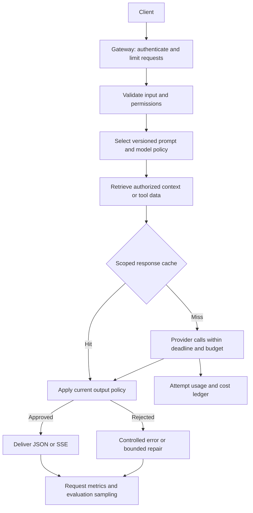
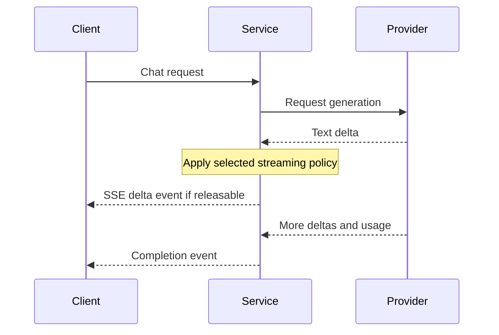

# Building a Production LLM Application

[Back to courses](../README.md) · [Evaluation](7-evaluation.md) · [Caching and Cost](8-caching-cost.md) · [Guardrails](9-guardrails.md)

## The Problem

A prototype sends a prompt and displays an answer. A service must also handle oversized requests, repeated questions, provider outages, malformed responses, unsafe tool calls, and an unexpected bill.

Think of moving from cooking one meal to running a restaurant. The recipe is still important, but reservations, inventory, hygiene, staffing, and recovery from a broken oven determine whether the restaurant works. Similarly, prompts are only one part of an LLM application.

This lesson connects prompt management, context, caching, validation, retries, accounting, and delivery. The central question is: **what happens at each boundary when the next component is slow, wrong, or unavailable?**

## The Concept

### Production Architecture



An **API gateway** handles entry-point concerns such as authentication, request size, and rate limits. **Authentication** identifies the caller; **authorization** determines which records and actions that caller may access. Obtain identity from verified credentials, never an arbitrary `user_id` supplied in a request body.

A cache hit still requires authorization and a current output policy. Include tenant, permission scope, model configuration, prompt version, and relevant data versions in cache keys. Changing a prompt without changing the cache namespace can invalidate an experiment.

### The Stack

| Component | Earlier course | Responsibility | Example implementation |
| --- | --- | --- | --- |
| API server | This capstone | Request validation, status codes, delivery | FastAPI and an ASGI server |
| Prompt registry | [Prompt Engineering](1-prompt-engineering.md) | Versioned instructions and settings | Immutable templates with recorded versions |
| Output schema | [Structured Outputs](2-structured-outputs.md) | Machine-readable contract | JSON Schema or typed validation |
| Retrieval | [Embeddings](3-embeddings.md), [RAG](5-rag-retrieval-augmented-generation.md) | Select permitted evidence | Vector index with metadata access filtering |
| Context assembly | [Context Engineering](4-context-engineering.md) | Fit evidence/history within a token budget | Trimming and retrieval policy |
| Tool service | [Function Calling](6-function-calling.md) | Execute authorized actions | Registry, schema checks, business rules |
| Evaluation | [Evaluation](7-evaluation.md) | Detect quality regressions | Labeled datasets and sampled reviews |
| Cache and accounting | [Caching and Cost](8-caching-cost.md) | Reuse work and track spend | Scoped cache and usage ledger |
| Guardrails | [Guardrails](9-guardrails.md) | Validate content and enforce boundaries | Input, output, and tool checks |
| Observability | This capstone | Explain behavior across components | Logs, metrics, distributed traces |

**ASGI** is the asynchronous interface between a Python web application and its server. **Async I/O** lets a task yield while waiting on network operations. It does not make CPU-heavy tokenization, embeddings, or validation free; move blocking work out of the event loop.

### Streaming and Time to First Token

**Time to first token (TTFT)** measures how long generation takes to start producing text. Also measure **time to first visible content**, which may include buffering and guardrail checks, and **total response latency**. Streaming can improve perceived responsiveness without reducing total generation time.



| Transport | Direction | Good fit | Tradeoff |
| --- | --- | --- | --- |
| Server-Sent Events (SSE) | Server to client | Text chat and progress events | Requires framing, proxy configuration, and disconnect handling |
| WebSocket | Both directions | Interactive audio and bidirectional sessions | More connection and state management |
| Job polling | Client asks for status | Long-running document or batch jobs | Extra requests and delayed updates |

SSE sends UTF-8 text events separated by a blank line. Encode payloads as JSON so newlines in model text do not corrupt framing. The browser's native `EventSource` opens a GET stream; use a streaming `fetch` client for a POST body or custom authorization headers. See the [SSE guide](https://developer.mozilla.org/en-US/docs/Web/API/Server-sent_events/Using_server-sent_events).

**Buffered delivery is different from live generation streaming.** If you wait for the complete answer, validate it, and then split it into chunks, the user still waits for generation before seeing the first chunk. This can be an intentional choice for full-response validation. You cannot retract sensitive text already sent to a client.

Set proxy idle timeouts and buffering behavior deliberately. Use heartbeats where appropriate, stop work on disconnect, and handle slow consumers with bounded buffers. Do not restart a failed stream invisibly after sending partial text: clients could receive duplicated or contradictory content.

### Error Handling: Three Layers

**Exponential backoff** increases delay between retries; **jitter** adds randomness so clients do not retry simultaneously. A **deadline** bounds the complete operation, including retries and fallback attempts, rather than granting each attempt a fresh unlimited budget.

| Failure | Retry policy | Safe fallback | Important constraint |
| --- | --- | --- | --- |
| Provider throttling | Respect retry guidance within deadline | Queue or reject excess traffic | Distinguish temporary throttling from exhausted quota |
| Transient connection/server failure | Bounded retry with jitter | Approved alternate model | Earlier attempts may still incur charges |
| Invalid credentials or request schema | Do not retry unchanged | Configuration or validation error | Repetition will not repair the request |
| Malformed model output | Limited repair if allowed | Structured failure | Do not return raw invalid output to a typed consumer |
| Required retrieval unavailable | Retry within dependency budget | State that evidence is unavailable | Do not invent an answer without required evidence |
| Optional cache unavailable | Bypass if budgets allow | Direct generation | Watch provider capacity and spend |
| Required guardrail unavailable | Withhold protected result | Controlled service error | Do not silently bypass a required check |
| Client disconnect | Cancel remaining work where supported | No further delivery | Reconcile any provider usage already incurred |

A **fallback chain** is an ordered set of approved alternatives. Each must meet the same privacy, tool, schema, and minimum-quality requirements. A cheaper or available model is not automatically an acceptable replacement.

An **idempotency key** identifies a logical operation so retries do not duplicate its effects. A model call retry and a money-transfer retry require different treatment: tool services must prevent duplicate side effects independently of the model.

### Observability: Logs, Traces, and Metrics

A **log** records an event. A **metric** aggregates measurements. A **trace** connects timed operations, called spans, across one request and its dependencies.

| Record | Useful fields | Avoid |
| --- | --- | --- |
| Request log | Request ID, authorized tenant reference, route, prompt/model/policy versions, status, latency | Raw private prompts by default |
| Provider attempt | Request ID, attempt number, model, usage, pricing version, outcome | Dropping charges for rejected answers |
| Trace spans | Admission, retrieval, cache, each provider call, validation, delivery | One opaque span hiding retry delays |
| Quality sample | Dataset/case ID, version, rubric outcome, reviewer information | Treating output length as accuracy |

| Metric | Definition | Illustrative objective, not a universal target |
| --- | --- | --- |
| Success availability | Successful eligible requests / eligible requests | 99.9% over a defined period |
| p50/p95/p99 latency | Median and tail end-to-end durations | p95 under 5 seconds for a selected chat workflow |
| First visible content | Time until client receives usable content | Under 1 second for an approved live-streaming route |
| Cache hit rate | Hits / eligible lookups | Monitor by route rather than force a minimum |
| Guardrail false positives | Benign cases incorrectly rejected / benign cases | Measure with labeled samples |
| Cost per successful task | Serving spend / acceptable completed tasks | Product-specific unit economics |
| Queue depth and saturation | Waiting work and used capacity | Alert before deadlines are routinely missed |

A **service-level objective (SLO)** is a target for a measured indicator over a defined window. A 99.9% request-success SLO allows a 0.1% error budget: 1,000 failures per million eligible requests. Define eligibility and failure semantics before counting.

### Prompt Versioning and Rollout

Keep prompt text, model settings, tool schemas, retrieval configuration, and policy versions together as a release artifact.

| Strategy | How it works | What to watch |
| --- | --- | --- |
| Offline evaluation | Compare candidates on a fixed dataset | Coverage, leakage, uncertainty, and regressions |
| Shadow traffic | Evaluate a candidate without showing its output | Additional spend and data exposure; disable side-effecting tools |
| Canary rollout | Serve a small, stable cohort first | Quality, errors, latency, and rollback criteria |
| A/B experiment | Compare randomized, stable cohorts | Sample size, assignment unit, cache separation, interference |
| Rollback | Restore an earlier compatible release | Prompt, model, cache, schema, and data-version compatibility |

Use a stable digest of tenant/user plus experiment ID. Python's built-in `hash()` is not a stable cross-process assignment mechanism. A 10% cohort is an allocation rule, not a guarantee of exactly 10% in a small sample.

Shadowing is not risk-free: it processes data and spends money. Prefer sampled shadow traffic, sanitized logs, and tool stubs. A staged rollout logs the selected variant; paired shadow comparisons deliberately run both and must account for both.

### Architecture Patterns and Scaling

| Application pattern | Context | Delivery | Key risk |
| --- | --- | --- | --- |
| Search assistant | Retrieved pages with evidence IDs | Answer plus citations | Untrusted content and unsupported claims |
| Coding assistant | Selected files and authorized repository context | Suggested diff | Executing or applying unreviewed changes |
| Support assistant | Knowledge base and scoped customer tools | Answer or proposed action | Cross-customer disclosure and duplicate operations |

These are illustrative patterns, not claims about specific companies' private architectures or traffic volumes.

Capacity depends on request rate, duration, token volume, provider quotas, and CPU/memory use—not daily users alone. Under stable conditions, **Little's law** relates average in-flight work to arrival rate × average time in the system. At 20 requests/second and 5 seconds per request, expect roughly 100 in-flight requests before adding headroom for variability.

| Pressure | Technique | Tradeoff |
| --- | --- | --- |
| More network-bound requests | Async clients, connection pooling, bounded concurrency | Provider quotas still limit throughput |
| Bursts | Admission control and bounded queues | Some work must wait or be rejected |
| Long-running tasks | Durable queue plus workers | Job state, retry, cancellation, and deduplication needed |
| Multiple replicas | Shared quotas/cache/ledger, stateless HTTP workers | Coordination and failure recovery |
| Heavy local inference/embeddings | Separate compute service or worker pool | Hardware scheduling and batching |
| Regional resilience | Tested regional/provider failover | Data residency, consistency, and cost |

Four web workers do not automatically deliver a particular concurrency or throughput level. Each worker has separate Python memory; four local rate limiters can multiply the intended allowance.

### Cost Projection

Use explicit hypothetical rates and workload assumptions:

| Variable | Value |
| --- | ---: |
| Daily active users | 10,000 |
| Queries per user per day | 5 |
| Input tokens per generated answer | 1,500 |
| Output tokens per generated answer | 400 |
| Input price per million tokens | $2.50 |
| Output price per million tokens | $10.00 |
| Safe response-cache hit rate | 35% |
| Days | 30 |

```text
Daily requests = 10,000 × 5 = 50,000
Daily generation calls = 50,000 × (1 − 0.35) = 32,500
Monthly input cost = 32,500 × 1,500 × 30 / 1,000,000 × $2.50 = $3,656.25
Monthly output cost = 32,500 × 400 × 30 / 1,000,000 × $10 = $3,900.00
Generation total = $7,556.25
Without response caching = $11,625.00
Generation savings = $4,068.75
```

This excludes retries, embeddings, cache storage, tools, networking, and evaluation. A provider prefix-cache hit still generates output, so it does not produce the same savings as skipping an entire call. Record the original provider usage even when an output guardrail replaces the answer with a short refusal.

### Deployment Review

| Area | Review question | Evidence |
| --- | --- | --- |
| Identity | Is caller identity verified and propagated? | Unauthorized requests and tenant-isolation tests |
| Secrets | Are credentials excluded from code and images? | Runtime secret injection and rotation procedure |
| Resource controls | Are input, output, queues, concurrency, and spend bounded? | Boundary and overload tests |
| Output safety | Can alternate endpoints or cache hits bypass policy? | Integration and streaming tests |
| Reliability | Are retries and fallbacks within a shared deadline? | Fault injection and cancellation tests |
| Observability | Can each request and charged attempt be explained? | Correlated trace and usage records |
| Quality | Does the release meet task-specific criteria? | Versioned evaluation results |
| Rollback | Can the earlier release be restored compatibly? | Rehearsed rollback |
| HTTP edge | Are TLS, CORS, body limits, and proxy settings configured? | Deployment configuration and endpoint tests |
| Capacity | Does the service meet its SLO under representative load? | Sustained, burst, slow-client, and recovery tests |

**Liveness** asks whether the process is running. **Readiness** asks whether it should receive traffic. Avoid restarting every replica simply because a shared model provider is temporarily unavailable. Keep detailed dependency and billing diagnostics behind operator authorization.

## Build It

Copy the following Python blocks into `production_demo.py` in order and run with Python 3.10+. Everything runs offline. The demo integrates prompt selection, scoped exact caching, bounded provider retry/fallback, output validation, usage accounting, and request logs. RAG, real tools, authentication, distributed quotas, and live token streaming remain integration work described below.

### Step 1: Configuration, Prompt Versions, and Accounting

```python
import asyncio
import hashlib
import json
import random
import time
import uuid
from collections import OrderedDict
from dataclasses import dataclass


# Fictional model identifiers and hypothetical per-million-token prices.
PRICES = {"demo-primary": (2.50, 10.00), "demo-backup": (3.00, 15.00)}
PROMPTS = {
    "v1": "Answer clearly using the supplied evidence.",
    "v2": "Answer concisely; state when evidence is insufficient.",
}


def select_version(tenant, user, experiment="prompt-test", percent=10):
    if not 0 <= percent <= 100:
        raise ValueError("Percentage must be between 0 and 100")
    digest = hashlib.sha256(json.dumps([tenant, user, experiment]).encode()).hexdigest()
    return "v2" if int(digest, 16) % 100 < percent else "v1"


@dataclass(frozen=True)
class Generation:
    text: str
    input_tokens: int
    output_tokens: int


def charge(model, generation):
    counts = (generation.input_tokens, generation.output_tokens)
    if any(type(n) is not int or n < 0 for n in counts):
        raise ValueError("Usage must contain nonnegative integer counts")
    input_rate, output_rate = PRICES[model]
    return (counts[0] * input_rate + counts[1] * output_rate) / 1_000_000
```

Real usage comes from the provider, not a word-count estimate. The simplified ledger below omits cache-write/tool fees and failed-call billing; a production adapter must reconcile partial usage and uncertain billing after interruptions.

### Step 2: Scoped Exact Cache

Hashing creates an exact lookup key. It does not produce a semantic embedding. Semantic response reuse needs real representations and an evaluated reuse policy, as explained in [course 8](8-caching-cost.md).

```python
class ExactCache:
    def __init__(self, capacity=100, ttl=300, clock=time.monotonic):
        if capacity < 1 or ttl <= 0:
            raise ValueError("Capacity and TTL must be positive")
        self.capacity, self.ttl, self.clock = capacity, ttl, clock
        self.entries = OrderedDict()

    def get(self, key):
        item = self.entries.get(key)
        if item is None:
            return None
        expires, value = item
        if expires <= self.clock():
            del self.entries[key]
            return None
        self.entries.move_to_end(key)
        return value

    def put(self, key, value):
        self.entries[key] = (self.clock() + self.ttl, value)
        self.entries.move_to_end(key)
        while len(self.entries) > self.capacity:
            self.entries.popitem(last=False)


def cache_key(tenant, user, scope_version, prompt, context, query, chain):
    data = [tenant, user, scope_version, prompt, context, query, chain, "policy-v1"]
    return hashlib.sha256(json.dumps(data, sort_keys=True).encode()).hexdigest()
```

Scope versions must come from trusted application state. In this demo the caller supplies them to illustrate the interface; no authentication takes place. Invalidate when permissions, data, prompts, or model settings change. Add single-flight request coalescing to avoid simultaneous identical misses making duplicate calls.

### Step 3: Simulated Provider and Bounded Retries

```python
class TransientError(Exception):
    pass


class FakeProvider:
    def __init__(self, fail_models=()):
        self.fail_models = set(fail_models)
        self.calls = []

    async def generate(self, model, prompt):
        self.calls.append(model)
        await asyncio.sleep(0)  # Yield to the event loop; no network call.
        if model in self.fail_models:
            raise TransientError("Simulated provider outage")
        return Generation("Simulated answer based on the supplied evidence.", 100, 20)


async def generate_with_fallback(provider, prompt, chain, attempts, usage_log,
                                 request_id, backoff=0.01):
    if attempts < 1 or not chain:
        raise ValueError("At least one model and attempt are required")
    for model in chain:
        for attempt in range(attempts):
            try:
                result = await provider.generate(model, prompt)
                # Record original usage before output filtering.
                usage_log.append({"request_id": request_id, "model": model,
                                  "attempt": attempt + 1, "outcome": "completed",
                                  "cost": charge(model, result)})
                return result.text, model
            except TransientError:
                usage_log.append({"request_id": request_id, "model": model,
                                  "attempt": attempt + 1, "outcome": "transient_error",
                                  "cost": None})
                if attempt + 1 < attempts:
                    await asyncio.sleep(backoff * (2 ** attempt) * random.uniform(0.5, 1.5))
    raise TransientError("All approved models unavailable")
```

The service applies one outer deadline to this entire operation, including semaphore waiting and backoff. Unknown costs remain `None`, not invented zeroes. The fake provider's failures are known not to incur real charges; real adapters must classify errors and record usage independently. Never retry a permanent validation/authentication error as though it were a transient outage.

### Step 4: Request Pipeline

The output check is deliberately narrow: it verifies nonempty bounded text and one fixture marker. It is not a content-safety classifier. Substitute the required policy checks from [course 9](9-guardrails.md).

```python
def output_allowed(text):
    return (isinstance(text, str) and bool(text.strip()) and len(text) <= 4000
            and "PRIVATE_FIXTURE" not in text)


class DemoService:
    def __init__(self, provider=None, timeout=1.0, concurrency=4):
        if timeout <= 0 or concurrency < 1:
            raise ValueError("Timeout and concurrency must be positive")
        self.provider = provider or FakeProvider()
        self.timeout = timeout
        self.slots = asyncio.Semaphore(concurrency)
        self.cache = ExactCache()
        self.usage_log, self.request_log = [], []
        self.chain = ["demo-primary", "demo-backup"]

    async def handle(self, tenant, user, query, context="", scope_version="v1"):
        request_id = str(uuid.uuid4())
        start = time.monotonic()
        event = {"request_id": request_id, "status": "error", "cache_hit": False}
        result = {"request_id": request_id, "status": "error", "answer": None}
        try:
            if (not tenant or not user or not isinstance(query, str)
                    or not query.strip() or len(query) > 5000
                    or not isinstance(context, str) or len(context) > 10000):
                result["status"] = "invalid"
                return result
            version = select_version(tenant, user)
            event["prompt_version"] = version
            prompt = json.dumps({"instructions": PROMPTS[version],
                                 "untrusted_context": context, "query": query})
            key = cache_key(tenant, user, scope_version, prompt, context, query, self.chain)
            cached = self.cache.get(key)
            if cached is not None:
                text, model = cached
                event["cache_hit"] = True
            else:
                async def generate():
                    async with self.slots:
                        return await generate_with_fallback(
                            self.provider, prompt, self.chain, 2,
                            self.usage_log, request_id)
                text, model = await asyncio.wait_for(generate(), timeout=self.timeout)
            event["model"] = model
            if not output_allowed(text):
                result["status"] = "blocked"
                return result
            if not event["cache_hit"]:
                self.cache.put(key, (text, model))
            result.update(status="ok", answer=text, cache_hit=event["cache_hit"],
                          model=model, prompt_version=version)
            return result
        except (asyncio.TimeoutError, TransientError):
            result["status"] = "unavailable"
            return result
        except asyncio.CancelledError:
            result["status"] = "cancelled"
            raise
        finally:
            event["status"] = result["status"]
            event["latency_ms"] = (time.monotonic() - start) * 1000
            self.request_log.append(event)

    def summary(self):
        known = [row["cost"] for row in self.usage_log if row["cost"] is not None]
        return {"requests": len(self.request_log),
                "cache_hits": sum(e["cache_hit"] for e in self.request_log),
                "known_generation_cost": sum(known),
                "attempts_with_unknown_cost": sum(
                    row["cost"] is None for row in self.usage_log)}
```

`asyncio.wait_for` cancels a timed-out awaitable and waits for cancellation to complete; it cannot forcibly stop blocking code or guarantee the remote provider stopped billing. Use cooperative async clients with their own connection/read timeouts. See [Python's task documentation](https://docs.python.org/3/library/asyncio-task.html#asyncio.wait_for).

This local semaphore bounds active generation, not the number of waiting HTTP requests. Add bounded admission queues and per-tenant quotas before serving traffic. The local lists and cache are neither durable nor shared across workers.

### Step 5: Delivery and Demo

The SSE helper sends only completed, validated answers. It demonstrates framing and preserves whitespace; its chunks are character slices, not model tokens.

```python
async def buffered_events(result, chunk_size=24):
    if chunk_size < 1:
        raise ValueError("Chunk size must be positive")
    if result["status"] != "ok":
        yield "event: error\ndata: " + json.dumps(
            {"request_id": result["request_id"], "status": result["status"]}) + "\n\n"
        return
    answer = result["answer"]
    for start in range(0, len(answer), chunk_size):
        yield "event: delta\ndata: " + json.dumps(
            {"text": answer[start:start + chunk_size]}) + "\n\n"
        await asyncio.sleep(0)
    yield "event: done\ndata: " + json.dumps(
        {"request_id": result["request_id"]}) + "\n\n"


async def run_demo():
    service = DemoService()
    first = await service.handle("tenant-a", "user-a", "Explain caching")
    second = await service.handle("tenant-a", "user-a", "Explain caching")
    other = await service.handle("tenant-b", "user-b", "Explain caching")
    assert first["status"] == "ok" and not first["cache_hit"]
    assert second["cache_hit"] and not other["cache_hit"]
    print(json.dumps(service.summary(), indent=2))
    async for event in buffered_events(second):
        print(event, end="")
    backup_service = DemoService(FakeProvider(fail_models={"demo-primary"}))
    recovered = await backup_service.handle("tenant-a", "user-a", "Explain retries")
    assert recovered["model"] == "demo-backup"
    print(json.dumps(backup_service.summary(), indent=2))


if __name__ == "__main__":
    asyncio.run(run_demo())
```

Expected first summary: **3 requests, 1 cache hit, $0.0009 known generation cost**. Each primary call uses the fixed fixture of 100 input and 20 output tokens, costing $0.00045. The fallback demonstration records two primary failures and one backup completion costing **$0.0006**. These are simulated accounting results, not measured quality or throughput.

## Use It

### FastAPI HTTP Adapter

Save this separate example as `production_app.py` beside `production_demo.py`. It requires FastAPI, Pydantic, and Uvicorn installed in an isolated environment. Pin tested versions for a deployable artifact. This adapter is intentionally closed to unauthenticated callers: trusted authentication middleware must set `request.state.principal` after verifying credentials.

```python
from fastapi import FastAPI, HTTPException, Request
from fastapi.responses import StreamingResponse
from pydantic import BaseModel, Field
from production_demo import DemoService, buffered_events

app = FastAPI(title="LLM Teaching Service")
service = DemoService()


class ChatRequest(BaseModel):
    query: str = Field(min_length=1, max_length=5000)
    stream: bool = False


@app.post("/v1/chat")
async def chat(body: ChatRequest, request: Request):
    principal = getattr(request.state, "principal", None)
    if principal is None:
        raise HTTPException(status_code=401, detail="Authentication required")
    result = await service.handle(principal["tenant_id"], principal["user_id"],
                                  body.query, scope_version=principal["scope_version"])
    if result["status"] != "ok":
        code = {"invalid": 422, "blocked": 403, "unavailable": 503}.get(
            result["status"], 500)
        raise HTTPException(status_code=code, detail={
            "request_id": result["request_id"], "status": result["status"]})
    if body.stream:
        return StreamingResponse(buffered_events(result),
                                 media_type="text/event-stream",
                                 headers={"Cache-Control": "no-cache"})
    return result


@app.get("/livez")
async def livez():
    return {"status": "alive"}
```

[FastAPI's `StreamingResponse`](https://fastapi.tiangolo.com/advanced/custom-response/#streamingresponse) accepts an iterator or async iterator for response delivery. Here generation completes before the iterator starts. This adapter does not implement live provider streaming, retrieval, readiness checks, authentication middleware, or operator endpoints; these are explicit extension points.

Map external errors to stable response codes without exposing credentials or provider stack traces. CORS is a browser access policy, not authentication. Protect cost/usage dashboards separately and add a readiness endpoint based on your deployment's required capabilities.

### Provider, Retrieval, and Tool Integration

Replace `FakeProvider` with a long-lived async client adapter. Preserve distinct system/user roles in the actual provider request; the demo's serialized object only makes inputs easy to inspect. Validate model eligibility, output limits, structured-output support, and usage reporting. Track every billable attempt, including failed repairs and outputs withheld by policy.

For RAG, filter sources by caller permissions before retrieval, attach evidence IDs and data versions, and assemble a bounded context. If a route requires evidence and none is available, return an explicit unavailable/insufficient-evidence result.

For tools, treat the model's arguments as a proposal. Validate the schema and permissions, enforce action limits, and use idempotency keys for side effects. Never execute shadow-evaluation tool calls against live mutable systems.

For true streaming, consume provider deltas inside the response iterator and define when each delta may be released. Preserve structured events for tool calls, completion, errors, and usage; do not assume every provider chunk contains plain text. Cancel upstream generation when the client disconnects, and record incomplete-request accounting.

### Container Packaging

An illustrative Dockerfile for the two Python files and a reviewed, pinned `requirements.txt`:

```dockerfile
FROM python:3.12-slim
WORKDIR /app
COPY requirements.txt .
RUN pip install --no-cache-dir -r requirements.txt
RUN useradd --create-home appuser
COPY --chown=appuser:appuser production_demo.py production_app.py ./
USER appuser
EXPOSE 8000
CMD ["uvicorn", "production_app:app", "--host", "0.0.0.0", "--port", "8000"]
```

For reproducible releases, pin the base image by a reviewed digest and use a dependency lock with hashes. Inject secrets at runtime. Configure TLS, request limits, health probes, and shutdown grace periods in deployment infrastructure. More replicas require shared quotas, persistent accounting, and a deliberate cache strategy; increasing workers alone does not provide those properties. This lesson does not build or deploy a container.

## Exercises

1. **RAG integration:** add 20 fixture documents with tenant permissions and version IDs. Retrieve relevant evidence, measure retrieval latency, and test that changing permissions invalidates reuse. Compare answer quality with and without evidence.
2. **Tool integration:** add a read-only lookup and a simulated side-effecting tool. Test schema errors, unauthorized access, repeated idempotency keys, and bounded tool loops.
3. **Cost enforcement:** reserve estimated spend before generation and reconcile actual usage. Include rejected outputs and retries. Simulate concurrent requests near a daily budget boundary; alerting alone must not be mistaken for enforcement.
4. **Rollback:** implement versioned configuration and a stable canary cohort. Define minimum sample sizes and quality/error thresholds, then simulate a bad release and verify cache separation after rollback.
5. **Tracing:** add spans for retrieval, cache, provider attempts, guardrails, and delivery. Produce one trace that explains a fallback, rather than only reporting total latency.
6. **Fault injection:** test provider timeout, unavailable retrieval, invalid schema, guardrail outage, and cancellation. Verify that required checks remain enforced and failures are not cached.
7. **Load testing:** vary arrival rate, response duration, cache hits, and slow clients. Report p50/p95/p99, saturation, errors, and cost. A few concurrent fake calls do not establish production capacity.
8. **Live streaming:** implement a provider fixture that yields deltas over time and fails midstream. Test framing, whitespace, disconnect cancellation, and the chosen output-validation policy.

## Quick Cheat Sheet

| Term | Crisp definition | Remember |
| --- | --- | --- |
| Gateway | Entry layer for identity, routing, and traffic controls | Caller identity must be verified |
| Prompt registry | Versioned prompt/configuration storage | Version what changes behavior |
| Exact cache | Reuse under an identical fully scoped request key | Hashes are not embeddings |
| SSE | HTTP event stream from server to client | Frame events; handle disconnects |
| TTFT | Time until the first generated token | Visible content may arrive later |
| Deadline | Time budget for the whole operation | Retries share the budget |
| Backoff and jitter | Increasing retry delay plus randomness | Retry only appropriate errors |
| Fallback | Approved alternate execution path | Preserve required quality and policy |
| Idempotency | Repeated logical operation has no duplicate effect | Enforce at side-effecting services |
| Trace/span | Request journey and one timed operation within it | Make retries visible |
| SLO | Target for an indicator over a defined window | Define numerator and denominator |
| Liveness/readiness | Process alive versus able to accept work | They answer different questions |
| Shadow mode | Evaluate without serving candidate output | Still costs money and processes data |
| Graceful degradation | Retain permitted useful behavior after a failure | Required controls stay required |

## Further Reading

- [Source lesson](https://github.com/rohitg00/ai-engineering-from-scratch/blob/main/phases/11-llm-engineering/13-production-app/docs/en.md) — original production-application capstone.
- [FastAPI documentation](https://fastapi.tiangolo.com/) — request validation, async handlers, and deployment.
- [Python asyncio tasks](https://docs.python.org/3/library/asyncio-task.html) — cancellation and timeout semantics.
- [SSE guide](https://developer.mozilla.org/en-US/docs/Web/API/Server-sent_events/Using_server-sent_events) — event formatting and browser behavior.
- [OpenTelemetry Python](https://opentelemetry.io/docs/languages/python/) — tracing and metrics instrumentation.
- [Evaluation course](7-evaluation.md) — quality assessment and release comparisons.
- [Caching and Cost course](8-caching-cost.md) — cache strategies, budgets, and cost metrics.
- [Guardrails course](9-guardrails.md) — content policy and action-boundary validation.

## Resource

Adapted from the MIT-licensed lesson; copyright © 2026 Rohit Ghumare. [Original license](../licenses/ai-engineering-from-scratch-LICENSE). This capstone includes a runnable offline service simulation and a separate HTTP integration example. It is a teaching foundation, not a deployed or load-certified production application.

| Field | Details |
| --- | --- |
| Origin | [AI Engineering from Scratch — source lesson](https://github.com/rohitg00/ai-engineering-from-scratch/blob/main/phases/11-llm-engineering/13-production-app/docs/en.md) |
| Author | Rohit Ghumare and contributors |
| Level | Intermediate to advanced — repository assessment |
| Best for | Connecting LLM components into a service, reasoning about failure modes, streaming, observability, deployment, and production system-design interviews |

## Attribution and Import Notes

Adapted on 2026-10-12 from the source linked above. Preserves the capstone's architecture, component mapping, streaming, failure handling, prompt experiments, scaling, cost projection, deployment review, async Python walkthrough, HTTP/container examples, and exercises. Local edits correct inconsistent pricing arithmetic, replace hash-based semantic matching with scoped exact caching, distinguish buffered delivery from live streaming, and preserve usage before output rejection. Unverified company architectures and universal capacity claims are replaced with illustrative patterns. The offline demo does not implement real model APIs, authentication, retrieval, tool execution, or distributed state; the HTTP/container examples are integration guidance, not deployment certification.

Source SHA-256: `b0a346e45927205a67e1db24f0d67e16adde62736840bd2ac923a5fc03cd6101`.
