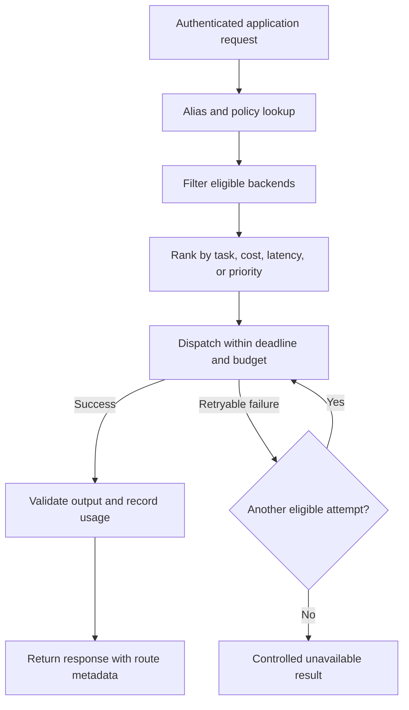

# LLM Routing Layer — LiteLLM, OpenRouter, and Portkey

[Back to courses](../README.md) · [Function Calling](6-function-calling.md) · [Caching and Cost](8-caching-cost.md) · [Production App](10-production-app.md)

## The Problem

Different workloads need different models. A short classification task may work well on a smaller model, while difficult synthesis may justify a stronger one. If each feature implements provider selection, retries, pricing, and credentials independently, behavior becomes difficult to control and audit.

A **routing gateway** is an intermediary that selects an eligible model/backend and forwards requests through a common interface. Think of a travel booking desk: it can choose among carriers, but every itinerary still has to meet the traveler's destination, timing, and eligibility requirements.

| Motivation | Example | What routing must preserve |
| --- | --- | --- |
| Cost | Send routine triage to a lower-cost model | Measured task-quality threshold |
| Availability | Switch after a provider outage | Data handling, schemas, and tool support |
| Latency | Use a faster route for live chat | Answer quality and output limits |
| Region policy | Restrict processing to approved locations | Contractual and technical controls across every fallback |
| Experimentation | Compare two model versions | Stable assignment and attributable outcomes |

A gateway centralizes integration work. It also becomes a critical dependency: operating its authentication, configuration, credentials, and availability is part of the application design.

## The Concept

### A Common API Does Not Mean Identical Behavior

Many gateways accept an OpenAI-style request shape, such as `/v1/chat/completions`, with `model` and `messages` fields, then translate it for different backends. **API compatibility** means support for a defined interface, not identical capabilities or outputs.

Check tool-call arguments and IDs, JSON/schema enforcement, image inputs, context limits, streaming events, usage fields, and unsupported parameters. Some combinations need provider-specific handling. Reject a missing required capability rather than silently dropping its parameter.



### Model Aliases

A **model alias** is an application-facing name, such as `support_fast` or `analysis_strong`, mapped to concrete backend configurations. It decouples application code from provider identifiers.

| Alias | Intended workload | Example routing rule |
| --- | --- | --- |
| `support_fast` | Routine support classification | Lowest evaluated cost among eligible models |
| `analysis_strong` | Complex evidence synthesis | Quality-first approved priority chain |
| `restricted_region` | Region-constrained requests | Filter locations before ranking or fallback |

Record both the alias/configuration version and the actual model/provider version. Updating an alias is a behavioral release: run evaluations, stage the change, separate cache entries, and keep rollback available. An alias is not a substitute for version pinning when reproducibility matters.

### Routing Strategies

| Strategy | Decision rule | Useful when | Failure mode to test |
| --- | --- | --- | --- |
| Static priority | Try eligible backends in configured order | Predictable primary/fallback behavior | Correlated outages or expensive cascades |
| Load balancing | Round-robin or weighted distribution | Spreading load across suitable deployments | Unequal quotas and capabilities |
| Cost-aware | Minimize cost subject to quality/latency requirements | High-volume routine work | Cheap answers causing more retries or failures |
| Latency-aware | Use recent timing statistics | Interactive services | Small samples and rapidly changing load |
| Task-aware | Classify workload and choose a route | Coding versus summarization | Misclassification and classifier overhead |
| Experiment-based | Stable randomized cohort assignment | Comparing candidate models | Cache contamination and uneven user groups |

First apply **hard constraints**: permission, data policy, context size, required tools, and output format. Then optimize **soft objectives** such as cost or latency among the remaining candidates. If no candidate is eligible, return an explicit failure instead of weakening policy.

### Fallback Chains and Retry Budgets

A **retry** repeats an attempt; a **fallback** changes the backend or model. They can be combined, but the total number of attempts, elapsed time, and spend must remain bounded.

```text
primary: demo-a/large
retryable outage -> eligible demo-b/large
retryable outage -> eligible demo-c/large
no eligible attempt left -> unavailable
```

| Failure | Appropriate handling |
| --- | --- |
| Transient server/network failure | Retry or fall back within the shared deadline |
| Temporary throttling | Respect retry guidance and remaining quota/deadline |
| Invalid request or credentials | Fix or reject; do not retry unchanged indefinitely |
| Output schema failure | Bounded repair or approved alternative; validate again |
| Required policy rejection | Apply policy; do not shop among models to bypass it |
| Partial stream already delivered | Report interruption or explicitly restart; avoid mixing answers |

Keep tool side effects idempotent independently of model retries. A gateway outage can also affect every provider route: an alternate model is not a complete disaster-recovery plan.

### Exact and Semantic Caching

**Exact caching** uses an exact request key, often a cryptographic digest such as SHA-256. **Semantic caching** compares meaning representations, typically embeddings, and applies a validated answer-reuse policy. Hashing prompt text does not provide semantic similarity.

Both require tenant/authorization scope, messages, model settings, prompt/tool/schema versions, and relevant data freshness. Near-identical wording can still require different answers, especially with negation, dates, or account IDs. Measure hit rate, incorrect reuse, freshness, and net costs; there is no universal savings percentage.

Provider prefix caching is a third mechanism: it reuses input computation while still generating a new answer. See [Caching and Cost](8-caching-cost.md) for worked examples.

### Gateway Guardrails

- **Input checks:** detect or redact selected personal information and enforce request limits before dispatch.
- **Output checks:** validate schemas and disclosure policies before releasing responses.
- **Action checks:** enforce authorization and business rules at the tool service.
- **Audit controls:** record policy versions and decisions without unnecessarily logging sensitive text.

A gateway's filter cannot replace application context or access control. The regex demo below only matches two numeric shapes; it does not implement comprehensive personal-information detection or prove that a response is safe.

### Per-Key Rate Limits and Budgets

A **virtual key** is a gateway-issued credential that can be scoped to a team, project, or application without exposing the provider's key. Authenticate it and resolve its permissions server-side.

| Control | Unit | Example |
| --- | --- | --- |
| Rate limit | Requests or tokens per interval | 60 requests/minute |
| Concurrency limit | Active requests | At most 10 simultaneous generations |
| Quota | Total usage in a period | 1 million tokens/day |
| Spend budget | Currency in a billing period | $100/month per project |

These are distinct controls. For a strict shared spend cap, atomically reserve estimated cost before dispatch and reconcile actual usage afterward. Account for all attempts, cached-input rates, reasoning/tool fees where applicable, and uncertain billing after interrupted calls. Rotating a key should not reset a team's accounting unintentionally.

### LiteLLM, OpenRouter, and Portkey

The following compares deployment approaches, not a claim that one product alone is suitable for production. Feature availability depends on version, plan, provider, and configuration. Check the linked documentation before selecting a service.

| Factor | LiteLLM | OpenRouter | Portkey |
| --- | --- | --- | --- |
| Typical approach | SDK and self-hostable gateway | Managed multi-provider API | Gateway with self-hosted and managed options |
| Operational decision | Own deployment, upgrades, and availability when self-hosting | Delegate gateway operation; review service terms | Choose deployment and management features required |
| Credential/billing review | Provider credentials plus virtual-key policies | Credits and applicable bring-your-own-key options | Provider-key integration and gateway/platform charges |
| Evaluation focus | Routing configuration, budgets, instrumentation, feature tiers | Provider selection, fallback, data handling, billing | Routing, observability, guardrail integration, deployment controls |
| Useful scenario | Team wants infrastructure and configuration control | Team wants a hosted common API | Team wants integrated gateway operations and policy controls |

[LiteLLM documentation](https://docs.litellm.ai/) describes its SDK, proxy, virtual keys, budgets, and request accounting. [OpenRouter documentation](https://openrouter.ai/docs/quickstart) provides its managed API entry point and links to provider routing and credential options. [Portkey documentation](https://portkey.ai/docs) describes its gateway and platform capabilities. Provider counts and headline performance are not interchangeable comparison metrics: check your exact models and required operations.

Self-hosting a gateway does not keep data local if its backend is a remote model service. Managed hosting does not automatically satisfy a particular organization's requirements. Trace prompts, responses, logs, backups, and fallback destinations through the entire path.

### Cost Attribution and Evaluation

For hypothetical per-million rates:

```text
attempt cost = (input tokens × input rate + output tokens × output rate) / 1,000,000
request cost = sum of all billable attempts + other attributable charges
cost per successful task = total serving cost / acceptable completed tasks
```

| Record or metric | Why it matters |
| --- | --- |
| Team/project, request ID, alias/config version | Attribute traffic and reproduce route decisions |
| Actual provider/model and attempt outcome | Explain which fallback served the request |
| Input/output/cached tokens and pricing version | Reconcile billing rather than assuming a fixed rate |
| Attempt latency and end-to-end latency | Expose fallback delay and gateway overhead |
| Fallback rate and error rate | Detect unstable primary routes |
| Quality and schema/tool success by task | Verify alternatives are adequate |
| Unknown-cost attempts | Avoid silently counting uncertain billing as zero |

Do not optimize only successful-call token prices. Router classification, failed attempts, extra tool steps, and lower task success can erase apparent savings.

### MCP Sampling and Model Routing

**MCP sampling** lets an MCP server request a model generation through the client. The client retains control of model selection and permissions; server-supplied model preferences are hints, not binding authorization. A client can use an LLM gateway as its backend while preserving those controls. See the [MCP sampling specification](https://modelcontextprotocol.io/specification/2025-11-25/client/sampling).

An MCP gateway that routes tool/server connections and an LLM gateway that routes inference are different responsibilities, even if one product offers both. Do not forward a sampling request to an arbitrary backend merely because it names that model. Reapply data, capability, budget, and user-approval policies.

## Build It: An Offline Routing Gateway

The upstream lesson references a companion `code/main.py`. Its adapted contents are included here so this course is self-contained. Copy this block into `routing_demo.py` and run with Python 3.10+. It uses only the standard library.

The example accepts a limited chat-style message structure in a Python function; it does not expose an HTTP endpoint or implement a complete compatible API. Routes are predefined eligible examples. There is one attempt per backend, a total attempt limit, pre-dispatch numeric-pattern redaction, and success-cost attribution. Network deadlines, team budgets, region/capability filtering, output guards, and streaming remain production extensions.

```python
from __future__ import annotations

import json
import re
import time
from dataclasses import dataclass, field


# cost per 1M tokens (input, output); fake rates for demo
PRICES = {
    "demo-a/large":           (5.0, 15.0),
    "demo-a/small":      (0.15, 0.60),
    "demo-b/large": (3.0, 15.0),
    "demo-b/small":  (0.80, 4.0),
    "demo-c/large":       (1.25, 5.0),
}

class TransientProviderError(Exception):
    """Only explicitly retryable simulated provider failures."""


OUTAGE: set[str] = set()


def provider_call(model: str, messages: list[dict]) -> dict:
    if model in OUTAGE:
        raise TransientProviderError(f"simulated 5xx from {model}")
    time.sleep(0.01)
    last = messages[-1]["content"]
    out_toks = max(20, len(last) // 3)
    return {
        "id": f"resp_{model.replace('/', '_')}",
        "model": model,
        "choices": [{"message": {"role": "assistant",
                                 "content": f"[{model}] echoed: {last[:60]}"}}],
        "usage": {"prompt_tokens": sum(max(1, len(m["content"]) // 4) for m in messages), "completion_tokens": out_toks},
    }


# aliases -> fallback chain
ROUTES = {
    "smart": ["demo-a/large", "demo-b/large", "demo-c/large"],
    "fast":  ["demo-a/small", "demo-b/small"],
}


PII_PATTERNS = [
    re.compile(r"\b\d{3}-\d{2}-\d{4}\b"),  # SSN-shaped text; not identity verification
    re.compile(r"\b\d{16}\b"),               # 16 digits; not validated as a card
]


def redact_pii(text: str) -> tuple[str, bool]:
    redacted = False
    for pat in PII_PATTERNS:
        if pat.search(text):
            text = pat.sub("[REDACTED]", text)
            redacted = True
    return text, redacted


@dataclass
class Invocation:
    alias: str
    chosen_model: str = ""
    attempts: list[str] = field(default_factory=list)
    input_tokens: int = 0
    output_tokens: int = 0
    cost_usd: float = 0.0
    unknown_cost_attempts: int = 0
    redacted: bool = False
    response: dict | None = None
    error: str | None = None


def route(alias: str, messages: list[dict], max_attempts: int = 3) -> Invocation:
    if alias not in ROUTES:
        raise ValueError("Unknown alias; direct model bypass is not allowed")
    if type(max_attempts) is not int or max_attempts < 1:
        raise ValueError("max_attempts must be a positive integer")
    if not isinstance(messages, list) or not messages:
        raise ValueError("A nonempty messages list is required")
    for message in messages:
        if (not isinstance(message, dict)
                or set(message) != {"role", "content"}
                or message["role"] not in ("system", "user", "assistant")
                or not isinstance(message["content"], str)):
            raise ValueError("Demo supports only role/content text messages")
    inv = Invocation(alias=alias)
    # redact pii on inputs
    new_msgs = []
    for m in messages:
        txt, r = redact_pii(m["content"])
        if r:
            inv.redacted = True
        new_msgs.append({"role": m["role"], "content": txt})
    chain = ROUTES[alias][:max_attempts]
    for model in chain:
        inv.attempts.append(model)
        try:
            resp = provider_call(model, new_msgs)
            inv.chosen_model = model
            inv.response = resp
            u = resp["usage"]
            inv.input_tokens = u["prompt_tokens"]
            inv.output_tokens = u["completion_tokens"]
            in_rate, out_rate = PRICES[model]
            inv.cost_usd = (u["prompt_tokens"] * in_rate +
                            u["completion_tokens"] * out_rate) / 1_000_000
            return inv
        except TransientProviderError:
            inv.unknown_cost_attempts += 1
            continue
    inv.error = "eligible route attempts exhausted"
    return inv


def demo() -> None:
    print("=" * 72)
    print("COURSE 11 - LLM ROUTING GATEWAY")
    print("=" * 72)

    print("\n--- scenario 1: smart route, primary available ---")
    inv = route("smart", [{"role": "user", "content": "explain MCP"}])
    print(f"  chosen  : {inv.chosen_model}")
    print(f"  attempts: {inv.attempts}")
    print(f"  tokens  : in={inv.input_tokens} out={inv.output_tokens}")
    print(f"  cost    : ${inv.cost_usd:.6f}")
    print(f"  reply   : {inv.response['choices'][0]['message']['content']}")

    print("\n--- scenario 2: demo-a/large OUTAGE -> falls back to demo-b/large ---")
    OUTAGE.add("demo-a/large")
    inv = route("smart", [{"role": "user", "content": "same request"}])
    print(f"  chosen  : {inv.chosen_model}")
    print(f"  attempts: {inv.attempts}")
    print(f"  cost    : ${inv.cost_usd:.6f}")
    OUTAGE.clear()

    print("\n--- scenario 3: PII in input gets redacted pre-dispatch ---")
    inv = route("fast", [{"role": "user",
                           "content": "contact me at SSN 123-45-6789 please"}])
    print(f"  redacted: {inv.redacted}")
    print(f"  reply   : {inv.response['choices'][0]['message']['content']}")

    print("\n--- scenario 4: all providers down ---")
    OUTAGE.update(ROUTES["fast"])
    inv = route("fast", [{"role": "user", "content": "help"}])
    print(f"  attempts: {inv.attempts}")
    print(f"  error   : {inv.error}")
    OUTAGE.clear()


if __name__ == "__main__":
    demo()
```

### Reading the Results

| Scenario | Expected behavior |
| --- | --- |
| Primary available | `smart` selects `demo-a/large` on its first attempt |
| Primary outage | `smart` records the failed attempt, then selects `demo-b/large` |
| Numeric personal-data fixture | `fast` forwards the replacement marker instead of the original number |
| All configured backends unavailable | Returns an error with no response object |

`cost_usd` is the known successful-generation cost, not the total reconciled bill. `unknown_cost_attempts` highlights failed attempts whose billing is not modeled. Token counts are rough simulation fixtures rather than provider measurements. The global outage set and synchronous function are teaching conveniences, not concurrent-service state management.

Unknown aliases are rejected rather than treated as unrestricted model IDs. Unsupported message fields are rejected rather than silently dropped. This example supports plain text only; extend the schema deliberately for tool calls and multimodal content.

## Use It in a Service

1. Authenticate the caller and load its allowed aliases, data policy, quotas, and budget.
2. Resolve a versioned alias configuration, filter eligible backends, and validate capabilities.
3. Apply required input checks and any scoped cache lookup.
4. Reserve resources; dispatch through a pooled client with a shared request deadline and bounded attempts.
5. Record usage for each attempt, validate the response, and return route metadata suitable for the client.
6. Reconcile spending, monitor quality and fallback rates, and roll back route changes when needed.

Keep provider credentials server-side. Use a timeout-aware asynchronous adapter for network calls; a synchronous function with a counter does not enforce a wall-clock deadline. Test failure classification and respect provider retry guidance. Add circuit breakers to avoid repeatedly sending traffic to a failing deployment, while allowing controlled recovery probes.

## Exercises

1. **Failover:** run all four demo scenarios. Add an attempt limit of one and verify the second provider is never invoked. Inject a non-transient error and confirm it is not silently swallowed.
2. **Exact caching:** add SHA-256 request keys containing tenant, full messages, alias/config version, and settings. Test cache hits, expiry, policy changes, and cross-tenant isolation. Label this exact caching.
3. **Semantic reuse:** separately add an embedding-based candidate lookup with labeled reusable/non-reusable pairs. Include negation and account-specific questions; measure incorrect reuse before serving cached answers.
4. **Task routing:** classify coding versus summarization requests, then compare quality, latency, classifier overhead, and cost per successful task against a fixed-model baseline.
5. **Team budgets:** implement atomic reservations and reconciliation across concurrent requests. Simulate uncertain provider charges and show how they affect remaining budget.
6. **Eligibility:** add region, context-limit, tool, and schema requirements to each backend. Test that failover never relaxes hard constraints and that an empty eligible set fails clearly.
7. **Gateway comparison:** use current official docs to compare the same deployment requirements across LiteLLM, OpenRouter, and Portkey. Record date, version/plan, and evidence; do not assume a feature is exclusive because another quickstart omits it.
8. **Streaming and tools:** simulate failure after partial output and after a proposed tool call. Define an explicit restart policy and enforce idempotency at the action service.

## Quick Cheat Sheet

| Term | Crisp definition | Remember |
| --- | --- | --- |
| Routing gateway | Shared layer selecting and invoking model backends | Common entry point, explicit policy |
| API compatibility | Support for a defined request/response interface | Same shape does not mean same capability |
| Model alias | Stable application name mapped to backend configuration | Version the mapping |
| Retry | Another attempt on a backend | Count time and spend |
| Fallback | Switch to an eligible alternative | Keep the same hard constraints |
| Exact cache | Reuse for an identical fully scoped key | SHA-256 matches bytes, not meaning |
| Semantic cache | Reuse after similarity and eligibility checks | Similar is not always interchangeable |
| Virtual key | Gateway credential scoped to a caller or workload | Resolve permissions server-side |
| Rate limit | Throughput restriction over time | Requests/tokens per interval |
| Spend budget | Currency allowance for a period | Reserve and reconcile across attempts |
| Circuit breaker | Temporarily stops calls to an unhealthy dependency | Probe recovery deliberately |
| MCP sampling | Server-requested generation mediated by the client | Model preferences do not override client control |

## Further Reading

- [Pinned lesson](https://github.com/rohitg00/ai-engineering-from-scratch/blob/fe27da89a34ac7a6fcd81659df9347f5eb31fc25/phases/13-tools-and-protocols/21-llm-routing-layer/docs/en.md) and [companion code](https://github.com/rohitg00/ai-engineering-from-scratch/blob/fe27da89a34ac7a6fcd81659df9347f5eb31fc25/phases/13-tools-and-protocols/21-llm-routing-layer/code/main.py).
- [LiteLLM documentation](https://docs.litellm.ai/) — SDK, proxy routing, keys, and budgets.
- [OpenRouter documentation](https://openrouter.ai/docs/quickstart) — managed API and routing options.
- [Portkey documentation](https://portkey.ai/docs) — gateway and platform integration.
- [MCP sampling specification](https://modelcontextprotocol.io/specification/2025-11-25/client/sampling) — model preferences and client controls.
- [Production App](10-production-app.md) — deadlines, accounting, streaming, and deployment.

## Resource

Adapted from the MIT-licensed lesson and its companion Python example; copyright © 2026 Rohit Ghumare. [Original license](../licenses/ai-engineering-from-scratch-LICENSE). The walkthrough uses provider stubs and fictional prices; it makes no API calls.

| Field | Details |
| --- | --- |
| Origin | [AI Engineering from Scratch — pinned source lesson](https://github.com/rohitg00/ai-engineering-from-scratch/blob/fe27da89a34ac7a6fcd81659df9347f5eb31fc25/phases/13-tools-and-protocols/21-llm-routing-layer/docs/en.md) |
| Author | Rohit Ghumare and contributors |
| Level | Intermediate — repository assessment |
| Best for | Choosing routing gateways, designing model aliases and failover policies, attributing usage, and explaining multi-provider tradeoffs in interviews |

## Attribution and Import Notes

Adapted on 2026-10-18 from upstream commit `fe27da89a34ac7a6fcd81659df9347f5eb31fc25`. Retains the lesson's routing motivations, aliases, failover, caching, guardrails, budgets, gateway comparison, cost attribution, MCP sampling, and exercises. Includes an adapted version of its companion Python example. Local changes qualify API compatibility and vendor claims, distinguish exact from semantic caching and rate limits from budgets, reject unknown aliases, bound attempts, classify transient failures explicitly, and identify unmodeled billing. No live gateway integration or paid provider call was tested.

Source lesson SHA-256: `76708436ac5d3bafa1bcf40c7a4a7cc6cdb7e89b9d75bd0694bc5cc81549549a`.

Companion code SHA-256: `bdea81aa42c4747bb3a142b364bca343e8ebc89334e5cadff4d8b3f751b1e836`.
