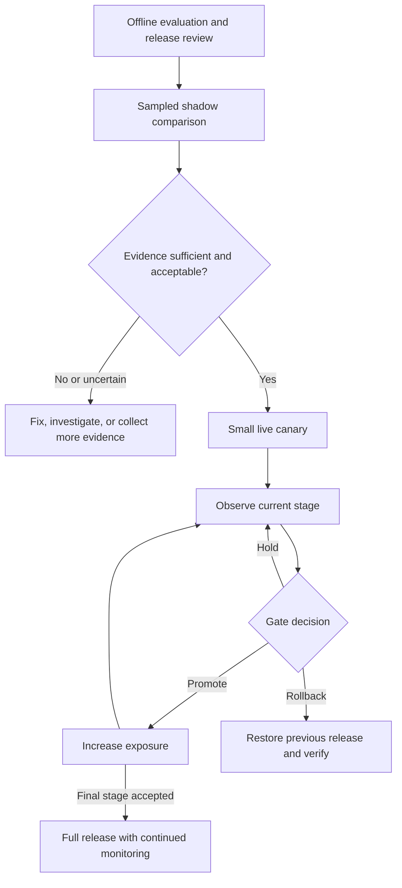

# Shadow Traffic, Canary Rollouts, and Progressive Deployment for LLMs

[Back to courses](../README.md) · [Evaluation](7-evaluation.md) · [Production App](10-production-app.md) · [LLM Routing Layer](11-llm-routing-layer.md)

## The Problem

Suppose a candidate model improves offline accuracy by three percentage points. After release, its cost rises 40%, negative feedback increases, and users report unexpected behavior. Offline quality alone did not establish that this was a good production change.

Think of introducing a new restaurant menu. First, the kitchen prepares samples without serving them. Next, a few tables try it. The restaurant expands the trial only if preparation time, cost, and customer experience remain acceptable. It also needs a practical way to return to the old menu.

**Progressive delivery** gradually exposes a change while checking predefined evidence. It reduces the number of users exposed before a problem is detected; it does not guarantee that every problem will be found.

## The Concept

### Shadow, Canary, and A/B Testing

| Method | Who receives the candidate output? | Main purpose | Important limitation |
| --- | --- | --- | --- |
| Shadow traffic | Evaluators/logging systems, not the requesting user | Compare behavior on realistic inputs | Extra cost, data processing, and resource contention |
| Canary rollout | A small, expanding user cohort | Limit exposure while checking operational and quality criteria | Small samples and delayed outcomes can hide regressions |
| A/B experiment | Stable randomized control and treatment cohorts | Estimate differences between alternatives | Needs an experiment design, adequate samples, and careful analysis |

These are complementary methods, not mandatory fixed stages. An A/B comparison can run within a controlled rollout. A stable canary does not, by itself, prove a quality improvement.



### Shadow Mode

Duplicate an approved sample of production requests to a candidate, keeping the production response on the user-facing path. Correlate baseline and candidate by request ID and release version.

| Record | What it reveals | How to handle it |
| --- | --- | --- |
| Candidate and baseline answers | Refusal changes, unsupported claims, format differences | Minimize sensitive retention; use controlled review |
| Token usage and cost | Longer answers, hidden retry costs, expensive routes | Include all attempts and shadow overhead |
| Latency and failures | Slow or unavailable candidate dependencies | Keep shadow queues and quotas isolated |
| Schema/tool proposals | Contract incompatibility or changed action selection | Stub side-effecting tools |
| Rubric scores | Potential task-quality changes | Calibrate graders and review representative samples |

Shadowing is not zero-impact: it spends money, sends data to additional processing paths, and can contend for shared quotas. Do not duplicate purchases, messages, or database writes. Disable candidate side effects or replay against isolated fixtures.

Shadow evaluations can measure quality with labels, rubrics, or human review. They cannot directly reveal how users would react to an answer they never saw, and mirrored histories may diverge from a genuinely candidate-driven conversation.

### Canary Progression

An illustrative ramp is **1% → 10% → 25% → 50% → 75% → 100%**. Choose stages based on risk and traffic volume rather than treating these percentages as universal requirements.

Assign a stable cohort at the appropriate unit—user, tenant, or conversation—so a session does not unexpectedly alternate between incompatible model behaviors. Log assignment and actual serving model separately, including fallback traffic. Separate caches by release configuration.

Each stage has three outcomes:

- **Promote:** required evidence is present and acceptance criteria are met.
- **Hold:** more data, delayed feedback, or investigation is needed.
- **Rollback:** a predefined unacceptable condition requires restoring the prior release.

Missing telemetry is not a passing result. Define emergency rules for security incidents and hard service-level breaches that do not wait for statistical significance.

### Five Metric Families

The source proposes five practical families. Thresholds below are illustrative policy choices, not validated industry defaults.

| Family | Measure | Example review/breach rule | Interpretation |
| --- | --- | --- | --- |
| Latency | p50/p95/p99, first visible output, timeout rate | Candidate p99 exceeds 1.5× control | Compare similar workloads; tail estimates need many samples |
| Cost | Total cost/request and cost/successful task | More than 20% above control | Include retries, tools, and cache effects |
| Errors and refusals | Transport errors, schema failures, justified/unjustified refusals | Error rate exceeds an agreed relative and absolute margin | A correct safety refusal is not an outage |
| Output length | Median, mean, tail token counts | Candidate tail exceeds a review threshold | Longer or shorter is not automatically worse |
| User feedback | Negative ratings, ticket rate, task completion | Negative-feedback rate exceeds an agreed margin | Delayed, sparse, and subject to response bias |

Do not collapse all errors and refusals into one metric. Report both feedback participation (`ratings / eligible responses`) and dissatisfaction among respondents (`negative ratings / ratings`). If participation changes, the dissatisfaction rate may reflect a different set of users.

**Worked gate example:** baseline cost is $0.020/request and the allowed increase is 20%. The limit is $0.024. A candidate at $0.025 is 25% more expensive and breaches that policy; $0.0236 is 18% more expensive and does not breach it. Neither result alone determines whether quality and reliability justify the release.

**Zero-baseline example:** two errors where the control had none cannot be evaluated meaningfully as “2× baseline.” Use absolute rate limits and uncertainty-aware comparisons instead of division by zero.

### Non-Determinism and Statistical Uncertainty

**Non-determinism** means repeated executions can produce different outputs. Sampling, provider changes, and hardware or batching details can contribute. Temperature zero is not a universal reproducibility guarantee.

There is no universal “15% variation ceiling.” Measure repeat-run variation on your own task, model configuration, dataset, and evaluation procedure. Distinguish generation variation from sampling uncertainty in user traffic and noise in an LLM-based judge.

Use repeated runs or paired comparisons where appropriate. Define a practically meaningful regression margin and how uncertainty affects promotion. A wide confidence interval should usually lead to holding for more evidence, not assuming equivalence. Repeatedly checking conventional significance tests can inflate false alarms; predefine analysis windows or use an appropriate sequential design.

### Sample Size and Observation Cadence

```text
Expected candidate requests = total requests/minute × candidate share × minutes
At 10 total requests/minute and 1% exposure:
  5-minute window  = 10 × 0.01 × 5  = 0.5 expected requests
  15-minute window = 10 × 0.01 × 15 = 1.5 expected requests
```

Those are expectations, not fractional actual requests. If the **candidate itself** receives 10 requests/minute, it gets 50–150 requests in those windows. State which traffic rate is being used.

A few dozen requests are not a dependable basis for a p99 estimate or rare-failure detection. With zero failures among 100 independent trials, the rough “rule of three” gives an upper 95% failure-rate bound near 3%, not proof of zero risk. Conversation-level correlation further reduces effective information.

A controller can inspect metrics every 5–15 minutes, but progression also needs minimum sample counts, minimum dwell time, coverage of relevant workloads, and mature outcome signals. A fixed timer alone is not an evaluation gate.

### Cost Is a Release Criterion

A quality improvement can be worthwhile despite higher cost, but the tradeoff should be explicit. Compare cost per acceptable completed task, not only per API call. Extra retries, longer outputs, reduced cache reuse, and increased tool usage can change the economics.

At 100,000 daily requests, a rise from $0.020 to $0.025 adds **$500/day**, or **$15,000 per 30-day month** at unchanged traffic. A 10% shadow sample at $0.025 adds **$250/day**, before other infrastructure costs. Shadowing the entire workload would add $2,500/day under the same assumptions.

### Rollback Is an Operational Capability

A **feature flag** or routing policy controls which release receives traffic. A **model pin** identifies a specific version: an artifact digest for self-hosted weights, or an available versioned provider identifier. Hosted providers may not expose immutable weight digests or guarantee indefinite availability of an old snapshot.

Rollback must restore the compatible bundle: model/route, prompts, tool schemas, retrieval settings, guardrail thresholds, and cache namespace. Restoring just the model may leave the regression in place.

| Runbook step | What to verify |
| --- | --- |
| Stop progression | Automation cannot immediately re-promote the candidate |
| Set candidate traffic to zero | Routing configuration propagates to all serving instances |
| Restore prior bundle | Prior model, settings, schemas, and policies remain available |
| Handle in-flight work | Drain/cancel according to policy; avoid duplicate tool effects |
| Isolate candidate state | Prevent incompatible cached responses or conversation state from leaking across releases |
| Verify recovery | Actual served-version metrics, errors, latency, and quality return to expected behavior |
| Preserve evidence | Retain privacy-appropriate incident metadata for investigation |

An example target is under 60 seconds from rollback decision to verified routing recovery. Measure it in drills; a fast flag write does not prove fast fleet-wide recovery. Rollback does not undo messages already sent, transactions already committed, or data migrations that are not backward compatible.

### Tooling

| Layer | Examples | Responsibility |
| --- | --- | --- |
| Progressive delivery controller | Argo Rollouts, Flagger | Coordinate traffic stages and analysis |
| Traffic routing | Ingress, gateway, service-mesh routing | Apply configured weights or cohort decisions |
| Model serving | Serving infrastructure selected for the model | Maintain candidate and baseline capacity |
| Feature flags | A flag service or versioned configuration store | Change application-level release policy |
| Metrics and evaluation | Telemetry backend plus quality pipeline | Supply decision evidence |

[Argo Rollouts analysis](https://argo-rollouts.readthedocs.io/en/stable/features/analysis/) supports analysis outcomes that can continue, abort, or pause a rollout. [Flagger](https://docs.flagger.app/) provides progressive-delivery automation. Your application still needs meaningful metrics, version attribution, and a tested rollback contract; infrastructure controllers cannot infer answer quality from HTTP success alone.

## Build It: Progressive Rollout Simulator

The upstream lesson references a small Python simulator. This adapted version adds explicit hold decisions for insufficient/missing data, keeps the source's five metric families, and separates a rollback recommendation from an actual deployment action.

Copy the block into `rollout_demo.py` and run with Python 3.10+. All values are synthetic. No models, traffic routers, or deployment APIs are called.

```python
from dataclasses import dataclass, replace
import math

STAGES = (0.01, 0.10, 0.25, 0.50, 0.75, 1.00)
BASELINE = {
    "latency_p99_ms": 900.0,
    "cost_per_request": 0.020,
    "error_rate": 0.020,
    "output_length_p99": 450.0,
    "negative_feedback_rate": 0.030,
}
MULTIPLIERS = {
    "latency_p99_ms": 1.5,
    "cost_per_request": 1.2,
    "error_rate": 2.0,
    "output_length_p99": 1.4,
    "negative_feedback_rate": 1.5,
}


@dataclass(frozen=True)
class Window:
    requests: int
    ratings: int
    minutes: float
    metrics: dict


@dataclass(frozen=True)
class Decision:
    action: str
    reasons: tuple


def check_gates(window, baseline=BASELINE, min_requests=1000,
                min_ratings=100, min_minutes=15):
    # These minimums are demonstration policy, not a power calculation.
    if (window.requests < min_requests or window.ratings < min_ratings
            or window.minutes < min_minutes):
        return Decision("hold", ("insufficient_observation",))
    for name in MULTIPLIERS:
        current, reference = window.metrics.get(name), baseline.get(name)
        if (not isinstance(current, (int, float))
                or not isinstance(reference, (int, float))
                or not math.isfinite(current) or not math.isfinite(reference)
                or current < 0 or reference <= 0):
            return Decision("hold", (f"invalid_or_missing:{name}",))
        if name.endswith("rate") and (current > 1 or reference > 1):
            return Decision("hold", (f"invalid_rate:{name}",))
    breaches = tuple(name for name, limit in MULTIPLIERS.items()
                     if window.metrics[name] > baseline[name] * limit)
    return Decision("rollback" if breaches else "promote", breaches)


def synthetic_window(stage, cost_multiplier=1.0, total_rpm=10000):
    minutes = 15
    requests = int(total_rpm * stage * minutes)
    metrics = dict(BASELINE)
    metrics["cost_per_request"] *= cost_multiplier
    # Assumes 10% rating participation solely to illustrate a sample gate.
    return Window(requests, int(requests * 0.10), minutes, metrics)


def rollout(cost_multiplier=1.0, total_rpm=10000):
    history = []
    for stage in STAGES:
        window = synthetic_window(stage, cost_multiplier, total_rpm)
        decision = check_gates(window)
        history.append((stage, decision))
        print(f"{stage:4.0%}: {decision.action}; {decision.reasons}")
        if decision.action != "promote":
            return history
    print("All synthetic stages accepted; no live traffic changed.")
    return history


def main():
    print("Clean candidate")
    clean = rollout()
    assert len(clean) == 6 and clean[-1][1].action == "promote"
    print("Candidate cost +25%")
    expensive = rollout(cost_multiplier=1.25)
    assert expensive[0][1] == Decision("rollback", ("cost_per_request",))
    print("Low-volume candidate")
    sparse = rollout(total_rpm=10)
    assert sparse[0][1].action == "hold"
    print("Missing feedback")
    window = synthetic_window(0.10)
    incomplete = dict(window.metrics)
    del incomplete["negative_feedback_rate"]
    assert check_gates(replace(window, metrics=incomplete)).action == "hold"


if __name__ == "__main__":
    main()
```

### Interpreting the Demo

| Scenario | Result | Why |
| --- | --- | --- |
| Clean candidate, high traffic | All six stages accepted | Fixed fixture values remain within thresholds |
| Cost +25% | Rollback recommendation at 1% | $0.025 exceeds the $0.024 limit |
| Ten total requests/minute | Hold at 1% | Insufficient observations |
| Missing feedback metric | Hold | Missing telemetry is not silently accepted |

The simulator evaluates hypothetical candidate metrics, not blended fleet averages. At 1% exposure, a 25% candidate cost increase raises the overall average by only 0.25% if everything else is identical; fleet aggregates can conceal a serious candidate regression.

This code does not estimate percentiles from observations, calculate confidence intervals, model delayed feedback, or perform a statistical test. The synthetic metrics are fixed so boundary behavior is reproducible. A zero baseline causes a hold; a real policy should define absolute thresholds rather than improvise a ratio. Emergency safety rules should be evaluated independently of these ordinary sample-count gates.

## Use It: A Release Runbook

Record the following before starting:

1. **Release bundle:** baseline and candidate identifiers, prompt/tool/schema versions, retrieval and policy configuration, cache namespace.
2. **Hypothesis and constraints:** expected quality gain, acceptable cost/latency changes, hard safety requirements, and eligible populations.
3. **Shadow plan:** sampling fraction, independent quota, disabled side effects, privacy-aware retention, and evaluation rubric.
4. **Canary plan:** stable assignment unit, stages, dwell times, sample requirements, telemetry freshness, and delayed-outcome policy.
5. **Decision rules:** promote/hold/rollback thresholds, absolute limits, uncertainty handling, and incident overrides.
6. **Recovery:** owner, stop-progression control, previous-version availability, in-flight handling, and verification queries.
7. **Post-release observation:** continued monitoring after 100%, including costs and feedback that arrive late.

For a candidate with a three-percentage-point offline gain and 18% higher cost, two defensible policies can reach different outcomes. A product with a validated quality benefit and a 20% cost allowance may proceed if all other gates pass. A product with a 10% allowance holds or rejects it. State the policy and evidence rather than declaring a universal shipping rule.

## Exercises

1. Run the simulator and verify the +25% cost case stops at the first stage with adequate evidence. Change the cost multiplier to 1.20 and explain the strict `>` boundary.
2. Add independent absolute error limits for a zero-error baseline. Test missing values, NaN, and invalid rates.
3. Calculate candidate sample counts at 1%, 10%, and 25% for both 10 and 1,000 total requests/minute. Identify where the 15-minute window is insufficient.
4. Design a shadow alert for a 40% cost increase. Include minimum samples, all-attempt accounting, and separate shadow-budget protection.
5. Replace synthetic metrics with recorded observations. Compute latency percentiles and uncertainty for error rates; keep a hold state when the result is inconclusive.
6. If repeated evaluation varies by about seven percentage points, design a repeated/paired evaluation rather than choosing an arbitrary multiplier. Explain what data would justify a non-regression claim.
7. Rehearse a rollback target under 60 seconds. Measure configuration propagation, in-flight behavior, cache effects, and served-version recovery separately.
8. Add delayed user feedback and stable tenant cohorts. Show how a seemingly clean short window can be misleading and how a candidate-driven conversation differs from a mirrored one.

## Quick Cheat Sheet

| Term | Crisp definition | Remember |
| --- | --- | --- |
| Shadow traffic | Candidate processes mirrored requests without serving its answer to users | No candidate answer exposure; still cost and risk |
| Canary | Limited live exposure before wider release | Limit exposure while gathering evidence |
| Progressive delivery | Staged release controlled by observations | Promote, hold, or roll back |
| Gate | Predefined acceptance or rejection condition | Missing data is not a pass |
| A/B test | Randomized comparison of alternatives | Stable cohorts and analysis plan |
| Non-determinism | Repeated execution can differ | Measure variation; no universal ceiling |
| Dwell time | Time spent observing a stage | A timer does not ensure enough evidence |
| Feature flag | Runtime control selecting behavior | Verify propagation, not just the write |
| Model pin | Reference to a specific model version/artifact | Know the provider's version guarantees |
| Rollback | Restore a prior compatible release | Does not undo completed side effects |
| p99 latency | Duration at or below which 99% of observed requests fall | Sparse samples give unstable tails |

## Further Reading

- [Pinned source lesson](https://github.com/rohitg00/ai-engineering-from-scratch/blob/fe27da89a34ac7a6fcd81659df9347f5eb31fc25/phases/17-infrastructure-and-production/20-shadow-canary-progressive/docs/en.md) and [companion simulator](https://github.com/rohitg00/ai-engineering-from-scratch/blob/fe27da89a34ac7a6fcd81659df9347f5eb31fc25/phases/17-infrastructure-and-production/20-shadow-canary-progressive/code/main.py).
- [Argo Rollouts analysis](https://argo-rollouts.readthedocs.io/en/stable/features/analysis/) — success, failure, and inconclusive rollout analysis.
- [Flagger documentation](https://docs.flagger.app/) — progressive-delivery automation.
- [Evaluation](7-evaluation.md) — quality datasets, comparisons, and uncertainty.
- [Production App](10-production-app.md) — service observability and versioned release design.
- [LLM Routing Layer](11-llm-routing-layer.md) — aliases, policies, and fallback attribution.

## Resource

Adapted from the MIT-licensed lesson and companion simulator; copyright © 2026 Rohit Ghumare. [Original license](../licenses/ai-engineering-from-scratch-LICENSE). The Python example uses synthetic metrics and makes no infrastructure changes.

| Field | Details |
| --- | --- |
| Origin | [AI Engineering from Scratch — pinned source lesson](https://github.com/rohitg00/ai-engineering-from-scratch/blob/fe27da89a34ac7a6fcd81659df9347f5eb31fc25/phases/17-infrastructure-and-production/20-shadow-canary-progressive/docs/en.md) |
| Author | Rohit Ghumare and contributors |
| Level | Intermediate to advanced — repository assessment |
| Best for | Planning model and prompt releases, defining rollout gates, interpreting noisy metrics, and rehearsing rollback for production interviews |

## Attribution and Import Notes

Adapted on 2026-10-18 from upstream commit `fe27da89a34ac7a6fcd81659df9347f5eb31fc25`. Retains shadow comparisons, staged canaries, five metric families, cost gates, rollback, tooling, simulator concepts, and exercises. Local changes qualify shadow risks, remove the unsupported universal variance ceiling, correct traffic/sample arithmetic, distinguish error and refusal signals, add insufficient-data holds, and make rollback recommendations explicitly simulated. No live rollout or infrastructure integration was performed.

Source lesson SHA-256: `7f172d6f18a66561b84a773fe9ab9fc800c2cb30af597d8c740ceff0ede09dea`.

Companion code SHA-256: `45f745d8d3e99b4675ce2451decbb16ff68de2b5ee5608391306992a55b39950`.
