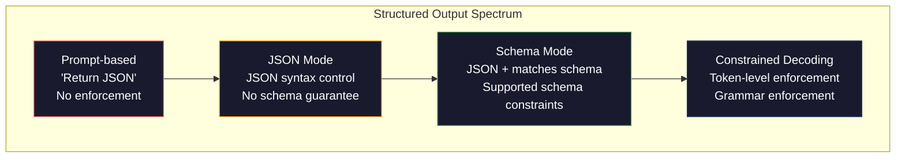
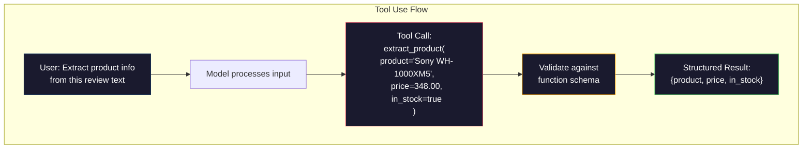
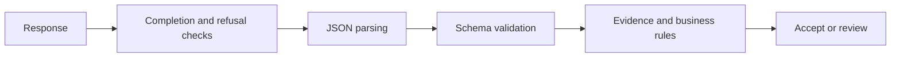

# Structured Outputs: JSON, Schema Validation, and Constrained Decoding

[Back to courses](../README.md) · [Prompt Engineering](1-prompt-engineering.md)

## The Problem

You ask an LLM: "Extract the product name, price, and availability from this text." It responds:

```
The product is the Sony WH-1000XM5 headphones, which cost $348.00 and are currently in stock.
```

That is a perfectly correct answer. It is also completely useless to your application. Your inventory system needs `{"product": "Sony WH-1000XM5", "price": 348.00, "in_stock": true}`. You need a JSON object with specific keys, specific types, and specific value constraints. You do not need a sentence.

The naive solution: add "Respond in JSON" to your prompt. This may work on easy examples, but the model sometimes wraps the JSON in markdown code fences, or adds a preamble like "Here's the JSON:", or produces syntactically invalid JSON because it closed a bracket early. Your JSON parser crashes. Your pipeline breaks. You add try/except and a retry loop. The retry sometimes produces different data. Now you have a consistency problem on top of a parsing problem.

Prompting alone cannot enforce a grammar. During decoding (choosing successive tokens), an unconstrained model can select text that breaks JSON syntax. After `{"price":`, JSON syntax permits whitespace followed by a string, number, boolean, null, array, or object; the **schema** further restricts which value types are appropriate. Tokens can contain several characters, so a real constrained decoder must track both grammar state and tokenizer behavior.

## The Concept

### The Structured Output Spectrum

Distinguish the interface from its implementation: schema mode can use constrained decoding internally. These are related techniques, not four independent reliability tiers.



**Prompt-based** ("Respond in valid JSON"): no enforcement. The model usually complies but sometimes does not. Failure mode: markdown fences, preamble text, truncated output, wrong structure.

**JSON mode:** constrains output to JSON syntax, without enforcing your application's schema. Completion status still matters: a truncated response may be unusable.

**Schema mode:** supplies a JSON Schema to a supported structured-output interface. Check its supported schema subset and handle refusals, incomplete responses, and API failures. Requiring a tool call does not by itself enable strict argument validation. See the [OpenAI structured-output guide](https://developers.openai.com/api/docs/guides/structured-outputs) and [Claude structured-output guide](https://platform.claude.com/docs/en/build-with-claude/structured-outputs).

**Constrained decoding:** masks disallowed next tokens according to a grammar or supported schema. It constrains form, not truth: a correctly typed price can still be invented.

| Approach | What it controls | What still needs checking | Good fit |
| --- | --- | --- | --- |
| Prompt only | Instructions and examples | Syntax, types, missing fields, correctness | Prototypes and unsupported endpoints |
| JSON mode | JSON syntax for a completed response | Schema and factual accuracy | Flexible JSON structures |
| Strict schema output | Supported structural constraints | Completion, refusal, business rules, evidence | Typed extraction and application responses |
| Strict tool arguments | Supported argument schema | Tool selection, authorization, execution results | Calling application functions |
| Local constrained decoder | Grammar during token generation | Grammar coverage, completion, semantic accuracy | Self-hosted generation |

Think of a schema as a form with labeled boxes. It can ensure that the price box contains a number; it cannot prove that the number was copied from the receipt.

### JSON Schema: The Contract Language

JSON Schema is how you tell the model (or validation layer) what shape the output must have. Many structured-output interfaces use it, often supporting only a subset.

```json
{
  "type": "object",
  "properties": {
    "product": { "type": "string" },
    "price": { "type": "number", "minimum": 0 },
    "in_stock": { "type": "boolean" },
    "categories": {
      "type": "array",
      "items": { "type": "string" }
    }
  },
  "required": ["product", "price", "in_stock"]
}
```

This schema says: the output must be an object with a string `product`, a non-negative number `price`, a boolean `in_stock`, and an optional array of string `categories`. Any output that does not match gets rejected.

Schemas handle the hard cases: nested objects, arrays with typed items, enums (constrain a string to specific values), pattern matching (regex on strings), and combinators (oneOf, anyOf, allOf for polymorphic outputs).

### The Pydantic Pattern

In Python, you can avoid writing JSON Schema by hand. You define a Pydantic model and it generates the schema for you.

```python
from pydantic import BaseModel, ConfigDict, Field

class Product(BaseModel):
    model_config = ConfigDict(extra="forbid")
    product: str
    price: float = Field(ge=0)
    in_stock: bool
    categories: list[str] = Field(default_factory=list)
```

This Pydantic v2 model adds a non-negative price constraint and forbids extra fields. Use `Product.model_json_schema()` to inspect its schema and `Product.model_validate_json(raw)` to parse and validate a response. Pydantic may coerce types by default; use strict validation when coercion is inappropriate. Provider schema subsets may require adapting optional fields. Instructor can add bounded validation retries. The Build It walkthrough below uses only the standard library; this standalone example requires Pydantic v2.

### Function Calling / Tool Use

An alternative interface for the same problem. Instead of asking the model to produce JSON directly, you define "tools" (functions) with typed parameters. The model outputs a function call with structured arguments. OpenAI calls this "function calling." Anthropic calls it "tool use." The result is the same: structured data.



Tool use is preferred when the model needs to choose which function to call, not just fill in parameters. If you have 10 different extraction schemas and the model must pick the right one based on the input, tool use gives you both the schema selection and the structured output.

### Common Failure Modes

Even with schema enforcement, structured outputs can fail in subtle ways.

**Hallucinated values**: the output matches the schema but contains invented data. The model produces `{"price": 299.99}` when the text says $348. Schema validation cannot catch this -- the type is correct, the value is wrong.

**Enum confusion**: you constrain a field to `["in_stock", "out_of_stock", "preorder"]`. The model outputs `"available"` -- semantically correct, but not in the allowed set. Good constrained decoding prevents this. Prompt-based approaches do not.

**Nested object depth**: deeply nested schemas are harder to inspect and may exceed provider nesting limits. Measure extraction quality rather than assuming a universal four-level threshold.

**Array length**: the model may produce too many or too few items in an array. Schemas support `minItems` and `maxItems` but not all providers enforce them at the decoding level.

**Optional field omission**: the model omits fields that are technically optional but semantically important for your use case. Set them as required in the schema even if the data is sometimes missing -- allow `null` in the field type and require the key, so missing evidence can be represented explicitly. Do not substitute zero for an unknown price or false for unknown availability.



## Build It

Copy the five Python blocks below into one file in order and run it with Python 3.10+. No API key, model download, or third-party package is needed. Responses are fixed fixtures, not model measurements.

### Step 1: JSON Schema Validator

Build a small validator to learn recursive checks. It supports only the keywords shown below, not the full JSON Schema specification: no references, combinators, nullable unions, or string patterns. Use a maintained JSON Schema validator or Pydantic for production; unsupported keywords in this teaching implementation are not enforced.

```python
import json
import math

def validate_schema(data, schema):
    errors = []
    _validate(data, schema, "", errors)
    return errors

def _validate(data, schema, path, errors):
    schema_type = schema.get("type")

    if schema_type == "object":
        if not isinstance(data, dict):
            errors.append(f"{path}: expected object, got {type(data).__name__}")
            return
        for key in schema.get("required", []):
            if key not in data:
                errors.append(f"{path}.{key}: required field missing")
        properties = schema.get("properties", {})
        for key, value in data.items():
            if key in properties:
                _validate(value, properties[key], f"{path}.{key}", errors)
            elif schema.get("additionalProperties") is False:
                errors.append(f"{path}.{key}: extra field not allowed")

    elif schema_type == "array":
        if not isinstance(data, list):
            errors.append(f"{path}: expected array, got {type(data).__name__}")
            return
        min_items = schema.get("minItems", 0)
        max_items = schema.get("maxItems", float("inf"))
        if len(data) < min_items:
            errors.append(f"{path}: array has {len(data)} items, minimum is {min_items}")
        if len(data) > max_items:
            errors.append(f"{path}: array has {len(data)} items, maximum is {max_items}")
        items_schema = schema.get("items", {})
        for i, item in enumerate(data):
            _validate(item, items_schema, f"{path}[{i}]", errors)

    elif schema_type == "string":
        if not isinstance(data, str):
            errors.append(f"{path}: expected string, got {type(data).__name__}")
            return
        enum_values = schema.get("enum")
        if enum_values and data not in enum_values:
            errors.append(f"{path}: '{data}' not in allowed values {enum_values}")

    elif schema_type == "number":
        if isinstance(data, bool) or not isinstance(data, (int, float)) or not math.isfinite(data):
            errors.append(f"{path}: expected number, got {type(data).__name__}")
            return
        minimum = schema.get("minimum")
        maximum = schema.get("maximum")
        if minimum is not None and data < minimum:
            errors.append(f"{path}: {data} is less than minimum {minimum}")
        if maximum is not None and data > maximum:
            errors.append(f"{path}: {data} is greater than maximum {maximum}")

    elif schema_type == "boolean":
        if not isinstance(data, bool):
            errors.append(f"{path}: expected boolean, got {type(data).__name__}")

    elif schema_type == "integer":
        if not isinstance(data, int) or isinstance(data, bool):
            errors.append(f"{path}: expected integer, got {type(data).__name__}")
```

### Step 2: Pydantic-Style Model to Schema

Build a minimal field-description-to-schema converter. This illustrates one part of what Pydantic provides; it is not Pydantic and does not implement defaults, coercion, or full validation.

```python
class SchemaField:
    def __init__(self, field_type, required=True, default=None, enum=None, minimum=None, maximum=None):
        self.field_type = field_type
        self.required = required
        self.default = default
        self.enum = enum
        self.minimum = minimum
        self.maximum = maximum

def python_type_to_schema(field):
    type_map = {
        str: "string",
        int: "integer",
        float: "number",
        bool: "boolean",
    }

    schema = {}

    if isinstance(field.field_type, dict):
        schema = dict(field.field_type)
    elif field.field_type in type_map:
        schema["type"] = type_map[field.field_type]
    elif field.field_type == list:
        schema["type"] = "array"
        schema["items"] = {"type": "string"}

    if field.enum:
        schema["enum"] = field.enum
    if field.minimum is not None:
        schema["minimum"] = field.minimum
    if field.maximum is not None:
        schema["maximum"] = field.maximum

    return schema

def model_to_schema(name, fields):
    properties = {}
    required = []

    for field_name, field in fields.items():
        properties[field_name] = python_type_to_schema(field)
        if field.required:
            required.append(field_name)

    return {
        "type": "object",
        "properties": properties,
        "required": required,
    }
```

### Step 3: Constrained Token Filter

Inspect illustrative character categories after a few partial JSON strings. This upstream sketch is **not a valid constrained decoder**: it ignores the schema argument, does not track nesting or escaped strings, and has no tokenizer. Its suggestions can be wrong; do not use it to constrain generation. A real implementation needs a parser state and token-aware grammar transitions.

```python
def next_valid_tokens(partial_json, schema):
    stripped = partial_json.strip()

    if not stripped:
        return ["{"]

    try:
        json.loads(stripped)
        return ["<EOS>"]
    except json.JSONDecodeError:
        pass

    last_char = stripped[-1] if stripped else ""

    if last_char == "{":
        return ['"', "}"]
    elif last_char == '"':
        return ["a-z", '"']
    elif last_char == ":":
        return [" ", '"', "0-9", "true", "false", "null", "[", "{"]
    elif last_char == ",":
        return [" ", '"', "{", "["]
    elif last_char in "0123456789":
        return ["0-9", ".", ",", "}", "]"]
    elif last_char == "}":
        return [",", "}", "]", "<EOS>"]
    elif last_char == "]":
        return [",", "}", "<EOS>"]
    elif last_char == "[":
        return ['"', "0-9", "true", "false", "null", "{", "[", "]"]
    else:
        return ["any"]

def demonstrate_constrained_decoding():
    partial_states = [
        '',
        '{',
        '{"product"',
        '{"product":',
        '{"product": "Sony"',
        '{"product": "Sony",',
        '{"product": "Sony", "price":',
        '{"product": "Sony", "price": 348',
        '{"product": "Sony", "price": 348}',
    ]

    print(f"{'Partial JSON':<45} {'Illustrative categories (not enforced)'}")
    print("-" * 80)
    for state in partial_states:
        valid = next_valid_tokens(state, {})
        display = state if state else "(empty)"
        print(f"{display:<45} {valid}")
```

### Step 4: Extraction Pipeline

Combine everything into an extraction pipeline: define a schema, simulate an LLM producing structured output, validate the output, and handle retries.

```python
def simulate_llm_extraction(text, schema, attempt=0):
    if "headphones" in text.lower() or "sony" in text.lower():
        if attempt == 0:
            return '{"product": "Sony WH-1000XM5", "price": "unknown", "in_stock": true, "categories": ["audio", "headphones"]}'
        return '{"product": "Sony WH-1000XM5", "price": 348.00, "in_stock": true}'

    if "laptop" in text.lower():
        return '{"product": "MacBook Pro 16", "price": 2499.00, "in_stock": false, "categories": ["computers"]}'

    return '{}'  # Missing evidence: reject rather than invent field values.

def extract_with_retry(text, schema, max_attempts=3):
    if max_attempts < 1:
        raise ValueError("max_attempts must be at least 1")
    for attempt in range(max_attempts):
        raw = simulate_llm_extraction(text, schema, attempt)

        try:
            data = json.loads(raw)
        except json.JSONDecodeError as e:
            print(f"  Attempt {attempt + 1}: JSON parse error -- {e}")
            continue

        errors = validate_schema(data, schema)
        if not errors:
            return data

        print(f"  Attempt {attempt + 1}: Schema validation errors -- {errors}")

    return None

product_schema = {
    "type": "object",
    "properties": {
        "product": {"type": "string"},
        "price": {"type": "number", "minimum": 0},
        "in_stock": {"type": "boolean"},
        "categories": {"type": "array", "items": {"type": "string"}},
    },
    "required": ["product", "price", "in_stock"],
}
```

The first headphone fixture deliberately fails validation; the second succeeds. This demonstrates retry control flow, not model self-correction. A real adapter should send concise validation feedback, bound retries by cost and deadline, and handle rate limits separately. Never treat missing evidence as something retries must invent.

### Step 5: Run the Full Pipeline

```python
def run_demo():
    print("=" * 60)
    print("  Structured Output Pipeline Demo")
    print("=" * 60)

    print("\n--- Schema Definition ---")
    product_fields = {
        "product": SchemaField(str),
        "price": SchemaField(float, minimum=0),
        "in_stock": SchemaField(bool),
        "categories": SchemaField(list, required=False),
    }
    generated_schema = model_to_schema("Product", product_fields)
    print(json.dumps(generated_schema, indent=2))

    print("\n--- Schema Validation ---")
    test_cases = [
        ({"product": "Test", "price": 10.0, "in_stock": True}, "Valid object"),
        ({"product": "Test", "price": -5.0, "in_stock": True}, "Negative price"),
        ({"product": "Test", "in_stock": True}, "Missing price"),
        ({"product": "Test", "price": "ten", "in_stock": True}, "String as price"),
        ("not an object", "String instead of object"),
    ]

    for data, label in test_cases:
        errors = validate_schema(data, product_schema)
        status = "PASS" if not errors else f"FAIL: {errors}"
        print(f"  {label}: {status}")

    print("\n--- Constrained Decoding Simulation ---")
    demonstrate_constrained_decoding()

    print("\n--- Extraction Pipeline ---")
    texts = [
        "The Sony WH-1000XM5 headphones are priced at $348 and currently available.",
        "The new MacBook Pro 16-inch laptop costs $2499 but is sold out.",
        "This is a random sentence with no product info.",
    ]

    for text in texts:
        print(f"\n  Input: {text[:60]}...")
        result = extract_with_retry(text, product_schema)
        if result:
            print(f"  Output: {json.dumps(result)}")
        else:
            print(f"  Output: FAILED after retries")
```

```python
run_demo()
```

The extra invocation above runs the five-block walkthrough. Expect the valid object to pass, malformed cases to fail, the headphone extraction to succeed on its second attempt, and text without product evidence to exhaust its attempts.

## Use It

The following commented examples illustrate SDK integration and are separate from the offline walkthrough. They require the relevant packages, credentials, and a currently available model supporting the chosen feature. They were not run against live APIs.

### OpenAI Structured Outputs

```python
# from openai import OpenAI
# from pydantic import BaseModel
#
# client = OpenAI()
#
# class Product(BaseModel):
#     product: str
#     price: float
#     in_stock: bool
#
# response = client.chat.completions.parse(
#     model="gpt-5-mini",
#     messages=[
#         {"role": "system", "content": "Extract product information."},
#         {"role": "user", "content": "Sony WH-1000XM5, $348, in stock"},
#     ],
#     response_format=Product,
# )
#
# product = response.choices[0].message.parsed
# print(product.product, product.price, product.in_stock)
```

Handle refusals and incomplete responses before reading `message.parsed`, and check it is not `None`. Validate business rules and source evidence after parsing: schema constraints do not establish factual accuracy. See the [official guide](https://developers.openai.com/api/docs/guides/structured-outputs) for supported models and schema restrictions.

### Anthropic Tool Use

```python
# import anthropic
#
# client = anthropic.Anthropic()
#
# response = client.messages.create(
#     model="claude-opus-4-7",
#     max_tokens=1024,
#     tools=[{
#         "name": "extract_product",
#         "description": "Extract product information from text",
#         "input_schema": {
#             "type": "object",
#             "properties": {
#                 "product": {"type": "string"},
#                 "price": {"type": "number"},
#                 "in_stock": {"type": "boolean"},
#             },
#             "required": ["product", "price", "in_stock"],
#         },
#     }],
#     messages=[{"role": "user", "content": "Extract: Sony WH-1000XM5, $348, in stock"}],
# )
```

This example shows ordinary tool use, not strict schema enforcement. Inspect returned content blocks for `tool_use` and validate `input`; the model may instead return text. Claude also offers JSON structured outputs and strict tool use on supported models. See [Claude structured outputs](https://platform.claude.com/docs/en/build-with-claude/structured-outputs) for the applicable configuration. A tool call is a request; the application decides whether it is authorized to execute it.

### Instructor Library

```python
# pip install instructor
# import instructor
# from openai import OpenAI
# from pydantic import BaseModel
#
# client = instructor.from_openai(OpenAI())
#
# class Product(BaseModel):
#     product: str
#     price: float
#     in_stock: bool
#
# product = client.chat.completions.create(
#     model="gpt-5-mini",
#     response_model=Product,
#     messages=[{"role": "user", "content": "Sony WH-1000XM5, $348, in stock"}],
# )
```

Instructor integrates with supported LLM clients and adds configurable retries with validation. If the first attempt fails validation, it sends the errors back to the model as context and asks it to fix the output. Provider support and retry behavior depend on the integration; configure an explicit retry limit and handle exhaustion. See [Instructor retry documentation](https://python.useinstructor.com/concepts/retrying/).

## Reusable Extraction Patterns

The upstream lesson provides a [structured-extractor prompt](https://github.com/rohitg00/ai-engineering-from-scratch/blob/main/phases/11-llm-engineering/03-structured-outputs/outputs/prompt-structured-extractor.md) and a [structured-output strategy guide](https://github.com/rohitg00/ai-engineering-from-scratch/blob/main/phases/11-llm-engineering/03-structured-outputs/outputs/skill-structured-outputs.md). These are linked resources, not files produced by the offline demo. A prompt alone cannot guarantee validated output.

### Measure the pipeline

| Metric | Calculation | What it tells you |
| --- | --- | --- |
| Parse success | JSON-parsable responses / all responses | Syntax reliability |
| Schema pass rate | Schema-valid outputs / all attempted requests | Usable shape, including failures in the denominator |
| Field accuracy | Correct field values / labeled fields | Extraction correctness; define handling of nulls |
| Record exact match | Fully correct records / labeled records | Whether the whole result is correct |
| Unsupported-value rate | Values without source evidence / extracted values | Hallucination risk |
| Retry rate | Requests needing another attempt / requests | Reliability and cost overhead |
| Latency and cost | End-to-end p50/p95 latency; total cost / accepted records | Operational cost including failed attempts |

For example, 95 schema-valid records out of 100 requests gives a 95% schema pass rate. If only 80 match the labeled truth, record exact match is 80%, not 95%. Report first-attempt and final success separately.

## Exercises

1. Extend the schema validator to support `oneOf` (the data must match exactly one of several schemas). This handles polymorphic outputs -- for example, a field that can be either a `Product` or a `Service` object with different shapes.

2. Build a "schema diff" tool that compares two schemas and identifies breaking changes (new required fields, incompatible type changes) versus non-breaking changes (added optional fields, relaxed constraints). State the compatibility direction: what is safe for a producer may break an older consumer, especially when extra fields are forbidden.

3. Implement a more realistic constrained decoding simulator. Given a JSON Schema and a vocabulary of 100 tokens (letters, digits, punctuation, keywords), walk through generation step by step, masking invalid tokens at each position. Measure what percentage of the vocabulary is valid at each step.

4. Build an extraction eval suite. Create 50 product descriptions with hand-labeled JSON outputs. Run your extraction pipeline on all 50 and measure exact match, field-level accuracy, and type compliance. Identify which fields are hardest to extract correctly.

5. Add "confidence scores" to your extraction pipeline. For each extracted field, estimate how confident the model is (based on token probabilities, or by running extraction 3 times and measuring consistency). Treat these as uncertainty signals, not calibrated probabilities of correctness. Evaluate calibration against labeled examples before choosing a threshold for human review.

## Key Terms

| Term | What people say | What it actually means |
|------|----------------|----------------------|
| JSON mode | "Returns JSON" | Generation mode that constrains JSON syntax, not an application schema; incomplete responses still require handling |
| Structured output | "Typed JSON" | Output that matches a specific JSON Schema with correct keys, types, and constraints |
| Constrained decoding | "Guided generation" | Mask tokens inconsistent with the supported grammar or schema; does not establish truth or guarantee request completion |
| JSON Schema | "A JSON template" | A declarative language for describing the structure, types, and constraints of JSON data (used by OpenAPI, JSON Forms, etc.) |
| Pydantic | "Python dataclasses+" | Python library that defines data models with type validation, used by FastAPI and Instructor to generate JSON Schemas |
| Function calling | "Tool use" | LLM outputs a structured function invocation (name + typed arguments) instead of free text -- OpenAI and Anthropic both support this |
| Instructor | "Pydantic for LLMs" | Python library that wraps LLM clients to return validated Pydantic instances, with automatic retry on validation failure |
| Token masking | "Filtering the vocabulary" | Setting specific token probabilities to zero during generation so the model cannot produce them |
| Schema compliance | "Matches the shape" | The output has every required field, correct types, values within constraints, and no extra disallowed fields |
| Retry loop | "Try again until it works" | Send validation errors back to the model and ask it to fix the output -- Instructor does this automatically, up to a configurable max |

## Further Reading

- [OpenAI Structured Outputs Guide](https://platform.openai.com/docs/guides/structured-outputs) -- official documentation for JSON Schema-based constrained decoding in the OpenAI API
- [Willard & Louf, 2023 -- "Efficient Guided Generation for Large Language Models"](https://arxiv.org/abs/2307.09702) -- the Outlines paper, describing how to compile JSON Schemas into finite state machines for token-level constraints
- [Instructor documentation](https://python.useinstructor.com/) -- a third-party library for getting structured outputs from supported LLM integrations with Pydantic validation and retries
- [Anthropic Tool Use Guide](https://docs.anthropic.com/en/docs/tool-use) -- how Claude implements structured output via tool use with JSON Schema input_schema
- [JSON Schema specification](https://json-schema.org/) -- the schema-language specification; provider interfaces may support only a subset
- [Outlines library](https://github.com/outlines-dev/outlines) -- open-source constrained generation using regex and JSON Schema compiled to finite state machines
- [Dong et al., "XGrammar: Flexible and Efficient Structured Generation Engine for Large Language Models" (MLSys 2025)](https://arxiv.org/abs/2411.15100) -- research on efficient grammar compilation and token masking; consult the paper for benchmark conditions.
- [Beurer-Kellner et al., "Prompting Is Programming: A Query Language for Large Language Models" (LMQL)](https://arxiv.org/abs/2212.06094) -- the LMQL paper framing constrained decoding as a query language with type and value constraints.
- [Microsoft Guidance (framework docs)](https://github.com/guidance-ai/guidance) -- template-driven constrained generation; vendor-agnostic complement to Outlines and XGrammar.

## Resource

Adapted from the MIT-licensed lesson; copyright © 2026 Rohit Ghumare. [Original license](../licenses/ai-engineering-from-scratch-LICENSE). The core walkthrough runs offline with simulated responses.

| Field | Details |
| --- | --- |
| Origin | [AI Engineering from Scratch — source lesson](https://github.com/rohitg00/ai-engineering-from-scratch/blob/main/phases/11-llm-engineering/03-structured-outputs/docs/en.md) |
| Author | Rohit Ghumare and contributors |
| Level | Intermediate — repository assessment |
| Best for | Building typed LLM responses, reliable extraction pipelines, and preparing for engineering interviews |

## Attribution and Import Notes

Imported on 2026-10-11 from the source linked above. Local edits qualify reliability claims, correct validation examples, label the token-filter sketch as incomplete, demonstrate retry and missing-evidence cases, and add comparison and evaluation tables. Provider snippets are illustrative and have not been live-tested.

Source SHA-256: `6d310ae5ce8f771c5668d8742f1d1b1c922e738c087225d7c4b31eed492e43d7`.
