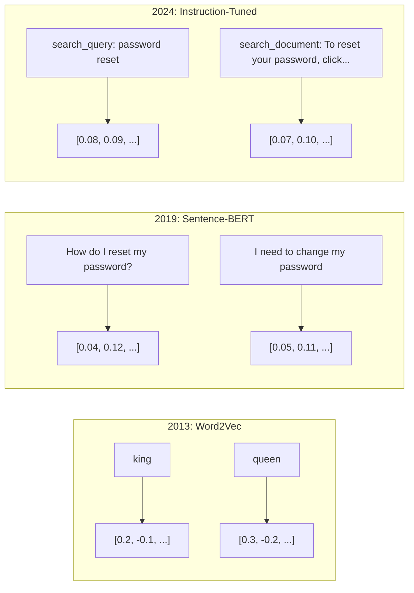
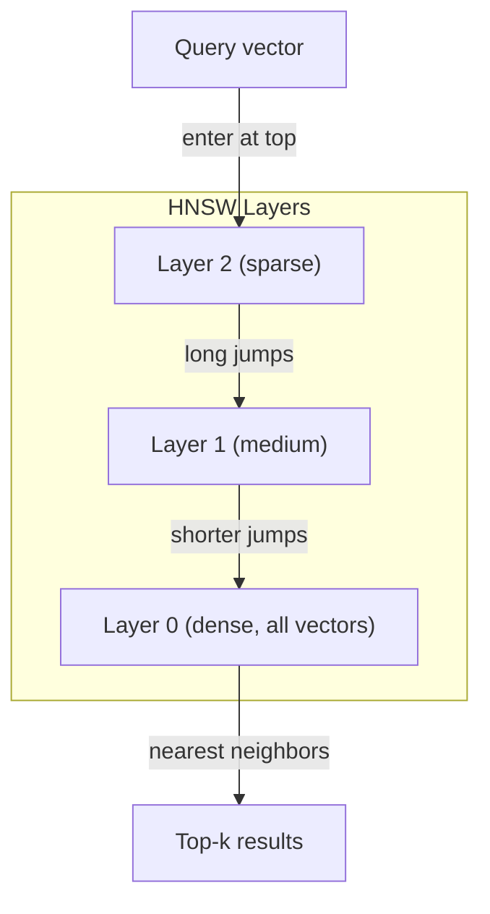
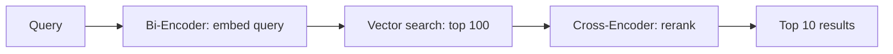

# Embeddings and Vector Representations

[Back to courses](../README.md) · [Prompt Engineering](1-prompt-engineering.md) · [Structured Outputs](2-structured-outputs.md)

| Field | Details |
| --- | --- |
| Origin | [AI Engineering from Scratch — source lesson](https://github.com/rohitg00/ai-engineering-from-scratch/blob/main/phases/11-llm-engineering/04-embeddings/docs/en.md) |
| Author | Rohit Ghumare and contributors |
| Level | Intermediate — repository assessment |
| Best for | Understanding vector search, choosing embedding and chunking strategies, and preparing for retrieval interviews |

Adapted from the MIT-licensed lesson; copyright © 2026 Rohit Ghumare. [Original license](../licenses/ai-engineering-from-scratch-LICENSE). The main Python walkthrough uses NumPy and TF-IDF; optional examples use learned embedding models.

## The Problem

You have 10,000 support tickets. A customer writes "my payment didn't go through." You need to find similar past tickets. Keyword search finds tickets containing "payment" and "didn't go through." It misses "transaction failed," "charge was declined," and "billing error." These tickets can describe related problems with different words; relevance depends on the support task.

This is the vocabulary mismatch problem. Human language has dozens of ways to say the same thing. A basic keyword matcher treats words as independent symbols. Without synonym expansion or other enhancements, it does not know that "declined" and "didn't go through" refer to the same concept.

You need a representation of text where meaning, not spelling, determines similarity. You need a way to place "my payment didn't go through" and "transaction was declined" close together in some mathematical space, while pushing "my payment arrived on time" far away despite sharing the word "payment."

That representation is an embedding.

## The Concept

### What Is an Embedding?

An embedding maps an item, such as text, to a numerical vector. A learned text embedding aims to place related items close together for its training task. Dense vectors typically have many nonzero coordinates; sparse representations such as bag-of-words and TF-IDF typically have mostly zero coordinates. Individual coordinates usually have no simple human-readable meaning.

Think of an embedding as coordinates on a map of related ideas. Nearby points can be useful matches, but proximity is not proof that two statements mean exactly the same thing or that either is true.

"The cat sat on the mat" becomes something like `[0.023, -0.041, 0.087, ..., 0.012]` -- a fixed-length list whose size depends on the model and configuration. Usually you compare whole vectors rather than interpret individual coordinates.

### The Word2Vec Breakthrough

In 2013, Tomas Mikolov and colleagues at Google published Word2Vec. The core insight: train a neural network to predict a word from its neighbors (or neighbors from a word), and the hidden layer weights become meaningful vector representations.

The famous result:

```
king - man + woman ≈ queen
```

Vector arithmetic on word embeddings captures semantic relationships. The direction from "man" to "woman" is roughly the same as the direction from "king" to "queen." This is an illustrative learned relationship, not an exact identity or a guarantee across models; word vectors can also encode biases in their training data.

A widely used Word2Vec configuration used 300-dimensional vectors; dimensionality is a training choice. Each word got one vector regardless of context. "Bank" in "river bank" and "bank account" had the same embedding. This limitation drove the next decade of research.

### From Words to Sentences

Word embeddings represent single tokens. Production systems need to embed entire sentences, paragraphs, or documents. Four approaches emerged:

**Averaging**: take the mean of all word vectors in the sentence. Cheap, lossy, surprisingly decent for short text. Loses word order entirely -- "dog bites man" and "man bites dog" get identical embeddings.

**CLS token**: transformer models (BERT, 2018) output a special [CLS] token embedding that represents the entire input. An unadapted [CLS] representation is not necessarily better for similarity; pooling and task-specific training matter.

**Contrastive learning**: train the model explicitly to push similar pairs together and dissimilar pairs apart. Sentence-BERT (Reimers & Gurevych, 2019) used siamese and triplet network structures and became a foundation for modern embedding models. Given "How do I reset my password?" and "I need to change my password," the model learns these should have nearby vectors for suitable retrieval tasks.

**Instruction-tuned embeddings**: a task-aware approach. Some models accept task instructions or prefixes that tells the model what kind of embedding to produce. Follow the exact model card: prefix names are not interchangeable. The diagram below uses illustrative Nomic-style prefixes.



### Modern Embedding Models

The source highlights the following model families. This table keeps concrete dimensions and input limits while linking to provider documentation and model cards checked on **2026-10-11**. Limits are model-specific; verify deployment availability before integrating.

| Model | Provider | Dimensions | Input limit | Access / comparison note |
| --- | --- | --- | --- | --- |
| [Gemini Embedding 2](https://ai.google.dev/gemini-api/docs/models/gemini-embedding-2) | Google | 128–3072; recommended 768, 1536, 3072 | 8192 tokens | Hosted; multimodal inputs |
| [embed-v4.0](https://docs.cohere.com/v1/docs/embeddings) | Cohere | 256, 512, 1024, 1536 | 128K tokens | Hosted; use the correct input type |
| [voyage-4 family](https://www.mongodb.com/docs/voyageai/models/) | Voyage AI | Check the exact variant; configurable dimensions | Check exact variant | Hosted; compare general and domain-specific models |
| [text-embedding-3-large](https://developers.openai.com/api/docs/guides/embeddings) | OpenAI | 3072 default; supports shortening | 8192 tokens | Hosted; `dimensions` controls vector size |
| [text-embedding-3-small](https://developers.openai.com/api/docs/guides/embeddings) | OpenAI | 1536 default; supports shortening | 8192 tokens | Hosted; smaller default vectors |
| [BGE-M3](https://huggingface.co/BAAI/bge-m3) | BAAI | 1024 dense | 8192 tokens | Open weights; dense, sparse, and multi-vector retrieval |
| [Qwen3-Embedding-8B](https://huggingface.co/Qwen/Qwen3-Embedding-8B) | Alibaba | 32–4096 | 32K tokens | Open weights; 8B variant, not a family-wide dimension |
| [nomic-embed-text-v2-moe](https://huggingface.co/nomic-ai/nomic-embed-text-v2-moe) | Nomic | 768, reducible to 256 | 512 tokens | Open weights; query/document prefixes required |

**MTEB** means Massive Text Embedding Benchmark, a collection of evaluations across tasks and languages. Do not compare an aggregate score with a retrieval-only score or mix benchmark versions. The source's scores and prices are not reproduced as current rankings because they lack a common reproducible evaluation configuration. Compare candidates on your own labeled queries, and record model version, dimension, dataset, metric, latency, and current API or hosting cost. Open weights still incur inference, memory, and operational costs.

### Similarity Metrics

Given two embedding vectors, three ways to measure how similar they are:

**Cosine similarity**: the cosine of the angle between two vectors. Ranges from -1 (opposite) to 1 (identical direction). Ignores magnitude -- a 10-word sentence and a 500-word document can score 1.0 if they point the same direction. It is a common retrieval metric, but follow the embedding model’s recommended scoring method.

```
cosine_sim(a, b) = dot(a, b) / (||a|| * ||b||)
```

**Dot product**: the raw inner product of two vectors. Identical to cosine similarity when vectors are normalized (unit length). Faster to compute. OpenAI's embeddings are normalized, so dot product and cosine give the same ranking.

```
dot(a, b) = sum(a_i * b_i)
```

**Euclidean (L2) distance**: straight-line distance in the vector space. Smaller = more similar. Sensitive to magnitude differences. Use when the absolute position in space matters, not just the direction.

```
L2(a, b) = sqrt(sum((a_i - b_i)^2))
```

When to use which:

| Metric | Use when | Avoid when |
|--------|----------|------------|
| Cosine similarity | Comparing texts of different lengths; most retrieval tasks | Magnitude carries information |
| Dot product | Embeddings are already normalized; maximum speed | Vectors have varying magnitudes |
| Euclidean distance | Clustering; spatial nearest-neighbor problems | Comparing documents of wildly different lengths |

### Vector Databases and HNSW

A brute-force similarity search compares the query against every stored vector. At 1 million vectors with 1536 dimensions, that is about 1.5 billion multiply-add terms per query. Whether this meets a latency target depends on hardware, batching, and implementation; benchmark exact search as a baseline.

Vector databases solve this with Approximate Nearest Neighbor (ANN) algorithms. One widely used algorithm is HNSW (Hierarchical Navigable Small World):

1. Build a multi-layer graph of vectors
2. Top layers are sparse -- long-range connections between distant clusters
3. Bottom layers are dense -- fine-grained connections between nearby vectors
4. Search starts at the top layer, greedily descending to refine
5. Returns approximate top-k results while visiting only part of the graph; practical cost depends on data and search parameters

HNSW trades recall, memory, build time, and query latency. There is no universal recall or millisecond guarantee. Measure ANN recall against exact nearest neighbors, separately from relevance against human labels.

| Parameter | Increasing it typically does | What to measure |
| --- | --- | --- |
| `M` (graph connections) | Uses more memory and may improve navigability | Index bytes/vector and recall |
| `ef_construction` (build search breadth) | Increases build effort and may improve graph quality | Build time and final recall |
| `ef_search` (query search breadth) | Explores more candidates | p95 latency versus ANN recall@k |
| `top_k` (returned results) | Returns more candidates to downstream stages | Relevant-document recall and reranking cost |



Production options:

| Option | Deployment style | What to evaluate |
| --- | --- | --- |
| Pinecone | Managed service | Operational effort, filtering, cost, and region requirements |
| Weaviate | Self-hosted or managed database | Hybrid retrieval and schema design |
| Qdrant | Self-hosted or managed vector database | Payload filters, recall, and memory |
| Chroma | Local or hosted vector store | Prototype workflow and deployment requirements |
| pgvector | PostgreSQL extension | SQL joins, existing operations, and index tuning |
| FAISS | Similarity-search library | In-process search, hardware, and custom persistence |

These are examples from the source, not fixed scale ceilings or benchmark winners. Capacity depends on dimension, index, memory, replicas, filtering, and latency targets.

### Chunking Strategies

Long or multi-topic documents can be poor candidates for a single vector. A 50-page PDF covers dozens of topics -- one vector may blur details needed by a specific query. You split documents into chunks and embed each one.

**Fixed-size chunking**: split every N tokens with M-token overlap. Simple and predictable. Works well when documents have no clear structure. A 512-token chunk with 50-token overlap: chunk 1 is tokens 0-511, chunk 2 is tokens 462-973.

**Sentence-based chunking**: split at sentence boundaries, grouping sentences until reaching the token limit. Each chunk is at least one complete sentence. This preserves many sentence boundaries, though long sentences and tokenizer limits still need a fallback.

**Recursive chunking**: try splitting at the largest boundary first (section headers). If still too large, try paragraph boundaries. Then sentence boundaries. Then character limits. Recursive splitters can use such a hierarchy; separator configuration determines whether headings and paragraphs are preserved.

**Semantic chunking**: embed each sentence, then group consecutive sentences whose embeddings are similar. When the embedding similarity drops below a threshold, start a new chunk. Expensive (requires embedding every sentence individually) and must be evaluated against simpler splits.

| Strategy | Complexity | Quality | Best for |
|----------|-----------|---------|----------|
| Fixed-size | Low | Decent | Unstructured text, logs |
| Sentence-based | Low | Good | Articles, emails |
| Recursive | Medium | Good | Markdown, HTML, mixed docs |
| Semantic | High | Task-dependent | Testing topic-aware boundaries |

An illustrative starting experiment is 256- and 512-token chunks with 50-token overlap. Measure retrieval quality on your documents; this is not a universal optimum. The code below counts **words**, not tokenizer tokens.

### Bi-Encoders vs Cross-Encoders

A bi-encoder embeds the query and documents independently, then compares vectors. Fast -- you embed the query once and compare against pre-computed document embeddings. This is what you use for retrieval.

A cross-encoder takes the query and a document as a single input and outputs a relevance score. Slow -- it processes each query-document pair through the full model. It can improve relevance scoring because query and document tokens interact, but the benefit must be measured.

The production pattern: bi-encoder retrieves top-100 candidates, cross-encoder reranks them to top-10. This is the retrieve-then-rerank pipeline.



Reranker examples include Cohere Rerank, BGE rerankers, and Jina rerankers. Check exact version availability, license, and hosting cost. The top-100 to top-10 pipeline above is a starting configuration, not a required ratio.

### Matryoshka Embeddings

Traditional embeddings are all-or-nothing. A 1536-dimensional vector uses 1536 floats. Arbitrary truncation can discard important information; useful quality at smaller dimensions is not guaranteed.

Matryoshka Representation Learning (Kusupati et al., 2022) fixes this. The model is trained so that the first N dimensions capture the most important information, like a Russian nesting doll. Truncating a 1536-d Matryoshka embedding to 256 dimensions loses some accuracy but remains functional.

OpenAI's text-embedding-3-small and text-embedding-3-large support Matryoshka truncation via the `dimensions` parameter. Requesting 256 dimensions instead of 1536 cuts raw vector storage by 6x. Measure the retrieval-quality change rather than assuming a fixed percentage loss.

### Binary Quantization

A 1536-dimensional embedding stored as float32 uses 6,144 bytes. Multiply by 10 million documents: 61 GB just for vectors.

Binary quantization converts each float to a single bit: positive values become 1, negative values become 0. Storage drops from 6,144 bytes to 192 bytes -- a 32x reduction. Similarity is computed using Hamming distance (count differing bits), which can use XOR and population-count instructions over multiple machine words.

A possible pipeline uses binary vectors for candidate retrieval and full-precision vectors for rescoring. Measure recall loss for the model and dataset. The 32x ratio applies only to packed vector payloads; retaining original vectors and index metadata reduces the overall memory saving.

For unit vectors, `L2(a, b)^2 = 2 - 2*cosine(a, b)`, so cosine, dot product, and negative L2 rank neighbors identically (apart from ties and numerical effects).

| Pair | Cosine | Dot product | L2 distance |
| --- | --- | --- | --- |
| `[1, 0]`, `[1, 0]` | 1 | 1 | 0 |
| `[1, 0]`, `[0, 1]` | 0 | 0 | √2 |
| `[1, 0]`, `[-1, 0]` | -1 | -1 | 2 |
| `[1, 0]`, `[2, 0]` | 1 | 2 | 1 |

The final row shows why normalization matters. Cosine is undefined for a zero vector; our teaching function returns 0 as a deliberate fallback, and the search engine declines queries with no known vocabulary.

## Build It

We build the mechanics of a vector-search pipeline using a **TF-IDF lexical baseline**. It does not learn synonyms or semantic relationships. Replace the encoder with a trained embedding model to explore semantic retrieval.

Use Python 3.10+ with NumPy (`python -m pip install numpy` in your own environment). Copy the seven Python blocks in this section into one file in order and run it. No credentials or model downloads are needed for this walkthrough.

### Step 1: Text Chunking

```python
def chunk_text(text, chunk_size=200, overlap=50):
    if chunk_size <= 0 or not 0 <= overlap < chunk_size:
        raise ValueError("Require chunk_size > 0 and 0 <= overlap < chunk_size")
    words = text.split()
    chunks = []
    start = 0
    while start < len(words):
        end = start + chunk_size
        chunk = " ".join(words[start:end])
        chunks.append(chunk)
        if end >= len(words):
            break
        start += chunk_size - overlap
    return chunks


def chunk_by_sentences(text, max_chunk_words=200):
    if max_chunk_words <= 0:
        raise ValueError("max_chunk_words must be positive")
    sentences = text.replace("\n", " ").split(".")
    sentences = [s.strip() + "." for s in sentences if s.strip()]
    chunks = []
    current_chunk = []
    current_length = 0
    for sentence in sentences:
        sentence_length = len(sentence.split())
        if current_length + sentence_length > max_chunk_words and current_chunk:
            chunks.append(" ".join(current_chunk))
            current_chunk = []
            current_length = 0
        current_chunk.append(sentence)
        current_length += sentence_length
    if current_chunk:
        chunks.append(" ".join(current_chunk))
    return chunks
```

The sentence splitter is deliberately basic: periods in abbreviations can split incorrectly, and a single long sentence may exceed the requested word count. Use tokenizer-aware limits and a long-sentence fallback in production.

### Step 2: Building a TF-IDF Baseline

We store L2-normalized TF-IDF features in a NumPy array. The representation is conceptually sparse even though the array uses dense storage. Similarity here depends on shared words. Fitting freezes a vocabulary; a new vocabulary requires rebuilding all stored vectors.

```python
import math
import numpy as np
from collections import Counter

class SimpleEmbedder:
    def __init__(self):
        self.vocab = []
        self.idf = []
        self.word_to_idx = {}

    def fit(self, documents):
        vocab_set = set()
        for doc in documents:
            vocab_set.update(doc.lower().split())
        self.vocab = sorted(vocab_set)
        self.word_to_idx = {w: i for i, w in enumerate(self.vocab)}
        n = len(documents)
        self.idf = np.zeros(len(self.vocab))
        for i, word in enumerate(self.vocab):
            doc_count = sum(1 for doc in documents if word in doc.lower().split())
            self.idf[i] = math.log((n + 1) / (doc_count + 1)) + 1

    def embed(self, text):
        words = text.lower().split()
        count = Counter(words)
        total = len(words) if words else 1
        vec = np.zeros(len(self.vocab))
        for word, freq in count.items():
            if word in self.word_to_idx:
                tf = freq / total
                vec[self.word_to_idx[word]] = tf * self.idf[self.word_to_idx[word]]
        norm = np.linalg.norm(vec)
        if norm > 0:
            vec = vec / norm
        return vec
```

### Step 3: Similarity Functions

```python
def cosine_similarity(a, b):
    dot = np.dot(a, b)
    norm_a = np.linalg.norm(a)
    norm_b = np.linalg.norm(b)
    if norm_a == 0 or norm_b == 0:
        return 0.0
    return float(dot / (norm_a * norm_b))


def dot_product(a, b):
    return float(np.dot(a, b))


def euclidean_distance(a, b):
    return float(np.linalg.norm(a - b))
```

### Step 4: Vector Index with Brute-Force Search

```python
class VectorIndex:
    def __init__(self):
        self.vectors = []
        self.texts = []
        self.metadata = []

    def add(self, vector, text, meta=None):
        self.vectors.append(vector)
        self.texts.append(text)
        self.metadata.append(meta or {})

    def search(self, query_vector, top_k=5, metric="cosine"):
        if top_k < 1:
            raise ValueError("top_k must be positive")
        if metric not in {"cosine", "dot", "euclidean"}:
            raise ValueError(f"Unknown metric: {metric}")
        scores = []
        for i, vec in enumerate(self.vectors):
            if metric == "cosine":
                score = cosine_similarity(query_vector, vec)
            elif metric == "dot":
                score = dot_product(query_vector, vec)
            elif metric == "euclidean":
                score = -euclidean_distance(query_vector, vec)
            else:
                raise ValueError(f"Unknown metric: {metric}")
            scores.append((i, score))
        scores.sort(key=lambda x: x[1], reverse=True)
        results = []
        for idx, score in scores[:top_k]:
            results.append({
                "text": self.texts[idx],
                "score": score,
                "metadata": self.metadata[idx],
                "index": idx
            })
        return results

    def size(self):
        return len(self.vectors)
```

### Step 5: The Search Pipeline

```python
class VectorSearchEngine:
    def __init__(self, chunk_size=200, overlap=50):
        self.embedder = SimpleEmbedder()
        self.index = VectorIndex()
        self.chunk_size = chunk_size
        self.overlap = overlap

    def index_documents(self, documents, source_names=None):
        if source_names is not None and len(source_names) != len(documents):
            raise ValueError("One source name is required per document")
        self.index = VectorIndex()  # Refit means rebuilding, not appending old vectors.
        all_chunks = []
        all_sources = []
        for i, doc in enumerate(documents):
            chunks = chunk_text(doc, self.chunk_size, self.overlap)
            all_chunks.extend(chunks)
            name = source_names[i] if source_names else f"doc_{i}"
            all_sources.extend([name] * len(chunks))
        self.embedder.fit(all_chunks)
        for chunk, source in zip(all_chunks, all_sources):
            vec = self.embedder.embed(chunk)
            self.index.add(vec, chunk, {"source": source})
        return len(all_chunks)

    def search(self, query, top_k=5, metric="cosine"):
        query_vec = self.embedder.embed(query)
        if not np.any(query_vec):
            return []
        return self.index.search(query_vec, top_k, metric)

    def search_with_scores(self, query, top_k=5):
        results = self.search(query, top_k)
        return [
            {
                "text": r["text"][:200],
                "source": r["metadata"].get("source", "unknown"),
                "score": round(r["score"], 4)
            }
            for r in results
        ]
```

### Step 6: Comparing Similarity Metrics

```python
def compare_metrics(engine, query, top_k=3):
    results = {}
    for metric in ["cosine", "dot", "euclidean"]:
        hits = engine.search(query, top_k=top_k, metric=metric)
        results[metric] = [
            {"score": round(h["score"], 4), "preview": h["text"][:80]}
            for h in hits
        ]
    return results
```

### Step 7: Run and Evaluate a Small Example

```python
documents = [
    "payment declined card transaction failed",
    "password reset account login help",
    "refund return purchase money policy",
]
engine = VectorSearchEngine(chunk_size=20, overlap=3)
engine.index_documents(documents, ["billing", "login", "refunds"])
print(engine.search_with_scores("payment declined", top_k=2))
print(compare_metrics(engine, "payment declined", top_k=3))
print("Unknown vocabulary:", engine.search("reimbursement"))

# Labeled query-to-relevant-source pairs, not similarity thresholds.
cases = [("payment declined", {"billing"}), ("password reset", {"login"}),
         ("refund", {"refunds"}), ("reimbursement", {"refunds"})]
hits = 0
for query, relevant in cases:
    found = engine.search_with_scores(query, top_k=1)
    hits += bool(found and found[0]["source"] in relevant)
print(f"Hit rate@1: {hits / len(cases):.2f}")  # 0.75 on these four toy cases
```

The billing query ranks billing first. The unknown synonym `reimbursement` returns no result, showing the vocabulary-mismatch problem. The 0.75 score describes only these four examples, not a general retrieval benchmark.

### Retrieval Metrics to Track

| Metric | Definition | Interpretation |
| --- | --- | --- |
| Precision@k | Relevant retrieved items / k | How much of the returned list is useful; specify handling of short lists |
| Recall@k | Relevant retrieved items / all labeled relevant items | How much needed evidence was recovered |
| MRR | Mean of reciprocal rank of the first relevant item; 0 if absent | How early the first useful result appears |
| nDCG@k | Discounted graded relevance normalized by ideal ranking | Ranking quality when relevance has levels |
| ANN recall@k | Overlap with exact top-k neighbors / k | Index approximation quality, not semantic relevance |
| p50/p95 latency | Median and 95th-percentile end-to-end query duration | Typical and tail response times |

Evaluate by source document when overlapping chunks would otherwise inflate counts. Compare the same query set, labels, and model version. Similarity scores alone are not quality metrics or calibrated probabilities.

## Use It

These optional examples require provider SDKs and credentials, or a local model download. They are separate from the offline walkthrough and were not live-tested. Use the same model, dimension, normalization, and query/document preprocessing for compatible vectors. Re-embed the corpus when changing its vector space.

For OpenAI, install the `openai` package and configure `OPENAI_API_KEY`. The [official embeddings guide](https://developers.openai.com/api/docs/guides/embeddings) documents the request below:

```python
from openai import OpenAI

client = OpenAI()

def openai_embed(texts, model="text-embedding-3-small", dimensions=None):
    kwargs = {"model": model, "input": texts}
    if dimensions is not None:
        kwargs["dimensions"] = dimensions
    response = client.embeddings.create(**kwargs)
    return [item.embedding for item in response.data]
```

Matryoshka truncation with OpenAI -- same model, fewer dimensions, lower storage:

```python
full = openai_embed(["semantic search query"], dimensions=1536)
compact = openai_embed(["semantic search query"], dimensions=256)
```

The 256-d vector uses 6x less storage. For 10 million documents, that is 10 GB vs 61 GB. Measure accuracy loss on your labeled queries; raw storage excludes index and metadata overhead.

For reranking with Cohere, install `cohere`, configure `CO_API_KEY`, and check availability of the example model:

```python
import cohere

co = cohere.ClientV2()

results = co.rerank(
    model="rerank-v3.5",
    query="What is the refund policy?",
    documents=["Full refund within 30 days...", "No refunds after 90 days..."],
    top_n=2
)
```

For local embeddings, install `sentence-transformers`; the first run downloads model weights and needs network access. Follow the model card’s query instructions:

```python
from sentence_transformers import SentenceTransformer

model = SentenceTransformer("BAAI/bge-small-en-v1.5")
embeddings = model.encode(["another document"], normalize_embeddings=True)
query = model.encode(
    ["Represent this sentence for searching relevant passages: semantic search query"],
    normalize_embeddings=True,
)
```

For the local example, add `embeddings[0]` to a fresh `VectorIndex` and search with `query[0]`. Convert API-returned lists to NumPy arrays before using the L2 function. Cohere reranking returns relevance results, not embedding vectors, and belongs after retrieval. A hosted embedder also needs an adapter for batching, retries, token limits, and persistence.

## Reusable Patterns

The source includes an [embedding-advisor prompt](https://github.com/rohitg00/ai-engineering-from-scratch/blob/main/phases/11-llm-engineering/04-embeddings/outputs/prompt-embedding-advisor.md) and [embedding-patterns guide](https://github.com/rohitg00/ai-engineering-from-scratch/blob/main/phases/11-llm-engineering/04-embeddings/outputs/skill-embedding-patterns.md). These are upstream resources, not artifacts generated by this walkthrough.

## Exercises

1. **Metric comparison**: run the same 5 queries against the sample documents using cosine similarity, dot product, and euclidean distance. Record the top-3 results for each. For nonzero unit vectors, rankings should agree apart from ties. Then deliberately rescale a document vector and explain which metrics change.

2. **Chunk size experiment**: index the sample documents with chunk sizes of 50, 100, 200, and 500 words. For each, run 5 queries and record labeled recall@k and latency, holding queries and labels fixed. Plot retrieval quality against chunk size. Check whether larger chunks help or hurt; no particular direction is guaranteed.

3. **Dimension reduction**: first truncate TF-IDF vectors and measure recall, noting that this drops vocabulary coordinates and is not Matryoshka learning. Then use a genuine Matryoshka model at supported dimensions (for example 1536 and 256), normalize as required, and compare labeled recall and raw storage.

4. **Binary quantization**: take the embeddings from the search engine, convert them to binary (1 if positive, 0 if negative), and implement Hamming distance search. Compare the top-10 results against full-precision cosine similarity. Measure overlap with exact top-k and labeled recall separately. With nonnegative TF-IDF, sign thresholding mostly becomes word-presence encoding; repeat with learned dense vectors before generalizing.

5. **Sentence-based chunking**: replace fixed-size chunking with `chunk_by_sentences`. Run the same queries and compare labeled recall@k and latency. Does respecting sentence boundaries improve results on this dataset?

## Key Terms

| Term | What people say | What it actually means |
|------|----------------|----------------------|
| Embedding | "Text to numbers" | A dense vector where geometric proximity encodes semantic similarity |
| Word2Vec | "The OG embedding" | 2013 model that learned word vectors by predicting context words; demonstrated useful approximate relationships between learned vectors |
| Cosine similarity | "How similar are two vectors" | Cosine of the angle between vectors; 1 = identical direction, 0 = orthogonal, -1 = opposite |
| HNSW | "Fast vector search" | Hierarchical Navigable Small World graph -- multi-layer graph for approximate search; speed and recall depend on tuning and data |
| Bi-encoder | "Embed separately, compare fast" | Encodes query and document independently into vectors; enables pre-computation and fast retrieval |
| Cross-encoder | "Slow but accurate reranker" | Processes query-document pair jointly through the full model; can improve relevance; pair scores cannot be precomputed independently of queries |
| Matryoshka embeddings | "Truncatable vectors" | Embeddings trained so the first N dimensions capture the most important information, enabling variable-size storage |
| Binary quantization | "1-bit embeddings" | Converting float vectors to binary (sign bit only) for 32x storage reduction with Hamming distance search |
| Chunking | "Split docs for embedding" | Breaking documents into task-appropriate segments so each can be independently embedded and retrieved |
| Vector database | "Search engine for embeddings" | Data store optimized for storing vectors and performing approximate nearest neighbor search at scale |
| Contrastive learning | "Train by comparison" | Training approach that pushes similar pair embeddings together and dissimilar pair embeddings apart |
| MTEB | "The embedding benchmark" | Massive Text Embedding Benchmark -- a versioned collection of embedding evaluations; compare the same tasks, languages, and aggregation |

## Further Reading

- Mikolov et al., "Efficient Estimation of Word Representations in Vector Space" (2013) -- the Word2Vec paper that started the embedding revolution with the king-queen analogy
- Reimers & Gurevych, "Sentence-BERT: Sentence Embeddings using Siamese BERT-Networks" (2019) -- how to train bi-encoders for sentence-level similarity, foundation of modern embedding models
- Kusupati et al., "Matryoshka Representation Learning" (2022) -- the technique behind variable-dimension embeddings that OpenAI adopted for text-embedding-3
- Malkov & Yashunin, "Efficient and Robust Approximate Nearest Neighbor using Hierarchical Navigable Small World Graphs" (2018) -- the HNSW paper, the algorithm behind most production vector search
- [OpenAI Embeddings Guide](https://developers.openai.com/api/docs/guides/embeddings) -- practical reference for text-embedding-3 models including Matryoshka dimension reduction
- [MTEB Leaderboard](https://huggingface.co/spaces/mteb/leaderboard) -- live benchmark comparing all embedding models across tasks and languages
- [Muennighoff et al., "MTEB: Massive Text Embedding Benchmark" (EACL 2023)](https://arxiv.org/abs/2210.07316) -- the benchmark defining 8 task categories (classification, clustering, pair classification, reranking, retrieval, STS, summarization, bitext mining) that the leaderboard reports; read before trusting any single MTEB score.
- [Sentence Transformers documentation](https://www.sbert.net/) -- canonical reference for bi-encoder vs cross-encoder, pooling strategies, and the ingest-split-embed-store RAG pipeline this lesson implements.

## Attribution and Import Notes

Imported on 2026-10-11 from the source linked above. Local edits correct technical claims and model specifications, distinguish lexical TF-IDF from semantic embeddings, add runnable examples and evaluation metrics, fix chunking and index-rebuild edge cases, and qualify benchmark and storage claims. Provider examples were not live-tested.

Source SHA-256: `9c3115093f152ce871351f278f9e08a2322849bfaa9af54bb5339b5874f2b401`.
