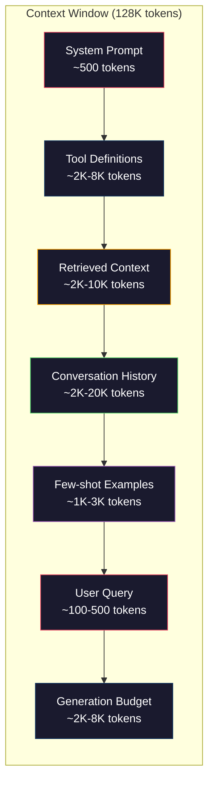
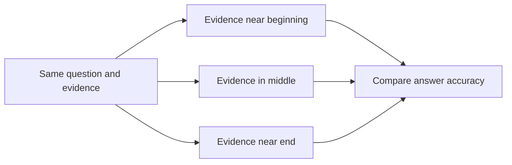
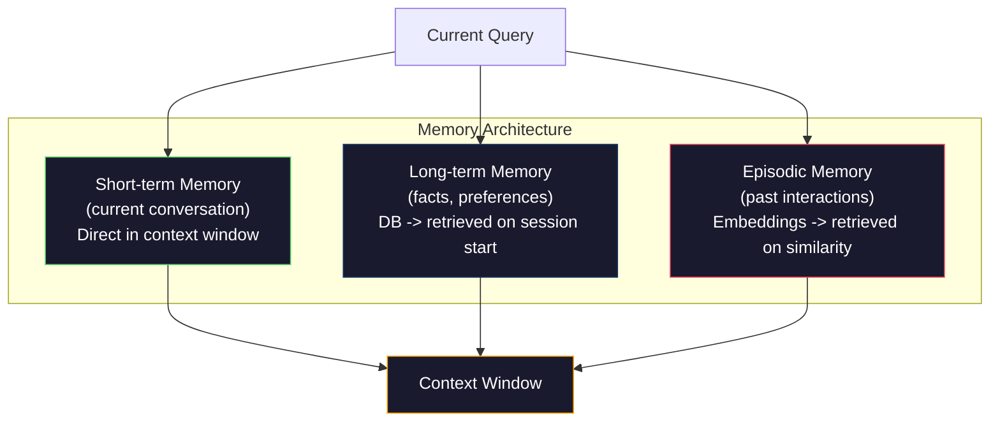

# Context Engineering: Windows, Budgets, Memory, and Retrieval

[Back to courses](../README.md) · [Prompt Engineering](1-prompt-engineering.md) · [Embeddings](3-embeddings.md)

## The Problem

A large context window can fill quickly once you include instructions, tools, documents, conversation history, and room for the answer. See the [model-limit comparison](1-prompt-engineering.md#context-windows-what-fits-where) for concrete examples; the exact limit depends on the deployed model and endpoint.

Consider this **illustrative** coding-assistant budget:

| Component | Tokens | Purpose |
| --- | ---: | --- |
| System instructions | 500 | Behavior and task constraints |
| Definitions for 50 tools | 8,000 | Names, descriptions, argument schemas |
| Retrieved documentation | 4,000 | Evidence needed for the task |
| Conversation history | 6,000 | Prior decisions and ongoing work |
| Current query | 200 | What the user wants now |
| Reserved generation | 4,000 | Room for the response |
| **Total** | **22,700** | **17.7% of a 128,000-token combined window** |

Input uses 18,700 tokens; the remaining 4,000 is a reservation, not input sent to the model. A provider may publish separate input and output limits instead of one combined limit. Reasoning tokens, message formatting, and tool schemas also need accounting under the chosen API.

Full self-attention has quadratic pairwise work in input length; actual inference latency also depends on architecture, caching, hardware, and serving. A larger window does not guarantee that a model reliably uses every included fact.

**Context engineering** means choosing, arranging, and maintaining the information available to the model for each request. A focused 10K-token context can outperform a noisy 100K-token context, but this is a hypothesis to evaluate, not a universal rule. Extra relevant evidence can help; duplicated or irrelevant material can waste cost and distract from the task.

## The Concept

### The Context Window is a Scarce Resource

Think of the context window as RAM, not disk. It is fast and directly accessible, but limited. You cannot fit everything. You must choose.



Each component competes for space. Adding more tool definitions means less room for conversation history. Adding more retrieved context means less room for few-shot examples. Context engineering is the art of allocating this budget to maximize task performance.

### Lost-in-the-Middle

[Liu et al.'s Lost in the Middle study](https://arxiv.org/abs/2307.03172) found that performance on evaluated retrieval and question-answering tasks often depended on where relevant information appeared. Beginning and end positions tended to perform better than middle positions. This is a behavioral finding, not a direct measurement of attention weights or a fixed accuracy penalty for all models.

Test ordering on your own model and tasks. Keep governing instructions in their proper message roles; moving untrusted document text next to instructions must not give it authority. Repeating key facts can help some tasks but costs tokens and may overweight duplicated evidence.



| Experiment | Hold constant | Measure |
| --- | --- | --- |
| Move evidence: beginning / middle / end | Query, facts, model, distractors | Answer accuracy by position |
| Increase distractors | Relevant evidence and question | Accuracy, latency, input tokens |
| Summarize older history | Latest query and required decisions | Fact retention and contradictions |
| Prune tool definitions | Tasks and authorized capabilities | Tool-selection success and missing-tool rate |

### Context Components

| Component | What belongs here | What to watch |
| --- | --- | --- |
| System instructions | Stable behavior and application constraints | Preserve required instructions; avoid contradictory copies |
| Tool definitions | Relevant names, descriptions, and complete parameter schemas | Count serialized definitions, not just names; selection is not permission |
| Retrieved context | Documents, search results, and tool outputs | Relevance, source IDs, freshness, and access control |
| Conversation history | Recent turns, decisions, unresolved constraints | Preserve tool-call/result pairs and corrections |
| Few-shot examples | Representative input/output pairs | Example relevance and token cost |
| Generation reserve | Capacity for the answer and applicable reasoning | Task-dependent; respect both context and output limits |

For example, 50 definitions averaging 150 tokens cost 7,500 tokens. Selecting 10 would cost 1,500 under that assumption, but actual definitions vary. Start with a measured budget rather than treating this arithmetic as a guaranteed saving. A 2,000–4,000-token response reserve is a possible experiment for a text task, not a required minimum for every application.

### Context Compression Strategies

**History summarization**: instead of keeping all previous turns verbatim, periodically summarize the conversation. A digest such as "We discussed X, decided Y, and the user wants Z" can replace older turns, but may lose crucial exceptions. Preserve decisions, corrections, source IDs, and unfinished work. Run summarization when history exceeds a threshold (e.g., 5,000 tokens).

**Relevance filtering**: score each retrieved document against the current query and drop documents below a threshold. If you retrieved 10 chunks but only 3 are relevant, discard the other 7. Better to have 3 highly relevant chunks than 10 mediocre ones.

**Tool pruning**: classify the user's query intent and only include tools relevant to that intent. A code question does not need calendar tools. A scheduling question does not need file system tools. An illustrative reduction from 8,000 to 1,000 tokens saves 87.5%; measure whether important tools are accidentally excluded.

**Recursive summarization**: for very long documents, summarize in stages. First summarize each section, then summarize the summaries. A 50-page document becomes a 500-token digest whose retention of key facts must be checked against the task.

### Memory Systems

Context engineering spans three time horizons.

**Short-term memory**: the current conversation. Stored in the context window directly. Grows with each turn. Managed by summarization and truncation.

**Long-term memory**: facts and preferences that persist across conversations. "The user prefers TypeScript." "The project uses PostgreSQL." Stored outside the current request, for example in an application database or project notes, and retrieved when relevant. Record provenance, scope, timestamps, corrections, and deletion rules.

**Episodic memory**: specific past interactions that might be relevant. "Last Tuesday, we debugged a similar issue in the auth module." Stored as records that can be indexed with embeddings or other retrieval methods; retrieve relevant episodes without treating old conclusions as automatically current.



### Dynamic Context Assembly

The key insight: different queries need different context. A static system prompt + static tools + static history is wasteful. The best systems dynamically assemble context per query.

1. Classify the query intent
2. Select relevant tools (not all tools)
3. Retrieve relevant documents (not a fixed set)
4. Include relevant history turns (not all history)
5. Add few-shot examples that match the task type
6. Order everything by importance: critical first, important last, optional in the middle

Evaluate this pipeline against a simpler fixed-context baseline. Context changes can improve performance without changing the model, but selection and compression can also remove needed evidence.

### Budget Equation and Overflow Policy

For a combined window, use `input_tokens + generation_reserve + safety_margin <= context_limit`. Input includes message envelopes and complete tool definitions. In production, count with the model-compatible tokenizer or provider counting interface and check the final serialized request.

If a request is too large, preserve the current user query and governing instructions first. Drop low-value optional items, keep tools as complete schemas, and compact older history while preserving source facts. If mandatory content still does not fit, return an explicit overflow error or split the task; do not silently cut the user's request.

| Strategy | Keeps | Main risk | Verification |
| --- | --- | --- | --- |
| Sliding window | Most recent turns | Drops older decisions | Decision-retention tests |
| Extractive compression | Selected original passages | Omits needed qualifiers | Evidence coverage |
| Generated summary | Concise paraphrase | Invents or changes facts | Compare facts and citations to originals |
| Retrieval from memory | Task-relevant stored records | Stale or unauthorized data | Scope, freshness, provenance |
| Deduplication | Representative passages | Collapses distinct exceptions | Duplicate detection and contradiction tests |

## Build It

Copy the six Python blocks below into one file in order, then add the final `run_demo()` invocation. Use Python 3.10+; only the standard library is required. No models or external services are called.

### Step 1: Token Counter

This counter uses a word-based heuristic, not a tokenizer. It can substantially undercount code, JSON, languages without spaces, or long strings. Every budget guarantee below applies only to this estimate. A production implementation needs model-specific counting, message overhead, and a safety margin.

```python
import json
import math
from collections import OrderedDict

def count_tokens(text):
    if not text:
        return 0
    return math.ceil(len(text.split()) * 1.3)

def count_tokens_json(obj):
    return count_tokens(json.dumps(obj))
```

### Step 2: Context Budget Manager

The core abstraction. A budget manager tracks how many tokens each component uses and enforces limits.

```python
class ContextBudget:
    def __init__(self, max_tokens=128000, generation_reserve=4000):
        if max_tokens <= 0 or not 0 <= generation_reserve < max_tokens:
            raise ValueError("Require 0 <= reserve < a positive context limit")
        self.max_tokens = max_tokens
        self.generation_reserve = generation_reserve
        self.available = max_tokens - generation_reserve
        self.allocations = OrderedDict()
        self.contents = OrderedDict()

    def allocate(self, component, content, max_tokens=None, required=False):
        if max_tokens is not None and max_tokens < 0:
            raise ValueError("Component cap cannot be negative")
        # Replacing a component releases its previous allocation.
        used = sum(self.allocations.values()) - self.allocations.get(component, 0)
        allowed = self.available - used
        if max_tokens is not None:
            allowed = min(allowed, max_tokens)
        tokens = count_tokens(content)
        if tokens > allowed:
            if required:
                raise ValueError(f"Mandatory component does not fit: {component}")
            # Optional items are omitted whole, not broken by truncation.
            self.allocations.pop(component, None)
            self.contents.pop(component, None)
            return None, 0
        self.allocations[component] = tokens
        self.contents[component] = content
        return content, tokens

    def remaining(self):
        return self.available - sum(self.allocations.values())

    def utilization(self):
        return sum(self.allocations.values()) / self.max_tokens

    def report(self):
        lines = [f"Estimated Context Budget ({self.max_tokens:,} token window)"]
        for name, tokens in self.allocations.items():
            lines.append(f"  {name:<25} {tokens:>6} estimated tokens")
        lines.append(f"  Input used: {sum(self.allocations.values())}")
        lines.append(f"  Generation reserve: {self.generation_reserve}")
        lines.append(f"  Remaining input budget: {self.remaining()}")
        return "\n".join(lines)
```


### Step 3: Lost-in-the-Middle Reordering

Implement the reordering strategy: most important items go first and last, least important go in the middle.

```python
def reorder_lost_in_middle(items, scores):
    if len(items) != len(scores):
        raise ValueError("One score per item is required")
    paired = sorted(zip(scores, items), key=lambda pair: pair[0], reverse=True)
    sorted_items = [item for _, item in paired]

    if len(sorted_items) <= 2:
        return sorted_items

    first_half = sorted_items[::2]
    second_half = sorted_items[1::2]
    second_half.reverse()

    return first_half + second_half

def score_relevance(query, documents):
    query_words = set(query.lower().split())
    scores = []
    for doc in documents:
        doc_words = set(doc.lower().split())
        if not query_words:
            scores.append(0.0)
            continue
        overlap = len(query_words & doc_words) / len(query_words)
        scores.append(round(overlap, 3))
    return scores
```

### Step 4: Conversation History Compressor

This teaching compressor keeps recent whole turns and creates a short **extractive preview** of older turns. It is not a semantic summary and can lose important facts. Both the preview and recent turns count toward the cap; production compaction should preserve decisions and tool-call/result pairs.

```python
class ConversationManager:
    def __init__(self, max_history_tokens=5000):
        if max_history_tokens <= 0:
            raise ValueError("History budget must be positive")
        self.turns = []
        self.summary = ""
        self.max_history_tokens = max_history_tokens

    def add_turn(self, role, content):
        self.turns.append({"role": role, "content": content})
        self._compress_if_needed()

    def _compress_if_needed(self):
        # First reclaim preview space, then compact oldest turns as needed.
        while self.token_count() > self.max_history_tokens:
            if self.summary:
                self.summary = ""
            elif len(self.turns) > 1:
                old = self.turns.pop(0)
                preview = " ".join(old["content"].split()[:20])
                candidate = f"{old['role']}: {preview}"
                if count_tokens(candidate) <= self.max_history_tokens // 4:
                    self.summary = candidate
            else:
                # An oversized stored turn is omitted whole. The live query
                # is separately mandatory in ContextEngine.assemble().
                self.turns.clear()

    def get_context(self):
        parts = []
        if self.summary:
            parts.append("[Older-turn preview; incomplete] " + self.summary)
        parts.extend(f"{t['role']}: {t['content']}" for t in self.turns)
        return "\n".join(parts)

    def token_count(self):
        return count_tokens(self.get_context())
```


### Step 5: Dynamic Tool Selector

Use keyword-based intent classification to select illustrative tool descriptions. The registry is metadata, not executable API schemas; no tools run. The fixed `tokens` values are sample estimates for selection only. The assembler counts the actual serialized metadata separately. Tool availability must still be constrained by application authorization.

```python
TOOL_REGISTRY = {
    "read_file": {
        "description": "Read contents of a file",
        "tokens": 120,
        "categories": ["code", "files"],
    },
    "write_file": {
        "description": "Write content to a file",
        "tokens": 150,
        "categories": ["code", "files"],
    },
    "search_code": {
        "description": "Search for patterns in codebase",
        "tokens": 130,
        "categories": ["code"],
    },
    "run_command": {
        "description": "Execute a shell command",
        "tokens": 140,
        "categories": ["code", "system"],
    },
    "create_calendar_event": {
        "description": "Create a new calendar event",
        "tokens": 180,
        "categories": ["calendar"],
    },
    "list_emails": {
        "description": "List recent emails",
        "tokens": 160,
        "categories": ["email"],
    },
    "send_email": {
        "description": "Send an email message",
        "tokens": 200,
        "categories": ["email"],
    },
    "web_search": {
        "description": "Search the web for information",
        "tokens": 140,
        "categories": ["research"],
    },
    "query_database": {
        "description": "Run a SQL query on the database",
        "tokens": 170,
        "categories": ["code", "data"],
    },
    "generate_chart": {
        "description": "Generate a chart from data",
        "tokens": 190,
        "categories": ["data", "visualization"],
    },
}

def classify_intent(query):
    query_lower = query.lower()

    intent_keywords = {
        "code": ["code", "function", "bug", "error", "file", "implement", "refactor", "debug", "test"],
        "calendar": ["meeting", "schedule", "calendar", "appointment", "event"],
        "email": ["email", "mail", "send", "inbox", "message"],
        "research": ["search", "find", "what is", "how does", "explain", "look up"],
        "data": ["data", "query", "database", "chart", "graph", "analytics", "sql"],
    }

    scores = {}
    for intent, keywords in intent_keywords.items():
        score = sum(1 for kw in keywords if kw in query_lower)
        if score > 0:
            scores[intent] = score

    if not scores:
        return []  # Unknown intent does not imply code tools.

    max_score = max(scores.values())
    return [intent for intent, score in scores.items() if score >= max_score * 0.5]

def select_tools(query, token_budget=2000):
    intents = classify_intent(query)
    relevant = {}
    total_tokens = 0

    for name, tool in TOOL_REGISTRY.items():
        if any(cat in intents for cat in tool["categories"]):
            if total_tokens + tool["tokens"] <= token_budget:
                relevant[name] = tool
                total_tokens += tool["tokens"]

    return relevant, total_tokens
```

### Step 6: Full Context Assembly Pipeline

Assemble a context candidate and expose both its contents and estimated budget. The miniature knowledge base contains fictional project facts. Relevance uses word overlap; it is not semantic retrieval. Compare policies experimentally before calling one optimal.

```python
class ContextEngine:
    def __init__(self, max_tokens=128000, generation_reserve=4000):
        self.budget = ContextBudget(max_tokens, generation_reserve)
        self.conversation = ConversationManager(max_history_tokens=5000)
        self.system_prompt = (
            "You are a helpful AI assistant. You have access to tools for "
            "code editing, file management, web search, and data analysis. "
            "Use the appropriate tools for each task. Be concise and accurate."
        )
        self.knowledge_base = [
            "Python 3.12 introduced type parameter syntax for generic classes using bracket notation.",
            "The project uses PostgreSQL 16 with pgvector for embedding storage.",
            "Authentication is handled by Supabase Auth with JWT tokens.",
            "The frontend is built with Next.js 15 using the App Router.",
            "API rate limits are set to 100 requests per minute per user.",
            "The deployment pipeline uses GitHub Actions with Docker multi-stage builds.",
            "Test coverage must be above 80% for all new modules.",
            "The codebase follows the repository pattern for data access.",
        ]

    def assemble(self, query):
        self.budget = ContextBudget(self.budget.max_tokens, self.budget.generation_reserve)
        # Allocation priority is separate from presentation order.
        self.budget.allocate("system_prompt", self.system_prompt, required=True)
        self.budget.allocate("user_query", query, required=True)

        tools, _ = select_tools(query, token_budget=2000)
        tool_text = json.dumps(tools, sort_keys=True)
        if tools:
            self.budget.allocate("tools", tool_text, max_tokens=2000)

        relevance = score_relevance(query, self.knowledge_base)
        ranked = sorted(zip(relevance, self.knowledge_base),
                        key=lambda pair: pair[0], reverse=True)
        selected_docs, selected_scores = [], []
        for score, doc in ranked:
            if score < 0.1:
                continue
            candidate = "\n".join(selected_docs + [doc])
            if count_tokens(candidate) <= min(3000, self.budget.remaining()):
                selected_docs.append(doc)
                selected_scores.append(score)
        if selected_docs:
            ordered = reorder_lost_in_middle(selected_docs, selected_scores)
            self.budget.allocate("retrieved_context", "\n".join(ordered))

        history = self.conversation.get_context()
        if history:
            self.budget.allocate("conversation_history", history, max_tokens=5000)

        presentation = ["system_prompt", "tools", "conversation_history",
                        "retrieved_context", "user_query"]
        self.context = OrderedDict(
            (name, self.budget.contents[name]) for name in presentation
            if name in self.budget.contents
        )
        return self.budget

    def chat(self, query):
        budget = self.assemble(query)  # Query is not duplicated in history.
        response = f"[Simulated response to: {query[:50]}...]"
        self.conversation.add_turn("user", query)
        self.conversation.add_turn("assistant", response)
        return budget


def run_demo():
    print("=" * 60)
    print("  Context Engineering Pipeline Demo")
    print("=" * 60)

    engine = ContextEngine(max_tokens=128000, generation_reserve=4000)

    print("\n--- Query 1: Code task ---")
    budget = engine.chat("Fix the bug in the authentication module where JWT tokens expire too early")
    print(budget.report())

    print("\n--- Query 2: Research task ---")
    budget = engine.chat("What is the best approach for implementing vector search in PostgreSQL?")
    print(budget.report())

    print("\n--- Query 3: After conversation history builds up ---")
    for i in range(8):
        engine.conversation.add_turn("user", f"Follow-up question number {i+1} about the implementation details of the system")
        engine.conversation.add_turn("assistant", f"Here is the response to follow-up {i+1} with technical details about the architecture")

    budget = engine.chat("Now implement the changes we discussed")
    print(budget.report())

    print("\n--- Tool Selection Examples ---")
    test_queries = [
        "Fix the bug in auth.py",
        "Schedule a meeting with the team for Tuesday",
        "Show me the database query performance stats",
        "Search for best practices on error handling",
    ]

    for q in test_queries:
        tools, tokens = select_tools(q)
        intents = classify_intent(q)
        print(f"\n  Query: {q}")
        print(f"  Intents: {intents}")
        print(f"  Tools: {list(tools.keys())} ({tokens} tokens)")

    print("\n--- Lost-in-the-Middle Reordering ---")
    docs = ["Doc A (most relevant)", "Doc B (somewhat relevant)", "Doc C (least relevant)",
            "Doc D (relevant)", "Doc E (moderately relevant)"]
    scores = [0.95, 0.60, 0.20, 0.80, 0.50]
    reordered = reorder_lost_in_middle(docs, scores)
    print(f"  Original order: {docs}")
    print(f"  Scores:         {scores}")
    print(f"  Reordered:      {reordered}")
    print(f"  (Most relevant at start and end, least relevant in middle)")
```

```python
run_demo()
```

The reports show estimated allocation changes, not model quality or actual API usage. Inspect `engine.context` after `assemble()` to see the retained content. This mapping is not an API payload: a real adapter must preserve message roles, encode tool schemas, label retrieved data as untrusted evidence, and recount its final serialized request.

## Use It

### Apply the Pattern in an Application

A coding assistant can retrieve files or code snippets on demand, keep recent tool results, and store durable project decisions outside the active window. A support assistant can retrieve policy passages and account state while keeping customer messages separate from governing instructions. Neither needs to load every available document.

Keep stable instructions reusable and retrieve task-specific evidence when needed. For persistent memory, include source, timestamp, user/project scope, and a correction path. Retrieved text remains data even if it contains instructions. Similarity and freshness do not establish authorization.

| Production concern | Implementation check |
| --- | --- |
| Token count | Count serialized roles, tools, content, and applicable reasoning allowance |
| Overflow | Fail explicitly if required content cannot fit; omit optional items whole |
| Tool definitions | Keep valid complete schemas and preserve corresponding call/result pairs |
| Retrieval | Carry source IDs, document versions, and permission filters |
| Compaction | Preserve constraints, decisions, unresolved tasks, and important exceptions |
| Memory | Scope, timestamp, update, and delete records; detect contradictions |
| Evaluation | Measure task success as well as token and latency savings |

### RAG as Context Engineering

Retrieval-Augmented Generation is context engineering formalized. Instead of stuffing knowledge into the model's weights (training) or the system prompt (static context), you retrieve relevant documents at query time and inject them into the context window. The entire RAG pipeline -- chunking, embedding, retrieval, reranking -- exists to solve one problem: putting the right information in the context window.

## Evaluate and Reuse

| Metric | Calculation or method | Why it matters |
| --- | --- | --- |
| Input utilization | Counted input / usable input capacity | Budget pressure; higher is not automatically better |
| Compression ratio | Original tokens / compressed tokens | Space saving, not information retention |
| Fact retention | Required facts preserved / labeled required facts | Whether compression lost essential evidence |
| Answer accuracy | Correct answers / evaluated questions | End-task effect of context changes |
| Position sensitivity | Compare accuracy with evidence at start, middle, end | Whether ordering matters for this model/task |
| Tool coverage | Tasks retaining required tools / tasks | Whether pruning removed necessary capabilities |
| Overflow rate | Requests exceeding final input limit / requests | Reliability of budgeting |
| Cost and latency | Total request cost; p50/p95 time to first token | Operational tradeoff, including retrieval and compression |

For example, compressing 2,000 tokens to 500 gives a 4:1 ratio. If only 8 of 10 required facts remain, retention is 80%; the space saving may not justify the loss. Keep a held-out task set when tuning selection thresholds.

Upstream resources: [context-optimizer prompt](https://github.com/rohitg00/ai-engineering-from-scratch/blob/main/phases/11-llm-engineering/05-context-engineering/outputs/prompt-context-optimizer.md) and [context-engineering guide](https://github.com/rohitg00/ai-engineering-from-scratch/blob/main/phases/11-llm-engineering/05-context-engineering/outputs/skill-context-engineering.md). These are linked resources, not files generated by the demo.

## Exercises

1. Add a "token waste detector" to the ContextBudget class. It should flag components using more than 30% of the budget and suggest compression strategies specific to each component type (summarize history, prune tools, re-rank documents).

2. Implement semantic deduplication for retrieved context. Try a model-specific similarity threshold, for example cosine 0.8, and validate it on labeled duplicate pairs. A cosine score of 0.8 is not an 80% probability of duplication. Preserve distinct exceptions and source provenance. Measure how much token budget this recovers.

3. Build a "context replay" tool. Given a conversation transcript, replay it through the ContextEngine and visualize how the budget allocation changes turn by turn. Plot token usage per component over time. Identify the turn where context starts getting compressed.

4. Implement a priority-based tool selector. Instead of binary include/exclude, assign each tool a relevance score to the current query. Include tools in descending relevance order until the tool budget is exhausted. Compare task performance with 5, 10, 20, and 50 tools included.

5. Build a multi-strategy context compressor. Implement three compression strategies (truncation, summarization, extraction of key sentences) and benchmark them on a set of 20 documents. Measure the tradeoff between compression ratio and information retention (does the compressed version still contain the answer to the query?).

## Key Terms

| Term | What people say | What it actually means |
|------|----------------|----------------------|
| Context window | "How much the model can read" | Capacity for tokens available to a request; combined input/output accounting and separate caps depend on the model and interface |
| Context engineering | "Advanced prompt engineering" | The discipline of deciding what goes into the context window, in what order, and at what priority -- encompasses retrieval, compression, tool selection, and memory management |
| Lost-in-the-middle | "Models forget stuff in the middle" | Position-dependent performance observed in long-context tasks; magnitude and shape vary by model and evaluation |
| Token budget | "How many tokens you have left" | An explicit allocation of context window capacity across components (system prompt, tools, history, retrieval, generation) with per-component limits |
| Dynamic context | "Loading stuff on the fly" | Assembling the context window differently for each query based on intent classification, relevant tool selection, and retrieval results |
| History summarization | "Compressing the conversation" | Replacing verbatim old conversation turns with a concise summary, aiming to reduce token cost while preserving key information; requires retention checks |
| Tool pruning | "Only including relevant tools" | Classifying query intent and only including tool definitions that match, reducing definition tokens while risking omission of useful tools |
| Long-term memory | "Remembering across sessions" | Persistent facts and preferences stored outside a request and retrieved when relevant |
| Episodic memory | "Remembering specific past events" | Past interactions stored as embeddings and retrieved when the current query is similar to a past conversation |
| Generation budget | "Room for the answer" | Tokens reserved for the model's output -- if the context fills the window completely, the model has no room to respond |

## Further Reading

- [Effective context engineering for AI agents](https://www.anthropic.com/engineering/effective-context-engineering-for-ai-agents) — practical discussion of context selection, compaction, and persistent notes.

- [Liu et al., 2023 -- "Lost in the Middle: How Language Models Use Long Contexts"](https://arxiv.org/abs/2307.03172) -- research on position-dependent task performance in evaluated models
- [Anthropic's Contextual Retrieval blog post](https://www.anthropic.com/news/contextual-retrieval) -- how Anthropic approaches context-aware chunk retrieval, with evaluation results specific to its experiments
- [Simon Willison's "Context Engineering"](https://simonwillison.net/2025/Jun/27/context-engineering/) -- a discussion distinguishing context engineering from prompt engineering
- [LangChain documentation on RAG](https://python.langchain.com/docs/tutorials/rag/) -- practical implementation of retrieval-augmented generation as a context engineering pattern
- [Greg Kamradt's Needle in a Haystack test](https://github.com/gkamradt/LLMTest_NeedleInAHaystack) -- a tool for testing retrieval at different context lengths and evidence positions
- [Pope et al., "Efficiently Scaling Transformer Inference" (2022)](https://arxiv.org/abs/2211.05102) -- why context length drives memory and latency, and how KV cache, MQA, and GQA change the budget calculation.
- [Agrawal et al., "SARATHI: Efficient LLM Inference by Piggybacking Decodes with Chunked Prefills" (2023)](https://arxiv.org/abs/2308.16369) -- research on prefill/decode scheduling and inference tradeoffs.
- [Ainslie et al., "GQA: Training Generalized Multi-Query Transformer Models from Multi-Head Checkpoints" (EMNLP 2023)](https://arxiv.org/abs/2305.13245) -- research on grouped-query attention, quality, and key/value cache tradeoffs.

## Resource

Adapted from the MIT-licensed lesson; copyright © 2026 Rohit Ghumare. [Original license](../licenses/ai-engineering-from-scratch-LICENSE). The Python walkthrough is offline and uses approximate token counts and simulated responses.

| Field | Details |
| --- | --- |
| Origin | [AI Engineering from Scratch — source lesson](https://github.com/rohitg00/ai-engineering-from-scratch/blob/main/phases/11-llm-engineering/05-context-engineering/docs/en.md) |
| Author | Rohit Ghumare and contributors |
| Level | Intermediate — repository assessment |
| Best for | Designing context budgets, retrieval and memory pipelines, and preparing for LLM application interviews |

## Attribution and Import Notes

Imported on 2026-10-11 from the source linked above. Local edits qualify model and benchmark claims, add budgeting and evaluation tables, replace a site-only figure with portable content, and correct mandatory-content handling, duplicate-query counting, history bounds, and payload retention. The demo does not call models or execute tools.

Source SHA-256: `778ebedaa18baad1af5409b500b174f1809d215fcc20a48960e8ad6324eb50a6`.
