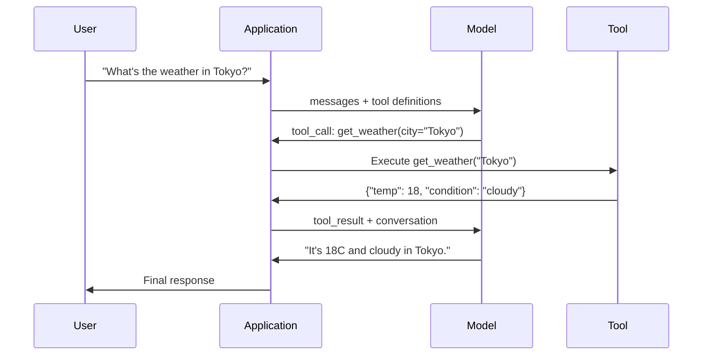
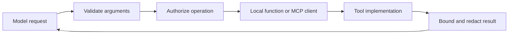

# Function Calling and Tool Use

[Back to courses](../README.md) · [Structured Outputs](2-structured-outputs.md) · [RAG](5-rag-retrieval-augmented-generation.md)

| Field | Details |
| --- | --- |
| Origin | [AI Engineering from Scratch — source lesson](https://github.com/rohitg00/ai-engineering-from-scratch/blob/main/phases/11-llm-engineering/09-function-calling/docs/en.md) |
| Author | Rohit Ghumare and contributors |
| Level | Intermediate — repository assessment |
| Best for | Designing tool schemas, implementing bounded tool loops, handling errors, and preparing for agent engineering interviews |

Adapted from the MIT-licensed lesson; copyright © 2026 Rohit Ghumare. [Original license](../licenses/ai-engineering-from-scratch-LICENSE). The walkthrough is offline and uses simulated tools and model decisions.

## The Problem

You build a chatbot. A user asks: "What's the weather in Tokyo right now?"

The model responds: "I don't have access to real-time weather data, but based on the season, Tokyo is likely around 15 degrees Celsius..."

A seasonal guess does not establish current weather. The application needs a fresh observation from an external source, not an answer inferred from training data.

An accurate answer could use a weather service API, getting the current temperature, and returning the real number. The model cannot call APIs. Your code can. The missing piece: a structured protocol that lets the model say "I need to call the weather API with these arguments" and lets your code execute it and feed the result back.

This is **function calling** (also known as **tool calling**). It provides a powerful and flexible way for  models to interface with external systems and access data outside their training data. The model outputs structured JSON describing which function to invoke with what arguments. Your application executes the function. The result goes back into the conversation. The model uses the result to produce its final answer.

Think of the model as someone filling out a request form: the form names a service and its inputs. Your application checks that request, performs an authorized operation, and returns the result. A tool call is a request, not permission to execute.

## The Concept

### The Function Calling Loop

Every tool-use interaction follows the same 5-step loop.



Step 1: the user sends a message. Step 2: the model receives the message along with tool definitions (JSON Schema describing available functions). Step 3: instead of responding with text, the model outputs a tool call -- a structured JSON object with the function name and arguments. Step 4: your code validates and authorizes the request, executes the function, and captures the result. Step 5: the result goes back to the model, which now has real data to produce its final answer.

The model never executes anything. It only decides what to call and with what arguments. Your code is the executor.

### Tool Definitions: The JSON Schema Contract

Each tool is defined by a JSON Schema that tells the model what the function does, what arguments it takes, and what types those arguments must be.

```json
{
  "type": "function",
  "function": {
    "name": "get_weather",
    "description": "Get current weather for a city. Returns temperature in Celsius and conditions.",
    "parameters": {
      "type": "object",
      "properties": {
        "city": {
          "type": "string",
          "description": "City name, e.g. 'Tokyo' or 'San Francisco'"
        },
        "units": {
          "type": "string",
          "enum": ["celsius", "fahrenheit"],
          "description": "Temperature units"
        }
      },
      "required": ["city"]
    }
  }
}
```

The `description` fields are critical. The model reads them to decide when and how to use the tool. A vague description like "gets weather" produces worse tool selection than "Get current weather for a city. Returns temperature in Celsius and conditions." The description is a prompt for tool selection.

### Provider Comparison

Interfaces differ by endpoint and model. The following table compares message shapes, not a guarantee that every model supports every option.

| Interface | Definition | Request from model | Result returned by application |
| --- | --- | --- | --- |
| OpenAI Chat Completions | `tools[].function.parameters` | `message.tool_calls[]` with ID, name, JSON argument string | `role="tool"`, matching `tool_call_id`, serialized result |
| OpenAI Responses | Function tool with `parameters` | Function-call output item | Function-call output with matching `call_id` |
| Anthropic Messages | `tools[].input_schema` | `tool_use` content block with ID, name, input object | `tool_result` block with matching `tool_use_id` |
| Open-weight model via a serving layer | Server and chat-template dependent | Server-specific or compatible tool-call format | Follow that serving layer's protocol |

See the [OpenAI function-calling guide](https://developers.openai.com/api/docs/guides/function-calling) and [Claude tool-use guide](https://platform.claude.com/docs/en/agents-and-tools/tool-use/overview). Strict schema enforcement, parallel calls, and forced tool choice are separate capabilities; validate their support for the actual model and endpoint. Schema-valid inputs still require authorization and business-rule checks.

### Tool Choice: Auto, Required, Specific

You control when the model uses tools.

**Auto** (default): the model decides whether to call a tool or respond directly. "What's 2+2?" -- responds directly. "What's the weather?" -- calls the tool.

**Required**: the model must call at least one tool. Use this when you know the user's intent requires a tool. Prevents the model from guessing instead of looking up real data.

**Specific function**: force the model to call a particular function. `tool_choice={"type":"function", "function": {"name": "get_weather"}}` requests that named function on a compatible endpoint; this does not guarantee successful execution or bypass refusals and request failures. Use this for routing -- when upstream logic already determined which tool is needed.

### Parallel Function Calling

Supported models and endpoints can request multiple functions in one turn. A user asks: "What's the weather in Tokyo and New York?" The model outputs two tool calls simultaneously:

```json
[
  {"name": "get_weather", "arguments": {"city": "Tokyo"}},
  {"name": "get_weather", "arguments": {"city": "New York"}}
]
```

Your code executes both (ideally concurrently), returns both results, and the model synthesizes a single response. This cuts round trips from 2 to 1. Execute concurrently only when calls are independent and concurrency is permitted. Dependent or conflicting writes need ordering. There is no universal percentage saving: total time includes model latency, the slowest tool, and orchestration overhead.

### Structured Outputs vs Function Calling

The [Structured Outputs course](2-structured-outputs.md) covers typed responses. Function calling uses the same JSON Schema machinery, but for a different purpose.

**Structured outputs**: force the model to produce data in a specific shape. The output is the final product. Example: extract product info from text as `{name, price, in_stock}`.

**Function calling**: the model declares an intent to execute an action. The output is an intermediate step. Example: `get_weather(city="Tokyo")` -- the model is requesting an action, not producing the final answer.

Use structured outputs when you want data extraction. Use function calling when you want the model to interact with external systems.

### Execution Boundaries

| Check | Concrete implementation | Failure it prevents |
| --- | --- | --- |
| Tool allowlist | Resolve names only from the approved registry | Arbitrary function dispatch |
| Argument validation | Check types, required fields, bounds, enums, and extra keys | Malformed or excessive inputs |
| Authorization | Enforce caller identity, tenant scope, and allowed actions outside the model | Valid arguments accessing unauthorized resources |
| Database access | Parameterize values; allowlist table/column identifiers and operations | Injection and unintended query scope |
| Files and code | Constrain file roots; use an isolated, resource-limited execution service for untrusted code | Host access and resource exhaustion |
| Results | Redact secrets and limit returned content; retain structured errors | Data leakage and oversized context |
| Side effects | Use idempotency keys and approval rules appropriate to the action | Duplicate or unintended writes |
| Budgets | Bound calls, iterations, retries, elapsed time, and cost | Repeated loops and runaway work |

Tool results are untrusted data, even when the tool itself is authorized. Text returned by search or a file can contain instructions; it must not acquire authority over the application. Redaction alone does not eliminate prompt injection.

### Error Handling

Tools fail. APIs time out. Databases go down. Files do not exist. The model needs to know when a tool fails and why.

Return errors as structured tool results, not exceptions:

```json
{
  "error": true,
  "message": "City 'Toky' not found. Did you mean 'Tokyo'?",
  "code": "CITY_NOT_FOUND"
}
```

The model may use the error to correct its arguments. Bound retries and distinguish invalid input from transient service failures. Retry reads when appropriate; for writes, first determine whether the previous attempt succeeded. Keep internal exception details in protected logs rather than exposing secrets in tool results.

### MCP: Model Context Protocol

**Model Context Protocol (MCP)** standardizes discovery and invocation of tools exposed by servers. It complements provider-specific function calling: an adapter can present discovered tools to a model and route authorized calls to the appropriate server. It does not itself grant database or repository permissions.

See the [MCP tools specification](https://modelcontextprotocol.io/specification/2025-11-25/server/tools). Transport, authentication, capability discovery, and tool execution remain distinct concerns.



## Build It

Copy the six Python blocks below into one file in order, followed by the final `run_demo()` invocation. Python 3.10+ and the standard library are sufficient. The model, weather, search, file store, and code runner are simulations; no network calls, filesystem reads, or arbitrary code execution occur.

### Step 1: Define the Tool Registry

Build a registry that stores tool definitions and their implementations. Each tool has a JSON Schema definition (what the model sees) and a Python function (what your code executes).

```python
import ast
import json
import math
import time
import operator


TOOL_REGISTRY = {}


def register_tool(name, description, parameters, function):
    TOOL_REGISTRY[name] = {
        "definition": {
            "type": "function",
            "function": {
                "name": name,
                "description": description,
                "parameters": parameters,
            },
        },
        "function": function,
    }
```

### Step 2: Implement 5 Tools

Build a calculator, weather lookup, web search simulator, file reader, and code runner.

```python
def calculator(expression, precision=2):
    # Deliberately small arithmetic language: no eval(), calls, or powers.
    if len(expression) > 200 or not 0 <= precision <= 10:
        return {"error": True, "code": "INVALID_INPUT", "message": "Input limit exceeded"}
    binary = {ast.Add: operator.add, ast.Sub: operator.sub,
              ast.Mult: operator.mul, ast.Div: operator.truediv}
    unary = {ast.UAdd: operator.pos, ast.USub: operator.neg}

    def visit(node):
        if isinstance(node, ast.Constant) and type(node.value) in (int, float):
            value = float(node.value)
        elif isinstance(node, ast.BinOp) and type(node.op) in binary:
            value = binary[type(node.op)](visit(node.left), visit(node.right))
        elif isinstance(node, ast.UnaryOp) and type(node.op) in unary:
            value = unary[type(node.op)](visit(node.operand))
        else:
            raise ValueError("Unsupported arithmetic syntax")
        if not math.isfinite(value) or abs(value) > 1e12:
            raise ValueError("Result outside demo limits")
        return value

    try:
        tree = ast.parse(expression, mode="eval")
        if sum(1 for _ in ast.walk(tree)) > 100:
            raise ValueError("Expression too complex")
        return {"result": round(visit(tree.body), precision), "expression": expression}
    except (SyntaxError, ValueError, ZeroDivisionError, OverflowError, RecursionError):
        return {"error": True, "code": "INVALID_EXPRESSION", "message": "Unsupported or invalid arithmetic"}


WEATHER_DB = {
    "tokyo": {"temp_c": 18, "condition": "cloudy", "humidity": 72, "wind_kph": 14},
    "new york": {"temp_c": 22, "condition": "sunny", "humidity": 45, "wind_kph": 8},
    "london": {"temp_c": 12, "condition": "rainy", "humidity": 88, "wind_kph": 22},
    "san francisco": {"temp_c": 16, "condition": "foggy", "humidity": 80, "wind_kph": 18},
    "sydney": {"temp_c": 25, "condition": "sunny", "humidity": 55, "wind_kph": 10},
}


def get_weather(city, units="celsius"):
    key = city.lower().strip()
    if key not in WEATHER_DB:
        suggestions = [c for c in WEATHER_DB if c.startswith(key[:3])]
        return {
            "error": True,
            "message": f"City '{city}' not found.",
            "suggestions": suggestions,
            "code": "CITY_NOT_FOUND",
        }
    data = WEATHER_DB[key].copy()
    if units == "fahrenheit":
        data["temp_f"] = round(data["temp_c"] * 9 / 5 + 32, 1)
        del data["temp_c"]
    data["city"] = city
    return data


SEARCH_DB = {
    "python function calling": [
        {"title": "OpenAI Function Calling Guide", "url": "https://platform.openai.com/docs/guides/function-calling", "snippet": "Learn how to connect LLMs to external tools."},
        {"title": "Anthropic Tool Use", "url": "https://docs.anthropic.com/en/docs/tool-use", "snippet": "Claude can interact with external tools and APIs."},
    ],
    "MCP protocol": [
        {"title": "Model Context Protocol", "url": "https://modelcontextprotocol.io", "snippet": "An open standard for connecting AI models to data sources."},
    ],
    "weather API": [
        {"title": "OpenWeatherMap API", "url": "https://openweathermap.org/api", "snippet": "Free weather API with current, forecast, and historical data."},
    ],
}


def web_search(query, max_results=3):
    key = query.lower().strip()
    for db_key, results in SEARCH_DB.items():
        if db_key.lower() in key or key in db_key.lower():
            return {"query": query, "results": results[:max_results], "total": len(results)}
    return {"query": query, "results": [], "total": 0}


FILE_SYSTEM = {
    "data/config.json": '{"model": "gpt-4o", "temperature": 0.7, "max_tokens": 4096}',
    "data/users.csv": "name,email,role\nAlice,alice@example.com,admin\nBob,bob@example.com,user",
    "README.md": "# My Project\nA tool-use agent built from scratch.",
}


def read_file(path):
    if ".." in path or path.startswith("/"):
        return {"error": True, "message": "Path traversal not allowed.", "code": "FORBIDDEN"}
    if path not in FILE_SYSTEM:
        available = list(FILE_SYSTEM.keys())
        return {"error": True, "message": f"File '{path}' not found.", "available_files": available, "code": "NOT_FOUND"}
    content = FILE_SYSTEM[path]
    return {"path": path, "content": content, "size_bytes": len(content.encode("utf-8")), "lines": content.count("\n") + 1}


def run_code(code, language="python"):
    # Fixture lookup only. No supplied code is executed.
    fixtures = {
        "result = sum(range(1, 101))": 5050,
        "result = 'Hello from the simulator!'": "Hello from the simulator!",
    }
    if language != "python" or code not in fixtures:
        return {"error": True, "code": "UNSUPPORTED_FIXTURE",
                "message": "Only the documented demo snippets are supported"}
    return {"success": True, "result": fixtures[code], "simulated": True}
```

The calculator interprets a bounded arithmetic syntax tree. The code runner only recognizes fixed strings and returns fixture values. Neither is a general Python sandbox. A real code-execution tool needs separate isolation, resource limits, network controls, and a bounded result protocol.

### Step 3: Register All Tools

```python
def register_all_tools():
    register_tool(
        "calculator", "Evaluate a mathematical expression. Supports +, -, *, /, parentheses, and decimals. Returns the numeric result.",
        {"type": "object", "properties": {"expression": {"type": "string", "description": "Math expression, e.g. '(10 + 5) * 3'"}, "precision": {"type": "integer", "description": "Decimal places in result", "minimum": 0, "maximum": 10, "default": 2}}, "required": ["expression"]},
        calculator,
    )
    register_tool(
        "get_weather", "Get fictional fixture weather for a city. Not a live observation.",
        {"type": "object", "properties": {"city": {"type": "string", "description": "City name, e.g. 'Tokyo' or 'San Francisco'"}, "units": {"type": "string", "enum": ["celsius", "fahrenheit"], "description": "Temperature units, defaults to celsius"}}, "required": ["city"]},
        get_weather,
    )
    register_tool(
        "web_search", "Search a fixed in-memory fixture database; does not access the web.",
        {"type": "object", "properties": {"query": {"type": "string", "description": "Search query"}, "max_results": {"type": "integer", "description": "Maximum results to return", "minimum": 1, "maximum": 10, "default": 3}}, "required": ["query"]},
        web_search,
    )
    register_tool(
        "read_file", "Read a fictional file from the in-memory dictionary; not the host filesystem.",
        {"type": "object", "properties": {"path": {"type": "string", "description": "Relative file path, e.g. 'data/config.json'"}}, "required": ["path"]},
        read_file,
    )
    register_tool(
        "run_code", "Simulate a documented Python fixture. Does not execute arbitrary code.",
        {"type": "object", "properties": {"code": {"type": "string", "description": "Python code to execute"}, "language": {"type": "string", "enum": ["python"], "description": "Programming language"}}, "required": ["code"]},
        run_code,
    )
```

### Step 4: Build the Function Calling Loop

This is the core engine. It simulates the model deciding which tool to call, executes the tool, and feeds results back.

```python
def simulate_model_decision(user_message, tools, conversation_history):
    if any(turn["role"] == "tool" for turn in conversation_history):
        return []  # This fixture policy finishes after receiving tool results.
    msg = user_message.lower()

    if any(word in msg for word in ["weather", "temperature", "forecast"]):
        cities = []
        for city in WEATHER_DB:
            if city in msg:
                cities.append(city)
        if not cities:
            for word in msg.split():
                if word.capitalize() in [c.title() for c in WEATHER_DB]:
                    cities.append(word)
        if not cities:
            return []  # Do not invent a requested city.
        calls = []
        for city in cities:
            calls.append({"name": "get_weather", "arguments": {"city": city.title()}})
        return calls

    if any(word in msg for word in ["calculate", "compute", "math", "what is", "how much"]):
        if any(symbol in msg for symbol in "+-*/"):
            expr = "".join(c for c in msg if c in "0123456789+-*/.() ").strip()
            if expr:
                return [{"name": "calculator", "arguments": {"expression": expr}}]
        return []

    if any(word in msg for word in ["search", "find", "look up", "google"]):
        query = msg.replace("search for", "").replace("look up", "").replace("find", "").strip()
        return [{"name": "web_search", "arguments": {"query": query}}]

    if any(word in msg for word in ["read", "file", "open", "cat", "show"]):
        for path in FILE_SYSTEM:
            if path.split("/")[-1].split(".")[0] in msg:
                return [{"name": "read_file", "arguments": {"path": path}}]
        return [{"name": "read_file", "arguments": {"path": "README.md"}}]

    if any(word in msg for word in ["run", "execute", "code", "python"]):
        return [{"name": "run_code", "arguments": {"code": "result = 'Hello from the simulator!'", "language": "python"}}]

    return []


def execute_tool_call(tool_call):
    name = tool_call.get("name", "")
    args = tool_call.get("arguments", {})
    start = time.perf_counter()
    errors = validate_tool_arguments(name, args)
    if errors:
        result = {"error": True, "code": "INVALID_ARGUMENTS", "message": "; ".join(errors)}
    else:
        try:
            result = TOOL_REGISTRY[name]["function"](**args)
        except Exception:
            result = {"error": True, "code": "TOOL_FAILED", "message": "Tool execution failed"}
    return {"tool": name, "call_id": tool_call.get("id"), "result": result,
            "execution_time_ms": round((time.perf_counter() - start) * 1000, 2)}


def run_function_calling_loop(user_message, max_iterations=5, max_calls=10,
                              decide=simulate_model_decision):
    if max_iterations < 1 or max_calls < 1:
        raise ValueError("Iteration and call limits must be positive")
    conversation = [{"role": "user", "content": user_message}]
    definitions = [t["definition"] for t in TOOL_REGISTRY.values()]
    all_results = []
    stop_reason = "iteration_limit"
    rounds = 0
    for _ in range(max_iterations):
        calls = decide(user_message, definitions, conversation)
        rounds += 1
        if not calls:
            stop_reason = "complete"
            break
        if len(all_results) + len(calls) > max_calls:
            stop_reason = "call_limit"
            break
        calls = [dict(call, id=f"call_{len(all_results) + i + 1}")
                 for i, call in enumerate(calls)]
        conversation.append({"role": "assistant", "content": None, "tool_calls": calls})
        # Sequential execution even when several calls were requested together.
        for call in calls:
            result = execute_tool_call(call)
            all_results.append(result)
            conversation.append({"role": "tool", "tool_call_id": call["id"],
                                 "content": json.dumps(result["result"])})
    if stop_reason == "complete":
        final_text = "[Simulated final answer using tool results]" if all_results else "[Simulated direct response]"
    else:
        final_text = f"[Stopped: {stop_reason}; task may be incomplete]"
    conversation.append({"role": "assistant", "content": final_text})
    return {"conversation": conversation, "tool_results": all_results,
            "iterations": rounds, "stop_reason": stop_reason}
```

This is an application-internal message format, not a ready-to-send provider payload. A real model supplies call IDs; preserve them when returning results. The fixture decision policy stops after one batch, while the loop can support multiple decisions and enforces call/iteration limits. It has no deadline or cancellation implementation; real tools need those too.

### Step 5: Argument Validation

Validate before dispatch, as `execute_tool_call` above does. This teaching validator supports only flat properties, required fields, simple types, numeric bounds, enums, and a string-length cap. Use a maintained schema validator for nested schemas and other keywords. This is not an authorization check.

```python
def validate_tool_arguments(tool_name, arguments):
    if tool_name not in TOOL_REGISTRY:
        return [f"Unknown tool: {tool_name}"]

    schema = TOOL_REGISTRY[tool_name]["definition"]["function"]["parameters"]
    errors = []

    if not isinstance(arguments, dict):
        return [f"Arguments must be an object, got {type(arguments).__name__}"]

    for required_field in schema.get("required", []):
        if required_field not in arguments:
            errors.append(f"Missing required argument: {required_field}")

    properties = schema.get("properties", {})
    for arg_name, arg_value in arguments.items():
        if arg_name not in properties:
            errors.append(f"Unknown argument: {arg_name}")
            continue

        prop_schema = properties[arg_name]
        expected_type = prop_schema.get("type")

        type_checks = {"string": str, "integer": int, "number": (int, float), "boolean": bool, "array": list, "object": dict}
        if expected_type in type_checks:
            if (not isinstance(arg_value, type_checks[expected_type])
                    or expected_type in ("integer", "number") and isinstance(arg_value, bool)):
                errors.append(f"Argument '{arg_name}': expected {expected_type}, got {type(arg_value).__name__}")

        if isinstance(arg_value, str) and len(arg_value) > 2000:
            errors.append(f"Argument {arg_name}: string exceeds demo limit")
        if type(arg_value) in (int, float):
            if not math.isfinite(arg_value):
                errors.append(f"Argument {arg_name}: must be finite")
            if "minimum" in prop_schema and arg_value < prop_schema["minimum"]:
                errors.append(f"Argument {arg_name}: below minimum")
            if "maximum" in prop_schema and arg_value > prop_schema["maximum"]:
                errors.append(f"Argument {arg_name}: above maximum")
        if "enum" in prop_schema and arg_value not in prop_schema["enum"]:
            errors.append(f"Argument '{arg_name}': '{arg_value}' not in {prop_schema['enum']}")

    return errors
```

### Step 6: Run the Demo

```python
def run_demo():
    register_all_tools()

    print("=" * 60)
    print("  Function Calling & Tool Use Demo")
    print("=" * 60)

    print("\n--- Registered Tools ---")
    for name, tool in TOOL_REGISTRY.items():
        desc = tool["definition"]["function"]["description"][:60]
        params = list(tool["definition"]["function"]["parameters"].get("properties", {}).keys())
        print(f"  {name}: {desc}...")
        print(f"    params: {params}")

    print(f"\n--- Argument Validation ---")
    validation_tests = [
        ("get_weather", {"city": "Tokyo"}, "Valid call"),
        ("get_weather", {}, "Missing required arg"),
        ("get_weather", {"city": "Tokyo", "units": "kelvin"}, "Invalid enum value"),
        ("calculator", {"expression": 123}, "Wrong type (int for string)"),
        ("unknown_tool", {"x": 1}, "Unknown tool"),
    ]
    for tool_name, args, label in validation_tests:
        errors = validate_tool_arguments(tool_name, args)
        status = "VALID" if not errors else f"ERRORS: {errors}"
        print(f"  {label}: {status}")

    print(f"\n--- Tool Execution ---")
    direct_tests = [
        {"name": "calculator", "arguments": {"expression": "(10 + 5) * 3 / 2"}},
        {"name": "get_weather", "arguments": {"city": "Tokyo"}},
        {"name": "get_weather", "arguments": {"city": "Mars"}},
        {"name": "web_search", "arguments": {"query": "python function calling"}},
        {"name": "read_file", "arguments": {"path": "data/config.json"}},
        {"name": "read_file", "arguments": {"path": "../etc/passwd"}},
        {"name": "run_code", "arguments": {"code": "result = sum(range(1, 101))"}},
        {"name": "run_code", "arguments": {"code": "import os"}},
    ]
    for call in direct_tests:
        result = execute_tool_call(call)
        print(f"\n  {call['name']}({json.dumps(call['arguments'])})")
        print(f"    -> {json.dumps(result['result'], indent=None)[:100]}")
        print(f"    time: {result['execution_time_ms']}ms")

    print(f"\n--- Full Function Calling Loop ---")
    test_queries = [
        "What's the weather in Tokyo?",
        "Calculate (100 + 250) * 0.15",
        "Search for MCP protocol",
        "Read the config file",
        "Run some Python code",
        "Tell me a joke",
    ]
    for query in test_queries:
        print(f"\n  User: {query}")
        result = run_function_calling_loop(query)
        if result["tool_results"]:
            for tr in result["tool_results"]:
                print(f"    Tool: {tr['tool']} ({tr['execution_time_ms']}ms)")
                print(f"    Result: {json.dumps(tr['result'], indent=None)[:90]}")
        else:
            print(f"    [No tool called -- direct response]")
        print(f"    Iterations: {result['iterations']}")

    print(f"\n--- Multiple Calls in One Turn (executed sequentially) ---")
    multi_city_query = "What's the weather in tokyo and london?"
    print(f"  User: {multi_city_query}")
    result = run_function_calling_loop(multi_city_query)
    print(f"  Tool calls made: {len(result['tool_results'])}")
    for tr in result["tool_results"]:
        city = tr["result"].get("city", "unknown")
        temp = tr["result"].get("temp_c", "N/A")
        print(f"    {city}: {temp}C, {tr['result'].get('condition', 'N/A')}")

    print(f"\n--- Security Checks ---")
    security_tests = [
        ("read_file", {"path": "../../etc/passwd"}),
        ("run_code", {"code": "import subprocess; subprocess.run(['ls'])"}),
        ("calculator", {"expression": "__import__('os').system('ls')"}),
    ]
    for tool_name, args in security_tests:
        result = execute_tool_call({"name": tool_name, "arguments": args})
        blocked = result["result"].get("error", False)
        print(f"  {tool_name}({list(args.values())[0][:40]}): {'BLOCKED' if blocked else 'ALLOWED'}")
```

```python
run_demo()
```

Expect the calculator to return 22.5 for `(10 + 5) * 3 / 2`, fixture weather for Tokyo, structured errors for unknown cities and invalid arguments, two call/result pairs for Tokyo and London, and a simulated final answer. None of this measures a real model’s tool-selection accuracy.

## Use It

### Provider Adapters

The offline loop separates model decisions from execution. For a live client, preserve full assistant messages and every call ID. Do not assume the response contains exactly one tool call: it can contain none, multiple calls, or a refusal/incomplete response. Decode arguments, validate, authorize, execute, and return one corresponding result per accepted call. Handle denied calls as explicit errors, not missing results.

| Step | OpenAI Chat Completions | Anthropic Messages |
| --- | --- | --- |
| Find calls | Iterate `message.tool_calls or []` | Iterate content blocks with `type == "tool_use"` |
| Read arguments | Decode `call.function.arguments` as JSON | Read `block.input` |
| Return results | Tool messages with `tool_call_id` | User message containing `tool_result` blocks with `tool_use_id` |
| Continue | Preserve assistant message and append all results | Preserve assistant content and append all result blocks |

API shapes and supported schema restrictions are documented in the [OpenAI guide](https://developers.openai.com/api/docs/guides/function-calling) and [Claude guide](https://platform.claude.com/docs/en/agents-and-tools/tool-use/overview). The following provider-neutral adapter demonstrates JSON argument handling; it does not make network requests:

```python
def dispatch_json_call(call_id, name, raw_arguments):
    try:
        arguments = json.loads(raw_arguments)
    except (json.JSONDecodeError, TypeError):
        return {"tool": name, "call_id": call_id,
                "result": {"error": True, "code": "INVALID_JSON",
                           "message": "Arguments must be valid JSON"}}
    return execute_tool_call({"id": call_id, "name": name, "arguments": arguments})

print(dispatch_json_call("demo_1", "get_weather", '{"city": "Tokyo"}'))
print(dispatch_json_call("demo_2", "get_weather", '{invalid'))
```

### MCP Integration

For an approved MCP server, the client initializes a session, discovers tools with `tools/list`, maps their schemas into the model’s tool format, and invokes `tools/call` for authorized requests. The server returns content and may mark a tool error. Preserve error information and apply output limits before adding results to context. See the [MCP specification](https://modelcontextprotocol.io/specification/2025-11-25/server/tools).

MCP standardizes the integration boundary; it does not make arbitrary servers trusted, grant permissions, or replace provider adapters. No MCP server is installed or started by this lesson.


#### Discovery and Changes

In the [2025-11-25 tools specification](https://modelcontextprotocol.io/specification/2025-11-25/server/tools), servers advertise a `tools` capability. Clients page through `tools/list` using `nextCursor`. A server advertising `listChanged` can emit `notifications/tools/list_changed`; refresh discovery when notified.

#### Input and Output Contracts

| Field | Purpose |
| --- | --- |
| `name` | Invocation identifier |
| `title`, `description` | Display label and explanation |
| `inputSchema` | Argument contract |
| `outputSchema` | Optional structured-result contract |
| `annotations` | Behavioral hints; untrusted unless the server is trusted |

Example call and successful response (fictional inventory data):

```json
{
  "jsonrpc": "2.0",
  "id": 42,
  "method": "tools/call",
  "params": {
    "name": "inventory.lookup",
    "arguments": {"sku": "DEMO-7"}
  }
}
```

```json
{
  "jsonrpc": "2.0",
  "id": 42,
  "result": {
    "content": [{"type": "text", "text": "{\"stock\":7}"}],
    "structuredContent": {"stock": 7},
    "isError": false
  }
}
```

`structuredContent` is server data, not schema-constrained LLM generation. With `outputSchema`, servers must conform and clients should validate. Results can also contain images, audio, resource links, or embedded resources.

#### Two Error Paths

| Error | Envelope | Example |
| --- | --- | --- |
| Protocol | JSON-RPC `error` | Unknown tool or malformed request |
| Execution | `result.isError: true` | Invalid business input or unavailable backend |

Surface actionable execution errors for bounded recovery. Enforce server-side access controls; clients should apply timeouts, validate results, and seek confirmation for sensitive operations. These distinctions come from the [MCP tools specification](https://modelcontextprotocol.io/specification/2025-11-25/server/tools#error-handling).

## Evaluation and Reusable Patterns

| Metric | Definition | What it tells you |
| --- | --- | --- |
| Tool selection accuracy | Queries choosing the expected tool set / labeled queries | Routing quality, including no-tool cases |
| Argument validity | Calls passing schema checks / proposed calls | Structural correctness, not semantic correctness |
| Argument accuracy | Calls with task-correct arguments / labeled calls | Whether the model chose the right resource and values |
| Task success | Completed tasks / evaluated tasks | End-to-end usefulness |
| Recovery rate | Recoverable errors resolved within budget / recoverable errors | Effectiveness of feedback and retries |
| Duplicate side effects | Repeated unintended mutations / mutation tasks | Idempotency failures |
| Cost and latency | Model plus tool cost; p50/p95 elapsed time | Operational tradeoffs |

For example, 27 correct tool selections out of 30 queries is 90% selection accuracy. If only 21 tasks complete correctly, task success is 70%. Valid arguments alone cannot bridge that gap.

Upstream resources: [tool-designer prompt](https://github.com/rohitg00/ai-engineering-from-scratch/blob/main/phases/11-llm-engineering/09-function-calling/outputs/prompt-tool-designer.md) and [function-calling patterns](https://github.com/rohitg00/ai-engineering-from-scratch/blob/main/phases/11-llm-engineering/09-function-calling/outputs/skill-function-calling-patterns.md). These are linked resources, not generated artifacts.

## Exercises

1. **Add a 6th tool: database query.** Implement a simulated SQL tool with an in-memory table. The tool accepts a table name and filter conditions (not raw SQL). Validate that the table name is in an allowlist and that filter operators are restricted to `=`, `>`, `<`, `>=`, `<=`. Return matching rows as JSON.

2. **Implement retry with error feedback.** When a tool call fails (e.g., city not found), feed the error message back to the model decision function and let it correct its arguments. Track how many retries each call takes. Set a maximum of 3 retries per tool call.

3. **Build a multi-step agent.** Some queries require chaining tool calls: "Read the config file and tell me what model is configured, then search the web for that model's pricing." Implement a loop that runs until the model decides no more tools are needed, passing accumulated results into each decision step. Limit to 10 iterations to prevent infinite loops.

4. **Measure tool selection accuracy.** Create 30 test queries with expected tool names. Run your decision function on all 30 and measure what percentage of the time it selects the correct tool. Identify which queries cause the most confusion between tools.

5. **Implement tool call caching.** If the same tool is called with identical arguments within 60 seconds, return the cached result instead of re-executing. For read-only calls, key a cache by tool name, version, caller scope, and canonical JSON arguments (`json.dumps(args, sort_keys=True)`). Nested arguments are not generally hashable. Do not reuse this as a blanket cache for writes; enforce freshness and authorization. Measure cache hit rates across a conversation with 20 queries.

## Key Terms

| Term | What people say | What it actually means |
|------|----------------|----------------------|
| Function calling | "Tool use" | The model outputs structured JSON describing a function to invoke with specific arguments -- your code executes it, not the model |
| Tool definition | "Function schema" | A JSON Schema object describing a tool's name, purpose, parameters, and types -- the model reads this to decide when and how to use the tool |
| Tool choice | "Calling mode" | Controls whether the model must call a tool (required), may call a tool (auto), or must call a specific tool (named) |
| Parallel calling | "Multi-tool" | The model outputs multiple tool calls in a single turn, potentially reducing round trips; execution concurrency is an application decision |
| Tool result | "Function output" | The return value from executing a tool, sent back to the model as a message so it can use real data in its response |
| Argument validation | "Input checking" | Verifying that model-generated arguments match the expected types, ranges, and constraints before executing the tool |
| MCP | "Tool protocol" | Model Context Protocol -- An open protocol for exposing tools via servers that any compatible client can discover and call |
| Agent loop | "Tool loop" | The iterative cycle of model-decides-tool, code-executes-tool, result-feeds-back until the model has enough information to respond |
| Tool poisoning | "Prompt injection via tools" | Malicious tool metadata or content that attempts to redirect behavior; tool-result prompt injection is one related attack surface |
| Rate limiting | "Call budget" | Limiting calls over time; distinct from per-task call, retry, and iteration budgets |

## Further Reading

- [OpenAI Function Calling Guide](https://platform.openai.com/docs/guides/function-calling) -- reference for supported tool-use interfaces, including parallel calls, forced calling, and structured arguments
- [Anthropic Tool Use Guide](https://docs.anthropic.com/en/docs/tool-use) -- Claude's tool use implementation with input_schema, multi-tool responses, and tool_choice configuration
- [Model Context Protocol Specification](https://modelcontextprotocol.io) -- the open standard for tool interoperability across AI applications, with server/client architecture
- [Schick et al., 2023 -- "Toolformer: Language Models Can Teach Themselves to Use Tools"](https://arxiv.org/abs/2302.04761) -- the foundational paper on training LLMs to decide when and how to call external tools
- [Patil et al., 2023 -- "Gorilla: Large Language Model Connected with Massive APIs"](https://arxiv.org/abs/2305.15334) -- fine-tuning LLMs for accurate API calls across 1,645 APIs with hallucination reduction
- [Berkeley Function Calling Leaderboard](https://gorilla.cs.berkeley.edu/leaderboard.html) -- real-time benchmark comparing function calling accuracy across GPT-4o, Claude, Gemini, and open models
- [Yao et al., "ReAct: Synergizing Reasoning and Acting in Language Models" (ICLR 2023)](https://arxiv.org/abs/2210.03629) -- a reasoning-and-action pattern; not every tool loop uses explicit ReAct traces.
- [Anthropic — Building effective agents (Dec 2024)](https://www.anthropic.com/research/building-effective-agents) -- five composable patterns (prompt chaining, routing, parallelization, orchestrator-workers, evaluator-optimizer) built from the single tool-use primitive.

## Attribution and Import Notes

Imported on 2026-10-11 from the source linked above. Local edits qualify provider and performance claims, connect validation to dispatch, preserve call/result IDs, implement stop budgets, replace dynamic execution with bounded arithmetic and code fixtures, and add evaluation tables. Incomplete live SDK sketches are replaced with provider mappings and a runnable JSON adapter. No live APIs or MCP servers were tested.

Source SHA-256: `30695ec65c0ada92bac742cb5a287603a340c26ed7b1674767d886f54f591b29`.
