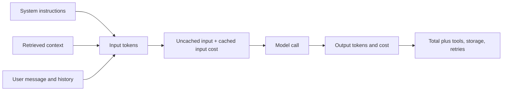
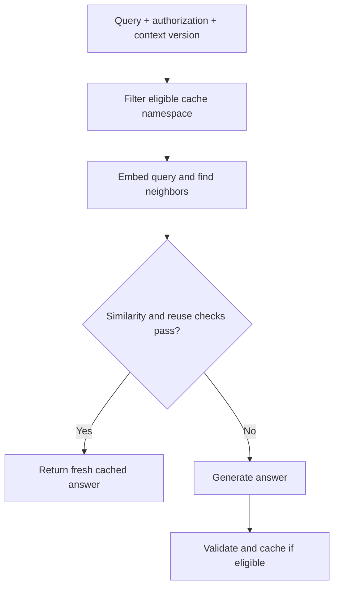
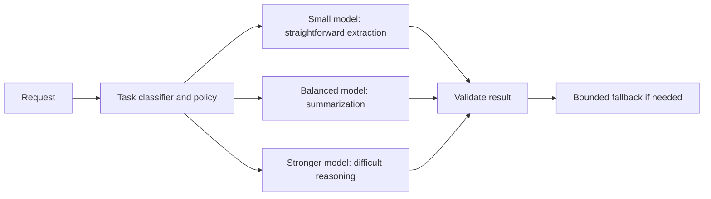

# Caching, Rate Limiting, and Cost Optimization

[Back to courses](../README.md) · [Evaluation](7-evaluation.md) · [Context Engineering](4-context-engineering.md)

## The Problem

You build a RAG chatbot. It works beautifully. Users love it.

Then the invoice arrives.

Suppose your application pays $2.50 per million input tokens and $10 per million output tokens:

- 10,000 daily active users × 10 queries = 100,000 requests/day.
- 1,000 input tokens/request costs $250/day.
- 500 output tokens/request costs $500/day.
- Total: $750/day, or **$22,500 per 30-day month**.

Embedding calls, vector storage, infrastructure, tool calls, and retries add separate costs. Their size depends on your workload. Repeated prompts and questions create opportunities to reuse work; measure repetition rather than assuming a universal hit rate.

## The Concept

### The Cost Anatomy of an LLM Call

A **token** is a unit of model input or output, often a word fragment. Provider usage counters, rather than character counts, are the source of truth for billing. An application request may trigger several model calls, including retries and agent steps.



For per-million-token rates, the simplified calculation is:

```text
call_cost = ((input_tokens - cached_input_tokens) × input_rate
             + cached_input_tokens × cached_input_rate
             + output_tokens × output_rate) / 1,000,000
```

Do not count cached input twice. Some providers report cached input separately, so normalize usage into this formula first. Cache writes, retention, reasoning-token billing, and tool fees may need extra fields.

A 1,500-token prefix at $2.50 per million tokens costs **$0.00375 per request**, **$375 per 100,000 requests**, or **$3,750 per million requests**. Small per-call costs compound quickly.

### Provider Prompt Caching

**Prompt caching** reuses computation for a repeated input prefix. Think of keeping the ingredients prepared: you still cook a new answer. It does not return an old response or eliminate output-token charges.

| Provider | Mechanism | Integration consideration |
| --- | --- | --- |
| OpenAI | Automatic matching of eligible repeated prefixes | Put stable instructions and examples first; inspect cached-token usage |
| Anthropic | Prompt caching with cache controls | Account for cache creation and read usage separately |
| Gemini | Implicit caching and explicit cached content | Explicit caching also requires managing retention and storage costs |

Minimum lengths, eligible models, retention options, and discounts vary. Check [OpenAI prompt caching](https://developers.openai.com/api/docs/guides/prompt-caching), [Anthropic prompt caching](https://platform.claude.com/docs/en/build-with-claude/prompt-caching), and [Gemini context caching](https://ai.google.dev/gemini-api/docs/caching) before budgeting.

Keep stable system instructions, tool definitions, and shared reference material before request-specific content where the API permits. A timestamp near the start can destroy prefix reuse. Never rearrange instructions in a way that changes their priority or meaning just to improve cache hits.

**Worked example:** a 2,000-token prefix at a hypothetical $2.50/M normally costs $0.005. A hypothetical 90% read discount makes its cached read cost $0.0005. Savings across 100,000 eligible reads are $450, before cache-write/storage charges. A first request that populates the cache is not a discounted read.

### Exact Response Caching

**Exact caching** stores a complete response under an exact request key. Like retrieving a saved receipt, a hit can bypass generation entirely.

Include everything that affects the permitted answer:

- Tenant and authorization scope; never reuse one user's private answer for another user.
- Model identifier/version and generation parameters.
- System prompt, full messages, tool/schema definitions, and relevant context.
- Knowledge-base, prompt, and policy versions.

Good candidates include repeated document classifications and stable FAQs. Avoid caching side-effecting tool execution as though it were a pure lookup: replaying an old purchase confirmation is not performing a new purchase.

Temperature zero does **not** guarantee identical provider outputs. Reusing an answer is an application policy that can be appropriate even for nonzero-temperature requests if freshness and diversity requirements allow it.

### Semantic Response Caching

**Semantic caching** searches for a previous request with sufficiently similar meaning, often using an embedding (a numeric representation of text). **Cosine similarity** compares vector directions; it is not a probability that two answers are interchangeable.



“What is the return policy?” and “How can I return an item?” might share an answer, but only for the same product, jurisdiction, policy version, and user entitlements. “Allow refunds” and “Do not allow refunds” can be close in vector space while requiring opposite behavior.

Tune a threshold on labeled reusable/non-reusable query pairs. Track **false-hit rate** (incorrect reused answers / all hits), **reuse recall** (found reusable pairs / all reusable pairs), and hit rate separately. Test negation, dates, product IDs, languages, and authorization boundaries. There is no universal safe threshold such as 0.95.

Use a **TTL**, or time to live, to expire entries, plus explicit invalidation when underlying facts or permissions change. Include embedding, vector-search, storage, and validation costs in the savings calculation.

### Comparing the Cache Layers

| Layer | Reuses | LLM generation on hit? | Main risk | Useful example |
| --- | --- | --- | --- | --- |
| Provider prompt cache | Prefix computation | Yes | Prefix changes or expired cache | Long shared instructions |
| Exact response cache | Complete previous answer | No | Missing key fields or stale facts | Same extraction on the same document |
| Semantic response cache | Answer to a related request | No | Similar wording, different required answer | Stable FAQ paraphrases |

A cache hit at one layer changes the traffic available to later layers. Do not add their percentage savings together.

### Rate Limiting and Quotas

A **token bucket** holds a maximum capacity and refills at a steady rate. Requests remove units; an empty bucket rejects or delays requests. This allows bursts while limiting sustained throughput. Bucket units can be requests or estimated LLM tokens: specify which one you mean.

A continuously refilling bucket is **not a daily quota**. Daily/monthly limits need separate period counters. Requests-per-minute and concurrent-request limits protect different resources.

| Illustrative tier | Daily token quota | Requests/minute | Routing policy |
| --- | ---: | ---: | --- |
| Free | 50,000 | 10 | Small model |
| Pro | 500,000 | 60 | Small or balanced model |
| Enterprise | 5,000,000 | 300 | Approved models within contract |

These are product-policy examples, not provider limits. Reserve estimated input plus maximum output tokens before dispatch, then reconcile actual usage afterward. In a multi-worker service, reservations must be atomic in a shared store. Retry with bounded exponential backoff and jitter; retries also need a budget.

### Model Routing

A **router** selects a model based on task requirements, measured quality, latency, and cost.



A short question can be difficult. Length and keywords are only demonstration heuristics. Evaluate each route on representative tasks, including expensive fallback calls and router overhead. A lower token bill is not an improvement if successful-task rate collapses.

### Cost Tracking and Metrics

Log request/call IDs, timestamp, model and pricing version, input/output/cached tokens, cost, latency, tenant identifier, task category, cache status, route, retries, and outcome. Avoid placing raw sensitive prompts in routine billing logs.

| Metric | Calculation or interpretation |
| --- | --- |
| Cost per request | Total serving cost / application requests, including hits and failures |
| Cost per successful task | Total serving cost / tasks meeting the quality rubric |
| Exact/semantic hit rate | Hits / lookups at that layer; report denominators |
| Provider cached-input fraction | Cached input tokens / total input tokens |
| False-hit rate | Incorrectly reused answers / evaluated response-cache hits |
| p50/p95 latency | Median and 95th-percentile end-to-end latency; split hits and misses |
| Retry/fallback rate | Requests requiring retries/fallbacks / requests |
| Budget burn rate | Spend per time interval; forecast with traffic assumptions |

Estimate avoided cost only when you have a defensible counterfactual. Logging zero tokens for a cache hit tells you its generation charge, not how much the avoided model call would have cost. Reconcile estimates against provider invoices.

### Batching

**Batch inference** processes queued independent requests asynchronously. It suits nightly extraction, bulk classification, evaluation, and enrichment. It is usually unsuitable for interactive answers with short deadlines.

For supported workloads, the [OpenAI Batch API](https://developers.openai.com/api/docs/guides/batch) offers discounted asynchronous processing. Verify current eligibility, limits, and completion-window terms. Preserve stable request IDs, match results by ID rather than order, record individual failures, and retry only failed jobs.

### Budget Alerts and Circuit Breakers

An alert informs you. A **circuit breaker** actually refuses new work when a budget or failure condition is reached. Illustrative policy:

| Budget consumed | Action |
| --- | --- |
| 70% | Warn and investigate unexpected growth |
| 85% | Restrict costly routes or defer eligible batch work |
| 95% | Stop new paid generation; serve eligible cache hits or a clear limit response |

The remaining 5% is headroom, not a guarantee: concurrent requests and delayed usage reports can overshoot it. Reserve estimated spend atomically before dispatch, enforce maximum output/tool steps, and reconcile completed calls. Define a billing period and reset policy explicitly.

### The Optimization Stack

| Technique | Measure before adopting | Additional cost or failure mode |
| --- | --- | --- |
| Provider caching | Repeated prefix tokens and read/write charges | Cache writes, retention, invalidations |
| Exact caching | Exact repetition and stale-answer rate | Storage and key correctness |
| Semantic caching | Validated reuse and false-hit rates | Embeddings, search, wrong-answer reuse |
| Routing | Quality and total cost per task | Classifier, fallback, and retry charges |
| Rate limiting | Rejected requests and user impact | Fairness and distributed coordination |
| Context reduction | Token savings and answer completeness | Omitted evidence can lower quality |
| Batching | Deadline tolerance and eligible volume | Queue delay and partial failures |

### Worked Before/After Budget

Keep the initial 3,000,000 requests/month, 1,000 input tokens, and 500 output tokens per uncached call. Suppose 20% are safe exact hits, and half the remaining calls can use a small model at hypothetical $0.15/M input and $0.60/M output without losing required quality.

| Component | Calculation | Monthly cost |
| --- | --- | ---: |
| Baseline | 3M × $0.0075 | $22,500 |
| Cached responses | 600K × $0 generation charge | $0 generation |
| Remaining premium calls | 1.2M × $0.0075 | $9,000 |
| Remaining small-model calls | 1.2M × $0.00045 | $540 |
| Optimized generation total | $9,000 + $540 | $9,540 |
| Generation savings | $22,500 − $9,540 | $12,960 (57.6%) |

This is a hypothetical scenario, not a benchmark or measured customer result. Add cache infrastructure, routing, retries, and other fees to get total cost. Latency improvements must be measured separately.

## Build It

Copy the following Python blocks into one file in order and run with Python 3.10+. No API key or third-party dependency is needed. This is a single-process teaching implementation: the similarity cache uses word counts, not neural embeddings, and the rate limiter is not thread-safe.

### Step 1: Cost Calculator

Use deliberately fictional model names so these rates cannot be mistaken for current quotes.

| Demo model | Input / 1M | Cached input / 1M | Output / 1M |
| --- | ---: | ---: | ---: |
| demo-small | $0.15 | $0.075 | $0.60 |
| demo-premium | $2.50 | $1.25 | $10.00 |

```python
import hashlib
import json
import math
import re
import time
from collections import Counter, OrderedDict

PRICES = {
    "demo-small": (0.15, 0.075, 0.60),
    "demo-premium": (2.50, 1.25, 10.00),
}


def cost(model, input_tokens, output_tokens, cached_tokens=0):
    counts = (input_tokens, output_tokens, cached_tokens)
    if any(type(n) is not int or n < 0 for n in counts):
        raise ValueError("Token counts must be nonnegative integers")
    if cached_tokens > input_tokens:
        raise ValueError("Cached tokens cannot exceed total input tokens")
    if model not in PRICES:
        raise ValueError("Unknown model")
    ordinary, cached, output = PRICES[model]
    return ((input_tokens - cached_tokens) * ordinary
            + cached_tokens * cached + output_tokens * output) / 1_000_000
```

Round for display, not after every call. Financial ledgers should use decimal arithmetic and the provider's billing rules. This formula intentionally excludes cache writes, storage, and tool fees.

### Step 2: Exact Cache with TTL and LRU Eviction

**LRU** means least recently used: when full, evict the entry that has gone unused longest. The scope is a caller-supplied versioned authorization namespace, not something derived from untrusted query text.

```python
class ExactCache:
    def __init__(self, capacity=1000, ttl=300, clock=time.monotonic):
        if capacity < 1 or ttl <= 0:
            raise ValueError("Capacity and TTL must be positive")
        self.capacity, self.ttl, self.clock = capacity, ttl, clock
        self.entries = OrderedDict()

    @staticmethod
    def key(scope, model, messages, settings):
        payload = [scope, model, messages, settings]
        encoded = json.dumps(payload, sort_keys=True, separators=(",", ":"))
        return hashlib.sha256(encoded.encode()).hexdigest()

    def get(self, key):
        item = self.entries.get(key)
        if item is None:
            return None
        expires, answer = item
        if expires <= self.clock():
            del self.entries[key]
            return None
        self.entries.move_to_end(key)
        return answer

    def put(self, key, answer):
        if answer is None:
            raise ValueError("None is reserved for cache misses")
        now = self.clock()
        for old_key, (expires, _) in list(self.entries.items()):
            if expires <= now:
                del self.entries[old_key]
        self.entries[key] = (now + self.ttl, answer)
        self.entries.move_to_end(key)
        while len(self.entries) > self.capacity:
            self.entries.popitem(last=False)
```

The demo keeps prompts in memory only. Production storage needs access controls, retention/deletion policies, and invalidation on permission changes. A hash is not encryption.

### Step 3: Similarity Cache Demonstration

This sparse bag-of-words vector counts normalized words. It illustrates the mechanics of cosine lookup but cannot reliably recognize paraphrases or negation. Keep it out of the automatic answer path until a real reuse policy has been evaluated.

```python
def word_vector(text):
    counts = Counter(re.findall(r"\b\w+\b", text.lower()))
    norm = math.sqrt(sum(n * n for n in counts.values()))
    return {word: n / norm for word, n in counts.items()} if norm else {}


def cosine(a, b):
    return sum(value * b.get(word, 0.0) for word, value in a.items())


class SimilarityCache:
    def __init__(self, threshold=0.95, capacity=100, ttl=300,
                 clock=time.monotonic):
        if not 0 <= threshold <= 1 or capacity < 1 or ttl <= 0:
            raise ValueError("Invalid threshold, capacity, or TTL")
        self.threshold, self.capacity = threshold, capacity
        self.ttl, self.clock, self.entries = ttl, clock, []

    def prune(self):
        self.entries = [e for e in self.entries if e[0] > self.clock()]

    def put(self, scope, query, answer):
        self.prune()
        self.entries.append((self.clock() + self.ttl, scope,
                             word_vector(query), answer))
        self.entries = self.entries[-self.capacity:]

    def candidate(self, scope, query):
        self.prune()
        vector = word_vector(query)
        matches = [(cosine(vector, v), answer)
                   for _, stored_scope, v, answer in self.entries
                   if stored_scope == scope and vector and v]
        if not matches:
            return None
        score, answer = max(matches, key=lambda pair: pair[0])
        return (score, answer) if score >= self.threshold else None
```

The returned value is a **candidate**, not proof that reuse is safe. Include model, settings, conversation/context, and policy versions in the scope or additional filters. Production search should use a suitable vector index rather than scanning every key in a Redis database.

### Step 4: Token Bucket

This bucket measures estimated LLM tokens. It rejects requests larger than its capacity because waiting will never make them fit.

```python
class TokenBucket:
    def __init__(self, capacity, refill_per_second, clock=time.monotonic):
        if capacity <= 0 or refill_per_second <= 0:
            raise ValueError("Capacity and refill rate must be positive")
        self.capacity, self.rate, self.clock = capacity, refill_per_second, clock
        self.available = float(capacity)
        self.updated = clock()

    def consume(self, amount):
        if type(amount) is not int or amount <= 0:
            raise ValueError("Reservation must be a positive integer")
        now = self.clock()
        self.available = min(self.capacity,
                             self.available + (now - self.updated) * self.rate)
        self.updated = now
        if amount > self.capacity:
            return {"allowed": False, "retry_after": None}
        if amount > self.available:
            return {"allowed": False,
                    "retry_after": (amount - self.available) / self.rate}
        self.available -= amount
        return {"allowed": True, "retry_after": 0.0}
```

Create one bucket per trusted user or tenant. Add a separate requests-per-minute limiter and daily quota if required. This local object does not coordinate across processes or reconcile reserved versus actual tokens.

### Step 5: Cost Tracker and Alerts

This tracker covers one explicitly managed accounting period. It reports alerts; it does not implement a distributed spending circuit breaker.

```python
class CostTracker:
    def __init__(self, budget):
        if budget <= 0:
            raise ValueError("Budget must be positive")
        self.budget, self.calls, self.alerts = budget, [], set()

    @property
    def total(self):
        return sum(call["cost"] for call in self.calls)

    def record(self, model, input_tokens, output_tokens, cached_tokens=0,
               status="miss"):
        if status not in {"miss", "exact_hit", "semantic_hit"}:
            raise ValueError("Unknown cache status")
        self.calls.append({"model": model, "status": status,
                           "cost": cost(model, input_tokens, output_tokens,
                                        cached_tokens)})
        for fraction, label in [(0.70, "warning"), (0.85, "throttle"),
                                (0.95, "stop")]:
            if self.total >= fraction * self.budget:
                self.alerts.add(label)

    def summary(self):
        count = len(self.calls)
        hits = sum(c["status"] != "miss" for c in self.calls)
        return {"requests": count, "cost": self.total,
                "cost_per_request": self.total / count if count else 0.0,
                "response_cache_hit_rate": hits / count if count else 0.0,
                "budget_remaining": self.budget - self.total,
                "alerts": sorted(self.alerts)}
```

Cache hits below log zero generation tokens. Cache infrastructure charges and estimated avoided cost are intentionally excluded; neither should be inferred from those zeroes.

### Step 6: Demonstration Router

Use word boundaries to avoid matching `hi` inside `shipping`. Check complex tasks first. This is still a toy classifier, not a validated quality gate.

```python
def route(query):
    if re.search(r"\b(debug|prove|design|analyze)\b", query.lower()):
        return "demo-premium"
    return "demo-small"


def simulate_call(model, query):
    # Fixed token counts support transparent arithmetic, not real tokenization.
    return f"Simulated {model} answer: {query}", 1000, 500
```

### Step 7: Run the Demo

The main comparison uses exact caching plus routing. Similarity search and rate limiting are demonstrated separately, so their effects are not misrepresented as measured savings.

```python
def run_demo():
    queries = ["What is the return policy?", "What is the return policy?",
               "Design a retrieval service", "When does the store close?"]
    cache, tracker = ExactCache(), CostTracker(budget=1.0)
    scope = "tenant-demo:public:policy-v1:prompt-v1"
    for query in queries:
        model = route(query)
        messages = [{"role": "user", "content": query}]
        key = cache.key(scope, model, messages, {"temperature": 0})
        answer = cache.get(key)
        if answer is not None:
            tracker.record(model, 0, 0, status="exact_hit")
        else:
            answer, input_n, output_n = simulate_call(model, query)
            cache.put(key, answer)
            tracker.record(model, input_n, output_n)
    baseline = len(queries) * cost("demo-premium", 1000, 500)
    print(f"Simulated baseline: ${baseline:.6f}")
    print(json.dumps(tracker.summary(), indent=2))
    print(f"Simulated generation savings: ${baseline - tracker.total:.6f}")

    similar = SimilarityCache()
    similar.put(scope, "return policy", "See the current returns page.")
    print("Lexical candidate:", similar.candidate(scope, "policy return"))
    bucket = TokenBucket(capacity=2000, refill_per_second=100)
    print("Reservation:", bucket.consume(1500))
    print("Oversized request:", bucket.consume(2500))


if __name__ == "__main__":
    run_demo()
```

Expected generation totals: **$0.030000 baseline**, **$0.008400 optimized**, and **$0.021600 saved** across four synthetic requests, with one exact hit. No real model quality, latency, or commercial savings have been measured.

## Use It in an Application

1. Authenticate the caller and build a versioned cache namespace from server-side permissions.
2. Validate the request, select an allowed route, and check exact response reuse.
3. If appropriate, find semantic candidates and apply the evaluated reuse policy.
4. On a miss, reserve rate/quota/spend allowance, build a stable-prefix prompt, and call the model.
5. Validate the answer, reconcile usage, and cache only eligible results.
6. Track quality, freshness, spend, and latency for each route and cache layer.

Provider prompt caching sits inside the paid model-call step; it complements response caching. Use the provider documentation linked above for current API fields and supported models. For batches, assign unique IDs before submission and join results back to those IDs.

For a shared cache, use TTLs on both answer and vector records, consistent deletion, metadata filtering, bounded storage, and atomic operations where needed. Test tenant isolation and policy-version invalidation before enabling reuse. Never use a global similarity lookup that filters permissions only after returning an answer.

## Exercises

1. **Cache correctness:** test changed model/settings, expired entries, updated policy versions, different tenants, and LRU eviction. Explain why temperature zero is not a correctness proof.
2. **Semantic evaluation:** label at least 30 query pairs, including negation and dates. Compare hit rate and false-hit rate at several thresholds. Reject uncertain matches instead of attaching a disclaimer to an unverified reused answer.
3. **Budget projection:** vary daily users, calls/user, token counts, hit rates, and small-model routing fraction. Include cache/embedding overhead and show optimistic/base/pessimistic scenarios.
4. **Rate limits:** add a daily quota alongside the token bucket. Use an injected clock to test refill, period reset, and requests exceeding capacity without sleeping.
5. **Router quality:** replace the keyword heuristic with a task classifier and evaluate cost per successful task against a single-model baseline, including fallback costs.
6. **Spending breaker:** implement reservation, completion reconciliation, and cancellation refunds. Test simultaneous requests near the budget boundary using a shared atomic store.
7. **Batch processing:** prepare an offline JSONL manifest with unique IDs. Simulate shuffled responses and individual failures; retry only failed items without double-counting successful jobs.

## Quick Cheat Sheet

| Term | Crisp definition | Remember |
| --- | --- | --- |
| Prompt cache | Reuses computation for repeated input prefixes | Prepared ingredients; new answer |
| Exact response cache | Reuses an answer for an identical fully scoped request | Same valid request, saved answer |
| Semantic cache | Reuses an answer after similarity and eligibility checks | Similar is not necessarily interchangeable |
| TTL | Time until a cache entry expires | Freshness timer |
| Invalidation | Removes or versions entries when their assumptions change | Changed policy, changed key |
| LRU | Eviction of the least recently accessed entry | Make room by recency |
| Token bucket | Capacity-limited allowance that refills over time | Bursts plus sustained-rate control |
| Quota | Total permitted consumption in an accounting period | Daily/monthly ceiling |
| Model routing | Selects a model according to task and service requirements | Cheapest route meeting quality needs |
| Circuit breaker | Refuses new work after a defined threshold | Alerts alone do not stop spending |
| Batch inference | Processes independent queued requests asynchronously | Trade immediacy for scheduling flexibility |
| Cost per successful task | Total cost divided by acceptable completed tasks | Cheap failures are still failures |

## Further Reading

- [Source lesson](https://github.com/rohitg00/ai-engineering-from-scratch/blob/main/phases/11-llm-engineering/11-caching-cost/docs/en.md) — original cost-optimization walkthrough.
- [OpenAI prompt caching](https://developers.openai.com/api/docs/guides/prompt-caching) — prefix reuse and cached-token reporting.
- [Anthropic prompt caching](https://platform.claude.com/docs/en/build-with-claude/prompt-caching) — cache controls, writes, reads, and retention.
- [Gemini context caching](https://ai.google.dev/gemini-api/docs/caching) — implicit/explicit caching and storage considerations.
- [OpenAI Batch API](https://developers.openai.com/api/docs/guides/batch) — asynchronous submissions and result handling.
- [Evaluation course](7-evaluation.md) — measuring whether an optimization preserves required answer quality.

## Resource

Adapted from the MIT-licensed lesson; copyright © 2026 Rohit Ghumare. [Original license](../licenses/ai-engineering-from-scratch-LICENSE). Prices below are hypothetical teaching fixtures, not provider quotes. The Python walkthrough runs offline with simulated responses.

| Field | Details |
| --- | --- |
| Origin | [AI Engineering from Scratch — source lesson](https://github.com/rohitg00/ai-engineering-from-scratch/blob/main/phases/11-llm-engineering/11-caching-cost/docs/en.md) |
| Author | Rohit Ghumare and contributors |
| Level | Intermediate — repository assessment |
| Best for | Reducing LLM serving costs, choosing cache strategies, protecting budgets, and explaining cost/quality tradeoffs in interviews |

## Attribution and Import Notes

Adapted on 2026-10-11 from the source linked above. Preserves the lesson's coverage of cost anatomy, provider/exact/semantic caching, rate limits, routing, accounting, batching, budgets, and exercises. Local changes correct prefix-cost arithmetic, replace unverified savings claims with explicit scenarios, use fictional pricing fixtures, and rewrite the offline code to demonstrate scoped keys, expiration, LRU eviction, validated token counts, and testable clocks. Provider integrations are described rather than live-tested; no paid calls are made.

Source SHA-256: `bec924754c74950f7a7f6e975846b477cb63cc8aec4e8942cffdb4bbbd076bd3`.
