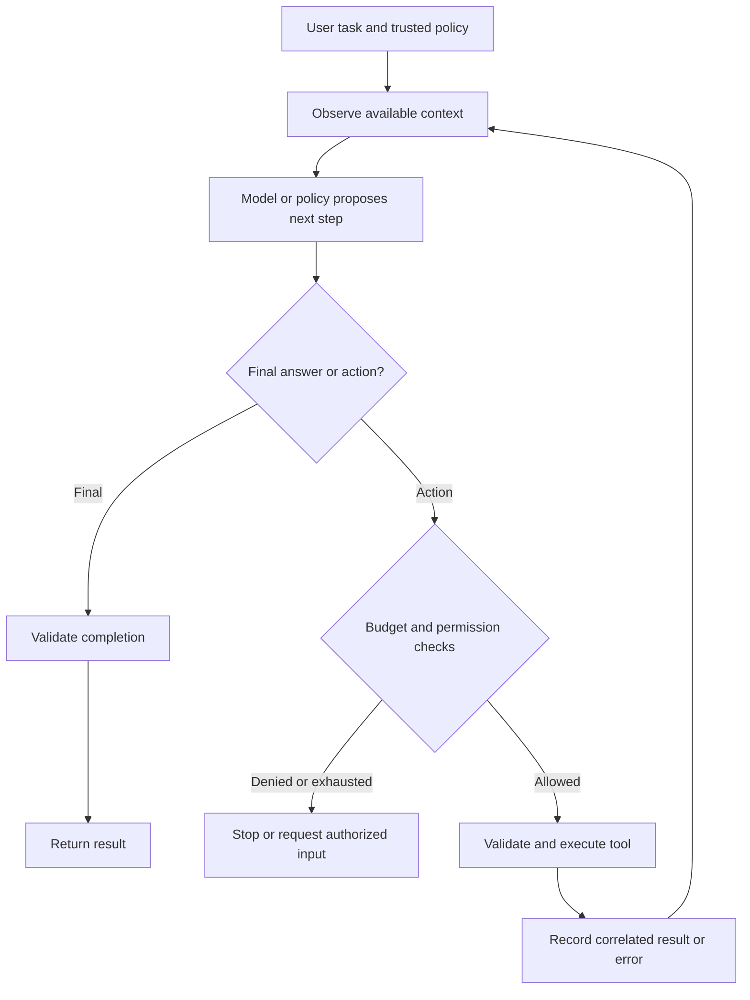

# The Agent Loop: Observe, Think, Act

[Back to courses](../README.md#agent-engineering) · [Function Calling](../1-llm-engineering/6-function-calling.md) · [Agent Framework Tradeoffs](../1-llm-engineering/13-agent-framework-tradeoffs.md)

| Field | Details |
| --- | --- |
| Origin | [AI Engineering from Scratch — source lesson](https://github.com/rohitg00/ai-engineering-from-scratch/blob/main/phases/14-agent-engineering/01-the-agent-loop/docs/en.md) |
| Author | Rohit Ghumare and contributors |
| Level | Intermediate — repository assessment |
| Best for | Understanding tool-using agents, implementing a bounded loop, handling observations and errors, and explaining agent architecture in interviews |

Adapted from the MIT-licensed lesson and companion example; copyright © 2026 Rohit Ghumare. [Original license](../licenses/ai-engineering-from-scratch-LICENSE). The Python walkthrough uses a deterministic toy policy and local tools. It requires no model download, API key, or network access.

> Every agent in 2026 is a variant of the ReAct loop from 2022 — Claude Code, Cursor, Devin, Operator included. Reasoning tokens interleave with tool calls and observations until a stop condition fires. Learn this loop cold before touching any framework.

## The Problem

A model can propose a database lookup or calculate an answer in text, but reading an external database requires an execution environment. A tool-using application must validate the proposal, execute the permitted operation, return its result, and decide whether another step is needed.

An **agent loop** repeatedly uses observations to select actions toward a goal. In an LLM agent, the model can select the next action; application code controls which actions are permitted and when execution stops.

Think of a mechanic diagnosing a car: inspect the symptoms, choose a test, read the result, and decide what to do next. A failed test is new information, not proof that the repair succeeded.

Examples:

- A support assistant looks up an order, notices a missing tracking number, then checks shipment status before answering.
- A coding assistant runs a test, reads the failure, changes code within its permissions, and runs the test again.
- A research assistant retrieves evidence, identifies a gap, retrieves another source, then produces a supported answer.

A fixed sequence of known steps may be better expressed as a workflow. Model-driven selection is useful when observations genuinely affect what should happen next. [Anthropic's workflow/agent discussion](https://www.anthropic.com/engineering/building-effective-agents) makes this distinction and emphasizes starting with simple patterns.
--> "the most successful implementations use simple, composable patterns rather than complex frameworks."

## The Concept

### ReAct: Reasoning and Acting

**ReAct** is an influential pattern that interleaves reasoning about a task with actions and observations. Yao et al. introduced it in a 2022 preprint published at ICLR 2023. Their paper reports task-specific improvements, including 34 and 10 percentage-point success-rate gains on ALFWorld and WebShop against the compared baselines; these are experimental results, not universal agent performance guarantees. [ReAct paper](https://arxiv.org/abs/2210.03629).

A simple teaching trace:

```text
Decision summary: Look up the order before discussing delivery.
Action: order_lookup(order_id="demo-123")
Observation: {"status": "shipped", "tracking_id": "track-9"}
Action: shipment_lookup(tracking_id="track-9")
Observation: {"estimated_delivery": "Friday"}
Final: The shipment service estimates delivery on Friday.
```

The decision summary is a human-written explanation of the example. A production implementation does not need to expose or reconstruct private model reasoning. Log actions, results, decisions, and available summaries without treating them as a complete record of a model's internal computation.



### Five Practical Ingredients

| Ingredient | Definition | Why it matters |
| --- | --- | --- |
| Context/history | Task, model outputs, and relevant observations available to the next decision | Prevents decisions detached from earlier results |
| Tool registry | Allowed tool names, contracts, and implementations | Maps proposals to controlled execution |
| Stop conditions | Explicit rules for ending a run | Distinguishes completion, failure, cancellation, and limits |
| Resource budgets | Caps on decisions, calls, time, tokens, and cost | Prevents unbounded loops and spend |
| Observation formatter | Converts results and errors into bounded, structured feedback | Lets the next step distinguish success from failure |

These are useful building blocks, not an exhaustive definition of every possible agent. History need not grow forever: select, summarize, or checkpoint it within a context budget while retaining relevant evidence and tool-call relationships.

### Think, Propose, Execute, Observe

The model **proposes** a tool call. The runtime **executes** it after validation and authorization. The tool **reports** an observation. Keeping these responsibilities separate prevents model text from becoming arbitrary executable code.

| Boundary | Check | Example |
| --- | --- | --- |
| Model → runtime | Recognized action type and valid arguments | Reject a missing `order_id` |
| Runtime → tool | Caller permissions and business constraints | Only read the caller's own order |
| Tool → context | Size, provenance, status, and safe serialization | Return `not_found`, not a fabricated record |
| Context → model | Treat external content as data | A retrieved page cannot grant new permissions |
| Model → final result | Required evidence/output contract | A failed transfer cannot be described as successful |

A tool result can contain malicious instructions or incorrect data. Its presence in history does not give it the authority of user/developer policy. Passing a schema check also does not establish permission.

### Native Reasoning and Tool Protocols

Some models use internal reasoning and expose provider-specific continuation items or summaries. Others can be used with ordinary tool-calling requests. Literal `Thought:` strings are not required for the observe–act cycle.

Keep provider protocol handling in an adapter. Preserve continuation fields according to the selected API's documentation rather than assuming reasoning metadata is portable across providers. Do not manufacture hidden reasoning or require the model to print it as a condition of using tools.

Frameworks package this cycle with different persistence, routing, tracing, and lifecycle abstractions. They do not all implement an identical loop. See [Agent Framework Tradeoffs](../1-llm-engineering/13-agent-framework-tradeoffs.md) for comparison.

### Stop Conditions Are Part of Correctness

| Stop reason | Meaning | Appropriate result |
| --- | --- | --- |
| Final answer | Policy/model proposes completion | Validate it against the task's completion contract |
| No tool calls | Model chose not to act again | Could be an answer, clarification, or refusal; inspect it |
| Turn/call limit | Resource allowance exhausted | Report partial progress or limitation, not success |
| Timeout/cancellation | Execution interrupted | Stop pending work and reconcile side effects/usage |
| Authorization failure | Proposed action not permitted | Reject or follow the application's approval workflow |
| Repeated no progress | Calls/results repeat without improvement | Stop or escalate under a bounded policy |

A **turn** here means one policy/model decision. A turn may propose several tools in some APIs; a **tool-call budget** therefore needs its own counter. There is no universal correct number of steps for all agents.

For multiple calls, attach a unique **call ID** to each proposal and match every result to that ID. If a cap prevents executing some calls, explicitly report those as unexecuted or reject the batch according to the API contract. Silently dropping a call leaves the model's history inconsistent.

### Error Feedback and Failure Boundaries

| Error | Feedback strategy | Retry behavior |
| --- | --- | --- |
| Unknown tool | Structured `unknown_tool` observation | Model may choose an allowed tool |
| Malformed arguments | Structured validation error | Bounded correction attempt |
| Missing record | `not_found` observation | Clarify or change plan; do not invent data |
| Temporary dependency failure | Sanitized retryable error | Retry with backoff inside the total deadline |
| Invalid permission | Denial result | Do not retry to bypass authorization |
| Programming/configuration failure | Operational failure and alert | Do not hide every exception as ordinary model feedback |

Avoid logging raw secrets or full exception messages by default. Side-effecting tools need idempotency and recovery rules: repeating a model decision must not accidentally repeat a purchase or send a message twice.

## Build It: A Bounded Offline Agent Loop

The upstream example uses a scripted model, calculator, and key-value store. This adaptation retains those components while using structured arithmetic instead of `eval`, validating arguments, correlating observations, and deriving later actions from actual results.

Copy the following Python block into `agent_loop.py` and run with Python 3.10+. The “model” is deterministic code, not an LLM. It demonstrates the execution contract; it does not measure reasoning quality.

```python
import json
import math
from dataclasses import dataclass, field


class ToolInputError(ValueError):
    pass


class ToolRegistry:
    def __init__(self):
        self.tools = {}

    def register(self, name, schema, fn):
        if name in self.tools:
            raise ValueError("Duplicate tool")
        self.tools[name] = (schema, fn)

    def dispatch(self, name, args):
        if name not in self.tools:
            return {"ok": False, "error": "unknown_tool"}
        schema, fn = self.tools[name]
        if not isinstance(args, dict) or set(args) != set(schema):
            return {"ok": False, "error": "invalid_arguments"}
        for key, expected in schema.items():
            value = args[key]
            if expected == "number":
                if type(value) not in (int, float) or not math.isfinite(value) or abs(value) > 1e9:
                    return {"ok": False, "error": "invalid_number"}
            elif not isinstance(value, str) or len(value) > 1000:
                return {"ok": False, "error": "invalid_text"}
        try:
            return {"ok": True, "value": fn(**args)}
        except ToolInputError:
            return {"ok": False, "error": "invalid_tool_input"}
        # Unexpected programming errors propagate instead of looking recoverable.


def calculator(op, a, b):
    if op == "add":
        return a + b
    if op == "multiply":
        return a * b
    raise ToolInputError("Unsupported operation")


class KVStore:
    def __init__(self):
        self.values = {}

    def get(self, key):
        return {"found": key in self.values, "value": self.values.get(key)}

    def set(self, key, value):
        self.values[key] = value
        return {"stored": key}


def build_tools():
    tools, kv = ToolRegistry(), KVStore()
    tools.register("calculator", {"op": "text", "a": "number", "b": "number"}, calculator)
    tools.register("kv_get", {"key": "text"}, kv.get)
    tools.register("kv_set", {"key": "text", "value": "text"}, kv.set)
    return tools, kv


class ToyLLM:
    """A policy for one fixed task: compute 120 plus 15% tax and store it."""
    def respond(self, history):
        observations = [item for item in history if item["kind"] == "observation"]
        if not observations:
            return {"kind": "action", "name": "calculator",
                    "args": {"op": "multiply", "a": 120, "b": 0.15}}
        last = observations[-1]["result"]
        if not last["ok"]:
            return {"kind": "stop", "reason": "tool_error"}
        step = len(observations)
        if step == 1:
            return {"kind": "action", "name": "calculator",
                    "args": {"op": "add", "a": 120, "b": last["value"]}}
        if step == 2:
            return {"kind": "action", "name": "kv_set",
                    "args": {"key": "total", "value": str(last["value"])}}
        if step == 3:
            return {"kind": "action", "name": "kv_get", "args": {"key": "total"}}
        if step == 4 and last["value"].get("found"):
            return {"kind": "finish", "answer": "Stored total: " + last["value"]["value"]}
        return {"kind": "stop", "reason": "verification_failed"}


@dataclass
class RunResult:
    status: str
    answer: str | None
    decisions: int
    tool_calls: int
    history: list = field(default_factory=list)


class AgentLoop:
    def __init__(self, policy, tools, max_turns=8, max_tool_calls=6):
        if type(max_turns) is not int or type(max_tool_calls) is not int:
            raise ValueError("Budgets must be integers")
        if max_turns < 1 or max_tool_calls < 0:
            raise ValueError("Invalid budgets")
        self.policy, self.tools = policy, tools
        self.max_turns, self.max_tool_calls = max_turns, max_tool_calls

    def run(self, user_message):
        history = [{"kind": "user", "text": user_message}]
        calls = 0
        for turn in range(1, self.max_turns + 1):
            reply = self.policy.respond(history)
            if not isinstance(reply, dict):
                return RunResult("invalid_reply", None, turn, calls, history)
            kind = reply.get("kind")
            if kind == "finish":
                answer = reply.get("answer")
                if not isinstance(answer, str) or not answer.strip():
                    return RunResult("invalid_reply", None, turn, calls, history)
                history.append({"kind": "final", "text": answer})
                return RunResult("finished", answer, turn, calls, history)
            if kind == "stop":
                return RunResult("policy_stopped", None, turn, calls, history)
            if kind != "action" or not isinstance(reply.get("name"), str):
                return RunResult("invalid_reply", None, turn, calls, history)
            if calls >= self.max_tool_calls:
                return RunResult("tool_budget_exhausted", None, turn, calls, history)
            calls += 1
            call_id = f"call-{calls}"
            history.append({"kind": "action", "call_id": call_id,
                            "name": reply["name"], "args": reply.get("args")})
            result = self.tools.dispatch(reply["name"], reply.get("args"))
            history.append({"kind": "observation", "call_id": call_id, "result": result})
        return RunResult("turn_budget_exhausted", None, self.max_turns, calls, history)


def demo():
    tools, kv = build_tools()
    result = AgentLoop(ToyLLM(), tools).run("Compute 120 plus 15% tax and store it.")
    print(json.dumps(result.history, indent=2))
    print(result.status, result.answer, result.decisions, result.tool_calls)
    assert result.answer == "Stored total: 138.0"
    assert kv.get("total")["value"] == "138.0"
    assert (result.decisions, result.tool_calls) == (5, 4)


if __name__ == "__main__":
    demo()
```

### What the Example Demonstrates

| Step | Proposal | Observation used next |
| --- | --- | --- |
| 1 | Multiply 120 by 0.15 | Tax = 18.0 |
| 2 | Add base price to the observed tax | Total = 138.0 |
| 3 | Store the observed total | Confirmation that `total` was stored |
| 4 | Read `total` | Actual stored value |
| 5 | Finish | Final text reflects the read result |

The toy policy does not parse arbitrary tasks. It only implements the tax example, so changing the user message does not give it general intelligence. The local store is per demo instance and has no authentication or durable storage. Python floating-point arithmetic is adequate for this illustration; financial applications need explicit decimal/rounding rules.

`finished` means the policy returned a final message. In a real application, a separate task-specific validator must establish success. Tool budgets count dispatched attempts, including invalid arguments. IDs are unique within a run; production traces also need a run ID.

The registry intentionally supports only a tiny schema vocabulary and bounded inputs. It is not a general JSON Schema validator, sandbox, timeout controller, or permission system. Replacing the policy with an API client does not automatically supply those missing controls.

## Use It in a Real Application

1. Define the task's completion contract, permitted tools, identity scope, and resource limits.
2. Adapt the provider's structured responses into actions/final messages without scraping arbitrary prose for executable commands.
3. Validate and authorize proposals before dispatch. Attach stable IDs and idempotency keys where appropriate.
4. Return bounded observations, preserving call/result relationships and distinguishing failure from success.
5. Enforce time, token, cost, and concurrency limits in addition to loop counters.
6. Persist resumable state when necessary; handle cancellation and partially completed external actions.
7. Validate final outputs and collect privacy-aware traces for evaluation.

Use ordinary workflows where the sequence is known. Add dynamic selection only where it helps task performance. A visible progress summary can help users understand what the application is doing without exposing internal reasoning or sensitive tool data.

### Metrics to Measure

| Metric | Definition | What it reveals |
| --- | --- | --- |
| Task success | Runs meeting the completion contract / evaluated runs | Whether the agent accomplished the goal |
| Tool validity | Schema-valid calls / proposed calls | Tool-contract understanding |
| Tool success | Successful executions / dispatched calls | Dependency and argument reliability |
| Recovery success | Recoverable-error cases completed / injected recoverable-error cases | Whether observations lead to useful correction |
| Loop length | Decisions and tool calls per run, including p95 | Long-tail cost and stalled behavior |
| Budget exhaustion | Limit-stopped runs / runs | Limits too small, poor planning, or repeated failures |
| Cost per successful task | Total serving spend / successful tasks | Actual economics, including failed runs |
| Unauthorized effects | Count of prohibited actions actually executed | Permission-boundary failures |

For example, 90 completed tasks out of 100 evaluated runs give a 90% task-success rate. If the batch costs $9, cost per successful task is $0.10, even though average cost per run is $0.09. Report the sample and evaluation method; an offline scripted demo does not establish model quality.

## Exercises

1. Add a policy that first submits malformed calculator arguments, reads `invalid_arguments`, then repairs the call. Verify it consumes budget and does not claim success before a successful observation.
2. Add a policy that repeats an unknown tool forever. Check both turn and tool-call limits and ensure no final success is fabricated.
3. Extend a turn to contain multiple calls. Correlate out-of-order results by ID and define how rejected calls are represented when a cap is reached.
4. Implement “no tool calls” as a completion path. Distinguish an answer from a clarification or refusal, and compare it with explicit `finish`.
5. Make `kv_set` a durable external fixture with idempotency keys. Simulate interruption after the write but before recording the observation.
6. Add a malicious instruction inside a tool result. Demonstrate that it cannot expand the runtime's permissions.
7. Integrate a real model adapter using that provider's documented tool/result protocol. Keep hidden reasoning private; record supported summaries, actions, usage, and outcomes instead. Compare behavior with the deterministic policy.
8. Add deadlines and cancellation without swallowing programming errors. Test a slow tool, a temporary failure, and an invalid permission separately.

## Quick Cheat Sheet

| Term | Crisp definition | Remember |
| --- | --- | --- |
| Agent loop | Repeated observation, decision, and action toward a goal | Observe → decide → act → observe |
| ReAct | Interleaving reasoning and task actions | Reasoning informs action; results inform the next step |
| Tool call | Structured proposal to invoke a function/service | Proposal is not permission |
| Tool registry | Allowed names, contracts, and implementations | Controlled dispatch |
| Observation | Tool result or error provided for the next decision | Evidence, not authority |
| Call ID | Identifier linking a proposal to its result | Match results even out of order |
| Turn budget | Maximum decision iterations | Separate from calls, tokens, time, and spend |
| Stop condition | Rule ending the run | Completion and exhaustion are different |
| Trace | Recorded execution events and metadata | Useful evidence, not hidden reasoning |
| Idempotency | Repetition does not duplicate an intended external effect | Protect side effects during retries |

## Further Reading

- [Source lesson](https://github.com/rohitg00/ai-engineering-from-scratch/blob/main/phases/14-agent-engineering/01-the-agent-loop/docs/en.md) and [companion implementation](https://github.com/rohitg00/ai-engineering-from-scratch/blob/main/phases/14-agent-engineering/01-the-agent-loop/code/main.py).
- [Yao et al., ReAct](https://arxiv.org/abs/2210.03629) — interleaving reasoning, actions, and environment feedback.
- [Anthropic, Building Effective Agents](https://www.anthropic.com/engineering/building-effective-agents) — workflows, agents, and simple composable patterns.
- [Function Calling](../1-llm-engineering/6-function-calling.md) — schemas, tool dispatch, and protocol handling.
- [Guardrails](../1-llm-engineering/9-guardrails.md) — validation and action boundaries.
- [Agent Framework Tradeoffs](../1-llm-engineering/13-agent-framework-tradeoffs.md) — state, orchestration, and recovery abstractions.

## Attribution and Import Notes

Adapted on 2026-10-18 from the upstream lesson and companion implementation. Retains ReAct, the five practical ingredients, tool dispatch, observation feedback, budgets, the calculator/key-value example, and exercises. Local changes replace `eval` with bounded arithmetic operations, validate arguments, correlate results, derive later actions from observations, distinguish completion from limit stops, and qualify universal framework/step-count claims. No live model integration was tested.

Source lesson SHA-256: `5f40298b9c1cbabd41a85ede8679c80c55b9a6c9ed92ac661ecd1f9aba18b83e`.

Companion code SHA-256: `5fc9514531f6c088b593da55a99877887d8aa96cc0acbb63376fe1787230e534`.
