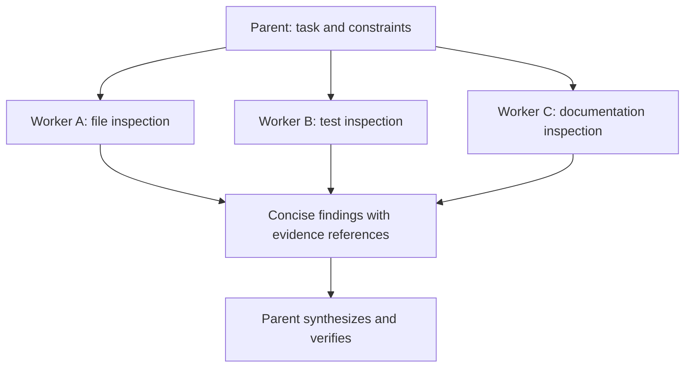

# Claude Agent SDK: The Harness as a Library

[Back to courses](../README.md#agent-engineering) · [The Agent Loop](1-agent-loop.md) · [OpenAI Agents SDK](10-openai-agents-sdk.md)

| Field | Details |
| --- | --- |
| Origin | [AI Engineering from Scratch — source lesson](https://github.com/rohitg00/ai-engineering-from-scratch/blob/main/phases/14-agent-engineering/17-claude-agent-sdk/docs/en.md) |
| Author | Rohit Ghumare and contributors |
| Level | Intermediate — repository assessment |
| Best for | Understanding an agent harness, isolating specialist context, designing hooks and session storage, and evaluating self-hosted versus managed execution |

Adapted from the MIT-licensed lesson; copyright © 2026 Rohit Ghumare. [Original license](../licenses/ai-engineering-from-scratch-LICENSE). The Python example is an original offline simulation using standard-library components, not the Claude Agent SDK itself.

## What Is an Agent Harness?

A **harness** is the runtime around a model: it repeatedly requests decisions, executes tools, records observations, maintains context, and enforces stopping and permission rules.

Think of the model as a specialist and the harness as their equipped workplace. The specialist can decide what to inspect, but the workplace supplies tools, access controls, records, and operating procedures. Calling a model once supplies an answer; operating a harness supports a task that takes several steps.

Examples:

- Inspect repository files, identify a likely bug, edit a patch, and run checks.
- Delegate independent document inspections, collect concise findings, and synthesize a report.
- Continue an interrupted investigation with its earlier conversation and evidence available.

## Client SDK, Agent SDK, CLI, and Managed Execution

The [official overview](https://code.claude.com/docs/en/agent-sdk/overview) distinguishes these surfaces:

| Surface | What it provides | What you operate |
| --- | --- | --- |
| Client SDK | Direct Claude API access | Application logic and tool orchestration, or a supported client tool runner |
| Claude Agent SDK | Claude Code's agent loop and capabilities through Python or TypeScript | The application process and execution environment |
| Claude Code CLI | Terminal interface to the agent | Interactive or scripted command-line use |
| Managed Agents | Hosted harness configured through API surfaces | Application integration and the chosen environment boundaries |

The Agent SDK runs the Claude Code binary through a library interface. It is not simply a differently named Messages API client. Managed execution changes operational responsibilities; it does not remove requirements for tool permissions, secrets management, budgets, or acceptance checks.

## Tools and MCP

**Built-in tools** supply common capabilities such as reading, editing, searching, and running commands. **Custom tools** expose application-specific functions. **MCP**, the Model Context Protocol, connects external tool and data surfaces through a standard interface.

| Capability | Useful task | Boundary to define |
| --- | --- | --- |
| File reading and search | Inspect a repository | Allowed paths and sensitive-file handling |
| File editing | Prepare a patch | Write scope, review, and conflict handling |
| Shell execution | Run tests | Process isolation, network access, timeouts |
| Custom business tool | Inspect a ticket | Identity, argument validation, record-level access |
| MCP connection | Query an external service | Server trust, exposed capabilities, credentials |

A model instruction such as “only read project files” is not a filesystem sandbox. Enforce access in the tool and hosting environment. Tool results may contain untrusted instructions; treat them as evidence or data rather than permission to expand the task.

## Subagents: Parallel Work and Separate Context

A **subagent** is a specialist execution with its own working context. The parent supplies a focused assignment and receives a result. Separate context helps keep detailed investigation out of the parent's main conversation. Independent assignments may run concurrently. See the [subagent guide](https://code.claude.com/docs/en/agent-sdk/subagents).



| Benefit | Example | Limitation |
| --- | --- | --- |
| Context isolation | Return findings instead of entire file contents | Returned findings still consume parent context |
| Parallelism | Inspect independent modules concurrently | More workers consume more total resources |
| Specialization | Give a reviewer a narrow checklist | A role does not guarantee expertise |
| Scoped capability | Restrict a worker to inspection tools | Context separation is not OS-level isolation |

Do not parallelize conflicting edits without a merge strategy. Batch tiny tasks when startup and repeated instructions dominate. Define worker deadlines, output size limits, partial-failure behavior, and the parent's verification step.

## Session Storage and Resume

A **transcript** records conversation events. A **session** identifies a continuing interaction. Storing a transcript supports continuity, but does not prove external operations committed exactly once or reproduce the original workspace.

The [session-storage guide](https://code.claude.com/docs/en/agent-sdk/session-storage) documents local JSONL transcripts and external adapters. Its Python interface uses structured keys containing project, session, and optional subpath information—not only a bare session ID.

| Adapter operation | Purpose |
| --- | --- |
| `append` | Save ordered batches of transcript entries |
| `load` | Retrieve entries for resume |
| `list_sessions` | Enumerate sessions in a project |
| `list_session_summaries` | Retrieve summary metadata efficiently |
| `delete` | Remove a transcript; main-session deletion must handle its related keys |
| `list_subkeys` | Discover subordinate transcripts for restoration |

`append` and `load` are required; the other operations are optional with feature-specific consequences. Preserve opaque entries and ordering rather than rewriting SDK-owned fields. Match project identity when restoring sessions, and control concurrent writes. In-memory stores are suitable for tests, not process-crash durability.

A transcript mirror is an observability/storage mechanism, not a filesystem backup. Use documented SDK storage options for the pinned version rather than assuming an internal CLI flag is a stable public interface.

## Hooks: Policy and Observability at Lifecycle Boundaries

A **hook** is a callback at a lifecycle event. The [hook guide](https://code.claude.com/docs/en/agent-sdk/hooks) documents events and their payloads; supported events and controls depend on SDK language and version.

| Hook category | Typical event names | Example responsibility |
| --- | --- | --- |
| Before tool use | `PreToolUse` | Inspect proposed arguments or block an operation |
| After tool use | `PostToolUse` | Record outcome and validate expected behavior |
| Prompt processing | `UserPromptSubmit` | Attach approved context or inspect the request |
| Session lifecycle | `SessionStart`, `SessionEnd` | Initialize resources or record completion |
| Context maintenance | `PreCompact` | Preserve important constraints before compaction |
| Completion and notification | `Stop`, `Notification` | Track status or notify the application |

Check the actual callback contract before relying on an event as an enforcement point. A post-tool hook cannot undo an already completed external action. Hook failure behavior should be explicit: whether a missing policy service blocks work is an application decision that must be tested.

Keep hooks focused. Excessive network calls inside hooks add latency and create new failure dependencies. Separate audit collection from permission enforcement so an audit message is not mistaken for an authorization decision.

## Hands-On: Isolated Workers, Hooks, and SQLite Transcripts

This example uses fixture documents, a read-only tool registry, separate worker contexts, a concurrency limit, lifecycle events, and a real SQLite transcript store. The parent retains worker summaries rather than raw document contents. All files are created in a temporary directory and removed after the demo.

The store API is deliberately simpler than the SDK adapter: it is **not compatible with `SessionStore`**. Workers are ordinary asynchronous Python functions, not model-backed subagents.

Save as `harness_demo.py` and run `python3 harness_demo.py` with Python 3.10+.

```python
import asyncio
import json
import sqlite3
from pathlib import Path
from tempfile import TemporaryDirectory


class Store:
    def __init__(self, path):
        self.db = sqlite3.connect(path)
        self.db.execute("CREATE TABLE IF NOT EXISTS messages "
                        "(seq INTEGER PRIMARY KEY, session TEXT, subkey TEXT, data TEXT)")
        self.db.commit()

    def append(self, session, subkey, entry):
        with self.db:
            self.db.execute("INSERT INTO messages(session,subkey,data) VALUES(?,?,?)",
                            (session, subkey, json.dumps(entry)))

    def load(self, session, subkey=""):
        return [json.loads(row[0]) for row in self.db.execute(
            "SELECT data FROM messages WHERE session=? AND subkey=? ORDER BY seq",
            (session, subkey))]

    def list_sessions(self):
        return [r[0] for r in self.db.execute(
            "SELECT DISTINCT session FROM messages ORDER BY session")]

    def list_subkeys(self, session):
        return [r[0] for r in self.db.execute(
            "SELECT DISTINCT subkey FROM messages WHERE session=? AND subkey!='' "
            "ORDER BY subkey", (session,))]

    def delete(self, session):
        with self.db:
            self.db.execute("DELETE FROM messages WHERE session=?", (session,))

    def close(self):
        self.db.close()


class Harness:
    def __init__(self, store, documents, concurrency=2):
        if concurrency < 1:
            raise ValueError("concurrency must be positive")
        self.store = store
        self.documents = dict(documents)
        self.limit = asyncio.Semaphore(concurrency)
        self.events = []
        self.tools = {"read_document": self.documents.__getitem__}

    def call_tool(self, name, key):
        self.events.append(("pre_tool_use", name))
        if name not in self.tools or key not in self.documents:
            raise PermissionError("Tool or document outside configured scope")
        result = self.tools[name](key)
        self.events.append(("post_tool_use", name))
        return result

    async def worker(self, session, key):
        async with self.limit:
            context = [{"task": "Count lines", "document": key}]
            await asyncio.sleep(0)  # Yield to other independent workers.
            content = self.call_tool("read_document", key)
            context.append({"observation": content})
            summary = {"document": key, "lines": len(content.splitlines())}
            self.store.append(session, key, {"context": context, "result": summary})
            return summary

    async def run(self, session, keys):
        if not keys or len(set(keys)) != len(keys):
            raise ValueError("Provide distinct document keys")
        if self.store.load(session):
            raise ValueError("Demo run already exists; use a new session ID")
        self.events.append(("session_start", session))
        self.store.append(session, "", {"task": "Inspect documents", "keys": keys})
        try:
            results = await asyncio.gather(
                *(self.worker(session, key) for key in keys), return_exceptions=True
            )
            if any(isinstance(result, Exception) for result in results):
                self.store.append(session, "", {"status": "failed"})
                raise RuntimeError("At least one worker failed; no aggregate accepted")
            self.store.append(session, "", {"status": "complete", "results": results})
            return results
        finally:
            self.events.append(("session_end", session))


async def main():
    with TemporaryDirectory() as directory:
        path = Path(directory) / "sessions.sqlite"
        store = Store(path)
        try:
            harness = Harness(store, {"a.py": "a\nb\n", "test_a.py": "test\n",
                                      "README.md": "Overview\nUsage\n"})
            print(await harness.run("demo", ["a.py", "test_a.py", "README.md"]))
            print("Workers:", store.list_subkeys("demo"))
            print("Events:", harness.events)
        finally:
            store.close()
        reopened = Store(path)
        try:
            print("Restored parent transcript:", reopened.load("demo"))
        finally:
            reopened.close()


if __name__ == "__main__":
    asyncio.run(main())
```

Expected summaries report two, one, and two lines. Three child transcripts retain detailed observations; the parent transcript contains the request and concise results. Reopening SQLite proves transcript persistence, not automatic continuation of an interrupted agent loop.

The example waits for all workers and rejects the aggregate if any fail. A production application might instead return explicitly labeled partial results. Add cancellation, deadlines, cost caps, schema validation, tenant isolation, and safe resume before extending this pattern to real tools.

## Tracing Across Process Boundaries

**OpenTelemetry** is an instrumentation ecosystem. **W3C Trace Context** defines identifiers used to connect operations across boundaries. A parent span in the application and child spans in a subprocess need compatible instrumentation and propagation to appear in one trace.

Follow the [SDK observability guide](https://code.claude.com/docs/en/agent-sdk/observability) for the deployed version; verify the actual exported parent-child relationships. Do not assume enabling a logger produces complete distributed tracing. Filter sensitive prompts, tool results, and session data before exporting them.

Useful spans include parent orchestration, each worker, each tool invocation, persistence writes, and hooks. Separate queue delay, model latency, tool latency, and storage latency so a slow worker is diagnosable.

## Self-Hosted or Managed?

| Question | Operating the Agent SDK | Managed harness |
| --- | --- | --- |
| Runtime deployment | Your application hosts the runtime | Provider operates the harness service |
| Environment | You configure process/filesystem/network boundaries | Understand the selected managed or attached environment |
| Long-running work | You arrange scheduling, persistence, and recovery | Assess the service's supported lifecycle and limits |
| Integration | Direct access to your application architecture | API-driven integration and service boundaries |
| Operational cost | Infrastructure plus model/tool use | Service charges and limits plus integration costs |

Choose based on required control, hosting constraints, failure recovery, latency, and operational effort. Verify current service features before migration; a historical beta header or launch date is not a durable configuration recommendation.

## Failure Modes and Metrics

| Failure mode | Control or measurement |
| --- | --- |
| Too many small workers | Batch tasks; measure startup and repeated-context overhead |
| Conflicting writes | Isolate workspaces or serialize writes; reconcile artifacts |
| Summaries omit constraints | Require evidence IDs and unresolved issues; validate the aggregate |
| Slow hooks | Track per-hook p95 latency and timeout behavior |
| Growing transcripts | Measure storage, apply scoped retention, test cascading deletion |
| Interrupted external action | Reconcile with the system of record; use idempotency where supported |
| Cross-session leakage | Test identity, project, and worker-key boundaries |

Measure verified completion rate, total cost per accepted result, worker failure rate, parent context size, total tokens across all workers, and end-to-end p50/p95 latency. A smaller parent context does not imply lower total token use.

For independent work, ideal parallel latency approaches the slowest batch plus coordination and synthesis; total compute still includes every worker. Compare sequential, batched, and one-worker-per-task designs on the same workload and quality criteria.

## Exercises

1. Run twenty fixture tasks with concurrency limits of one, five, and twenty. Compare elapsed time and result correctness; explain why a fixture benchmark does not predict model latency.
2. Request an unknown document and confirm that no aggregate is accepted, failure is stored, and session-end handling runs.
3. Delete a session and verify both its parent and child transcripts disappear. Add a second session to test isolation.
4. Add a per-session rate limit for a mock write tool. Enforce it before the effect and test retries at the limit.
5. Add evidence IDs and an output-length limit to worker summaries. Measure parent payload size separately from stored worker observations.
6. Implement an SDK-compatible session adapter for a pinned version. Preserve opaque entries, project keys, subkeys, and append order; test concurrent appends.
7. Port a read-only task to the actual SDK using documented tools and hooks. Inspect permission decisions and trace propagation without assuming the toy's contracts match.
8. Write a deployment decision comparing self-hosted and managed execution, including recovery, retention, environment access, and spending limits.

## Quick Cheat Sheet

**Harness = loop + tools + context + permissions + lifecycle.**

| Concept | Remember it as | Caveat |
| --- | --- | --- |
| Client SDK | API access | Not the complete Claude Code harness |
| Agent SDK | Harness embedded in an application | You still operate its environment |
| Subagent | Specialist with separate working context | Not automatically an isolated OS process |
| Hook | Callback at an execution boundary | Post-action checks cannot undo the action |
| Session store | Durable transcript adapter | History is not exactly-once business execution |
| Trace propagation | Connect parent and child operations | Verify actual instrumentation and exporter configuration |
| Managed harness | Delegate runtime operations | Application authorization remains your responsibility |

An interview answer: “The Claude Agent SDK exposes the Claude Code harness through a library: an agent loop with tools, permissions, context management, sessions, and extensibility. I would use subagents for independent tasks or context isolation, return bounded evidence-backed results, and enforce tool permissions outside prompts. I would test session restoration and side-effect recovery separately, because restoring a transcript does not guarantee exactly-once execution.”

## References and Attribution

- [Source lesson](https://github.com/rohitg00/ai-engineering-from-scratch/blob/main/phases/14-agent-engineering/17-claude-agent-sdk/docs/en.md) — Rohit Ghumare and contributors.
- Official Anthropic [Agent SDK overview](https://code.claude.com/docs/en/agent-sdk/overview), [subagents](https://code.claude.com/docs/en/agent-sdk/subagents), and [session storage](https://code.claude.com/docs/en/agent-sdk/session-storage).
- Official Anthropic [hooks](https://code.claude.com/docs/en/agent-sdk/hooks) and [observability](https://code.claude.com/docs/en/agent-sdk/observability).

Adapted on 2026-10-28. The course retains the source's harness comparison, tools, subagents, storage, hooks, tracing, hosted alternative, and exercise themes. It distinguishes the toy storage API from the SDK's structured-key protocol and avoids assuming historical CLI flags or beta headers remain stable. The offline example was tested; no Claude SDK package, live model, shell execution tool, or managed agent was run.

The source tracks upstream `main`; its downloaded hash follows. Imported material retains its [MIT license notice](../licenses/ai-engineering-from-scratch-LICENSE).

- Lesson Markdown SHA-256: `f1fb3653f42b54dd9267aa3bd20bb56714567f56c71a8b92972d725f0948b9bd`
