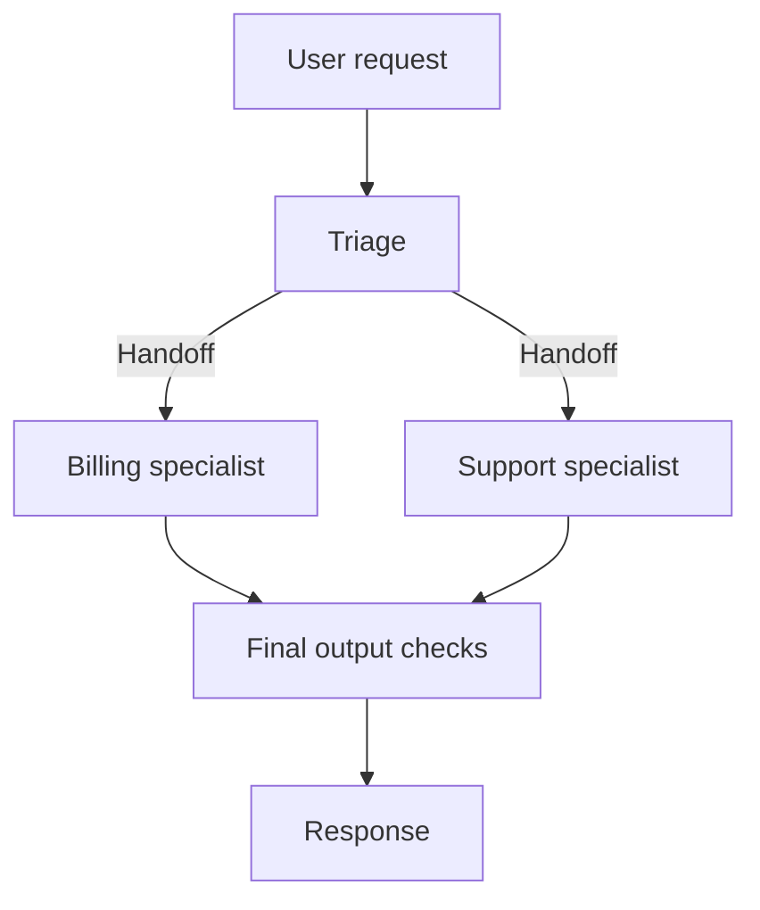

# OpenAI Agents SDK: Handoffs, Guardrails, Sessions, and Tracing

[Back to courses](../README.md#agent-engineering) · [The Agent Loop](1-agent-loop.md) · [Workflow Patterns](6-anthropic-workflow-patterns.md)

## Why Use an Agent Runtime?

An application that repeatedly asks a model what to do must interpret tool requests, execute permitted operations, return observations, and decide when to stop. Adding specialists introduces another question: which agent owns the next response?

Think of a support desk. Reception can transfer a customer to billing, or ask billing a question and then answer the customer itself. Those are different control flows. The runtime must preserve the distinction while recording what happened and applying checks at the relevant boundaries.

Examples:

- Transfer an invoice question to a billing specialist that continues the conversation.
- Let a research coordinator call a summarization specialist and combine its result with other evidence.
- Pause a proposed account change for review before executing it.

The SDK runs the agent loop in your application. Your service still owns authentication, tool implementations, deployment, persistence choices, and business authorization. See the [official SDK overview](https://developers.openai.com/api/docs/guides/agents/sdk).

## The Core Concepts

| Concept | Definition | Application responsibility |
| --- | --- | --- |
| Agent | Model configuration, instructions, and available capabilities | Define a focused job and permitted tools |
| Runner | Component that executes the model/tool loop | Set limits and handle results or failures |
| Function tool | Application function exposed through an argument contract | Validate inputs and enforce authorization |
| Handoff | Transfer of control to another agent | Define allowed destinations and context policy |
| Guardrail | Automated validation at a specified boundary | Measure coverage and false decisions |
| Session | Conversation-history management across runs | Scope access, retention, and concurrency |
| Trace | Record of a run and its operations | Choose capture, storage, and redaction policies |
| Span | One operation within a trace | Record useful timing, status, and relationships |

These are useful teaching categories, not an exhaustive or permanently fixed list of SDK primitives. An agent definition alone is not a running autonomous process.

## Handoffs Versus Agents as Tools

| Design | Who owns the final reply? | Example |
| --- | --- | --- |
| Handoff | Receiving specialist | Triage transfers a billing conversation |
| Agent as a tool | Calling manager | Coordinator asks a specialist for a bounded analysis |
| Direct application routing | Application chooses the next component | Validated category selects a workflow |

The [official orchestration guide](https://developers.openai.com/api/docs/guides/agents/orchestration) distinguishes ownership transfer from manager-style specialist calls. In Python, `agent.as_tool(...)` supports the latter. A handoff is not automatically a supervisor workflow that returns a result to the original agent.



The model-facing handoff is represented as a tool-like capability, commonly named `transfer_to_<agent_name>`; names and behavior can be customized. Transfer changes the active agent and its instructions and tools. Treat transferred history as an explicit design decision: unnecessary history increases cost, and missing constraints can make a specialist act on an incomplete task.

A summary of prior context can omit evidence or qualifications. Preserve unresolved requirements, source references, pending operations, and the user's actual request. Never treat a summary as a replacement for authorization.

## Guardrails: Where and When They Run

The [guardrail guide](https://developers.openai.com/api/docs/guides/agents/guardrails-approvals) describes input checks on the first agent, output checks on the final-output agent, and tool checks on the function tools to which they are attached. Do not assume those checks cover every intermediate handoff or hosted tool.

| Boundary | Example check | Important limitation |
| --- | --- | --- |
| Input | Request is within the application's supported scope | Does not validate later tool arguments |
| Output | Final result satisfies a schema or release rule | Cannot undo an external action already performed |
| Tool input | Authenticated user may access this record | Must inspect actual arguments and trusted identity |
| Tool output | Tool result has the expected shape and permitted content | Valid shape does not establish factual correctness |

A **tripwire** is a rejection signal that stops the relevant execution path. Input and output guardrail failures can raise corresponding SDK exceptions. Rejection does not automatically produce a corrected answer: the application must choose whether to stop, clarify, or run a bounded repair process.

### Blocking and Parallel Input Checks

Blocking input validation completes before the main agent proceeds. Parallel validation can overlap with agent work to reduce latency, at the cost of speculative work. It does not guarantee that no model call or action starts before a rejection. Use blocking checks and action-boundary controls where that distinction matters.

`run_in_parallel=False` is an input-guardrail execution choice in the Python SDK. It is not a generic switch that makes an output check happen before output generation. Output checks necessarily require a candidate output.

Illustrative latency, ignoring overhead:

```text
Blocking: input-check time + agent time
Parallel: approximately max(input-check time, agent time)
```

These are rough estimates, not guarantees. Model-based checks cost tokens themselves. Cancelling speculative work does not necessarily recover its cost or reverse external effects.

## Human Review Is a Separate Control

A guardrail evaluates automatically; an approval requests a decision before continuing a proposed action. Bind approval to the exact operation and arguments, authenticate the reviewer, and define expiry if the underlying state changes.

For paused SDK runs, the application receives interruptions and resumable state, resolves the review, then resumes that state. Do not restart the entire workflow as if it were a new request. Approval handling must still be paired with idempotency and reconciliation where external actions may be retried.

## Sessions, Conversation State, and Recovery

A **session** carries conversation history between runs. It is distinct from a checkpoint of an in-flight workflow and from a business system's authoritative state.

| State | Example | Question to answer |
| --- | --- | --- |
| Conversation history | Prior user messages and replies | Which user and conversation can access it? |
| Active specialist | Billing remains responsible after transfer | Should the next turn return to triage or continue here? |
| Paused run state | Pending approval and execution progress | Can the same run resume without duplicating work? |
| Business state | Actual invoice or refund status | What did the external service really commit? |

The [results and state guide](https://developers.openai.com/api/docs/guides/agents/results) explains final output, continuation, and resumable state. Keep using the chosen session strategy consistently. After a handoff, `last_agent` identifies the final active Python agent when that specialist should handle the next turn.

History persistence alone does not make concurrent writes safe or provide exactly-once tool execution. Define ownership for concurrent turns, retention limits, and a policy for failed-run history.

## Tracing and Sensitive Data

The [observability guide](https://developers.openai.com/api/docs/guides/agents/integrations-observability) describes tracing enabled by default in the normal server-side SDK path. Traces can capture model calls, tools, handoffs, guardrails, and custom operations.

Use traces to explain route decisions, expensive tool loops, and validation failures. Record identifiers, durations, outcomes, and usage without indiscriminately copying prompts, credentials, or private tool results. Review export destinations, access permissions, retention, and supported capture controls in the pinned SDK version.

A trace is diagnostic evidence, not proof of correctness. Trace export is also separate from durable business auditing and resumable execution. Do not assume SDK trace data automatically matches a particular OpenTelemetry semantic-convention version.

## Hands-On: Bounded Handoffs and Guardrails Offline

The toy below models triage, two specialists, an allowed tool, blocking checks, session history, and parent-linked span records. It uses exact marker checks to expose control flow; they are **not** real PII detection or a production safety policy.

Save as `agents_runtime_demo.py` and run `python3 agents_runtime_demo.py` with Python 3.10+. No network, API key, or SDK package is required.

```python
from dataclasses import dataclass, field
from contextlib import contextmanager
from time import perf_counter


class Rejected(Exception):
    pass


@dataclass(frozen=True)
class Decision:
    kind: str
    value: str


@dataclass
class Agent:
    name: str
    decide: object
    handoffs: tuple[str, ...] = ()
    tools: tuple[str, ...] = ()


@dataclass
class Session:
    history: list[tuple[str, str]] = field(default_factory=list)


class Runner:
    def __init__(self, agents, tools):
        self.agents = agents
        self.tools = tools
        self.spans = []
        self.stack = []

    @contextmanager
    def span(self, kind, name):
        record = {"id": len(self.spans),
                  "parent": self.stack[-1] if self.stack else None,
                  "kind": kind, "name": name, "status": "running"}
        self.spans.append(record)
        self.stack.append(record["id"])
        start = perf_counter()
        try:
            yield
        except Exception:
            record["status"] = "error"
            raise
        else:
            record["status"] = "ok"
        finally:
            record["seconds"] = perf_counter() - start
            self.stack.pop()

    def run(self, text, session, start="triage", max_steps=6, max_hops=2):
        if max_steps < 1 or max_hops < 0:
            raise ValueError("Invalid limits")
        with self.span("run", start):
            with self.span("guardrail", "input"):
                if not text.strip() or "DEMO_BLOCK" in text:
                    raise Rejected("Input check failed")
            active, hops, observation = start, 0, None
            for _ in range(max_steps):
                agent = self.agents[active]
                with self.span("decision", active):
                    decision = agent.decide(text, observation, tuple(session.history))
                if decision.kind == "handoff":
                    with self.span("handoff", decision.value):
                        if decision.value not in agent.handoffs or hops >= max_hops:
                            raise Rejected("Handoff not allowed or hop limit reached")
                        if decision.value not in self.agents:
                            raise Rejected("Unknown specialist")
                        active, observation = decision.value, None
                        hops += 1
                elif decision.kind == "tool":
                    with self.span("guardrail", "tool_input"):
                        if decision.value not in agent.tools or decision.value not in self.tools:
                            raise Rejected("Tool not allowed")
                    with self.span("tool", decision.value):
                        observation = self.tools[decision.value]()
                    with self.span("guardrail", "tool_output"):
                        if not isinstance(observation, str):
                            raise Rejected("Invalid tool result")
                elif decision.kind == "final":
                    with self.span("guardrail", "output"):
                        if not decision.value.strip() or "DEMO_SECRET" in decision.value:
                            raise Rejected("Output check failed")
                    # This toy persists successful turns only.
                    session.history.extend((("user", text), ("assistant", decision.value)))
                    return decision.value, active
                else:
                    raise Rejected("Unknown decision kind")
            raise Rejected("Step budget exhausted")


def triage(text, observation, history):
    return Decision("handoff", "billing" if "invoice" in text.lower() else "support")


def billing(text, observation, history):
    if observation is None:
        return Decision("tool", "invoice_help")
    return Decision("final", observation)


def support(text, observation, history):
    return Decision("final", "Please provide the error message and reproduction steps.")


def build_runner():
    agents = {
        "triage": Agent("triage", triage, handoffs=("billing", "support")),
        "billing": Agent("billing", billing, tools=("invoice_help",)),
        "support": Agent("support", support),
    }
    return Runner(agents, {"invoice_help": lambda: "Use the billing page to inspect your invoice."})


def main():
    runner = build_runner()
    session = Session()
    for request in ("Where is my invoice?", "My application fails", "DEMO_BLOCK"):
        try:
            print(runner.run(request, session))
        except Rejected as exc:
            print("Rejected:", exc)
    print("Stored messages:", len(session.history))
    print("Spans:", [(s["kind"], s["name"], s["status"]) for s in runner.spans])


if __name__ == "__main__":
    main()
```

Two requests succeed through different handoffs; the third fails before any agent decision. The session contains four messages from successful turns. Spans store operation metadata and timings, not request text. This is a simplified trace structure, not the SDK export schema.

The toy's tool registry is an allowlist, not a complete authorization system. Real tools need authenticated identity, validated arguments, and resource-level permission checks. Session history here is only in-memory, routing ignores its contents, and the runner is single-threaded and not safe for concurrent calls. It does not implement parallel checks, streaming, approvals, structured model outputs, or durable resume.

## A Minimal Real SDK Shape

The following conceptual Python configuration shows specialist ownership using real SDK names. It is not executed here. Configure a supported model and provider credentials in an isolated environment, pin the package version, and add the application's validation and authorization before using it with real users.

```python
from agents import Agent, Runner, function_tool


@function_tool
def invoice_help() -> str:
    """Return general invoice-navigation guidance; no account data is accessed."""
    return "Use the billing page to inspect your invoice."


billing_agent = Agent(
    name="Billing",
    instructions="Help with invoice navigation using the provided tool.",
    tools=[invoice_help],
)
support_agent = Agent(
    name="Support",
    instructions="Ask for an error message and reproduction steps.",
)
triage_agent = Agent(
    name="Triage",
    instructions="Transfer invoice questions to Billing and technical issues to Support.",
    handoffs=[billing_agent, support_agent],
)

# Inside an async application after provider/model configuration:
# result = await Runner.run(triage_agent, "Where can I find my invoice?", max_turns=6)
# print(result.final_output)
```

The routing instruction influences model behavior; it is not a deterministic classifier. Test ambiguous requests and unauthorized tool attempts. Use an agent as a tool when the initial agent must synthesize the specialist's result rather than transfer ownership.

## Failure Modes and Measurement

| Failure | Control to test |
| --- | --- |
| Specialists transfer back and forth | Hop and turn caps; detect repeated routes without progress |
| Tool arguments cross an account boundary | Authorization next to the tool, using trusted identity |
| Parallel rejection arrives after work starts | Blocking checks where needed; separate action approvals |
| Output fails after an external action | Idempotency and reconciliation; do not assume rollback |
| Session mixes users or concurrent turns | Tenant-scoped access and explicit write ownership |
| Summary drops a restriction | Preserve constraints and compare summarized versus full-context outcomes |
| Trace leaks private content | Capture controls, redaction, access restrictions, and retention |

| Metric | Definition |
| --- | --- |
| Verified completion | Independently correct completions / attempted tasks |
| Handoff accuracy | Appropriate specialist selections / evaluated handoffs |
| Handoff overhead | Transfer-related time and cost per task |
| False-accept rate | Disallowed cases accepted / disallowed evaluation cases |
| False-reject rate | Allowed cases rejected / allowed evaluation cases |
| Cost per completion | All run costs, including failures / verified completions |
| Latency p50 / p95 | Median / 95th-percentile end-to-end time |
| Budget exhaustion | Runs stopped by limits / attempted runs |

Report metric denominators because terms such as false-accept rate are used differently across teams. Evaluate guardrails with labeled cases, including adversarial and ambiguous inputs, rather than counting only successful demonstrations.

## Exercises

1. Set `max_hops=0`. Verify that a transfer fails before the specialist runs.
2. Create two agents that always transfer to one another. Confirm bounded termination and an error trace.
3. Make the fixture tool return a non-string or a forbidden output marker. Confirm that the relevant check rejects it and the session is not updated.
4. Implement a parallel input check in a separate experiment with controlled delays. Measure work started before rejection; do not execute consequential tools in the experiment.
5. Add a persistent session keyed by authenticated user and conversation. Test concurrent turns and deletion.
6. Replace full transferred history with a summary retaining constraints and evidence IDs. Compare task success and token usage on the same examples.
7. Port the toy to a pinned SDK version and compare its actual guardrail, handoff, and trace behavior. Document every simplification in the toy.
8. Design approval for a proposed account action, including proposal version, reviewer identity, expiry, and recovery after a timeout.

## Quick Cheat Sheet

**Agent = specialist. Handoff = transfer ownership. Tool = bounded capability. Guardrail = check. Session = history. Trace = execution record.**

| Concept | Remember | Caveat |
| --- | --- | --- |
| Handoff | Transfer the conversation | Does not automatically return to the caller |
| Agent as tool | Ask a specialist for help | Manager retains responsibility for the answer |
| Blocking input check | Check before starting | The check itself may cost time and tokens |
| Parallel input check | Check while work begins | Rejection may follow speculative work |
| Output guardrail | Check the candidate response | Cannot reverse earlier side effects |
| Session | Remember prior conversation | Not full workflow durability |
| Approval | Authorize a specific proposed action | Bind it to identity and exact arguments |

An interview answer: “The Agents SDK manages an agent loop with tools, handoffs, guardrails, sessions, and tracing. I would choose handoffs when a specialist should take over, and agents-as-tools when a manager should retain control. I would enforce permission checks at the tool boundary, bound turns and transfers, and distinguish conversation history from resumable execution and business state.”

## Resource

Adapted from the MIT-licensed lesson; copyright © 2026 Rohit Ghumare. [Original license](../licenses/ai-engineering-from-scratch-LICENSE). The main Python demonstration is a scripted standard-library simulation, not an SDK implementation or a model benchmark.

| Field | Details |
| --- | --- |
| Origin | [AI Engineering from Scratch — source lesson](https://github.com/rohitg00/ai-engineering-from-scratch/blob/main/phases/14-agent-engineering/16-openai-agents-sdk/docs/en.md) |
| Author | Rohit Ghumare and contributors |
| Level | Intermediate — repository assessment |
| Best for | Designing specialist ownership, placing validation at the right boundary, managing conversation history, and debugging bounded agent runs |

## References and Attribution

- [Source lesson](https://github.com/rohitg00/ai-engineering-from-scratch/blob/main/phases/14-agent-engineering/16-openai-agents-sdk/docs/en.md) — Rohit Ghumare and contributors.
- Official OpenAI [Agents SDK overview](https://developers.openai.com/api/docs/guides/agents/sdk), [orchestration and handoffs](https://developers.openai.com/api/docs/guides/agents/orchestration), and [guardrails and human review](https://developers.openai.com/api/docs/guides/agents/guardrails-approvals).
- Official OpenAI [results and state](https://developers.openai.com/api/docs/guides/agents/results) and [integrations and observability](https://developers.openai.com/api/docs/guides/agents/integrations-observability).
- [Guardrails course](../1-llm-engineering/9-guardrails.md) — related material.

Adapted on 2026-10-27 using the source lesson and official OpenAI documentation. This course retains the handoff, validation, session, tracing, failure-mode, and exercise themes. It corrects the distinction between ownership transfer and manager delegation, clarifies parallel input-check behavior, and separates history from durable execution. The original offline example was tested; the SDK configuration was syntax-checked but no SDK package or live model was executed.

The source tracks upstream `main`; its downloaded hash follows. Imported material retains its [MIT license notice](../licenses/ai-engineering-from-scratch-LICENSE).

- Lesson Markdown SHA-256: `377b426042d5664c5c9cf36932d5ae56dc66c51236a1de60656ef110112eb76c`
