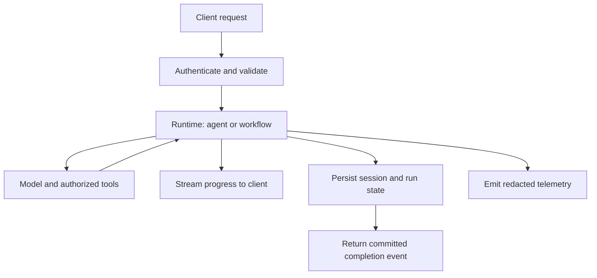

# Agno and Mastra: Production Agent Runtime Tradeoffs

[Back to courses](../README.md#agent-engineering) · [LangGraph Stateful Graphs](7-langgraph-stateful-graphs.md) · [CrewAI Role-Based Crews](9-crewai-role-based-crews.md)

## Choose the Runtime Around the Application

An **agent runtime** coordinates model calls, tools, state, and execution. A **serving layer** exposes that runtime to clients and handles requests, streaming, authentication, and operational concerns.

Think of choosing a kitchen for a restaurant. Fast equipment setup helps, but the customer's wait also includes preparing ingredients, cooking, and serving. Likewise, constructing an agent object quickly is useful only to the extent that construction contributes to the actual workload.

Examples:

- A Python analytics service may benefit from keeping agents beside existing Python tools and data pipelines.
- A TypeScript application may benefit from sharing schemas and development practices with its backend and UI.
- A long-running approval workflow may prioritize recovery and state inspection over constructor speed.

Language fit is a starting point. Evaluate actual integration, quality, cost, latency, and recovery behavior before choosing a framework.

## Agno: Python Agents and a Service Runtime

The current [Agno documentation](https://docs.agno.com/) describes an agent SDK alongside AgentOS, teams, workflows, storage, and operational capabilities. Its [runtime documentation](https://docs.agno.com/features/runtime) presents the execution/service layer. Agno is therefore broader than a fast object constructor or a stateless request wrapper.

| Concept | Meaning | Design question |
| --- | --- | --- |
| Agent | Model-driven component with instructions and tools | Which capabilities does this task require? |
| Team | Coordinated agents | Does delegation improve outcomes? |
| Workflow | Application-defined execution structure | Which transitions and checks should be explicit? |
| Serving runtime | Infrastructure exposing and managing execution | How are identity, state, and recovery configured? |

A useful deployment pattern separates reusable agent configuration from per-request user and session data. Stateless request handlers can scale across replicas when persistent state lives outside the worker. That does not require recreating every client, connection pool, or immutable configuration object per request.

**Stateless** means the worker does not rely on its own local memory as the authoritative store between requests. It does not mean the conversation has no state. Verify how a chosen Agno deployment scopes sessions, database writes, and run ownership rather than assuming every configuration behaves the same way.

## Mastra: TypeScript Agents and Typed Workflows

The [Mastra documentation](https://mastra.ai/docs) presents a TypeScript framework for agents and applications. Agents, tools, and workflows are useful core concepts, alongside memory, storage, serving, observability, and development tooling.

| Concept | Meaning | Example |
| --- | --- | --- |
| Agent | Instructions, model configuration, and tools | Product-support assistant |
| Tool | Callable capability with input/output contracts | Retrieve an authorized order record |
| Workflow | Explicit orchestration of steps and branches | Validate request, retrieve data, prepare answer |
| Model routing | Consistent configuration across supported providers | Select an evaluated model for a task class |
| Studio | Interactive development and inspection surface | Inspect a run and its intermediate results |

TypeScript checks types during development; runtime schemas check data that arrives from users, tools, or models. **Zod** is a TypeScript-oriented schema validation library commonly used for those boundaries. Python also supports typed models and runtime validation; the comparison is not “TypeScript has types, Python has none.”

Mastra is not limited to one hosting vendor. Its [server guide](https://mastra.ai/docs/server/overview) describes serving and integration options, while its [workflow guide](https://mastra.ai/docs/workflows/overview) describes execution composition. Choose a supported adapter and verify streaming, cancellation, authentication, and deployment constraints in that environment.

## Side-by-Side Comparison

| Dimension | Agno-oriented evaluation | Mastra-oriented evaluation |
| --- | --- | --- |
| Primary language fit | Python services and tooling | TypeScript services and application tooling |
| Runtime boundary | SDK configuration plus chosen serving/runtime layer | Agents/workflows plus chosen server integration |
| Type contracts | Python annotations and runtime validation where configured | TypeScript types plus runtime schemas where configured |
| State | Confirm database/session and recovery configuration | Confirm memory/workflow storage domains and adapter support |
| Observability | Inspect instrumentation and export configuration | Inspect traces, metrics, and Studio integration |
| Provider support | Test the specific models and tools required | Test the specific models and tools required |
| Performance evidence | Measure representative runs | Measure representative runs |

Neither framework is categorically faster or more production-ready for every task. Provider counts, download counts, and repository stars do not establish reliability. Broad model support does not guarantee identical tool calling, structured outputs, streaming, or usage accounting across providers.

## Architecture: Stream Results, Persist State, Observe Execution



Define whether a streamed fragment is provisional or accepted output. A client may receive text before final validation or persistence succeeds. A final completion event should have clear semantics, such as “the completed turn is stored,” instead of merely “the model stopped emitting tokens.”

A disconnected client does not automatically cancel a model call or roll back a tool effect. Define cancellation propagation and whether the run continues in the background.

### Composite Storage

**Composite storage** routes different data categories to different backends. Mastra's [storage guide](https://mastra.ai/docs/storage) distinguishes memory, workflow snapshots, observability, and other domains. Adapter support varies by domain.

| Data | Typical access pattern | Requirement to examine |
| --- | --- | --- |
| Conversation history | Frequent reads and appends | Ordering, access scope, retention |
| Workflow state | Checkpoint and resume | Durable writes and compatible schema versions |
| Telemetry | High-volume writes and aggregate queries | Sampling, redaction, analytical query cost |
| Evaluation records | Experiment and dataset comparison | Reproducibility and version tracking |

Using multiple databases introduces operational cost and consistency questions. A trace write succeeding does not imply the workflow checkpoint committed. Start with storage that meets measured requirements, then split domains when their workloads justify it.

## Interpreting Performance Claims

The source cites approximately 2 microseconds for Agno agent instantiation and a small per-agent memory figure. Treat these as historical microbenchmark claims, not current independently reproduced results. This course does not repeat them as a production guarantee.

**Instantiation latency** is the time to construct an object. **Cold start** may also include imports, process startup, credentials, connection initialization, and loading configuration. **End-to-end latency** includes everything the user waits for.

```text
End-to-end time ≈ queueing + initialization + model work + tool work
                + persistence + application overhead
```

Overlapping steps change this sum. Measure the critical path rather than adding times for operations that run concurrently.

If construction drops from 2 milliseconds to 2 microseconds while the rest of the request takes 2 seconds, the saving is about 0.1% of total latency. At 10,000 constructions per second, the same difference would represent about 19.98 CPU-seconds of construction work per second under comparable single-core timing assumptions. That is why workload shape matters.

| Benchmark item | What to record |
| --- | --- |
| Environment | Hardware, interpreter/runtime, package versions, configuration |
| Workload | Input sizes, concurrency, tool count, session length |
| Initialization | Warm construction separately from cold process startup |
| User latency | Time to first event, first useful content, and final completion |
| Throughput | Verified completed tasks per second at a stated concurrency |
| Memory | Baseline, incremental allocation, and peak under load |
| Quality | Same acceptance checks across compared implementations |
| Failure behavior | Timeouts, retries, errors, and recovery outcomes |

Report medians and tail latency across repeated runs. Pin inputs and models where possible. Do not compare a cached fixture in one stack with a live model call in another.

## Hands-On: Equivalent Runtime Contracts in Plain Python

The example compares a direct request-handler shape with an explicit typed-step workflow. Both stream the same fixture response and persist the completed turn to SQLite. These are **framework-inspired shapes**, not evidence of Agno/Mastra performance or exact APIs.

Save as `runtime_contracts.py` and run `python3 runtime_contracts.py` with Python 3.10+. No provider credentials or third-party dependencies are required.

```python
from dataclasses import dataclass
from pathlib import Path
from tempfile import TemporaryDirectory
import sqlite3


@dataclass(frozen=True)
class Request:
    user_id: str
    session_id: str
    text: str

    def validate(self):
        if any(not isinstance(v, str) or not v.strip()
               for v in (self.user_id, self.session_id, self.text)):
            raise ValueError("Nonempty user, session, and text are required")


class Store:
    def __init__(self, path):
        self.db = sqlite3.connect(path)
        self.db.execute("CREATE TABLE IF NOT EXISTS turns "
                        "(id INTEGER PRIMARY KEY, user TEXT, session TEXT, "
                        "request TEXT, response TEXT)")
        self.db.commit()

    def append(self, request, answer):
        with self.db:
            self.db.execute("INSERT INTO turns(user,session,request,response) "
                            "VALUES(?,?,?,?)", (request.user_id, request.session_id,
                                               request.text, answer))

    def load(self, user, session):
        return self.db.execute("SELECT request,response FROM turns "
                               "WHERE user=? AND session=? ORDER BY id",
                               (user, session)).fetchall()

    def close(self):
        self.db.close()


def fixture_model(request):
    # No model, tokenization, or network call: deterministic fixture fragments.
    yield "Prepared response: "
    yield request.text.strip()


def direct_runtime(request, store):
    request.validate()
    pieces = []
    for fragment in fixture_model(request):
        pieces.append(fragment)
        yield {"type": "delta", "text": fragment}
    answer = "".join(pieces)
    store.append(request, answer)
    yield {"type": "complete", "persisted": True, "answer": answer}


@dataclass(frozen=True)
class Draft:
    request: Request
    fragments: tuple[str, ...]


def prepare_step(request):
    request.validate()
    return Draft(request, tuple(fixture_model(request)))


def workflow_runtime(request, store):
    draft = prepare_step(request)
    for fragment in draft.fragments:
        yield {"type": "delta", "text": fragment}
    answer = "".join(draft.fragments)
    store.append(draft.request, answer)
    yield {"type": "complete", "persisted": True, "answer": answer}


def main():
    with TemporaryDirectory() as directory:
        path = Path(directory) / "turns.sqlite"
        store = Store(path)
        try:
            for runtime in (direct_runtime, workflow_runtime):
                request = Request("user-a", runtime.__name__, "Explain runtime state")
                events = list(runtime(request, store))
                print(runtime.__name__, events)
                print("Stored:", store.load(request.user_id, request.session_id))
        finally:
            store.close()
        reopened = Store(path)
        try:
            assert len(reopened.load("user-a", "direct_runtime")) == 1
            assert reopened.load("user-b", "direct_runtime") == []
        finally:
            reopened.close()


if __name__ == "__main__":
    main()
```

The direct version yields fragments as it receives them; the workflow's preparation step buffers them first. Their final outputs match, but their time-to-first-content behavior could differ with a slow provider. A workflow can also implement streaming; buffering here is an explicit teaching choice, not a Mastra limitation.

Both save only completed responses. If iteration stops before persistence, no turn is written. If persistence fails, no completion event is emitted. Partial output may already have reached the client. The toy has no authentication, concurrent-write ownership, idempotency key, retries, or durable in-flight recovery. User/session filters demonstrate lookup scoping, not authorization of an untrusted caller.

## A TypeScript Contract for the Same Boundary

This standalone TypeScript illustration is not a Mastra API example and was not compiled here. It shows the difference between static types and runtime validation:

```typescript
type RunInput = { userId: string; sessionId: string; text: string };
type RunEvent =
  | { type: "delta"; text: string }
  | { type: "complete"; persisted: true; answer: string };

function parseInput(value: unknown): RunInput {
  if (typeof value !== "object" || value === null) throw new Error("Expected object");
  const record = value as Record<string, unknown>;
  for (const key of ["userId", "sessionId", "text"]) {
    if (typeof record[key] !== "string" || !(record[key] as string).trim()) {
      throw new Error(`Invalid ${key}`);
    }
  }
  return {
    userId: record.userId as string,
    sessionId: record.sessionId as string,
    text: record.text as string,
  };
}
```

A schema library such as Zod can express this validation more declaratively. Neither TypeScript assertions nor Python annotations validate arbitrary JSON automatically. Enforce identity using trusted server context rather than accepting a user ID from the request as proof of permission.

## Choosing and Migrating a Runtime

| Situation | Candidate to evaluate | Evidence needed |
| --- | --- | --- |
| Existing Python tools and backend | Agno | Tool compatibility, serving fit, measured operational behavior |
| Existing TypeScript application | Mastra | Schema integration, hosting adapter, streaming and state behavior |
| Explicit recoverable state transitions | Stateful workflow design, including LangGraph | Failure-injection and resume tests |
| Existing provider-specific harness requirements | Relevant provider SDK | Capability fit and integration cost |

For migration, inventory prompts, tool schemas, permissions, memory, model configuration, state formats, approvals, and observability. Port a narrow workflow behind the same input/output contract. Run it against a fixed evaluation set, then compare failure cases before expanding rollout.

Do not assume database contents or saved runs are portable between frameworks. A useful migration boundary is often an application-owned task schema and tool interface, with framework-specific orchestration behind it.

## Licensing and Dependency Review

The source distinguishes open-source core packages from separately licensed enterprise components. Inspect the actual license files for the pinned packages and directories you intend to redistribute or modify; do not infer every component's license from a project homepage.

**Source-available** means source can be inspected under specified terms; it does not by itself describe one particular commercial-use restriction. Avoid treating “visible on GitHub” as synonymous with an open-source license. This course does not import framework source or provide a legal interpretation of its terms.

## Exercises

1. Port the direct-runtime contract to Agno with a selected, pinned configuration. Identify which serving and state responsibilities remain in your application.
2. Port the workflow contract to Mastra with runtime schemas. Verify invalid input, streaming behavior, persistence failure, and cancellation.
3. Benchmark construction separately from a full task. Explain whether constructor speed materially affects your workload.
4. Stop consuming the Python generator after its first fragment. Confirm that no completed turn was stored; define what a real client should display.
5. Inject a failing store. Verify that provisional output is not followed by a false persisted-completion event.
6. Design composite storage for conversation history, workflow snapshots, and telemetry. Explain consistency and retention across domains.
7. Plan a CrewAI-to-Agno migration without changing the application's acceptance checks. Identify nonportable memory and task semantics.
8. Review the exact dependency licenses for a pinned deployment and record which components require separate review.

## Quick Cheat Sheet

**Pick for stack fit and verified outcomes; benchmark the whole request.**

| Term | Remember it as | Caveat |
| --- | --- | --- |
| Agno | Python agent and service ecosystem | More than an instantiation benchmark |
| Mastra | TypeScript agents and workflows | Not confined to one hosting vendor |
| Stateless worker | Replaceable request processor | Session state still exists elsewhere |
| Typed workflow | Explicit input/output contracts | Runtime validation remains necessary |
| Composite storage | Different stores for different data | No automatic cross-store transaction |
| Streaming | Show progress before completion | A fragment is not a committed result |
| Microbenchmark | Timing one small operation | Not end-to-end performance evidence |

An interview answer: “I would compare Agno and Mastra primarily through language fit, tool integration, state and serving requirements, and verified task outcomes. Fast agent construction may matter at high request volume, but model and tool latency often dominate. I would benchmark full requests, validate runtime data, and test persistence failure and cancellation before choosing a production runtime.”

## Resource

Adapted from the MIT-licensed lesson; copyright © 2026 Rohit Ghumare. [Original license](../licenses/ai-engineering-from-scratch-LICENSE). The offline examples teach runtime contracts; they are not Agno or Mastra implementations or comparative benchmarks.

| Field | Details |
| --- | --- |
| Origin | [AI Engineering from Scratch — source lesson](https://github.com/rohitg00/ai-engineering-from-scratch/blob/main/phases/14-agent-engineering/18-agno-and-mastra-runtimes/docs/en.md) |
| Author | Rohit Ghumare and contributors |
| Level | Intermediate — repository assessment |
| Best for | Comparing Python and TypeScript agent stacks, interpreting performance claims, and designing streaming, session persistence, and typed workflow boundaries |

## References and Attribution

- [Source lesson](https://github.com/rohitg00/ai-engineering-from-scratch/blob/main/phases/14-agent-engineering/18-agno-and-mastra-runtimes/docs/en.md) — Rohit Ghumare and contributors.
- Official Agno [overview](https://docs.agno.com/) and [runtime](https://docs.agno.com/features/runtime).
- Official Mastra [overview](https://mastra.ai/docs), [workflows](https://mastra.ai/docs/workflows/overview), [server](https://mastra.ai/docs/server/overview), and [storage](https://mastra.ai/docs/storage).

Adapted on 2026-10-30. The course retains the source's language-fit comparison, performance discussion, serving patterns, typed workflows, storage, and migration exercises. It updates the broader runtime framing and avoids presenting historical microbenchmarks, provider counts, adoption statistics, or license summaries as current guarantees. The original Python contract examples were tested; the TypeScript illustration was not compiled, and neither framework nor a live model was executed.

The source tracks upstream `main`; its downloaded hash follows. Imported material retains its [MIT license notice](../licenses/ai-engineering-from-scratch-LICENSE).

- Lesson Markdown SHA-256: `825b6ee75ecab014886579c42bbae112c977eb6b51b91d570c412faa3933ec79`
