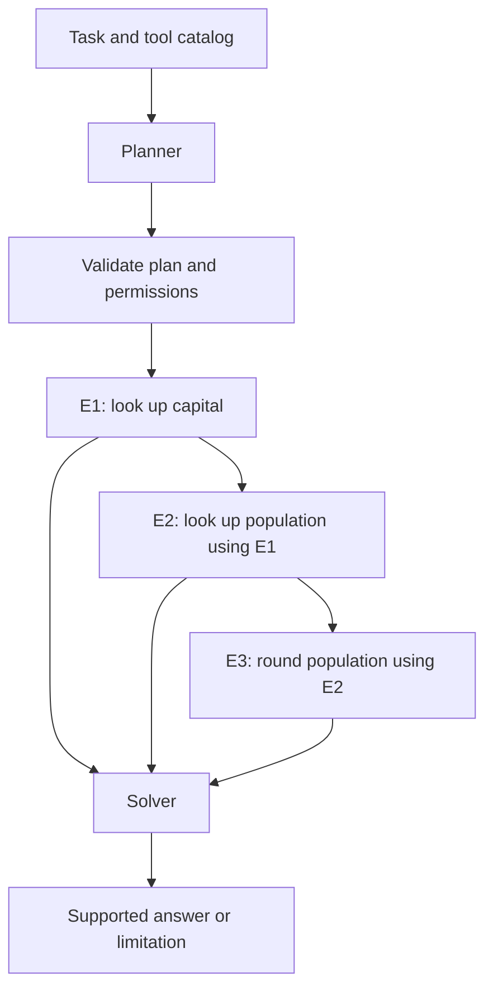
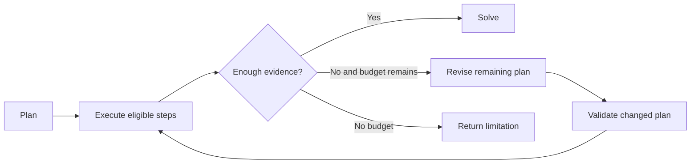

# ReWOO and Plan-and-Execute: Decoupled Planning

[Back to courses](../README.md#agent-engineering) · [The Agent Loop](1-agent-loop.md) · [Agent Framework Tradeoffs](../1-llm-engineering/13-agent-framework-tradeoffs.md)

| Field | Details |
| --- | --- |
| Origin | [AI Engineering from Scratch — source lesson](https://github.com/rohitg00/ai-engineering-from-scratch/blob/main/phases/14-agent-engineering/02-rewoo-plan-and-execute/docs/en.md) |
| Author | Rohit Ghumare and contributors |
| Level | Intermediate — repository assessment |
| Best for | Separating planning from execution, validating dependency graphs, comparing ReAct with ReWOO, and designing bounded replanning |

Adapted from the MIT-licensed lesson and companion implementation; copyright © 2026 Rohit Ghumare. [Original license](../licenses/ai-engineering-from-scratch-LICENSE). The Python example runs offline with a scripted planner, fixture tools, and a deterministic solver.

## The Problem

An interleaved agent decides, calls a tool, reads the result, and decides again. That flexibility is useful when the next step depends on what the environment reveals. It can also repeat a growing amount of context across model calls.

For a task with predictable dependencies, the application may be able to plan once, gather evidence, and compose an answer afterward. Think of a chef writing a preparation list before cooking: independent ingredients can be prepared together, but the sauce cannot be finished before its required ingredients are ready.

Examples:

- Look up a country's capital, retrieve a population record for that city, then round the result.
- Retrieve two companies' reports independently, extract comparable figures, then calculate a difference.
- Inspect a repository, run diagnostics, and revise the plan when a failing test reveals an unexpected dependency. This last case needs more adaptation than a fixed plan alone provides.

## The Concept

### Planner, Workers, Solver

**ReWOO** means Reasoning WithOut Observation. It separates initial planning from tool observations; the overall system still uses observations as evidence when solving the task.

| Component | Input | Output | Responsibility |
| --- | --- | --- | --- |
| Planner | Task, tool catalog, constraints | Plan with evidence references | Decide the intended steps before seeing their results |
| Workers | Validated steps and resolved arguments | Evidence or structured failures | Execute permitted tools in dependency order |
| Solver | Task, plan, evidence and failures | Answer or explicit limitation | Compose a response supported by completed work |



An **evidence reference**, such as `#E1`, is a placeholder for a worker result. It allows a planner to describe a dependency without knowing the result's value yet.

A **directed acyclic graph (DAG)** represents steps and dependencies without circular paths. **Topological order** places each dependency before its consumers. A DAG is a useful implementation of a dependency-aware plan; it does not imply that all tools can run in parallel.

### ReAct Versus ReWOO

| Dimension | Interleaved ReAct-style loop | ReWOO-style separation |
| --- | --- | --- |
| Planning | Revised as observations arrive | Initial plan formed before worker observations |
| Model interaction | Often a decision call after each tool result | Planner and solver calls, plus any model-backed workers |
| Adaptability | Can choose a different next action immediately | Unexpected observations may require a separate replanner |
| Context cost | Repeated history can accumulate | Less repeated planning context, but evidence still reaches the solver |
| Parallel work | Possible when several actions are independent | Dependencies make scheduling opportunities explicit |
| Failure handling | Feed error back into the next decision | Record node failure and block/revise affected dependencies |
| Best starting fit | Exploratory or changing environments | Predictable evidence-gathering structure |

Neither approach automatically wins on accuracy, latency, or robustness. A bad up-front plan can execute many unnecessary calls; an interleaved agent can sometimes recover more cheaply.

### Token Efficiency: What the Formula Actually Says

Suppose each decision repeats a base prompt of `P` tokens and every completed step adds `h` history tokens. For `n` decisions, a simplified input total is:

```text
sum from i=0 to n−1 of (P + i × h)
= n × P + h × n × (n−1) / 2
```

For `P=500`, `h=200`, and `n=5`, this gives **4,500 input tokens**. The quadratic term describes repeated full-history prompting under these assumptions. Summarization, bounded history, caching, and different execution policies change the result. It is not an unavoidable law of every ReAct implementation.

For a separated design:

```text
total model tokens = planner input/output
                   + solver input/output
                   + any model-backed worker or replanner calls
```

A normal database/API worker need not call an LLM at all. The solver still needs enough evidence, and long results can dominate its context. Token counts also differ from billed cost, especially with cached-input rates and different planner/solver models.

The [ReWOO paper](https://arxiv.org/abs/2305.18323) reports approximately fivefold token efficiency and a reported 4% accuracy improvement on HotpotQA in its evaluated setup. Treat these as research results, not a promised saving for a new application. The local demo does not reproduce that benchmark.

### Failure Localization and Recovery

| Condition | Executor response | Solver/replanner response |
| --- | --- | --- |
| Unknown tool or malformed plan | Reject before execution | Request a bounded corrected plan |
| Missing evidence reference | Reject the plan | Repair the dependency definition |
| Cyclic dependency | Reject the plan | Produce an acyclic alternative |
| Worker returns no result | Record a typed failure | Clarify, abstain, or select another source |
| Dependency fails | Skip dependent nodes | Explain missing evidence; do not treat error text as facts |
| Independent branch succeeds | Preserve its result | Use it only if sufficient for a supported partial answer |
| Required permission missing | Deny execution | Do not replan to bypass the restriction |

A plan makes failures easier to locate, but it does not guarantee recovery. The original plan may be invalidated by new information. Distinguish “no evidence found” from “the claim is false.”

### Plan-and-Execute and Replanning

**Plan-and-Execute** is the broader architectural pattern of making a plan and executing steps. Some implementations add an explicit replanner after partial execution. It is not simply a new name for every ReWOO system.



A replanner should receive the goal, completed evidence, failures, and remaining budget. Preserve valid completed work where possible. Version the new plan, revalidate permissions, and prevent repeated side effects with idempotency keys. Cap replans, total tool calls, elapsed time, and spend.

### Planner Distillation

**Distillation** trains a smaller model using outputs or supervision from a stronger model. A planner training set can pair task/tool-catalog inputs with validated plans, without needing worker observations in the planner input.

The ReWOO authors describe transferring reasoning capability from a 175B teacher to a 7B model. This motivates testing smaller planners; it does not establish that any 7B model can replace all larger planning or solving models. [ReWOO paper](https://arxiv.org/abs/2305.18323).

Evaluate plan syntax, dependency validity, tool selection, unnecessary steps, and end-to-end task success. Split data by task family or environment to avoid measuring memorized templates. A syntactically valid plan can still be strategically wrong.

### Plan-and-Act

[Plan-and-Act](https://arxiv.org/abs/2503.09572), published at ICML 2025, separates high-level planning from environment-specific execution and uses synthetic training data that associates trajectories with feasible plans. Its evaluations include web-navigation tasks.

A **trajectory** is a sequence of states/observations and actions during an interaction. A high-level instruction such as “find the account settings” may require several low-level clicks that cannot be fixed before the current interface is observed. A trained planner/executor hierarchy is more than converting a DAG to a list.

There is no universal “over 30 steps means use Plan-and-Act” boundary. Choose based on environment change, feedback needs, training-data availability, and measured performance.

### Choosing the Simplest Suitable Pattern

| Situation | Starting approach | Why |
| --- | --- | --- |
| One lookup and a summary | Ordinary code plus a model call | Little value in a separate planner |
| Predictable dependent lookups | ReWOO-style plan/worker/solver | Explicit dependencies and limited repeated planning |
| Unknown environment | Interleaved agent loop | Observations can change the next action |
| Mostly predictable task with occasional surprises | Plan-and-Execute with bounded replanning | Preserve structure while adapting |
| Learned high-level web-navigation planning | Investigate Plan-and-Act | Distinct planner/executor and training-data requirements |

## Build It: A Validated Dependency Executor

The upstream example asks for the rounded population of a country's capital. Here all population values are **synthetic fixtures**, not current demographic claims. References must occupy an entire argument, such as `"#E1"`; this keeps substitution typed rather than converting arbitrary results into strings.

Copy the following block into `rewoo_demo.py` and run with Python 3.10+. It uses only the standard library. The executor is sequential; parallel scheduling is an exercise.

```python
import json
import re
from dataclasses import dataclass
from graphlib import TopologicalSorter, CycleError


@dataclass(frozen=True)
class Step:
    id: str
    tool: str
    args: dict


class LookupFailure(Exception):
    pass


def capital(country):
    if country != "France":
        raise LookupFailure("No fixture for country")
    return "Paris"


def population(city):
    if city != "Paris":
        raise LookupFailure("No fixture for city")
    return 2_100_000  # Synthetic city fixture; not a factual population estimate.


def round_millions(value):
    return f"{value / 1_000_000:.0f} million"


TOOLS = {
    "capital": ({"country": str}, capital),
    "population": ({"city": str}, population),
    "round_millions": ({"value": int}, round_millions),
}
REFERENCE = re.compile(r"#(E[1-9][0-9]*)\Z")


def reference(value):
    match = REFERENCE.fullmatch(value) if isinstance(value, str) else None
    return match.group(1) if match else None


def validate_plan(plan, max_steps=20):
    if not isinstance(plan, list) or not 1 <= len(plan) <= max_steps:
        raise ValueError("Plan must contain 1..max_steps steps")
    by_id, dependencies = {}, {}
    for step in plan:
        if not isinstance(step, Step) or not isinstance(step.id, str):
            raise ValueError("Invalid step")
        if not re.fullmatch(r"E[1-9][0-9]*", step.id) or step.id in by_id:
            raise ValueError("Invalid or duplicate evidence ID")
        if not isinstance(step.tool, str) or step.tool not in TOOLS:
            raise ValueError("Unknown tool")
        schema, _ = TOOLS[step.tool]
        if not isinstance(step.args, dict) or set(step.args) != set(schema):
            raise ValueError("Invalid argument names")
        refs = set()
        for name, value in step.args.items():
            ref = reference(value)
            if ref:
                refs.add(ref)
            elif type(value) is not schema[name]:
                raise ValueError("Invalid literal argument type")
            elif isinstance(value, str) and "#" in value:
                raise ValueError("Only whole-argument evidence references are supported")
        by_id[step.id] = step
        dependencies[step.id] = refs
    if any(ref not in by_id for refs in dependencies.values() for ref in refs):
        raise ValueError("Unknown evidence reference")
    try:
        order = list(TopologicalSorter(dependencies).static_order())
    except CycleError as exc:
        raise ValueError("Cyclic plan") from exc
    return by_id, dependencies, order


def run_workers(plan):
    # Validate the entire graph before executing any tool.
    by_id, dependencies, order = validate_plan(plan)
    evidence = {}
    for node_id in order:
        step = by_id[node_id]
        if any(evidence[dep]["status"] != "ok" for dep in dependencies[node_id]):
            evidence[node_id] = {"status": "skipped", "error": "dependency_failed"}
            continue
        bound = {key: evidence[reference(value)]["value"] if reference(value) else value
                 for key, value in step.args.items()}
        schema, fn = TOOLS[step.tool]
        if any(type(bound[key]) is not expected for key, expected in schema.items()):
            evidence[node_id] = {"status": "error", "error": "resolved_argument_type"}
            continue
        try:
            evidence[node_id] = {"status": "ok", "value": fn(**bound)}
        except LookupFailure:
            evidence[node_id] = {"status": "error", "error": "not_found"}
        # Unexpected programming failures propagate for operational handling.
    return evidence


def scripted_planner(question):
    # Fixed task fixture, not natural-language planning.
    return [
        Step("E1", "capital", {"country": "France"}),
        Step("E2", "population", {"city": "#E1"}),
        Step("E3", "round_millions", {"value": "#E2"}),
    ]


def scripted_solver(question, evidence):
    required = ("E1", "E2", "E3")
    if any(evidence.get(key, {}).get("status") != "ok" for key in required):
        return "Insufficient fixture evidence to answer."
    return (f"In the synthetic fixture, {evidence['E1']['value']} has "
            f"{evidence['E2']['value']:,} people, rounded to {evidence['E3']['value']}.")


def demo():
    question = "Round the population of France's capital using the fixture."
    plan = scripted_planner(question)
    evidence = run_workers(plan)
    print(json.dumps(evidence, indent=2))
    answer = scripted_solver(question, evidence)
    print(answer)
    assert evidence["E3"]["value"] == "2 million"
    # Input list order does not determine execution order.
    assert run_workers(list(reversed(plan))) == evidence


if __name__ == "__main__":
    demo()
```

### What the Example Proves—and What It Does Not

| Demonstrated behavior | Deliberate limitation |
| --- | --- |
| Duplicate IDs, unknown tools/references, and cycles are rejected | No model-generated plan or general schema engine |
| Dependency order is computed before work begins | No concurrent worker execution |
| Evidence keeps its native value type | No nested references or field-path selection |
| Dependent nodes skip failed evidence | No automatic replanning or retry controller |
| Solver withholds an answer when required evidence fails | Solver is specific to the fixture, not an LLM |

The demo runs three tool steps, not two: capital lookup, population lookup, then rounding. It measures neither actual tokens nor savings against ReAct. Character counts are not a substitute for provider token usage, and a simulated transcript is not a controlled model benchmark.

Real plans need authorization, bounded arguments/results, deadlines, cost reservations, evidence provenance, and output validation. For side effects, plan validation must be followed by per-action authorization and idempotency; an approved initial plan does not make every later argument safe.

## Use It in a Real Application

1. Give the planner a versioned tool catalog with input/output contracts and resource constraints.
2. Parse its plan as structured data; validate all IDs, references, cycles, tool eligibility, and size limits before dispatch.
3. Execute ready nodes with bounded concurrency, deadlines, and per-tool permission checks.
4. Store results with node ID, source/version, status, timing, and relevant provenance. Keep external text as untrusted evidence.
5. Invoke the solver with sufficient successful evidence and explicit gaps. Validate factual support rather than assuming fluent synthesis means completion.
6. If replanning is permitted, revise only within the remaining budget and revalidate the new graph.

A graph runtime can manage checkpoints and scheduling, but it does not choose correct tools or authorize actions for you. Keep the planner, executor, and solver interfaces separate so they can be tested and upgraded independently.

### Metrics and a Fair Comparison

| Metric | Definition | Why it matters |
| --- | --- | --- |
| Plan validity | Valid plans / generated plans | Detects schema and dependency errors |
| Task success | Accepted answers / evaluated tasks | Measures the actual outcome |
| Tool efficiency | Useful executed calls / executed calls | Exposes waste from bad plans |
| Dependency failure | Nodes skipped due to upstream failures / planned nodes | Shows fragility of long chains |
| Token/cost efficiency | Total tokens and spend per successful task | Includes planner, solver, repairs, and model-backed workers |
| Latency | End-to-end p50/p95 and critical-path duration | Distinguishes concurrency benefit from fewer model calls |
| Replan rate | Runs requiring revision / runs | Indicates mismatch between initial plans and reality |

Compare both patterns on the same tasks, tools, model settings, output rubric, and budgets. Count failed runs and retries. Repeated runs and uncertainty estimates help separate genuine changes from model variability. Parallelism reduces latency only across independent work; a dependency chain remains sequential.

## Exercises

1. Add two independent lookup branches and a final aggregation step. Schedule ready nodes concurrently with a cap; test partial failures and preserve evidence IDs.
2. Test duplicate IDs, cycles, unknown references, invalid argument names, and resolved values of the wrong type. Verify invalid plans execute no tools.
3. Make the first lookup fail. Confirm dependent nodes are skipped and the solver returns a limitation rather than an invented answer.
4. Add a replanner after failure with a maximum of two revisions. Preserve valid results, version the plan, and count all attempts against one budget.
5. Replace the scripted planner with a smaller model while keeping the solver fixed. Compare plan validity and task success; do not infer capability from parameter count alone.
6. Design distillation data containing task, tool catalog, constraints, and a validated plan. Explain how to avoid training on invalid teacher plans or leaking evaluation tasks.
7. Build a controlled ReAct versus ReWOO comparison. Measure actual token usage and cost per successful task, including long evidence and failed calls.
8. Sketch a high-level planner with an environment-specific executor for a changing web interface. Explain why a predetermined click list differs from the Plan-and-Act research approach.

## Quick Cheat Sheet

| Term | Crisp definition | Remember |
| --- | --- | --- |
| ReWOO | Separates initial planning from tool observations, then solves with evidence | Plan → workers → solver |
| Planner | Produces intended steps and dependencies | Describe what evidence is needed |
| Worker | Executes a permitted tool step | Fetch or compute evidence |
| Solver | Composes an answer from the task and evidence | Explain supported results and gaps |
| DAG | Directed dependency graph with no cycles | No circular prerequisites |
| Topological order | Dependencies precede their consumers | Prerequisites first |
| Evidence reference | Placeholder for another step's result | `#E1` is a dependency, not a fact |
| Replanner | Revises unfinished work using observations | Adapt within the remaining budget |
| Distillation | Train a smaller model using stronger-model supervision | Validate teacher outputs |
| Plan-and-Act | Planner/executor research approach using synthetic plan supervision | High-level plans, environment-specific actions |
| Critical path | Longest dependency chain by execution time | Limits parallel speedup |

## Further Reading

- [Source lesson](https://github.com/rohitg00/ai-engineering-from-scratch/blob/main/phases/14-agent-engineering/02-rewoo-plan-and-execute/docs/en.md) and [companion implementation](https://github.com/rohitg00/ai-engineering-from-scratch/blob/main/phases/14-agent-engineering/02-rewoo-plan-and-execute/code/main.py).
- [Xu et al., ReWOO](https://arxiv.org/abs/2305.18323) — observation-independent planning, efficiency experiments, and smaller-model transfer.
- [Erdogan et al., Plan-and-Act](https://arxiv.org/abs/2503.09572) — planner/executor separation and synthetic training trajectories.
- [The Agent Loop](1-agent-loop.md) — interleaved execution and stopping conditions.
- [Evaluation](../1-llm-engineering/7-evaluation.md) — controlled comparisons and uncertainty.
- [Agent Framework Tradeoffs](../1-llm-engineering/13-agent-framework-tradeoffs.md) — orchestration, state, and recovery abstractions.

## Attribution and Import Notes

Adapted on 2026-10-18 from the upstream lesson and companion code. Retains planner/worker/solver roles, evidence dependencies, efficiency discussion, distillation, Plan-and-Execute, Plan-and-Act, and exercises. Local changes qualify benchmark claims, condition the quadratic-context example, validate the full plan before execution, preserve evidence types, explicitly skip failed dependencies, and label demographic data as synthetic. The offline example is not a live-model benchmark and does not implement parallel scheduling or replanning.

Source lesson SHA-256: `6415552ddca63102995206c84e95e9b0225b77c0c06ac808f316eb36431bb4df`.

Companion code SHA-256: `840b29ae5c67841213c752fcfff78da457ac61faf850cb884d09e8b0765bacfe`.
