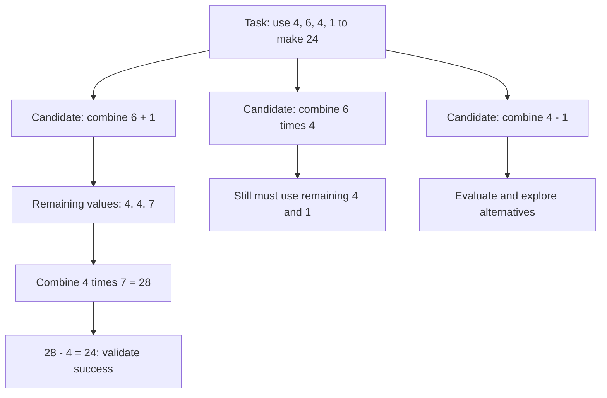

# Tree of Thoughts and LATS: Deliberate Search

[Back to courses](../README.md#agent-engineering) · [The Agent Loop](1-agent-loop.md) · [Reflexion](3-reflexion-verbal-rl.md)

## Why Search Instead of Following One Path?

Imagine looking for a route through a maze. Following one corridor is cheap, but a wrong turn can lead to a dead end. Search keeps track of alternative routes, explores promising ones, and returns to earlier junctions when needed.

A single generated solution can revise its own earlier statements, but it does not automatically maintain a persistent tree of alternatives. **Tree of Thoughts (ToT)** makes those alternatives explicit: propose several intermediate steps, evaluate them, and choose which branches to explore further.

Examples:

- **Arithmetic:** Try different ways to combine numbers before committing to one expression.
- **Coding:** Generate alternative patches, test them in isolated workspaces, and explore improvements to the strongest candidates.
- **Research:** Explore several query paths and compare their evidence before composing a conclusion. More branches do not compensate for unreliable sources.

Search is worthwhile when mistakes are expensive, candidate outcomes can be checked, and the task permits multiple attempts within the available time and cost.

## Tree of Thoughts: The Building Blocks

A **thought** is a useful intermediate unit represented by the application, such as an arithmetic operation, a partial plan, or a proposed code edit. It is not a claim about access to a model's private internal reasoning.

| Term | Definition | Example |
| --- | --- | --- |
| State or node | A representation of current progress | Remaining numbers and expressions already constructed |
| Edge | A transition between states | Combining two numbers with multiplication |
| Policy or generator | A mechanism that proposes next steps | Generate three candidate edits |
| Value function | An estimate of how promising a state is | Predicted likelihood that a partial solution can succeed |
| Terminal state | A state where the task attempt ends | A complete expression or finished program |
| Reward | A measured outcome used to compare attempts | Passing a validator or a fraction of tests passed |
| Pruning | Discarding branches from further exploration | Rejecting an invalid arithmetic operation |
| Backtracking | Returning to an earlier state to try another branch | Abandoning a patch and trying a different fix |

For Game of 24, the final expression must use every supplied number exactly once. Merely producing 24 from a subset is insufficient. With `4, 6, 4, 1`, a valid solution is `4 * (6 + 1) - 4 = 24`. Keep explicit remaining-number state so checks can verify both arithmetic and resource use.



### Choosing a Search Strategy

| Strategy | What it does | Advantage | Tradeoff |
| --- | --- | --- | --- |
| Breadth-first search (BFS) | Explores all nodes at one depth before the next | Systematic coverage of shallow alternatives | Large frontier and expensive expansion |
| Depth-first search (DFS) | Follows one branch deeply before backtracking | Small active frontier | Can spend its budget on a poor branch |
| Beam search | Keeps only the highest-scoring `b` states per depth | Predictable width and lower cost | A misleading score can discard the winning branch permanently |
| Monte Carlo Tree Search (MCTS) | Allocates repeated trials using outcome estimates and exploration | Concentrates effort adaptively | Needs meaningful rewards and enough trials |

A **frontier** is the collection of discovered states awaiting exploration. **Beam width** is the maximum number retained at each level. A bounded BFS-style search that discards low-ranked states is effectively beam search; it is not exhaustive BFS.

### Evaluating Partial Solutions

Possible evaluators include categorical judgments such as “promising” or “impossible,” numeric scores, pairwise comparisons, and executable checks. These are design choices; their reliability varies by task.

A partial state close to a numerical target may still be a dead end. A program passing visible tests may fail hidden cases. Separate a heuristic used to rank candidates from the final check used to declare success.

The [ToT paper](https://arxiv.org/abs/2305.10601) reports 74% success on Game of 24 compared with 4% for its GPT-4 chain-of-thought baseline. These are results from that study's prompts, tasks, and search settings, not a universal improvement or a guarantee for each scoring method.

## LATS: Search With Actions, Feedback, and Reflection

**Language Agent Tree Search (LATS)** combines branching search with language-model action proposals, value estimates, environment observations, and reflection on failures. A node can represent an interactive trajectory rather than only a text answer.

| Ingredient | Role in LATS | Connection to earlier courses |
| --- | --- | --- |
| Action generation | Propose candidate next actions | ReAct-style agent loop |
| Environment feedback | Observe what actually happened | Tool results and external verification |
| Value estimation | Judge promising partial trajectories | ToT-style evaluation |
| Reflection | Turn failure evidence into corrective guidance | Reflexion memory |
| Tree search | Decide where to spend another attempt | MCTS selection and backup |

For example, a coding agent can propose several patches, execute tests in separate sandboxes, use failures to guide new candidates, and update estimates for the branches that produced those candidates. Tests provide evidence; reflections propose a better strategy. Neither substitutes for validating the final patch.

The [LATS paper](https://arxiv.org/abs/2310.04406) reports 92.7% pass@1 on HumanEval with GPT-4 and a 75.9 average WebShop score with GPT-3.5 under its experimental settings. A final-output pass@1 result does not mean the system used only one internal model call or one searched candidate. Always report the search budget alongside final-answer accuracy.

## MCTS: Select, Expand, Simulate, Back Up

1. **Select:** Follow existing branches using a rule that balances known performance with exploration.
2. **Expand:** Add one or more candidate children to the tree.
3. **Simulate:** Continue from a child to an outcome. This continuation is a **rollout**.
4. **Back up:** Update visit counts and accumulated rewards along the selected path.

Here, “backpropagation” means propagating search statistics to ancestor nodes. It does **not** mean calculating neural-network gradients or updating model weights.

### UCT: Balancing Exploration and Exploitation

**UCT**, Upper Confidence Bounds applied to Trees, is a common selection rule:

```text
UCT(child) = Q(child) + c * sqrt(ln N(parent) / N(child))
Q(child)   = total backed-up reward / visits
```

| Symbol | Meaning | Practical implication |
| --- | --- | --- |
| `Q` | Mean observed reward | Favors branches that have worked well |
| `N(parent)` | Parent visit count | Exploration pressure grows as the parent is revisited |
| `N(child)` | Child visit count | Less-visited children receive a larger exploration bonus |
| `c` | Nonnegative exploration coefficient | Higher values encourage more exploration |

Unvisited children need special treatment, commonly an infinite selection score, rather than division by zero. Reward scale affects the appropriate `c`: values suited to rewards in `[0, 1]` may not suit rewards in `[0, 100]`.

These statistics estimate performance under the sampled rollouts. They are not calibrated probabilities of correctness. Model-generated actions and nonstationary evaluators can also violate assumptions used in classical search analysis.

## Hands-On: BFS and MCTS Without an API

This simplified arithmetic task starts at `1`, applies exactly three operations, and aims for `10`. At each step the choices are `+1`, `+2`, or `*2`. One solution is `((1 + 2) + 2) * 2 = 10`.

The example uses deterministic transitions, a numerical reward, and seeded random rollouts. It demonstrates the search core relevant to ToT and LATS. It does not include an LLM policy, language-based self-evaluation, or reflection, so it is **not a full LATS implementation**. Counters measure work, not invented token usage.

Save the block as `tree_search_demo.py` and run `python3 tree_search_demo.py` (Python 3.10+, standard library only).

```python
from collections import deque
from dataclasses import dataclass, field
from math import log, sqrt
from random import Random

OPS = ("+1", "+2", "*2")
DEPTH = 3
TARGET = 10


def apply(value, action):
    if action == "+1":
        return value + 1
    if action == "+2":
        return value + 2
    if action == "*2":
        return value * 2
    raise ValueError("Unknown action")


def reward(value):
    return 1.0 / (1 + abs(TARGET - value))


def bfs():
    frontier = deque([(1, ())])
    visited = 0
    while frontier:
        value, path = frontier.popleft()
        visited += 1
        if len(path) == DEPTH:
            if value == TARGET:
                return path, visited
            continue
        for action in OPS:
            frontier.append((apply(value, action), path + (action,)))
    return None, visited


@dataclass
class Node:
    value: int
    path: tuple = ()
    parent: object = field(default=None, repr=False)
    children: list = field(default_factory=list, repr=False)
    untried: list = field(default_factory=lambda: list(OPS))
    visits: int = 0
    total: float = 0.0

    def terminal(self):
        return len(self.path) == DEPTH


def uct(child, parent_visits, c):
    if child.visits == 0:
        return float("inf")
    return child.total / child.visits + c * sqrt(
        log(max(1, parent_visits)) / child.visits
    )


def mcts(iterations=100, c=1.4, seed=7):
    if iterations < 1 or c < 0:
        raise ValueError("iterations must be positive and c nonnegative")
    rng = Random(seed)
    root = Node(1)
    best_path, best_score = None, -1.0
    for _ in range(iterations):
        node = root
        # Select until a terminal node or a node with an untried action.
        while not node.terminal() and not node.untried:
            node = max(node.children,
                       key=lambda child: uct(child, node.visits, c))
        # Expand one untried action.
        if not node.terminal():
            action = node.untried.pop(rng.randrange(len(node.untried)))
            child = Node(apply(node.value, action),
                         node.path + (action,), parent=node)
            node.children.append(child)
            node = child
        # Roll out to the required depth; do not mutate the tree state.
        value, path = node.value, node.path
        while len(path) < DEPTH:
            action = rng.choice(OPS)
            value = apply(value, action)
            path += (action,)
        score = reward(value)
        if score > best_score:
            best_path, best_score = path, score
        # Back up the observed reward, including at the root.
        while node is not None:
            node.visits += 1
            node.total += score
            node = node.parent
    return best_path, best_score, root


def verify(path):
    if path is None or len(path) != DEPTH:
        return False
    value = 1
    for action in path:
        value = apply(value, action)
    return value == TARGET


def main():
    path, visited = bfs()
    print("BFS:", path, "valid:", verify(path), "nodes:", visited)
    path, score, root = mcts()
    print("MCTS:", path, "valid:", verify(path),
          "score:", score, "rollouts:", root.visits)
    print("Root child visits:",
          {child.path[0]: child.visits for child in root.children})


if __name__ == "__main__":
    main()
```

BFS systematically examines up to `1 + 3 + 9 + 27 = 40` nodes. MCTS runs the specified number of rollouts, including repeated paths, so 100 iterations are not automatically cheaper than BFS on this tiny tree. The purpose is to understand adaptive allocation before applying it to an expensive search space.

MCTS returns the highest-reward completed candidate observed, which may still fail verification under a small budget. Do not label a near-target candidate as successful. A production solver can stop early on independently verified success; the demo uses the full budget to make visit statistics observable.

## Adding the Language-Agent Components

| Replace or extend | Real-agent version | Check |
| --- | --- | --- |
| `OPS` | Model-generated structured candidate actions | Validate tool names, arguments, and permissions |
| `apply` | Execute in a branch-specific environment | Preserve observations and isolate mutable state |
| Random rollout | Bounded agent loop using task context and reflections | Enforce tool, token, and time limits |
| Numerical reward | Environment outcome plus an optional calibrated value estimate | Keep final acceptance grounded in independent evidence |
| Failure handling | Reflect on failed trajectories and condition future proposals | Avoid treating unsupported reflections as facts |
| Tree state | Persist actions, observations, visits, values, and provenance | Allow reproducible inspection and recovery |

If combining a model score with an environment score, normalize their ranges and validate the weighting. An arbitrary average can hide a failed hard requirement behind a confident self-assessment.

Backtracking requires a restorable environment. A browser purchase or sent message cannot be undone by moving to another tree node. Use read-only exploration, simulators, isolated branches, or deferred execution when the task requires comparing alternatives before acting.

## Cost, Metrics, and a Search Policy

With branching factor `k` and depth `d`, a complete tree contains:

```text
1 + k + k^2 + ... + k^d = (k^(d+1) - 1) / (k - 1), for k > 1
```

A width-`b` beam generates roughly `k + (d - 1) * b * k` candidates when each retained state proposes `k` children. Actual model calls depend on batching, repeated evaluation, and caching. MCTS cost depends on iteration count and rollout length. No fixed token multiplier applies to every task.

| Metric | What to record |
| --- | --- |
| Verified success rate | Correct accepted results divided by evaluated tasks |
| Cost per solved task | Total model and tool cost, including failures, divided by solved tasks |
| Search effort | Expanded nodes, rollouts, tool calls, and evaluator calls |
| Token usage | Actual input/output usage, including repeated contexts and evaluations |
| Latency | Median and p95 end-to-end time; include retries and tool execution |
| Evaluator error | Incorrect candidates accepted and correct candidates rejected |
| Diversity | Distinct useful candidates rather than paraphrases of one approach |

Compare linear execution, multiple independent samples, beam search, and MCTS under matched resource caps. More candidates can exploit evaluator weaknesses: search may discover outputs that score well without satisfying the task. Use held-out checks and audit false positives.

| Task shape | Starting strategy | Reason |
| --- | --- | --- |
| Simple extraction or factual response | Direct answer with validation | Branching adds little value |
| Interactive task with evolving observations | Bounded ReAct-style loop | Next action depends on new evidence |
| Diagnosable failures across attempts | Reflexion | Corrective feedback may be sufficient |
| Several plausible partial solutions | ToT with a small beam | Compare alternatives within a predictable width |
| Valuable task with restorable state and reliable rewards | Evaluate an MCTS/LATS approach | Adaptive exploration may justify its cost |
| Iterative program optimization with executable fitness | Consider evolutionary search | Mutations can improve a population of candidates |

This is a design guide, not a claim about which architecture dominates current production systems. Start with a measured baseline and add search where experiments show a benefit.

## Exercises

1. Run MCTS with `c=0.1` and `c=2.0` across multiple seeds. Compare visit distributions, verified success, and work at fixed iteration budgets.
2. Add seeded noise to the search score while keeping `verify` exact. Measure false confidence and success as noise increases. There is no universal minimum signal-to-noise ratio.
3. Implement a beam search keeping the top `b` states per depth. Compare widths 1, 2, and 3 against BFS, using the same candidate budget. Explain why distance to the target can be a poor partial-state heuristic.
4. Add a maximum rollout depth and explicit budget-exhaustion outcome for a larger task. Never report an incomplete path as success.
5. Add a reflection store to a model-backed version. Compare runs with and without reflection at the same spending cap; retain evaluator evidence with each note.
6. Read the LATS experimental protocol. Record model, prompts, rollout limits, tests available during search, and final evaluation before interpreting its HumanEval result.
7. Write a search policy for a coding agent: when to branch, which state to isolate, how to validate patches, and when to stop.

## Quick Cheat Sheet

**ToT: propose → score → keep promising branches.**

**MCTS: select → expand → simulate → back up.**

| Concept | Memory aid | Caveat |
| --- | --- | --- |
| ToT | A map of alternative routes | Depends on useful candidates and evaluation |
| LATS | A search tree that acts, observes, and reflects | Plain MCTS alone is not full LATS |
| UCT | Reward the promising; investigate the neglected | Exploration strength depends on reward scale |
| Rollout | Follow a branch to an outcome | Simulated outcomes may differ from real ones |
| Backup | Send the result to ancestor statistics | No neural-weight training involved |
| Beam width | Number of routes kept per level | Pruned routes can include the best solution |
| Final verification | Check the destination independently | A high heuristic score is not proof |

An interview answer: “Tree of Thoughts explores alternative intermediate solutions instead of committing to one path. LATS combines language-agent actions, environmental feedback, reflection, and Monte Carlo Tree Search. The tradeoff is more inference work and dependence on reliable evaluation, so I would compare verified success, cost, and latency against simpler baselines under the same budget.”

## Resource

Adapted from the MIT-licensed lesson; copyright © 2026 Rohit Ghumare. [Original license](../licenses/ai-engineering-from-scratch-LICENSE). The standalone Python example below is a teaching implementation of search mechanics, not a reproduction of the research benchmarks.

| Field | Details |
| --- | --- |
| Origin | [AI Engineering from Scratch — source lesson](https://github.com/rohitg00/ai-engineering-from-scratch/blob/main/phases/14-agent-engineering/04-tree-of-thoughts-lats/docs/en.md) |
| Author | Rohit Ghumare and contributors |
| Level | Intermediate to advanced — repository assessment |
| Best for | Comparing branching search strategies, understanding MCTS and UCT, and deciding when additional inference cost improves agent outcomes |

## References and Attribution

- [Source lesson](https://github.com/rohitg00/ai-engineering-from-scratch/blob/main/phases/14-agent-engineering/04-tree-of-thoughts-lats/docs/en.md) — Rohit Ghumare and contributors.
- [Tree of Thoughts: Deliberate Problem Solving with Large Language Models](https://arxiv.org/abs/2305.10601) — Yao et al.
- [Language Agent Tree Search Unifies Reasoning Acting and Planning in Language Models](https://arxiv.org/abs/2310.04406) — Zhou et al.
- [Evaluation course](../1-llm-engineering/7-evaluation.md) — experiment design and outcome measurement.

Adapted on 2026-10-23. This course retains the source's ToT/LATS concepts, MCTS stages, UCT formula, search-cost discussion, and exercise themes. It adds terminology, diagrams, comparisons, and a self-contained search demonstration. The code is an original teaching example rather than an import of the upstream companion. Benchmark figures are attributed to their papers; no live LLM benchmark was run. Unverified framework availability and blanket token-cost or production-adoption claims are omitted.

The source tracks upstream `main`; the hash below identifies the downloaded lesson. Imported material retains its [MIT license notice](../licenses/ai-engineering-from-scratch-LICENSE).

- Lesson Markdown SHA-256: `c0d4e1af4425b9cc2a97b944e4b538fb2bcef90e4469acab0d547c69e317e92f`
