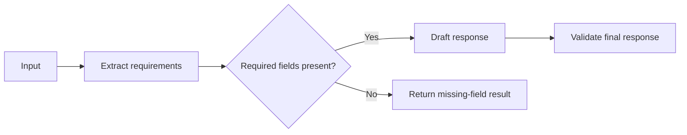
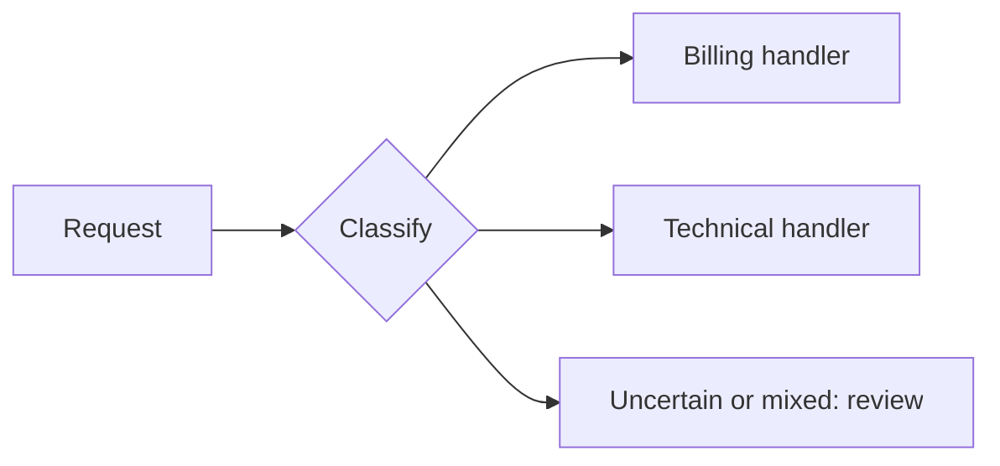
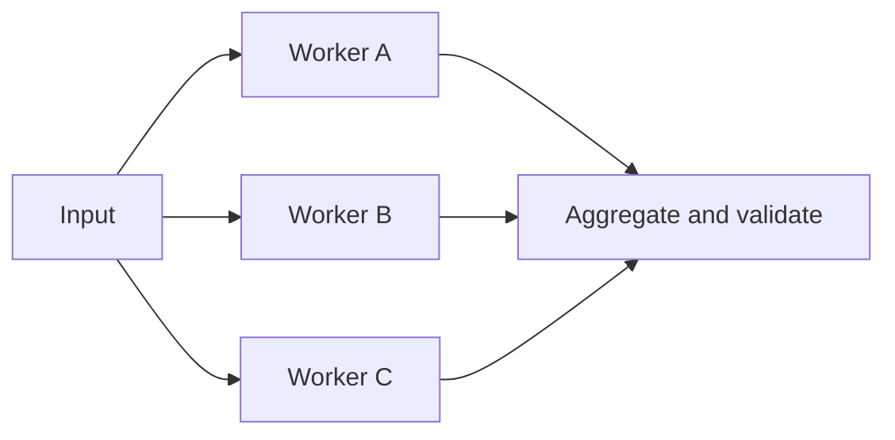
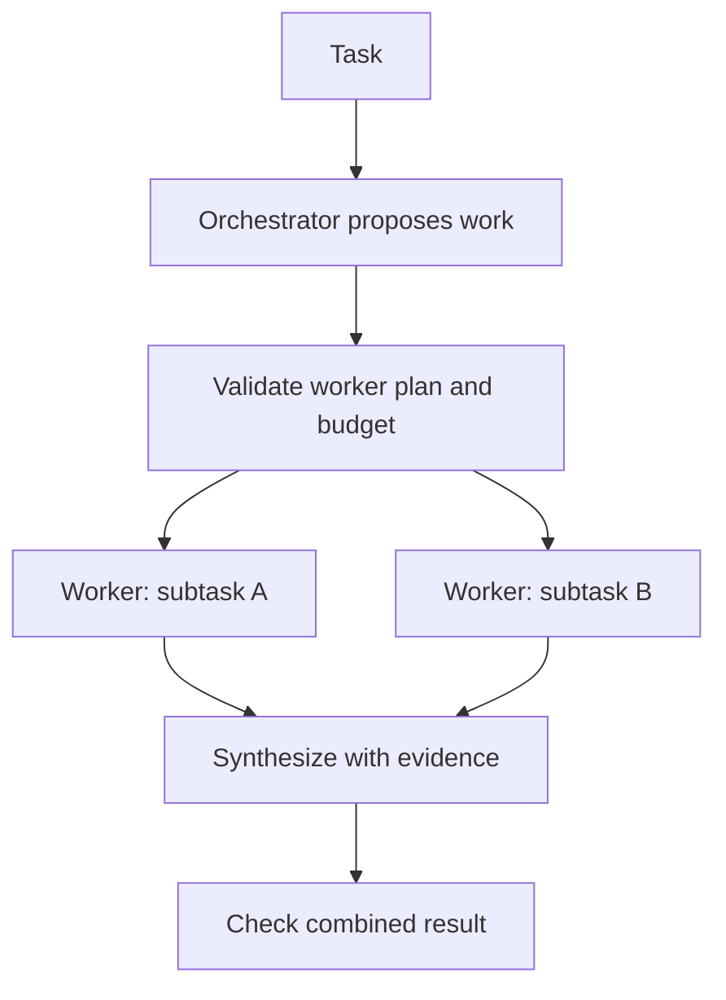
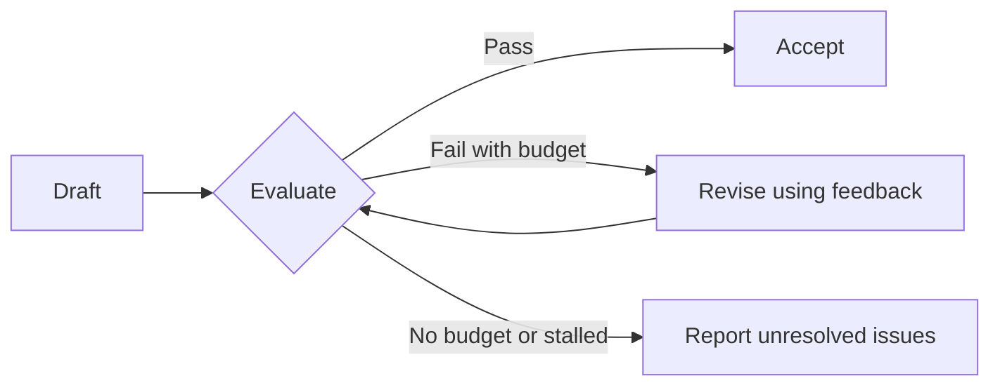

# Anthropic Workflow Patterns: Choosing the Simplest Useful Design

[Back to courses](../README.md#agent-engineering) · [The Agent Loop](1-agent-loop.md) · [Self-Refine and CRITIC](5-self-refine-and-critic.md)

| Field | Details |
| --- | --- |
| Origin | [AI Engineering from Scratch — source lesson](https://github.com/rohitg00/ai-engineering-from-scratch/blob/main/phases/14-agent-engineering/12-anthropic-workflow-patterns/docs/en.md) |
| Author | Rohit Ghumare and contributors; workflow taxonomy attributed to Anthropic |
| Level | Intermediate — repository assessment |
| Best for | Selecting and combining workflow patterns, explaining workflows versus agents, and implementing explicit control flow before choosing a framework |

Adapted from the MIT-licensed lesson; copyright © 2026 Rohit Ghumare. [Original license](../licenses/ai-engineering-from-scratch-LICENSE). The Python demonstration uses scripted functions, no external packages, and no live model calls.

## Start With the Shape of the Task

A useful architecture follows the decisions a task actually requires. Some tasks need one answer, some need several predictable transformations, and others need decisions based on observations that do not exist yet.

Think of a restaurant. A fixed preparation checklist is a workflow. Sending orders to the appropriate station is routing. Preparing several dishes simultaneously is parallelization. A head chef deciding which stations a special order needs resembles orchestrator-workers. Tasting and adjusting a dish resembles evaluator-optimizer.

These patterns are ways to organize calls, tools, and data. They do not require a particular model provider or framework.

The source lesson builds on Anthropic's December 2024 article, [Building Effective Agents](https://www.anthropic.com/research/building-effective-agents), which distinguishes predefined workflows from model-directed agents and presents five workflow patterns. This course applies that taxonomy with original examples and implementation guidance.

## Workflows Versus Agents

| Dimension | Workflow | Agent |
| --- | --- | --- |
| Control flow | Application defines the permitted sequence and branches | Model chooses next actions based on observations within application constraints |
| Task fit | Steps or decision boundaries are reasonably predictable | Useful next steps emerge during execution |
| Debugging | Inspect named stages, inputs, and outputs | Inspect the actual action trajectory and state changes |
| Budgeting | Often easier to estimate from the graph | Requires explicit limits on steps, tools, time, and spend |
| Failure recovery | Retry or resume a known stage | May require revising the plan after new evidence |

A workflow may contain model decisions, loops, and a variable number of workers. An agent still operates inside engineered permissions and budgets. “The model owns the graph” is only shorthand: the application remains responsible for what actions are allowed.

A workflow is not automatically faster or cheaper. A ten-stage workflow can cost more than a two-call agent. Compare actual call counts, context sizes, tool latency, and outcome quality.

Examples:

- **Workflow:** Extract invoice fields, validate totals, and prepare an accounting record.
- **Agent:** Investigate an unfamiliar build failure by choosing inspections and tests based on results.
- **Hybrid:** A fixed support workflow invokes a bounded diagnostic agent only for unresolved technical cases.

## The Augmented LLM

An **augmented LLM** is a language model connected to additional capabilities. Add the capabilities the task needs; every call does not need all three.

| Capability | Meaning | Example | Boundary to define |
| --- | --- | --- | --- |
| Retrieval | Fetch relevant information | Search an authorized product manual | Source quality, access scope, freshness |
| Tools | Read or act through programmatic interfaces | Run a calculation or create a draft ticket | Argument validation and action permissions |
| Memory | Retain useful information across steps or sessions | Store task progress or validated preferences | Scope, retention, correction, and expiry |

**State** is the information required to continue the current execution. **Durability** means that state survives process failure. Persistent memory and durable execution are related but different concerns.

## 1. Prompt Chaining

**Prompt chaining** passes the output of one stage into the next. A **gate** is a programmatic check that allows or rejects progression.



Use it when the stages have clear contracts. For example, extract document claims before writing a summary, or draft an outline before expanding it into an article. Gates can catch missing fields before an expensive later stage.

The tradeoff is serial latency and error propagation. A polished final response may hide an incorrect extraction. Keep intermediate evidence and validate the final result, not only its format.

## 2. Routing

**Routing** classifies an input and sends it to a specialized handler. The router can use rules, a trained classifier, or an LLM.



Examples include choosing a support procedure or selecting a model tier for a task. The route is a decision about where work goes, not permission to perform an action such as issuing a refund.

For an uncertain classifier, measure performance on labeled requests and choose thresholds based on the cost of errors. An LLM's self-reported confidence is not automatically calibrated. Include fallback handling for unknown categories, ambiguous requests, and unavailable handlers.

## 3. Parallelization

**Parallelization** runs independent work concurrently and then combines the results. A **fan-out** launches branches; a **fan-in** aggregates their outputs.

| Variant | Work assigned | Example | Aggregation |
| --- | --- | --- | --- |
| Sectioning | Different independent subtasks | Review separate document sections | Merge findings with source references |
| Voting | Repeated assessments of the same task | Multiple classifications of one request | Apply a defined vote or consensus rule |



For independent tasks, ideal latency approaches the slowest branch plus aggregation time; total compute still includes every branch. Real systems also pay queueing and rate-limit costs.

Define ties, missing results, timeouts, and the minimum number of valid votes. Correlated model errors weaken voting: three agreeing calls are not equivalent to three independent sources of evidence. Required screening branches must complete before releasing an output that depends on their approval.

## 4. Orchestrator-Workers

An **orchestrator** decomposes a task into subtasks, assigns them to workers, and synthesizes their results. Unlike fixed sectioning, the subtasks are chosen for the particular input.



A repository change may need different files inspected depending on the issue. A report may need different source searches depending on its subject. Use worker input/output contracts and explicit dependencies: dynamically planned work is not necessarily safe to run in parallel.

Cap workers, total calls, and recursive delegation. Isolate edits or other mutable state, and resolve conflicting results rather than silently concatenating them. Orchestration can be bounded to one planning round or allow controlled replanning; neither shape is guaranteed by the pattern name.

## 5. Evaluator-Optimizer

An **evaluator** checks a candidate against criteria; an **optimizer** revises it using the feedback. They can be separate calls to the same model, different models, or a combination of models and deterministic checks.



Examples include improving a translation against a rubric and correcting code after a test failure. Use the loop when feedback can produce measurable improvement. A critique that merely repeats the original assumptions adds little value.

Recheck every revision and preserve the best independently evaluated candidate when appropriate. A bounded list of top candidates is a retention strategy; it is not a bandit algorithm unless it also defines adaptive action selection and reward updates. See [Self-Refine and CRITIC](5-self-refine-and-critic.md) for grounded checks and stopping policies.

## Hands-On: All Five Patterns in Standard Python

The following functions stand in for model calls. Their outputs are scripted so the example demonstrates control flow rather than model intelligence. The router uses keywords; the orchestrator chooses workers from the task text. Replace these components with validated model outputs when extending the example.

Save as `workflow_patterns.py` and run `python3 workflow_patterns.py` with Python 3.10+.

```python
from concurrent.futures import ThreadPoolExecutor
from collections import Counter


def prompt_chain(text, steps):
    value = text
    trace = []
    for name, transform, gate in steps:
        value = transform(value)
        trace.append((name, value))
        if not gate(value):
            return "gate_failed", trace
    return "completed", trace


def classify(text):
    text = text.lower()
    labels = []
    if "invoice" in text:
        labels.append("billing")
    if "error" in text:
        labels.append("technical")
    return labels[0] if len(labels) == 1 else "review"


def route(text, classifier, handlers):
    label = classifier(text)
    if label not in handlers:
        return "review", "No validated handler for this request."
    return label, handlers[label](text)


def parallel_section(items, worker, max_workers=3):
    if max_workers < 1:
        raise ValueError("max_workers must be positive")
    with ThreadPoolExecutor(max_workers=max_workers) as pool:
        return list(pool.map(worker, items))


def parallel_vote(prompt, voters):
    if not voters:
        raise ValueError("At least one voter is required")
    votes = parallel_section(voters, lambda voter: voter(prompt))
    counts = Counter(votes)
    winner, count = counts.most_common(1)[0]
    # Require a strict majority; a plurality or a tie is insufficient.
    return (winner if count > len(votes) / 2 else "review"), votes


def plan(task):
    # Scripted substitute for an orchestrator proposing structured subtasks.
    names = [name for name in ("security", "cost") if name in task.lower()]
    return names or ["general"]


def orchestrator_workers(task, planner, workers, max_tasks=3):
    names = planner(task)
    if (not names or len(names) > max_tasks
            or len(set(names)) != len(names)
            or any(name not in workers for name in names)):
        raise ValueError("Invalid or over-budget worker plan")
    results = parallel_section(names, lambda name: (name, workers[name](task)))
    # Deterministic synthesis preserves which worker supplied each result.
    return "\n".join(f"{name}: {result}" for name, result in results)


def evaluator_optimizer(initial, evaluator, optimizer, max_revisions=2):
    if max_revisions < 0:
        raise ValueError("max_revisions must be nonnegative")
    candidate = initial
    history = []
    for revision in range(max_revisions + 1):
        passed, feedback = evaluator(candidate)
        history.append((candidate, passed, feedback))
        if passed:
            return "accepted", history
        if revision == max_revisions:
            return "budget_exhausted", history
        updated = optimizer(candidate, feedback)
        if any(updated == old for old, _, _ in history):
            return "stalled", history
        candidate = updated
    raise AssertionError("Unreachable")


def main():
    chain = [
        ("normalize", str.strip, bool),
        ("draft", lambda text: "Reply: " + text, lambda text: len(text) < 80),
    ]
    print("CHAIN", prompt_chain("  invoice question  ", chain))
    handlers = {
        "billing": lambda _: "Prepare a billing response.",
        "technical": lambda _: "Prepare a diagnostic checklist.",
    }
    print("ROUTE", route("Invoice question", classify, handlers))
    print("SECTION", parallel_section(["part A", "part B"], str.upper))
    voters = [lambda _: "billing", lambda _: "billing", lambda _: "technical"]
    print("VOTE", parallel_vote("Invoice question", voters))
    workers = {
        "security": lambda _: "Check access boundaries.",
        "cost": lambda _: "Measure model and tool spending.",
        "general": lambda _: "Clarify acceptance criteria.",
    }
    print("ORCHESTRATE", orchestrator_workers("Review security and cost", plan, workers))
    evaluator = lambda text: (len(text.split()) <= 5, "Use at most five words.")
    optimizer = lambda text, _: " ".join(text.split()[:5])
    print("REFINE", evaluator_optimizer(
        "This response has more than five words", evaluator, optimizer
    ))


if __name__ == "__main__":
    main()
```

The chain completes two stages, routing selects billing, sectioning returns two independent results, and voting finds a strict majority. The orchestrator invokes security and cost workers. The optimizer removes excess words and rechecks the result before acceptance.

The threaded helper suits this bounded toy example. It propagates worker exceptions and has no timeout or partial-result policy. A hung worker can block completion, including executor shutdown. Production I/O calls need their own deadlines and cancellation support; a timeout on waiting alone does not terminate the underlying work.

## Combining Patterns and Engineering Boundaries

For a support assistant, start with a router. Billing requests might use a fixed retrieval–draft–validation chain. Technical requests might use orchestrator-workers to collect independent diagnostics, followed by an evaluator-optimizer. Uncertain requests can return a clarification requirement or enter a review queue.

| Boundary | Explicit decision |
| --- | --- |
| Stage contract | Input/output schema and evidence required for the next stage |
| Routing | Supported labels, calibrated threshold if used, fallback behavior |
| Parallel work | Concurrency limit, deadline, required branches, partial-result policy |
| Orchestration | Allowed worker types, dependency order, task cap, merge policy |
| Revision loop | Acceptance criteria, stagnation detection, revision and cost caps |
| Side effects | Permissions, idempotency keys where supported, reconciliation after retry |
| Observability | Stage identifiers, timing, usage, tool results, and failure reasons |

**Idempotency** means repeating an operation has the same intended effect as performing it once. It matters when retries could otherwise duplicate a ticket, charge, or message. Read-only checks are easier to parallelize than conflicting writes.

## Context Engineering and Framework Choice

**Context engineering** selects the information supplied to each call: task instructions, relevant evidence, current state, and useful history. A large context window is still a finite budget, and unnecessary content can obscure the required evidence. Give workers scoped inputs and return concise findings with provenance. Preserve unresolved constraints when compacting history. See [Context Engineering](../1-llm-engineering/4-context-engineering.md).

A framework can earn its cost through durable checkpoints, tracing, concurrency management, or resumable review steps. Choose it for requirements you can name and test. Direct calls may be sufficient for a small workflow; a framework does not remove the need to understand retries, state, tool permissions, and actual prompts. See [Agent Framework Tradeoffs](../1-llm-engineering/13-agent-framework-tradeoffs.md).

## Metrics and Decision Rules

| Metric | Definition or measurement | Why it matters |
| --- | --- | --- |
| Verified completion | Correct completed tasks / all tasks | Architecture should improve outcomes |
| Cost per correct task | Total spending, including failures / correct completions | Includes orchestration and evaluation overhead |
| End-to-end latency | Median and p95 completion time | Reveals serial chains and slow parallel branches |
| Route error | Requests sent to an inappropriate handler / routed requests | Exposes classification failures |
| Fallback rate | Requests requiring review or clarification / all requests | Shows coverage and uncertainty |
| Stage failure rate | Failures per stage invocation | Localizes weak gates and tool interfaces |
| Revision recovery/regression | Incorrect drafts fixed / correct drafts damaged | Checks whether the optimizer helps |
| Worker utilization | Useful completed subtasks / launched subtasks | Detects unnecessary fan-out |

For serial stages, latency is approximately the sum of stage times. For independent parallel stages with enough capacity, latency is approximately the maximum branch time plus aggregation. Cost still sums across calls, including evaluators and repeated context. These estimates exclude queueing, retries, and rate limits.

Start with one call when it meets the quality target. Add chaining for predictable dependencies, routing for distinct handling, parallelization for independent work, orchestrator-workers for task-specific decomposition, and evaluator-optimizer for actionable feedback. Consider a bounded agent when observations repeatedly determine steps that a fixed workflow cannot reasonably anticipate.

## Exercises

1. Add confidence-based routing with a review fallback. Calibrate a threshold on labeled requests and compare error costs; do not assume reported confidence is a probability.
2. Add parallel-call deadlines and a minimum valid-vote requirement. Test one failed worker, one slow worker, and tied votes. Document what happens to unfinished work.
3. Retain the two highest-scoring evaluated candidates in the optimizer. Explain why retention alone is not a multi-armed bandit algorithm.
4. Combine routing with three chains. Compare accuracy, latency, and actual token usage against a single-prompt baseline on the same tasks.
5. Add dependencies to the orchestrator's plan. Ensure dependent workers cannot start before their required evidence exists.
6. Draw a workflow for a feature you know. Identify which decisions are predictable and which genuinely require dynamic tool selection.
7. Simulate a process failure between two stages. Specify the minimum checkpoint state needed to resume without repeating a side effect.

## Quick Cheat Sheet

**Chain = sequence. Route = choose. Parallelize = independent work. Orchestrate = decompose. Evaluate–optimize = revise.**

| Pattern | Analogy | Main question |
| --- | --- | --- |
| Prompt chaining | Assembly line | Are the stages and gates clear? |
| Routing | Reception desk | Can requests be classified reliably? |
| Parallelization | Independent workstations | Can branches run without waiting on each other? |
| Orchestrator-workers | Project coordinator | Must the subtasks be chosen for this input? |
| Evaluator-optimizer | Editor and author | Can feedback measurably improve the draft? |
| Agent | Investigator choosing the next lead | Does new evidence determine the next action? |

An interview answer: “I would begin with the simplest design that meets the quality target. Anthropic's five workflow patterns organize predictable sequences, dispatch, independent work, dynamic decomposition, and feedback-driven revision. I would choose based on task dependencies, define gates and budgets, then compare verified completion, cost, and latency before adding more autonomy.”

## References and Attribution

- [Source lesson](https://github.com/rohitg00/ai-engineering-from-scratch/blob/main/phases/14-agent-engineering/12-anthropic-workflow-patterns/docs/en.md) — Rohit Ghumare and contributors.
- [Building Effective Agents](https://www.anthropic.com/research/building-effective-agents) — Anthropic's workflow taxonomy and architectural guidance.
- [Evaluation](../1-llm-engineering/7-evaluation.md) — measuring quality and comparing implementations.

Adapted on 2026-10-23. The course retains the source's five patterns, augmented-LLM concept, workflow/agent distinction, context and framework discussion, and exercise themes. It adds diagrams, implementation boundaries, metrics, and an original standard-library demonstration. It avoids fixed context-size assumptions, blanket claims that workflows are always cheaper, and unsupported product-specific API claims. No live model benchmark was executed.

The source tracks upstream `main`; the downloaded lesson hash appears below. Imported material retains its [MIT license notice](../licenses/ai-engineering-from-scratch-LICENSE).

- Lesson Markdown SHA-256: `55c8edf5c8a62595d2db17d555b2ca3cddf12a8b8d8bdf0ff745b347000c0a57`
