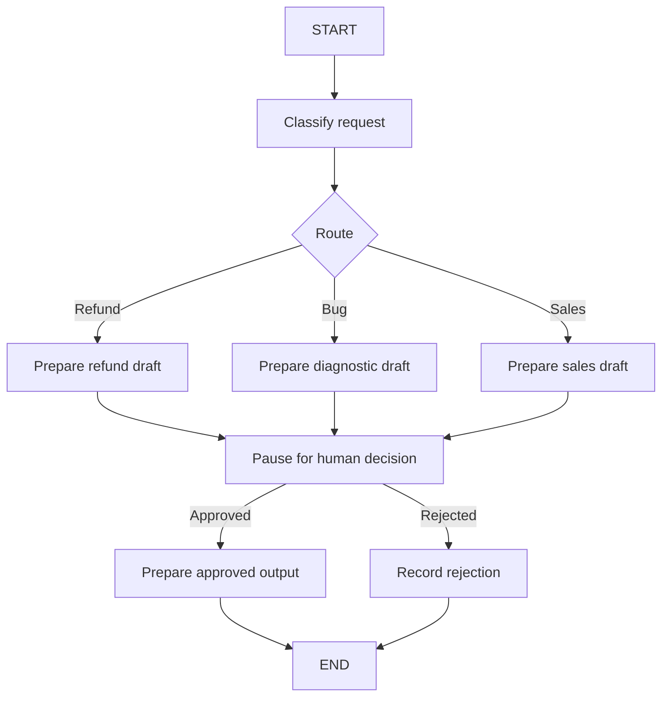

# LangGraph Stateful Graphs: State, Checkpoints, and Recovery

[Back to courses](../README.md#agent-engineering) · [Workflow Patterns](6-anthropic-workflow-patterns.md) · [The Agent Loop](1-agent-loop.md)

| Field | Details |
| --- | --- |
| Origin | [AI Engineering from Scratch — source lesson](https://github.com/rohitg00/ai-engineering-from-scratch/blob/main/phases/14-agent-engineering/13-langgraph-stateful-graphs/docs/en.md) |
| Author | Rohit Ghumare and contributors |
| Level | Intermediate — repository assessment |
| Best for | Modeling stateful workflows, understanding reducers and checkpoint recovery, implementing approval pauses, and distinguishing durable state from exactly-once external actions |

Adapted from the MIT-licensed lesson; copyright © 2026 Rohit Ghumare. [Original license](../licenses/ai-engineering-from-scratch-LICENSE). The runnable example is an original standard-library teaching runtime with real SQLite storage. A separate LangGraph API example shows how the concepts map to the framework.

## Why Make State Explicit?

Imagine processing a support request through classification, investigation, approval, and response preparation. If the process crashes near the end, restarting every stage wastes work and might repeat an external action.

A stateful graph is like a case file moving between desks. The file records what is known, each desk performs a defined task, and routing rules determine the next desk. A checkpoint is a saved copy of the case file **and its execution position**. Saving only the conversation is not enough if the system also needs a route, approval decision, or operation identifier.

Examples:

- Resume a document-processing workflow after a parser fails, retaining earlier validated extraction results.
- Pause a proposed refund for review, then continue using the recorded decision.
- Collect parallel research findings and merge them before drafting an answer.

## State, Nodes, Edges, and Reducers

| Term | Crisp definition | Example |
| --- | --- | --- |
| State | Data needed to describe and continue the execution | Request, route, draft, approval, operation ID |
| Schema | Declared structure and types of that data | A `TypedDict` with named fields |
| Node | A unit of work that reads state and returns updates | Classify a request or prepare a response |
| Edge | A transition between nodes | Classification followed by drafting |
| Conditional edge | A transition chosen from state | Refund branch versus technical branch |
| Reducer | A rule for merging an update into a state field | Append new findings instead of replacing old ones |
| Checkpointer | Storage for execution snapshots and related recovery data | Thread-scoped snapshots in a database |
| Thread | An identifier grouping a continuing execution or conversation | `support-case-42` |
| Subgraph | A graph composed inside another graph | A diagnostic workflow used by a support workflow |

In LangGraph's [Graph API](https://docs.langchain.com/oss/python/langgraph/graph-api), nodes return updates and edges determine subsequent work. State fields can use reducers; without a custom reducer, updates normally replace a field's value. `START` and `END` mark graph boundaries. Nodes may call models or tools; they need not be pure functions.

`TypedDict` helps static analysis but does not validate arbitrary input at runtime. Validate untrusted requests, tool results, and approval payloads explicitly.



### Reducers and Parallel Updates

Suppose two workers return findings. Replacing the same list can lose one worker's result; a reducer can merge them. List concatenation is simple but can preserve duplicates and produce ordering that should not be treated as a correctness guarantee. For evidence records, a merge keyed by stable finding IDs may be more appropriate.

Document which nodes may update each field, what conflicting updates mean, and whether merge operations are associative or order-sensitive. Prefer returned updates over hidden mutation of shared objects.

## Checkpoints and Durable Execution

**Durable execution** means an execution can continue using persisted progress after interruption or failure. It does not mean every instruction executes exactly once.

LangGraph executes in **super-steps**: nodes scheduled in parallel share a step; sequential nodes occupy separate steps. Its [checkpointer documentation](https://docs.langchain.com/oss/python/langgraph/checkpointers) describes checkpoints at super-step boundaries and pending writes that support recovery when another task in a step fails. “Checkpoint after every node” is therefore an incomplete description of parallel execution.

A checkpoint must preserve enough execution metadata to identify pending work. Backend durability and write configuration determine what survives a process or machine failure. In-memory storage is useful for tests but cannot provide recovery after the process disappears.

### The Side-Effect Gap

Consider this sequence:

1. A node calls a payment service successfully.
2. The process crashes before its completion checkpoint is saved.
3. Recovery runs the node again.

The checkpoint database cannot undo or automatically deduplicate the payment. Use an **idempotency key** accepted by the external service, reconcile operation status before retrying, or use a transactional outbox where appropriate. An outbox stores intended work with application state so a separate dispatcher can deliver it reliably; the receiver may still need deduplication.

| Failure location | Recovery concern |
| --- | --- |
| Before a pure computation completes | Recompute from saved inputs |
| After nondeterministic data is fetched | Preserve the observed result or explicitly accept a fresh observation |
| After an external action but before checkpoint | Reconcile or deduplicate before repeating |
| During state serialization | Fix unsupported data or schema incompatibility |
| After a graph deployment changes | Migrate saved state and ensure pending node names remain meaningful |

Record externally observed values, timestamps, model outputs, and random choices when their reuse matters. Avoid storing open connections, file handles, or credentials in serialized state.

## Human-in-the-Loop: Pause Is Not Failure

An approval pause is an expected execution state, not a generic exception to swallow. Show the reviewer the exact proposed action, scope, and relevant evidence. Authenticate the reviewer and associate the decision with that proposal's version.

LangGraph's [interrupt API](https://docs.langchain.com/oss/python/langgraph/interrupts) uses `interrupt(payload)` and resumes with `Command(resume=...)` on the same `thread_id`. The interrupted node restarts from its beginning on resume, so code before the interrupt can run again. Keep side effects after the decision or make them idempotent. Do not wrap interrupts in broad exception handling that prevents the runtime from processing them.

Reaching `END` completes a path; it is not the same as pausing for a later decision. Use an explicit interrupt when external input is needed to continue.

## Memory and Streaming

LangGraph distinguishes thread-scoped checkpoints from application data stored across threads. See [Persistence](https://docs.langchain.com/oss/python/langgraph/persistence).

| Mechanism | Scope | Typical contents |
| --- | --- | --- |
| Checkpoint state | One thread | Current draft, route, progress, conversation history |
| Long-term store | Application-defined cross-thread scope | Validated preferences or reusable facts |
| External system of record | Business domain | Actual refund status, ticket record, or document version |

A thread ID is a lookup key, not an authorization boundary. Enforce access checks around state retrieval, streaming, modification, and resume.

**Streaming** delivers progress before the entire run finishes. LangGraph supports state updates, state values, model messages, and custom events; its [streaming guide](https://docs.langchain.com/oss/python/langgraph/streaming) also documents the newer event-streaming interface. Pin your dependency version when choosing an API. A node returning a dictionary is not itself token streaming, and a streamed event is not proof that a business action is durably committed. Filter sensitive fields before exposing events to users.

## Three Useful Orchestration Topologies

| Topology | Shape | Best fit | Main risk |
| --- | --- | --- | --- |
| Supervisor | One coordinator dispatches specialists | Central routing and synthesis | Bottleneck and oversized coordinator context |
| Peer-to-peer / swarm | Specialists hand control to one another | Work naturally moves between domains | Handoff cycles or unclear ownership |
| Hierarchical | Coordinators delegate to subgraphs or teams | Complex work with local state boundaries | Nested budgets, tracing, and state propagation become harder |

These are design patterns rather than requirements to install a particular helper package. Define handoff contracts, termination rules, worker permissions, and total budgets regardless of topology.

## Hands-On: A Small Graph With Real SQLite Checkpoints

This offline runtime executes one node at a time and saves JSON state plus the next node after each successful transition. It intentionally does not implement LangGraph's parallel scheduler, reducers, checkpoint history, or pending-write protocol.

The demo pauses at approval, closes the database connection, reopens it, and resumes. It prepares a response locally; it does not issue a refund or send a message. The database is temporary and removed after the demonstration.

Save as `stateful_graph_demo.py` and run `python3 stateful_graph_demo.py` with Python 3.10+.

```python
import json
import sqlite3
from pathlib import Path
from tempfile import TemporaryDirectory
from typing import TypedDict


class State(TypedDict):
    request: str
    route: str
    draft: str
    approved: bool | None
    output: str


class SQLiteCheckpoint:
    def __init__(self, path):
        self.db = sqlite3.connect(path)
        self.db.execute("CREATE TABLE IF NOT EXISTS runs "
                        "(id TEXT PRIMARY KEY, state TEXT, next_node TEXT)")
        self.db.commit()

    def start(self, run_id, state):
        # INSERT prevents accidentally resetting an existing run.
        with self.db:
            self.db.execute("INSERT INTO runs VALUES (?, ?, ?)",
                            (run_id, json.dumps(state), "classify"))

    def save(self, run_id, state, next_node):
        with self.db:
            self.db.execute("UPDATE runs SET state=?, next_node=? WHERE id=?",
                            (json.dumps(state), next_node, run_id))

    def load(self, run_id):
        row = self.db.execute("SELECT state, next_node FROM runs WHERE id=?",
                              (run_id,)).fetchone()
        if row is None:
            raise KeyError(run_id)
        return json.loads(row[0]), row[1]

    def close(self):
        self.db.close()


def classify(state):
    text = state["request"].lower()
    route = "refund" if "refund" in text else "bug" if "bug" in text else "sales"
    return {"route": route}


def prepare(state):
    drafts = {
        "refund": "Proposed refund response; no payment has been issued.",
        "bug": "Proposed response requesting reproducible diagnostic details.",
        "sales": "Proposed response asking for product requirements.",
    }
    return {"draft": drafts[state["route"]]}


def run(store, run_id, max_steps=10):
    if max_steps < 1:
        raise ValueError("max_steps must be positive")
    state, node = store.load(run_id)
    events = []
    for _ in range(max_steps):
        if node == "END":
            return "completed", state, events
        if node == "classify":
            update, next_node = classify(state), "prepare"
        elif node == "prepare":
            update, next_node = prepare(state), "approval"
        elif node == "approval":
            if state["approved"] is None:
                return "paused", state, events
            if state["approved"] is True:
                update, next_node = {}, "finalize"
            else:
                update, next_node = {"output": "Rejected by reviewer."}, "END"
        elif node == "finalize":
            update, next_node = {"output": state["draft"]}, "END"
        else:
            raise ValueError(f"Unknown saved node: {node}")
        state = {**state, **update}
        store.save(run_id, state, next_node)
        events.append({"node": node, "update": update})
        node = next_node
    return ("completed" if node == "END" else "budget_exhausted"), state, events


def decide(store, run_id, approved):
    if type(approved) is not bool:
        raise ValueError("Decision must be a boolean")
    state, node = store.load(run_id)
    if node != "approval" or state["approved"] is not None:
        raise ValueError("Run is not awaiting a decision")
    store.save(run_id, {**state, "approved": approved}, node)


def initial(request):
    return State(request=request, route="", draft="", approved=None, output="")


def main():
    with TemporaryDirectory() as directory:
        path = Path(directory) / "checkpoints.sqlite"
        store = SQLiteCheckpoint(path)
        store.start("case-1", initial("Please review my refund request"))
        status, state, events = run(store, "case-1")
        print(status, events)
        store.close()
        # New connection reads persisted progress; classify is not repeated.
        store = SQLiteCheckpoint(path)
        try:
            decide(store, "case-1", True)
            status, state, events = run(store, "case-1")
            print(status, events, state["output"])
        finally:
            store.close()


if __name__ == "__main__":
    main()
```

Expected trace: classification and preparation run before `paused`. After reopening and approving, only approval and finalization run. Rejection completes with a rejected outcome. Exhausting the step budget preserves the next node, allowing a later call to continue.

The fallback-to-sales classifier is a toy simplification; a production router needs an unknown or review route. This database implementation assumes one runner per run ID. Concurrent operators require transactions with version checks or another ownership mechanism to avoid lost updates. A durable file alone does not solve distributed concurrency.

## Mapping the Concepts to LangGraph

This separate example requires the `langgraph` package. It uses `InMemorySaver` to keep the API illustration small; it survives neither process exit nor object replacement. Choose and configure a persistent backend for actual recovery.

The snippet was checked against the linked official API documentation, but was not executed in this repository's environment. Install a compatible pinned version in an isolated environment before running it.

```python
from typing import TypedDict
from langgraph.graph import StateGraph, START, END
from langgraph.checkpoint.memory import InMemorySaver
from langgraph.types import Command, interrupt


class ApprovalState(TypedDict):
    draft: str
    approved: bool
    output: str


def approval(state):
    decision = interrupt({"draft": state["draft"], "question": "Approve?"})
    if type(decision) is not bool:
        raise ValueError("Expected an authenticated boolean decision")
    return {"approved": decision}


def finalize(state):
    return {"output": state["draft"]}


def reject(state):
    return {"output": "Rejected by reviewer."}


builder = StateGraph(ApprovalState)
builder.add_node("approval", approval)
builder.add_node("finalize", finalize)
builder.add_node("reject", reject)
builder.add_edge(START, "approval")
builder.add_conditional_edges(
    "approval",
    lambda state: "finalize" if state["approved"] else "reject",
    {"finalize": "finalize", "reject": "reject"},
)
builder.add_edge("finalize", END)
builder.add_edge("reject", END)
app = builder.compile(checkpointer=InMemorySaver())
config = {"configurable": {"thread_id": "approval-demo"}}
paused = app.invoke({"draft": "Proposed response", "approved": False,
                     "output": ""}, config)
# In a real app, obtain and authorize this decision outside the model.
completed = app.invoke(Command(resume=True), config)
print(completed["output"])
```

Use the same thread ID when resuming an interrupt. The example's hardcoded `True` simulates a reviewer decision; checking its Python type does not authenticate a reviewer. Authentication and approval-to-proposal binding belong at the application boundary.

## Production Design and Measurement

| Concern | What to specify or measure |
| --- | --- |
| Checkpoint cost | Serialization time, write p50/p95, bytes per checkpoint, retention |
| Recovery | Time to resume, amount of recomputed work, unresolved external operations |
| Correctness | Duplicate action rate and mismatch between saved state and system of record |
| Approval | Pending duration, authorized decision rate, stale-proposal rejection |
| Parallel merge | Lost updates, duplicate findings, deterministic final invariants |
| Versioning | State schema version and supported graph migrations |
| Security | Tenant isolation, encryption, redacted logs, access checks on resume |
| Budget | Maximum steps, model/tool spending, timeout and recursion limits |

A rough serial-run estimate is `execution time + checkpoint writes + serialization time`; concurrent execution and asynchronous durability settings change that relationship. Measure with representative state sizes. Large message histories and tool results can dominate checkpoint storage.

Test failure windows, not just successful runs: crash before a write, after a write, and after an external action. Verify restored state and next steps, then verify the external system independently.

## Exercises

1. Add an unknown route that pauses for manual classification. Resume with the selected route; do not use `END` as a waiting state.
2. Introduce a failure in `prepare`, reopen SQLite, and prove the completed classification is not repeated.
3. Run two branches producing findings. Define a reducer that merges by stable IDs and test duplicates and conflicting values.
4. Simulate an external action succeeding before checkpoint failure. Add an idempotency key and show that recovery does not repeat the business effect.
5. Add checkpoint versions and reject incompatible state instead of silently loading it after a graph change.
6. Add streaming callbacks to the toy runtime. Distinguish progress events from persisted transitions and redact sensitive data.
7. Run the LangGraph example with a persistent checkpointer and restart the process between interrupt and resume. Test both approval and rejection.
8. Compare supervisor, peer-to-peer, and hierarchical layouts for the same support task. Define ownership, context boundaries, and stopping conditions.

## Quick Cheat Sheet

**State = case file. Node = desk. Edge = routing rule. Checkpoint = saved file plus execution position.**

| Concept | Remember | Caveat |
| --- | --- | --- |
| Reducer | Merge a field's update | Parallel writes need intentional semantics |
| Super-step | One scheduling round | Several nodes may run in that round |
| Checkpointer | Save thread progress | In-memory storage is not crash durability |
| Interrupt | Wait for external input | Interrupted node code can run again |
| Durable execution | Recover using persisted progress | Does not guarantee exactly-once side effects |
| Store | Retain cross-thread application data | Enforce scope and retention |
| Subgraph | Reusable nested workflow | Define state and budget boundaries |

An interview answer: “LangGraph models execution through state, nodes, transitions, and reducers. Checkpointing supports persistence and recovery, while interrupts enable review pauses. I would define serializable state and merge semantics, use a durable backend, and test replay behavior. External actions still need idempotency or reconciliation because restoring graph state does not make those actions exactly once.”

## References and Attribution

- [Source lesson](https://github.com/rohitg00/ai-engineering-from-scratch/blob/main/phases/14-agent-engineering/13-langgraph-stateful-graphs/docs/en.md) — Rohit Ghumare and contributors.
- [LangGraph Graph API](https://docs.langchain.com/oss/python/langgraph/graph-api), [checkpointers](https://docs.langchain.com/oss/python/langgraph/checkpointers), and [persistence](https://docs.langchain.com/oss/python/langgraph/persistence).
- [Interrupts](https://docs.langchain.com/oss/python/langgraph/interrupts) and [streaming](https://docs.langchain.com/oss/python/langgraph/streaming).
- [Agent Framework Tradeoffs](../1-llm-engineering/13-agent-framework-tradeoffs.md) — related course.

Adapted on 2026-10-25. The course retains the source's graph model, durability, streaming, approval, memory, topology, and exercise themes. It corrects per-node checkpoint simplifications, separates checkpoint recovery from external-effect guarantees, and replaces the proposed fake persistence with a real SQLite teaching example. The standard-library runtime was tested; the separate LangGraph API snippet was reviewed against official documentation but not executed. No live model or external business action was used.

The source tracks upstream `main`; its downloaded hash follows. Imported material retains its [MIT license notice](../licenses/ai-engineering-from-scratch-LICENSE).

- Lesson Markdown SHA-256: `eff89296945c389b50c9491488940eebee8dc61756ea274a2b1a094709fb4951`
