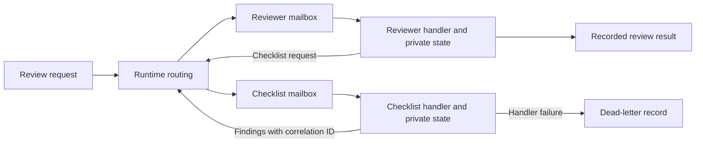

# AutoGen and the Actor Model: Async Messages and Typed Runtimes

[Back to courses](../README.md#agent-engineering) · [Workflow Patterns](6-anthropic-workflow-patterns.md) · [LangGraph Stateful Graphs](7-langgraph-stateful-graphs.md)

| Field | Details |
| --- | --- |
| Origin | [AI Engineering from Scratch — source lesson](https://github.com/rohitg00/ai-engineering-from-scratch/blob/main/phases/14-agent-engineering/14-autogen-actor-model/docs/en.md) |
| Author | Rohit Ghumare and contributors |
| Level | Intermediate — repository assessment |
| Best for | Explaining message-driven agents, comparing actor and graph orchestration, designing failure handling, and understanding AutoGen's Core, AgentChat, and Extensions layers |

Adapted from the MIT-licensed lesson; copyright © 2026 Rohit Ghumare. [Original license](../licenses/ai-engineering-from-scratch-LICENSE). The runnable example uses Python's standard library, not an installed AutoGen runtime or a live model.

**Framework status, checked 2026-10-25:** Microsoft's [AutoGen repository notice](https://github.com/microsoft/autogen#readme) says the project is archived and no longer maintained, and directs users toward Microsoft Agent Framework and its migration guide. This supersedes the source lesson's maintenance-mode description. The course studies AutoGen's architecture and transferable actor concepts; it is not a recommendation to start a new production deployment on the archived framework.

## Why Agents as Actors?

Imagine a review team communicating through individual inboxes. A reviewer sends a checklist request, continues with other work, and later receives a result. Each participant owns its notes; colleagues send messages rather than editing those notes directly.

An **actor** is an independently addressed component with private logical state and message handlers. A **runtime** routes messages and schedules handlers. An actor can represent an LLM-backed agent, a deterministic validator, or a tool wrapper; it does not need a model.

Examples:

- A reviewer requests static checks from a checklist actor and combines the reply with its own findings.
- A research coordinator sends requests to several source-specific workers and correlates their responses.
- A monitoring actor receives events while a separate actor prepares a report.

The benefit is explicit communication and independently scheduled work. It does not automatically create process isolation, durable queues, correct results, or reliable retries.

## Core Vocabulary

| Term | Definition | Example |
| --- | --- | --- |
| Actor | Component that owns logical state and reacts to messages | Reviewer with a set of completed review IDs |
| Message | Data describing a request, event, or response | A code-review request with source text |
| Mailbox | Pending messages for an actor | Queue awaiting checklist processing |
| Handler | Code invoked for a particular message | Parse source and return findings |
| Runtime | Infrastructure managing delivery and execution | Event loop and actor registry |
| Actor identity | Address used to locate an actor instance | Worker type plus a session-specific key |
| Topic | Publish-subscribe routing category | `review-events` |
| Subscription | Rule identifying recipients of published messages | Audit actor subscribes to review events |
| Correlation ID | Identifier linking related requests and responses | `review-42` on both messages |
| Dead-letter queue (DLQ) | Storage for messages that could not be processed | Invalid request with failure metadata |
| Backpressure | Limiting intake when consumers cannot keep up | Reject or defer work when a bounded mailbox fills |

“Private state” is an ownership discipline. In-process Python actors can technically share mutable objects, so implementations must avoid aliasing or copy/serialize payloads. Actor boundaries are not security boundaries unless the hosting system enforces them.



## AutoGen's Three Layers

| Layer | Purpose | Typical concepts | When studying it helps |
| --- | --- | --- | --- |
| Core | Message-driven execution and agent lifecycle | `RoutedAgent`, `AgentId`, handlers, runtimes, topics | Custom communication and execution policies |
| AgentChat | Higher-level task and conversation orchestration | Assistant agents, teams, turn selection, termination | Understanding common multi-agent conversation patterns |
| Extensions | Integrations around the core APIs | Model clients, tools, code executors, runtime integrations | Understanding provider and infrastructure boundaries |

The official [agent/runtime guide](https://microsoft.github.io/autogen/stable/user-guide/core-user-guide/framework/agent-and-agent-runtime.html) describes runtime-managed Core agents and type-routed handlers. AgentChat agents are application-created objects; using one inside Core requires an adapter rather than assuming the runtime automatically owns every AgentChat instance.

### Sending Is Not Always Fire-and-Forget

Separate three events: a message is accepted, its handler completes, and its business effect is confirmed. They are not interchangeable.

AutoGen's [communication guide](https://microsoft.github.io/autogen/stable/user-guide/core-user-guide/framework/message-and-communication.html) distinguishes direct messaging from publishing. Direct `send_message` supports request-response behavior; awaiting it is not merely an acknowledgement that an item entered a mailbox. Publishing follows subscription routing. Inspect the runtime's API and error behavior instead of assuming every “send” returns immediately.

| Communication style | Meaning | Design concern |
| --- | --- | --- |
| Request-response | Send to one recipient and await a result | Deadline, cancellation, response error |
| One-way event | Deliver information without an application reply | Acknowledgement and failure visibility |
| Publish-subscribe | Route an event to subscribers | Fan-out, ordering, duplicate handling |

An `await` can let other tasks run while the caller waits. It does not make blocking CPU work nonblocking. A single event-loop thread can interleave I/O operations, but a handler that blocks that thread can stall other actors.

## Concurrency and Failure Isolation

A classic mailbox design serializes handling within each actor while different actors progress concurrently. Framework runtimes may choose different scheduling semantics. Never infer that a particular agent's mutable state is race-free solely because the framework uses actor terminology.

| Claim | More precise engineering interpretation |
| --- | --- |
| “An actor failure cannot affect others” | Handler exceptions can be contained, but process crashes, shared resources, and dependency failures can affect many actors |
| “Messages arrive in order” | Ordering depends on sender, transport, retries, and scheduler guarantees |
| “A message is delivered once” | Delivery and acknowledgement policies determine loss and duplication risks |
| “Distribution only changes transport” | Remote execution also introduces serialization, authentication, partitions, deadlines, and recovery |
| “Retry fixes the failure” | A retry may repeat a side effect or encounter the same invalid input |

A **supervision policy** decides whether to continue, restart, retry, or stop after a failure. A **poison message** repeatedly fails because of its content. Bound retries and retain enough diagnostic context to distinguish transient failures from invalid requests.

For side effects, use stable operation IDs and receiver-side deduplication where supported. A dead-letter record is evidence of failure, not proof that no external effect happened before the exception.

## Team Topologies

| Pattern | Turn allocation | Strength | Limitation |
| --- | --- | --- | --- |
| Round-robin group chat | Fixed rotation | Predictable participation | Unnecessary turns when a participant has nothing useful to add |
| Selector group chat | Select the next participant from context | Adaptable specialist selection | Selector errors and extra inference cost |
| Coordinator and workers | Coordinator assigns work and combines replies | Explicit task ownership | Coordinator bottleneck and timeout management |
| Peer handoff | Current actor transfers responsibility | Domain-based ownership | Cycles and lost task ownership |

The source also discusses Magentic-One, a reference multi-agent system associated with web, file, and code tasks. A reference team is distinct from a low-level message runtime. Its tool capabilities still require explicit permissions and suitable execution isolation.

Set termination rules before running a team: completion criteria, maximum messages or turns, elapsed-time budget, and a fallback for disagreement. Agreement between agents is not independent evidence of correctness.

## Hands-On: Two Actors, Separate Mailboxes, and a DLQ

This teaching runtime creates one queue and one asynchronous worker task per actor. Messages are immutable dataclasses containing strings. Each actor processes its own inbox sequentially. Handler failures are recorded and the worker continues.

The reviewer delegates an AST-based checklist and receives the result. A deliberately unsupported message also fails in the checklist actor, demonstrating that subsequent valid work can still complete. The checks are narrow: parsing Python and finding a function definition do not prove functional correctness. No submitted code is executed.

Save as `actor_demo.py` and run `python3 actor_demo.py` with Python 3.10+.

```python
import ast
import asyncio
from dataclasses import dataclass


@dataclass(frozen=True)
class Message:
    sender: str
    recipient: str
    kind: str
    correlation_id: str
    body: str


class Runtime:
    def __init__(self, capacity=16, max_messages=50):
        if capacity < 1 or max_messages < 1:
            raise ValueError("Limits must be positive")
        self.capacity = capacity
        self.max_messages = max_messages
        self.actors = {}
        self.mailboxes = {}
        self.tasks = []
        self.dead_letters = []
        self.accepted = 0
        self.pending = 0
        self.idle = asyncio.Event()
        self.idle.set()
        self.started = False

    def register(self, name, actor):
        if self.started or name in self.actors:
            raise ValueError("Register unique actors before starting")
        self.actors[name] = actor
        self.mailboxes[name] = asyncio.Queue(maxsize=self.capacity)

    def send(self, message):
        if not self.started:
            raise RuntimeError("Runtime is not running")
        if message.recipient not in self.mailboxes:
            raise ValueError("Unknown recipient")
        if self.accepted >= self.max_messages:
            raise RuntimeError("Message budget exhausted")
        # Explicit rejection on overload avoids waiting while holding a handler.
        self.mailboxes[message.recipient].put_nowait(message)
        self.accepted += 1
        self.pending += 1
        self.idle.clear()

    async def _worker(self, name):
        queue = self.mailboxes[name]
        while True:
            message = await queue.get()
            try:
                await self.actors[name].receive(message, self)
            except Exception as exc:
                self.dead_letters.append((message, type(exc).__name__, str(exc)))
            finally:
                queue.task_done()
                self.pending -= 1
                if self.pending == 0:
                    self.idle.set()

    def start(self):
        if self.started:
            raise RuntimeError("Already started")
        self.started = True
        self.tasks = [asyncio.create_task(self._worker(name)) for name in self.actors]

    async def drain(self, timeout=2):
        await asyncio.wait_for(self.idle.wait(), timeout=timeout)

    async def close(self):
        self.started = False
        for task in self.tasks:
            task.cancel()
        await asyncio.gather(*self.tasks, return_exceptions=True)


class Reviewer:
    def __init__(self):
        self.results = {}

    async def receive(self, message, runtime):
        if message.kind == "review":
            runtime.send(Message("reviewer", "checklist", "check",
                                 message.correlation_id, message.body))
        elif message.kind == "findings":
            self.results[message.correlation_id] = message.body
        else:
            raise ValueError("Reviewer cannot handle this message kind")


class Checklist:
    async def receive(self, message, runtime):
        if message.kind != "check":
            raise ValueError("Checklist cannot handle this message kind")
        try:
            tree = ast.parse(message.body)
            has_function = any(isinstance(n, (ast.FunctionDef, ast.AsyncFunctionDef))
                               for n in ast.walk(tree))
            verdict = "Checklist passed" if has_function else "Missing function"
        except SyntaxError:
            verdict = "Invalid Python syntax"
        runtime.send(Message("checklist", message.sender, "findings",
                             message.correlation_id, verdict))


async def demo():
    runtime = Runtime()
    reviewer = Reviewer()
    runtime.register("reviewer", reviewer)
    runtime.register("checklist", Checklist())
    runtime.start()
    try:
        runtime.send(Message("user", "checklist", "unsupported", "failure-1", ""))
        runtime.send(Message("user", "reviewer", "review", "review-1",
                             "def add(a, b):\n    return a + b\n"))
        await runtime.drain()
        print("Results:", reviewer.results)
        print("Dead letters:", [(m.correlation_id, error)
                                for m, error, _ in runtime.dead_letters])
        return reviewer.results, runtime.dead_letters
    finally:
        await runtime.close()


if __name__ == "__main__":
    asyncio.run(demo())
```

Expected result: `review-1` receives `Checklist passed`; `failure-1` appears once in the dead-letter list. The runtime reaches idle after all accepted messages finish handling, including replies created by handlers. Idle does not imply that every business task succeeded: inspect results and dead letters separately.

### What the Example Deliberately Leaves Out

| Missing capability | Consequence |
| --- | --- |
| Durable mailbox and actor state | Process termination loses queued work and results |
| Automatic retry or restart | Failed messages stay in the in-memory DLQ |
| Authentication | A sender string is not proof of identity |
| Cancellation of external effects | Cancelling a handler cannot undo an already completed action |
| Concurrent callers across threads | This runtime assumes one event loop |
| Publication and subscriptions | Only direct addressed delivery is implemented |
| Transactional send plus state update | A handler may partially complete before failing |

`close()` cancels tasks; call `drain()` first for normal graceful shutdown. After a drain timeout, closing may abandon queued work. A production service needs an explicit abandonment or recovery policy. The sample rejects full mailboxes with `QueueFull` rather than silently dropping messages or risking cyclic waits between full inboxes.

## Mapping to AutoGen Core

The toy's `register`, message type, handler, and runtime correspond conceptually to Core agent registration, dataclass payloads, `RoutedAgent` methods decorated with `message_handler`, and an agent runtime. This is a conceptual mapping, not API compatibility. The toy's `send` is enqueue-only; AutoGen's awaited direct send has different semantics.

When porting, identify who creates agent instances, how identities are scoped, what handler concurrency is permitted, how errors reach senders, and which runtime handles distribution. Avoid mixing historical v0.2 conversation APIs with the later Core/AgentChat architecture. Use the documentation matching an explicitly pinned version when reproducing an old example.

## Actor Runtime Versus Stateful Graph

| Question | Actor-oriented design | Graph-oriented design |
| --- | --- | --- |
| Main abstraction | Addressed components exchanging messages | State transitions between nodes |
| Natural control flow | Events and replies | Explicit edges and conditional routing |
| State ownership | Usually per actor | Usually graph/thread state with merge rules |
| Recovery | Requires mailbox, actor-state, and delivery policy | Requires checkpoint and replay policy |
| Best conceptual fit | Independent participants reacting to events | Inspectable workflows with known transitions |

The designs can coexist: an actor can run a graph, and a graph node can send messages. Neither abstraction automatically supplies exactly-once external effects. See [LangGraph Stateful Graphs](7-langgraph-stateful-graphs.md) for checkpoint and replay concerns.

## Observability, Metrics, and Distribution

Trace a message through enqueue, handler start, handler completion, outgoing requests, and errors. Keep message ID and correlation ID distinct: each message needs its own identity while several messages may belong to one task. Record payload size and redact sensitive content.

The source discusses OpenTelemetry integration. Configure and inspect the instrumentation actually provided by your pinned runtime; do not assume every tool automatically emits a particular `gen_ai.*` attribute or that semantic-convention versions are interchangeable.

| Metric | Definition | What it reveals |
| --- | --- | --- |
| Queue delay | Handler start minus enqueue time | Consumer backlog |
| Handler latency | Completion minus handler start | Slow models, tools, or blocking code |
| Throughput | Completed messages per unit time | Processing capacity |
| Mailbox depth | Pending messages per actor | Hot actors and overload |
| DLQ rate | Dead-lettered messages / accepted messages | Processing failures requiring investigation |
| Task success | Independently verified completed tasks / requested tasks | Whether communication achieves useful work |
| Message amplification | Messages per task | Wasteful chatter or loops |
| Duplicate-effect rate | Repeated business effects / intended operations | Retry and deduplication failures |

For a stable system, incoming work must remain below sustainable processing capacity over time. Adding workers does not fix a bottleneck in a single serial actor or a shared rate-limited service.

Moving to remote transport adds schema versions, authentication, encryption, acknowledgements, reconnection, and partition handling. A network timeout means the outcome may be unknown, not necessarily that the request was never processed. Use bounded retries and reconcile effects before retrying consequential actions.

## Exercises

1. Send syntactically invalid code and code with no function. Confirm each produces a result rather than a handler crash.
2. Fill a mailbox before its worker runs. Verify overload is visible and rejected messages do not corrupt the idle counter.
3. Add retry counts and a maximum retry budget. Separate transient tool failures from unsupported message kinds.
4. Persist the DLQ and design a replay operation with message deduplication. Explain how to handle an action that succeeded before its handler failed.
5. Add a selector actor that chooses the next specialist. Enforce a total-message cap and handle repeated selections without progress.
6. Add per-message timing and correlation metadata. Measure queue delay separately from processing time.
7. Design a JSON-over-HTTP transport with schema validation and authenticated recipients. State its delivery guarantee and behavior on timeout.
8. Compare this runtime with the archived AutoGen Core documentation. List the missing lifecycle, cancellation, serialization, and distributed-runtime behavior before attempting a port.

## Quick Cheat Sheet

**Actor = owner of state. Message = contract. Mailbox = pending work. Runtime = delivery and scheduling.**

| Concept | Remember it as | Interview caveat |
| --- | --- | --- |
| Actor | A colleague with an inbox | Logical isolation is not process isolation |
| Async | Wait without blocking unrelated I/O work | Blocking code can still stall the event loop |
| Request-response | Ask and await an answer | Not necessarily fire-and-forget |
| Topic | A subscription address | Fan-out and duplicate policies still matter |
| DLQ | Failed-work tray | Does not prove an external effect never occurred |
| Backpressure | Admit only work you can handle | Define rejection, waiting, or durable buffering |
| Fault isolation | Contain a handler's failure | Process and shared-resource failures remain possible |

An interview answer: “The actor model separates stateful participants through message contracts and runtime-managed delivery. It can support independently scheduled agents, but I would explicitly define handler concurrency, mailbox limits, delivery and retry semantics, and shutdown behavior. AutoGen's Core, AgentChat, and Extensions illustrate different abstraction layers; the actor principles remain useful even though the project is now archived.”

## References and Attribution

- [Source lesson](https://github.com/rohitg00/ai-engineering-from-scratch/blob/main/phases/14-agent-engineering/14-autogen-actor-model/docs/en.md) — Rohit Ghumare and contributors.
- [AutoGen repository and project-status notice](https://github.com/microsoft/autogen#readme).
- [Agent and Agent Runtime](https://microsoft.github.io/autogen/stable/user-guide/core-user-guide/framework/agent-and-agent-runtime.html) and [Message and Communication](https://microsoft.github.io/autogen/stable/user-guide/core-user-guide/framework/message-and-communication.html) — official AutoGen documentation.
- [Agent Framework Tradeoffs](../1-llm-engineering/13-agent-framework-tradeoffs.md) — related course.

Adapted on 2026-10-25. This course retains the source's actor model, API layers, team patterns, observability, two-agent review theme, and exercises. It updates project status, corrects blanket claims about message delivery and fault isolation, and supplies an original standard-library runtime with bounded mailboxes and dead-letter handling. The offline example was tested; no AutoGen package, live model, distributed transport, or submitted code execution was used.

The source tracks upstream `main`; its downloaded hash follows. Imported material retains its [MIT license notice](../licenses/ai-engineering-from-scratch-LICENSE).

- Lesson Markdown SHA-256: `d711c64e9a5125ae7cb7b50dfd73abf765f3b3e0d6cef0992da9240fee934ad8`
