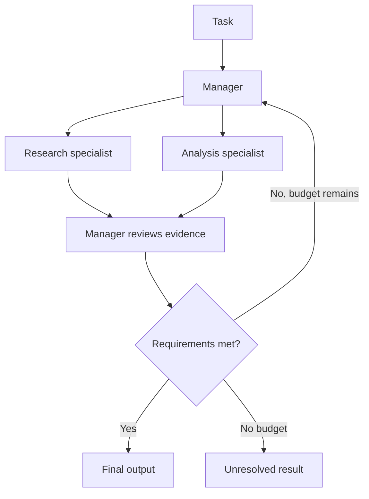
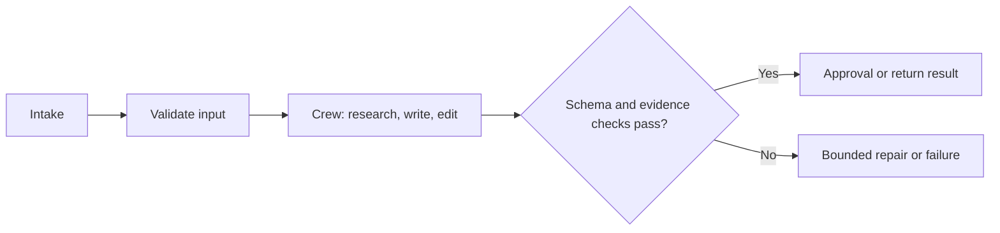

# CrewAI Role-Based Crews: Agents, Tasks, Processes, and Flows

[Back to courses](../README.md#agent-engineering) · [Workflow Patterns](6-anthropic-workflow-patterns.md) · [AutoGen Actor Model](8-autogen-actor-model.md)

## A Team Needs More Than Job Titles

Think of a small newsroom. A researcher gathers evidence, a writer produces a draft, and an editor checks it. Naming those roles helps assign responsibilities, but the team still needs deadlines, source requirements, an agreed output format, and a decision about who approves publication.

A **role-based crew** expresses work through specialist agents and assigned tasks. A **process** determines how the work is coordinated. A **Flow** describes application-controlled execution around or between those units of work.

Examples:

- Research a product, write a comparison, then check that claims match supplied sources.
- Analyze support cases with different specialists, with a manager selecting which expertise is needed.
- Run a fixed intake–validation–review–release workflow that invokes a crew only during analysis.

Adding agents is useful when specialization produces better outcomes. Three personas repeating the same unsupported claim are not three independent sources of evidence.

## Four Primitives

| Primitive | What it owns | Typical fields | What it does not guarantee |
| --- | --- | --- | --- |
| Agent | A specialist's instructions and available capabilities | Role, goal, backstory, tools, model settings | Actual expertise, authorization, or correct judgment |
| Task | A unit of work and its expected deliverable | Description, expected output, assigned agent, context | Correct content merely because the prompt specifies it |
| Crew | The team and task configuration | Agents, tasks, process, optional memory | Bounded cost unless limits are configured |
| Process | Coordination strategy | Sequential or hierarchical | One model call per task |

A **backstory** is additional role guidance. Keep it focused on useful behavior, such as “preserve source IDs and flag missing evidence.” Elaborate fictional biographies consume context and can distract from the actual task. Evaluate prompt changes rather than assuming a longer persona is better.

CrewAI's [agent documentation](https://docs.crewai.com/en/concepts/agents) describes role, goal, backstory, tools, and execution settings. A role prompt shapes behavior; it does not replace tool permissions or input validation.

## Sequential and Hierarchical Processes

| Dimension | Sequential | Hierarchical |
| --- | --- | --- |
| Coordination | Tasks follow the configured sequence | A manager delegates and reviews work |
| Good fit | Known dependencies and clear handoffs | Assignment or decomposition needs judgment |
| Context control | Explicit upstream task context | Manager and workers need scoped information |
| Cost | No manager required, but tasks may still make multiple calls | Adds management, delegation, and review work |
| Failure to watch | Early errors contaminate later tasks | Manager loops, unnecessary delegation, or missed dependencies |

The current [process documentation](https://docs.crewai.com/en/concepts/processes) lists `sequential` and `hierarchical`; a hierarchical crew requires `manager_llm` or `manager_agent`. Do not assume an unspecified default manager. Consensus is not listed as an implemented process in the documented enum. Build and evaluate voting explicitly if the application needs it.

There is no universal minimum number of specialists for hierarchy, nor a fixed multiplier for manager cost. The question is whether dynamic delegation improves quality enough to justify its additional calls and context.




## Crews and Flows Can Be Composed

A sequential crew already has a predefined task order; not every crew invents its control flow. A Flow makes application state, event dependencies, and routing explicit. Its steps may run ordinary Python, invoke a model, or call a crew.

CrewAI's [Flows guide](https://docs.crewai.com/en/concepts/flows) documents `@start`, `@listen`, and routing. A listener can refer to a method or its name; router outcomes can also select named paths. Explicit topic strings are not mandatory for every Flow.

| Use a crew for… | Use explicit surrounding workflow steps for… |
| --- | --- |
| Evidence gathering and synthesis | Input validation and access checks |
| Specialist drafting or critique | Resource budgets and acceptance gates |
| Bounded exploratory analysis | Review checkpoints and controlled release |
| Manager-guided assignment | Failure handling and state transitions |



A Flow can make control logic inspectable without making a model's responses deterministic. Replay additionally requires captured inputs, model/tool observations, configuration versions, and a recovery policy. A one-step Flow wrapper does not automatically provide auditing, idempotency, or acceptable latency.

## Task Contracts and Structured Handoffs

**`expected_output`** describes the desired deliverable in natural language. It is guidance, not executable validation. **`context`** identifies upstream task outputs a task should use. Supply the minimum necessary evidence rather than the entire team history.

The [task documentation](https://docs.crewai.com/en/concepts/tasks) supports structured output through `output_pydantic` or `output_json`. Inspect the corresponding structured result and handle conversion or validation failures; do not assume every model response becomes valid or that retries are unlimited.

| Handoff | Weak contract | Stronger contract |
| --- | --- | --- |
| Research → writing | “Some research” | Claims with source IDs, dates, and unresolved questions |
| Writing → editing | “A good outline” | Title, summary, ordered sections, and citations |
| Editing → application | “Final answer” | Validated fields plus acceptance status and unresolved issues |

A schema validates shape and declared constraints. It does not establish that a source supports a claim. Keep structural checks separate from factual checks and business rules.

## Tools: Decorator, Class, or Integration

| Approach | What it expresses | Good fit |
| --- | --- | --- |
| `@tool` | Function exposed with a name, description, and arguments | Small, focused capabilities |
| `BaseTool` | Class-based tool with an explicit schema and implementation | Reusable integration with configured clients or behavior |
| Existing integration | Packaged adapter to a service or capability | Common integrations after checking permissions and dependencies |

CrewAI's [tools guide](https://docs.crewai.com/en/concepts/tools) documents custom tools and typed inputs. Tool descriptions help the model choose; runtime checks enforce what may actually happen. A class-based tool does not automatically make retrying a payment safe or guarantee that all failures are retried.

For consequential actions, validate arguments, authorize the operation, obtain required approval, and use idempotency or reconciliation. Keeping action execution in a controlled workflow step can simplify these checks, but placement alone is not a security guarantee.

## Memory: Keep the Concepts, Check the Version

The current [memory documentation](https://docs.crewai.com/en/concepts/memory) presents a unified `Memory` API replacing separate memory types. It describes storage-time analysis and retrieval combining similarity, recency, and importance. The source's fixed list of stores and backend defaults should not be treated as a current API contract.

These conceptual distinctions remain useful:

| Concept | Purpose | Example |
| --- | --- | --- |
| Run-local context | Carry work through one execution | Current evidence and draft |
| Cross-run memory | Reuse valid information in later executions | A previously confirmed project constraint |
| Entity-scoped facts | Associate data with the correct subject | A customer-specific preference |
| Context selection | Choose relevant memory for a particular call | Retrieve only facts applicable to this customer and task |

Record provenance, scope, freshness, and deletion rules. Memory retrieval is not an authorization system. Model-assisted memory operations may add latency, embedding calls, and model costs; configure providers deliberately and measure actual usage.

## Hands-On: Researcher, Writer, and Editor

This offline example provides role and task dataclasses, explicit context dependencies, a sequential process, a bounded manager-selected process, and an outer workflow that validates the final brief. Its memory is an in-process dictionary scoped by customer ID; it persists across calls on that object, not across process restarts.

The researcher uses a fixture lookup tool. The writer creates a structured brief. The editor checks source IDs against that fixture. This verifies references in a tiny closed world, not general factual correctness. The manager is scripted rather than an LLM.

Save as `role_based_crew.py` and run `python3 role_based_crew.py` with Python 3.10+.

```python
from dataclasses import dataclass
from typing import Callable


@dataclass(frozen=True)
class Agent:
    role: str
    goal: str
    backstory: str
    work: Callable


@dataclass(frozen=True)
class Task:
    name: str
    agent: Agent
    expected_output: str
    context: tuple[str, ...] = ()


@dataclass(frozen=True)
class Brief:
    title: str
    summary: str
    sections: tuple[str, ...]
    source_ids: tuple[str, ...]

    def validate(self):
        if not isinstance(self.title, str) or not self.title.strip():
            raise ValueError("Missing title")
        if not isinstance(self.summary, str) or not self.summary.strip():
            raise ValueError("Missing summary")
        for values in (self.sections, self.source_ids):
            if (not isinstance(values, tuple) or not values
                    or any(not isinstance(v, str) or not v.strip() for v in values)):
                raise ValueError("Expected nonempty tuples of strings")


class Memory:
    def __init__(self):
        self.preferences = {}

    def remember(self, customer, preference):
        self.preferences[customer] = preference

    def recall(self, customer):
        return self.preferences.get(customer, "Use concise language.")


def lookup(topic):
    # Local fixture tool: no browsing or model calls.
    return {"fixture-1": f"{topic}: assign clear responsibilities.",
            "fixture-2": f"{topic}: validate each handoff."}


def research(inputs, context):
    return lookup(inputs["topic"])


def write(inputs, context):
    evidence = context["research"]
    return Brief(inputs["topic"], inputs["preference"],
                 tuple(evidence.values()), tuple(evidence.keys()))


def edit(inputs, context):
    brief = context["write"]
    brief.validate()
    evidence = context["research"]
    if not set(brief.source_ids).issubset(evidence):
        raise ValueError("Unknown source ID")
    return brief


def tasks():
    researcher = Agent("Researcher", "Gather evidence", "Retain source IDs.", research)
    writer = Agent("Writer", "Draft a brief", "Use only supplied evidence.", write)
    editor = Agent("Editor", "Check the brief", "Reject unsupported references.", edit)
    return (
        Task("research", researcher, "Source ID to claim mapping"),
        Task("write", writer, "Brief with sections and references", ("research",)),
        Task("edit", editor, "Validated Brief", ("research", "write")),
    )


def execute(task, inputs, outputs):
    if any(name not in outputs for name in task.context):
        raise ValueError(f"Missing context for {task.name}")
    context = {name: outputs[name] for name in task.context}
    return task.agent.work(inputs, context)


def sequential(inputs):
    outputs, trace = {}, []
    for task in tasks():
        outputs[task.name] = execute(task, inputs, outputs)
        trace.append(task.name)
    return outputs["edit"], trace


def manager(outputs):
    for name in ("research", "write", "edit"):
        if name not in outputs:
            return name
    return "done"


def hierarchical(inputs, choose=manager, max_decisions=4):
    registry = {task.name: task for task in tasks()}
    outputs, trace = {}, []
    for _ in range(max_decisions):
        name = choose(dict(outputs))
        trace.append("manager:" + name)
        if name == "done":
            if "edit" not in outputs:
                raise ValueError("Manager stopped before final validation")
            return outputs["edit"], trace
        if name not in registry or name in outputs:
            raise ValueError("Unknown task or repeated completed task")
        outputs[name] = execute(registry[name], inputs, outputs)
        trace.append(name)
    raise RuntimeError("Manager decision budget exhausted")


def brief_flow(topic, customer, memory, process=sequential):
    # Explicit Python workflow, not the CrewAI Flow class.
    if not isinstance(topic, str) or not topic.strip() or not customer:
        raise ValueError("Topic and customer are required")
    inputs = {"topic": topic.strip(), "preference": memory.recall(customer)}
    brief, trace = process(inputs)
    if not isinstance(brief, Brief):
        raise ValueError("Crew returned the wrong artifact type")
    brief.validate()
    return brief, ["validate_input", *trace, "validate_output"]


def main():
    memory = Memory()
    memory.remember("customer-a", "Use a short technical summary.")
    for process in (sequential, hierarchical):
        brief, trace = brief_flow("Role-based teams", "customer-a", memory, process)
        print(process.__name__, trace)
        print(brief)
    assert memory.recall("customer-b") == "Use concise language."


if __name__ == "__main__":
    main()
```

Both processes produce the same brief because the workers and manager are deterministic fixtures. The hierarchical trace adds four manager decisions, including `done`. These are function calls, not measured LLM calls or token costs. The example rejects dependency violations, premature completion, and repeated completed tasks; a real manager might support bounded revisions with explicit artifact versions instead.

### What a Real CrewAI Port Changes

| Toy component | Framework counterpart or responsibility |
| --- | --- |
| Agent dataclass | `crewai.Agent` configuration with a selected model and tools |
| Task dataclass | `crewai.Task`, including description, `expected_output`, and task `context` |
| Brief validator | Pydantic output schema plus semantic guardrails |
| Sequential function | `Crew(..., process=Process.sequential).kickoff(...)` |
| Manager callback | Configured manager in a hierarchical crew |
| Outer workflow | A Flow with entry, listeners, routing, and configured state handling |
| Dictionary memory | Deliberately configured memory with persistence and access scope |

The toy does not implement model prompting, automatic delegation, schema conversion retries, Flow decorators, durable state, or semantic retrieval. It illustrates the contracts those features must preserve. Pin a framework version and verify malformed-output and retry behavior before relying on a port.

## Designing the Production Boundary

| Failure mode | What to do |
| --- | --- |
| Long backstories consume the context budget | Keep role guidance concise and measure its effect |
| Manager delegates repeatedly without progress | Bound decisions, tool calls, elapsed time, and total spending |
| Writer invents fields or drops evidence | Validate schema and preserve source references at each handoff |
| Editor rubber-stamps the writer | Use explicit criteria and independent checks where possible |
| Memory retrieves another customer's facts | Enforce scope before retrieval and test tenant isolation |
| Tool repeats a side effect | Use operation IDs, approval binding, and reconciliation |
| Flow wraps nondeterministic work | Capture inputs and observations; test recovery rather than assuming replay |
| Framework defaults change | Pin versions, inspect configuration, and rerun representative evaluations |

Use sequential execution when dependencies are known. Use hierarchy when assignment decisions add measurable value. Use an explicit surrounding workflow for validation, recovery, and release rules. A simple single-agent loop may remain the best choice for a small task; neither a crew nor a graph is required merely because several role names can be imagined.

## Metrics and Cost

| Metric | Definition | Interpretation |
| --- | --- | --- |
| Final acceptance rate | Independently accepted briefs / attempted briefs | End-to-end quality |
| Handoff failure rate | Invalid downstream inputs / handoffs | Contract reliability |
| Unsupported claim rate | Unsupported checked claims / checked claims | Grounding quality |
| Manager overhead | Manager model/tool cost / total run cost | Cost of coordination |
| Revision count | Number of artifact rewrites per run | Rework and potential loops |
| Cost per accepted output | Total cost including failures / accepted outputs | Useful cost comparison; undefined if none pass |
| Latency p50 / p95 | Median / 95th-percentile completion time | Slow runs and retry tails |
| Memory contamination | Runs receiving out-of-scope memory / evaluated runs | Scope correctness |

For example, a crew with $0.06 in worker calls, $0.03 in manager calls, and $0.01 in tools costs $0.10 per run. If 80 of 100 runs pass independent evaluation and total spend is $10, cost per accepted output is $0.125. These are illustrative numbers, not framework benchmarks.

Compare one agent, a sequential crew, and a hierarchical crew on the same inputs and spending limits. Include manager calls, memory operations, tool usage, and failed attempts. Vendor speed claims without comparable workloads and quality measures do not establish which architecture suits your task.

## Exercises

1. Change the manager to choose `write` before `research`. Confirm the dependency check rejects the plan.
2. Make the manager return `done` immediately or repeat `research`. Verify explicit failure rather than incomplete acceptance or an infinite loop.
3. Produce a brief with an unknown source ID. Show that a valid schema still needs an evidence check.
4. Add customer-scoped persistent memory and test that a second customer cannot retrieve the first customer's preference. Document deletion and expiry.
5. Add a bounded writer revision when the editor rejects missing sections. Preserve prior artifacts and report the final failure if the budget is exhausted.
6. Port the fixture lookup to `@tool`, then to `BaseTool` with a typed argument schema. Test invalid arguments and tool failure separately.
7. Port the outer workflow to CrewAI Flow and the brief to `output_pydantic`. Inject malformed output once and record actual conversion and guardrail behavior in your pinned version.
8. Trace a real sequential and hierarchical run. Compare manager overhead, handoff failures, latency, and independently judged output quality.

## Quick Cheat Sheet

**Agent = specialist. Task = assignment. Crew = team. Process = coordination. Flow = application execution.**

| Term | Memory aid | Caveat |
| --- | --- | --- |
| Role / goal / backstory | Job title, objective, working instructions | Prompting does not grant expertise or permission |
| `expected_output` | Written deliverable description | Not a validator |
| `context` | Upstream evidence for this task | More context is not always better |
| Sequential | Known order | Individual tasks may still use multiple calls |
| Hierarchical | Manager delegates and checks | Configure the manager and bound its work |
| Structured output | Machine-readable handoff | Schema correctness is not factual correctness |
| Flow | Explicit application control | Does not make LLM output deterministic |
| Memory | Reusable scoped information | Check freshness, provenance, and access |

An interview answer: “CrewAI organizes agents around roles and tasks, with a process coordinating the crew. I would use sequential execution for known dependencies and hierarchy only when manager decisions improve results. I would place validation and release rules in explicit workflow steps, enforce structured handoffs, scope memory, and compare cost per accepted output against a simpler baseline.”

## Resource

Adapted from the MIT-licensed lesson; copyright © 2026 Rohit Ghumare. [Original license](../licenses/ai-engineering-from-scratch-LICENSE). The offline demonstration uses standard Python and scripted workers. It is a teaching implementation, not a replacement for or benchmark of CrewAI.

| Field | Details |
| --- | --- |
| Origin | [AI Engineering from Scratch — source lesson](https://github.com/rohitg00/ai-engineering-from-scratch/blob/main/phases/14-agent-engineering/15-crewai-role-based-crews/docs/en.md) |
| Author | Rohit Ghumare and contributors |
| Level | Intermediate — repository assessment |
| Best for | Designing role-based teams, specifying task handoffs, comparing sequential and hierarchical processes, and placing bounded crew work inside explicit application workflows |

## References and Attribution

- [Source lesson](https://github.com/rohitg00/ai-engineering-from-scratch/blob/main/phases/14-agent-engineering/15-crewai-role-based-crews/docs/en.md) — Rohit Ghumare and contributors.
- Official CrewAI [agents](https://docs.crewai.com/en/concepts/agents), [tasks](https://docs.crewai.com/en/concepts/tasks), [processes](https://docs.crewai.com/en/concepts/processes), and [Flows](https://docs.crewai.com/en/concepts/flows).
- Official CrewAI [tools](https://docs.crewai.com/en/concepts/tools) and [memory](https://docs.crewai.com/en/concepts/memory).
- [Structured Outputs](../1-llm-engineering/2-structured-outputs.md) and [Agent Framework Tradeoffs](../1-llm-engineering/13-agent-framework-tradeoffs.md) — related courses.

Adapted on 2026-10-25. The course retains the source's four primitives, process comparison, Crew/Flow composition, tools, structured outputs, memory, failure modes, and three-role demonstration. Official documentation resolved to versioned v1.15.30 pages during review. The adaptation updates memory and manager details and avoids unsupported fixed call multipliers, specialist-count rules, and deterministic-replay guarantees. The original standard-library example was tested; CrewAI itself and live model calls were not executed.

The source tracks upstream `main`; the downloaded lesson hash follows. Imported material retains its [MIT license notice](../licenses/ai-engineering-from-scratch-LICENSE).

- Lesson Markdown SHA-256: `7d4074c3393e128d5d2107662f6bb32ad3941daff1d8dbd2878a9d640441aeba`
