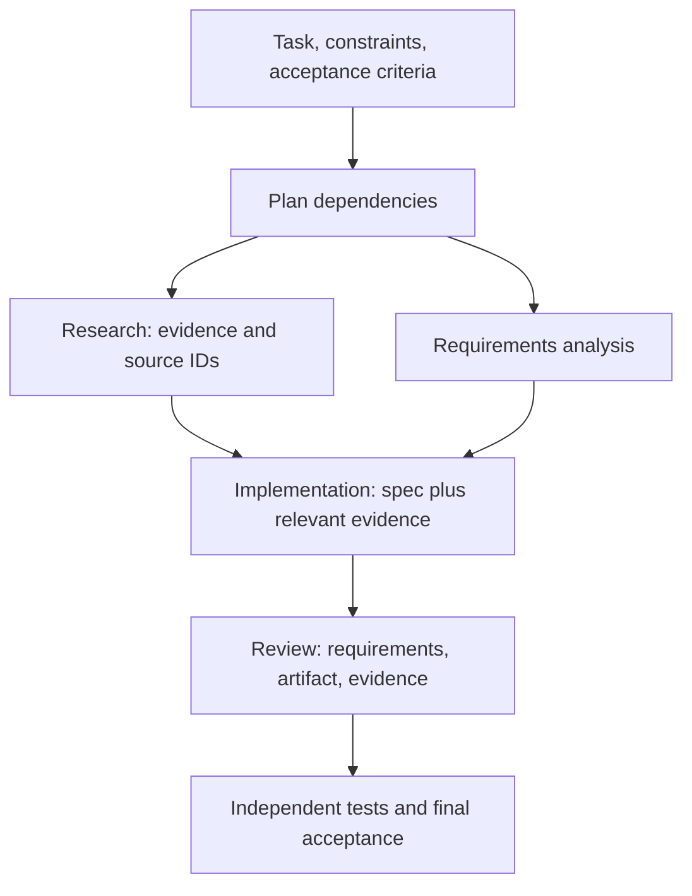

# Why Multi-Agent? Decomposition, Context, and Coordination

[Back to courses](../README.md#multi-agent-and-swarms) · [Agent Engineering](../README.md#agent-engineering) · [Workflow Patterns](../2-agent-engineering/6-anthropic-workflow-patterns.md)

## More Agents Are a Design Choice, Not an Upgrade

A **multi-agent system** coordinates multiple agent executions with separate responsibilities or working contexts. They may use the same model; different model weights are not required.

Imagine preparing a technical report. One person can research, draft, and review a short report efficiently. A larger investigation may benefit from specialists investigating independent areas. The team still needs a shared brief, evidence standards, deadlines, and someone responsible for resolving disagreements.

That is the central tradeoff: specialization and parallel work can help, but coordination consumes time and can lose information. Start by identifying a measured limitation in the simpler design.

Examples:

- Inspect independent services in a large repository, then combine findings before proposing a cross-service change.
- Research several jurisdictions or product categories independently, preserving source references for synthesis.
- Separate implementation from an evidence-based review, while giving the reviewer both the requirements and the candidate artifact.

## Where a Single-Agent Design Can Struggle

| Pressure | Observable symptom | Simpler remedy to test first | When splitting may help |
| --- | --- | --- | --- |
| Context saturation | Relevant constraints disappear among large tool outputs | Retrieval, filtering, summaries, artifact references | Subtasks need large but mostly separate working sets |
| Conflicting responsibilities | Drafting and checking compete for attention | Separate stages or prompts within one workflow | Distinct roles need different tools, context, or policies |
| Serial latency | Independent inspections wait for one another | Parallel tool calls or deterministic batching | Subtasks each require their own adaptive reasoning loop |
| Capability boundaries | One agent has an unnecessarily broad tool surface | Narrow tools and enforce permissions | Specialists can operate with genuinely separate capabilities |

**Context window** is the model's finite input/output budget. The useful working set depends on task structure, not a universal number of files or tokens. Fifty tiny files and fifty large files are very different workloads.

A single agent can use multiple prompts, stages, and parallel tools. Multi-agent is not required merely to read three files concurrently. Likewise, separate agents can all make the same mistake when they share assumptions or insufficient evidence.

When research notes, code, test output, and review feedback accumulate without filtering, the working context can become crowded:

```text
┌─────────────────────────────────────────┐
│            SINGLE AGENT                 │
│                                         │
│  ┌───────────────────────────────────┐  │
│  │         Context Window            │  │
│  │                                   │  │
│  │  research notes                   │  │
│  │  + code files                     │  │
│  │  + test output                    │  │
│  │  + review feedback                │  │
│  │  + API docs                       │  │
│  │  + ...                            │  │
│  │                                   │  │
│  │  ██████████████████████ FULL ███  │  │
│  └───────────────────────────────────┘  │
│                                         │
│  One system prompt tries to cover       │
│  research + coding + review + testing   │
│                                         │
│  Result: mediocre at everything         │
└─────────────────────────────────────────┘
```

The diagram illustrates a failure mode to diagnose, not an inevitable outcome. Better context selection can often address it before introducing another agent.

## What Decomposition Changes

**Decomposition** divides a task into smaller units with defined dependencies. Each worker should receive enough context to satisfy its assignment without receiving every unrelated artifact.

Split the work. Give each agent one job, a focused working context, and instructions tuned for that job. The orchestrator coordinates the specialists and merges their results:

```text
┌──────────────────────────────────────────────────────────┐
│                    ORCHESTRATOR                          │
│                                                          │
│  "Build a REST API for user management"                  │
│                                                          │
│         ┌──────────┬──────────┬──────────┐               │
│         │          │          │          │               │
│         ▼          ▼          ▼          ▼               │
│   ┌──────────┐ ┌──────────┐ ┌──────────┐ ┌──────────┐  │
│   │RESEARCHER│ │  CODER   │ │ REVIEWER │ │  TESTER  │  │
│   │          │ │          │ │          │ │          │  │
│   │ Reads    │ │ Writes   │ │ Checks   │ │ Runs     │  │
│   │ docs,    │ │ code     │ │ code     │ │ tests,   │  │
│   │ finds    │ │ based on │ │ quality, │ │ reports  │  │
│   │ patterns │ │ research │ │ finds    │ │ results  │  │
│   │          │ │ + spec   │ │ bugs     │ │          │  │
│   └─────┬────┘ └────┬─────┘ └────┬─────┘ └────┬─────┘  │
│         │           │            │             │         │
│         └───────────┴────────────┴─────────────┘         │
│                          │                               │
│                     Merge results                        │
└──────────────────────────────────────────────────────────┘
```

Each specialist receives a clear input/output contract. The roles above still have dependencies; map those before scheduling work:



Research and requirements analysis may be independent. Coding depends on their outputs. Review depends on the artifact. Launching all workers at once would violate those dependencies.

A useful split changes at least one of these: working context, tool permissions, expertise instructions, execution timing, or evaluation criteria. Renaming identical prompts “researcher” and “reviewer” is not enough.

## From One Loop to a Swarm

| Shape | Definition | Good fit | Cost to manage |
| --- | --- | --- | --- |
| Single agent | One primary decision loop | Small or tightly coupled work | Context and tool discipline |
| Parent with subagents | Parent delegates bounded tasks and integrates results | Focused investigations | Worker scope and summary quality |
| Pipeline | Ordered transformations with handoffs | Research → implement → review | Error propagation between stages |
| Coordinated team | Specialists communicate under explicit coordination | Mixed skills and dependencies | Ownership and shared-state consistency |
| Peer swarm | Distributed participants coordinate through local interactions or shared work | Suitable partitionable workloads | Scheduling, convergence, duplication, and debugging |

“Swarm” is used inconsistently across tools. Specify the actual protocol: who assigns work, how ownership is claimed, and how completion is detected. A work queue with a central scheduler is not leaderless simply because it has many workers.

Multi-agent is not binary. These arrangements form a spectrum of coordination complexity, not a ladder every application must climb:

```text
SIMPLE ──────────────────────────────────────────── COMPLEX

 Single        Sub-         Pipeline      Team         Swarm
 Agent         agents

 ┌───┐       ┌───┐        ┌───┐───┐    ┌───┐───┐    ┌─┐┌─┐┌─┐
 │ A │       │ A │        │ A │ B │    │ A │ B │    │ ││ ││ │
 └───┘       └─┬─┘        └───┘─┬─┘    └─┬─┘─┬─┘    └┬┘└┬┘└┬┘
               │                │        │   │       ┌┴──┴──┴┐
             ┌─┴─┐          ┌───┘───┐    │   │       │shared │
             │ a │          │ C │ D │  ┌─┴───┴─┐    │ state │
             └───┘          └───┘───┘  │  msg   │    └───────┘
                                       │  bus   │
 1 loop      Parent +      Stage by    │       │    N peers,
 1 context   child tasks   stage       └───────┘    emergent
                                       Explicit      behavior
                                       roles
```

## Coordination Patterns

### Pipeline

Each agent transforms the data and passes it forward. This fits staged work such as research, implementation, and review.

```text
Input ──▶ Agent A ──▶ Agent B ──▶ Agent C ──▶ Output
          (research)  (code)      (review)
```

A pipeline is easy to inspect when each stage has a contract. It does not provide parallel speedup along dependent stages. A faulty research summary can contaminate every downstream result.

### Fan-Out / Fan-In

Split work across parallel agents, then merge results. This fits tasks that decompose into independent subtasks.

```text
                ┌──▶ Agent A ──┐
                │              │
Input ──▶ Split ├──▶ Agent B ──├──▶ Merge ──▶ Output
                │              │
                └──▶ Agent C ──┘
```

**Fan-out** distributes independent work; **fan-in** combines outputs. Define behavior for missing workers, duplicate findings, and contradictions. Returning only successful branches without labeling missing coverage can make an incomplete result look authoritative.

### Orchestrator-Worker and Hierarchy

An **orchestrator** plans and delegates work, potentially using a model. A **coordinator** can be ordinary code that routes tasks according to fixed rules. A hierarchy adds nested coordinators or teams.

```text
                    ┌──────────┐
                    │  Orch.   │
                    └──┬───┬───┘
                  task │   │ task
                 ┌─────┘   └─────┐
                 ▼               ▼
           ┌──────────┐   ┌──────────┐
           │ Worker A │   │ Worker B │
           └──────────┘   └──────────┘
```

Use dynamic orchestration when the required subtasks depend on the input or new observations. Bound worker count, depth, retries, and spending across the entire hierarchy. Local limits alone can allow an excessive total budget.

### Peer Coordination

Peers may exchange messages or claim work from shared state. Define leases, duplicate detection, ownership transfer, and termination. A **lease** grants temporary ownership so abandoned work can be reassigned. It does not prevent duplicate effects unless execution also handles retries safely.

```text
         ┌───┐ ◄──── msg ────▶ ┌───┐
         │ A │                  │ B │
         └─┬─┘                  └─┬─┘
           │                      │
      msg  │    ┌───────────┐     │ msg
           └───▶│  Shared   │◄────┘
                │  State    │
           ┌───▶│  / Queue  │◄────┐
           │    └───────────┘     │
      msg  │                      │ msg
         ┌─┴─┐                  ┌─┴─┐
         │ C │ ◄──── msg ────▶ │ D │
         └───┘                  └───┘
```

**Consensus** is agreement under a specified protocol. Model majority voting is not automatically a distributed consensus protocol, and agreement is not proof of truth. **Emergent behavior** means system-level behavior arising from interactions; it can include useful coordination or unwanted loops.

Explore message exchange in the [interactive swarm illustration](https://aiengineeringfromscratch.com/lesson?path=phases%2F16-multi-agent-and-swarms%2F01-why-multi-agent). The widget runs on the course website.

## Contracts Before Conversations

| Field | Purpose | Example |
| --- | --- | --- |
| Task ID and artifact version | Correlate work with the exact input | `review-42`, patch revision 3 |
| Objective and constraints | Preserve what success means | Reject malformed input; no network access |
| Inputs and evidence | Give the worker sufficient context | Spec, source IDs, candidate code |
| Output schema | Make handoffs machine-checkable | Findings with severity and evidence |
| Status | Distinguish completion from uncertainty | Complete, blocked, partial, failed |
| Budget and deadline | Bound delegated work | At most two revisions and a time limit |
| Permissions | Restrict capabilities | Read-only repository access |
| Ownership | Identify who integrates or approves | Parent coordinator |

Keep authoritative artifacts outside conversation summaries when possible and pass versioned references. Give reviewers the original requirements, not only the coder's explanation of its own work. Separate private worker scratch data from shared evidence and final artifacts.

## Hands-On: Shared History Versus Scoped Handoffs

The source uses TypeScript sketches with a placeholder model call. This complete Python adaptation makes the comparison executable without a model. Both designs perform research, coding, and review using the same scripted outputs.

We count **input characters**, not tokens, price, or quality. The baseline retains raw fixture notes while the scoped design passes a concise evidence summary. A well-designed single-agent workflow could also filter its history; this experiment demonstrates context selection, not inherent multi-agent superiority.

Save as `why_multi_agent.py` and run `python3 why_multi_agent.py` with Python 3.10+.

```python
from dataclasses import dataclass
import json


@dataclass(frozen=True)
class Message:
    sender: str
    recipient: str
    artifact_id: str
    content: str


SPEC = "Implement an identity function: return exactly the supplied value."
RAW_NOTES = "Irrelevant historical notes. " * 100
EVIDENCE = "Requirement R1: output equals input, including None."
CODE = "def identity(value):\n    return value\n"


def fixture_call(role, payload, calls):
    calls.append({"role": role, "input_characters": len(json.dumps(payload))})
    if role == "researcher":
        return EVIDENCE
    if role == "coder":
        if "requirements" not in payload:
            raise ValueError("Missing original requirements")
        return CODE
    if role == "reviewer":
        if "requirements" not in payload or "code" not in payload:
            raise ValueError("Reviewer needs requirements and code")
        return "Fixture review: R1 is preserved; run independent checks."
    raise ValueError("Unknown role")


def single_history():
    calls = []
    history = [RAW_NOTES]
    evidence = fixture_call("researcher", {"requirements": SPEC, "history": history}, calls)
    history.append(evidence)
    code = fixture_call("coder", {"requirements": SPEC, "history": history}, calls)
    history.append(code)
    review = fixture_call("reviewer", {
        "requirements": SPEC, "code": code, "history": history
    }, calls)
    return {"code": code, "review": review, "calls": calls}


def receive(messages, recipient):
    return {m.artifact_id: m.content for m in messages if m.recipient == recipient}


def scoped_pipeline():
    calls, messages = [], []
    evidence = fixture_call("researcher", {"requirements": SPEC, "notes": RAW_NOTES}, calls)
    messages.append(Message("researcher", "coder", "evidence", evidence))
    coder_input = {"requirements": SPEC, **receive(messages, "coder")}
    code = fixture_call("coder", coder_input, calls)
    messages.extend([
        Message("coder", "reviewer", "code", code),
        Message("researcher", "reviewer", "evidence", evidence),
    ])
    reviewer_input = {"requirements": SPEC, **receive(messages, "reviewer")}
    review = fixture_call("reviewer", reviewer_input, calls)
    return {"code": code, "review": review, "calls": calls,
            "messages": messages, "reviewer_input": reviewer_input}


def main():
    for name, run in [("Shared history", single_history), ("Scoped handoffs", scoped_pipeline)]:
        result = run()
        counts = [call["input_characters"] for call in result["calls"]]
        print(name, "calls:", len(counts), "total input characters:", sum(counts),
              "largest input:", max(counts))
        print(result["review"])
    assert single_history()["code"] == scoped_pipeline()["code"]


if __name__ == "__main__":
    main()
```

Both runs make three fixture calls and produce the same code. Scoped handoffs avoid repeatedly sending the long raw notes. The reviewer's payload retains the requirements, artifact, and evidence summary. No generated code is executed and no real agent has been evaluated.

In a real implementation, schemas must reject duplicate artifact IDs rather than silently overwrite them, evidence must be checked, and worker errors must remain distinguishable from success. Replace fixtures with bounded workers only after those contracts are clear.

## Evaluate the Whole System

Use a held-out task set and an evaluator independent of the coordinator's self-assessment. Compare:

1. A strong single-agent baseline with retrieval and context management.
2. A fixed staged workflow, potentially with parallel tools.
3. A multi-agent design using the same overall resource limits.

| Metric | Definition or measurement |
| --- | --- |
| Verified success | Correctly completed tasks / all evaluated tasks |
| Cost per verified success | Total cost including failed runs / verified successes |
| End-to-end latency | Median and p95 task completion time |
| Total token usage | Input and output tokens across all workers and coordination |
| Peak worker context | Largest input context used by any individual worker |
| Handoff failure rate | Invalid or insufficient handoffs / all handoffs |
| Coordination overhead | Calls, time, and spending devoted to assignment and merging |
| Coverage | Required subproblems actually evaluated / required subproblems |
| Rework | Repeated or revised tasks per accepted result |

If three independent workers take 10, 15, and 20 seconds, serial work takes about 45 seconds. Ideal parallel work takes about 20 seconds plus splitting, queueing, and merging. If coordination takes 8 seconds, the result is roughly 28 seconds, not 15 or zero. Rate limits and shared tools can reduce the benefit further.

For a serial fraction `s` and `n` workers, an idealized speedup bound is `1 / (s + (1-s)/n)` before coordination overhead. If half the work is serial, unlimited workers cannot exceed a 2× speedup under those assumptions.

More agents may increase or reduce total tokens depending on duplicated instructions, context filtering, retries, and search breadth. Do not infer savings from smaller individual contexts alone.

## When to Stay Single-Agent

Stay with the simpler approach when it meets quality and latency targets, subtasks are tightly coupled, coordination costs dominate, or no reliable merge/evaluation step exists. First improve retrieval, tools, schemas, and context selection.

| Observed problem | Useful next experiment |
| --- | --- |
| Large tool outputs obscure requirements | Filter or summarize observations |
| Independent tool calls dominate latency | Parallelize those calls without adding agents |
| One stage needs different instructions | Use a staged workflow |
| Independent investigations need separate adaptive loops | Try bounded subagents |
| The task's decomposition changes after observations | Evaluate an orchestrator-worker design |
| Many workers contend for the same artifact | Reduce concurrency or isolate ownership |

A larger model is another possible baseline, not automatically the wrong answer. Likewise, multi-agent does not inherently outperform single-agent systems on coding benchmarks. Compare matched models, tools, task sets, budgets, and evaluation protocols before making such a claim.

## Failure Modes

- **Lost constraints:** a summary omits a requirement. Pass acceptance criteria explicitly with every relevant assignment.
- **Correlated mistakes:** agents reinforce the same unsupported assumption. Require external evidence or executable validation.
- **Conflicting writes:** workers modify overlapping state. Use ownership boundaries and controlled merges.
- **Delegation loops:** tasks bounce between specialists. Cap hops and require observable progress.
- **Incomplete fan-in:** a failed worker disappears from the final answer. Record coverage and partial status.
- **Authority confusion:** a worker message claims approval. Authenticate decisions separately from model-generated text.
- **Untraceable results:** findings lack source or artifact versions. Preserve lineage through every handoff.

## Exercises

1. Add a tester receiving the original specification, candidate code, and review findings. Keep its result separate from the reviewer opinion.
2. Add at most two code-revision rounds after review failure. Record artifact versions and stop explicitly when unresolved.
3. Run research and requirements analysis independently, then merge before coding. Demonstrate that review still waits for the implementation.
4. Remove a requirement from a handoff and show that a validator catches the omission.
5. Inject a worker timeout. Return a partial or failed outcome instead of silently claiming complete coverage.
6. Improve the single-history baseline by filtering raw notes. Compare it again before attributing any benefit to multiple agents.
7. Design a queue-worker protocol with leases, retries, and deduplication. Explain why it is not necessarily a leaderless swarm.
8. Write a decision memo with baseline results, proposed split, expected benefit, coordination cost, and a rollback criterion.

## Quick Cheat Sheet

**Split for a measured reason; define the handoff; verify the merge.**

| Concept | Memory aid | Caveat |
| --- | --- | --- |
| Decomposition | Divide responsibilities | Preserve dependencies and constraints |
| Subagent | A scoped investigation | Separate context is not independent truth |
| Pipeline | An assembly line | Errors can propagate downstream |
| Fan-out / fan-in | Divide and combine | Missing branches require explicit handling |
| Orchestrator | Plans and delegates | Can become a bottleneck |
| Coordinator | Routes by rules | Does not have to be a model |
| Swarm | Peer coordination | Define actual ownership and termination rules |
| Consensus | Agreement protocol | Agreement alone is not correctness |

An interview answer: “I would use multiple agents when independent working contexts, specialized capabilities, or parallel reasoning improve a measured bottleneck. I would first test retrieval, staged prompts, and parallel tools in a simpler baseline. Then I would define dependencies, message contracts, ownership, and budgets, and compare verified success, cost, and latency under matched resource limits.”

## Resource

Adapted from the MIT-licensed lesson; copyright © 2026 Rohit Ghumare. [Original license](../licenses/ai-engineering-from-scratch-LICENSE). The runnable Python example uses deterministic fixtures to expose context boundaries; it does not demonstrate actual model-quality gains.

| Field | Details |
| --- | --- |
| Origin | [AI Engineering from Scratch — source lesson](https://github.com/rohitg00/ai-engineering-from-scratch/blob/main/phases/16-multi-agent-and-swarms/01-why-multi-agent/docs/en.md) |
| Author | Rohit Ghumare and contributors |
| Level | Intermediate — repository assessment |
| Best for | Deciding whether multiple agents are justified, selecting a coordination pattern, specifying handoffs, and comparing quality, latency, and cost against a single-agent baseline |

## References and Attribution

- [Source lesson](https://github.com/rohitg00/ai-engineering-from-scratch/blob/main/phases/16-multi-agent-and-swarms/01-why-multi-agent/docs/en.md) — Rohit Ghumare and contributors.
- [Large Language Model-Based Agents for Software Engineering: A Survey](https://arxiv.org/abs/2409.02977) — the software-engineering survey linked by the source, with its correct title.
- [AutoGen: Enabling Next-Gen LLM Applications via Multi-Agent Conversation](https://arxiv.org/abs/2308.08155) — research on configurable multi-agent conversations, not a universal superiority claim.
- [Claude Agent SDK](../2-agent-engineering/11-claude-agent-sdk.md) and [CrewAI Role-Based Crews](../2-agent-engineering/9-crewai-role-based-crews.md) — related courses.

Adapted on 2026-10-31. This course retains the source's context, specialization, parallelism, coordination-pattern, message-contract, and exercise themes. It corrects absolute single-agent limitations, arbitrary token thresholds, and unsupported product-architecture or benchmark claims. The source's placeholder TypeScript sketch is replaced by a complete offline Python demonstration. The example was tested; no live agents or quality benchmark were run.

The source tracks upstream `main`; its downloaded hash follows. Imported material retains its [MIT license notice](../licenses/ai-engineering-from-scratch-LICENSE).

- Lesson Markdown SHA-256: `43afcd0c4577433cf152e33711cdee7dc0a0625a37b01a3d30c1588d52dd952e`
