# Communication Protocols

[Back to courses](../README.md#multi-agent-and-swarms) · [Why Multi-Agent?](1-why-multi-agent.md)

## The Problem

You split your system into multiple agents. A researcher, a coder, a reviewer. They're great at their individual jobs. But now you need them to actually talk to each other.

Your first attempt is obvious: pass strings around. The researcher returns a blob of text, the coder parses it however it can. It works until the coder misinterprets a research summary, or two agents deadlock waiting for each other, or you need agents built by different teams to collaborate. Suddenly "just pass strings" falls apart.

This is the communication protocol problem. Without a shared contract, each integration needs custom parsing, error handling, and coordination. A protocol defines the structure and meaning of messages so independently built components can cooperate.

Four protocol families help explain the design space:

- **MCP** for tool access
- **A2A** for agent-to-agent collaboration
- **ACP** for agent runs and metadata (historical; now part of A2A)
- **ANP** for agent discovery, identity, and communication

Think of a team of contractors: a tool catalog lists equipment, a business card advertises a specialist, a work order tracks a job, and an identity check verifies who is requesting access. None of those alone guarantees good work or permission to perform it.

This lesson follows those distinctions through diagrams, message examples, and a runnable task-coordination exercise.

## The Concept

### The Protocol Landscape

These protocols overlap; they are not a mandatory four-layer stack:

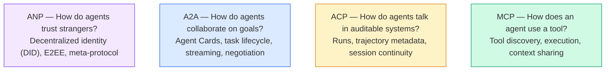

Choose the smallest set that solves an interoperability requirement. Audit logging and authorization remain application responsibilities regardless of protocol.

### MCP (Recap)

See [Function Calling](../1-llm-engineering/6-function-calling.md) for more on MCP. Quick recap: MCP standardizes how an LLM connects to external tools and data sources. It's a **client-server** protocol where the agent (client) discovers and calls tools exposed by a server.

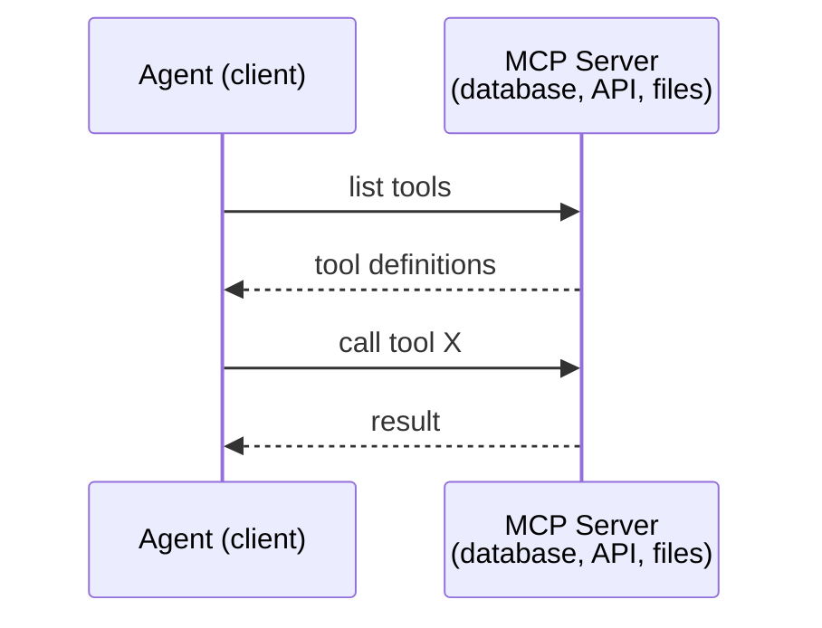

MCP primarily standardizes **client-to-tool/context** access. A tool can itself be backed by an agent, but a tool interface is not the same contract as A2A's remote-agent task lifecycle.

After initialization and capability negotiation, clients use `tools/list` to discover schemas and `tools/call` to invoke a named tool. Validate arguments and enforce permissions before executing. A tool execution failure can return `isError: true`; protocol failures use JSON-RPC errors. See the [MCP tools specification](https://modelcontextprotocol.io/specification/2025-11-25/server/tools).

```json
{"jsonrpc":"2.0","id":1,"method":"tools/list","params":{}}
```

```json
{"jsonrpc":"2.0","id":2,"method":"tools/call","params":{"name":"search_docs","arguments":{"query":"refund policy"}}}
```

### MCP Transports: Legacy HTTP + SSE vs Streamable HTTP

**Streaming** means delivering results incrementally. **SSE (Server-Sent Events)** is one HTTP response format for doing that. Deprecating a transport that uses SSE does not deprecate SSE itself.

| Aspect | Legacy HTTP + SSE | Streamable HTTP |
| --- | --- | --- |
| MCP status | Deprecated remote transport from version 2024-11-05 | Replacement introduced in version 2025-03-26 |
| Endpoints | Separate POST message endpoint and long-lived GET SSE endpoint | One HTTP/HTTPS endpoint, typically `/mcp`, for POST and GET |
| Sending messages | POST to the message endpoint | POST to the shared endpoint |
| Receiving messages | Dedicated SSE stream | JSON response or SSE response; optional GET stream |
| GET streaming | Central to the legacy design | Server may return 405 when unsupported |

Streamable HTTP can return `application/json` or `text/event-stream`. This is response content negotiation, **not an HTTP protocol upgrade** like WebSocket. See the [March 2025 MCP transport specification](https://modelcontextprotocol.io/specification/2025-03-26/basic/transports).

**Analogy:** the legacy design has separate delivery and collection doors. Streamable HTTP uses one address, where you can receive a complete reply or a sequence of updates.

### A2A (Agent2Agent Protocol)

**Created by:** Google (now under Linux Foundation as `lf.a2a.v1`)
**Example protocol version:** 1.0 — see the [official A2A specification](https://a2a-protocol.org/latest/specification/) for binding and version requirements.
**Problem:** How do autonomous agents collaborate, negotiate, and delegate tasks to each other?

A2A is the protocol for **peer-to-peer agent collaboration**. Where MCP connects an agent to tools, A2A connects an agent to other agents. Each agent publishes an **Agent Card** at a well-known URL, and other agents discover, negotiate with, and delegate tasks to it.

#### How A2A Works

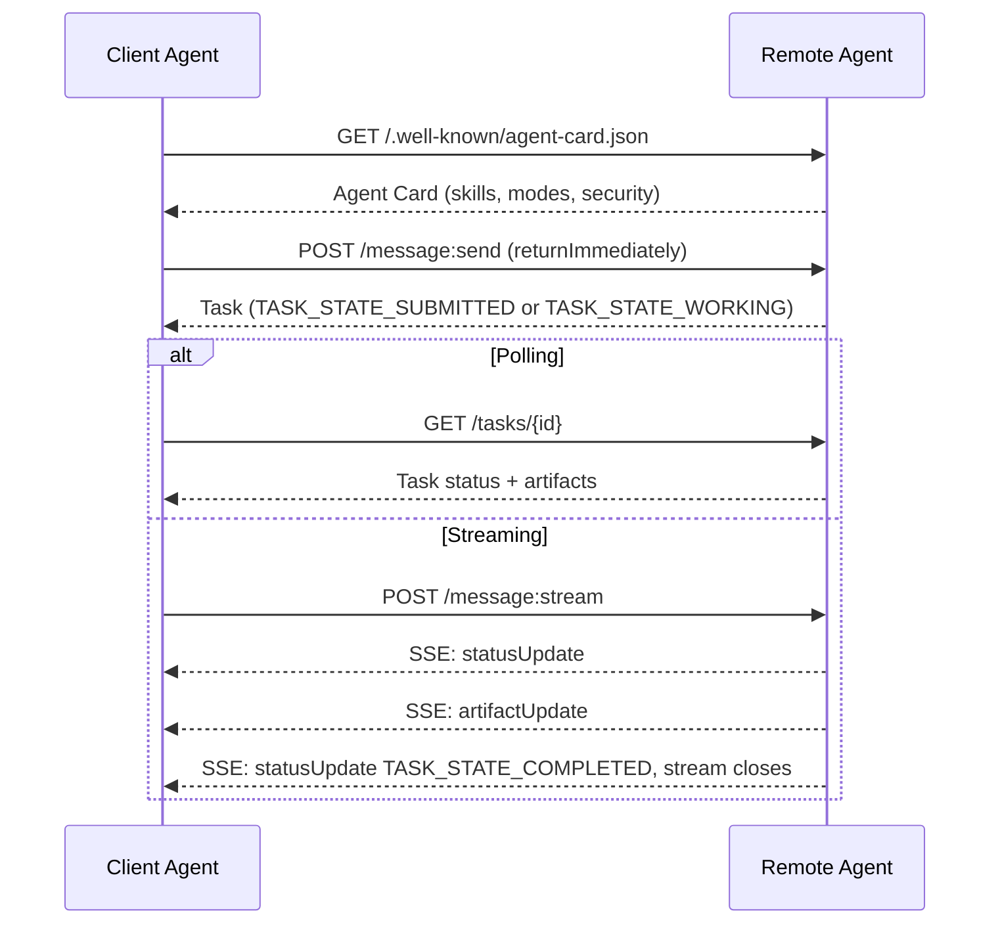

#### The Real Agent Card

This illustrative A2A 1.0 Agent Card advertises skills, transport interfaces, and security requirements. Served at `GET /.well-known/agent-card.json`:

```json
{
  "name": "Research Agent",
  "description": "Searches documentation and summarizes findings",
  "version": "1.0.0",
  "supportedInterfaces": [
    {
      "url": "https://research-agent.example.com/a2a/v1",
      "protocolBinding": "JSONRPC",
      "protocolVersion": "1.0"
    },
    {
      "url": "https://research-agent.example.com/a2a/rest",
      "protocolBinding": "HTTP+JSON",
      "protocolVersion": "1.0"
    }
  ],
  "provider": {
    "organization": "Your Company",
    "url": "https://example.com"
  },
  "capabilities": {
    "streaming": true,
    "pushNotifications": false
  },
  "defaultInputModes": ["text/plain", "application/json"],
  "defaultOutputModes": ["text/plain", "application/json"],
  "skills": [
    {
      "id": "web-research",
      "name": "Web Research",
      "description": "Searches the web and synthesizes findings",
      "tags": ["research", "search", "summarization"],
      "examples": ["Research the latest changes in React 19"]
    },
    {
      "id": "doc-analysis",
      "name": "Documentation Analysis",
      "description": "Reads and analyzes technical documentation",
      "tags": ["docs", "analysis"],
      "inputModes": ["text/plain", "application/pdf"],
      "outputModes": ["application/json"]
    }
  ],
  "securitySchemes": {
    "bearer": {
      "httpAuthSecurityScheme": {
        "scheme": "Bearer",
        "bearerFormat": "JWT"
      }
    }
  },
  "securityRequirements": [{ "schemes": { "bearer": { "list": [] } } }]
}
```

Key things to notice:
- **Skills** are what an agent can do. Each has an ID, tags, and supported input/output MIME types. This is how a client agent decides whether this remote agent can handle its request.
- **supportedInterfaces** lists multiple protocol bindings. A single agent can speak JSON-RPC, REST, and gRPC simultaneously.
- **Security** is built into the card: `securitySchemes` names each scheme and `securityRequirements` says which ones apply. The client knows what auth it needs before making a single request.

#### Task Lifecycle

Tasks are the core unit of work in A2A. They move through defined states (the diagram drops the `TASK_STATE_` prefix that every state carries on the wire):

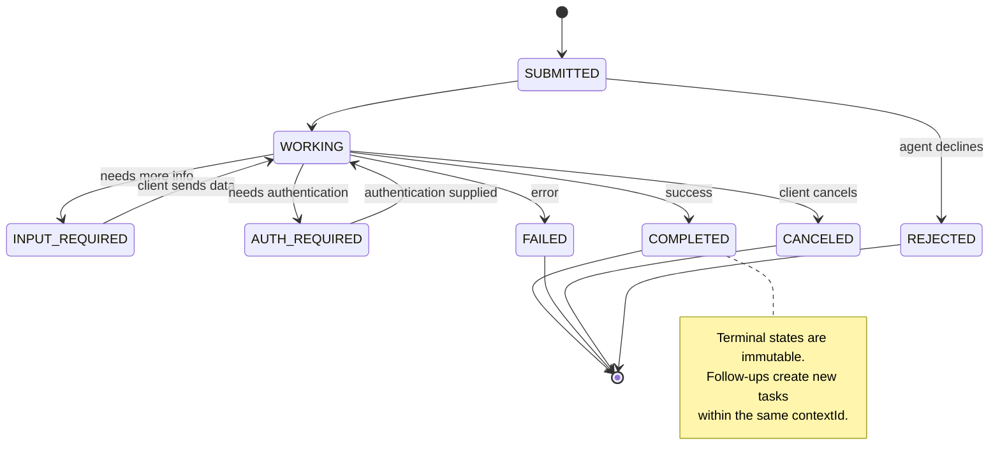

All 8 states (the spec also defines `UNSPECIFIED` as a sentinel, omitted here):

| State | Terminal? | Meaning |
|---|---|---|
| `TASK_STATE_SUBMITTED` | No | Acknowledged, not yet processing |
| `TASK_STATE_WORKING` | No | Actively being processed |
| `TASK_STATE_INPUT_REQUIRED` | No | Agent needs more info from client |
| `TASK_STATE_AUTH_REQUIRED` | No | Authentication needed |
| `TASK_STATE_COMPLETED` | Yes | Finished successfully |
| `TASK_STATE_FAILED` | Yes | Finished with error |
| `TASK_STATE_CANCELED` | Yes | Canceled before completion |
| `TASK_STATE_REJECTED` | Yes | Agent declined the task |

Once a task reaches a terminal state, it's immutable. No further messages. Follow-ups create a new task within the same `contextId`.

#### Wire Format

A2A supports multiple bindings. The following example uses JSON-RPC 2.0; the earlier URL-based sequence uses the HTTP+JSON binding. Do not mix binding-specific routes and envelopes.

**Client sends a message:**
```json
{
  "jsonrpc": "2.0",
  "id": 1,
  "method": "SendMessage",
  "params": {
    "message": {
      "messageId": "msg-001",
      "role": "ROLE_USER",
      "parts": [{ "text": "Summarize the supplied fictional product notes" }]
    },
    "configuration": {
      "acceptedOutputModes": ["text/plain", "application/json"],
      "historyLength": 10
    }
  }
}
```

**Agent responds with a task:**
```json
{
  "jsonrpc": "2.0",
  "id": 1,
  "result": {
    "task": {
      "id": "task-abc-123",
      "contextId": "ctx-xyz-789",
      "status": {
        "state": "TASK_STATE_COMPLETED",
        "timestamp": "2026-03-27T10:30:00Z"
      },
      "artifacts": [
        {
          "artifactId": "art-001",
          "name": "research-results",
          "parts": [{
            "data": {
              "findings": [
                "Product Atlas supports CSV export",
                "Exports require the reporting permission",
                "Exports are generated asynchronously"
              ]
            },
            "mediaType": "application/json"
          }]
        }
      ]
    }
  }
}
```

**Streaming via SSE (Server-Sent Events):** This is A2A streaming, not MCP’s deprecated HTTP+SSE transport. SSE remains usable in both A2A and MCP Streamable HTTP. The request uses the HTTP+JSON binding. The following `data:` records are response excerpts, not the request body. SSE lets the server push updates over an open HTTP response.
```text
POST /message:stream HTTP/1.1
Content-Type: application/a2a+json
A2A-Version: 1.0
Accept: text/event-stream

[Request JSON body omitted]

HTTP/1.1 200 OK
Content-Type: text/event-stream

data: {"task":{"id":"task-123","contextId":"ctx-123","status":{"state":"TASK_STATE_WORKING"}}}

data: {"statusUpdate":{"taskId":"task-123","contextId":"ctx-123","status":{"state":"TASK_STATE_WORKING","message":{"messageId":"msg-002","role":"ROLE_AGENT","parts":[{"text":"Searching documentation..."}]}}}}

data: {"artifactUpdate":{"taskId":"task-123","contextId":"ctx-123","artifact":{"artifactId":"art-1","parts":[{"text":"partial findings..."}]},"append":true,"lastChunk":false}}

data: {"statusUpdate":{"taskId":"task-123","contextId":"ctx-123","status":{"state":"TASK_STATE_COMPLETED"}}}
```

### ACP (Agent Communication Protocol)

**Created by:** IBM / BeeAI
**Spec version:** 0.2.0 (OpenAPI 3.1.1)
**Status:** [ACP is now part of A2A](https://github.com/i-am-bee/acp) under the Linux Foundation. The following 0.2-era examples explain historical concepts, not a recommendation to start a new ACP deployment.
**Problem:** How do agents communicate with full auditability, session continuity, and trajectory tracking?

ACP used a REST/JSON API defined via OpenAPI for agent communication. Its optional **TrajectoryMetadata** could describe actions and tool calls associated with a response. Auditability is useful across protocols, not exclusive to ACP.

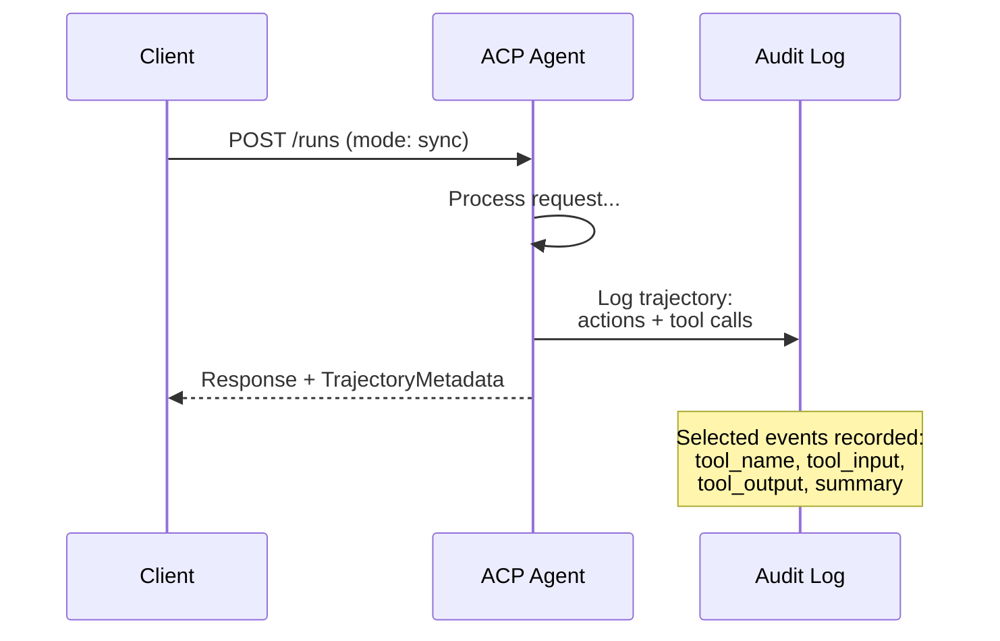

#### Agent Discovery in ACP

ACP defines four discovery methods:

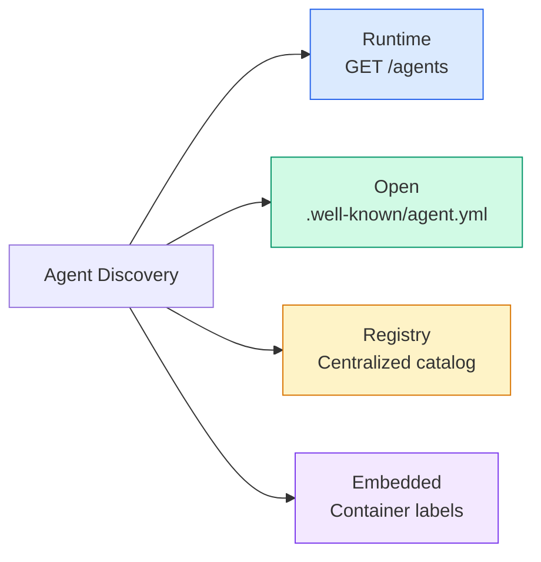

The **AgentManifest** is simpler than A2A's Agent Card:

```json
{
  "name": "summarizer",
  "description": "Summarizes documents with source citations",
  "input_content_types": ["text/plain", "application/pdf"],
  "output_content_types": ["text/plain", "application/json"],
  "metadata": {
    "tags": ["summarization", "RAG"],
    "framework": "BeeAI",
    "capabilities": [
      {
        "name": "Document Summarization",
        "description": "Condenses long documents into key points"
      }
    ],
    "recommended_models": ["llama3.3:70b-instruct-fp16"],
    "license": "Apache-2.0",
    "programming_language": "Python"
  }
}
```

#### Run Lifecycle

ACP uses "Runs" instead of "Tasks". A Run is an agent execution with three modes:

| Mode | Behavior |
|---|---|
| `sync` | Blocking. Response contains the complete result. |
| `async` | Returns 202 immediately. Poll `GET /runs/{id}` for status. |
| `stream` | SSE stream. Events fire as the agent works. |

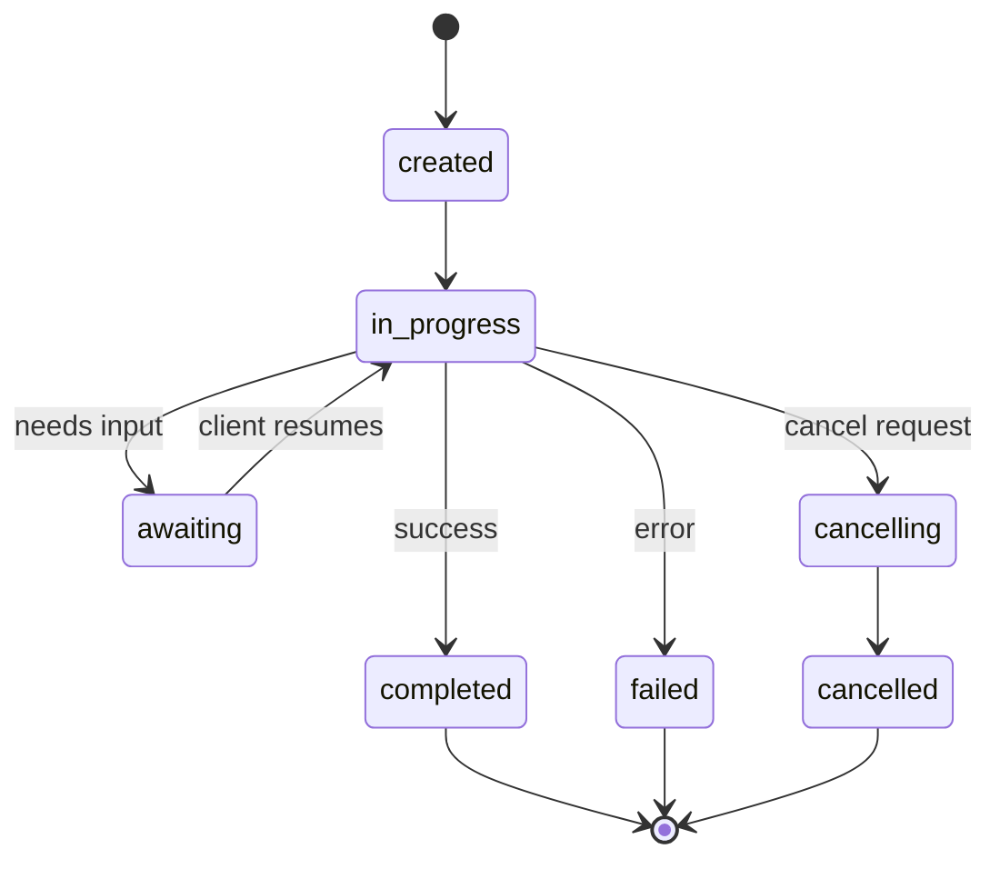

#### TrajectoryMetadata (The Audit Trail)

Message parts can carry optional trajectory metadata. This fictional weather example illustrates the shape:

```json
{
  "role": "agent/researcher",
  "parts": [
    {
      "content_type": "text/plain",
      "content": "The weather in San Francisco is 72F and sunny.",
      "metadata": {
        "kind": "trajectory",
        "message": "I need to check the weather for this location",
        "tool_name": "weather_api",
        "tool_input": { "location": "San Francisco, CA" },
        "tool_output": { "temperature": 72, "condition": "sunny" }
      }
    }
  ]
}
```

Metadata is not proof of correctness or a complete record. Record observable actions, source references, timestamps, and outcomes; redact secrets and apply retention and integrity controls. Do not require private model chain-of-thought for auditability.

ACP also supports **CitationMetadata** for source attribution:

```json
{
  "kind": "citation",
  "start_index": 0,
  "end_index": 47,
  "url": "https://weather.gov/sf",
  "title": "NWS San Francisco Forecast"
}
```

#### ACP vs OpenTelemetry: Communication and Observability

**ACP defines how agents exchange requests, run states, and results. OpenTelemetry (OTel) instruments the systems handling that work and exports telemetry about their behavior.** They serve complementary purposes at different architectural layers.

| Aspect | ACP (Agent Communication Protocol) | OTel (OpenTelemetry) |
| --- | --- | --- |
| Main question | How do I request work and receive its result? | Where did time go, and what failed? |
| Responsibility | Message contracts and run lifecycle | Instrumentation and telemetry collection/export |
| Typical data | Run inputs, status, output messages | Traces, metrics, and logs |
| Example | Submit a summarization run and retrieve the answer | Measure its duration and trace a failed tool call |
| Executes business work? | Defines the interaction; the agent implementation executes it | Does not delegate or execute agent tasks |
| Stores and displays monitoring data? | Not its purpose | Exports to a separate observability backend |

OTel captures signals **during execution**, not only after the fact. A **trace** follows a request across components; a **span** represents one timed operation within it. **Metrics** summarize measurements such as request counts and latency, while **logs** record individual events. See the [OpenTelemetry overview](https://opentelemetry.io/docs/what-is-opentelemetry/) and [signal definitions](https://opentelemetry.io/docs/concepts/signals/).

**How ACP uses OTel:** the ACP project provides an OpenTelemetry integration example and discusses instrumentation and export to monitoring backends. This supports describing OTel as an integration for ACP observability; it does not establish that the ACP wire specification requires OTel for every implementation. See the [ACP maintainers’ integration discussion](https://github.com/i-am-bee/acp/issues/150). The same separation applies when migrating ACP applications to A2A.

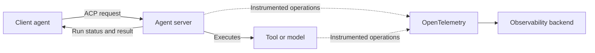

**Analogy:** ACP is the restaurant’s ordering procedure: submit an order, check its status, receive the meal. OTel is the instrumentation that measures preparation time and records kitchen errors while the order is being fulfilled.

**Two examples:**

- A researcher delegates a summary through ACP. The response contains the summary; a trace can show that retrieval took 300 ms and generation took 2 seconds. These are illustrative timings.
- A tool fails and the agent retries. ACP communicates the run’s outcome; telemetry can reveal the failed attempt, retry count, and added latency.

ACP’s optional `TrajectoryMetadata` is application message content, not an OTel trace. Correlate run IDs with trace IDs when useful, but do not assume a one-to-one mapping. Sampling and export failures can leave telemetry incomplete, so monitoring traces alone are not a complete audit ledger. Avoid recording credentials or sensitive prompt content by default.

**Quick reminder:** *ACP carries the work request; OTel observes its execution.*

### ANP (Agent Network Protocol)

**Created by:** Open-source community (founded by GaoWei Chang)
**Repo:** [github.com/agent-network-protocol/AgentNetworkProtocol](https://github.com/agent-network-protocol/AgentNetworkProtocol)
**Problem:** How do agents from different organizations trust each other without a central authority?

ANP explores identity, discovery, and communication across agent networks. Its identity and messaging profiles build on web infrastructure and DID concepts. A2A deployments can also authenticate peers; DID-based identity is one approach, not a prerequisite for cross-organization communication.

The source organizes ANP into three conceptual layers. Concrete algorithms and maturity depend on the selected specification/profile:

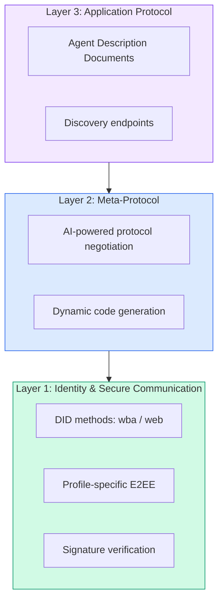

#### DID Documents and Versioned Identity Rules

A **decentralized identifier (DID)** identifies a subject and resolves, using its DID method, to information such as verification keys and service endpoints. A **DID document** describes those keys and relationships. Not every DID is domain-hosted; that property depends on the method.

ANP's current specification set is 1.2. Its authentication layer supports `did:wba` and native `did:web`; WBA method validation includes identity-binding rules. The source lesson's older DID document is therefore not a current deployment template. Use the [ANP specification index](https://github.com/agent-network-protocol/AgentNetworkProtocol) to select compatible authentication, discovery, and messaging profiles.

Signing proves possession of a key; encryption protects confidentiality. These are separate functions and may require separate key types. A signature does not prove that an agent is honest, accurate, or authorized. Enforce scopes, expiry, revocation, audience binding, and replay protection independently. DID document extensions do not, by themselves, enforce human approval.

#### Authentication and Authorization

ANP does **not** use a web-of-trust or endorsement graph. The following simplified authentication exchange omits nonce handling, expiry, and policy checks:

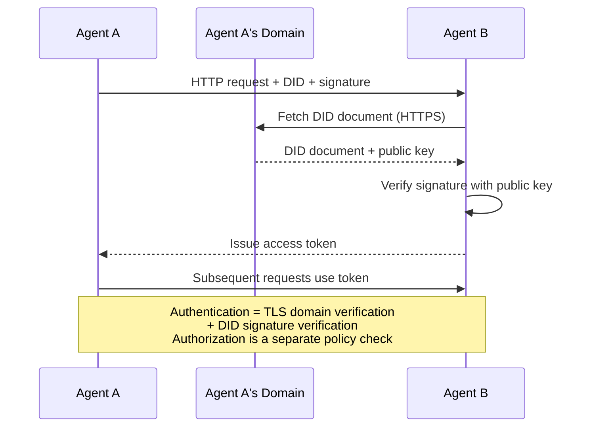

A deployment separates these checks:
1. **Domain-level TLS** verifies the DID document host
2. **DID cryptographic signatures** establish control of the corresponding key
3. **Principle of least trust** grants only minimum permissions

There's no gossip-based trust propagation or PageRank scoring. You verify each agent directly through its DID.

#### Meta-Protocol Negotiation

This is ANP's most novel feature. When two agents from different ecosystems meet, they don't need pre-agreed data formats. They negotiate in natural language:

```json
{
  "action": "protocolNegotiation",
  "sequenceId": 0,
  "candidateProtocols": "I can communicate using:\n1. JSON-RPC with hotel booking schema\n2. REST with OpenAPI 3.1 spec\n3. Natural language over HTTP",
  "modificationSummary": "Initial proposal",
  "status": "negotiating"
}
```

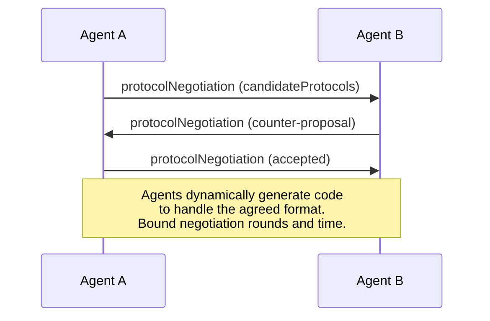

This conceptual exchange must have bounded rounds and a deadline. Treat any generated adapter as untrusted code requiring validation and isolation. Example status values: `negotiating`, `rejected`, `accepted`, `timeout`.

This means two agents that have never seen each other before can figure out how to communicate without anyone pre-defining a shared schema.

### Comparison

| Concern | MCP | A2A | ACP (historical) | ANP |
| --- | --- | --- | --- | --- |
| Main abstraction | Tool/resource interface | Agent capability and task | Agent run | Agent identity, discovery, communication |
| Discovery | Tool listing | Agent Card | Agent manifest | Description/discovery protocols |
| Communication | JSON-RPC; local/HTTP transports | JSON-RPC, HTTP+JSON, gRPC bindings | REST/JSON and SSE | Depends on chosen profile |
| Authentication | Deployment/transport-dependent authorization | Advertised security schemes and server enforcement | Server authorization | DID-based authentication profiles |
| Work tracking | Feature/version-dependent | Task states and artifacts | Run states | Profile/application-dependent |
| Audit | Application instrumentation | Application instrumentation | Optional trajectory metadata | Application instrumentation |
| Interview takeaway | “Which tool and arguments?” | “Which agent and task status?” | “How did the run proceed?” | “Who is communicating, and how?” |

### How They Work Together

These protocols are not mutually exclusive. A deployment can combine them, but adapters and shared policy must be designed explicitly:

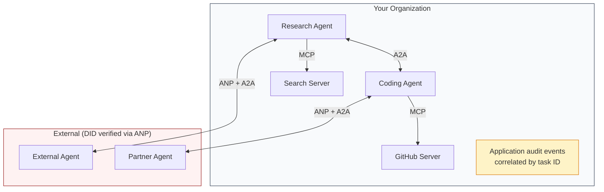

- **MCP** connects each agent to its tools
- **A2A** handles collaboration between agents (internal and external)
- **Application audit logging** records actions and outcomes; ACP illustrates one metadata design
- **ANP** is an optional identity/communication approach for external peers; it is not required by A2A

A message bus can decouple producers from consumers. The bus transports messages; schemas, ordering, retries, and authorization still need explicit contracts.

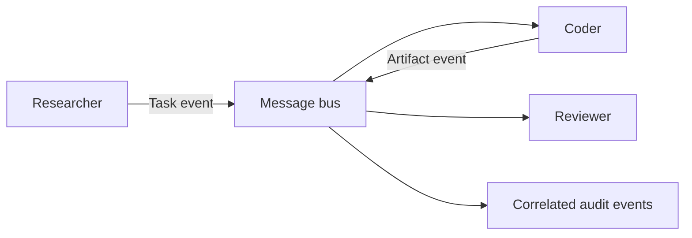


## Build It: Discovery, Tasks, and Audit Events

A **gateway** is an application boundary that checks requests and routes them to handlers. It can translate protocols, but it must preserve identities, task IDs, deadlines, and error semantics.

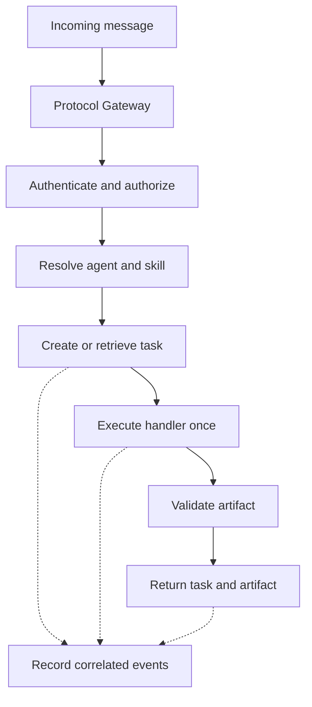

The source builds registries, task managers, audit runners, and an identity gateway in TypeScript. This compact Python version makes their coordination testable without an SDK or credentials. It implements an in-memory registry, a restricted task state machine, request deduplication, and observable action logs. It does **not** implement MCP, A2A HTTP endpoints, DID resolution, cryptography, streaming, or durable execution.

Save the following block as `communication_demo.py` and run `python3 communication_demo.py` (Python 3.10+). All data is synthetic.

```python
from copy import deepcopy
from dataclasses import dataclass, field
from uuid import uuid4


@dataclass
class Task:
    id: str
    state: str = "submitted"
    artifacts: list = field(default_factory=list)
    error: str | None = None


class Gateway:
    # Deliberately a subset of A2A's lifecycle, not its wire representation.
    transitions = {
        "submitted": {"working", "rejected"},
        "working": {"completed", "failed"},
        "completed": set(), "failed": set(), "rejected": set(),
    }

    def __init__(self):
        self.agents = {}
        self.tasks = {}
        self.requests = {}
        self.audit = []

    def register(self, name, skill, handler):
        if name in self.agents:
            raise ValueError("Agent already registered")
        self.agents[name] = (skill, handler)

    def discover(self, skill):
        return sorted(name for name, (s, _) in self.agents.items() if s == skill)

    def transition(self, task, state):
        if state not in self.transitions[task.state]:
            raise ValueError(f"Invalid transition: {task.state} -> {state}")
        task.state = state
        self.audit.append({"task_id": task.id, "event": state})

    def submit(self, principal, agent, request_id, text):
        # principal is trusted middleware context, not a client-supplied identity.
        if principal != "interview-demo":
            raise PermissionError("Caller is not authorized")
        if not request_id or not isinstance(text, str) or not text.strip():
            raise ValueError("A request ID and nonempty text are required")
        if agent not in self.agents:
            raise LookupError("Unknown agent")
        key = (principal, agent, request_id)
        if key in self.requests:
            old_text, task_id = self.requests[key]
            if old_text != text:
                raise ValueError("Request ID reused with different content")
            return deepcopy(self.tasks[task_id])

        task = Task(str(uuid4()))
        self.tasks[task.id] = task
        self.requests[key] = (text, task.id)
        self.audit.append({"task_id": task.id, "event": "submitted"})
        self.transition(task, "working")
        try:
            result = self.agents[agent][1](text)
            if not isinstance(result, dict) or not isinstance(result.get("summary"), str):
                raise ValueError("Invalid result schema")
            task.artifacts.append({"artifact_id": str(uuid4()), "data": deepcopy(result)})
            self.transition(task, "completed")
        except Exception as exc:
            # Keep the public error bounded; production needs redacted diagnostics.
            task.error = type(exc).__name__
            self.transition(task, "failed")
        return deepcopy(task)


calls = 0


def researcher(text):
    global calls
    calls += 1
    return {"summary": f"Fixture summary for: {text}", "sources": ["fixture://notes"]}


def expect_error(kind, action):
    try:
        action()
    except kind:
        return
    raise AssertionError(f"Expected {kind.__name__}")


gateway = Gateway()
gateway.register("researcher", "summarize", researcher)
assert gateway.discover("summarize") == ["researcher"]
first = gateway.submit("interview-demo", "researcher", "req-1", "Product notes")
retry = gateway.submit("interview-demo", "researcher", "req-1", "Product notes")
assert first.state == "completed" and first.id == retry.id and calls == 1
expect_error(ValueError, lambda: gateway.submit(
    "interview-demo", "researcher", "req-1", "Different notes"))
expect_error(PermissionError, lambda: gateway.submit(
    "unknown", "researcher", "req-2", "Product notes"))
expect_error(ValueError, lambda: gateway.transition(
    gateway.tasks[first.id], "working"))
gateway.register("broken", "summarize", lambda text: {"unexpected": True})
failed = gateway.submit("interview-demo", "broken", "req-3", "Product notes")
assert failed.state == "failed" and failed.artifacts == []
assert [event["event"] for event in gateway.audit if event["task_id"] == first.id] == [
    "submitted", "working", "completed"]
print("Passed: discovery, deduplication, authorization, terminal states, schema failure, audit")
```

### What This Exercise Teaches

- **Discovery:** an advertised skill helps select a candidate; it does not certify result quality.
- **Idempotency:** a repeated request key returns the existing task. Reusing a key with different content fails. This demonstration only handles sequential calls in one process; concurrent requests need atomic storage/locking.
- **Task lifecycle:** terminal tasks cannot resume. A follow-up should create another task, with an application correlation ID linking related work.
- **Artifacts:** structured deliverables are validated before completion. Transport success alone is not semantic success.
- **Audit:** one execution produces correlated events. An audit wrapper should observe execution, not run the handler again.
- **Authorization:** a real service must derive the principal from verified credentials and enforce per-agent, per-tool, and per-resource permissions.

To implement the same pattern over A2A, map discovery to Agent Cards, use the chosen binding's message/task envelopes, and persist tasks and artifacts. For tools, use a real MCP client session. Add transport adapters around a tested execution core rather than claiming that custom dictionaries implement those protocols.

## What Goes Wrong in Production

| Failure | Example | Design response |
| --- | --- | --- |
| Schema drift | A skill still returns JSON, but `summary` becomes `report` | Version and validate output schemas; test compatibility independently of the Agent Card version |
| Duplicate side effects | A timeout causes an invoice task to be retried | Persist idempotency keys atomically; make the downstream side effect idempotent too |
| Terminal-state violations | An artifact arrives after completion | Commit final artifacts before the terminal event; reject late writes |
| Identity resolution outage | A DID document cannot be fetched | Use an explicit cache and expiry policy; do not silently bypass verification |
| Replay or tampering | A valid signature is attached to changed content | Bind signatures to the required envelope, audience, nonce, and expiry; verify with the selected protocol profile |
| Audit bloat | Hundreds of tool outputs contain large documents and secrets | Redact, store references/hashes where appropriate, cap size, and define retention |
| Discovery thundering herd | Hundreds of workers refresh cards together | Cache with TTL, stagger refreshes, and bound retries |
| Stream interruption | The client loses the completion event | Recover task state and artifacts; deduplicate events and avoid rerunning completed work |
| Cancellation race | A payment completes while cancellation is requested | Distinguish cancel requested from canceled; define compensation for irreversible effects |
| Untrusted discovery | An Agent Card advertises an internal network URL | Apply endpoint allowlists, egress restrictions, and credential boundaries |

**Exactly-once execution is not implied by a protocol or a request ID.** A crash between an external side effect and saving its completion record creates ambiguity. Use durable state, transactional outbox patterns where applicable, and downstream idempotency to make recovery safe.

## Choosing Protocols

These are independent questions. A system can need both tool access and delegated tasks, and all deployments need appropriate security and observability.

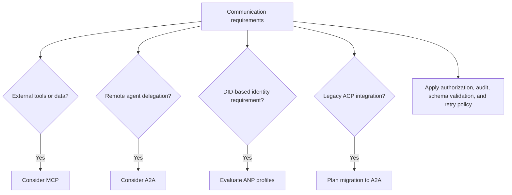

For example, a research assistant might use MCP to query a document store and A2A to delegate a long-running analysis. An internal two-function pipeline might need only typed function calls and a queue. A partner-facing service needs authenticated, authorized delegation; using a DID system is a separate architectural decision.

## Measure Communication Quality

| Metric | Definition | What it reveals |
| --- | --- | --- |
| Contract success rate | Schema-valid responses / responses received | Compatibility, not answer correctness |
| Task completion rate | Successfully completed tasks / submitted tasks over a defined cohort | Execution reliability; track pending tasks separately |
| p50/p95 delegation latency | Time from submission to terminal result, including queues and retries | Typical and tail user experience |
| Duplicate side-effect rate | Repeated effects / logical operations | Whether retry protection actually works |
| Discovery cache hit rate | Cached lookups / total lookups | Discovery overhead and availability tradeoffs |
| Audit coverage | Tasks with required lifecycle/action records / tasks sampled | Observability completeness, not truth of the result |
| Protocol overhead | Coordination bytes, calls, and elapsed time per task | Cost of adding more agents |

Evaluate answer quality separately with task-specific checks. A perfectly delivered wrong answer is still a failure. Compare against a single-agent baseline using the same task set, budgets, and success criteria.

## Exercises

1. **Multi-hop delegation:** add a coordinator that calls two specialists and combines their artifacts. Propagate a shared trace ID and deadline. Test one specialist failing.
2. **Streaming and recovery:** emit task events incrementally. Simulate a dropped connection and resume without duplicating artifacts or work.
3. **Durable deduplication:** replace in-memory request storage with SQLite and a unique constraint. Test concurrent submissions and recovery after a crash.
4. **Identity rotation:** design key rotation, revocation, and cache expiry using a specific identity profile. Explain why accepting an old key indefinitely defeats revocation.
5. **Bounded negotiation:** select from an allowlist of supported schemas, with a maximum of three proposals. Reject unsupported formats without executing generated code.
6. **Rate-limited discovery:** simulate 100 workers and compare lookup counts with and without caching and jitter. Include stale-card handling.

## Quick Cheat Sheet

| Term | Crisp definition | Analogy |
| --- | --- | --- |
| Protocol | Shared rules for message structure, meaning, and interaction | Rules of a conversation |
| Transport | Mechanism carrying messages, such as HTTP | Delivery road |
| Binding | Mapping abstract protocol operations onto a concrete transport/encoding | Address and packaging convention |
| MCP | Protocol for exposing tools and context to clients | Equipment catalog and controls |
| A2A | Protocol for discovering and interacting with remote agents | Specialist directory plus work orders |
| Agent Card | Agent capability, interface, and security description | Business card with service terms |
| Task | Tracked unit of delegated work with a lifecycle | Work order |
| Artifact | Deliverable produced by a task | Completed report |
| SSE | Server-Sent Events: incremental server-to-client events over HTTP | Live status ticker |
| ACP | Historical agent communication protocol now part of A2A | Earlier work-order format |
| DID | Identifier resolved according to a DID method | Identity reference |
| Authentication | Establishing who controls presented credentials | Checking an ID |
| Authorization | Deciding what that identity may do | Checking access permissions |
| Idempotency | Repeating an operation has the same intended effect as performing it once | Resending an order without buying twice |
| Correlation ID | Identifier connecting related messages or events | Case number |
| Audit trail | Recorded actions and outcomes for later inspection | Activity ledger |
| OpenTelemetry (OTel) | Framework for instrumenting, collecting, and exporting telemetry | Operational instruments |
| Meta-protocol | Rules for negotiating which communication rules to use | Agreeing on a language first |

**Memory aid:** *Discover → authorize → delegate → track → validate → record.* A protocol makes messages interoperable; your application makes execution reliable and useful.

## Resource

Adapted from the MIT-licensed lesson; copyright © 2026 Rohit Ghumare. [Original license](../licenses/ai-engineering-from-scratch-LICENSE). Protocol examples are illustrative; the Python exercise is an offline teaching implementation, not a conformant protocol server.

| Field | Details |
| --- | --- |
| Origin | [AI Engineering from Scratch — source lesson](https://github.com/rohitg00/ai-engineering-from-scratch/blob/main/phases/16-multi-agent-and-swarms/03-communication-protocols/docs/en.md) |
| Author | Rohit Ghumare and contributors |
| Level | Intermediate to advanced — repository assessment |
| Best for | Designing agent handoffs, comparing MCP and A2A, understanding discovery and task lifecycles, and building reliable communication contracts |

## References and Attribution

- [Source lesson](https://github.com/rohitg00/ai-engineering-from-scratch/blob/main/phases/16-multi-agent-and-swarms/03-communication-protocols/docs/en.md) — explanatory prose, message examples, and protocol diagrams adapted under the [MIT license](../licenses/ai-engineering-from-scratch-LICENSE), copyright © 2026 Rohit Ghumare.
- [A2A specification](https://a2a-protocol.org/latest/specification/) — normative task, binding, and Agent Card definitions.
- [MCP transport specification, 2025-03-26](https://modelcontextprotocol.io/specification/2025-03-26/basic/transports) — legacy HTTP+SSE replacement and Streamable HTTP behavior.
- [MCP tools specification, 2025-11-25](https://modelcontextprotocol.io/specification/2025-11-25/server/tools) — discovery and invocation.
- [ACP project and migration notice](https://github.com/i-am-bee/acp) — historical protocol and A2A transition.
- [ANP specifications](https://github.com/agent-network-protocol/AgentNetworkProtocol) — versioned identity, discovery, and communication profiles.
- [W3C DID Core](https://www.w3.org/TR/did-core/) — DID concepts and document model.
- [RFC 9180](https://www.rfc-editor.org/rfc/rfc9180) — Hybrid Public Key Encryption (HPKE); algorithm use depends on the selected profile.

Adapted on **2026-10-31**. Source Mermaid diagrams are integrated with the explanations and corrected where needed; the source's site-specific message-bus figure is represented as portable Mermaid. The offline Python example replaces the source's illustrative TypeScript gateway to make lifecycle, duplicate-request, and failure behavior directly testable. It does not claim network interoperability or production security.

Source snapshot SHA-256: `736ef386c6e6899469883d7b0183f2a490374c1c6d5cbc9ab9fa6b4649de562b`.
