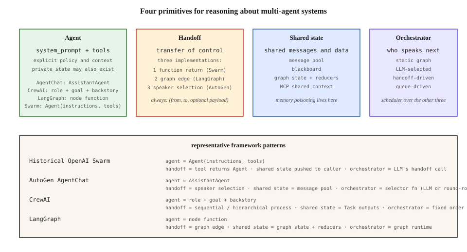

# The Multi-Agent Primitive Model

[Back to courses](../README.md#multi-agent-and-swarms) · [Communication Protocols](2-communication-protocols.md)

## Problem

Multi-agent frameworks expose different APIs for similar coordination problems. Learning each API separately can obscure the design decisions they share.

If you try to learn them one at a time you will burn out. The APIs look different. The docs disagree about what an "agent" is. One framework calls its shared memory a "blackboard," another calls it a "message pool," a third calls it a "StateGraph." You start suspecting the field is just churning.

A useful starting point is to identify four recurring abstractions: the agent, the handoff, shared state, and the orchestrator. This is a design lens, not a claim that every framework has only four features.

## Concept

### The four primitives

1. **Agent** — a component that applies a policy to context and can use tools. Instructions, model configuration, and tool access shape its behavior. In this lesson, runtime memory is passed explicitly.
2. **Handoff** — a structured transfer of control from one agent to another. Mechanically, a tool call that returns a new agent or a graph edge that follows a condition.
3. **Shared state** — any data structure that more than one agent can read (sometimes write). Message pool, blackboard, key-value store, vector memory.
4. **Orchestrator** — whoever decides who speaks next. Options: an explicit graph (deterministic), an LLM speaker-selector (soft), the last speaker's handoff call (OpenAI Swarm), or a scheduler over a queue (swarm architecture).

Frameworks choose defaults for these axes. Persistence, concurrency, isolation, deployment, and recovery semantics still matter; they are not merely syntax.

### Mapping Frameworks to the Primitives

These are representative patterns, not complete feature inventories or performance rankings.

| Framework/pattern | Agent | Handoff or routing | Shared state | Orchestrator |
| --- | --- | --- | --- | --- |
| Historical OpenAI Swarm | Instructions and tools | Tool can return another agent | Caller-managed history/context | Handoff-driven run loop |
| AutoGen AgentChat | Participants such as `AssistantAgent` | Team speaker selection | Participant and team conversation state | Selector or round-robin team |
| CrewAI crews | Role, goal, backstory, tools | Task assignment or delegation | Task outputs and configured context/memory | Sequential process or hierarchical manager |
| LangGraph | Node function; not every node is an agent | Edges, conditional routing, commands | Graph state with update/reducer rules | Graph runtime |

AutoGen AgentChat and AG2 are distinct API lines; do not label them both `ConversableAgent`. Likewise, historical Swarm examples should not be treated as the current Agents SDK API. A graph can have fixed topology while model-driven routing and outputs remain nondeterministic. See [AutoGen selector teams](https://microsoft.github.io/autogen/stable/user-guide/agentchat-user-guide/selector-group-chat.html), [CrewAI processes](https://docs.crewai.com/en/concepts/processes), and [LangGraph workflows](https://docs.langchain.com/oss/python/langgraph/workflows-agents).

### Why this matters

Once you see the primitives, framework comparison becomes a short checklist:

- Does the orchestrator trust the LLM to route (Swarm) or does it pin routing in code (LangGraph)?
- Is shared state full-history (GroupChat) or projected (StateGraph reducer)?
- Which component may change instructions, route work, or write shared data, and which permissions enforce that boundary?

Those questions narrow the design choices before you compare runtime guarantees and operational requirements. You stop shopping for "the best multi-agent framework" and start designing for the axis you actually care about.

### Make State Explicit

For this teaching model, separate agent configuration from runtime state. An agent policy consumes a state snapshot and produces an output; the runtime stores messages and decides what happens next.

Real agents can retain private history, caches, and sessions. Schedulers can retain queues, retries, leases, and progress. Shared state is therefore **not the only stateful component** in a real system. Enumerate all state, who owns it, which readers can access it, and how it survives failures.

**Analogy:** agents are specialists, handoffs are job transfers, shared state is the project folder, and the orchestrator is the dispatcher. Specialists may also have private notebooks. A shared folder does not make every notebook visible or every edit safe.

### Anatomy of a single primitive

#### Agent

```
Agent = (system_prompt, tools, model, optional_name)
```

This tuple describes configuration, not a guarantee of statelessness or identical outputs. Model sampling, private memory, tool permissions, and external data can change behavior. The example below deliberately makes memory explicit for inspection.

#### Handoff

```
Handoff = (from_agent, to_agent, reason, payload)
```

Three implementations dominate:

- **Function return** — the tool returns the next agent. This is the OpenAI Swarm pattern. Agents carry routing in their tool schemas.
- **Graph edge** — LangGraph. Edges are declarative. The LLM produces a value; a condition selects the next node.
- **Speaker selection** — AutoGen GroupChat. A selector function (sometimes itself an LLM call) reads the pool and picks who speaks next.

#### Shared state

```
SharedState = { messages: [], artifacts: {}, context: {} }
```

At minimum, a list of messages. Often more: structured artifacts (CrewAI Task outputs), typed context (LangGraph reducers), external memory (MCP, vector DB).

Two topologies: **full pool** (every agent sees every message) and **projected** (agents see a role-scoped view). Full pools are simple but can expose irrelevant or sensitive context and increase token use. Projected views select only the fields or messages needed for a role; they require schemas and access rules. Projection alone is not an authorization boundary unless enforced.

#### Orchestrator

```
Orchestrator = ({state, last_speaker}) -> next_agent
```

Four flavors:

- **Static** — the execution order is fixed, such as a sequential research → write → review pipeline.
- **LLM-selected** — an LLM reads the pool and picks the next speaker (AutoGen, CrewAI Hierarchical).
- **Handoff-driven** — the current agent decides by calling a handoff tool (Swarm).
- **Queue-driven** — workers pull from a shared queue; no explicit next-speaker (swarm architectures, Matrix).

### What changes between frameworks

Once the primitives are fixed, the remaining design decisions are:

- **Memory strategy** — ephemeral vs durable checkpointing (LangGraph checkpointer).
- **Safety boundary** — who can approve a handoff (human-in-the-loop).
- **Cost accounting** — per-agent token budgets.
- **Observability** — tracing handoffs, persisting state for replay.

Use the four-part model to locate these responsibilities, then evaluate their guarantees directly. A clean abstraction diagram does not prove safe execution or durable recovery.

The four responsibilities appear together in this overview. Follow the columns to identify who performs work, how control moves, where context lives, and who schedules the next step.



The table and diagram are conceptual mappings, not numerical scores of framework quality.


## Build It: Keep the Agents, Swap the Orchestrator

The companion example runs a research → write → review pipeline under three routing strategies. It uses standard-library Python and scripted policies, with no model calls or external tools. The instructions are descriptive metadata here; the policy functions determine behavior.

Copy this block into `primitive_demo.py` and run `python3 primitive_demo.py` with Python 3.10+. A handoff is represented by a target in a message; it is not an A2A request or a separate SDK object.

```python
"""Four multi-agent primitives, stdlib only.

Primitives:
  - Agent(name, system_prompt, policy); tool dispatch omitted
  - Handoff represented by a message target
  - SharedState (locked append/read methods)
  - Orchestrator (Static, Handoff-driven, scripted selector)

Runs the same three-agent pipeline (researcher -> writer -> reviewer) under
three orchestrator types. Agents are scripted policies, not LLM calls -- the
point is the coordination structure.
"""
from __future__ import annotations

import threading
from copy import deepcopy
from dataclasses import dataclass, field
from typing import Callable, Optional


Message = dict


@dataclass
class SharedState:
    messages: list[Message] = field(default_factory=list)
    _lock: threading.Lock = field(default_factory=threading.Lock)

    def append(self, msg: Message) -> None:
        with self._lock:
            self.messages.append(deepcopy(msg))

    def snapshot(self) -> list[Message]:
        with self._lock:
            return deepcopy(self.messages)

    def last_by(self, name: str) -> Optional[Message]:
        with self._lock:
            for m in reversed(self.messages):
                if m["from"] == name:
                    return deepcopy(m)
            return None


@dataclass
class Agent:
    name: str
    system_prompt: str
    policy: Callable[[SharedState], Message]

    def run(self, state: SharedState) -> Message:
        msg = self.policy(state)
        msg["from"] = self.name
        return msg


def researcher_policy(state: SharedState) -> Message:
    n = len([m for m in state.snapshot() if m["from"] == "researcher"])
    notes = f"note {n + 1}: Fictional product Atlas supports CSV exports."
    return {"content": notes, "handoff": "writer" if n == 0 else "done"}


def writer_policy(state: SharedState) -> Message:
    research = [m["content"] for m in state.snapshot() if m["from"] == "researcher"]
    draft = "Draft summarizing: " + " | ".join(research) if research else "Draft with no research yet."
    return {"content": draft, "handoff": "reviewer"}


def reviewer_policy(state: SharedState) -> Message:
    last = state.last_by("writer")
    verdict = "approved" if last and "summarizing" in last["content"] else "needs revision"
    return {"content": f"Review verdict: {verdict}.", "handoff": "done"}


def make_team() -> dict[str, Agent]:
    return {
        "researcher": Agent("researcher", "Gather facts.", researcher_policy),
        "writer": Agent("writer", "Draft from research.", writer_policy),
        "reviewer": Agent("reviewer", "Critique the draft.", reviewer_policy),
    }


class StaticOrchestrator:
    """Fixed sequential execution; ignores policy handoff suggestions."""

    def __init__(self, order: list[str]) -> None:
        self.order = order

    def run(self, team: dict[str, Agent], state: SharedState, max_steps: int = 10) -> None:
        if max_steps < 1:
            raise ValueError("max_steps must be positive")
        for name in self.order[:max_steps]:
            msg = team[name].run(state)
            state.append(msg)
        if len(self.order) > max_steps:
            raise RuntimeError("Step budget exhausted")


class HandoffOrchestrator:
    """OpenAI Swarm-style: the current agent returns its own handoff target."""

    def __init__(self, start: str) -> None:
        self.start = start

    def run(self, team: dict[str, Agent], state: SharedState, max_steps: int = 10) -> None:
        if max_steps < 1:
            raise ValueError("max_steps must be positive")
        current = self.start
        for _ in range(max_steps):
            if current not in team:
                raise ValueError(f"Unknown agent: {current}")
            msg = team[current].run(state)
            state.append(msg)
            nxt = msg.get("handoff", "done")
            if nxt == "done":
                return
            current = nxt
        raise RuntimeError("Step budget exhausted")


class SelectorOrchestrator:
    """AutoGen GroupChat-style speaker selection. The selector function is
    scripted here, but in production it would be an LLM call reading the pool."""

    def __init__(self, start: str, selector: Callable[[SharedState, dict[str, Agent]], Optional[str]]) -> None:
        self.start = start
        self.selector = selector

    def run(self, team: dict[str, Agent], state: SharedState, max_steps: int = 10) -> None:
        if max_steps < 1:
            raise ValueError("max_steps must be positive")
        current: Optional[str] = self.start
        for _ in range(max_steps):
            if current is None:
                return
            if current not in team:
                raise ValueError(f"Unknown agent: {current}")
            msg = team[current].run(state)
            state.append(msg)
            current = self.selector(state, team)
            if current is None:
                return
        raise RuntimeError("Step budget exhausted")


def round_robin_selector(state: SharedState, team: dict[str, Agent]) -> Optional[str]:
    messages = state.snapshot()
    if not messages:
        return None
    last = messages[-1]["from"]
    names = list(team.keys())
    idx = (names.index(last) + 1) % len(names)
    if len([m for m in messages if m["from"] == "reviewer"]) >= 1:
        return None
    return names[idx]


def render_pool(label: str, state: SharedState) -> None:
    print(f"\n=== {label} ===")
    for i, m in enumerate(state.snapshot()):
        ho = f" -> {m['handoff']}" if "handoff" in m else ""
        print(f"  [{i}] {m['from']:10s} | {m['content']}{ho}")


def main() -> None:
    print("Four multi-agent primitives demo")
    print("-" * 42)

    team = make_team()
    state_a = SharedState()
    StaticOrchestrator(["researcher", "writer", "reviewer"]).run(team, state_a)
    render_pool("Static (LangGraph-style)", state_a)

    team = make_team()
    state_b = SharedState()
    HandoffOrchestrator("researcher").run(team, state_b)
    render_pool("Handoff-driven (OpenAI Swarm-style)", state_b)

    team = make_team()
    state_c = SharedState()
    SelectorOrchestrator("researcher", round_robin_selector).run(team, state_c)
    render_pool("Scripted selector (no LLM)", state_c)

    print("\nTakeaway: agents and state are identical across runs;")
    print("only the orchestrator choice changes who speaks when.")


if __name__ == "__main__":
    main()
```

### Read the Result

Each normal run produces three messages: research notes, a draft, and an approval. This is intentional: the same policies take the same path under all three orchestrators. The selector is scripted, not an LLM evaluation. The reviewer only checks a fixture string; its approval does not establish factual quality.

Change the researcher’s `handoff` to `"done"` to expose the difference:

| Routing mode | Who decides the next step? | Effect of early `"done"` |
| --- | --- | --- |
| Static | Fixed order in code | Writer and reviewer still execute |
| Handoff-driven | Current policy’s target | Stops after research |
| Scripted selector | Separate selector function | Continues according to the selector |

The lock protects individual pool operations. Deep copies prevent readers from changing stored messages through returned references. This does **not** make a multi-step read → decide → write sequence atomic, provide durable storage, or authorize access to fields. All agents in this demo receive the same state object.

An unknown routing target raises an error. Exhausting the step budget also raises an error, rather than being reported as successful completion. A production runtime should persist a typed stop reason and support recovery.

## State Design: Full Pool or Scoped View?

| Choice | Benefit | Tradeoff | Example |
| --- | --- | --- | --- |
| Full message pool | Easy to inspect the complete conversation | Larger inputs and broader data exposure | A small brainstorming team |
| Role-scoped view | Focused context and explicit input contracts | Selection logic can omit needed facts | Writer receives approved notes, not raw customer records |
| Shared artifact store | Large outputs can be referenced by ID | Requires versioning and access checks | Reviewer reads draft version 3 |
| Private agent memory | Specialist keeps its own working history | Hidden state can complicate replay | Researcher caches earlier search results |

A **reducer** is a rule for combining a new state update with the existing value. For example, appending messages differs from replacing the whole list. Concurrent writers need conflict rules, such as rejecting stale versions, merging disjoint fields, or serializing updates.

**Example 1:** a researcher and writer both update `status`. Last-write-wins may erase a failure. Store per-agent status and derive the overall run state instead.

**Example 2:** a reviewer approves draft version 2 while the writer saves version 3. Record the approved artifact version, rather than a bare `approved = true` flag.

## Compare Designs Before Comparing Frameworks

For a proposed system, write one sentence for each primitive:

- **Agent:** which policy, tools, inputs, and permissions does each worker have?
- **Handoff:** what is transferred, to whom, and under which routing and approval rules?
- **Shared state:** what is stored, who owns each field, and how are conflicts resolved?
- **Orchestrator:** what schedules work, detects completion, and handles timeouts or retries?

Then verify persistence, isolation, and recovery separately. A new framework release may leave these four mappings unchanged while substantially changing guarantees, so review relevant release notes and migration guidance too.

| Measurement | Definition | Design question |
| --- | --- | --- |
| Task success rate | Successful tasks / evaluated tasks | Does extra coordination improve useful outcomes? |
| Handoffs per task | Number of control transfers | Is routing causing loops or unnecessary delegation? |
| Routing error rate | Invalid or inappropriate routes / routing decisions | Are targets and prerequisites validated? |
| p95 completion latency | 95th percentile end-to-end task duration | Are serial dependencies slowing users down? |
| Context volume | Tokens supplied across all agent/model calls | Does projection reduce repeated context? |
| State conflict rate | Rejected/conflicting writes / attempted writes | Does ownership or concurrency control need improvement? |
| Budget-stop rate | Runs ending at a limit / all runs | Are loops bounded, and are budgets realistic? |

These are proposed evaluation metrics, not benchmark results from the scripted example. Compare alternatives on the same tasks and budgets.

## Exercises

1. Make the researcher stop early. Verify which orchestrators still run the writer and reviewer.
2. Route an agent back to itself. Confirm budget exhaustion is visible and is not marked as success.
3. Add a queue-driven orchestrator. Define termination when the queue is empty but work is still in flight; explain how lost workers are detected.
4. Replace the full pool with scoped snapshots. Prevent the writer from seeing a synthetic secret in research-only context.
5. Add artifact versions and reject approval of a stale draft. Test two competing updates.
6. Map a framework from its documentation using the four questions above. Identify private agent state and scheduler state as well as shared data.

## Quick Cheat Sheet

| Term | Definition | Memory aid |
| --- | --- | --- |
| Primitive | A basic abstraction used to describe a design | Building block |
| Agent | Worker applying a policy to context, optionally with tools | Specialist |
| Handoff | Structured transfer of control and relevant context | Pass the baton |
| Shared state | Data accessible to multiple participants | Project folder |
| Orchestrator | Component selecting and scheduling work | Dispatcher |
| Policy | Rule or model determining an action from inputs | Decision method |
| Message pool | Collection of conversation messages | Shared transcript |
| Projected state | Selected view of a larger state object | Role-specific brief |
| Reducer | Rule merging an update into existing state | Update rule |
| Checkpoint | Saved execution state used for inspection or recovery | Save point |
| Step budget | Maximum allowed execution steps | Loop limit |

**Remember:** *who works, who gets control, what is shared, who schedules.* Explicit state is easier to inspect; it does not mean every component is stateless.

## Resource

| Field | Details |
| --- | --- |
| Origin | [AI Engineering from Scratch — source lesson](https://github.com/rohitg00/ai-engineering-from-scratch/blob/main/phases/16-multi-agent-and-swarms/04-primitive-model/docs/en.md) |
| Author | Rohit Ghumare and contributors |
| Level | Intermediate — repository assessment |
| Best for | Comparing multi-agent architectures, separating routing from worker policies, designing shared state, and explaining framework tradeoffs in interviews |

Adapted from the MIT-licensed lesson, companion Python code, and SVG; copyright © 2026 Rohit Ghumare. [Original license](../licenses/ai-engineering-from-scratch-LICENSE).

- [Companion Python source](https://github.com/rohitg00/ai-engineering-from-scratch/blob/main/phases/16-multi-agent-and-swarms/04-primitive-model/code/main.py)
- [Source diagram](https://github.com/rohitg00/ai-engineering-from-scratch/blob/main/phases/16-multi-agent-and-swarms/04-primitive-model/assets/primitives.svg)
- [AutoGen selector teams](https://microsoft.github.io/autogen/stable/user-guide/agentchat-user-guide/selector-group-chat.html)
- [LangGraph workflows and agents](https://docs.langchain.com/oss/python/langgraph/workflows-agents)
- [CrewAI processes](https://docs.crewai.com/en/concepts/processes)

Adapted on **2026-10-31**. Source explanations and the companion diagram are retained with corrections to absolute statelessness claims and framework mappings. The site-specific `a5-primitive-radar` marker is replaced by the lesson’s companion SVG, adapted to match those corrections. The Python example adds copied snapshots, explicit invalid-route failures, and step-budget errors. It is an offline coordination demonstration; no framework SDK or live model benchmark is exercised.

Source Markdown SHA-256: `3b17765b0944dce19879fea690146703bead63f48a52d2d7d4c5667ac84b166f`.
