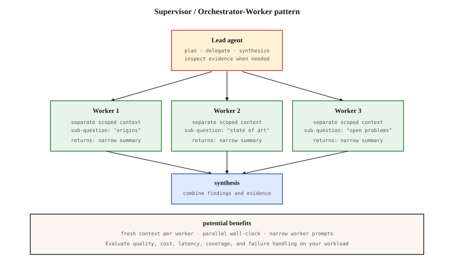

# Supervisor / Orchestrator-Worker Pattern

[Back to courses](../README.md#multi-agent-and-swarms) · [Primitive Model](3-primitive-model.md)

## The Problem

A broad research question may require several independent investigations. One agent can handle many such tasks, including parallel tool calls, but a long shared history may crowd out useful evidence. A supervisor can assign narrower investigations to workers, then combine their findings.

**Analogy:** an editor commissions three reporters, gives each a clear topic and deadline, and assembles their reports into one article. The editor must check sources, identify gaps, and resolve disagreements; adding reporters does not automatically improve the article.

## Concept

### The pattern

The lead decomposes a request, assigns scoped work, collects artifacts, and synthesizes an answer. Workers can have separate contexts and tool permissions. A lead may inspect original sources when needed; summaries are a context-management choice, not a prohibition on verification.



Each outward arrow carries a task contract. Each return arrow carries findings, evidence, status, and limitations. Workers need not share their entire histories with the lead or with each other.

### Why It Can Help

Three mechanisms:

1. **Fresh context per subagent.** A worker exploring "FIPA-ACL heritage" does not carry the 40k tokens the lead spent planning. It receives a scoped context whose size depends on the model and application budget.
2. **Specialization via prompt.** The lead's prompt is "decompose and synthesize," not "research." Each worker's prompt is narrow: "find what changed in X." Focused prompts produce focused outputs.
3. **Parallelism.** Workers run concurrently. With independent tasks and enough concurrency, latency is approximately `plan + max(worker_times) + synthesis + coordination`. Sequential execution instead includes the sum of worker times. Rate limits, retries, and dependencies reduce the benefit.

### Evidence and Its Limits

In its June 2025 report, Anthropic described a lead-and-worker research system outperforming a single Opus 4 agent by **90.2% on an internal research evaluation**. Its BrowseComp analysis attributed **80% of performance variance to token usage**, with model choice and tool calls also relevant. These are results for that setup, not universal gains or proof that fresh contexts alone caused the improvement. The reported **15× token usage was relative to chats**, not single-agent systems. See [Anthropic’s research-system report](https://www.anthropic.com/research/multi-agent-research-system).

Practical design lessons are to scale effort to task complexity, keep worker scopes explicit, and evaluate quality together with latency and cost. Treat agent counts and token limits as measured workload settings rather than universal thresholds.

### The graph-native turn

The [`langgraph-supervisor` repository](https://github.com/langchain-ai/langgraph-supervisor-py) recommends implementing supervisors through tools for most use cases to gain control over context engineering. It was archived on September 20, 2026. Treat the helper as historical reference and check supported migration paths before adopting it.

A worker-as-tool design gives the supervisor a narrow interface: invoke a specialist with defined inputs and receive a compact result. The runtime still needs budgets, authorization, persistence, and error handling.

### The failure modes

- **Lead hallucinates the plan.** If the lead generates sub-questions that do not decompose the real question, workers do precise research on the wrong target.
- **Workers over-explore.** Without explicit scope boundaries, workers drift beyond their assigned sub-question and pollute the synthesis step.
- **Synthesis conflicts.** Two workers return contradictory facts. The lead must either re-ask (add a round) or note the disagreement explicitly. Silent picking of one side is the worst failure: the user never knows disagreement happened.

### When supervisor is wrong

- **Sequential tasks.** If step 2 literally needs step 1's output, parallelism buys nothing. Use a pipeline (CrewAI Sequential, LangGraph linear graph).
- **Simple queries.** Single-agent handles them faster and cheaper. Use the lead's "scale effort" check before spawning workers.
- **Fixed execution requirements.** A model-selected plan introduces variability. Use code-defined routing when the order is prescribed. Static routing helps inspection but does not make model outputs or external side effects deterministic.


## Define the Worker Contract

A **task contract** specifies what a worker should do and what it must return. A **synthesis** combines results into an answer while retaining evidence and uncertainty.

| Input | Purpose | Example |
| --- | --- | --- |
| Task ID and question | Correlate a result with the plan | `pricing`: compare fictional product tiers |
| Scope and exclusions | Prevent duplicate or irrelevant work | Include public prices; exclude negotiated contracts |
| Allowed tools and data | Enforce least privilege | Read-only product documentation |
| Deadline and budget | Bound time and resource consumption | Application-selected timeout and tool-call cap |
| Output schema | Make synthesis predictable | Findings, citations, status, limitations |

Worker outputs should distinguish `completed`, `failed`, and `timed_out`. An empty result is not evidence that nothing exists. Keep source identifiers alongside claims so the lead can verify them.

**Example 1:** market research can delegate pricing, integrations, and deployment options independently, then report missing evidence if one worker fails.

**Example 2:** incident diagnosis can delegate log analysis and recent-deployment inspection. Remediation may require both results and explicit approval, so parallel research does not imply parallel production changes.

## Build It: Parallel Workers with Explicit Outcomes

The upstream companion uses threads and simulated fetches. This adaptation uses a bounded thread pool, a shared monotonic deadline, and cooperative cancellation. It runs entirely offline using synthetic findings; no SDK, network access, or model is involved.

Save the block as `supervisor_demo.py` and run `python3 supervisor_demo.py` with Python 3.10+.

```python
from concurrent.futures import ThreadPoolExecutor
from dataclasses import dataclass
from threading import Event
from time import monotonic


@dataclass(frozen=True)
class Task:
    id: str
    question: str
    delay: float = 0.03
    fail: bool = False


@dataclass(frozen=True)
class Result:
    task_id: str
    status: str
    finding: str = ""
    source: str = ""
    detail: str = ""


def worker(task, deadline, stop):
    # Simulated I/O checks cancellation and the remaining time budget.
    finish = monotonic() + task.delay
    while monotonic() < finish:
        remaining = deadline - monotonic()
        if stop.is_set() or remaining <= 0:
            return Result(task.id, "timed_out", detail="Deadline reached")
        stop.wait(min(0.005, remaining, max(0, finish - monotonic())))
    if stop.is_set() or monotonic() >= deadline:
        return Result(task.id, "timed_out", detail="Deadline reached")
    if task.fail:
        raise RuntimeError("Synthetic retrieval failure")
    return Result(task.id, "completed", f"Fixture finding: {task.question}",
                  f"fixture://{task.id}")


class Lead:
    def plan(self, query):
        if not query.strip():
            raise ValueError("A query is required")
        return [Task("pricing", f"{query}: pricing"),
                Task("integrations", f"{query}: integrations"),
                Task("deployment", f"{query}: deployment")]

    def run(self, tasks, max_workers=3, timeout=1.0):
        if not tasks or max_workers < 1 or timeout <= 0:
            raise ValueError("Tasks and positive execution limits are required")
        if len({t.id for t in tasks}) != len(tasks):
            raise ValueError("Task IDs must be unique")
        if any(t.delay < 0 for t in tasks):
            raise ValueError("Delays must be nonnegative")
        start = monotonic()
        deadline = start + timeout
        stop = Event()
        results = []
        with ThreadPoolExecutor(max_workers=max_workers) as pool:
            futures = [pool.submit(worker, task, deadline, stop) for task in tasks]
            # Stable plan order makes synthesis reproducible for these fixtures.
            # Workers enforce the deadline themselves; this is not a hard kill.
            for task, future in zip(tasks, futures):
                try:
                    result = future.result()
                except Exception as exc:
                    result = Result(task.id, "failed", detail=type(exc).__name__)
                results.append(result)
            stop.set()
        completed = sum(r.status == "completed" for r in results)
        return results, {"seconds": monotonic() - start,
                         "completed": completed, "requested": len(tasks)}

    def synthesize(self, results):
        lines = []
        for result in results:
            if result.status == "completed":
                lines.append(f"- {result.finding} [{result.source}]")
            else:
                lines.append(f"- GAP: {result.task_id}: {result.status} ({result.detail})")
        return "\n".join(lines)


if __name__ == "__main__":
    lead = Lead()
    tasks = lead.plan("Compare fictional Atlas plans")
    serial, serial_stats = lead.run(tasks, max_workers=1)
    parallel, parallel_stats = lead.run(tasks, max_workers=3)
    assert serial == parallel
    print(lead.synthesize(parallel))
    print("Sequential:", serial_stats)
    print("Parallel:", parallel_stats)
    partial, _ = lead.run([
        Task("ok", "available evidence", delay=0),
        Task("broken", "unavailable evidence", delay=0, fail=True),
        Task("slow", "delayed evidence", delay=0.2),
    ], timeout=0.05)
    assert [r.status for r in partial] == ["completed", "failed", "timed_out"]
    print("\nPartial result:\n" + lead.synthesize(partial))
```

Normal execution produces three synthetic findings. The failure case explicitly shows one completed result, one failure, and one timeout. The three 30 ms waits often take around 90 ms sequentially and 30 ms concurrently, plus overhead; these are illustrative timings, not performance guarantees. Threads help this simulated waiting workload, not necessarily CPU-bound Python computation.

The deadline is **cooperative**: the fixture checks it frequently. `future.cancel()` cannot terminate an already running thread, and leaving the executor waits for running work. Real blocking tools need their own request timeouts and cancellation support. Use process isolation when enforceable termination is required, and account for external effects that may already have happened.

## Synthesis, Conflicts, and Missing Evidence

| Worker outcome | Lead action | Avoid |
| --- | --- | --- |
| Consistent, cited findings | Combine them and retain provenance | Dropping source references |
| Conflicting values | Compare scope, date, and sources; investigate or report disagreement | Silently choosing the convenient answer |
| Failed or timed-out worker | Mark a gap or retry within the remaining budget | Presenting a partial result as complete |
| Off-topic result | Reject or narrow the assignment | Adding irrelevant content to synthesis |
| Unsupported claim | Request evidence or qualify the answer | Treating fluency as verification |

A structured conflict check can detect unequal values for the same entity, field, and effective date. It cannot establish arbitrary natural-language contradictions. For example, “$20 monthly” and “$200 annually” may describe different billing periods rather than conflicting prices.

## Production Design Choices

- **Effort allocation:** start with a small plan and expand only when evidence gaps justify the cost. Enforce worker, tool-call, token, and elapsed-time limits in code.
- **Model selection:** benchmark lead planning and worker tasks separately. More expensive models are not automatically better for every role.
- **Concurrency:** limit simultaneous calls to respect provider quotas and downstream capacity. Include queue time in deadline accounting.
- **Recovery:** persist the plan, task IDs, artifact versions, and stop reasons. Make retries idempotent when tools can change external state.
- **Observability:** trace delegation and worker actions; record latency, usage, errors, and synthesis gaps. Do not require private chain-of-thought.
- **Rollouts:** version prompts, models, schemas, and tool adapters. Allow old runs to drain or migrate them deliberately. “Rainbow deployment” describes overlapping versions while existing work finishes; blue-green deployments can also support draining when designed for it.

## Evaluate the Whole Workflow

| Metric | Calculation or definition | Interpretation |
| --- | --- | --- |
| End-to-end success | Successful answers / evaluated queries | Compare with a single-agent baseline |
| Evidence coverage | Required sub-questions with adequate evidence / required sub-questions | Distinguish completion from useful findings |
| Worker failure rate | Failed and timed-out tasks / launched tasks | Diagnose reliability and budget fit |
| Speedup | Sequential latency / parallel latency for comparable work | Include planning, queues, and synthesis |
| Cost per successful query | Total evaluated cost / successful queries | Include failed attempts and lead overhead |
| Duplication | Repeated investigations or retrieved sources across workers | Detect poor decomposition |
| Conflict handling | Correctly surfaced/resolved conflicts / labeled conflicts | Evaluate synthesis rather than only worker quality |

A simple cost model is `lead planning + sum(worker costs) + synthesis + retries`. Parallelism reduces elapsed time under suitable conditions; it does not automatically reduce total tokens or billed work.

## Exercises

1. Increase the task count while keeping `max_workers` fixed. Observe execution waves and queue time.
2. Introduce a slow or failing worker. Verify that the final answer exposes the missing coverage.
3. Add structured claims with entity, field, date, and value. Detect conflicting values without guessing which is correct.
4. Implement a bounded retry for transient failures and record both attempts under the same logical task ID.
5. Replace a fixture with a real read-only tool. Add a tool-level timeout and explicit result validation before introducing an LLM planner.
6. Design a versioned rollout for a run that takes an hour. Explain how old workers and new result schemas coexist.

## Quick Cheat Sheet

| Term | Definition | Memory aid |
| --- | --- | --- |
| Supervisor | Coordinator that plans, delegates, and combines results; may also do work | Editor |
| Worker | Specialist executing a scoped assignment | Reporter |
| Fan-out / fan-in | Dispatch work to multiple workers, then gather results | Split, then collect |
| Fresh context | Worker context assembled for its assignment | Focused brief |
| Task contract | Explicit inputs, scope, permissions, budget, and output requirements | Assignment sheet |
| Synthesis | Combining evidence while retaining uncertainty and provenance | Final article |
| Cooperative cancellation | Worker checks and honors a stop request | Asked to stop |
| Deadline | Time after which work is no longer allowed or useful | Due time |
| Idempotent retry | Repeating a logical operation does not duplicate its intended effect | Retry without double action |
| Rainbow rollout | Coexisting versions while earlier runs drain | Finish on the version you started |

**Remember:** *plan → scope → delegate → collect → verify → synthesize*. Parallel workers are useful when work is separable and the added value exceeds coordination cost.

## Resource

| Field | Details |
| --- | --- |
| Origin | [AI Engineering from Scratch — source lesson](https://github.com/rohitg00/ai-engineering-from-scratch/blob/main/phases/16-multi-agent-and-swarms/05-supervisor-orchestrator-pattern/docs/en.md) |
| Author | Rohit Ghumare and contributors |
| Level | Intermediate — repository assessment |
| Best for | Designing supervisor-worker systems, evaluating parallel research, managing partial failures, and explaining coordination tradeoffs in interviews |

Adapted from the MIT-licensed lesson and companion diagram; copyright © 2026 Rohit Ghumare. [Original license](../licenses/ai-engineering-from-scratch-LICENSE).

- [Source companion code](https://github.com/rohitg00/ai-engineering-from-scratch/blob/main/phases/16-multi-agent-and-swarms/05-supervisor-orchestrator-pattern/code/main.py) — basis for the offline parallel-worker teaching example.
- [Source SVG](https://github.com/rohitg00/ai-engineering-from-scratch/blob/main/phases/16-multi-agent-and-swarms/05-supervisor-orchestrator-pattern/assets/supervisor.svg) — hierarchy diagram, adapted with model-neutral labels and qualified claims.
- [Anthropic research-system report](https://www.anthropic.com/research/multi-agent-research-system) — historical evaluation and engineering context.
- [LangGraph supervisor repository](https://github.com/langchain-ai/langgraph-supervisor-py) — archive status and tool-based supervisor recommendation.

Adapted on **2026-10-31**. Preserves the source’s delegation, separate-context, parallelism, synthesis, failure-mode, and deployment themes. Replaces the site-only figure marker and duplicate text sketch with the companion SVG. Corrects the token-cost baseline, universal single-agent limitations, and thread-termination claims. The offline example demonstrates deterministic fixtures and cooperative deadlines, not a live-model benchmark or production runtime.

Source Markdown SHA-256: `f21e9026c0cf79b00c0027cf0391ff2dc2b760ec28a4a7989f46d5fc4d37ef50`.
