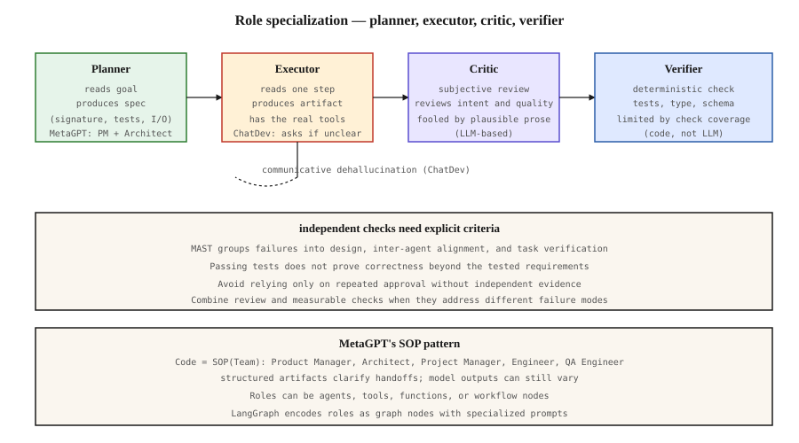
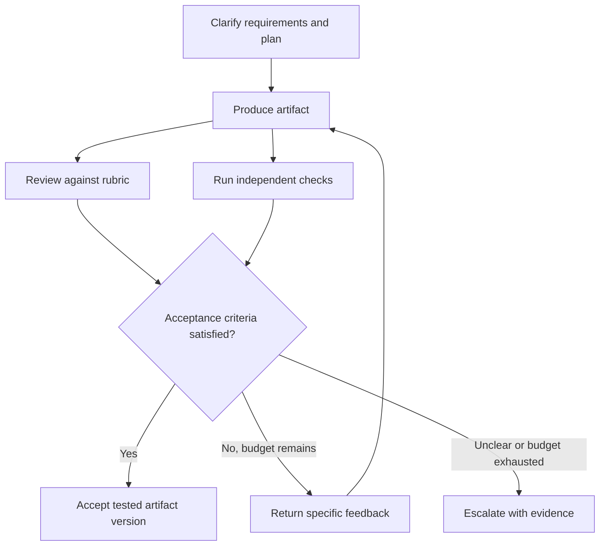

# Role Specialization — Planner, Critic, Executor, Verifier

[Back to courses](../README.md#multi-agent-and-swarms) · [Supervisor Pattern](4-supervisor-orchestrator-pattern.md)

## Problem

Several agents with similar instructions, tools, and context may repeat the same mistakes. More agents and discussion rounds do not guarantee better results.

Role specialization gives participants distinct responsibilities, evidence, and permissions. Assign distinct roles. Give the critic tools the planner does not have. Give the verifier an objective test suite. This creates opportunities for independent checks and actionable correction. Different role names alone do not establish independence.

**Analogy:** a building project has an architect, a builder, a design reviewer, and an inspector. The reviewer can question whether the design meets the owner’s needs; the inspector checks measurable requirements. A passed inspection only covers what was inspected.

## Concept

### Four Useful Roles

**Planner.** Reads the goal, produces a step list or a spec. Tools: knowledge retrieval, docs. Output: structured plan.

**Executor.** Reads one plan step at a time, produces the artifact. Tools: the actual work tools (code compiler, shell, API client). Output: the artifact.

**Critic.** Reads the executor's output against the planner's intent. Tools: read-only access to the artifact, static analysis. Output: accept/reject with reasons.

**Verifier.** Reads the artifact and runs a deterministic check. Tools: test runner, type checker, schema validator. Output: pass/fail with evidence.

Critic is subjective, opinionated, often LLM-based. A verifier checks explicit criteria, often with deterministic code. Its reliability depends on the specification, checks, and execution environment. They are not the same role.

### MetaGPT's SOP pattern

MetaGPT (arXiv:2308.00352) encodes software engineering SOPs as role prompts:

- **Product Manager** writes the PRD.
- **Architect** produces the system design.
- **Project Manager** splits tasks.
- **Engineer** implements.
- **QA Engineer** runs tests.

An **SOP (standard operating procedure)** defines responsibilities, expected artifacts, and handoff rules. MetaGPT encodes such procedures into prompt sequences. Structured intermediate outputs support coordination, but do not make model-generated work deterministic or correct. See the [MetaGPT paper](https://arxiv.org/abs/2308.00352).

### ChatDev's communicative dehallucination

ChatDev adds a key move: when an executor needs a specific detail that was not in the plan, it explicitly asks the designer before continuing. This reduces pressure to invent missing requirements; it does not eliminate hallucination. See the [ChatDev paper](https://arxiv.org/abs/2307.07924).

Implementation: the role prompt includes "when you need specific information you were not given, ask the relevant role by name before producing output."

### Why Verification Matters

The [MAST study](https://arxiv.org/abs/2503.13657) describes 14 failure modes in three groups: system design, inter-agent misalignment, and task verification. Its dataset contains more than 1,600 annotated traces. It does **not** establish that every multi-agent failure is a verification failure or that adding a verifier fixes every category.

Verification is valuable when acceptance criteria can be tested independently. A schema validator checks structure, a type checker checks specified type constraints, and a test suite checks selected behaviors. All can miss defects outside their coverage or validate the wrong requirements.

### Critic vs verifier

- A critic reviews an artifact against a rubric, often using an LLM. It can identify requirement gaps and design problems as well as subjective quality issues, but can accept persuasive wrong answers.
- A verifier evaluates explicit acceptance criteria and returns evidence. Deterministic checks are reproducible under controlled conditions, but incorrect tests, incomplete coverage, and environment problems can produce misleading results.

Combine complementary checks where useful. For a marketing draft, a critic may assess tone while code checks required fields and length. For a financial calculation, code can verify arithmetic while a reviewer checks whether the business assumptions are appropriate.

### The anti-pattern

Every role in your system is an LLM and every role's output is "looks good to me." Repeated agreement can share the same blind spots. Add independent, evidence-based checks for requirements that are mechanically testable; use calibrated human or rubric-based evaluation for the rest.

### Implement Roles as Contracts

Roles can be separate agents, functions, tools, or workflow nodes. You do not need four model calls just to represent four responsibilities. A deterministic schema check may be a small function, while a specialist critic may require a model and retrieved evidence.

The following diagram shows the responsibilities and handoffs. Review and verification can run in either order—or concurrently—when their inputs are ready.



| Role | Input | Output | Permission boundary |
| --- | --- | --- | --- |
| Planner | Goal and clarified constraints | Versioned specification and acceptance criteria | Read requirements; propose a plan |
| Executor | Approved specification and permitted tools | Candidate artifact with version/hash | Write only authorized artifacts |
| Critic | Specification, artifact, and review rubric | Findings with severity and suggested changes | Read artifact; request revision |
| Verifier | Artifact and independently maintained checks | Pass, fail, or inconclusive with evidence | Run bounded checks; cannot rewrite the tested artifact |

Attach results to the exact artifact version tested. If the executor changes the artifact afterward, rerun the relevant checks. A prompt saying “read-only” is not an access-control mechanism; enforce tool permissions in the runtime.

## Build It: Plausible Output Versus Checked Behavior

The source’s example contrasts correct addition with plausible multiplication code. This version keeps that distinction but never executes generated Python. It parses a tiny arithmetic expression and permits only `a + b` or `a * b`. This is a deliberately restricted evaluator, not a sandbox for general code.

Save the block as `role_demo.py` and run `python3 role_demo.py` with Python 3.10+. The planner and critic are scripted fixtures, not LLMs. Test cases are fixed independently of the executor.

```python
import ast
import hashlib
from dataclasses import dataclass


@dataclass(frozen=True)
class Spec:
    operation: str
    tests: tuple


@dataclass(frozen=True)
class Artifact:
    expression: str
    explanation: str

    @property
    def digest(self):
        payload = repr((self.expression, self.explanation)).encode()
        return hashlib.sha256(payload).hexdigest()


@dataclass(frozen=True)
class Report:
    status: str
    artifact_digest: str
    evidence: tuple


def planner(operation):
    if operation != "sum_two_integers":
        raise ValueError("Clarify the requested operation before execution")
    return Spec(operation, (((1, 2), 3), ((10, 20), 30),
                            ((-5, 5), 0), ((0, 7), 7)))


def executor(buggy=False, explanation="Return the sum of two integers."):
    return Artifact("a * b" if buggy else "a + b", explanation)


def critic(spec, artifact):
    # Deliberately weak surface review: demonstrates a blind spot.
    issues = []
    if "sum" not in artifact.explanation.lower():
        issues.append("Explain how this meets the addition requirement")
    if not all(name in artifact.expression for name in ("a", "b")):
        issues.append("Both inputs should be represented")
    return Report("fail" if issues else "pass", artifact.digest, tuple(issues))


def restricted_evaluate(expression, a, b):
    if len(expression) > 40:
        raise ValueError("Expression too long")
    node = ast.parse(expression, mode="eval").body
    valid = (isinstance(node, ast.BinOp)
             and isinstance(node.left, ast.Name) and node.left.id == "a"
             and isinstance(node.right, ast.Name) and node.right.id == "b"
             and type(node.op) in (ast.Add, ast.Mult))
    if not valid:
        raise ValueError("Only a + b or a * b is supported")
    return a + b if isinstance(node.op, ast.Add) else a * b


def verifier(spec, artifact):
    if not spec.tests:
        return Report("inconclusive", artifact.digest, ("No test cases",))
    failures = []
    for (a, b), expected in spec.tests:
        try:
            actual = restricted_evaluate(artifact.expression, a, b)
        except (ValueError, SyntaxError) as exc:
            failures.append(f"Rejected expression: {type(exc).__name__}")
            break
        if actual != expected:
            failures.append(f"Inputs {(a, b)}: expected {expected}, got {actual}")
    return Report("fail" if failures else "pass", artifact.digest,
                  tuple(failures) or (f"Passed {len(spec.tests)} cases",))


def accepted(artifact, *reports):
    return bool(reports) and all(
        report.status == "pass" and report.artifact_digest == artifact.digest
        for report in reports)


if __name__ == "__main__":
    spec = planner("sum_two_integers")
    for label, artifact in [
        ("correct", executor()),
        ("plausible bug", executor(buggy=True)),
        ("missing explanation", executor(explanation="Calculation.")),
    ]:
        review, checks = critic(spec, artifact), verifier(spec, artifact)
        print(label, "critic:", review.status, "verifier:", checks.status,
              "accepted:", accepted(artifact, review, checks))
        print("Evidence:", checks.evidence)
    correct, buggy = executor(), executor(buggy=True)
    assert critic(spec, buggy).status == "pass"
    assert verifier(spec, buggy).status == "fail"
    assert verifier(spec, correct).status == "pass"
    assert not accepted(buggy, verifier(spec, correct))  # Stale artifact report.
    assert verifier(Spec(spec.operation, ()), correct).status == "inconclusive"
    for expression in ("__import__('os')", "a / b", "a + b + 1"):
        assert verifier(spec, Artifact(expression, "sum")).status == "fail"
```

Expected status summary:

| Candidate | Critic | Verifier | Accepted? |
| --- | --- | --- | --- |
| Correct addition and explanation | Pass | Pass | Yes, under this toy rubric |
| Multiplication described as addition | Pass | Fail | No |
| Correct addition without the required explanation | Fail | Pass | No |

The example shows that different checks can disagree for useful reasons. It does not measure LLM critic accuracy. In real code-generation systems, `exec(code, {})` is **not** a security sandbox: executing generated code requires an appropriately isolated environment, resource limits, and controlled network/filesystem access.

## Add a Bounded Revision Loop

A **revision loop** sends actionable feedback to the executor and checks the revised artifact. Every iteration should retain the specification version, artifact identity, failed criteria, and stop reason.



Choose a revision budget based on measured benefit and cost; two rounds may be a useful experiment, not a universal limit. Avoid loops that merely rephrase feedback. If requirements are ambiguous, return to clarification instead of repeatedly editing the artifact.

Run cheap checks early when they can reject invalid output quickly. A schema check may cost less than an LLM critic call; an expensive integration test may come later. The source’s critic-before-verifier sequence is one option, not a requirement.

## Common Failure Modes

| Failure | Example | Response |
| --- | --- | --- |
| Shared misconception | Planner and verifier assume the same wrong tax rule | Validate requirements against an independent source |
| Weak test coverage | Addition tested only with `(2, 2)`, where multiplication also returns 4 | Include discriminating and boundary cases |
| Review without evidence | Critic says “looks good” with no rubric references | Require specific findings and evidence |
| Missing verification | Empty test suite treated as passing | Report inconclusive and block acceptance when required checks are absent |
| Stale approval | Code changes after tests pass | Bind results to the tested artifact version or hash |
| Excessive permissions | Reviewer can modify the artifact it approves | Enforce separate read/write permissions |
| Evaluation leakage | Executor sees every held-out case | Separate development feedback from final evaluation cases |
| Unbounded revision | Roles exchange feedback indefinitely | Enforce time, cost, and round limits with escalation |

## Measure Whether Specialization Helps

Use the same task set and budget to compare executor-only, executor-plus-critic, executor-plus-verifier, and combined designs. This comparison is an **ablation**: remove components to estimate their contribution.

| Metric | Definition | What it reveals |
| --- | --- | --- |
| Final task success | Correct accepted outputs / all evaluated tasks | End-to-end usefulness |
| Defect detection recall | Known defective artifacts rejected / all known defective artifacts | Missed defects |
| False rejection rate | Known valid artifacts rejected / all known valid artifacts | Unnecessary rework |
| Escaped defect rate | Defective accepted outputs / all accepted outputs | Risk among delivered results |
| Repair success | Failed artifacts corrected and accepted / failed artifacts sent for revision | Value of feedback |
| Inconclusive rate | Artifacts lacking a decisive result / evaluated artifacts | Missing tests or environment limitations |
| Cost per correct output | Total cost, including retries / correct outputs | Whether the extra roles justify their expense |

Label the source of correctness judgments. A verifier cannot evaluate its own reliability using only its own pass/fail results. Use independent labels, held-out tests, or expert review where appropriate, and report sample counts alongside rates.

## Exercises

1. Replace the test set with only `(2, 2) → 4`. Observe the multiplication bug passing, then add a discriminating case.
2. Add tests for zero, negative inputs, and very large integers. Explain which properties remain untested.
3. Add a requirements-analyst role. List clarification questions for “add two values” when types, units, and missing-value behavior are unspecified.
4. Add one revision attempt driven by verifier evidence. Confirm that the second artifact receives new reports.
5. Design a critic and verifier for a research summary: distinguish citation presence, citation support, and factual correctness.
6. Find a task with subjective success criteria. Explain which constraints can still be checked mechanically and which require human or rubric-based judgment.

## Quick Cheat Sheet

| Term | Definition | Memory aid |
| --- | --- | --- |
| Role specialization | Distinct responsibilities, context, tools, and output contracts | Different jobs, not just names |
| Planner | Converts requirements into a specification or steps | Define the work |
| Executor | Produces the requested artifact using authorized tools | Do the work |
| Critic | Reviews intent, design, and quality against a rubric | Question the work |
| Verifier | Checks explicit criteria and reports supporting evidence | Test the work |
| SOP | Standard operating procedure governing responsibilities and handoffs | Agreed process |
| Communicative dehallucination | Clarification-oriented interaction to reduce unsupported assumptions | Ask before inventing |
| Test oracle | Rule or reference determining the expected result | What counts as correct? |
| Verification gap | Missing or inadequate checking of an outcome | Unchecked requirement |
| Inconclusive | Evidence is insufficient to decide pass or fail | Not yet verified |
| Ablation | Comparison with a component removed | Measure its contribution |

**Remember:** *plan, produce, review, check*. A role label is not a guarantee of independence, and a passing check is only as meaningful as its criteria.

## Resource

| Field | Details |
| --- | --- |
| Origin | [AI Engineering from Scratch — source lesson](https://github.com/rohitg00/ai-engineering-from-scratch/blob/main/phases/16-multi-agent-and-swarms/08-role-specialization/docs/en.md) |
| Author | Rohit Ghumare and contributors |
| Level | Intermediate — repository assessment |
| Best for | Designing role contracts, distinguishing criticism from verification, building bounded feedback loops, and evaluating multi-agent quality improvements |

Adapted from the MIT-licensed lesson and companion SVG; copyright © 2026 Rohit Ghumare. [Original license](../licenses/ai-engineering-from-scratch-LICENSE).

- [Companion code](https://github.com/rohitg00/ai-engineering-from-scratch/blob/main/phases/16-multi-agent-and-swarms/08-role-specialization/code/main.py) — source planner/executor/critic/verifier demonstration.
- [Source diagram](https://github.com/rohitg00/ai-engineering-from-scratch/blob/main/phases/16-multi-agent-and-swarms/08-role-specialization/assets/roles.svg) — adapted role overview.
- [MetaGPT paper](https://arxiv.org/abs/2308.00352) — SOP-based role coordination.
- [ChatDev paper](https://arxiv.org/abs/2307.07924) — chat chains and communicative dehallucination.
- [MAST paper](https://arxiv.org/abs/2503.13657) — multi-agent failure taxonomy and annotated traces.

Adapted on **2026-10-31**. Preserves the source’s role definitions, research examples, review/check distinction, and exercise themes. Replaces the site-only figure marker with the companion SVG and corrects its absolute claims. Omits the unsupported attribution of all failures to verification and the unverified PwC accuracy anecdote. The offline example uses a restricted arithmetic evaluator instead of presenting `exec` as a sandbox; no framework SDK or live LLM was evaluated.

Source Markdown SHA-256: `50c791bf5867a18c6d0621942fe7fc2e62f417bfa9c71b523f05ee9b2310273a`.
