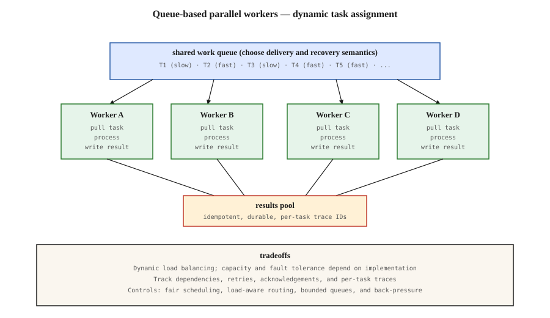

# Parallel / Swarm / Networked Architectures

[Back to courses](../README.md#multi-agent-and-swarms) · [Supervisor Pattern](4-supervisor-orchestrator-pattern.md) · [Role Specialization](5-role-specialization.md)

## Problem

A supervisor can become a bottleneck if every small task requires another planning or dispatch decision. Whether this happens depends on the workload, implementation, and available capacity; there is no fixed maximum worker count.

For many independent tasks, workers can claim jobs from a shared queue as they become available. Scheduling moves into the queue and worker runtime. Coordination still exists: someone must define tasks, handle dependencies, store outcomes, and decide when the work is complete.

**Analogy:** customers join one checkout line and go to the next free cashier. This can reduce imbalance compared with choosing a cashier in advance. It does not guarantee equal customer counts, and a customer with a huge cart can still finish last.

## Concept

### The shape

A queue-based worker pool is one architecture often described as a swarm. Workers repeat: claim a task, process it, record the outcome, then claim another.



A supervisor can also produce tasks for this queue and synthesize the results. Central planning and distributed execution are compatible.

### When swarm fits

- **Many independent tasks.** Scraping, transforming, classifying. Tasks do not depend on each other.
- **Variable-duration work.** If some tasks take 100ms and others take 10s, a swarm balances load automatically — fast workers pull next jobs. A supervisor can use the same dynamic scheduling technique rather than preassigning work.
- **Flexible completion order.** You can collect results by task ID rather than requiring tasks to finish in submission order.

### Where Extra Coordination Is Needed

- **Ordered workflows.** If step 3 needs step 2's output, a naive queue may release work too early. Track dependencies and enqueue a task only when prerequisites are satisfied.
- **Global-plan tasks.** Complex research questions benefit from a planner. Independent worker outputs still need planning, evidence reconciliation, and synthesis.
- **Debugging.** Concurrent execution complicates replay. Centralized telemetry is still possible; correlate events with task, attempt, and trace IDs.

### Matrix: Message-Based Agent Workflows

[Matrix: Peer-to-Peer Multi-Agent Synthetic Data Generation Framework](https://arxiv.org/abs/2511.21686) represents control and data flow as serialized messages across distributed queues. Its Ray-based design separates lightweight agent coordination from compute-heavy services. The paper reports 2–15× higher data-generation throughput in its evaluated scenarios under identical hardware resources. This is workload-specific evidence, not a general swarm speedup guarantee.

Removing a central orchestrator does not remove storage, queue, inference-service, or scheduling limits. Durability alone does not provide complete fault tolerance: recovery also needs acknowledgement rules, retries, deduplication, and safe handling of partial side effects.

### “Swarm” Does Not Always Mean a Shared Queue

The [LangGraph Swarm library](https://github.com/langchain-ai/langgraph-swarm-py) describes agents handing control to one another based on expertise, with shared context and active-agent tracking. That handoff model is different from this lesson’s competing workers pulling independent jobs. Check the actual scheduling semantics instead of relying on the pattern name.

| Pattern | How work moves | Important distinction |
| --- | --- | --- |
| Shared work queue | Available worker claims the next job | One consumer handles a queued item per delivery |
| Pub/sub | An event is delivered to subscribed consumers/groups | Multiple subscribers may each need their own copy |
| Work stealing | Idle worker takes work from another worker’s local queue | Different from all workers sharing one queue |
| Agent handoff | Active agent transfers control to another agent | Does not inherently mean concurrent execution |
| Supervisor with worker pool | Lead plans; pool executes; lead combines | Can use dynamic scheduling too |

### Starvation, Stragglers, and Hot Spots

**Starvation** means eligible work waits indefinitely while other work continues. A FIFO queue does not rank tasks by duration, so the mere presence of long tasks does not cause duration-based starvation. Strict-priority scheduling can starve low-priority work under continuous high-priority arrivals.

**Stragglers** are tasks that finish much later than their peers. **Hot spots** are overloaded workers, partitions, or services. Unequal task counts alone do not prove a hot spot: one worker may complete many short jobs while another handles one expensive job.

Possible controls include aging low-priority tasks, fair scheduling between tenants, dedicated capacity for slow work, partition rebalancing, and bounded admission. In Python’s `PriorityQueue`, smaller numbers are retrieved first; implement aging by updating/rebuilding priorities or through a scheduler rather than assuming they change while queued.

### The content-based routing link

Queue-based workers can use **content-based routing**: inspect a message field to select an eligible destination. Instead of a generic queue, have one queue per message type. Specialist workers subscribe only to their type. For example, image jobs can go to GPU workers while metadata checks go to CPU workers. Enforce routing centrally or through broker subscriptions; repeatedly removing and requeueing jobs that a worker cannot handle can cause livelock.


## Build It: Sequential, Fixed Assignment, and Shared Queue

The source’s standard-library demo deliberately assigns all slow tasks to one worker in the fixed baseline. Retaining this skew makes the load-balancing effect visible; it is not a fair benchmark against all supervisors or optimized static schedulers.

Save the following block as `swarm_demo.py` and run `python3 swarm_demo.py` with Python 3.10+. It simulates waiting with `sleep`, not model calls or CPU-intensive computation. The adaptation validates inputs and propagates worker failures instead of losing exceptions inside threads.

```python
"""Swarm architecture demo: workers pull from a shared queue.

Compares three scheduling strategies on a variable-duration workload:
  - sequential (1 worker processes all tasks)
  - fixed assignment (each task pre-assigned to a specific worker)
  - swarm (4 workers pull from a shared queue)

Swarm balances load automatically; fixed assignment leaves fast workers idle.
"""
from __future__ import annotations

import queue
import threading
import time
from dataclasses import dataclass


@dataclass
class Task:
    task_id: int
    duration: float
    pre_assigned: int  # for the fixed-assignment baseline
    fail: bool = False


def fake_work(task: Task) -> str:
    if task.fail:
        raise RuntimeError(f"Synthetic failure: {task.task_id}")
    time.sleep(task.duration)
    return f"task-{task.task_id}-done"


def validate(tasks, n_workers):
    if n_workers < 1:
        raise ValueError("At least one worker is required")
    if len({t.task_id for t in tasks}) != len(tasks):
        raise ValueError("Task IDs must be unique in this batch")
    if any(not 0 <= t.duration <= 1 for t in tasks):
        raise ValueError("Demo durations must be between 0 and 1 second")
    if any(not 0 <= t.pre_assigned < n_workers for t in tasks):
        raise ValueError("Invalid fixed-assignment worker")


def run_sequential(tasks: list[Task]) -> tuple[float, dict[int, int]]:
    validate(tasks, max((t.pre_assigned for t in tasks), default=0) + 1)
    t0 = time.perf_counter()
    counts: dict[int, int] = {0: 0}
    for t in tasks:
        fake_work(t)
        counts[0] += 1
    return time.perf_counter() - t0, counts


def run_fixed_assignment(tasks: list[Task], n_workers: int) -> tuple[float, dict[int, int]]:
    """Each task is pre-assigned to worker id. Worker processes its tasks serially."""
    validate(tasks, n_workers)
    errors = []
    lock = threading.Lock()
    per_worker: dict[int, list[Task]] = {i: [] for i in range(n_workers)}
    for t in tasks:
        per_worker[t.pre_assigned].append(t)
    counts: dict[int, int] = {i: 0 for i in range(n_workers)}

    def worker(wid: int) -> None:
        for t in per_worker[wid]:
            try:
                fake_work(t)
                counts[wid] += 1
            except Exception as exc:
                with lock:
                    errors.append((t.task_id, type(exc).__name__))

    t0 = time.perf_counter()
    threads = [threading.Thread(target=worker, args=(i,)) for i in range(n_workers)]
    for th in threads:
        th.start()
    for th in threads:
        th.join()
    if errors:
        raise RuntimeError(f"Worker failures: {errors}")
    return time.perf_counter() - t0, counts


def run_swarm(tasks: list[Task], n_workers: int) -> tuple[float, dict[int, int]]:
    """Workers pull from a shared queue."""
    validate(tasks, n_workers)
    errors = []
    q: queue.Queue = queue.Queue()
    for t in tasks:
        q.put(t)
    counts: dict[int, int] = {i: 0 for i in range(n_workers)}
    lock = threading.Lock()

    def worker(wid: int) -> None:
        while True:
            try:
                task = q.get_nowait()
            except queue.Empty:
                return
            try:
                fake_work(task)
                with lock:
                    counts[wid] += 1
            except Exception as exc:
                with lock:
                    errors.append((task.task_id, type(exc).__name__))
            finally:
                q.task_done()

    t0 = time.perf_counter()
    threads = [threading.Thread(target=worker, args=(i,)) for i in range(n_workers)]
    for th in threads:
        th.start()
    for th in threads:
        th.join()
    q.join()
    if errors:
        raise RuntimeError(f"Worker failures: {errors}")
    return time.perf_counter() - t0, counts


def make_tasks(n_workers: int = 4) -> list[Task]:
    """8 tasks: half fast (0.1s), half slow (0.4s). Pre-assignment is pessimal:
    worker 0 gets all slow tasks, others get fast ones."""
    tasks: list[Task] = []
    for i in range(8):
        is_slow = i < 4
        tasks.append(
            Task(
                task_id=i,
                duration=0.4 if is_slow else 0.1,
                pre_assigned=0 if is_slow else (i - 3) % n_workers,
            )
        )
    return tasks


def main() -> None:
    print("Swarm architecture demo — variable-duration workload")
    print("-" * 56)
    n_workers = 4

    tasks = make_tasks(n_workers)
    total_work = sum(t.duration for t in tasks)
    print(f"{len(tasks)} tasks, 4 slow (0.4s) + 4 fast (0.1s)")
    print(f"Total work-seconds: {total_work:.2f}s")
    print(f"Work-per-worker lower bound with {n_workers} workers: {total_work / n_workers:.2f}s")

    seq_time, seq_counts = run_sequential(tasks)
    print(f"\nSequential (1 worker):      wall={seq_time:.2f}s, counts={seq_counts}")

    fixed_time, fixed_counts = run_fixed_assignment(tasks, n_workers)
    print(f"Fixed assignment ({n_workers} workers): wall={fixed_time:.2f}s, counts={fixed_counts}")
    print("  worker 0 got all 4 slow tasks; other workers idle after their fast ones.")

    swarm_time, swarm_counts = run_swarm(tasks, n_workers)
    print(f"Swarm ({n_workers} workers):            wall={swarm_time:.2f}s, counts={swarm_counts}")
    print("  available workers claim the next task; counts and timing may vary.")

    speedup_vs_seq = seq_time / swarm_time if swarm_time > 0 else float("inf")
    speedup_vs_fixed = fixed_time / swarm_time if swarm_time > 0 else float("inf")
    print(f"\nSwarm speedup vs sequential: {speedup_vs_seq:.2f}x")
    print(f"Swarm speedup vs fixed:      {speedup_vs_fixed:.2f}x")
    print("\nTakeaway: dynamic scheduling helps this deliberately imbalanced fixture.")
    print("Production needs task tracing, recovery, back-pressure, and safe retries.")


if __name__ == "__main__":
    main()
```
### Interpret the Results

The fixture has four 0.4-second tasks and four 0.1-second tasks, totaling 2 seconds of simulated work. Sequential execution therefore takes roughly 2 seconds plus overhead. Fixed assignment gives worker 0 all four slow tasks and one fast task: roughly 1.7 seconds. With four shared-queue workers, this particular workload can finish near 0.5 seconds. Actual timings depend on scheduling and machine load; do not assert exact speedups in a test.

For independent, indivisible tasks on identical workers, a useful lower bound is:

`parallel duration >= max(total work / worker count, longest task)`

This excludes startup, queue operations, tool limits, and other overhead. Dynamic FIFO scheduling is not guaranteed to achieve the optimal assignment.

The demo preloads a finite batch, so exiting on `queue.Empty` is appropriate. With a live producer or follow-up tasks, an empty queue is not proof of completion. Use explicit producer completion, in-flight accounting, and shutdown signaling. The example’s `task_done()` tracks local queue accounting even for a failed task; it is not an acknowledgement that a durable broker should delete failed work.

## Delivery Semantics and Recovery

| Concept | Meaning | Design consequence |
| --- | --- | --- |
| At-most-once delivery | A message may be lost but is not redelivered by the mechanism | Appropriate only when loss is acceptable |
| At-least-once delivery | A message can be redelivered until acknowledged under the broker’s contract | Expect duplicates and design safe retries |
| Acknowledgement | Consumer confirms handling according to the broker’s rules | Coordinate with durable result storage |
| Lease / visibility timeout | Temporary ownership of a job | Expired ownership may cause redelivery while old work is still running |
| Idempotency | Repeating an operation preserves its intended effect | Use stable operation keys and downstream deduplication |
| Dead-letter destination | Store repeatedly failing messages for inspection | Bound retries and retain failure context |

A durable queue alone cannot guarantee exactly-once business effects. If a worker charges a customer and crashes before acknowledging the message, replaying the job may charge again. Persist operation identity and use idempotent downstream APIs or transactional coordination where available.

**Example 1:** document classification can write a result keyed by document ID and model version, making duplicate deliveries easy to reconcile.

**Example 2:** sending an email has an external side effect. Recording “sent” after the call still leaves a crash window; use a provider-supported idempotency mechanism where available and define how ambiguous outcomes are handled.

The Python example uses in-memory `queue.Queue`, with no leases, persistence, retries, or crash recovery. A worker thread crash does not automatically put its task back in that queue.

## Back-Pressure and Capacity

**Back-pressure** slows upstream work when downstream capacity is exhausted. A bounded queue can block or reject producers, but the application must decide how long to wait and what to do on rejection. Python’s [`Queue(maxsize=...)`](https://docs.python.org/3/library/queue.html) provides bounded storage and blocking operations; it does not supply a production admission policy.

If arrival rate is `λ` tasks/second and each of `N` comparable workers serves about `μ` tasks/second, sustained stability generally requires `λ < N × μ`, with headroom for bursts and variability. Under stable conditions, Little’s Law relates average in-system tasks `L`, arrival rate `λ`, and average time in the system `W`: `L = λ × W`.

For example, 20 tasks/second with an average total residence time of 2 seconds implies about 40 tasks in the system. This includes waiting and active work; it is not automatically the right queue-capacity setting.

Do not fill a bounded queue before starting consumers if the batch exceeds capacity: the producer will block before any worker can drain it. Also avoid a design where every worker blocks trying to enqueue follow-up work into a full queue and no consumer remains free.

## Production Checks and Metrics

| Metric | Definition | What to investigate |
| --- | --- | --- |
| Throughput | Successfully completed tasks per second | Worker or downstream service saturation |
| Queue wait p50/p95 | Time from enqueue to start | Admission pressure and fairness |
| End-to-end p95 latency | Time from submission to durable outcome | Stragglers, retries, and queue delays |
| Oldest eligible task age | Longest time an eligible task has waited | Starvation or routing mistakes |
| Busy-time distribution | Processing time per worker | Load imbalance; more informative than counts alone |
| Retry / dead-letter rate | Retried or exhausted tasks divided by logical tasks | Transient versus permanent failures |
| Duplicate-effect rate | Repeated external effects divided by logical operations | Idempotency failures |
| Queue growth | Change in waiting work over time | Sustained arrival/service mismatch |

Track task ID, attempt ID, trace ID, worker ID, enqueue/start/end times, and outcome. Centralized logging is compatible with decentralized execution. Reconstructing a workflow requires causal links, not just sorting timestamps.

For ordered work, partition by the relevant business key or enforce dependency readiness. Global ordering limits concurrency; per-customer ordering may preserve useful parallelism across customers.

## Exercises

1. Compare the supplied skewed assignment with a balanced fixed assignment. Explain how changing the baseline changes the apparent benefit.
2. Add priority scheduling and a continuous high-priority producer. Measure oldest low-priority task age and implement an explicit aging policy.
3. Inject a worker failure. Verify that the caller sees it and queue accounting does not hang.
4. Add a bounded live producer. Define back-pressure, producer completion, and worker shutdown without relying only on `empty()`.
5. Route tasks by type to separate specialist queues. Prevent unknown types from circulating forever.
6. Simulate redelivery after a crash between result storage and acknowledgement. Check that a stable operation key prevents a duplicate effect.
7. Read the Matrix paper and distinguish its evaluated synthetic-data workloads from this in-process queue demonstration.

## Quick Cheat Sheet

| Term | Definition | Memory aid |
| --- | --- | --- |
| Worker pool | Reusable workers processing jobs | Available cashiers |
| Shared work queue | Pending jobs claimed by eligible consumers | One checkout line |
| Pub/sub | Event delivery to subscribers or subscriber groups | Broadcast to interested teams |
| Work stealing | Taking jobs from another worker’s local queue | Help a busy colleague |
| Starvation | Eligible work repeatedly denied service | Never gets a turn |
| Straggler | Task that completes much later than peers | Last finisher |
| Hot spot | Concentrated load on a worker, partition, or service | Overloaded station |
| Back-pressure | Upstream slowdown in response to downstream limits | Stop admitting more work |
| Idempotency | Repeated execution preserves the intended effect | Retry without double action |
| Durable queue | Queue data survives the failures covered by its configuration | Persistent backlog |
| Makespan | Time until all tasks in a batch finish | Batch finish time |

**Remember:** *claim → process → persist outcome → acknowledge*. Define what happens between those steps when a worker fails.

## Resource

| Field | Details |
| --- | --- |
| Origin | [AI Engineering from Scratch — source lesson](https://github.com/rohitg00/ai-engineering-from-scratch/blob/main/phases/16-multi-agent-and-swarms/09-parallel-swarm-networks/docs/en.md) |
| Author | Rohit Ghumare and contributors |
| Level | Intermediate — repository assessment |
| Best for | Comparing queue-based execution with supervisors, understanding load balancing, and designing fair scheduling, back-pressure, and safe retries |

Adapted from the MIT-licensed lesson, Python example, and SVG; copyright © 2026 Rohit Ghumare. [Original license](../licenses/ai-engineering-from-scratch-LICENSE).

- [Companion code](https://github.com/rohitg00/ai-engineering-from-scratch/blob/main/phases/16-multi-agent-and-swarms/09-parallel-swarm-networks/code/main.py) — sequential, fixed-assignment, and shared-queue comparison.
- [Source diagram](https://github.com/rohitg00/ai-engineering-from-scratch/blob/main/phases/16-multi-agent-and-swarms/09-parallel-swarm-networks/assets/swarm-topology.svg) — adapted topology overview.
- [Matrix paper](https://arxiv.org/abs/2511.21686) — peer-to-peer synthetic-data workflows and workload-specific throughput results.
- [LangGraph Swarm](https://github.com/langchain-ai/langgraph-swarm-py) — handoff-based swarm semantics.
- [Python queue documentation](https://docs.python.org/3/library/queue.html) — synchronized queues and task accounting.

Adapted on **2026-10-31**. Preserves the source’s queue topology, variable-duration demonstration, scheduling discussion, and exercise themes. Replaces the site-specific work-stealing figure marker with the companion shared-queue SVG. Corrects claims about FIFO starvation, mandatory loss of traceability, guaranteed optimal scheduling, and durability alone providing fault tolerance. The example validates its finite fixture and surfaces worker failures; it is not a distributed agent runtime or live-model benchmark.

Source Markdown SHA-256: `2dde437ce309db7e43e69e34bb091b8ca019d5e4c55293e582f7497776dd21c9`.
