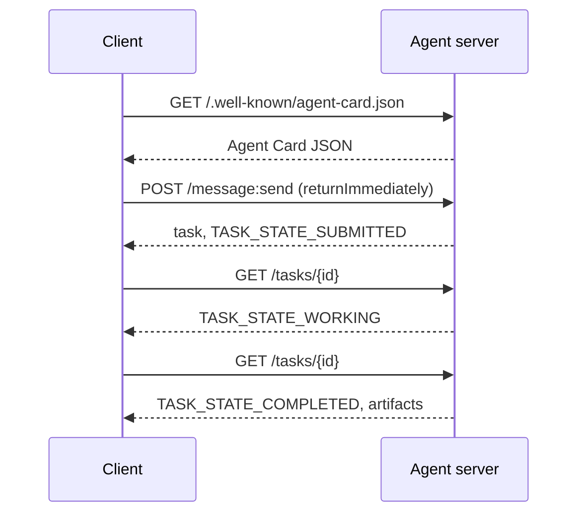
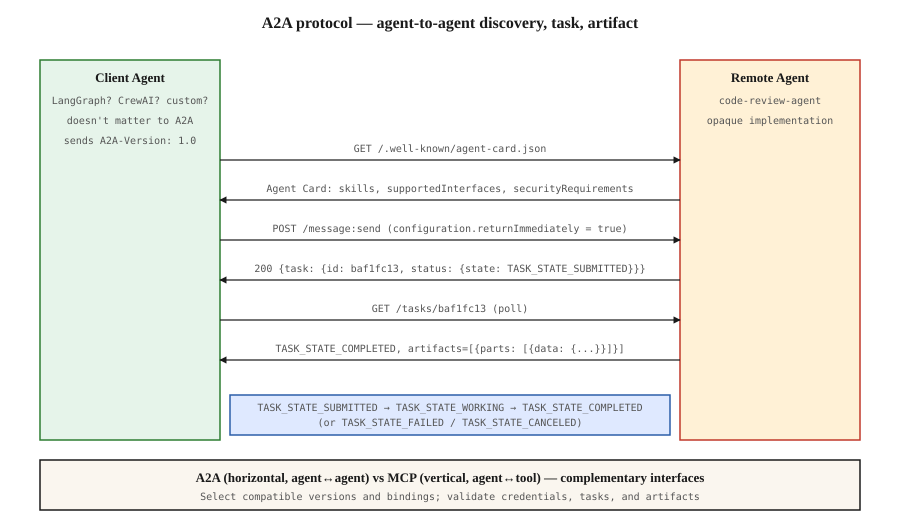

# A2A — The Agent-to-Agent Protocol

[Back to courses](../README.md#multi-agent-and-swarms) · [Communication Protocols](2-communication-protocols.md)

## Problem

Your agent needs to call another agent on another system. How? You can expose an HTTP endpoint, define a bespoke JSON schema, and hope the other side speaks it. Every pair of agents becomes a custom integration.

A2A standardizes this interaction for clients and servers that implement compatible versions and bindings. Standard discovery, standard task model, standard transport, standard artifacts. It offers JSON-RPC, HTTP+JSON, and gRPC bindings rather than a single transport shape.

**Analogy:** an Agent Card is a contractor’s service listing, a message is your request, a task is the tracked work order, and artifacts are the deliverables. The contractor’s internal process can remain private.

This lesson uses **A2A protocol version 1.0** and the HTTP+JSON binding. Protocol version, agent software version, and skill/output schema versions are separate concerns.

## Concept

### The four elements

**Agent Card.** A JSON document at `/.well-known/agent-card.json` describing the agent: name, skills, `supportedInterfaces` (endpoint URL, protocol binding, protocol version), default input and output media types, and auth requirements (`securitySchemes` plus `securityRequirements`). Discovery happens by reading the card.

```http
GET /.well-known/agent-card.json HTTP/1.1
Host: agent.example.com
```

```json
{
  "name": "code-review-agent",
  "description": "Reviews Python and TypeScript code.",
  "version": "1.0.0",
  "supportedInterfaces": [
    {
      "url": "https://agent.example.com",
      "protocolBinding": "HTTP+JSON",
      "protocolVersion": "1.0"
    }
  ],
  "capabilities": {"streaming": false, "pushNotifications": false},
  "securitySchemes": {
    "bearer": {"httpAuthSecurityScheme": {"scheme": "Bearer"}}
  },
  "securityRequirements": [{"schemes": {"bearer": {"list": []}}}],
  "defaultInputModes": ["text/plain", "application/json"],
  "defaultOutputModes": ["application/json"],
  "skills": [
    {
      "id": "review-python",
      "name": "Review Python",
      "description": "Reviews Python code.",
      "tags": ["code-review", "python"]
    },
    {
      "id": "review-typescript",
      "name": "Review TypeScript",
      "description": "Reviews TypeScript code.",
      "tags": ["code-review", "typescript"]
    }
  ]
}
```

**Task.** A tracked unit of work. A stateful object with a lifecycle: `TASK_STATE_SUBMITTED` → `TASK_STATE_WORKING` → `TASK_STATE_COMPLETED` / `TASK_STATE_FAILED` / `TASK_STATE_CANCELED`. A task-based interaction supports polling or updates. A server can also answer with a direct Message when no tracked task is needed.

**Artifact.** The result type produced by a task. Text, structured JSON, image, video, audio. Artifacts are typed: each part carries one of `text`, `raw`, `url`, or `data` and can name its `mediaType`, so different modalities are first-class.

**Opaque lifecycle.** A2A does not prescribe *how* the remote agent solves the task. The client sees state transitions and artifacts; the implementation is free to use any framework.

### The MCP/A2A split

- **MCP:** client ↔ tools and context. Clients discover schemas and invoke tools, commonly through JSON-RPC. Sessions and state depend on the transport, features, and application; “stateless by default” is not a universal rule.
- **A2A:** client ↔ remote agent service. The client can be an agent, application, or user-facing interface; both sides need not run an LLM.

A system can use both when it needs both kinds of integration. An A2A peer calls MCP tools on its side. The split keeps the two concerns clean.

### Discovery flow



These are the HTTP+JSON binding routes; operation requests carry `A2A-Version: 1.0`. By default `SendMessage` blocks until the task reaches a terminal or interrupted state, so a polling client sets `configuration.returnImmediately` to get the task back at once.

Or with streaming: `POST /message:stream` returns Server-Sent Events (a `task` first, then `statusUpdate` and `artifactUpdate` events), and `/tasks/{id}:subscribe` reattaches to a running task. The stream closes when the task reaches a terminal state; there is no `final` flag.

### Auth

A2A supports three common patterns:

- **Bearer token**: OAuth2 or opaque (`httpAuthSecurityScheme` or `oauth2SecurityScheme`).
- **mTLS**: mutual TLS; organizations prove identity to each other (`mtlsSecurityScheme`).
- **API key**: a key in a header, query parameter, or cookie (`apiKeySecurityScheme`).

The Agent Card declares schemes and requirements. The server must actually authenticate credentials and authorize each task and artifact access; a declaration alone does not enforce anything. Obtain credentials through the agreed out-of-band flow. Do not put secrets in task text or treat a task ID as permission to read it.

### Where A2A wins

- **Cross-organization calls.** Agent at company A calls agent at company B. Without A2A, every pair is a bespoke contract.
- **Heterogeneous frameworks.** LangGraph agent calls CrewAI agent calls custom Python agent. A2A normalizes.
- **Typed artifacts.** Video result, structured JSON, audio — all first-class.
- **Long-running tasks.** Task status and updates provide a common interface, but hours-long work still needs durable state, recovery, deadlines, and retention policies.

### Where A2A struggles

- **Latency-sensitive micro-calls.** Discovery, serialization, authentication, and task bookkeeping add overhead. Compare measured latency against direct calls; A2A does not require every response to be asynchronous.
- **Tight-coupled in-process agents.** If both agents run in the same Python process, A2A's HTTP round-trip is overkill.
- **Small teams.** Spec overhead is real; internal-only agents may not need the formality.

### Related Protocols

ACP was a separate IBM/BeeAI agent-communication effort that is now part of A2A, rather than simply an earlier A2A version. ANP explores agent identity, discovery, and communication. Their histories and abstractions differ; popularity claims alone are not a basis for selecting an integration. See [Communication Protocols](2-communication-protocols.md) for the wider comparison.

The overview below places the wire exchanges beside the client and remote service. The example is a task-producing request with `returnImmediately` enabled.



## Build It: Discover, Submit, Poll, Read

The source companion is adapted below into a loopback-only Python demonstration of the **1.0 HTTP+JSON message shapes**. It uses a free local port and an in-memory task store. Copy the block to `a2a_demo.py` and run `python3 a2a_demo.py` with Python 3.10+.

This is a partial teaching server, not a conformant production A2A implementation. It supports one toy review skill, checks basic request structure and protocol version, and returns copied task snapshots. It does not implement authentication, TLS, persistence, deduplication, cancellation, streaming, all optional request fields, or full schema validation. The earlier Agent Card illustrates authentication; the demo card honestly advertises no security requirements.

The review only checks whether strings contain `def ` and `return`; it neither executes code nor establishes code quality. A valid review artifact is not proof that reviewed code is correct.

```python
"""A2A-minimal server and client using http.server, on the A2A 1.0 HTTP+JSON binding.

Implements the discovery-submit-poll-result flow:
  - GET /.well-known/agent-card.json  -> Agent Card
  - POST /message:send                -> SendMessage, returns the new task
  - GET /tasks/{id}                   -> GetTask, status + artifacts

Server runs in a background thread; client talks to it and prints the trace.
"""
from __future__ import annotations

import json
from copy import deepcopy
import threading
import time
import urllib.request
from http.server import BaseHTTPRequestHandler, HTTPServer
from typing import Any
from uuid import uuid4


A2A_VERSION = "1.0"
A2A_MEDIA_TYPE = "application/a2a+json"
PORT = 0  # Ask the OS for a free loopback port.
BASE_URL = ""
TERMINAL_STATES = ("TASK_STATE_COMPLETED", "TASK_STATE_FAILED", "TASK_STATE_CANCELED", "TASK_STATE_REJECTED")

AGENT_CARD = {
    "name": "code-review-agent",
    "description": "Reviews Python code for missing functions and return statements.",
    "version": "0.1.0",
    "supportedInterfaces": [
        {"url": BASE_URL, "protocolBinding": "HTTP+JSON", "protocolVersion": A2A_VERSION},
    ],
    "capabilities": {"streaming": False, "pushNotifications": False},
    "securityRequirements": [],
    "defaultInputModes": ["application/json"],
    "defaultOutputModes": ["application/json"],
    "skills": [
        {
            "id": "review-python",
            "name": "Review Python",
            "description": "Flags Python code with no function definition or no return statement.",
            "tags": ["code-review", "python"],
        }
    ],
}


class TaskStore:
    def __init__(self) -> None:
        self.tasks: dict[str, dict[str, Any]] = {}
        self._lock = threading.Lock()

    def create(self, message: dict, return_immediately: bool) -> dict:
        tid = str(uuid4())
        task = {
            "id": tid,
            "contextId": str(uuid4()),
            "status": {"state": "TASK_STATE_SUBMITTED"},
            "artifacts": [],
            "history": [deepcopy(message)],
        }
        with self._lock:
            self.tasks[tid] = task
            submitted = {"id": tid, "contextId": task["contextId"], "status": dict(task["status"])}
        worker = threading.Thread(target=self._run, args=(tid,), daemon=True)
        worker.start()
        if return_immediately:
            return submitted
        worker.join()
        return self.get(tid)

    def _run(self, tid: str) -> None:
        with self._lock:
            self.tasks[tid]["status"] = {"state": "TASK_STATE_WORKING"}
        time.sleep(0.2)
        with self._lock:
            t = self.tasks[tid]
            data = next((p["data"] for p in t["history"][0]["parts"] if "data" in p), {})
            code = data.get("code") if isinstance(data, dict) else None
            if isinstance(code, str):
                issues = []
                if "return" not in code:
                    issues.append("no return statement")
                if "def " not in code:
                    issues.append("no function definition")
                t["artifacts"] = [{
                    "artifactId": str(uuid4()),
                    "name": "review",
                    "parts": [{"data": {"issues": issues, "lines": code.count("\n") + 1},
                               "mediaType": "application/json"}],
                }]
                t["status"] = {"state": "TASK_STATE_COMPLETED"}
            else:
                t["status"] = {
                    "state": "TASK_STATE_FAILED",
                    "message": {"messageId": str(uuid4()), "role": "ROLE_AGENT",
                                "parts": [{"text": "expected a data part with a 'code' field"}]},
                }

    def get(self, tid: str) -> dict | None:
        with self._lock:
            return deepcopy(self.tasks.get(tid))


STORE = TaskStore()


class A2AHandler(BaseHTTPRequestHandler):
    def log_message(self, format: str, *args: Any) -> None:
        return

    def _send_json(self, status: int, body: Any, content_type: str = A2A_MEDIA_TYPE) -> None:
        data = json.dumps(body).encode("utf-8")
        self.send_response(status)
        self.send_header("Content-Type", content_type)
        self.send_header("Content-Length", str(len(data)))
        self.end_headers()
        self.wfile.write(data)

    def _send_error(self, http_status: int, rpc_status: str, message: str, reason: str = "") -> None:
        error: dict[str, Any] = {"code": http_status, "status": rpc_status, "message": message}
        if reason:
            error["details"] = [{"@type": "type.googleapis.com/google.rpc.ErrorInfo",
                                 "reason": reason, "domain": "a2a-protocol.org"}]
        self._send_json(http_status, {"error": error})

    def _version_ok(self) -> bool:
        if self.headers.get("A2A-Version") == A2A_VERSION:
            return True
        self._send_error(400, "FAILED_PRECONDITION", f"A2A-Version {A2A_VERSION} is required",
                         "VERSION_NOT_SUPPORTED")
        return False

    def do_GET(self) -> None:
        if self.path == "/.well-known/agent-card.json":
            self._send_json(200, AGENT_CARD, "application/json")
            return
        if self.path.startswith("/tasks/"):
            if not self._version_ok():
                return
            tid = self.path.split("/tasks/", 1)[1]
            task = STORE.get(tid)
            if task is None:
                self._send_error(404, "NOT_FOUND", "task not found", "TASK_NOT_FOUND")
                return
            self._send_json(200, task)
            return
        self._send_error(404, "NOT_FOUND", "route not found")

    def do_POST(self) -> None:
        if self.path == "/message:send":
            if not self._version_ok():
                return
            if self.headers.get("Content-Type", "").split(";")[0] != A2A_MEDIA_TYPE:
                self._send_error(415, "INVALID_ARGUMENT", "Expected application/a2a+json")
                return
            try:
                length = int(self.headers.get("Content-Length", "0"))
                if not 0 < length <= 65536:
                    raise ValueError("Body must be between 1 and 65536 bytes")
                body = json.loads(self.rfile.read(length).decode("utf-8"))
                if not isinstance(body, dict):
                    raise ValueError("Expected an object")
                message = body.get("message")
                config = body.get("configuration", {})
                if not isinstance(message, dict) or not isinstance(config, dict):
                    raise ValueError("Expected message and configuration objects")
                if not isinstance(message.get("messageId"), str) or not message["messageId"]:
                    raise ValueError("messageId is required")
                if message.get("role") != "ROLE_USER":
                    raise ValueError("Demo expects ROLE_USER")
                parts = message.get("parts")
                if not isinstance(parts, list) or not parts or not all(isinstance(p, dict) for p in parts):
                    raise ValueError("Nonempty parts array is required")
                return_immediately = config.get("returnImmediately", False)
                if type(return_immediately) is not bool:
                    raise ValueError("returnImmediately must be boolean")
            except (ValueError, UnicodeError) as exc:
                self._send_error(400, "INVALID_ARGUMENT", str(exc))
                return
            task = STORE.create(message, return_immediately)
            self._send_json(200, {"task": task})
            return
        self._send_error(404, "NOT_FOUND", "route not found")


def run_server() -> HTTPServer:
    global BASE_URL, STORE
    STORE = TaskStore()
    server = HTTPServer(("127.0.0.1", PORT), A2AHandler)
    BASE_URL = f"http://127.0.0.1:{server.server_port}"
    AGENT_CARD["supportedInterfaces"][0]["url"] = BASE_URL
    threading.Thread(target=server.serve_forever, daemon=True).start()
    return server


def http_json(method: str, url: str, body: Any = None) -> dict:
    data = json.dumps(body).encode("utf-8") if body is not None else None
    req = urllib.request.Request(url, data=data, method=method)
    req.add_header("Content-Type", A2A_MEDIA_TYPE)
    req.add_header("A2A-Version", A2A_VERSION)
    with urllib.request.urlopen(req, timeout=3) as resp:
        return json.loads(resp.read().decode("utf-8"))


def run_client() -> None:
    print("\n[1] discovery: GET /.well-known/agent-card.json")
    card = http_json("GET", f"{BASE_URL}/.well-known/agent-card.json")
    interface = card["supportedInterfaces"][0]
    print(f"    name={card['name']}, skills={[s['id'] for s in card['skills']]}")
    print(f"    interface={interface['protocolBinding']} {interface['protocolVersion']} at {interface['url']}")

    print("\n[2] send message: POST /message:send (returnImmediately)")
    request = {
        "message": {
            "messageId": str(uuid4()),
            "role": "ROLE_USER",
            "parts": [{"data": {"code": "x = 1\nprint(x)\n"}, "mediaType": "application/json"}],
        },
        "configuration": {"returnImmediately": True},
    }
    task = http_json("POST", f"{interface['url']}/message:send", request)["task"]
    tid = task["id"]
    print(f"    task id={tid}, state={task['status']['state']}")

    print("\n[3] poll GET /tasks/{id} until a terminal state")
    for i in range(10):
        task = http_json("GET", f"{interface['url']}/tasks/{tid}")
        state = task["status"]["state"]
        print(f"    attempt {i + 1}: state={state}")
        if state in TERMINAL_STATES:
            if state != "TASK_STATE_COMPLETED":
                raise RuntimeError(f"Task ended in {state}")
            print(f"    artifacts: {task['artifacts']}")
            break
        time.sleep(0.1)
    else:
        raise TimeoutError("Polling budget exhausted")


def main() -> None:
    print("A2A 1.0-shaped local teaching demo (partial implementation)")
    print("-" * 30)
    server = run_server()
    time.sleep(0.1)
    try:
        run_client()
    finally:
        server.shutdown()
        server.server_close()
    print("\nKey insight: discovery + task lifecycle + artifacts are demonstrated; authentication is not.")
    print("MCP is agent <-> tool (vertical); A2A is agent <-> agent (horizontal). They can be combined when useful.")


if __name__ == "__main__":
    main()
```
### Read the Output

The client discovers the advertised interface, submits a code-review message, polls the returned task ID, and prints a structured review artifact. The fixture `x = 1; print(x)` lacks both a function definition and a return statement, so the toy reviewer reports both issues.

The task is still `TASK_STATE_COMPLETED`: the review ran successfully even though it found issues. Distinguish **execution success** from **the quality or acceptance of the artifact being reviewed**. A missing `code` field instead produces `TASK_STATE_FAILED` in this demo.

Malformed requests are rejected before task creation. Unknown tasks return 404. A client timeout only stops waiting; it does not cancel remote execution. The single-threaded HTTP server and unbounded in-memory task collection are deliberate simplifications, not scaling or retention designs.

## Lifecycle and Identifier Cheat Sheet

| State (without `TASK_STATE_` prefix) | Meaning | Client behavior |
| --- | --- | --- |
| `SUBMITTED` | Accepted for processing | Wait or retrieve updates |
| `WORKING` | Processing is underway | Track progress within a deadline |
| `INPUT_REQUIRED` | More user/application input is needed | Provide the requested input for the task |
| `AUTH_REQUIRED` | Additional authentication/authorization is needed | Complete the appropriate trusted authorization flow |
| `COMPLETED` | Work finished successfully | Retrieve and validate artifacts |
| `FAILED` | Work ended with an error | Inspect failure evidence and decide whether to retry |
| `CANCELED` | Work was canceled | Reconcile any effects already performed |
| `REJECTED` | Agent declined the task | Inspect the reason or choose another service |

`UNSPECIFIED` is also defined; do not treat it as successful completion. Completed, failed, canceled, and rejected tasks are terminal. A follow-up after terminal completion requires new work rather than silently reopening the task.

| Identifier | Scope and purpose |
| --- | --- |
| `messageId` | Identifies a message; may support server-side duplicate detection |
| `taskId` / task `id` | Identifies tracked work |
| `contextId` | Groups related interactions; not a credential |
| `artifactId` | Identifies a task deliverable |
| Trace ID | Application observability correlation; separate from A2A task identity |

See the [A2A specification](https://a2a-protocol.org/latest/specification/) for normative lifecycle and binding requirements.

## Polling, Streaming, and Push Notifications

| Mechanism | How it works | Tradeoff |
| --- | --- | --- |
| Polling | Client repeatedly retrieves the task | Simple recovery, but extra requests and delayed visibility |
| Streaming | An open response carries status/artifact events | Timely updates; client must handle disconnects and partial artifacts |
| Push notifications | Server sends updates to a configured callback | Useful for long-running work; requires callback authentication and delivery policy |

Respect advertised capabilities. SSE is an HTTP event stream, not WebSocket, and is not deprecated merely because MCP replaced its legacy HTTP+SSE transport. A2A streaming and MCP transport evolution are separate topics.

After a lost stream, retrieve task state and use supported subscription/recovery operations rather than automatically submitting the job again. Assemble artifact chunks using their identifiers and update semantics; receiving a partial chunk does not mean the artifact is complete.

## Retries, Security, and Output Contracts

**Idempotency is optional for SendMessage.** The A2A specification allows servers to use `messageId` for duplicate detection; it does not guarantee deduplication. The demo creates a new task for each submission. Agree on retry behavior before automatically resending a request after a network timeout.

In a production design, scope any idempotency key to the authenticated caller and operation, compare the request payload, store the mapping atomically, and define expiry. A message ID alone cannot prevent duplicate downstream side effects.

| Concern | Practical design |
| --- | --- |
| Version mismatch | Select a supported binding/version from the card; fail clearly when incompatible |
| Task access | Enforce owner/tenant permissions on reads, subscriptions, and artifact access |
| Untrusted card URLs | Validate destinations before following advertised endpoints or sending credentials |
| Output compatibility | Version application schemas and validate returned `data`, not just its media type |
| Long-running work | Persist state, bound execution, handle restart recovery, and define retention |
| Artifact links | Check authorization and expiry before downloading referenced content |
| Push callbacks | Authenticate notifications and constrain callback destinations |
| Resource pressure | Bound request size, concurrent work, storage, polling rate, and retries |

**Example 1:** a research agent delegates document analysis to another organization. A2A handles the task interaction; a domain-specific schema still defines findings, source references, and uncertainty.

**Example 2:** a travel assistant asks a booking agent for options. Producing options and committing a purchase are different operations. Authentication, approval, and idempotent purchase execution remain application responsibilities.

## Evaluate the Integration

| Metric | Definition | Purpose |
| --- | --- | --- |
| Contract success | Schema-valid responses / received responses | Detect serialization and schema drift |
| Completion rate | Successfully completed tasks / submitted cohort | Separate protocol failures from pending work |
| p95 task latency | Submission-to-terminal-state time | Include queues, retries, and authorization waits |
| Polling overhead | Task-read requests per completed task | Tune update strategy |
| Duplicate-effect rate | Duplicate business effects / logical operations | Assess retry safety |
| Recovery success | Interrupted interactions recovered without duplicate execution / tested interruptions | Validate disconnect/restart behavior |

Evaluate semantic answer quality separately. A task may complete with an artifact that is valid JSON but factually wrong.

## Exercises

1. Run the demo and inspect the Agent Card, submission envelope, task status, and artifact separately.
2. Submit a malformed request, an unsupported version, an unknown task ID, and a valid message without `code`. Explain why some fail at HTTP/request validation and another becomes a failed task.
3. Add a second skill and explicit application-level routing based on message content. A skill declaration is not itself a standard request-side skill selector.
4. Add scoped duplicate detection. Test retries with the same ID and payload, conflicting payloads, and different callers.
5. Design streaming recovery: disconnect after an artifact chunk and recover without duplicating the task.
6. Add authorization and task ownership checks. Verify that knowing another caller’s task ID does not grant access.
7. Compare the demo with the official specification and list unsupported requirements before attempting an SDK interoperability test.

## Quick Cheat Sheet

| Concept | Definition | Analogy |
| --- | --- | --- |
| A2A | Protocol for interacting with remote agent services | Shared work-order language |
| Agent Card | Description of skills, interfaces, capabilities, and security | Service listing |
| Binding | Mapping protocol operations to a wire format and transport | Delivery convention |
| Message | Input or response in an interaction | Request or reply |
| Task | Stateful unit of tracked work | Work order |
| Artifact | Deliverable produced by a task | Completed report |
| Opaque implementation | Internal reasoning/tools are not prescribed by the protocol | Contractor chooses its process |
| Authentication | Establishing the caller’s identity | Checking ID |
| Authorization | Deciding what that caller may access or do | Checking permission |

**Remember:** *discover → authenticate → send → track → validate*. Standard message envelopes do not replace domain schemas or application security.

## Resource

| Field | Details |
| --- | --- |
| Origin | [AI Engineering from Scratch — source lesson](https://github.com/rohitg00/ai-engineering-from-scratch/blob/main/phases/16-multi-agent-and-swarms/12-a2a-protocol/docs/en.md) |
| Author | Rohit Ghumare and contributors |
| Level | Intermediate to advanced — repository assessment |
| Best for | Understanding A2A discovery and task flows, designing cross-service agent contracts, and explaining streaming, security, and retry tradeoffs |

Adapted from the MIT-licensed lesson, companion Python example, and SVG; copyright © 2026 Rohit Ghumare. [Original license](../licenses/ai-engineering-from-scratch-LICENSE).

- [Companion code](https://github.com/rohitg00/ai-engineering-from-scratch/blob/main/phases/16-multi-agent-and-swarms/12-a2a-protocol/code/main.py) — source local server/client example.
- [Source diagram](https://github.com/rohitg00/ai-engineering-from-scratch/blob/main/phases/16-multi-agent-and-swarms/12-a2a-protocol/assets/a2a-flow.svg) — discovery and task flow.
- [Official A2A specification](https://a2a-protocol.org/latest/specification/) — normative data model, bindings, lifecycle, security, and versioning.
- [A2A project](https://github.com/a2aproject/A2A) — specifications and SDK links.

Adapted on **2026-10-31**, using protocol **1.0** examples. Preserves source explanations, the Mermaid sequence, and the companion SVG. The site-specific discovery figure is represented by that SVG. Removes unsupported adoption rankings, qualifies MCP/statefulness claims, and distinguishes optional idempotency from guarantees. The example adds basic validation, copied snapshots, a dynamic loopback port, request timeouts, explicit polling exhaustion, and socket cleanup. Local HTTP checks are not A2A conformance certification; no remote agent or live LLM is used.

Source Markdown SHA-256: `64266b28fc18ceb78fc5bc7d7b0902de21e051cdf4631ebb1574412c24d4cdd2`.
