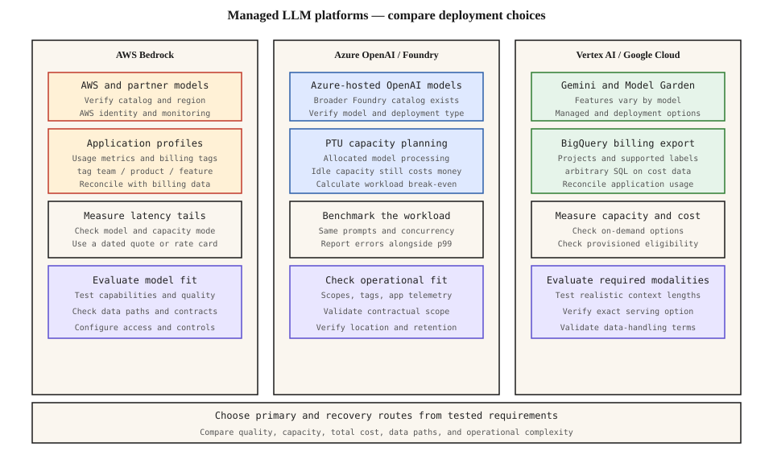

# Managed LLM Platforms — Bedrock, Vertex AI, Azure OpenAI

[Back to courses](../README.md#infrastructure-and-production) · [LLM Routing](../1-llm-engineering/11-llm-routing-layer.md) · [Caching and Cost](../1-llm-engineering/8-caching-cost.md)

## The Problem

Choosing a model is only part of deploying an AI product. You also need an inference endpoint, credentials, capacity, usage accounting, observability, and an operational owner. A managed platform provides some of that infrastructure, but your application still owns quality, data handling, retries, and user experience.

The source lesson frames this as three platform strategies: Bedrock’s multi-provider catalog, Azure-hosted OpenAI models, and Google’s Gemini and Model Garden ecosystem. That is a useful starting point, not a permanent ranking. Catalogs, product names, deployment options, and regional availability change.

**Analogy:** choosing a managed platform is like renting a commercial kitchen. The equipment matters, but so do location, booking terms, access controls, metering, and how you handle a busy evening. Renting capacity does not guarantee that your recipe produces a good meal.

## Compare the Platform and the Deployment

| Dimension | AWS Bedrock | Azure OpenAI / Microsoft Foundry | Vertex AI / Google Cloud model platform |
| --- | --- | --- | --- |
| Model access | AWS and third-party foundation models | Azure-hosted OpenAI models within a broader Foundry ecosystem | Gemini plus partner/open-model options in Model Garden |
| Enterprise integration | AWS identity, networking, logging, and billing | Azure identity, resource organization, networking, and billing | Google Cloud identity, projects, networking, and billing |
| Capacity question | Which model supports on-demand or provisioned access in the target location? | Which deployment type, model, quota, and PTU capacity fit? | Which endpoint, model, quota, and provisioned capacity fit? |
| Attribution starting point | Application inference profiles and billing tags | Resource/subscription scopes, tags, and application telemetry | Projects, supported labels, billing exports, and application telemetry |
| Main evaluation task | Verify model-feature-region compatibility | Distinguish model availability from deployment capacity | Distinguish managed API access from self-deployed model serving |

Do not infer that all models behind one platform share an API feature set, context limit, price, or availability policy. A model family may be available through several providers, with different versions or capabilities. Azure OpenAI is not the whole Foundry catalog, and Model Garden is broader than only third-party managed endpoints.

The diagram separates catalog, capacity, attribution, and deployment checks for each platform. Read it as a decision checklist rather than a performance ranking.



## Direct API, Cloud Platform, or Gateway?

| Access path | Potential benefit | Work that remains |
| --- | --- | --- |
| Model provider’s direct API | Direct access to that provider’s features and release cadence | Separate credentials, billing, governance, and integration |
| Managed cloud platform | Integration with an existing cloud operating model | Verify feature parity, regional access, quota, and commercial terms |
| Multi-provider gateway | Common routing, budgets, telemetry, and fallback policy | Provider-specific behavior, extra dependency, data handling, and gateway cost |

A gateway can normalize request envelopes; it cannot make models semantically interchangeable. Tool calling, structured output, refusal behavior, token accounting, and caching can differ. Test each supported route against the same task-level acceptance criteria.

## Shared Capacity and Provisioned Throughput

**On-demand inference** generally charges for usage, with capacity and rate-limit behavior defined by the service. **Provisioned throughput** allocates a purchased amount of processing capacity. Its billing units, commitments, minimum sizes, and overflow behavior depend on the platform and model.

Microsoft describes **PTUs (Provisioned Throughput Units)** as a way to measure allocated model-processing capacity. A PTU is not a portable GPU count or a universal tokens-per-second value. The documented provisioned deployment holds processing capacity for the deployment even while idle. See [Microsoft’s provisioned-throughput overview](https://learn.microsoft.com/en-us/azure/foundry/openai/concepts/provisioned-throughput).

AWS and Google also provide provisioned offerings for eligible models and configurations. Check the specific model’s terms rather than transferring PTU arithmetic between providers. See [Bedrock pricing](https://aws.amazon.com/bedrock/pricing/) and [Google Cloud provisioned throughput](https://cloud.google.com/vertex-ai/generative-ai/docs/provisioned-throughput/overview).

Provisioned capacity can improve predictability, but does not remove prompt processing, output generation, network latency, quotas, or capacity ceilings. Buying capacity is not an unconditional end-to-end latency guarantee.

## Measure Latency Instead of Memorizing Rankings

**TTFT (time to first token)** measures the delay until the first generated token arrives. **Inter-token latency** measures subsequent token delivery. **End-to-end latency** includes the whole response and any surrounding application work.

Compare deployments using the same model/version when possible, prompt distribution, output limits, client location, concurrency, caching policy, and observation period. Report quality as well as latency when models differ.

| Measurement | Why it matters |
| --- | --- |
| TTFT p50 / p95 / p99 | Typical responsiveness and tail delays |
| End-to-end p95 | Whether the completed answer arrives on time |
| Output tokens per second | Generation speed after the first token |
| Throttling and error rate | Whether measured speed hides rejected requests |
| Queue wait and concurrency | Whether load causes a capacity bottleneck |
| Success rate by prompt-length bucket | Whether long inputs change reliability or latency |

The source’s 50/60/75 ms provider comparisons are not retained: without a reproducible workload and equivalent deployments, they do not establish a reliable platform ranking. Never derive p99 by multiplying the median by an arbitrary constant.

## Cost and Break-Even Mathematics

For a simple token-billed workload:

`on-demand cost = input tokens × input rate + output tokens × output rate`

Use consistent units, such as dollars per million tokens. Add cached-token rates, batch discounts, tool charges, storage, networking, retries, and other applicable costs separately.

For a simplified provisioned deployment:

`provisioned cost = purchased units × hourly rate × billed hours + overflow + other charges`

If one purchased block costs `F` per hour and the same workload at full usable capacity would cost `D_full` per hour on demand, the simplified break-even utilization is:

`u* = F / D_full`

This assumes a fixed input/output mix, linear on-demand pricing, and measured usable capacity. If `u* > 1`, the block never breaks even within its modeled capacity. Real deployments have discrete unit sizes and model-specific throughput behavior; daily token totals alone cannot prove peak demand will fit.

**Fictional example:** a block costs $12/hour and handles the measured workload mix at 6 million input and 2 million output tokens/hour. At fictional rates of $2/M input and $8/M output, full utilization would cost $28/hour on demand. Break-even is `12 / 28 ≈ 42.9%`. That number belongs to this example, not to Azure, AWS, or Google.

### Numbers you should remember

The upstream lesson lists the following figures. **These are unverified source claims, not current provider quotes or comparable benchmark results.** Use them as prompts for validation rather than deployment assumptions.

| Figure from the source | Qualification |
| --- | --- |
| Azure OpenAI median TTFT on “Llama 3.1 405B equivalents”: ~50 ms with PTUs | The model/service comparison is unclear: Azure OpenAI and Llama deployments are not interchangeable. No reproducible benchmark configuration is supplied. |
| Bedrock median TTFT on demand: ~75 ms | Not a platform-wide latency guarantee; model, prompt length, region, concurrency, and caching affect TTFT. |
| Bedrock Provisioned Throughput: $21–$50/hour per unit | Not a universal rate. Verify the exact model, region, unit definition, and commitment against the current rate card or quote. |
| Azure PTU break-even: ~40–60% sustained utilization | A scenario-dependent range, not a general threshold. Calculate break-even using your workload mix, measured capacity, and contracted prices. |
| PTU savings at high utilization: up to 70% versus on demand | Not a guaranteed discount. The baseline, reservation terms, utilization, and overflow costs must be specified. |

For a defensible interview answer, remember the **method**: compare equivalent workloads, report latency percentiles, and compute `break-even utilization = fixed hourly capacity cost / equivalent on-demand cost at full usable capacity`. The fictional example above yields **42.9%**, solely from its stated assumptions.

## Build It: Compare Fictional Capacity Plans

The upstream exercise compares platform costs. This version removes vendor-labeled approximate prices and invented latency estimates. It compares fictional plans against explicit measured-capacity assumptions, includes overflow, and treats latency evidence as an independent constraint.

Copy into `platform_cost_demo.py` and run `python3 platform_cost_demo.py` with Python 3.10+. It uses only the standard library and makes no cloud calls.

```python
from dataclasses import dataclass
from math import isfinite


@dataclass(frozen=True)
class Plan:
    name: str
    input_per_million: float
    output_per_million: float
    block_hourly: float
    input_capacity_per_hour: int
    output_capacity_per_hour: int
    # Both capacities describe one benchmarked input/output workload mix.

    def __post_init__(self):
        values = (self.input_per_million, self.output_per_million,
                  self.block_hourly, self.input_capacity_per_hour,
                  self.output_capacity_per_hour)
        if any(not isfinite(v) or v <= 0 for v in values):
            raise ValueError("Rates and benchmarked capacities must be positive")


def compare(plan, utilization, hours=24):
    if not isfinite(utilization) or utilization < 0 or not isfinite(hours) or hours <= 0:
        raise ValueError("Use finite nonnegative utilization and positive hours")
    full_hourly = (plan.input_capacity_per_hour * plan.input_per_million
                   + plan.output_capacity_per_hour * plan.output_per_million) / 1e6
    on_demand = full_hourly * utilization * hours
    # One block is paid for all hours; overflow is charged at on-demand rates.
    provisioned = (plan.block_hourly + full_hourly * max(0, utilization - 1)) * hours
    return {"on_demand": round(on_demand, 2),
            "one_block_plus_overflow": round(provisioned, 2),
            "break_even_utilization": plan.block_hourly / full_hourly}


def choose_with_evidence(costs, measured_p99_ms, target_ms):
    # Missing latency evidence never becomes an automatic pass.
    if not isfinite(target_ms) or target_ms <= 0:
        raise ValueError("Positive latency target required")
    eligible = []
    for route, cost in costs.items():
        value = measured_p99_ms.get(route)
        if value is not None and isfinite(value) and 0 <= value <= target_ms:
            eligible.append((cost, route))
    return min(eligible)[1] if eligible else "No eligible route: measure or redesign"


if __name__ == "__main__":
    plan = Plan("Fictional block A", 2, 8, 12, 6_000_000, 2_000_000)
    for utilization in (0, 0.25, 0.5, 1, 1.5):
        print(utilization, compare(plan, utilization))
    assert compare(plan, 0)["one_block_plus_overflow"] == 288
    assert compare(plan, 0.5)["on_demand"] == 336
    assert compare(plan, 1.5)["one_block_plus_overflow"] == 624
    result = compare(plan, 0.5)
    # Synthetic test evidence, not provider measurements or predictions.
    costs = {"on_demand": result["on_demand"],
             "provisioned": result["one_block_plus_overflow"]}
    evidence = {"on_demand": 1200, "provisioned": 700}
    assert choose_with_evidence(costs, evidence, 800) == "provisioned"
    assert choose_with_evidence(costs, {}, 800).startswith("No eligible")
    print("All checks passed; fictional figures only.")
```

The exercise pays for idle capacity and models overflow explicitly. It assumes overflow is available at the stated rate, and that the workload mix stays fixed. It does not simulate burst queues, establish provider capacity, or replace load testing. A different prompt/output ratio requires new capacity measurements.

## FinOps: Attribute Usage and Reconcile the Bill

**FinOps** is the practice of connecting technology spending to ownership and business value. For LLM systems, total monthly spend is not enough: distinguish teams, tenants, features, models, retries, and environments.

### Bedrock Application Inference Profiles

Application inference profiles can associate invocations with tagged resources and track model usage. AWS documents CloudWatch usage metrics separately from billing cost-allocation tags. Do not assume CloudWatch automatically provides fully reconciled invoice costs per request. Cross-region profiles can route to multiple regions, which must be considered in deployment requirements. [AWS inference-profile documentation](https://docs.aws.amazon.com/bedrock/latest/userguide/inference-profiles.html).

### Google Cloud Billing Export

Projects and supported labels provide organizational attribution, while billing export to BigQuery enables SQL analysis and reporting. Project-per-team is one design, not a universal requirement. Resource-level billing still needs application metadata to explain which feature or tenant triggered usage. [Cloud Billing export documentation](https://cloud.google.com/billing/docs/how-to/export-data-bigquery).

### Azure Scopes and Tags

Subscriptions, resources, and supported tags organize spend. Cost Management’s optional tag-inheritance setting can apply higher-level tags to usage records; this is not automatic resource-tag inheritance or per-request tagging. Combine billing records with application telemetry for feature-level attribution. [Microsoft tag-inheritance documentation](https://learn.microsoft.com/en-us/azure/cost-management-billing/costs/enable-tag-inheritance).

| Record | Why retain it? |
| --- | --- |
| Request/trace ID and logical operation ID | Correlate attempts and retries |
| Team, feature, tenant, environment | Assign ownership without logging sensitive prompts |
| Platform, region, model/version, deployment | Explain routing and pricing differences |
| Input/output/cached tokens where reported | Estimate usage consistently |
| Latency, outcome, retry count | Relate spending to reliability |
| Pricing version and reconciliation period | Explain differences from the final invoice |

Do not grade platform attribution with arbitrary A/B scores. Test whether your chosen billing and telemetry fields support the reporting questions your team actually needs.

## Portability and Failover

The source recommends a two-provider minimum. Treat that as an option to evaluate, not a universal rule. Multi-provider operation adds adapters, evaluation, credentials, quota planning, data paths, and incident procedures. A single-provider design with suitable regional recovery may fit some workloads better.

A fallback must have acceptable task quality, compatible output/tool behavior, permitted data handling, and available capacity. Two cloud endpoints can still share an upstream model dependency. Failure independence matters more than counting provider logos.

**Example 1:** an internal summarizer might accept a slower fallback with a shorter output limit after it passes the same factuality checks.

**Example 2:** a tool-using assistant may need to stop rather than switch if the fallback cannot preserve schema or authorization requirements. Never replay a side-effecting tool call blindly after a timeout.

## Data Handling and Deployment Requirements

Check the exact service, model, endpoint, region, deployment mode, and contract. Distinguish inference processing location from stored prompts, application logs, backups, monitoring, and any cross-region routing. Private connectivity does not by itself establish where processing or retention occurs.

A **BAA (Business Associate Agreement)** is a contractual term relevant to certain healthcare data processing arrangements; it is not a blanket approval for every feature or deployment. Have the responsible legal/security teams validate applicable requirements against current service documentation and contracts. Avoid assuming all platforms have identical retention or abuse-monitoring options, or that an opt-out is universally available.

## A Practical Selection Record

| Decision | Evidence to record |
| --- | --- |
| Model and feature fit | Task evaluations, supported modalities, tool/schema behavior |
| Deployment fit | Available model version, endpoint type, permitted locations |
| Capacity | Measured workload mix, concurrency, quotas, provisioned availability |
| Cost | Dated rate card/quote, idle cost, overflow, caching, retries, operational overhead |
| Reliability | Timeout, retry, degradation, and recovery tests |
| Attribution | Ownership fields, billing export, reconciliation process |
| Data handling | Approved data paths, retention/logging settings, contractual scope |
| Exit plan | Adapter boundaries, exported evaluation sets, state portability |

## Exercises

1. Change the fictional token mix and rates. Find a case where break-even exceeds 100% utilization and explain the result.
2. Add a second purchased capacity block and compute when overflow becomes more expensive than the second block.
3. Design a benchmark with short and long prompts, cold and cached inputs, and bursty concurrency. Report p95/p99 and errors together.
4. Investigate a fictional fourfold bill increase with flat request volume. Check output length, model routing, retry amplification, cache hit rate, and idle provisioned spend.
5. Design a fallback evaluation for a structured-output application. Define when to fail closed instead of routing to an incompatible model.
6. Use current official rate cards to price one named model/version and region. Record assumptions and dates; do not compare unlike token mixes as equivalent workloads.

## Quick Cheat Sheet

| Term | Crisp definition | Memory aid |
| --- | --- | --- |
| Managed LLM platform | Service hosting model access with operational controls | Rented inference infrastructure |
| Model catalog | Available models and deployment options | Menu, not a compatibility guarantee |
| On-demand | Usage-based inference access under service limits | Pay as used |
| Provisioned throughput | Purchased processing capacity under a defined contract | Pay for available capacity |
| PTU | Microsoft’s provisioned-capacity measurement unit | Capacity unit, not GPU count |
| TTFT | Delay until the first generated token arrives | First response |
| Tail latency | Slow end of the latency distribution, such as p99 | Slowest user experiences |
| Utilization | Used capacity relative to the relevant measured capacity | How much of what you bought you use |
| Break-even | Usage level where compared costs are equal | Equal-cost point |
| FinOps | Spending ownership and optimization tied to business value | Know who spends and why |
| Failover | Switching to an alternative after failure under a tested policy | Planned recovery route |

**Remember:** *model fit → deployment fit → measured capacity → total cost → operational evidence*. There is no universal fastest or cheapest platform.

## Resource

| Field | Details |
| --- | --- |
| Origin | [AI Engineering from Scratch — source lesson](https://github.com/rohitg00/ai-engineering-from-scratch/blob/main/phases/17-infrastructure-and-production/01-managed-llm-platforms/docs/en.md) |
| Author | Rohit Ghumare and contributors |
| Level | Intermediate — repository assessment |
| Best for | Comparing managed inference platforms, explaining provisioned-capacity economics, and designing cost attribution and recovery policies |

Adapted from the MIT-licensed lesson and companion SVG; copyright © 2026 Rohit Ghumare. [Original license](../licenses/ai-engineering-from-scratch-LICENSE).

- [Source diagram](https://github.com/rohitg00/ai-engineering-from-scratch/blob/main/phases/17-infrastructure-and-production/01-managed-llm-platforms/assets/platforms.svg) — three-platform comparison layout.
- [Source companion code](https://github.com/rohitg00/ai-engineering-from-scratch/blob/main/phases/17-infrastructure-and-production/01-managed-llm-platforms/code/main.py) — inspiration for the fictional cost exercise.
- [AWS Bedrock pricing](https://aws.amazon.com/bedrock/pricing/).
- [Azure OpenAI pricing](https://azure.microsoft.com/en-us/pricing/details/azure-openai/).
- [Google Cloud generative AI pricing](https://cloud.google.com/vertex-ai/generative-ai/pricing).

Adapted on **2026-11-02**. Preserves the source’s catalog, capacity, FinOps, portability, and data-handling themes. The companion SVG replaces the site-only platform-lanes figure, with unsupported rankings and prices removed. The cost exercise uses fictional values and makes no provider benchmark claims. Product documentation may redirect under newer branding; verify exact offerings at deployment time. No cloud resources were provisioned or live inference calls made.

Source Markdown SHA-256: `3bc2410ee41ebf7a96d77929154c8036dfbfaa77a034dafdaf30ef5c5eb5c3a2`.
