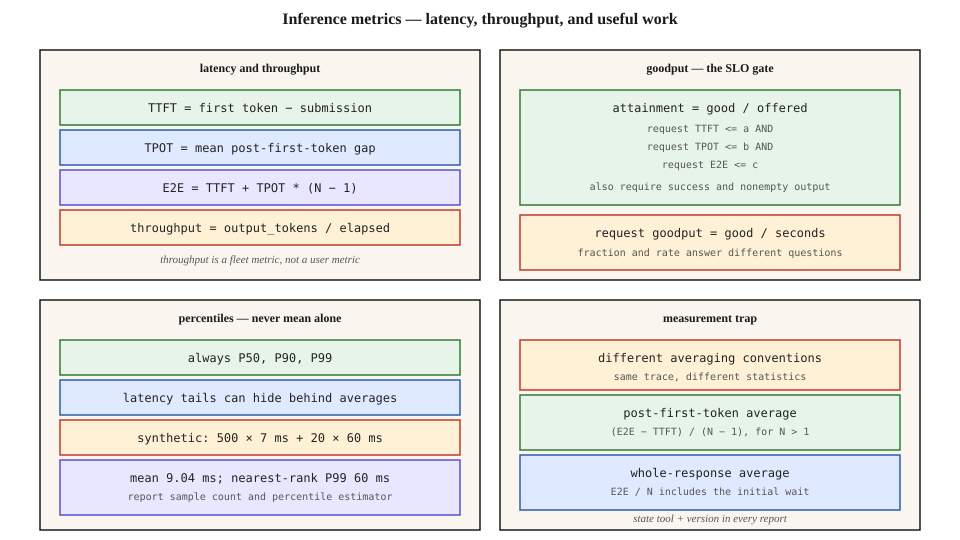

# Inference Metrics — TTFT, TPOT, ITL, Goodput, P99

[Back to courses](../README.md#infrastructure-and-production) · [Managed LLM Platforms](1-managed-llm-platforms.md) · [Prefill vs Decode](../../CHEAT_SHEET.md#prefill-vs-decode)

## The Problem

“Our throughput is 15,000 tokens per second.” That describes capacity, but it does not tell you whether users received useful responses on time. A service can produce many tokens while requests wait in queues, streams stall, or answers arrive after clients time out.

Inference has several latency components. Prefill processes input; decode generates subsequent tokens; scheduling, networking, and application work add delays. Compute and memory bottlenecks depend on the workload and deployment. Measure these effects separately, then evaluate whether each request met the product’s requirements.

**Analogy:** a restaurant can serve many dishes per hour while some customers wait too long. Time to the first dish, gaps between courses, total meal duration, and the share of meals served on time answer different questions.

## Define the Measurement Boundary First

For a streaming request, record a monotonic-clock submission timestamp `t0`, first nonempty token arrival `t1`, subsequent token arrival times, and last-token arrival `tN`. This lesson defines E2E as submission to last token. If your application instead measures the final protocol event or completed tool workflow, label that boundary separately.

Network chunks can contain multiple tokens. Chunk arrival gaps are not automatically individual token gaps; state how you tokenize responses and estimate timing when exact token arrival times are unavailable.

The diagram summarizes the metrics and contrasts two averaging conventions. Its numbers are illustrative, not provider performance targets.



## TTFT — Time to First Token

`TTFT = t1 − t0`

Client-observed TTFT includes request transmission, queueing, input processing/prefill, first-token selection, serialization, and return-path effects. These components may overlap, so “queue + network + prefill” is a diagnostic approximation, not a universal exact decomposition.

Long uncached prompts can increase prefill work; heavy load can increase queueing even for short prompts. Separate those causes with server-side traces. Ignore empty stream events when measuring the first useful token.

## TPOT and ITL — Average Pace Versus Individual Gaps

For `N > 1` output tokens:

`TPOT = (tN − t1) / (N − 1)`

This is a per-request average after the first token. An **inter-token latency (ITL)** sample is a gap `ti − t(i−1)`. Some tools use “ITL” to mean the average above; others report a distribution of gaps or another normalization. Publish the formula and tool version.

**Example:** gaps of 10, 10, and 100 ms give TPOT = 40 ms, but the user still experiences a 100 ms stall. P99 of per-request average TPOT is not P99 of all individual gaps. Pooling gaps weights long responses more heavily; averaging request TPOT values gives each request equal weight.

For a one-token response there are no post-first-token gaps, so TPOT is **undefined**, not zero. Define whether it is not applicable or makes a particular policy unevaluable. The calculator below treats it as not applicable while still requiring successful, nonempty output.

## E2E — End-to-End Latency

`E2E = tN − t0 = TTFT + (N − 1) × TPOT`

This identity holds for the same token-arrival boundary and TPOT definition. Do not add network time again to an already client-observed E2E measurement.

With TTFT = 500 ms, 100 output tokens, and 700 ms from first to last token: E2E = 1,200 ms and TPOT = `700/99 ≈ 7.07 ms`. Dividing the full E2E by all 100 tokens instead gives **12 ms/token**. Both arithmetic results are valid; they measure different things.

For long responses, generation often dominates E2E. For a short answer after a long prompt, TTFT may dominate. Report latency by input/output length, workload class, and cache status rather than comparing unlike requests as interchangeable.

## Throughput and Goodput

| Metric | Definition in this lesson | Unit |
| --- | --- | --- |
| Output throughput | Tokens received during the defined experiment / elapsed experiment time | Output tokens/s |
| Request throughput | Completed requests / elapsed experiment time | Requests/s |
| SLO attainment fraction | Successful requests meeting every per-request threshold / all offered requests | Fraction or percentage |
| Request goodput | Successful requests meeting every threshold / elapsed experiment time | Good requests/s |

**SLO** means service-level objective: a measurable target. An **SLA** is a contractual service-level agreement and may attach remedies to violations. Define the observation window, eligible population, and failures counted in either case.

For the same cohort and time window:

`request goodput = offered request rate × SLO attainment fraction`

The source calls the fraction “goodput”; other systems reserve that word for the rate. Report both with units. Do not multiply a completed-only request rate by an offered-request denominator without reconciling the populations.

**Example:** 1,000 offered requests over 100 seconds, with 900 successful requests meeting all thresholds, yields 90% attainment and **9 good requests/s**. Timeouts, errors, and empty responses remain in the denominator. Timing success alone does not establish semantic answer quality; measure that separately or add a defined quality gate.

## Joint Thresholds Versus Percentile Targets

A request-level gate might require:

- TTFT ≤ 500 ms.
- Average post-first-token TPOT ≤ 15 ms when applicable.
- Last-token E2E ≤ 2,000 ms.
- Successful, nonempty output.

These are **fictional teaching thresholds**, not universal chat-model targets. Evaluate the conjunction on each request before calculating the attainment fraction.

Requiring each metric’s population P99 to meet a target is different. If three constraints each fail on different 1% subsets, joint attainment can be 97%, even though each individually reaches 99%. Compute joint attainment directly; marginal percentiles cannot establish it.

## Percentiles: Keep the Mean, Expose the Tail

P50 is the median. P90 and P99 describe upper distribution quantiles; **P99 is not the worst case**. Means remain useful for aggregate cost and capacity analysis, but should not be the only latency statistics.

For 500 observations at 7 ms and 20 at 60 ms, the mean is about **9.04 ms** and nearest-rank P99 is **60 ms**. A low mean can conceal substantial stalls.

Choose and name a percentile estimator. This lesson uses nearest rank: sort `n` values and take rank `ceil(p × n)`, with ranks starting at 1. With only 50 observations, P99 is the sample maximum. That does not provide a stable estimate of rare production behavior. Collect enough representative traffic, repeat runs, report sample counts and uncertainty, and avoid averaging worker P99 values into a supposed fleet P99.

## Benchmark Tool Conventions

[NVIDIA’s metrics documentation](https://docs.nvidia.com/nim/benchmarking/llm/latest/metrics.html) defines first-token timing and a post-first-token average that subtracts TTFT and divides by output tokens minus one. Its current documentation uses AIPerf terminology. The source lesson’s GenAI-Perf/LLMPerf comparison should therefore be checked against the exact releases used, rather than treated as a timeless tool-name rule.

[LLMPerf’s repository](https://github.com/ray-project/llmperf) is archived. Retain tool version/commit, timing definitions, token-counting rules, warmup treatment, and raw observations with every report. A different name for a metric is less important than a different numerator or denominator.

## Build It: Calculate Latency and Joint Goodput

Copy the following into `goodput_demo.py` and run `python3 goodput_demo.py` with Python 3.10+. It evaluates synthetic token-arrival traces. No model or serving engine is called.

```python
from dataclasses import dataclass
from math import ceil, isfinite


@dataclass(frozen=True)
class Request:
    id: str
    arrivals_ms: tuple  # Relative to submission; one timestamp per output token.
    success: bool = True

    def __post_init__(self):
        if any(not isfinite(t) or t < 0 for t in self.arrivals_ms):
            raise ValueError("Arrival times must be finite and nonnegative")
        if any(b < a for a, b in zip(self.arrivals_ms, self.arrivals_ms[1:])):
            raise ValueError("Arrival times must be nondecreasing")

    def metrics(self):
        if not self.arrivals_ms:
            return None
        first, last = self.arrivals_ms[0], self.arrivals_ms[-1]
        gaps = tuple(b - a for a, b in zip(self.arrivals_ms, self.arrivals_ms[1:]))
        return {"ttft": first, "e2e": last,
                "tpot": sum(gaps) / len(gaps) if gaps else None,
                "gaps": gaps}


def percentile(values, p):
    if not 0 < p <= 1:
        raise ValueError("Percentile must be in (0, 1]")
    values = sorted(values)
    return values[ceil(p * len(values)) - 1] if values else None


def report(requests, elapsed_s, ttft_limit=500, tpot_limit=15, e2e_limit=2000):
    if not isfinite(elapsed_s) or elapsed_s <= 0:
        raise ValueError("Positive finite observation duration required")
    if len({r.id for r in requests}) != len(requests):
        raise ValueError("One record per logical request is required")
    if any(not isfinite(v) or v < 0 for v in (ttft_limit, tpot_limit, e2e_limit)):
        raise ValueError("Thresholds must be finite and nonnegative")
    good = 0
    successful_metrics = []
    for request in requests:
        m = request.metrics()
        if request.success and m is not None:
            successful_metrics.append(m)
            good += (m["ttft"] <= ttft_limit and m["e2e"] <= e2e_limit
                     and (m["tpot"] is None or m["tpot"] <= tpot_limit))
    # Partial output from failed requests counts as received tokens, not good work.
    tokens = sum(len(r.arrivals_ms) for r in requests)
    return {"offered": len(requests), "good": good,
            "attainment": good / len(requests) if requests else None,
            "good_requests_per_s": good / elapsed_s,
            "received_output_tokens_per_s": tokens / elapsed_s,
            "successful_nonempty": len(successful_metrics),
            "successful_ttft_p99_ms": percentile(
                [m["ttft"] for m in successful_metrics], 0.99),
            "successful_tpot_p99_ms": percentile(
                [m["tpot"] for m in successful_metrics if m["tpot"] is not None], 0.99)}


if __name__ == "__main__":
    requests = [Request("fast", (100, 110, 120)),
                Request("late-first", (600, 610)),
                Request("stall", (100, 110, 210)),
                Request("single", (200,)),
                Request("empty", ()),
                Request("failed", (100, 110), success=False)]
    # All offered requests and partial outputs belong to this synthetic window.
    result = report(requests, elapsed_s=2)
    assert result["good"] == 2
    assert result["attainment"] == 2 / 6
    assert result["good_requests_per_s"] == 1
    assert result["received_output_tokens_per_s"] == 5.5
    assert result["successful_tpot_p99_ms"] == 55
    assert report([], 1)["attainment"] is None
    assert percentile([7] * 500 + [60] * 20, .99) == 60
    print(result)
    print("All checks passed; synthetic traces only.")
```

The calculator keeps failed requests in the attainment denominator while naming latency summaries as successful-only. Do not hide failures by presenting those percentiles alone. An incomplete request at experiment end needs an explicit deadline/censoring policy; it must not disappear from the cohort.

The example has no submission timestamps across requests: the caller supplies the full experiment duration. In a real trace pipeline, derive that window explicitly and include drain time when using a completed finite-cohort benchmark. Do not infer fleet throughput by summing per-request tokens/second.

## Design a Useful Benchmark

1. Define workload classes, arrival patterns, input/output lengths, streaming mode, caching, and correctness requirements.
2. State the measurement boundary and capture attempts separately from logical requests.
3. Warm up deliberately, then sweep load below, near, and above expected operating demand. A fixed “2× peak concurrency” is not enough to characterize capacity.
4. Distinguish **open-loop load** (arrivals scheduled independently of completions) from **closed-loop load** (clients wait before sending another request). Closed-loop tests can hide queue buildup as latency rises.
5. Publish percentiles, sample counts, failures, throughput, attainment fraction, and good requests/second together.
6. Record model/version, hardware, serving-engine version, quantization, scheduler, concurrency, rate limits, prompt distribution, and client location.
7. Repeat runs and examine long-prompt and burst conditions. A deployment gate should compare compatible workloads with enough evidence, not one noisy P99 estimate.

**Example 1:** a streaming chat application needs fast first output and smooth continuation. Add a gap-based stall threshold if average TPOT hides pauses.

**Example 2:** a batch summarization job may not care about first-token delay. Its useful constraints may be completion deadline, cost, and factual quality.

For voice, time to first audible speech includes text-to-speech and buffering. Text TTFT is only one part of that user experience.

## Exercises

1. Tighten the TPOT threshold in the fixture. Identify which logical requests fail and recompute the rate and fraction.
2. Construct three disjoint 1% violation groups and show why three 99% marginal targets need not produce 99% joint attainment.
3. Compare P99 of pooled token gaps with P99 of per-request TPOT using one long response with a single large stall.
4. Add a maximum-gap gate and show a request passing average TPOT but failing the stall constraint.
5. Model 100 arrivals where 10 time out. Compare correct attainment with the misleading completed-only denominator.
6. Explain what model, workload, quality, and latency information is missing from a vendor’s “15,000 tokens/s” claim.

## Quick Cheat Sheet

| Term | Definition | Remember |
| --- | --- | --- |
| TTFT | Submission to first useful token | Initial wait |
| ITL sample | Gap between consecutive token arrivals | Streaming stall |
| TPOT | Average post-first-token time per token, under this convention | `(E2E − TTFT)/(N − 1)` |
| E2E | Submission to the chosen completion boundary | Define the endpoint |
| Throughput | Work divided by observation duration | Capacity, not a latency guarantee |
| SLO attainment | Fraction meeting the joint request-level gate | Good / offered |
| Request goodput | Rate of requests meeting the gate | Good / seconds |
| P99 | Estimated 99th percentile | Tail quantile, not worst case |
| Coordinated omission | Load generator suppresses arrivals during slow responses | Slow service can look healthier |

**Remember:** *first token, token gaps, final token, total work, useful work*. Keep units, populations, and measurement boundaries explicit.

## Resource

| Field | Details |
| --- | --- |
| Origin | [AI Engineering from Scratch — source lesson](https://github.com/rohitg00/ai-engineering-from-scratch/blob/main/phases/17-infrastructure-and-production/08-inference-metrics-goodput/docs/en.md) |
| Author | Rohit Ghumare and contributors |
| Level | Intermediate — repository assessment |
| Best for | Defining inference SLOs, comparing benchmark reports, diagnosing latency tails, and calculating request goodput |

Adapted from the MIT-licensed lesson and diagram; copyright © 2026 Rohit Ghumare. [Original license](../licenses/ai-engineering-from-scratch-LICENSE).

- [Source SVG](https://github.com/rohitg00/ai-engineering-from-scratch/blob/main/phases/17-infrastructure-and-production/08-inference-metrics-goodput/assets/metrics.svg).
- [NVIDIA inference metrics](https://docs.nvidia.com/nim/benchmarking/llm/latest/metrics.html).
- [LLMPerf repository](https://github.com/ray-project/llmperf).

Adapted on **2026-11-07**. Retains the source’s metric-by-metric explanation, goodput emphasis, benchmark-convention example, percentile discussion, and exercises. The companion SVG replaces the site-only throughput-latency figure. Corrects the output-token off-by-one, request versus population thresholds, tail arithmetic, and single-token handling. Unverified hardware reference timings and universal benchmark/SLO claims are omitted. The calculator uses synthetic traces and is not a serving-performance benchmark.

Source Markdown SHA-256: `20b9031b32843eb68b6903f07f830ea5835ffa01e81ba6c30a92ede732be48c2`.
