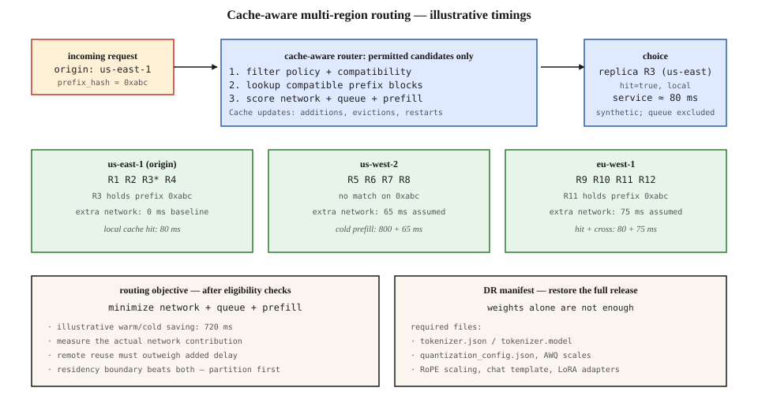

# Multi-Region LLM Serving and KV Cache Locality

[Back to courses](../README.md#infrastructure-and-production) · [Inference Metrics and Goodput](2-inference-metrics-goodput.md) · [Managed LLM Platforms](1-managed-llm-platforms.md)

## Why Routing Changes Inference Performance

Your service runs in three regions. A user asks several questions about the same long document, but each request reaches a different replica. Every replica may repeat the expensive work of processing that document, even though another replica has already done it.

**Simple analogy:** imagine three chefs preparing the same meal. One has already chopped the ingredients. Sending the order to that chef can save time—but not if their queue is much longer or delivering the food takes too long. You must also choose a kitchen permitted to handle the order.

Round-robin routing distributes requests without considering reusable computation. It can reduce cache locality when workloads share prefixes, although it remains a useful baseline. Cache-aware routing is valuable when reuse saves enough work to outweigh load imbalance and routing overhead.

A second problem appears during a regional outage: a backup containing model weights alone may not be enough to start the service. Tokenizers, model configuration, adapters, serving dependencies, and application state also matter.

## What Is KV Cache Locality?

A **Key-Value (KV) cache** stores attention keys and values computed for previously processed tokens. It avoids recomputing that attention state during autoregressive generation. **Prefix caching** extends reuse across requests that share a compatible beginning of their token sequence.

**Locality** means placing work near the reusable state—in the same replica, worker group, or accessible cache tier. A **replica** is an independently routable serving instance; it may span several GPUs.

For example, a document assistant can reuse the shared document prefix across questions. A conversation can reuse a cached portion of its earlier turns. vLLM documents automatic prefix caching as skipping computation for shared prefixes; it saves prefill work rather than directly accelerating generation of new output tokens. [vLLM prefix caching documentation](https://docs.vllm.ai/en/latest/features/automatic_prefix_caching/).

| Cache or state | What it stores | What a hit avoids |
| --- | --- | --- |
| Prefix KV cache | Intermediate attention state for a compatible token prefix | Recomputing that prefix |
| Response cache | A previously generated answer | Potentially the entire model call |
| Conversation store | Messages and application state | Losing session history after a restart |
| Model artifact store | Weights, tokenizer, configurations, adapters | Rebuilding or downloading an unavailable release |

These are different layers. Losing an ephemeral KV cache should normally cause a cold start, not loss of the authoritative conversation record.

## Cache-Aware Routing, Step by Step

1. **Filter candidates first.** Enforce permitted regions, tenant isolation, model and adapter compatibility, health, and capacity admission rules.
2. **Identify reusable prefixes.** Use token-prefix or block identifiers compatible with the serving engine. A shared string fragment is not sufficient evidence that internal tensors are reusable.
3. **Maintain a location index.** Workers report cache additions, evictions, and restarts. The router maps reusable blocks to candidate replicas.
4. **Estimate completion costs.** Combine network delay, queue delay, remaining prefill work, and any transfer overhead. For streaming applications, estimate TTFT and check decode constraints separately.
5. **Choose and observe.** Route to a suitable replica, compare predicted and actual reuse, and update estimates. A stale index must degrade safely to a miss or a bounded retry.

Do not query every worker synchronously on every request unless measurements justify that overhead. Event-fed indexes, periodic reconciliation, and bounded freshness are common design options. Event names and APIs depend on the implementation; a conceptual “block added” event is not a portable protocol.

The diagram illustrates routing among three regions. Its 80/800 ms service times and 65/75 ms network penalties are synthetic teaching assumptions, not hardware benchmarks or guaranteed regional latencies. Local network cost is absorbed into the baseline.



### A Prefix Hash Is a Lookup Hint, Not Proof

Two requests can share an initial token block while diverging later. Reuse only the compatible shared blocks; do not assume the entire prompt is cached because the first 512 tokens match.

A cache namespace should distinguish the model revision, relevant tokenizer/template preprocessing, adapters, tensor layout and precision where applicable, and tenant-sharing policy. The engine must validate reuse. Hash collision resistance and authorization remain separate concerns: knowing a hash does not grant access to another tenant’s state.

**Example:** a model deployment changes its chat template. Apparently identical user text now produces a different token sequence, so reuse can drop without any cache eviction bug.

**Example:** a popular system prompt routes most traffic to one hot worker. Allowing some cold prefill elsewhere can improve latency and goodput more than maximizing cache hit rate.

## The Routing Objective: Saved Work Versus Added Delay

A simple estimated first-token latency for candidate `i` is:

```text
TTFT_i ≈ network_i + queue_i + remaining_prefill_i + other_overhead_i
```

All terms must use compatible measurement boundaries. Network overhead is the relevant contribution to the request/first-token path; do not blindly add a round-trip time to a measurement that already includes it. **RTT** means round-trip time, not one-way propagation delay.

Prefer a remote candidate over a local one only when it is permitted and its expected savings exceed its additional costs:

```text
local_prefill − remote_prefill
    > extra_network + extra_queue + extra_transfer + extra_overhead
```

If routing to a replica that already owns the state, there may be no KV transfer. If moving KV state to a different worker, explicitly include serialization, transport, loading, and compatibility checks.

### Worked Examples

| Candidate | Network contribution | Queue | Remaining prefill | Estimated TTFT |
| --- | ---: | ---: | ---: | ---: |
| Local cold | 0 ms baseline | 20 ms | 800 ms | 820 ms |
| Remote warm | 75 ms extra | 40 ms | 80 ms | 195 ms |
| Remote warm but busy | 75 ms extra | 900 ms | 80 ms | 1,055 ms |
| Local warm | 0 ms baseline | 20 ms | 80 ms | 100 ms |

The lightly loaded remote worker beats the cold local one by 625 ms. The overloaded remote worker loses despite its cache hit. A warm local worker wins in this example.

For a short prompt, suppose cold prefill takes 30 ms and warm processing takes 10 ms. Saving 20 ms does not justify adding 75 ms of network delay before queueing is even considered.

These estimates guide routing; they do not replace measured P50/P99 latency or joint SLO attainment. A fast first token also does not guarantee smooth decoding. See [Inference Metrics and Goodput](2-inference-metrics-goodput.md).

## Routing to State Versus Moving State

| Approach | Advantage | Tradeoff |
| --- | --- | --- |
| Session affinity | Repeated turns often return to the same replica | Hot spots; affinity breaks on failure |
| Prefix-aware placement | Reuses computation across compatible requests | Index freshness and load balancing |
| Shared or tiered KV storage | Potentially recovers state beyond one worker | Transfer cost, layout compatibility, storage pressure |
| Replicating popular prefixes | Spreads hot-prefix traffic | Duplicate memory and warmup work |
| Cold recomputation | Simple fallback with no transfer dependency | More prefill compute and slower startup |

For ordinary dense attention, an illustrative unsharded KV footprint is:

```text
KV bytes ≈ 2 × layers × cached_tokens × KV_heads × head_dimension × bytes_per_element
```

The factor two represents keys and values. With 32 layers, 8 KV heads, head dimension 128, and two-byte elements, this is 128 KiB per token, or about 1 GiB for 8,192 tokens. This excludes allocator overhead, replication, and model-specific differences. It is not the size of the prompt text.

At an idealized effective bandwidth of 1 GB/s, moving 1 GiB alone takes about 1.07 seconds before fixed overhead. Recomputing a prefix can therefore be cheaper than transferring it. Quantization, sharding, partial-prefix transfers, and specialized architectures change the calculation.

## Managed Cross-Region Inference and Cache Control

Managed cross-region routing and application-controlled KV placement solve related but different problems. Do not assume that selecting a region or inference profile lets you select the individual worker holding your prefix.

Amazon Bedrock offers geographic and global cross-region inference profiles. The chosen profile defines possible processing regions; geographic profiles constrain that set to a geography. Inspect the profile and supported model rather than inferring the destination from the endpoint alone. [AWS cross-region inference documentation](https://docs.aws.amazon.com/bedrock/latest/userguide/cross-region-inference.html).

| Deployment | Questions to answer |
| --- | --- |
| Managed inference API | Which destinations are allowed? What caching guarantees and metrics are exposed? Can the caller control placement? |
| Generic multi-cluster gateway | Does it know only service health/load, or also reusable inference state? |
| Self-hosted cache-aware router | How are compatibility, eviction events, queues, and fallback handled? |

If a managed service does not expose KV placement, benchmark its observable behavior and use its supported controls. Adding an external router does not magically expose provider-internal caches.

## Region Policy Before Optimization

Represent each request’s permitted processing regions as an explicit policy derived from the deployment’s requirements. Apply that policy before scoring cache hits. Include prompts, retrieved documents, cached state, logs, traces, and backups in the design.

**Example:** a tenant contract allows processing only in approved EU regions. A warm US replica is ineligible even if it would respond faster. If all approved destinations fail, return a controlled failure or use an approved alternative; do not silently cross the boundary.

A user’s geographic location alone does not establish the applicable policy. Likewise, “EU data can never leave the EU” is not a substitute for determining actual requirements. This course uses explicit allowed-region sets as an engineering constraint.

## Python: Compare Routing Policies

This runnable standard-library example compares round-robin, local cache-aware, and global cache-aware selection. It uses a fixed snapshot, synthetic timings, and exact prefix keys. All strategies enforce region and model compatibility. It is a policy demonstration, not a load simulator or an integration with a serving engine.

```python
from dataclasses import dataclass, replace


@dataclass(frozen=True)
class Replica:
    name: str
    region: str
    model: str
    prefixes: frozenset
    queue_ms: float = 0
    healthy: bool = True


def choose(replicas, *, origin, allowed, model, prefix, network_ms,
           strategy="global", turn=0, cold_ms=800, warm_ms=80):
    if strategy not in {"round_robin", "local", "global"}:
        raise ValueError("Unknown routing strategy")
    eligible = [r for r in replicas
                if r.healthy and r.region in allowed and r.model == model]
    if strategy == "local":
        eligible = [r for r in eligible if r.region == origin]
    if not eligible:
        raise RuntimeError("No permitted healthy compatible destination")

    def estimate(r):
        return (network_ms[r.region] + r.queue_ms
                + (warm_ms if prefix in r.prefixes else cold_ms))

    if strategy == "round_robin":
        selected = eligible[turn % len(eligible)]
    else:
        selected = min(eligible, key=lambda r: (estimate(r), r.name))
    return selected.name, estimate(selected), prefix in selected.prefixes


replicas = [
    Replica("east-cold", "us-east", "model-v1", frozenset(), 20),
    Replica("west-warm", "us-west", "model-v1", frozenset({"tenant-a:p1"}), 40),
    Replica("eu-warm", "eu-west", "model-v1", frozenset({"tenant-a:p1"}), 10),
]
args = dict(origin="us-east", allowed={"us-east", "us-west"},
            model="model-v1", prefix="tenant-a:p1",
            network_ms={"us-east": 0, "us-west": 75, "eu-west": 60})

for strategy in ("round_robin", "local", "global"):
    print(strategy, choose(replicas, strategy=strategy, **args))

assert choose(replicas, **args) == ("west-warm", 195, True)
assert choose(replicas, strategy="local", **args) == ("east-cold", 820, False)
busy = [replicas[0], replace(replicas[1], queue_ms=900), replicas[2]]
assert choose(busy, **args)[0] == "east-cold"
assert choose(replicas, **{**args, "allowed": {"us-east"}})[0] == "east-cold"
try:
    choose(replicas, **{**args, "allowed": set()})
except RuntimeError:
    pass
else:
    raise AssertionError("Routing must fail when no region is permitted")
```

Expected estimates are 820 ms for the first round-robin choice, 820 ms for local-only routing, and 195 ms for global cache-aware routing. The EU replica is excluded by policy despite being warm.

Production extensions include finite/nonnegative input validation, partial-prefix matches, namespace verification, stale-event handling, queue evolution, capacity reservations, request deadlines, bounded retries, and measured cost. The example deliberately treats the prefix index as a snapshot; it neither warms nor evicts caches.

## Disaster Recovery: Restore a Release, Not Just Weights

**Disaster recovery (DR)** restores service after a major failure. **Recovery time objective (RTO)** is the target time to restore the required service level. **Recovery point objective (RPO)** is the maximum acceptable age of recovered durable data.

Organize the recovery manifest into three bundles, not literally three files:

| Bundle | Include | Validate |
| --- | --- | --- |
| Model release | Weight shards and indexes; tokenizer and vocabulary assets; model configuration; positional settings; chat templates; quantization metadata; adapter files and manifests | Pinned revisions and checksums; compatible tokenizer/model/adapters |
| Serving runtime | Container image digest, dependencies, engine configuration, GPU/runtime requirements, parallelism, sampling defaults | Starts on available hardware; passes a known inference fixture |
| Deployment and application | Infrastructure manifests, routing policy, quotas, artifact access, secret references, retrieval indexes, durable conversations, monitoring | Can be restored independently of the failed region |

Store secret references and recovery procedures appropriately; do not place plaintext credentials in the manifest. Quantization formats and artifact filenames differ, so inventory the actual release instead of relying on a universal filename list.

### Rehearse the Cold Path

1. Restore a pinned release into a clean recovery environment.
2. Check artifact integrity and load the tokenizer, model, and every required adapter.
3. Run representative inference and application checks, including retrieval and authorization.
4. Shift a controlled share of traffic and measure cold-start TTFT, errors, queueing, and goodput.
5. Warm important prefixes only where permitted; confirm capacity during the warmup surge.
6. Exercise failback, rollback, stale router entries, and recovery of durable state.

Measure recovery from incident start to the agreed service target—not merely to the first healthy process. A warm model with an empty prefix cache may be available but initially fail latency targets. Schedule drills according to the service’s risk and recovery objectives; do not substitute an unverified industry recovery time for your own measurement.

## What to Monitor

| Signal | What it reveals |
| --- | --- |
| Cached input tokens / eligible input tokens | How much prefix computation was reused; define eligibility and block accounting |
| Requests with any hit / eligible requests | Hit frequency, which can hide very small matched prefixes |
| Predicted hits versus actual hits | Stale indexes, eviction races, incompatible namespaces |
| TTFT P50/P99 by region, hit status, and prompt length | Whether locality improves user-visible delay |
| Queue delay, admission rejects, and active load | Hot-prefix imbalance or insufficient capacity |
| Cross-region requests, bytes, and cost | Whether remote reuse is worth the transport expense |
| SLO attainment and good requests/second | Whether the overall routing policy delivers useful work |
| Recovery duration and cold-cache performance | Whether failover meets the product target |

If hit rate falls sharply, check prompt/template changes, model or adapter revisions, cache eviction pressure, new replica warmup, affinity changes, and missing cache events. Compare matched-prefix lengths as well as binary hit rate.

## Exercises

1. Change the example’s remote network penalty and queue. Find the boundary at which cold local execution wins.
2. Make the warm replica unhealthy. Verify that no strategy chooses it and that region restrictions still hold.
3. Add partial-prefix lengths and estimate remaining prefill cost from measured data rather than a constant hit/miss pair.
4. Design a complete recovery manifest for a quantized model with five adapters. Explain how you verify each artifact.
5. Propose an experiment comparing round-robin and cache-aware routing under repeated, unique, and bursty prefixes. Report goodput as well as hit rate.
6. Explain why a remote cache hit might reduce TTFT while increasing cost or worsening token-stream latency.

## Quick Cheat Sheet

| Term | Crisp definition | Remember |
| --- | --- | --- |
| KV cache | Intermediate attention keys and values | Reusable computation, not an answer |
| Prefix locality | Request placement near compatible cached prefix state | Follow state when the savings justify it |
| Cache-aware router | Chooses replicas using reuse information and serving costs | Hit rate is not the objective by itself |
| RTT | Time for a network round trip | Avoid double-counting it |
| Eviction | Removal of cached state | A router’s hit prediction can become stale |
| Affinity | Preference for the same destination across related requests | Helps reuse; can create hot spots |
| RTO | Target time to restore service | Include usable performance |
| RPO | Maximum acceptable loss window for durable data | Separate from ephemeral cache loss |
| DR manifest | Inventory needed to restore a complete release | Model + runtime + deployment |

**Remember:** *permission first, compatibility next, then network + queue + remaining work*. Restore the whole serving system and expect a cold-cache period.

## Resource

| Field | Details |
| --- | --- |
| Origin | [AI Engineering from Scratch — source lesson](https://github.com/rohitg00/ai-engineering-from-scratch/blob/main/phases/17-infrastructure-and-production/11-multi-region-kv-locality/docs/en.md) |
| Author | Rohit Ghumare and contributors |
| Level | Intermediate — repository assessment |
| Best for | Multi-region inference design, cache locality, latency/cost tradeoffs, routing policy, and disaster-recovery interviews |

Adapted from the MIT-licensed lesson and companion diagram; copyright © 2026 Rohit Ghumare. [Original license](../licenses/ai-engineering-from-scratch-LICENSE).

- [Source diagram](https://github.com/rohitg00/ai-engineering-from-scratch/blob/main/phases/17-infrastructure-and-production/11-multi-region-kv-locality/assets/router.svg).
- [vLLM automatic prefix caching](https://docs.vllm.ai/en/latest/features/automatic_prefix_caching/).
- [AWS Bedrock cross-region inference](https://docs.aws.amazon.com/bedrock/latest/userguide/cross-region-inference.html).

Adapted on **2026-11-07**. Retains the source’s routing, network tradeoff, recovery-manifest, and residency-policy themes. Timings are illustrative; unsupported failure percentages and named recovery anecdotes are omitted. The Python example is a standalone policy demonstration. Diagram labels are adapted to include policy and queueing and remove unsupported implementation-specific claims.

Source Markdown SHA-256: `715c39184d431b6e4e6c489256679acb56a91702a328054e24416cbefbdc801f`.
