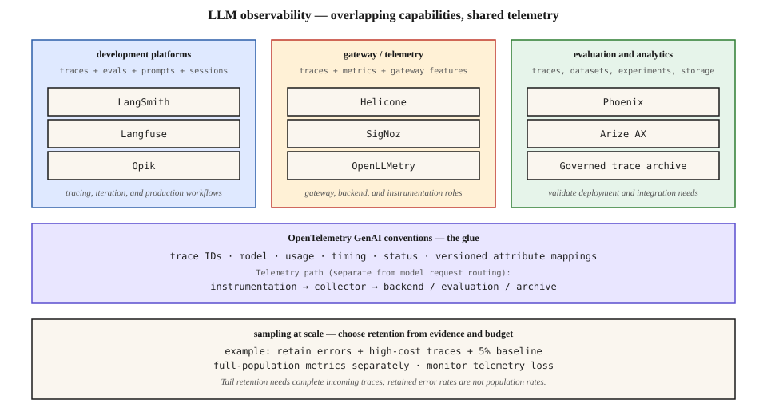

# LLM Observability — Traces, Evaluation, Sampling, and Stack Selection

[Back to courses](../README.md#infrastructure-and-production) · [Inference Metrics and Goodput](2-inference-metrics-goodput.md) · [Multi-Region Serving and KV Cache Locality](3-multi-region-kv-locality.md)

## Why Infrastructure Monitoring Is Not Enough

Your application returns HTTP 200, but the answer is wrong. Another request succeeds after seven unnecessary tool calls. A third uses an expensive fallback model and exceeds its budget. CPU dashboards alone cannot explain these failures.

**Observability** is the ability to understand a system’s behavior from the evidence it emits. For an LLM application, that evidence must connect the user request to retrieval, model calls, tool execution, latency, usage, and output quality.

**Analogy:** a restaurant’s electricity meter tells you how much power it used. Order tickets tell you which dishes were delayed and which kitchen station caused the problem. Customer feedback tells you whether the food was good. You need all three views—not just a bigger electricity dashboard.

Choose a stack by the questions you need to answer, then test its integration, operating cost, deployment options, and data handling. A product name is not an observability strategy.

## Metrics, Traces, Logs, and Evaluations

| Signal | Definition | LLM example | Limitation |
| --- | --- | --- | --- |
| Metric | Numerical measurement aggregated over time | Request rate, TTFT histogram, token usage | Usually cannot explain one specific failure |
| Trace | Connected record of operations belonging to a request or workflow | Retrieval → model → tool → model | Shows execution; does not prove answer correctness |
| Span | One timed operation within a trace | A vector search or one provider attempt | Needs context to explain the whole workflow |
| Log | Timestamped event with structured fields | Retry scheduled after a rate-limit error | Can be difficult to correlate without identifiers |
| Evaluation | Assessment against a defined criterion | Citation support, task success, tool-argument validity | Depends on rubric, labels, and evaluator reliability |

**Telemetry** means the measurements and records emitted by the application. **Instrumentation** is the code or integration that emits them. A **session** groups related interactions; one session may contain many traces. Session viewing is not automatically safe or deterministic replay of tool side effects.

An **eval** can run offline on a dataset or online against production outputs. A successful model API call and a successful user task are different outcomes.

## Trace the Whole Request

```text
answer_request                         trace root
├── authorize_and_load_context
├── retrieve_documents
│   ├── vector_search
│   └── rerank
├── model_turn_1
│   ├── provider_attempt_1             rate limited
│   └── provider_attempt_2             succeeds
├── execute_tool                       validated arguments
└── model_turn_2                        final streamed answer
```

Capture a stable trace ID, parent-child relationships, operation names, start/end times, and status. Model attempts should be distinguishable from logical turns so that retries and fallback costs do not disappear.

For parallel tools, sibling spans overlap. Adding every span’s duration overstates end-to-end latency: elapsed time follows the workflow’s critical path. For asynchronous evaluations, link the evaluation result to the original trace or response instead of keeping the request span open until an evaluator finishes.

**Example: slow RAG.** Retrieval takes 50 ms, reranking 80 ms, and a model call waits 2 seconds before its first token. Investigate provider queueing, prompt size, and cache reuse before replacing the vector database.

**Example: runaway agent.** Eight repeated calls to the same search tool have valid HTTP responses but add no new evidence. Record tool count, argument signatures where safe, termination reason, and task outcome; network error rate alone misses the loop.

## Instrument at Complementary Layers

| Layer | What it sees well | What it can miss |
| --- | --- | --- |
| Application/framework | User task, retrieval, tools, state transitions, prompt version | Provider internals and uninstrumented dependencies |
| Model SDK/client | Provider attempts, model names, usage, request timing | Business intent and steps outside the model call |
| Gateway/proxy | Calls passing through it, routing, retries, usage controls | Local tools, retrieval, and traffic bypassing the gateway |
| Infrastructure/APM | Queues, service health, network, database and host signals | Answer quality and task-specific success |

**APM** means application performance monitoring. Combining layers improves coverage, but duplicate instrumentation can double-count calls and cost. Assign ownership for each span and propagate context across service boundaries.

A gateway sits on the request path. A telemetry collector receives observations; it does not normally execute the model request. Do not confuse these two flows.

## An OpenTelemetry-Based Architecture

**OpenTelemetry (OTel)** provides APIs, SDKs, and collection mechanisms for telemetry. **OTLP** is its telemetry transport protocol. **Semantic conventions** define shared names and meanings for attributes. A **collector** can receive, process, and export telemetry to backends.

```text
REQUEST PATH:  application → optional gateway → model provider
                    │               │
                    └── telemetry ──┘
                             ↓
                 collector / export pipeline
                    ├── operational backend
                    ├── selected traces for evaluation
                    └── optional governed archive
```

The diagram groups capabilities for comparison. Products overlap across these groups; it is not a mutually exclusive market taxonomy.



### Define a Small Telemetry Contract

| Information | Capture | Why it matters |
| --- | --- | --- |
| Service identity | Service, environment, deployment version | Separate a release regression from global provider behavior |
| Model call | Provider, requested model, returned model when available, operation | Understand routing and fallback |
| Usage | Input/output tokens, available cached-token categories, source of usage | Reconcile cost and cache behavior |
| Timing | Request duration, TTFT, streaming gaps where measurable | Separate initial delay from slow continuation |
| Outcome | Success/error, bounded error category, retry count, finish reason | Avoid treating retries as free or partial output as success |
| Application context | Prompt version, retrieval configuration, tool name | Explain behavior changes |
| Evaluation | Criterion, score, evaluator/rubric version, linked response | Make quality results interpretable |

Examples of familiar GenAI attribute names include `gen_ai.request.model`, `gen_ai.usage.input_tokens`, and `gen_ai.usage.output_tokens`. Treat the exact schema as versioned: align the instrumentation package, semantic-convention version, and backend mapping. Do not assume older `gen_ai.system` examples are interchangeable with newer provider fields. Consult the [OpenTelemetry GenAI convention entry point](https://opentelemetry.io/docs/specs/semconv/gen-ai/), which directs readers to the [maintained specification repository](https://github.com/open-telemetry/semantic-conventions-genai).

“Supports OTel” does not guarantee identical rendering of tool spans, token fields, prompt messages, or evaluation scores. Test a representative trace through every destination, preserving trace IDs and checking for lost or duplicated fields.

## Compare Tools by Capability

The source discusses development platforms and gateway/telemetry tools. Those are useful starting points, but evaluation, prompt management, tracing, and gateway features increasingly overlap. The table below gives evaluation starting points, not a ranking or a price sheet.

| Tool | Useful starting point | What to validate in a proof of concept |
| --- | --- | --- |
| [Langfuse](https://langfuse.com/docs) | Integrated tracing, prompt management, evaluation, and self-hosting | Operational dependencies, access controls, retention, export, and edition boundaries |
| [LangSmith](https://docs.langchain.com/langsmith/observability) | Trace debugging and production monitoring across supported frameworks, including LangChain/LangGraph | Your actual SDK integrations, deployment terms, and trace/eval costs |
| [Phoenix](https://arize.com/docs/phoenix) | Tracing, evaluations, datasets, experiments, and prompt workflows | Production deployment, storage, backup, authentication, and retention requirements |
| [Arize AX](https://arize.com/docs/ax) | Observability and evaluation workflows for production AI systems | Data integration, query behavior, governance, and total cost on your workload |
| [Helicone](https://docs.helicone.ai/) | Gateway-oriented integration with usage, sessions, and observability | Streaming behavior, retry visibility, proxy overhead, and application-level trace coverage |
| [Opik](https://www.comet.com/docs/opik/) | Tracing and evaluation for iterative LLM application development | Dataset workflow, integration fidelity, self-host operations, and experiment reproducibility |
| [SigNoz](https://signoz.io/docs/) | Service-wide traces, metrics, logs, dashboards, and alerts | LLM-specific field interpretation and how evaluation results join operational telemetry |
| [OpenLLMetry](https://github.com/traceloop/openllmetry) | OpenTelemetry-based instrumentation for LLM applications | SDK coverage, attribute versions, and exporter/backend compatibility; it is not a standalone analysis backend |

Phoenix has production deployment guidance; it should not be dismissed as development-only. LangSmith documents integrations beyond LangChain. Verify current licensing for the exact components and edition you deploy rather than assuming the entire product shares one repository license.

### Three Example Stack Choices

**A small SDK-based assistant:** begin with application spans, model-call instrumentation, and one backend. Add a gateway if routing, rate limits, or centralized provider access justify another dependency.

**A multi-step RAG agent:** prioritize nested traces, retrieval/tool inspection, prompt versions, dataset creation from failures, and evaluation links. A token dashboard alone is insufficient.

**An established service platform:** integrate LLM spans with the existing operational backend, then add specialized evaluation workflows if needed. Compare data duplication and operational burden before sending every full payload to multiple systems.

For each candidate, test a timeout, retry, streamed response, parallel tool call, and redacted prompt. Check that the exported data remains useful outside the vendor UI.

## Metrics That Make a Dashboard Useful

| Area | Metrics | Investigation it supports |
| --- | --- | --- |
| Reliability | Offered requests, failures, timeouts, retry attempts, incomplete streams | Is the application actually completing work? |
| Latency | TTFT and E2E percentiles; token-gap distributions; tool/retrieval timing | Where is the wait? |
| Usage and cost | Tokens, model mix, cached-input usage, estimated cost per completed task | Why did spending change? |
| Agent behavior | Steps, repeated tools, budget exits, handoffs | Is the workflow making progress? |
| Quality | Task success, citation support, schema validity, human feedback | Are outputs useful and correct? |
| Telemetry health | Export failures, dropped spans, queue saturation, missing parent spans | Can the monitoring evidence itself be trusted? |

Define denominators. “Error rate” could mean errors per provider attempt or failed logical requests per offered request. “Cost per task” must include retries and failed work according to an explicit allocation policy. Keep estimated cost separate from provider invoices.

Use bounded labels such as environment, model family, and operation. User IDs, full prompts, trace IDs, and arbitrary URLs can create **high cardinality**—too many distinct metric series. Keep request-specific identifiers in appropriately controlled traces or logs instead.

An evaluator’s score is evidence with uncertainty, not ground truth. Track rubric and judge versions, inspect disagreements, and compare sampled scores against human labels before using them as automatic release gates.

## Sampling: Preserve Useful Evidence Without Distorting Metrics

**Head sampling** decides near trace start. **Tail sampling** waits for later information, such as errors or total latency. A head sampler cannot know a future failure; tail sampling cannot recover spans discarded upstream. Tail decisions also require buffering and consistent routing of a trace’s spans. [OpenTelemetry sampling concepts](https://opentelemetry.io/docs/concepts/sampling/).

One example retention policy is: keep received error traces, retain expensive traces, and keep a deterministic 5% baseline of the rest. This is a policy illustration, not a universal production default. Outages can make “keep every error” exceed collector or storage capacity, so provision and monitor limits explicitly.

Keep full-population counters and histograms through a separate metrics path where practical. Error-enriched retained traces are excellent debugging evidence but are not an unbiased estimate of production error rate or latency percentiles.

### Python: Compare Retention Policies

This standard-library example operates on completed synthetic traces. It models a tail-retention decision after collection, not an OTel sampler or a live deployment. SHA-256 gives a stable baseline selection for a given trace ID across processes.

```python
from dataclasses import dataclass
from hashlib import sha256


@dataclass(frozen=True)
class Trace:
    trace_id: str
    error: bool
    cost_usd: float
    size_bytes: int


def baseline(trace_id, rate=0.05):
    if not 0 <= rate <= 1:
        raise ValueError("Sampling rate must be between zero and one")
    bucket = int.from_bytes(sha256(trace_id.encode()).digest()[:8], "big")
    return bucket < int(rate * (1 << 64))


def retain(trace, policy):
    if policy == "all":
        return True
    if policy == "baseline":
        return baseline(trace.trace_id)
    if policy == "priority":
        return (trace.error or trace.cost_usd >= 0.10
                or baseline(trace.trace_id))
    raise ValueError("Unknown policy")


def summarize(traces, policy, ingest_usd_per_gb=0.50):
    # Synthetic linear ingest price, decimal GB; not a vendor quote.
    kept = [t for t in traces if retain(t, policy)]
    errors = sum(t.error for t in traces)
    retained_errors = sum(t.error for t in kept)
    gb = sum(t.size_bytes for t in kept) / 1_000_000_000
    return {
        "offered": len(traces), "retained": len(kept),
        "population_error_rate": errors / len(traces) if traces else None,
        "retained_error_rate": retained_errors / len(kept) if kept else None,
        "errors_missing": errors - retained_errors,
        "export_gb": gb, "illustrative_ingest_usd": gb * ingest_usd_per_gb,
    }


traces = [Trace(f"trace-{i}", i % 100 == 0,
                0.20 if i % 50 == 0 else 0.01, 20_000)
          for i in range(100_000)]
for policy in ("all", "baseline", "priority"):
    print(policy, summarize(traces, policy))

assert summarize(traces, "all")["export_gb"] == 2
assert summarize(traces, "priority")["errors_missing"] == 0
assert summarize(traces, "priority")["population_error_rate"] == 0.01
assert all(retain(t, "priority") for t in traces if t.cost_usd >= 0.10)
assert not baseline("example", 0)
assert baseline("example", 1)
assert summarize([], "all")["population_error_rate"] is None
```

Full export is 2 GB and costs $1 at the invented $0.50/GB ingestion price. Priority retention keeps all 1,000 observed errors and all 2,000 expensive traces; these sets overlap, so do not add them twice. Its retained error fraction is higher than the actual 1% population rate.

This example assumes complete traces reach the retention step. Real exporters can drop data, and tail buffers can expire before long-running traces finish. Monitor those losses separately. The code omits authentication, buffering, persistent storage, and live instrumentation.

## Budget for Total Cost, Not Just Ingestion

```text
monthly cost ≈ ingestion + retained storage + queries + evaluation calls
               + seats/platform fees + network + operational labor
```

Example assumptions: one million traces per day at 20 KB each produce 20 GB/day, or 600 GB over a 30-day month. Uniform 5% retention produces about 30 GB/month before error/cost overrides. This measures exported volume, not the full cost of producing and buffering telemetry.

An ingest price per GB is different from storage priced per GB-month. Retained storage depends on the retention window, compression, indexes, and replication. A “zero-copy” architecture may avoid some duplication, but still incurs storage, query compute, access, and operating costs. Measure the same retention and query workload when comparing systems; there is no universal 100× savings multiplier.

Similarly, a proxy adding 20 ms to each request is a hypothetical input, not a product guarantee. Assess both relative and absolute budget impact. Do not obtain combined P99 latency by blindly adding two independently measured P99s.

## Protect Content and Keep Export Off the Critical Path

Capture metadata by default; enable prompt/response content only for a defined debugging or evaluation need. Redact secrets and sensitive fields before export. Review attachments, retrieved documents, tool arguments, and tool outputs as well as the user prompt.

Use bounded asynchronous export queues, clear drop/backpressure behavior, restricted access, and explicit retention/deletion policies. Avoid making application availability depend on the observability backend unless that is a deliberate requirement. A second backend doubles some data-handling obligations even when export is technically easy.

**Example:** store prompt version, token count, retrieval document identifiers, and a redacted failure category while withholding document text. A separate approved dataset can support deeper evaluation without retaining every production payload.

## Exercises

1. Draw a trace for a RAG agent with two parallel tools, one retry, and an asynchronous evaluator. Identify the critical path.
2. Extend the sampling example with a rare slow-request cohort. Compare retained versus population latency distributions.
3. Evaluate two candidate backends using the same streamed request and tool failure. Check span relationships, usage accounting, export, and deletion.
4. Calculate monthly cost at 5 million traces/day with 10 KB and 100 KB payloads. Separate ingestion, retention, and evaluation assumptions.
5. Design a content-free telemetry contract that can still diagnose a prompt-version regression.
6. Explain why a 100% error-retention policy cannot guarantee complete error traces after upstream head sampling.

## Quick Cheat Sheet

| Concept | Meaning | Remember |
| --- | --- | --- |
| Trace | Connected execution record | The whole journey |
| Span | Timed operation in a trace | One step |
| Metric | Aggregated measurement | Population health |
| Evaluation | Quality assessment against a criterion | Correctness needs more than status 200 |
| OTel / OTLP | Instrumentation ecosystem / telemetry transport | Common plumbing, not guaranteed UI equivalence |
| Semantic convention | Shared field name and meaning | Pin versions and test mappings |
| Head sampling | Early keep/drop decision | Cannot see future failures |
| Tail sampling | Decision using later trace evidence | Needs buffers and upstream visibility |
| Cardinality | Number of distinct label combinations | Keep metrics labels bounded |
| Retention | How long recorded data is kept | Separate from sampling and ingestion |

**Remember:** *metrics tell you how often; traces help explain why; evaluations assess how well*. Select tools around those needs and measure the observability pipeline itself.

## Resource

| Field | Details |
| --- | --- |
| Origin | [AI Engineering from Scratch — source lesson](https://github.com/rohitg00/ai-engineering-from-scratch/blob/main/phases/17-infrastructure-and-production/13-llm-observability/docs/en.md) |
| Author | Rohit Ghumare and contributors |
| Level | Intermediate — repository assessment |
| Best for | Observability stack selection, tracing agent workflows, sampling, telemetry cost, and production debugging interviews |

Adapted from the MIT-licensed source lesson and diagram; copyright © 2026 Rohit Ghumare. [Original license](../licenses/ai-engineering-from-scratch-LICENSE).

- [Source diagram](https://github.com/rohitg00/ai-engineering-from-scratch/blob/main/phases/17-infrastructure-and-production/13-llm-observability/assets/stack.svg).
- [OpenTelemetry GenAI conventions](https://opentelemetry.io/docs/specs/semconv/gen-ai/).
- [OpenTelemetry sampling](https://opentelemetry.io/docs/concepts/sampling/).
- Product documentation is linked in the comparison table.

Adapted on **2026-11-07**. Preserves the source’s stack-selection, OTel integration, sampling, and cost themes. Replaces fixed prices and unverified savings claims with explicit assumptions; corrects rigid product categories and development-only characterizations. The executable example uses synthetic data and does not test a live observability service.

Source Markdown SHA-256: `eef0e8c56bfce6c48914766194c3fb738c7c4998fee43471c54038f447df1cc2`.
