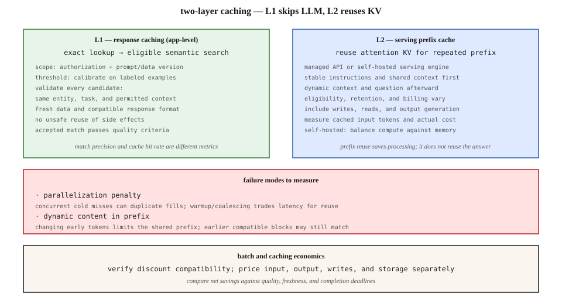

# Prompt Caching and Semantic Caching Economics

[Back to courses](../README.md#infrastructure-and-production) · [LLM Observability](4-llm-observability.md) · [KV Cache Locality](3-multi-region-kv-locality.md)

## Why Adding a Cache May Not Reduce the Bill

Your application repeats a long system prompt, but every request inserts a timestamp before the reusable instructions. Another service caches answers to similar questions but occasionally returns yesterday’s account balance. Both systems have a cache; neither has a sound reuse policy.

Caching means reusing earlier work when that work is still valid. There are two different questions: **can we reuse the answer?** and **can we reuse some computation while generating a new answer?**

**Analogy:** a restaurant can serve a prepared dish, or it can reuse chopped ingredients while cooking a fresh dish. Response caching serves the dish. Prefix caching reuses the preparation. A similar-looking order is not necessarily interchangeable if the customer has different dietary requirements.

## Three Mechanisms, Two Layers

This lesson uses **L1** for application response caching and **L2** for model-serving prefix caching. These are teaching labels, not universal provider terminology or CPU-cache levels.

| Mechanism | Match criterion | Reused object | Work avoided |
| --- | --- | --- | --- |
| Exact response cache | Same effective request and validity context | Completed response | Model call, and possibly retrieval/tool work |
| Semantic response cache | Compatible context plus validated similarity | Response to a different but equivalent request | Model call after lookup and validation |
| Prompt/prefix cache | Compatible shared input-token prefix | Attention Key-Value state or equivalent serving state | Processing the matched prefix; output is still generated |

A **Key-Value (KV) cache** contains intermediate attention keys and values. **Prefill** processes the input; **decode** generates subsequent tokens. Prefix reuse saves prefill work, not the cost of producing the entire answer. [vLLM prefix caching documentation](https://docs.vllm.ai/en/latest/features/automatic_prefix_caching/).

A response cache is different from an embedding cache, which stores vector representations so they do not need to be computed again. An exact hash lookup also does not perform semantic matching.



## Prefix Caching: Keep the Beginning Stable

A provider or serving engine can reuse a compatible prefix already processed for an earlier request. The request still supplies the dynamic suffix and receives newly generated output.

```text
Less reusable:
[current time + request ID]
[long instructions + examples + reference material]
[user question]

More reusable, when instruction semantics permit:
[stable instructions + stable examples]
[shared reference material, if identical and authorized]
[request-specific context + user question]
```

Changing an early token can prevent reuse of the later portion, but it does not necessarily invalidate every earlier shared block. Cache eligibility, minimum prefix length, block boundaries, eviction, routing, and retention behavior vary by implementation.

**Example 1:** a document assistant receives many questions about the same document. A stable document prefix can be useful, while the questions remain different.

**Example 2:** a classification service uses a fixed rubric and examples. Stable ordering helps reuse. Randomizing the examples for every request sacrifices shared-prefix opportunities.

Do not move authoritative instructions into a lower-priority message or remove needed context just to improve hit rate. Preserve application behavior and authorization boundaries while restructuring prompts.

### Provider and Self-Hosted Behavior

Managed APIs may offer automatic reuse, explicit cache markers, named cached contexts, or combinations of these. Verify the selected model and endpoint rather than generalizing one provider’s semantics.

Claude documents `cache_control` at the request level or on content blocks, with five-minute and one-hour retention options. Its documentation describes cache availability after the response starts and distinguishes cache reads from creation. Check the current model’s eligibility and rates before estimating savings. [Claude prompt caching documentation](https://platform.claude.com/docs/en/build-with-claude/prompt-caching).

A self-hosted system trades prefill computation against cache memory, eviction, and placement. There is no provider discount to collect, but saved GPU work can improve throughput or latency. See [KV Cache Locality](3-multi-region-kv-locality.md) for routing and transfer tradeoffs.

**TTL**, or time to live, is a cache entry’s retention interval. Some systems refresh it on reads; others use fixed expiration or explicit refresh. Treat retention as provider-specific and freshness as a separate application policy.

## Semantic Caching: Similar Meaning Is Only the First Filter

An **embedding** maps content to a numerical vector. **Cosine similarity** compares vector direction:

```text
cosine(a, b) = dot(a, b) / (norm(a) × norm(b))
```

The score is not a probability that two requests have the same answer. Its useful threshold depends on the embedding model, task, language, and candidate population. There is no universal safe threshold such as 0.95.

A practical response-cache path is:

1. Check whether the operation is cacheable at all.
2. Construct a namespace from authorization scope, model/prompt version, data version, and relevant request context.
3. Try an exact response match first.
4. For eligible misses, embed the request and search only compatible entries.
5. Validate the semantic candidate, its expiration, and any task-specific constraints.
6. Return a valid cached answer or generate a fresh one and conditionally store it.

**Safe-looking candidate:** “How do I reset my password?” and “Where can I change a forgotten password?” may share an answer within the same product and policy version.

**Dangerous candidate:** “Can I cancel order 123?” and “Can I cancel order 456?” are semantically similar but depend on different entities and states. “Enable access” and “disable access” also share many words while requiring opposite behavior.

### Cache Keys Must Describe the Effective Request

Include or otherwise enforce the dimensions that change answer validity:

| Dimension | Example |
| --- | --- |
| Authorization scope | Tenant, user, role, or approved shared-public scope |
| Instruction version | System prompt, tool schema, policy, output schema |
| Model configuration | Model revision and settings when they affect the contract |
| Data version | Knowledge-base snapshot, product-policy revision, retrieval context |
| Request context | Locale, entity IDs, conversation state, personalization |
| Time validity | Expiration or dependency-driven invalidation |

A hash is not authorization. Recheck access when serving a hit; a user’s permissions may have changed since the entry was written. Avoid storing failed, partial, unvalidated, or sensitive responses unless the application has an explicit suitable policy.

An answer cache also does not provide **idempotency** for a side-effecting operation. Idempotency means repeated execution requests produce the intended effect only once; returning an old message cannot guarantee a payment or tool action was performed correctly.

## Measure Hit Rate and Correctness Separately

| Metric | Definition | Why it matters |
| --- | --- | --- |
| Exact hit rate | Exact hits / eligible response-cache lookups | Repeated identical work |
| Semantic acceptance rate | Accepted semantic hits / eligible semantic lookups | How often approximate reuse is used |
| Match precision | Valid reused answers / audited reused answers | Whether accepted hits are correct |
| False-hit rate | Invalid reused answers / audited reused answers | Harm caused by incorrect reuse |
| Cached-input fraction | Reused input tokens / relevant provider input tokens | How much prefix processing was avoided |
| Net savings | Baseline cost minus total cached-system cost | Includes lookup, storage, and validation |

Always state the denominator. L2 is consulted only after L1 misses; its observed traffic distribution may be less repetitive than the original workload. Do not estimate L1 and L2 savings independently and add them.

Tune semantic thresholds on labeled equivalent and non-equivalent pairs. Include hard negatives involving changed numbers, dates, negation, account identifiers, and permissions. Audit accepted hits and track results by workload class. A lower threshold can improve hit rate while making the service worse.

## Cost Model and Break-Even

Let `P` be shared-prefix tokens, `D` dynamic input tokens, and `O` output tokens. Let `F`, `W`, `R`, and `G` be prices per million tokens for fresh input, cache creation, cached input reads, and output generation respectively. Here `W` is the **total** creation price, not an extra fee on top of `F`.

```text
uncached call = ((P + D) × F + O × G) / 1,000,000
cache write  = (P × W + D × F + O × G) / 1,000,000
cache read   = (P × R + D × F + O × G) / 1,000,000
```

For `n` identical-prefix calls within one usable cache lifetime, with one write and `n−1` reads, prefix caching saves money when:

```text
W + (n − 1) × R < n × F
n > (W − R) / (F − R), assuming F > R
```

This assumes unchanged output/dynamic costs, successful cache retention, and no separate storage charge. Add storage or reservation costs if the service bills them.

### Worked Example: Prefix Discount Is Not Total-Bill Discount

Use invented prices `F=$3`, `W=$3.75`, `R=$0.30`, and `G=$12` per million tokens. With `P=4,000`, `D=500`, and `O=500`:

| Call | Prefix cost | Dynamic input | Output | Total |
| --- | ---: | ---: | ---: | ---: |
| Uncached | $0.01200 | $0.00150 | $0.00600 | $0.01950 |
| Cache creation | $0.01500 | $0.00150 | $0.00600 | $0.02250 |
| Cached prefix read | $0.00120 | $0.00150 | $0.00600 | $0.00870 |

Ten calls cost $0.195 uncached versus $0.1008 for one write and nine reads: about **48.3% savings**, despite a 90% discount on the prefix-read component. Output-heavy workloads save less.

For a two-layer design, with response-cache hit probability `h1` and conditional prefix-read probability `h2` among its misses:

```text
expected cost/request = L1 lookup and validation cost
    + (1 − h1) × [h2 × prefix-read call cost
                  + (1 − h2) × cache-write call cost]
    + allocated storage/maintenance cost
```

This simplified expectation assumes all prefix misses create entries and all semantic hits are valid. Real billing categories and quality losses need separate accounting.

## Concurrent Misses and Cache Stampedes

A **cache stampede** occurs when many requests miss the same key and independently perform the expensive fill. Ten parallel calls can arrive before a reusable prefix becomes available. That does not imply a universal 5–10× bill increase: the result depends on billing, cache readiness, provider coalescing, output length, and the comparison baseline.

**Single-flight** coalesces concurrent fills for the same valid response-cache key. One request computes; others wait for that result. Distinct user questions sharing a prefix cannot share the entire answer this way, although they may benefit from prefix warmup.

Options include controlled warmup, bounded per-key waiting, jittered expiration, and admission limits. A sequential-first strategy may improve reuse but adds latency and can reduce concurrency. Measure that tradeoff; do not promise unchanged end-to-end latency. A local lock also does not coordinate a multi-process fleet without a suitable shared mechanism.

With the invented rates above, ten cold writes cost $0.225 versus $0.1008 for one write and nine reads: about 2.23×, not a fixed industry multiplier.

## Python: Two-Layer Cost Calculator

This standard-library example models costs and break-even, not a real vector search or provider API. Probabilities are inputs measured from a workload; they are not inferred from an embedding threshold.

```python
from math import isfinite, isclose


def call_cost(prefix=4000, dynamic=500, output=500, *,
              prefix_rate=3.0, fresh_rate=3.0, output_rate=12.0):
    values = (prefix, dynamic, output, prefix_rate, fresh_rate, output_rate)
    if any(not isfinite(x) or x < 0 for x in values):
        raise ValueError("Token counts and rates must be finite and nonnegative")
    return (prefix * prefix_rate + dynamic * fresh_rate
            + output * output_rate) / 1_000_000


def expected_cost(h1, h2, lookup=0.0002):
    if not all(isfinite(h) and 0 <= h <= 1 for h in (h1, h2)):
        raise ValueError("Hit probabilities must be in [0, 1]")
    if not isfinite(lookup) or lookup < 0:
        raise ValueError("Lookup cost must be finite and nonnegative")
    read = call_cost(prefix_rate=0.30)
    write = call_cost(prefix_rate=3.75)
    return lookup + (1 - h1) * (h2 * read + (1 - h2) * write)


fresh = call_cost()
write = call_cost(prefix_rate=3.75)
read = call_cost(prefix_rate=0.30)
assert isclose(fresh, 0.0195)
assert isclose(write + 9 * read, 0.1008)
assert isclose(expected_cost(1, 0), 0.0002)  # All responses reused.
assert isclose(expected_cost(0, 1), read + 0.0002)
assert isclose(expected_cost(0, 0), write + 0.0002)

for label, h1, h2 in [("no reuse", 0, 0),
                       ("prefix only", 0, 0.8),
                       ("two layers", 0.4, 0.8)]:
    cost = expected_cost(h1, h2)
    print(label, {"per_request": round(cost, 6),
                  "million_requests": round(cost * 1_000_000, 2),
                  "savings_pct": round(100 * (1 - cost / fresh), 2)})

print("ten cold writes:", round(10 * write, 4))
print("one write + nine reads:", round(write + 9 * read, 4))
```

The two-layer example costs $0.007076 per request, about 63.7% below the $0.0195 baseline. It excludes cache storage, invalidation, human audits, and any consequences of incorrect semantic reuse. “No reuse” can cost more than the baseline because creation and lookup costs remain.

## TTL, Invalidation, and Batch Processing

A longer TTL can avoid repeated cache creation when requests arrive sporadically. Whether it pays depends on arrival gaps, read-refresh semantics, creation premiums, storage pricing, and eviction. Compare actual sequences of requests, not just average requests per minute.

For response caching, **invalidation** removes or bypasses entries whose dependencies changed. Versioned keys can prevent reuse after a policy or knowledge-base update; TTL bounds age but does not guarantee correctness until expiry. Account balances and inventory may require stronger freshness checks or no response caching.

Batch processing may reduce price when delayed completion is acceptable. Verify whether batch and cached-input discounts combine for the specific endpoint and model. Calculate input, output, cache creation, and storage separately; do not multiply headline discounts and apply them to the entire bill. Execution ordering in a batch may also affect cache warmup.

## Roll Out With Evidence

1. Establish an uncached baseline on representative traffic, measuring cost, TTFT, E2E latency, and answer quality.
2. Stabilize prompts and validate prefix reuse through returned usage records or engine metrics.
3. Add exact response caching for explicitly safe workloads.
4. Test semantic matches in shadow mode: evaluate proposed hits without serving them to users.
5. Compare accepted candidates with a labeled sample and set a quality threshold before a hit-rate target.
6. Roll out gradually, observing stale answers, isolation failures, cache errors, and net savings.
7. Exercise expiry, permission changes, data updates, concurrent misses, and cache-backend failure.

Use [LLM Observability](4-llm-observability.md) to connect cache decisions to request traces. Record layer, hit/miss reason, namespace/version, matched-prefix length when available, and estimated avoided cost. Avoid logging sensitive prompt text solely to explain a miss.

## Exercises

1. Recompute the cost table with 4,000 output tokens. Explain why prefix caching saves a smaller fraction.
2. Construct two semantically similar requests that must not share an answer. Identify the necessary context or eligibility gate.
3. Compare short and long TTL policies using a sequence with bursts and long idle gaps. Include recreation costs.
4. Design single-flight behavior for an exact-key miss with a timeout and a failed cache fill.
5. Evaluate two similarity thresholds on equivalent pairs and hard negatives. Report precision as well as acceptance rate.
6. Explain why adding L1 can lower the L2 hit rate while still reducing the total bill.

## Quick Cheat Sheet

| Term | Definition | Remember |
| --- | --- | --- |
| Exact response cache | Reuses an answer for the same effective request | Match context as well as text |
| Semantic cache | Reuses an answer for a validated equivalent request | Similarity is not correctness |
| Prefix cache | Reuses compatible input computation | Still generates an answer |
| TTL | Retention lifetime | Freshness needs its own policy |
| Invalidation | Stops reuse after a dependency changes | Version data and instructions |
| Single-flight | One shared fill per eligible key | Coordinate misses, not unrelated answers |
| Cache stampede | Many simultaneous misses duplicate work | Cold traffic can be expensive |
| Match precision | Correct reused answers / audited reused answers | Separate from hit rate |
| Break-even | Reuse savings exceed added costs | Include writes, lookups, and output |

**Remember:** *reuse the answer only when it remains valid; reuse the prefix when computation is compatible*. Optimize net savings subject to correctness and latency.

## Resource

| Field | Details |
| --- | --- |
| Origin | [AI Engineering from Scratch — source lesson](https://github.com/rohitg00/ai-engineering-from-scratch/blob/main/phases/17-infrastructure-and-production/14-prompt-semantic-caching/docs/en.md) |
| Author | Rohit Ghumare and contributors |
| Level | Intermediate — repository assessment |
| Best for | Cache design, semantic-match evaluation, provider cost analysis, and production optimization interviews |

Adapted from the MIT-licensed source lesson and companion diagram; copyright © 2026 Rohit Ghumare. [Original license](../licenses/ai-engineering-from-scratch-LICENSE).

- [Source diagram](https://github.com/rohitg00/ai-engineering-from-scratch/blob/main/phases/17-infrastructure-and-production/14-prompt-semantic-caching/assets/two-layers.svg).
- [Claude prompt caching](https://platform.claude.com/docs/en/build-with-claude/prompt-caching).
- [vLLM prefix caching](https://docs.vllm.ai/en/latest/features/automatic_prefix_caching/).

Adapted on **2026-11-07**. Retains the source’s two-layer model, prompt restructuring, concurrency, TTL, batch, and economic themes. Prices are explicitly invented examples; unverified hit-rate baselines and universal savings multipliers are omitted. Adds exact-cache distinctions, validity constraints, and a runnable cost calculator.

Source Markdown SHA-256: `115c4b454ca9dea2e42f6235b591e06962a123f4b72b2815db8b0bf177298a79`.
