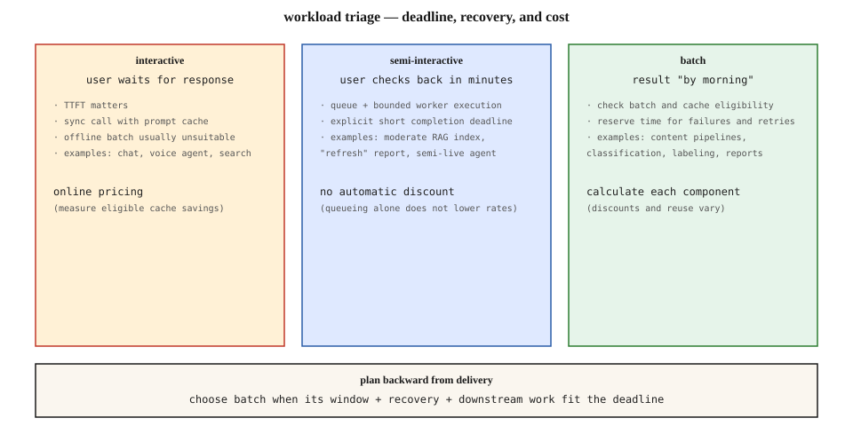

# Batch APIs — Asynchronous Workloads, Cost, and Reliable Completion

[Back to courses](../README.md#infrastructure-and-production) · [Prompt and Semantic Caching](5-prompt-semantic-caching.md) · [LLM Observability](4-llm-observability.md)

## Start With the Deadline

A nightly pipeline summarizes 50,000 documents, groups their summaries, and drafts an executive report. Users need the report tomorrow; they do not need each document streamed back immediately. A discounted asynchronous batch service may fit this workload better than thousands of online calls.

**Batch inference** submits a collection of requests for later processing and retrieves results separately. **Asynchronous** means submission and completion happen at different times; it does not imply a particular speed, discount, or successful outcome.

**Analogy:** express delivery optimizes for an individual parcel’s arrival. Consolidated freight groups parcels and offers a different cost/deadline tradeoff. Both need tracking numbers, handling for missing parcels, and an agreed delivery window.

The key question is not “is this production?” It is “when must valid results be available, including retries and downstream processing?”

## Three Workload Lanes

| Lane | User expectation | Suitable design | Examples |
| --- | --- | --- | --- |
| Interactive | User waits for an answer now | Online inference, streaming where useful, eligible caching | Chat, voice, interactive search |
| Deferred but time-sensitive | User checks back within a bounded short interval | Application queue with workers, deadlines, and controlled fallback | A report refresh or small indexing job |
| Offline batch | Results can arrive within a longer window | Provider batch service plus reconciliation and retry workflow | Bulk labeling, catalog tagging, offline evaluations |

An application queue does not automatically receive a provider’s batch discount. Likewise, a five-minute product deadline is not compatible with a service whose completion window can extend to hours just because both are asynchronous.



**Example 1:** a monthly catalog-tagging job with a two-day budget is a strong batch candidate. Leave time to validate labels and rerun failures.

**Example 2:** a “refresh report” button promising results in ten minutes needs a bounded execution path. A long-window batch API may be inappropriate even if its median completion time looks attractive.

**Example 3:** an agent’s next action depends on the last model output. Independent evaluation cases can run together, but the sequential steps of one agent run cannot be flattened into independent batch requests without changing the workflow.

## Provider Interfaces Are Not Interchangeable

Provider behavior below was checked on **2026-11-13**. Confirm the model, endpoint, region, quotas, and price sheet before deployment; this is not a promise that every model supports the same features.

| Service | Submission and results | Important distinction |
| --- | --- | --- |
| OpenAI Batch API | Upload JSONL requests, create a batch, retrieve output/error files; correlate with `custom_id` | Documents 50% lower costs and a 24-hour completion window; expired requests and partial results still need handling. [Official guide](https://developers.openai.com/api/docs/guides/batch) |
| Claude Message Batches | Submit a `requests` collection containing request IDs and message parameters; retrieve results as JSONL | JSONL result delivery does not mean the create operation is a JSONL upload. Per-item outcomes include success, error, cancellation, and expiry. [Official guide](https://platform.claude.com/docs/en/build-with-claude/batch-processing) |
| Google Cloud Gemini batch inference | Supported Cloud Storage or BigQuery input/output workflows | Use the Gemini-specific schema and supported model documentation; do not assume a generic TFRecord format applies. [Official guide](https://cloud.google.com/vertex-ai/generative-ai/docs/multimodal/batch-prediction-gemini) |

**JSONL** means JSON Lines: one JSON value per line. It is a serialization format, not a universal batch request schema. Provider adapters must translate request bodies, IDs, statuses, errors, and result locations into your application’s internal contract.

A documented processing window is not evidence that every item will succeed. A commercial **service-level agreement (SLA)** is also different from an observed median or an application’s **service-level objective (SLO)**. Do not invent a “typical two-to-six hours” planning assumption without workload evidence.

## A Reliable Batch Lifecycle

```text
snapshot inputs → validate → partition → submit → persist job ID
                                                    ↓
                  reconcile results ← poll / completion notification
                         ↓
             validate outputs → commit successes
                         ↓
              classify failures → bounded selective retry
```

1. **Snapshot inputs.** Pin input versions, model/configuration, prompt, and expected output schema. A rerun should identify which source revision it processed.
2. **Assign stable logical IDs.** Track each work item independently of the provider job ID and attempt ID.
3. **Validate before submission.** Check JSON syntax, required fields, model support, token budgets, and file/request limits. Run a small representative pilot.
4. **Partition sensibly.** Split by provider limits, deadline, workload class, and failure isolation. One enormous job can be harder to recover than several manageable shards.
5. **Persist submission state.** Store the manifest, provider job ID, attempt, and timestamps. A network timeout during submission can leave acceptance uncertain; reconcile before blindly resubmitting.
6. **Collect all outcomes.** Handle job-level failure and item-level failure separately. Completion of a job is not proof that every item produced valid output.
7. **Join by ID, never position.** Results may arrive out of order. Check for missing, duplicate, and unknown IDs.
8. **Validate and commit.** Enforce the application output schema, refusal policy, and quality requirements before publishing results.
9. **Retry selectively.** Retry transient failures within the remaining budget. Repair invalid inputs first; retain successful results instead of paying to regenerate everything.

An **idempotent commit** can be repeated without duplicating its intended effect. Enforce uniqueness for the logical item and input version when writing results. Provider execution may still occur more than once; deduplicating database writes does not eliminate duplicate inference charges.

## Python: Reconcile Unordered Results

The example uses a provider-neutral result envelope produced by an adapter, not a real provider response schema. Missing results are held for investigation: they should not trigger retries while a job may still be running.

```python
def reconcile(expected_ids, results):
    expected = set(expected_ids)
    if len(expected) != len(expected_ids):
        raise ValueError("Duplicate logical input IDs")
    seen, successes, retry, review = set(), {}, [], []
    for row in results:
        key = row["id"]
        if key not in expected or key in seen:
            raise ValueError("Unknown or duplicate result ID")
        seen.add(key)
        status = row["status"]
        if status == "ok":
            value = row.get("value")
            # Example application schema: exactly one supported label.
            if (isinstance(value, dict) and set(value) == {"label"}
                    and value["label"] in ("positive", "negative")):
                successes[key] = value
            else:
                review.append(key)
        elif status in {"transient_error", "expired"}:
            retry.append(key)
        elif status in {"invalid_request", "refused", "cancelled"}:
            review.append(key)
        else:
            raise ValueError("Unrecognized normalized status")
    return {"successes": successes, "retry_candidates": sorted(retry),
            "review": sorted(review), "missing": sorted(expected - seen)}


rows = [
    {"id": "doc-3", "status": "expired"},
    {"id": "doc-1", "status": "ok", "value": {"label": "positive"}},
    {"id": "doc-2", "status": "ok", "value": {"unexpected": True}},
]
result = reconcile(["doc-1", "doc-2", "doc-3", "doc-4"], rows)
assert list(result["successes"]) == ["doc-1"]
assert result["retry_candidates"] == ["doc-3"]
assert result["review"] == ["doc-2"]
assert result["missing"] == ["doc-4"]
print(result)
```

A retry candidate still needs deadline, attempt-limit, and duplicate-execution checks. Cancellation may be intentional, so the example does not automatically retry it. In production, persist state transactionally and make result ingestion safe to restart.

## Batch Plus Cache: Calculate Components Separately

A lower batch rate and a cached-input rate can sometimes combine, but availability and billing are provider-specific. Batch scheduling also changes cache reuse: requests are not necessarily processed consecutively or before entries expire. Claude explicitly discusses best-effort cache reuse in batches. [Claude batch caching guidance](https://platform.claude.com/docs/en/build-with-claude/batch-processing).

Do not assume that the first of 50,000 requests writes a prefix and the remaining 49,999 all read it. Measure cached-token usage and creation events. Unique document text and output generation remain billable even when a shared system prefix is reused.

Let `P`, `D`, and `O` be shared-prefix, document-input, and output tokens per request; `F`, `W`, `R`, and `G` are fresh-input, total cache-write, cache-read, and output prices per million tokens. With `N` requests and `K` cache writes:

```text
uncached = N × ((P + D) × F + O × G) / 1,000,000
cached   = (P × (K × W + (N − K) × R)
            + N × (D × F + O × G)) / 1,000,000
```

Only when all applicable rates receive the same batch multiplier `b` may you calculate batch cost as `b × cost`. Otherwise use separate provider rates for each category. Add retries, storage, validation, and orchestration to estimate the full pipeline cost.

### Worked Cost Comparison

These are invented rates and workload assumptions, not a provider quote: 50,000 requests, 4,000 prefix tokens, 1,000 document tokens, and 200 output tokens each. Rates per million tokens: fresh input $3, total prefix write $3.75, read $0.30, output $12. Assume 5,000 writes and 45,000 reads, and a hypothetical 50% batch discount on all categories.

| Mode | Inference cost | Savings versus uncached online |
| --- | ---: | ---: |
| Online, uncached | $870.00 | 0% |
| Online, cached | $399.00 | 54.1% |
| Batch, uncached | $435.00 | 50% |
| Batch, cached | $199.50 | 77.1% |

The combined mode costs about 23% of baseline, not an automatic 10%. Different input/output mixes and cache reuse produce different results.

```python
from math import isclose


def estimate(n=50_000, writes=5_000, batch_multiplier=0.5):
    if (not isinstance(n, int) or not isinstance(writes, int)
            or not 0 <= writes <= n):
        raise ValueError("Require integer counts with 0 <= writes <= n")
    if not 0 <= batch_multiplier <= 1:
        raise ValueError("Discount multiplier must be in [0, 1]")
    p, d, o = 4000, 1000, 200
    fresh, write, read, output = 3.0, 3.75, 0.30, 12.0
    online = n * ((p + d) * fresh + o * output) / 1_000_000
    cached = (p * (writes * write + (n - writes) * read)
              + n * (d * fresh + o * output)) / 1_000_000
    return {"online": online, "online_cached": cached,
            "batch": batch_multiplier * online,
            "batch_cached": batch_multiplier * cached}


costs = estimate()
assert isclose(costs["online"], 870)
assert isclose(costs["online_cached"], 399)
assert isclose(costs["batch_cached"], 199.5)
assert all(value == 0 for value in estimate(n=0, writes=0).values())
print(costs)
```

This calculator excludes real API calls and assumes every prefix operation is either a billed write or read. Adapt it when an API has uncached categories, storage charges, or different discount compatibility. See [Prompt and Semantic Caching](5-prompt-semantic-caching.md) for break-even reasoning.

## Plan Backward From Delivery

```text
latest submission time = delivery deadline
    − allowed provider window
    − reconciliation / retry reserve
    − downstream processing reserve
```

A job submitted at midnight with a possible 24-hour window does not necessarily meet an 08:00 deadline. A multi-stage pipeline needs a budget per dependent stage: summarization must finish before clustering and final synthesis can consume its outputs.

Set a fallback decision time. Before launching online replacements, reconcile completed items and decide whether cancellation is appropriate. Late batch results and online fallbacks may race; deduplicate publication and budget for duplicate execution. Surface partial completion explicitly instead of silently publishing a report missing important documents.

Queued data also ages. Pin source versions and decide whether a late result is still useful. Document retention, artifact access, and output deletion as part of the pipeline design.

## Monitoring and Operational Checks

| Metric | Definition or question |
| --- | --- |
| Turnaround | Submission to result availability, by job and item where available |
| Deadline attainment | Valid results ready by deadline / expected items |
| Valid completion rate | Schema- and policy-valid outputs / expected items |
| Retry amplification | Total attempts / logical items |
| Cost per accepted result | Total pipeline cost / accepted results |
| Missing or duplicate IDs | Reconciliation errors, not ordinary model-quality failures |
| Cache reuse | Cached input tokens and writes, with explicit denominators |
| Backlog age | How long uncompleted work has waited |

Compare models and modes on the same quality criteria. A cheaper token price can lose its advantage if malformed outputs, expirations, or retries produce fewer usable results. Evaluate operational labor and reserved-GPU utilization before claiming that batch is always cheaper than self-hosting.

## Exercises

1. Classify chat, a ten-minute report refresh, and overnight catalog labeling into execution lanes. State each deadline.
2. Change the cost example to 100,000 items and a much longer output. Explain how the savings fraction changes.
3. Add a duplicate result to the reconciliation example and verify that ingestion rejects it.
4. Design recovery for a submission timeout where the client does not know whether the provider accepted the job.
5. Allocate time for three dependent batch stages and one retry before a Friday delivery deadline.
6. Define an adapter contract for two providers with different input formats and item-status names.

## Quick Cheat Sheet

| Term | Meaning | Remember |
| --- | --- | --- |
| Batch API | Deferred processing of a request collection | Submission is not completion |
| JSONL | One JSON value per line | Format is not schema |
| Logical item ID | Identity of work across attempts | Join by ID, not order |
| Reconciliation | Account for every expected result | Include errors and missing items |
| Idempotent commit | Repeated ingestion has one intended effect | Does not prevent duplicate inference cost |
| Completion window | Service processing interval | Leave recovery time before delivery |
| Selective retry | Repeat only eligible failed work | Preserve successes |
| Stacked discounts | Compatible reductions on billing components | Compute actual categories, not headlines |

**Remember:** *deadline first, stable IDs, reconcile every item, retry selectively, price every component*.

## Resource

| Field | Details |
| --- | --- |
| Origin | [AI Engineering from Scratch — source lesson](https://github.com/rohitg00/ai-engineering-from-scratch/blob/main/phases/17-infrastructure-and-production/15-batch-apis/docs/en.md) |
| Author | Rohit Ghumare and contributors |
| Level | Intermediate — repository assessment |
| Best for | Offline inference pipelines, provider batch integration, cost modeling, and reliable asynchronous processing interviews |

Adapted from the MIT-licensed source lesson and diagram; copyright © 2026 Rohit Ghumare. [Original license](../licenses/ai-engineering-from-scratch-LICENSE).

- [Source diagram](https://github.com/rohitg00/ai-engineering-from-scratch/blob/main/phases/17-infrastructure-and-production/15-batch-apis/assets/triage.svg).
- [OpenAI Batch API](https://developers.openai.com/api/docs/guides/batch).
- [Claude Message Batches](https://platform.claude.com/docs/en/build-with-claude/batch-processing).
- [Google Cloud Gemini batch inference](https://cloud.google.com/vertex-ai/generative-ai/docs/multimodal/batch-prediction-gemini).

Adapted on **2026-11-13**. Retains the source’s workload lanes, provider comparison, caching economics, and exercises. Corrects submission-format assumptions and blanket completion/savings claims; adds result reconciliation, selective retries, deadline planning, and executable synthetic examples.

Source Markdown SHA-256: `8f0830eead1c5643e3e5d93c26ac5827a3c68800d07dc69c9c9c7f3cea99ac52`.
