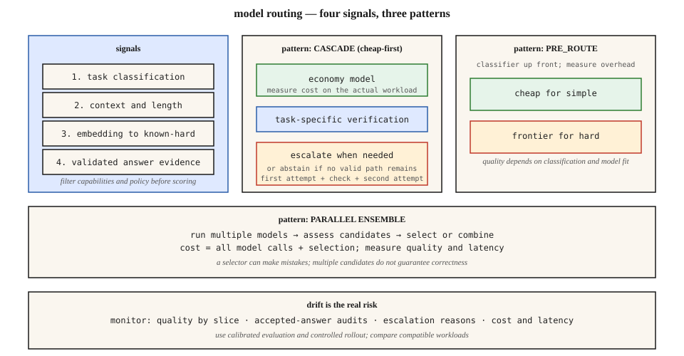

# Model Routing — Cost, Quality, Cascades, and Drift

[Back to courses](../README.md#infrastructure-and-production) · [LLM Routing Layer](../1-llm-engineering/11-llm-routing-layer.md) · [LLM Observability](4-llm-observability.md)

## Match the Model to the Work

An assistant uses one expensive model for every request. Some requests need substantial reasoning; others need a short rewrite or a routine classification. If a less expensive model meets the product’s requirements on some of that traffic, choosing it selectively can reduce cost.

**Model routing** selects a model for a request using task requirements, expected quality, cost, latency, and operational constraints. **Cascading** is one routing pattern: run an initial model, assess its result, and escalate when needed. They are related, but not synonyms.

**Analogy:** a support desk sends routine questions to a generalist and specialist problems to an expert. A triage mistake can be expensive: the customer waits through two conversations, or receives an incorrect answer that no one escalates.

A stronger model is not always better at every task. Treat “economy” and “strong” as labels for models evaluated on your workload, not universal rankings. Deterministic tools can also be better than either model for tasks such as current-time lookup or arithmetic.

## Define the Routing Objective

A useful objective is to minimize expected total cost while satisfying quality, latency, and policy requirements:

```text
minimize expected inference + routing + verification + retry cost
subject to:
    task quality meets the required floor in important workload slices
    deadline / latency objectives hold
    model capabilities, data policy, and authorization requirements hold
```

Filter ineligible destinations before optimizing. Required context capacity, modalities, tool support, structured output, region restrictions, and approved providers are hard constraints. A cheap destination that cannot satisfy the request is not a bargain.

Do not optimize only the percentage of traffic sent to a cheaper model. Optimize **cost per accepted task**, counting failed attempts, verification, retries, and downstream correction where measurable.

## Four Routing Signals—and Their Limits

| Signal | How it helps | Why it can mislead |
| --- | --- | --- |
| Task classification | Separates extraction, rewriting, coding, reasoning, and other evaluated categories | Each category contains easy and hard examples; labels can drift |
| Input length | Estimates context requirements, token cost, and latency | A short proof may be hard; a long extraction task may be routine |
| Embedding similarity | Compares a request with labeled examples of known task difficulty | Similar wording does not guarantee similar difficulty; thresholds depend on the embedding model |
| First-pass evidence | Uses schema checks, executable tests, retrieval support, or calibrated scores after generation | Validation may miss errors; confident wording is not reliable correctness evidence |

An **embedding** is a numerical representation of content. A **classifier** assigns a category or score. **Calibration** means that a score’s interpretation is supported by observed outcomes—for example, requests assigned 0.9 success probability succeed roughly 90% of the time on the evaluated distribution.

Token **log probabilities** describe model probabilities of generated tokens. They are not a universal measure of answer correctness, may not be available on every endpoint, and are not directly comparable across models or tokenizers. Self-reported confidence and hedging language are similarly weak gates unless validated for the task.

**Example:** a JSON response can pass schema validation while containing the wrong invoice amount. Schema validity is necessary for some workflows but does not establish factual correctness.

**Example:** generated code that passes targeted tests offers stronger task evidence, but incomplete tests can still accept a defective solution.

## Three Routing Patterns

| Pattern | Execution | Main benefit | Main risk |
| --- | --- | --- | --- |
| Pre-routing | Classify first, then run one selected model | Avoids paying for an initial answer that will be discarded | Misrouting happens before answer evidence is available |
| Cascade | Run economy model, verify, escalate selected requests | Uses evidence from the actual attempt | Verification cost and sequential latency; missed errors escape |
| Parallel ensemble | Run multiple models and select or combine outputs | Supports comparison and complementary candidates | Pays for multiple outputs and selection; no automatic quality guarantee |

The diagram compares signals and execution patterns. Its verification gate represents task-specific evidence, not simply a model saying “I am confident.”



### Pre-Routing

A rule-based or learned router selects a destination before generating an answer. Start with transparent rules tied to measured capability, then add complexity only if a learned router improves the cost-quality tradeoff.

**Example:** route routine support-label classification to an economy model that meets the slice’s accuracy target. Route an unsupported language or an out-of-distribution task to a validated alternative or human review.

### Cascading

Run the initial model, evaluate its output, and either accept, escalate, or abstain. **Abstention** means declining to produce an automatic answer when the system lacks sufficient evidence or cannot meet constraints.

Keep a request-wide deadline and attempt budget. Revalidate the escalated answer too; a stronger model is not an oracle. If insufficient time remains, use the product’s approved failure or review path rather than returning an unvalidated initial answer as though it passed.

A justified safety refusal is not an instruction to try another model until one complies. Classify refusal reasons and preserve the application’s policy across every route.

### Parallel Ensembles

Parallel generation can be useful for shadow evaluation or selected difficult tasks. A judge or selector still makes mistakes, models can share errors, and disagreement does not prove which answer is correct. Running both models costs both calls; latency is approximately the slower completed call plus selection when both outputs are required.

## Cost: Pre-Routing and Cascades Have Different Equations

Let `Ce` be economy-model cost, `Cs` strong-model cost, `Cr` pre-router cost, `Cv` verification cost, and `p` the fraction sent to the strong model.

```text
pre-route expected cost = Cr + (1 − p) × Ce + p × Cs
cascade expected cost   = Ce + Cv + p × Cs
parallel expected cost  = Ce + Cs + selection cost
```

Cascade escalation pays for the economy attempt **and** the strong attempt. Actual request costs depend on token lengths, caching, retries, model parameters, and any initial answer appended to the escalation prompt. Use per-request measurements when those costs are correlated with routing decisions.

### Worked Example

Invented costs: `Ce=$0.002`, `Cs=$0.020`, `Cr=$0.0002`, `Cv=$0.001`, and `p=0.30`.

| Strategy | Expected cost/request | Cost for one million requests | Savings versus strong-only |
| --- | ---: | ---: | ---: |
| Strong-only | $0.0200 | $20,000 | 0% |
| Pre-route | $0.0076 | $7,600 | 62% |
| Cascade | $0.0090 | $9,000 | 55% |
| Parallel, $0.001 selector | $0.0230 | $23,000 | −15% |

These are accounting examples, not equal-quality results. Quality must be measured independently before choosing the cheapest row.

A cascade is cheaper than strong-only under this fixed-cost model when:

```text
p < (Cs − Ce − Cv) / Cs
```

For these inputs, the threshold is 85%. That is an economic threshold, not an appropriate quality gate or a universal escalation target.

## Latency: Include the First Attempt

Let `Le`, `Ls`, and `Lv` be economy, strong, and verification durations. A non-escalated cascade takes approximately `Le + Lv`; an escalated request takes `Le + Lv + Ls`, excluding other overhead.

With illustrative times of 300 ms, 1,200 ms, and 50 ms, accepted initial answers take 350 ms and escalated requests take 1,550 ms. At 30% escalation, the mean in this fixed-duration example is 710 ms. This does not imply a universal median or P99 improvement.

Measure tail latency from end-to-end traces. Do not add independently measured P99s or describe all cascades as “1.2× median, 2× escalated.” Streaming an initial answer before verification creates another product tradeoff: a later escalation may require correcting content the user has already seen.

## Python: Explore Verification Errors and Escalation Cost

This standard-library calculator uses a synthetic population model. The verifier catches a fraction of incorrect initial answers and unnecessarily escalates a fraction of correct ones. Strong-model success is defined **on the escalated subset**, not on the whole workload.

```python
from math import isclose, isfinite


def cascade(initial_accuracy=0.80, catch_wrong=0.90,
            escalate_correct=0.10, strong_on_escalated=0.95):
    values = (initial_accuracy, catch_wrong,
              escalate_correct, strong_on_escalated)
    if any(not isfinite(x) or not 0 <= x <= 1 for x in values):
        raise ValueError("Probabilities must be finite and in [0, 1]")
    a = initial_accuracy
    escalated = (1 - a) * catch_wrong + a * escalate_correct
    accepted_correct = a * (1 - escalate_correct)
    escaped_wrong = (1 - a) * (1 - catch_wrong)
    final_accuracy = accepted_correct + escalated * strong_on_escalated
    cost = 0.002 + 0.001 + escalated * 0.020
    mean_ms = 300 + 50 + escalated * 1200
    return {"escalation_rate": escalated,
            "wrong_initial_answers_accepted_per_request": escaped_wrong,
            "final_accuracy": final_accuracy,
            "cost_per_request": cost,
            "mean_latency_ms": mean_ms}


result = cascade()
assert isclose(result["escalation_rate"], 0.26)
assert isclose(result["final_accuracy"], 0.967)
assert isclose(result["cost_per_request"], 0.0082)
assert isclose(result["mean_latency_ms"], 662)
print(result)

# A gate that never escalates preserves initial accuracy, not perfection.
assert isclose(cascade(catch_wrong=0, escalate_correct=0)["final_accuracy"], 0.80)
# A gate that escalates everything pays for both models and verification.
assert isclose(cascade(catch_wrong=1, escalate_correct=1)["cost_per_request"], 0.023)
```

The example produces 96.7% final accuracy under its assumptions. It does not prove that a cascade beats a strong-only system: that baseline's accuracy on the entire population was not specified. Real verifier errors and model outcomes are correlated; estimate conditional rates from held-out data, and do not assume they remain constant as you change thresholds.

The “escaped wrong” quantity uses all requests as denominator. To measure error among accepted initial answers, divide it by `1 − escalation_rate` when that denominator is nonzero.

## Evaluate the Router, Not Just the Models

1. Build representative examples with task, language, risk, length, and other relevant slices.
2. Run candidate models on the same inputs and score results using task-specific criteria.
3. Fit routing decisions or thresholds on training/calibration data, then evaluate on separate held-out data.
4. Compare economy-only, strong-only, simple pre-routing, and cascading baselines.
5. Report quality, latency, and cost together, including uncertainty and slice-level regressions.
6. Pilot in shadow mode, then use a controlled rollout with rollback criteria.

A **Pareto frontier** contains choices where improving one objective requires worsening another. Plot cost against measured quality and latency rather than reporting a single savings number without its tradeoffs.

**Iso-quality** means equivalent quality under a specified evaluation, not merely similar average scores. Define an acceptable degradation margin before looking at results and use sufficient samples to assess it. Rare critical failures may require separate constraints even if aggregate accuracy barely changes.

[RouteLLM](https://github.com/lm-sys/RouteLLM) provides a framework for serving and evaluating routers, including threshold calibration. Its benchmark results are evidence for the tested configurations, not a guarantee for a different model pair, language mix, or production task distribution.

## Routing Policy Versus Gateway Execution

A gateway may enforce budgets, quotas, retries, provider fallback, and routing rules. A learned quality router predicts which model suits the task. These are different capabilities; having a gateway does not mean it has learned your quality requirements.

Keep a versioned routing policy, explicit eligible destinations, request-wide timeout, maximum attempts, and a bounded fallback graph. Prevent cycles such as model A falling back to B, then B falling back to A. Preserve tools, output constraints, and data policy across transitions.

**Operational fallback** handles errors or unavailable capacity. **Quality escalation** handles insufficient output evidence. Record the reason separately so an outage does not masquerade as a harder user workload.

## Detect Drift Before Savings Hide Regressions

**Distribution drift** means incoming tasks change. **Model or policy drift** can occur when a provider model, prompt, verifier, or routing configuration changes. A fixed router can become inappropriate even when its code is untouched.

| Metric | What to investigate |
| --- | --- |
| Quality by route and task slice | Are previously safe tasks failing? |
| Initial-answer acceptance and audited correctness | Is the verifier accepting more wrong answers? |
| Escalation rate and reason | Harder traffic, model degradation, stricter checks, or provider errors? |
| P95/P99 end-to-end latency | Are sequential attempts violating deadlines? |
| Total cost per accepted task | Are cheap first attempts creating expensive retries? |
| Refusal and abstention categories | Legitimate policy behavior versus capability or integration problems |
| Route split and eligibility failures | Configuration shifts or unavailable destinations |

User feedback can be sparse and biased. LLM judges also require calibration against human or executable checks. Sample production traces across all routes, including accepted economy answers; auditing only escalations misses silent errors.

Comparing raw quality between routes is confounded when the strong model receives harder tasks. Use paired offline evaluation, controlled shadow samples, or randomized eligible traffic to assess whether the routing policy itself improves outcomes.

If escalation rises from 8% to 22%, inspect task mix, verifier version, prompt changes, model changes, and outages. There is no universal “above 30% means over-routing” rule. Recalibrate, update eligible tasks, or roll back according to measured quality and cost.

## Exercises

1. Compute pre-route and cascade costs when the strong-model share is 60%. Include verification and routing overhead.
2. Lower `catch_wrong` in the example. Explain why cost improves while incorrect initial answers escape more often.
3. Construct a short difficult prompt and a long easy prompt. Explain why length alone is a poor difficulty classifier.
4. Design routing constraints for tool use, required region, and a strict output schema.
5. Propose a rollout gate that allows no more than a specified quality degradation, with extra checks for a critical slice.
6. Diagnose a rising escalation rate without assuming the economy model is always the cause.

## Quick Cheat Sheet

| Term | Meaning | Remember |
| --- | --- | --- |
| Pre-routing | Choose before generation | One model call, classifier risk |
| Cascade | Generate, assess, then optionally escalate | Pay for the first attempt too |
| Ensemble | Multiple candidates plus selection | More calls do not guarantee correctness |
| Calibration | Scores agree with observed outcomes | Confidence needs evidence |
| Escalation rate | Escalated requests / initial cascade requests | Include reason and workload mix |
| Iso-quality | Equivalent quality under a stated evaluation | Define margin and uncertainty |
| Drift | Change in traffic or system behavior | Audit accepted answers, not just errors |
| Abstention | Withhold an unsupported automatic answer | A valid terminal outcome |

**Remember:** *filter constraints, route by evidence, account for every attempt, and monitor quality by slice*.

## Resource

| Field | Details |
| --- | --- |
| Origin | [AI Engineering from Scratch — source lesson](https://github.com/rohitg00/ai-engineering-from-scratch/blob/main/phases/17-infrastructure-and-production/16-model-routing/docs/en.md) |
| Author | Rohit Ghumare and contributors |
| Level | Intermediate — repository assessment |
| Best for | Model-selection policies, cascade economics, verification, evaluation design, and production drift interviews |

Adapted from the MIT-licensed source lesson and diagram; copyright © 2026 Rohit Ghumare. [Original license](../licenses/ai-engineering-from-scratch-LICENSE).

- [Source diagram](https://github.com/rohitg00/ai-engineering-from-scratch/blob/main/phases/17-infrastructure-and-production/16-model-routing/assets/cascade.svg).
- [RouteLLM framework and evaluation documentation](https://github.com/lm-sys/RouteLLM).

Adapted on **2026-11-13**. Retains the source’s four signals, three routing patterns, blended-cost analysis, and drift discussion. Replaces unsupported market pricing and fixed performance claims with synthetic calculations; clarifies calibration, refusal handling, conditional quality, and routing versus cascading.

Source Markdown SHA-256: `1b34b95e327b3e08c601e6c43166c83eaad749e2db4320a7bb950d7433e4a99d`.
