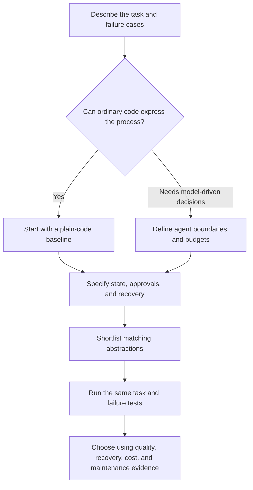

# Agent Framework Tradeoffs — Graphs, Roles, Actors, and Typed Agents

[Back to courses](../README.md) · [Function Calling](6-function-calling.md) · [Production App](10-production-app.md) · [LLM Routing Layer](11-llm-routing-layer.md)

| Field | Details |
| --- | --- |
| Origin | [AI Engineering from Scratch — source lesson](https://github.com/rohitg00/ai-engineering-from-scratch/blob/main/phases/11-llm-engineering/17-agent-framework-tradeoffs/docs/en.md), supplemented with official framework documentation |
| Author | Rohit Ghumare and contributors; local comparison and examples adapted for this repository |
| Level | Intermediate to advanced — repository assessment |
| Best for | Choosing agent orchestration abstractions, evaluating state/recovery tradeoffs, comparing Google ADK and other frameworks, and defending architecture choices in interviews |

Adapted from the MIT-licensed lesson; copyright © 2026 Rohit Ghumare. [Original license](../licenses/ai-engineering-from-scratch-LICENSE). Framework documentation reviewed on **2026-10-18**. Capabilities vary by package, language, version, integration, and deployment; the comparison is a shortlist guide, not a measured performance ranking.

## The Problem

A research assistant plans, searches, drafts, and checks citations. A code-review service parses a diff, proposes changes, validates them, and waits for approval. A customer assistant selects tools during a conversation. These are different orchestration problems even when each uses an LLM.

The wrong abstraction creates extra work: important state becomes hidden in prose, a predictable transition consumes a model call, or a saved conversation cannot resume an interrupted operation correctly.

An **agent framework** supplies abstractions for model calls, tools, state, and execution. **Orchestration** determines which operation runs next and how results move between operations. Choose based on the workflow and failure semantics you need, not the most impressive demo.

## The Concept

### Start with the Shape of the Work

An **abstraction** is the organizing concept exposed by a framework. It is what you draw on a whiteboard:

| Shape | Simple analogy | Engineering meaning | Example |
| --- | --- | --- | --- |
| Graph/state machine | A route map with explicit junctions | Steps and transitions operating on state | Review → approval → publish |
| Roles and tasks | A team with job descriptions | Specialists with assigned goals and handoffs | Researcher → writer → editor |
| Conversation/team | A moderated discussion | Agents exchange messages until a termination condition | Proposer ↔ critic |
| Actor/event system | Workers with mailboxes | Components respond to routed messages/events | Independent workers handling asynchronous jobs |
| Tool-using agent | A specialist with a toolbox | Model selects tools in a bounded loop | Support assistant using read-only account tools |
| Typed agent | A form with validated fields | Explicit input/dependency/output contracts | Invoice extraction into a validated schema |

These shapes overlap. A graph can contain a crew; a role-based team can run inside a deterministic workflow. Framework names are not exclusive capability categories.



### Framework Comparison

The “fit” and “tradeoff” columns are engineering interpretations of the documented abstractions. They are not vendor benchmarks or claims that competing products lack the capability.

| Framework | Main abstractions | Useful starting fit | Tradeoff to investigate |
| --- | --- | --- | --- |
| [LangGraph](https://docs.langchain.com/oss/python/langgraph/overview) | Stateful graphs and orchestration runtime | Explicit workflow transitions, interrupts, long-running execution | State/reducer design, checkpoint configuration, replay behavior |
| [CrewAI](https://docs.crewai.com/en/concepts/flows) | Crews/roles/tasks plus stateful event-driven Flows | Specialist teams inside a controlled business process | Distinguish crew coordination from Flow state and persistence |
| [AutoGen](https://microsoft.github.io/autogen/stable/) | AgentChat teams and event-driven Core | Conversational collaboration or message-driven agent systems | Choose the API generation/layer and evaluate migration direction |
| [Agno](https://docs.agno.com/) | Agent SDK plus service/runtime platform | Agent applications needing storage and operational integration | Separate SDK behavior from runtime/platform guarantees |
| [Google ADK](https://google.github.io/adk-docs/) | Agents, workflow orchestration, sessions/events, tools | Google-oriented applications needing a broader agent development lifecycle | Check language/version parity and chosen model/deployment path |
| [Microsoft Agent Framework](https://learn.microsoft.com/en-us/agent-framework/overview/) | Agents, sessions, middleware, explicit workflows | Microsoft ecosystem applications and explicit agent/workflow composition | Verify package maturity and migration effort for existing integrations |
| [Pydantic AI](https://ai.pydantic.dev/) | Typed agents, dependencies, tools, validated outputs | Python applications where data contracts and testability are central | Schema validity does not establish factual correctness or permission |
| Plain Python plus model client | Functions and an explicit bounded loop | A small number of predictable steps | You own retries, persistence, traces, and lifecycle management |

### What Changes the Source Comparison?

**LangGraph** supports mixing deterministic and model-driven steps, persistence, and human oversight. It does not require that every decision be predetermined; the important distinction is how dynamic decisions are represented and constrained. A checkpoint does not make an external side effect automatically safe to repeat. [Official overview](https://docs.langchain.com/oss/python/langgraph/overview).

**CrewAI** should not be reduced to string handoffs between roles. Flows provide structured state, event-driven control, and persistence. Its documentation describes `@persist` and state restoration. Evaluate whether the chosen Flow/crew combination restores the execution semantics you need, not merely the state values. [Flows documentation](https://docs.crewai.com/en/concepts/flows).

**AutoGen** is not just the older `ConversableAgent` interface. Its documented layers include AgentChat for conversational applications, Core for event-driven systems, and Extensions for integrations. Avoid mixing examples from different generations, or treating AutoGen and AG2 as interchangeable packages. [AutoGen documentation](https://microsoft.github.io/autogen/stable/).

**Agno** should not be described as only a single-agent session wrapper. Its documentation covers an SDK and agent-service platform, including storage, runtime, and observability. Verify which guarantees belong to the installed SDK versus the deployed runtime and its configured backend. [Agno documentation](https://docs.agno.com/).

### Google ADK in More Detail

Google's **Agent Development Kit (ADK)** documents model/tool agents, workflow orchestration, sessions/state/events, evaluation, deployment, and interoperability. Its current documentation includes sequential, loop, parallel, and graph workflow options. This makes it relevant beyond a single Gemini chatbot. [ADK documentation](https://google.github.io/adk-docs/).

A useful evaluation scenario is a support workflow that retrieves policy, proposes an action, waits for approval, and resumes. Test session persistence, event history, model compatibility, tool confirmation, and cancellation in the exact language/package you intend to deploy.

ADK is a reasonable shortlist candidate for teams already using Google's model and cloud ecosystem. That is a fit assessment, not a requirement to use Google-hosted deployment or a claim that every language/provider combination offers identical features.

### Additional Frameworks to Consider in 2026

**Microsoft Agent Framework** combines agent abstractions with explicit workflows, session state, middleware, and integrations. Microsoft describes it as the successor to AutoGen and Semantic Kernel. For new Microsoft-oriented projects, compare it before committing to an older API family; for existing projects, measure migration effort rather than assuming a drop-in replacement. [Official overview](https://learn.microsoft.com/en-us/agent-framework/overview/).

**Pydantic AI** emphasizes typed dependencies, tools, and validated output contracts. Its documentation also describes instrumentation through OpenTelemetry. It is a useful candidate for a Python service where the agent must return structured data and tools receive explicit dependencies. A valid output object can still contain unsupported facts, and retrying validation still consumes resources. [Official documentation](https://ai.pydantic.dev/).

## The State Question

**State** is the information needed to continue a computation. **Memory** is information selected for reuse across interactions. **Persistence** stores information beyond a process lifetime. **Durable execution** adds recovery semantics for continuing work after interruption. These are related but not identical.

| State type | Example | Question to ask |
| --- | --- | --- |
| Conversation history | User and assistant messages | Can it be loaded in the correct order and tenant scope? |
| Workflow state | Current stage, evidence IDs, validated draft | Is the schema explicit and versioned? |
| Execution checkpoint | Pending tasks, completed steps, resume location | Which operations replay after restart? |
| Long-term memory | User preferences or selected facts | Who can read, update, expire, or delete it? |
| External action state | Payment or email operation ID | Can a repeated call avoid duplicate effects? |

A conversation log is not necessarily a workflow checkpoint. A checkpoint is not a distributed transaction with a tool service. A persistence adapter is not an automatic guarantee of recovery across version upgrades.

**Recovery test:** stop the process after an external action completes but before its result is checkpointed. On restart, verify whether the action repeats. Use a stable idempotency key at the action service, rather than relying on the model to remember that it already acted.

For every shortlisted framework, record the backend, checkpoint boundaries, serialized types, locking behavior, tenant isolation, migration strategy, and restart procedure. “Supports persistence” is the beginning of this review.

## The Branching Question

**Explicit routing** uses application code to choose a transition. **Model-selected routing** asks an LLM to choose. A **reducer** defines how multiple updates combine, such as merging independently retrieved evidence without overwriting it.

| Decision | Explicit implementation | Model-selected implementation |
| --- | --- | --- |
| Retry a temporary timeout | Error classifier and retry budget | Usually unnecessary model work |
| Route a known document type | Parsed metadata or rules | Useful only when classification needs interpretation |
| Choose a research direction | Constrained planner output | Useful when alternatives are open-ended |
| Approve a payment | Server-side authorization and human policy | The model may propose; it cannot grant authority |

Parallel **fan-out** launches several tasks; **fan-in** combines their results. Evaluate bounded concurrency, partial failures, cancellation, aggregation, and recovery. Parallel execution is not exclusive to one framework, and spawning more agents does not guarantee better throughput or quality.

A role such as “reviewer” is a prompt description, not a security boundary. Separate permissions and approved actions must exist in the application/tool layer.

## Observability and Debugging

A **trace** connects timed operations across a run. A **span** describes one operation, such as a model call, tool call, or state transition. **OpenTelemetry** is a standard instrumentation ecosystem; an integration still requires configuration and data-handling decisions.

For a meaningful comparison, inspect the same evidence in every implementation:

- Actual model calls, prompts/configuration versions, token usage, and retries.
- Tool arguments/results with appropriate redaction and authorization decisions.
- Routing choices, handoffs, state versions, interrupts, and resume events.
- End-to-end latency, waiting time, cancellation, and errors.

A saved checkpoint is not a complete trace. A replay may call a nondeterministic model or mutable external service again. Record whether replay uses captured outputs or actually re-executes work.

## Cost and Latency

Do not rank frameworks by overhead without a controlled measurement. Most application cost differences come from the executed workflow: manager calls, repeated context, critic loops, tool retries, and additional model turns.

```text
run cost = model calls + tool/retrieval charges + infrastructure attributable to the run
cost per successful task = total measured cost / tasks meeting the acceptance rubric
end-to-end latency = critical-path execution + queueing + orchestration overhead
```

**Illustrative example:** four task calls at $0.002 each cost $0.008. Adding three manager decisions at $0.001 each raises the total to $0.011, a 37.5% increase before retries. That could be justified if task success improves enough. It is not a benchmark for any named framework.

Two one-second workers may complete in approximately one second when run concurrently, plus scheduling and aggregation overhead. A shared provider quota, CPU bottleneck, or sequential dependency can remove that benefit. Measure the actual critical path.

## Interoperability and Portability

**MCP** standardizes interactions with tools/resources; it does not standardize your complete workflow state, permissions, or replay semantics. **A2A** concerns agent-to-agent interoperability; it does not automatically make agents equally trustworthy.

| Boundary | Portability question |
| --- | --- |
| Model | Are required tool, image, schema, and streaming features supported by the adapter? |
| Tool | Can the function be called outside the framework through a stable contract? |
| State | Can state be exported, migrated, and validated independently? |
| Trace | Can telemetry be sent to the chosen backend without raw-secret leakage? |
| Deployment | Which features require a particular hosted runtime? |
| Version | Are package versions, model identifiers, prompts, and schemas recorded together? |

Keep business logic behind ordinary functions/services and use thin framework adapters. This reduces migration effort without pretending every orchestration primitive is portable.

## Decision Matrix: Choose a Shortlist, Then Test

| Workload | Candidates to investigate | Deciding experiment |
| --- | --- | --- |
| Approval-heavy, long-running workflow | LangGraph; ADK; Microsoft Agent Framework; CrewAI Flows | Restart while approval is pending and resume correctly |
| Researcher/writer/editor pipeline | CrewAI; explicit graph/workflow; plain code baseline | Same evidence and rubric, count extra coordination calls |
| Proposer/critic dialogue | AutoGen AgentChat; bounded team orchestration | Enforce termination and demonstrate improvement over one agent |
| Google-oriented agent application | Google ADK plus a simpler baseline | Test selected model/tools, session backend, evaluation, deployment |
| Typed Python extraction service | Pydantic AI; plain typed pipeline | Invalid output, dependency substitution, and bounded repair |
| Agent-as-service application | Agno plus alternatives matching the workflow | Test runtime recovery and operations, not only SDK setup |
| Microsoft-oriented new application | Microsoft Agent Framework | Verify workflow/session behavior and existing integration migration |
| Large fan-out with aggregation | Graph/workflow implementations with explicit concurrency | Partial failure, deterministic merge policy, provider saturation |
| Two predictable calls and a tool | Plain Python first | Determine whether framework lifecycle features justify dependency cost |

The matrix is an engineering shortlist, not an exclusive recommendation. A decision should state the requirement, evidence, tradeoff, and rejected alternative.

## Build It: A Framework-Independent Approval Workflow

This offline Python example makes state and transitions explicit before introducing a framework. It uses SQLite for a local checkpoint and a simulated draft. Run with Python 3.10+; no API key or third-party package is needed.

```python
import json
import sqlite3
from dataclasses import asdict, dataclass
from pathlib import Path
from tempfile import TemporaryDirectory


@dataclass
class ReviewState:
    run_id: str
    stage: str = "draft"
    draft: str = ""
    approved: bool = False
    schema_version: int = 1


class Store:
    def __init__(self, path):
        self.db = sqlite3.connect(path)
        self.db.execute("CREATE TABLE IF NOT EXISTS runs (id TEXT PRIMARY KEY, data TEXT)")
        self.db.commit()

    def save(self, state):
        with self.db:
            self.db.execute("INSERT OR REPLACE INTO runs VALUES (?, ?)",
                            (state.run_id, json.dumps(asdict(state))))

    def load(self, run_id):
        row = self.db.execute("SELECT data FROM runs WHERE id = ?", (run_id,)).fetchone()
        if row is None:
            raise KeyError(run_id)
        state = ReviewState(**json.loads(row[0]))
        if state.schema_version != 1:
            raise ValueError("State migration required")
        return state

    def close(self):
        self.db.close()


def advance(state, store):
    if state.stage == "draft":
        state.draft = "Simulated evidence-based brief requiring human review."
        state.stage = "approval"
        store.save(state)
        return "awaiting_approval"
    if state.stage == "approval":
        if not state.approved:
            return "awaiting_approval"
        state.stage = "complete"
        store.save(state)
        return "complete"
    if state.stage == "complete":
        return "complete"
    raise ValueError("Unknown workflow stage")


def approve(state, store):
    # Demo only: production must verify actor permission and approved draft version.
    if state.stage != "approval":
        raise ValueError("Run is not awaiting approval")
    state.approved = True
    store.save(state)


def demo():
    with TemporaryDirectory() as directory:
        path = Path(directory) / "workflow.sqlite"
        store = Store(path)
        state = ReviewState(run_id="example")
        assert advance(state, store) == "awaiting_approval"
        store.close()

        # Reopen storage to demonstrate recovery across a connection restart.
        store = Store(path)
        resumed = store.load("example")
        assert resumed.draft and not resumed.approved
        assert advance(resumed, store) == "awaiting_approval"
        approve(resumed, store)
        assert advance(resumed, store) == "complete"
        assert advance(resumed, store) == "complete"
        print(json.dumps(asdict(store.load("example")), indent=2))
        store.close()


if __name__ == "__main__":
    demo()
```

This shows explicit state, an approval pause, persistence, and repeatable completion. It does not demonstrate distributed locking, authenticated approval, external side effects, or recovery from every possible crash. It reopens a connection; it is not a process-kill test.

Port this exact contract to two shortlisted frameworks. Preserve stage names, output schema, approval semantics, and test fixtures. Then add a real process restart, a failed tool, cancellation, a schema migration, and concurrent updates. The differences you encounter are useful framework-selection evidence.

### Google ADK Configuration Sketch

ADK's documented agent API can express a tool-using assistant. The following is an illustrative configuration, not a complete runner or a live-tested integration. Set `ADK_MODEL` to a supported model identifier for your pinned package/provider setup; configure credentials and a session/runner separately.

```python
import os
from google.adk import Agent


def lookup_policy(topic: str) -> dict:
    """Look up a public policy fixture by topic."""
    policies = {"returns": "Returns are accepted within 30 days in this fixture."}
    return {"topic": topic, "policy": policies.get(topic), "source": "demo-policy-v1"}


root_agent = Agent(
    name="policy_assistant",
    model=os.environ["ADK_MODEL"],
    instruction="Use the policy tool. If the topic is unknown, say so; do not invent policy.",
    tools=[lookup_policy],
)
```

The configuration illustrates model, instruction, and tool composition from the [ADK documentation](https://google.github.io/adk-docs/). It does not implement the approval workflow above; that requires explicit orchestration and permission checks. Test the fixture result directly before paying for model calls.

## A Fair Comparison Protocol

Use the same model configuration, input fixtures, tool contracts, output schema, and acceptance rubric. Record where a framework forces a different prompt or workflow; those differences are part of the result.

| Dimension | Measurement | Example test |
| --- | --- | --- |
| Task quality | Acceptable results / labeled tasks | Correct brief with supported citations |
| Cost | Total spend / acceptable tasks | Include manager, repair, and failed calls |
| Latency | p50/p95 and time spent waiting | Controlled warm and cold runs |
| Recovery | Successful resumes / injected failures | Stop after a tool result, before checkpoint |
| Approval | Unauthorized actions and correct resumed actions | Attempt execution without a valid approval |
| Concurrency | Throughput, saturation, lost updates | Two workers modify one workflow |
| Maintenance | Code/adapters, schema changes, upgrade effort | Add a required field and migrate old state |
| Observability | Explainable run and failure coverage | Reconstruct a failed handoff from traces |

Repeat model-based runs and report sample sizes and uncertainty. Lines of code can indicate complexity, but fewer lines are not proof of reliability. Separate framework CPU/serialization overhead from model time and from additional model calls introduced by the architecture.

## Exercises

1. Implement the same research/write/cite task with a graph workflow and CrewAI roles/Flows. Keep evidence and output contracts identical, then compare quality and model-call count.
2. Compare a bounded proposer/critic dialogue with a single-agent baseline. Stop after a fixed turn budget; measure whether the critic improves accepted-task rate.
3. Port the approval example to Google ADK and one other candidate. Record exactly what survives restart and how the approval identity is verified.
4. Add a side-effecting fixture with an idempotency key. Crash between the action and the checkpoint; prove that resumption does not perform it twice.
5. Compare Pydantic AI with plain typed code for extraction. Test schema-valid but factually wrong output as well as invalid JSON.
6. For an existing AutoGen or Semantic Kernel application, write a Microsoft Agent Framework migration assessment using actual interfaces and tests, not a name-based replacement plan.
7. Build `pick_framework.py` that returns a shortlist and reasons from workflow requirements. Keep hard constraints separate from preferences; return “needs investigation” for unverified capabilities rather than inventing numeric rankings.
8. Test one package upgrade with saved state. Record migration behavior, traces, changed defaults, and rollback compatibility.

## Quick Cheat Sheet

| Term | Crisp definition | Memory aid |
| --- | --- | --- |
| Orchestration | Selection and coordination of steps | Who runs next? |
| Graph | Steps connected by transitions | Route map |
| Role | Prompted responsibility assigned to an agent | Job description, not permission |
| Actor | Component receiving and handling messages | Worker with a mailbox |
| Typed state | State described by an explicit data contract | Agreed form fields |
| Reducer | Rule combining concurrent updates | Merge instructions |
| Persistence | Data survives process lifetime | Saved information |
| Checkpoint | Recorded execution/state position | Resume marker |
| Durable execution | Recovery-aware continuation of work | Resume correctly, not merely reload |
| Session | Context scoped to an interaction | Conversation container |
| Idempotency | Repetition does not duplicate an intended effect | Same operation ID, same effect |
| Fan-out/fan-in | Parallel work followed by aggregation | Split, then combine |
| Human interrupt | Pause execution for external input | Approval must bind to the intended action |

## Further Reading

- [Source lesson](https://github.com/rohitg00/ai-engineering-from-scratch/blob/main/phases/11-llm-engineering/17-agent-framework-tradeoffs/docs/en.md) — original graph, role, conversation, and agent comparison.
- [LangGraph overview](https://docs.langchain.com/oss/python/langgraph/overview).
- [CrewAI Flows](https://docs.crewai.com/en/concepts/flows).
- [AutoGen documentation](https://microsoft.github.io/autogen/stable/).
- [Agno documentation](https://docs.agno.com/).
- [Google ADK documentation](https://google.github.io/adk-docs/).
- [Microsoft Agent Framework overview](https://learn.microsoft.com/en-us/agent-framework/overview/).
- [Pydantic AI documentation](https://ai.pydantic.dev/).
- [Evaluation](7-evaluation.md) and [Guardrails](9-guardrails.md) — evaluate behavior and enforce permissions independently of the chosen framework.

## Attribution and Import Notes

Adapted on 2026-10-18 from the upstream lesson linked above. Preserves the abstraction, state, branching, observability, cost, interoperability, decision-matrix, and exercise structure. Updates overly categorical limitations using current official documentation; adds Google ADK, Microsoft Agent Framework, Pydantic AI, an offline state/approval example, and a controlled comparison protocol. Selection guidance is local engineering judgment. No live framework benchmark or paid model call was performed; the ADK sketch was not integration-tested.

Source lesson SHA-256: `4c0c6119addcb3cf05f3a9e1884ae3bf75e4428a6196c90982653559c94c83b7`.
