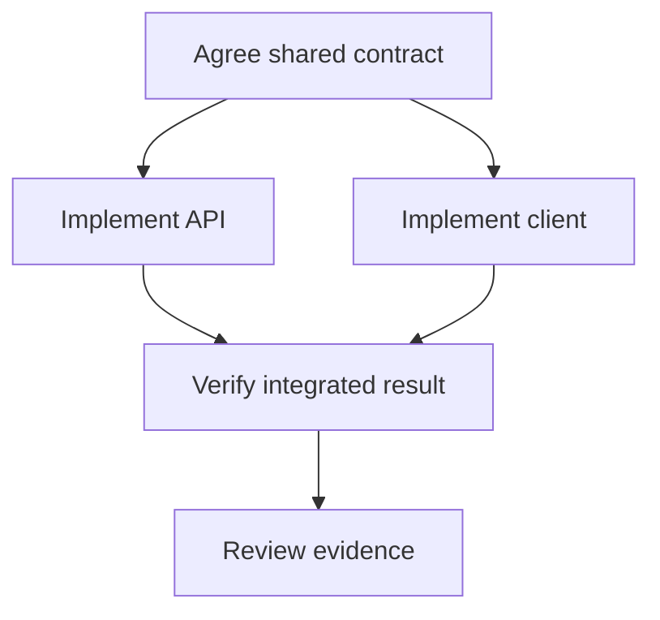
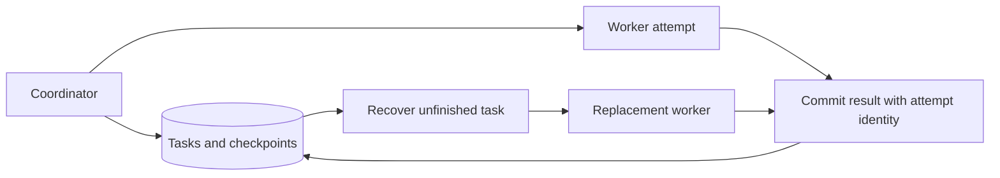

# Agent Orchestration Questions and Answers

[Back to the README](../README.md) · [Terminology glossary](../GLOSSARY.md) · [Agents and tool use](agents.md) · [Software Factory](software-factory.md) · [Evaluation](evaluation.md)

These questions extend the single-agent foundations into coordinating fleets of agents. They cover how work is divided, scheduled, verified, and recovered. The architectures and examples are illustrative design proposals; cited systems demonstrate particular techniques rather than universal guarantees.

Each question includes a short answer, a plain-language explanation with an analogy, an advanced answer with technical detail, metrics or checks, at least two examples, and a quick cheat sheet. Numerical examples are illustrative, not benchmark results or universal targets. Use the [cross-topic cheat sheet](../CHEAT_SHEET.md) for quick revision.

## Contents

- [Architecture and decomposition](#architecture-and-decomposition): orchestration, coordination patterns, and task graphs.
- [Scheduling and collaboration](#scheduling-and-collaboration): worker assignment, handoffs, and shared state.
- [Recovery and control](#recovery-and-control): durable execution, retries, cancellation, and budgets.
- [Verification and evaluation](#verification-and-evaluation): disagreement, traces, and measured value.

## Architecture and decomposition

## Question: 1. What does agent orchestration add beyond an individual agent's execution loop?

**Topic:** Orchestration responsibilities
**Difficulty:** Beginner

**Key terms:** [Orchestration](../GLOSSARY.md#orchestration) · [Agent](../GLOSSARY.md#agent) · [Workflow](../GLOSSARY.md#workflow)

**Short answer:**
Orchestration coordinates tasks, dependencies, workers, and resources across a larger objective, while an individual agent chooses actions within its assigned task.

**Simple answer and analogy:**

**In plain language:** Orchestration organizes the work around agents: who does what, what must finish first, how progress is saved, and what happens when something fails.

**Analogy:** An orchestra's musicians play their parts, while coordination keeps the performance together. Individual skill cannot prevent a poor result if everyone starts at a different time or follows a different score. The coordinating system need not itself perform every task.

**Advanced answer and AI/maths:**
A planner can propose work, but trusted application logic should own scheduling, permissions, and completion records. Separate the model's proposed plan from the system's authoritative execution state. A fleet needs a shared definition of completion; collecting successful worker messages does not establish that the overall objective succeeded.

Orchestration manages how multiple tasks and workers are scheduled, connected, recovered, and governed. The model's reasoning loop is only one component. Define durable task identities, dependency states, ownership, budgets, and completion contracts. A worker's textual assertion should not move the whole system to “done” without required artifacts and checks. Start from workflow requirements before choosing a coordination framework.

**Metrics and checks:** Measure throughput, queue delay, completion latency, recovery time, and verified end-to-end success. Worker utilization is useful for capacity analysis but not a substitute for completed useful work.

**Examples:**

**Example 1:**
For a feature request, an orchestrator waits for a versioned API contract before assigning compatible backend and frontend work, then schedules integration checks.

**Example 2:**
A research fleet may finish all worker responses yet fail to produce a consistent report. The orchestrator must also manage evidence consolidation and final verification.

**Quick Cheat Sheet:**

| Cue | Remember |
| --- | --- |
| **Agent** | chooses local actions |
| **Orchestrator** | coordinates system progress |
| **Completion** | required artifacts and checks |

**Follow-up questions:**

- Which orchestration decisions should use deterministic code?

**References:**

- [Anthropic: Orchestrator-worker patterns](https://www.anthropic.com/engineering/building-effective-agents)

## Question: 2. When should you use a fixed workflow, a supervisor, or peer-to-peer coordination?

**Topic:** Coordination patterns
**Difficulty:** Intermediate

**Key terms:** [Supervisor and handoff](../GLOSSARY.md#supervisor-and-handoff) · [Workflow](../GLOSSARY.md#workflow) · [Orchestration](../GLOSSARY.md#orchestration)

**Short answer:**
Use a fixed workflow for known dependencies, a supervisor for dynamic decomposition, and peer coordination when local decisions justify the added reconciliation complexity.

**Simple answer and analogy:**

**In plain language:** Choose a fixed sequence when the route is known, a supervisor when assignments need adapting, and peer coordination only when its flexibility is worth the extra complexity.

**Analogy:** A car wash follows fixed stations; an emergency dispatcher assigns changing jobs; a group of neighbors may coordinate a cleanup themselves. Each arrangement suits different uncertainty and coordination needs.

**Advanced answer and AI/maths:**
Central coordination gives a clear owner but can become a bottleneck. Peer communication allows flexible collaboration but needs explicit ownership, termination, and conflict rules. A useful hybrid lets a model suggest subtasks inside a workflow whose release and validation steps remain fixed.

Fixed workflows suit known dependencies; supervisors centralize dynamic assignment and integration; peer coordination allows local negotiation but increases consistency and termination challenges. Choose based on how predictable the task graph is and where decisions require shared knowledge. Central coordination can bottleneck, while decentralized systems require stronger protocols for ownership and conflict resolution. Hybrid designs often keep critical release decisions centralized.

**Metrics and checks:** Compare coordination calls, critical-path latency, unresolved conflicts, and task success. Include supervisor failures and communication overhead in evaluation.

**Examples:**

**Example 1:**
A supervisor discovers which modules need changes, while the application always requires integration checks before presenting the result for review.

**Example 2:**
A document pipeline can follow fixed extraction and validation stages, while incident investigation may need a supervisor to assign new subtasks as evidence emerges.

**Quick Cheat Sheet:**

| Cue | Remember |
| --- | --- |
| **Fixed** | predictable graph |
| **Supervisor** | central adaptive control |
| **Peers** | flexible coordination with protocol costs |

**Follow-up questions:**

- How would you detect circular delegation between peers?

**References:**

- [Anthropic: Workflow and agent architecture patterns](https://www.anthropic.com/engineering/building-effective-agents)

## Question: 3. How should an orchestrator decompose work into tasks that can run in parallel?

**Topic:** Task graphs and dependencies
**Difficulty:** Intermediate

**Key terms:** [Task graph and critical path](../GLOSSARY.md#task-graph-and-critical-path) · [Task graph and critical path](../GLOSSARY.md#task-graph-and-critical-path) · [Amdahl's law](../GLOSSARY.md#amdahls-law)

**Short answer:**
Define bounded deliverables, interfaces, dependencies, and acceptance criteria; parallelize tasks whose inputs and ownership are sufficiently independent.

**Simple answer and analogy:**

**In plain language:** Parallel work helps when tasks can proceed independently and their results can be combined. Some steps still have to wait for others.

**Analogy:** Several people can paint different rooms at once, but they cannot all install cabinets before the walls are ready. A shared measurement mistake can also make the finished pieces fail to fit. Include preparation and assembly when estimating time saved.

**Advanced answer and AI/maths:**
Represent a plan as a versioned dependency graph. Each task needs an owner, input revisions, output contract, and verification step. Reject dependency cycles and revise the graph when discoveries invalidate assumptions. Tiny tasks increase coordination overhead; broad tasks create overlap and make failures difficult to isolate.

Split work where inputs and outputs can be specified independently, then represent true dependencies explicitly. Parallel tasks should avoid writing the same mutable artifact unless a merge strategy exists. Excessively small tasks spend more time coordinating than working. Identify the critical path and integration cost before estimating speedup; independent execution does not imply independently mergeable results.

**Metrics and checks:** Amdahl's bound is speedup ≤ 1/(s + (1−s)/p) for serial fraction s and p workers, before overhead. Measure actual wall time and total compute.

**Examples:**

**Example 1:**
After agreeing on a response schema, assign implementation and client updates separately. A schema revision invalidates dependent work until compatibility is checked.

**Visual: Parallelize independent tasks**

This is an illustrative task graph: parallel work is appropriate only when dependencies and output contracts permit it. Concept reference: [Anthropic: agent and workflow patterns](https://www.anthropic.com/engineering/building-effective-agents).

**Example 2:**
Four agents can inspect four independent services, but a shared API decision may block all implementations. Resolve that contract first rather than discovering incompatible assumptions during integration.

**Quick Cheat Sheet:**

| Cue | Remember |
| --- | --- |
| **Independence** | separate inputs and outputs |
| **Critical path** | limits speedup |
| **Integration** | include it in estimates |

**Follow-up questions:**

- How would you identify the critical path before adding workers?

**References:**

- [Anthropic: Delegation and task boundaries in a multi-agent system](https://www.anthropic.com/engineering/multi-agent-research-system)

## Scheduling and collaboration

## Question: 4. How should a scheduler assign work across an agent fleet?

**Topic:** Admission control and scheduling
**Difficulty:** Advanced

**Key terms:** [Throughput and concurrency](../GLOSSARY.md#throughput-and-concurrency) · [Admission control and backpressure](../GLOSSARY.md#admission-control-and-backpressure) · [Little's Law](../GLOSSARY.md#littles-law) · [Rate limit and quota](../GLOSSARY.md#rate-limit-and-quota)

**Short answer:**
Schedule ready tasks according to capabilities, authorization, priority, and available resources, with limits that prevent one run from exhausting the fleet.

**Simple answer and analogy:**

**In plain language:** A scheduler chooses which ready tasks get workers and resources. It should respect urgency, fairness, and capacity rather than starting everything immediately.

**Analogy:** A restaurant seats parties according to available tables and kitchen capacity. Filling every possible seat while ignoring the kitchen can create a long wait for everyone. Some capacity may need reserving for urgent or short jobs.

**Advanced answer and AI/maths:**
Track model quotas, sandbox capacity, tool limits, and per-run concurrency separately. Use bounded queues, fairness across projects, and aging to avoid starving older work. Worker leases need expiry and renewal. A reassigned task must reject stale workers' results using an attempt or lease generation checked by the state store.

A fleet scheduler maps ready work to available capacity while respecting dependencies, priorities, quotas, and resource needs. Bound concurrency to avoid overwhelming model endpoints or downstream tools. Fairness matters when a large tenant can monopolize workers, and aging can prevent starvation of low-priority tasks. Backpressure should propagate upstream rather than allowing an unbounded queue to hide overload.

**Metrics and checks:** Track queue age, service time, utilization, deadline misses, and per-tenant throughput. Under stable conditions, Little's Law relates average in-flight work L to arrival rate lambda times average time W.

**Examples:**

**Example 1:**
A run may occupy four coding sandboxes, while integration checks use a reserved pool so a coding surge cannot block completed changes from verification.

**Example 2:**
A burst of long research jobs should not prevent short urgent incident tasks from running. Separate queues or weighted scheduling can reserve capacity for latency-sensitive work.

**Quick Cheat Sheet:**

| Cue | Remember |
| --- | --- |
| **Ready** | dependencies satisfied |
| **Schedule** | resource and priority fit |
| **Backpressure** | bound incoming work |

**Follow-up questions:**

- How do you distinguish a resource-starved task from a failed worker?

**References:**

- [Google SRE: Handling overload](https://sre.google/sre-book/handling-overload/)

## Question: 5. What should an agent handoff contain?

**Topic:** Task and result contracts
**Difficulty:** Intermediate

**Key terms:** [Supervisor and handoff](../GLOSSARY.md#supervisor-and-handoff) · [Acceptance criteria](../GLOSSARY.md#acceptance-criteria) · [Data provenance and lineage](../GLOSSARY.md#data-provenance-and-lineage)

**Short answer:**
A handoff should include the objective, input versions, constraints, expected output, evidence, and unresolved issues in a structured record.

**Simple answer and analogy:**

**In plain language:** A handoff should tell the next worker what to achieve, what is already known, which version to use, and what counts as finished. Separate facts from guesses.

**Analogy:** Leaving a mechanic the note “fix it” is much less useful than describing the fault, work already tried, relevant readings, and approved scope. A good handoff avoids making the next person repeat the investigation or assume the wrong goal.

**Advanced answer and AI/maths:**
Pass durable artifact references rather than relying on an expanding conversation transcript. Record task and attempt IDs so late or duplicate responses can be recognized. Distinguish facts, assumptions, and proposed next steps. A receiving worker should validate that the artifact exists and matches the expected revision before using it.

A handoff should specify the objective, relevant evidence, current state, constraints, expected artifact, and definition of done. Prefer references to authoritative versioned artifacts over large unstructured transcripts. Clearly mark hypotheses and unresolved questions so another worker does not mistake speculation for established fact. Include ownership and deadline information to prevent duplicated or abandoned work.

**Metrics and checks:** Measure handoff rejection, clarification rounds, missing-artifact failures, and integration rework. Increasing handoff text length is not automatically better information transfer.

**Examples:**

**Example 1:**
A coding agent returns a commit identifier, test report references, and a known limitation. The next stage retrieves those artifacts rather than interpreting “all done” as a sufficient result.

**Example 2:**
A code-review task should include the exact commit, intended behavior, test evidence, and known risks. “Review the latest changes” can refer to different code by the time the worker starts.

**Quick Cheat Sheet:**

| Cue | Remember |
| --- | --- |
| **Contract** | objective and done criteria |
| **Evidence** | versioned references |
| **Uncertainty** | explicit unresolved questions |

**Follow-up questions:**

- What happens when the referenced artifact has expired or changed?

**References:**

- [Anthropic: Agent communication and artifact handling](https://www.anthropic.com/engineering/multi-agent-research-system)

## Question: 6. How should agents share state without overwriting one another's work?

**Topic:** State ownership and concurrency
**Difficulty:** Advanced

**Key terms:** [Shared state and optimistic concurrency](../GLOSSARY.md#shared-state-and-optimistic-concurrency) · [Shared state and optimistic concurrency](../GLOSSARY.md#shared-state-and-optimistic-concurrency) · [Atomic operation and transaction](../GLOSSARY.md#atomic-operation-and-transaction)

**Short answer:**
Give each task an isolated workspace, publish immutable outputs, and use explicit version checks when updating shared records or integrating changes.

**Simple answer and analogy:**

**In plain language:** Workers need rules for who can change shared information and how conflicting changes are detected. Otherwise, one can silently overwrite another's work.

**Analogy:** Two people editing separate copies of a shopping list may each replace the shared list with their own version, losing the other's additions. Version checks or agreed ownership make the conflict visible before changes are accepted.

**Advanced answer and AI/maths:**
A shared chat history is not a transaction mechanism. An illustrative design stores accepted task results with compare-and-set updates and records conflicting proposals separately. For code, separate branches or worktrees reduce filesystem collisions, but they do not resolve semantic conflicts. Git worktrees also share repository metadata and are not a security boundary.

Shared state requires a consistency strategy: single-writer ownership, optimistic concurrency, transactional updates, or mergeable data structures depending on the workload. Workers should submit changes against known versions and handle conflicts explicitly. A shared conversation is not a reliable database. Separate immutable evidence from mutable decisions, and record who changed what so incorrect coordination can be reconstructed.

**Metrics and checks:** Track conflicting writes, rejected stale updates, lost-update incidents, and reconciliation time. Test concurrent updates to the same task rather than only isolated worker success.

**Examples:**

**Example 1:**
Two workers change different callers of a common API in separate workspaces. Integration checks expose incompatible assumptions even though the patches merge cleanly.

**Example 2:**
Two workers increment a progress counter from the same old value and overwrite each other. Atomic updates or version checks prevent the system from silently losing one completed contribution.

**Quick Cheat Sheet:**

| Cue | Remember |
| --- | --- |
| **Ownership** | who may write? |
| **Version** | detect stale updates |
| **History** | preserve auditable changes |

**Follow-up questions:**

- Which shared state needs strong consistency, and which can be eventually consistent?

**References:**

- [Git: Worktree behavior and shared repository state](https://git-scm.com/docs/git-worktree)

## Recovery and control

## Question: 7. How can an orchestration run survive process crashes or long pauses?

**Topic:** Durable execution
**Difficulty:** Advanced

**Key terms:** [Durable execution](../GLOSSARY.md#durable-execution) · [Checkpoint](../GLOSSARY.md#checkpoint) · [Lease and fencing token](../GLOSSARY.md#lease-and-fencing-token) · [Lease and fencing token](../GLOSSARY.md#lease-and-fencing-token)

**Short answer:**
Persist the plan, task states, accepted outputs, and pending operations so the system can resume and reconcile incomplete work.

**Simple answer and analogy:**

**In plain language:** Save progress and ownership information so work can resume safely. A worker returning after a long pause must not overwrite a replacement worker's newer result.

**Analogy:** A substitute librarian takes over a desk after a shift ends. If the original librarian returns with an old checkout list, the system should not let it replace the current record. Temporary ownership needs a clear expiration and handover rule.

**Advanced answer and AI/maths:**
Checkpoint at meaningful boundaries and retain the configuration needed to interpret state. Resumption may replay part of a task, so separate repeatable computations from external effects. Revalidate permissions, deadlines, and input revisions after a pause. If a required artifact is missing, explicitly recompute or block its dependents instead of pretending the step is complete.

Persist task state, dependencies, artifact references, and external operation identifiers so a coordinator can recover without guessing. Leases need expiration and fencing to prevent an old worker from writing after replacement. A checkpoint does not make external side effects exactly once. Recovery should reconcile ambiguous operations and resume from verified state, with explicit handling for long human-review pauses.

**Metrics and checks:** Measure recovery-point loss, recovery time, duplicate work/effects, and orphaned tasks. Inject crashes at handoff, external-write, and checkpoint boundaries.

**Examples:**

**Example 1:**
After a scheduler restart, completed build artifacts remain accepted, an expired coding lease is reassigned, and a pending deployment is reconciled with the deployment service.

**Visual: Durable orchestration state**

This is a design sketch, not a framework guarantee. Reject stale attempts and reconcile external side effects; recovered state alone does not prevent duplicate actions. Concept reference: [LangGraph: persistence](https://docs.langchain.com/oss/python/langgraph/persistence); [AWS: idempotent APIs](https://aws.amazon.com/builders-library/making-retries-safe-with-idempotent-APIs/).

**Example 2:**
A worker pauses long enough for its lease to expire, then resumes after another worker takes over. A fencing token lets the state store reject the stale worker's later writes.

**Quick Cheat Sheet:**

| Cue | Remember |
| --- | --- |
| **Persist** | verified progress |
| **Lease** | temporary ownership |
| **Fence** | reject stale owners |

**Follow-up questions:**

- How would you migrate persisted runs when the workflow definition changes?

**References:**

- [LangGraph: Persistence and checkpoints](https://docs.langchain.com/oss/python/langgraph/persistence)

## Question: 8. How should retries and cancellation work across delegated tasks?

**Topic:** Failure and side-effect semantics
**Difficulty:** Advanced

**Key terms:** [Retry and backoff](../GLOSSARY.md#retry-and-backoff) · [Deadline and cancellation](../GLOSSARY.md#deadline-and-cancellation) · [Deadline and cancellation](../GLOSSARY.md#deadline-and-cancellation) · [Side effect and reconciliation](../GLOSSARY.md#side-effect-and-reconciliation)

**Short answer:**
Bound retries at the run level, deduplicate repeated operations, propagate cancellation, and reconcile effects that may already have happened.

**Simple answer and analogy:**

**In plain language:** Retries and cancellation must be coordinated across the whole task, not decided independently by every worker. Stopping a task does not undo an action already completed elsewhere.

**Analogy:** Canceling a party stops future food orders, but does not unbake a cake already made. Similarly, three teams each retrying the same supplier can multiply orders unless they share one record and one limit.

**Advanced answer and AI/maths:**
Assign a stable operation ID before a state-changing request. A lost acknowledgment leaves the outcome unknown; retry only under a suitable idempotency contract or after checking status. Cancellation prevents new authorized work but does not undo a completed external action. Record compensation or manual intervention as separate outcomes.

Cancellation and retry policies must span the task tree rather than operating independently at each layer. Propagate deadlines and a shared attempt budget; otherwise nested retries multiply load. Cancellation can stop future work but may not undo an in-flight side effect. Record terminal states and reconcile writes whose outcome is unknown before declaring the whole task safely canceled.

**Metrics and checks:** Measure total attempts per logical operation, cancellation latency, orphaned work, and ambiguous effects. Three retrying layers with three total attempts each can produce up to 27 downstream attempts.

**Examples:**

**Example 1:**
A cancelled parent stops scheduling children, revokes tool access where possible, rejects late results, and checks whether an already-requested release was deployed.

**Example 2:**
A parent task is canceled while a worker submits a purchase request. The system must inspect whether the purchase completed rather than assuming cancellation of the worker reversed the transaction.

**Quick Cheat Sheet:**

| Cue | Remember |
| --- | --- |
| **Deadline** | shared across descendants |
| **Retry** | bounded across layers |
| **Cancel** | does not imply rollback |

**Follow-up questions:**

- How would you prevent retries in the supervisor, worker, and SDK from multiplying?

**References:**

- [AWS Builders' Library: Idempotent APIs and ambiguous outcomes](https://aws.amazon.com/builders-library/making-retries-safe-with-idempotent-APIs/)

## Question: 9. How do you keep delegation and repair loops within a budget?

**Topic:** Resource limits and stopping conditions
**Difficulty:** Intermediate

**Key terms:** [Orchestration](../GLOSSARY.md#orchestration) · [Planning and termination](../GLOSSARY.md#planning-and-termination) · [Cost per successful task](../GLOSSARY.md#cost-per-successful-task)

**Short answer:**
Enforce shared limits on spending, elapsed time, active workers, delegation depth, and repair attempts, then stop or escalate when progress stalls.

**Simple answer and analogy:**

**In plain language:** Set a total budget and divide it sensibly, leaving room to combine and check the results. Stop repair attempts when they no longer produce useful new evidence.

**Analogy:** A renovation budget must cover inspection and finishing, not just buying materials. Spending everything on repeated draft plans leaves nothing to verify or complete the work. Each extra attempt should have a clear purpose.

**Advanced answer and AI/maths:**
Reserve resources before dispatch so concurrent workers cannot each spend the same remaining budget. Include failed attempts and evaluation in accounting. Reconcile reservations when usage becomes known. Progress should mean new evidence or verified outputs, not additional messages. Budget exhaustion produces an incomplete outcome with preserved artifacts.

Allocate budgets for tokens, tool calls, elapsed time, and expensive external operations at the parent task and reserve portions for workers. Leave capacity for integration and verification rather than spending everything on generation. Repair loops should require a concrete failure and a testable change. Stop when repeated attempts produce no new evidence or when the expected benefit no longer justifies the remaining cost.

**Metrics and checks:** Track budget consumption by stage, successful repairs per attempt, and completion within budget. Include abandoned worker output in cost per successful task.

**Examples:**

**Example 1:**
A run reserves part of its budget for final integration checks and stops generating new candidate patches when the remaining allowance cannot cover verification.

**Example 2:**
A coding fleet that spends its entire budget drafting patches has no capacity to run integration tests. Reserving verification budget prevents “finished” from meaning merely “generated code.”

**Quick Cheat Sheet:**

| Cue | Remember |
| --- | --- |
| **Allocate** | parent and worker limits |
| **Reserve** | integration and verification |
| **Stop** | diminishing evidence or exhausted budget |

**Follow-up questions:**

- What should happen if billing information arrives after a worker finishes?

**References:**

- [Google SRE: Limiting admitted work and overload propagation](https://sre.google/sre-book/handling-overload/)

## Verification and evaluation

## Question: 10. How should an orchestrator resolve conflicting agent outputs?

**Topic:** Evidence and disagreement
**Difficulty:** Intermediate

**Key terms:** [Rubric and adjudication](../GLOSSARY.md#rubric-and-adjudication) · [Ground truth](../GLOSSARY.md#ground-truth) · [Invariant](../GLOSSARY.md#invariant)

**Short answer:**
Compare outputs against explicit requirements and executable evidence; seek more evidence or human judgment when the disagreement cannot be resolved mechanically.

**Simple answer and analogy:**

**In plain language:** Resolve disagreements by checking requirements and evidence, not by choosing the most confident answer or taking a vote automatically.

**Analogy:** Three people repeating directions from the same incorrect map are not three independent confirmations. A street sign or verified map update can outweigh their agreement. Agents likewise need stronger evidence than shared confidence.

**Advanced answer and AI/maths:**
Majority agreement is weak evidence when agents share models, context, or faulty assumptions. Preserve competing artifacts and reasons for rejection. A verifier can identify problems without having authority to redefine acceptance criteria. Useful escalation explains the decision, evidence, and unresolved tradeoff.

Conflicting outputs need a resolution policy tied to evidence and task ownership. Majority vote can help with independent errors but fails when workers share the same misleading source or model bias. Compare assumptions, cite authoritative artifacts, and use executable checks where possible. Escalate unresolved high-impact disagreements rather than silently choosing the most confident prose.

**Metrics and checks:** Measure disagreement frequency, resolution accuracy on labeled cases, added latency, and residual defects. Track whether reviewers are using independent evidence or merely repeating one another.

**Examples:**

**Example 1:**
Two agents propose different timeout behavior. Contract tests settle protocol compliance, while a product owner decides the acceptable user experience under slow responses.

**Example 2:**
Two agents propose incompatible API schemas. A compatibility test against real consumers and the agreed contract is stronger arbitration than asking a third agent which explanation sounds better.

**Quick Cheat Sheet:**

| Cue | Remember |
| --- | --- |
| **Conflict** | compare assumptions |
| **Evidence** | tests or authoritative sources |
| **Consensus** | not independent verification |

**Follow-up questions:**

- How would you reduce correlated errors between generation and review?

**References:**

- [Anthropic: Evaluator-optimizer workflows](https://www.anthropic.com/engineering/building-effective-agents)

## Question: 11. What observability is needed for a fleet of agents?

**Topic:** Distributed tracing and auditability
**Difficulty:** Intermediate

**Key terms:** [Trace and span](../GLOSSARY.md#trace-and-span) · [Observability and SRE](../GLOSSARY.md#observability-and-sre) · [Task graph and critical path](../GLOSSARY.md#task-graph-and-critical-path)

**Short answer:**
Correlate the overall run with tasks, attempts, model calls, tools, artifacts, and external operations so failures can be traced across delegation boundaries.

**Simple answer and analogy:**

**In plain language:** Track the parent task, its smaller jobs, their results, and their combined time and cost. This reveals stuck dependencies and wasted repeated work.

**Analogy:** At an airport, knowing each worker is busy does not explain why a flight cannot depart. You need to know whether baggage, fueling, crew, and safety checks are all complete. A fleet needs a similarly connected view.

**Advanced answer and AI/maths:**
Record queue time, execution time, retries, resource use, accepted outputs, and terminal reasons. Use parent-child relationships or trace links for asynchronous work. Keep permissions and retention controls on sensitive trace content. Operational events and artifact evidence are sufficient for audit; private model reasoning is not required.

Fleet observability needs parent-child task IDs, dependency edges, worker identities, versions, and cost attribution. A trace should show why work was spawned and what artifact it produced, not just model-call timings. Watch for fan-out storms, stalled joins, orphan workers, and repeated repairs. Protect sensitive artifacts and use stable bounded dimensions for metrics rather than raw prompts or unlimited task IDs.

**Metrics and checks:** Track critical-path latency, queue wait, active workers, retry amplification, tokens, and verified completion. Break down cost by parent task so parallelism does not hide total spending.

**Examples:**

**Example 1:**
A delayed feature is traced to repeated integration failures after a contract revision, rather than misclassified as slow model inference.

**Example 2:**
A user request appears slow because one child task never reaches a terminal state, leaving a join waiting forever. Dependency-aware traces reveal this more clearly than average worker latency.

**Quick Cheat Sheet:**

| Cue | Remember |
| --- | --- |
| **Trace tree** | parent and children |
| **Join** | inspect missing terminal states |
| **Cost** | aggregate all descendants |

**Follow-up questions:**

- Which metrics would reveal a supervisor bottleneck or excessive task fragmentation?

**References:**

- [OpenTelemetry: Traces, spans, and links](https://opentelemetry.io/docs/concepts/signals/traces/)

## Question: 12. How do you determine whether multiple agents improve the system?

**Topic:** Fleet evaluation
**Difficulty:** Advanced

**Key terms:** [Paired comparison](../GLOSSARY.md#paired-comparison) · [Baseline](../GLOSSARY.md#baseline) · [Cost per successful task](../GLOSSARY.md#cost-per-successful-task) · [Confidence interval](../GLOSSARY.md#confidence-interval)

**Short answer:**
Compare the fleet with a simpler baseline on matched tasks using verified outcomes, latency, cost, and human effort under comparable resource limits.

**Simple answer and analogy:**

**In plain language:** Compare the whole finished task with a simpler approach. Count checking, integration, failures, and human repair, not just how quickly individual agents stop working.

**Analogy:** Hiring four builders may speed up constructing separate walls but slow the project if the walls do not fit together. Judge when a usable house is delivered, its quality, and its total cost—not the number of busy builders.

**Advanced answer and AI/maths:**
Use held-out tasks and repeat variable runs. Inspect failures by task complexity, dependency structure, and shared-state contention. Measure the cost of coordination and verification, including unsuccessful attempts. More parallel work may shorten independent tasks while leaving the critical path unchanged. An improvement on one workload does not establish general superiority.

Evaluate orchestration changes as system changes using paired workloads, realistic failures, and the same quality requirements. Compare against a strong simpler configuration and control model versions and budgets where possible. Faster execution is not a gain if outputs need more human repair. Include integration, recovery, and review time, especially when parallel workers produce correlated mistakes.

**Metrics and checks:** Report verified success, wall-clock time, total cost, human rework, and reliability under faults. Use uncertainty estimates across representative tasks, with the task as the comparison unit.

**Examples:**

**Example 1:**
Compare a single coding agent with a planner and three workers on the same repository snapshots, scoring accepted changes and reviewer minutes as well as test results.

**Example 2:**
Doubling workers may shorten drafting but increase merge conflicts enough to slow accepted delivery. Measuring only worker finish times would report an improvement that users never receive.

**Quick Cheat Sheet:**

| Cue | Remember |
| --- | --- |
| **Baseline** | simpler strong system |
| **Unit** | complete task |
| **Value** | accepted quality, time, and total cost |

**Follow-up questions:**

- How would you separate the benefit of more compute from the benefit of orchestration?

**References:**

- [SWE-bench: Reproducible software-task evaluation](https://www.swebench.com/SWE-bench/)

Continue with [Software Factory](software-factory.md) and the [autonomous software factory design scenario](../system-design/README.md#6-autonomous-software-factory).
