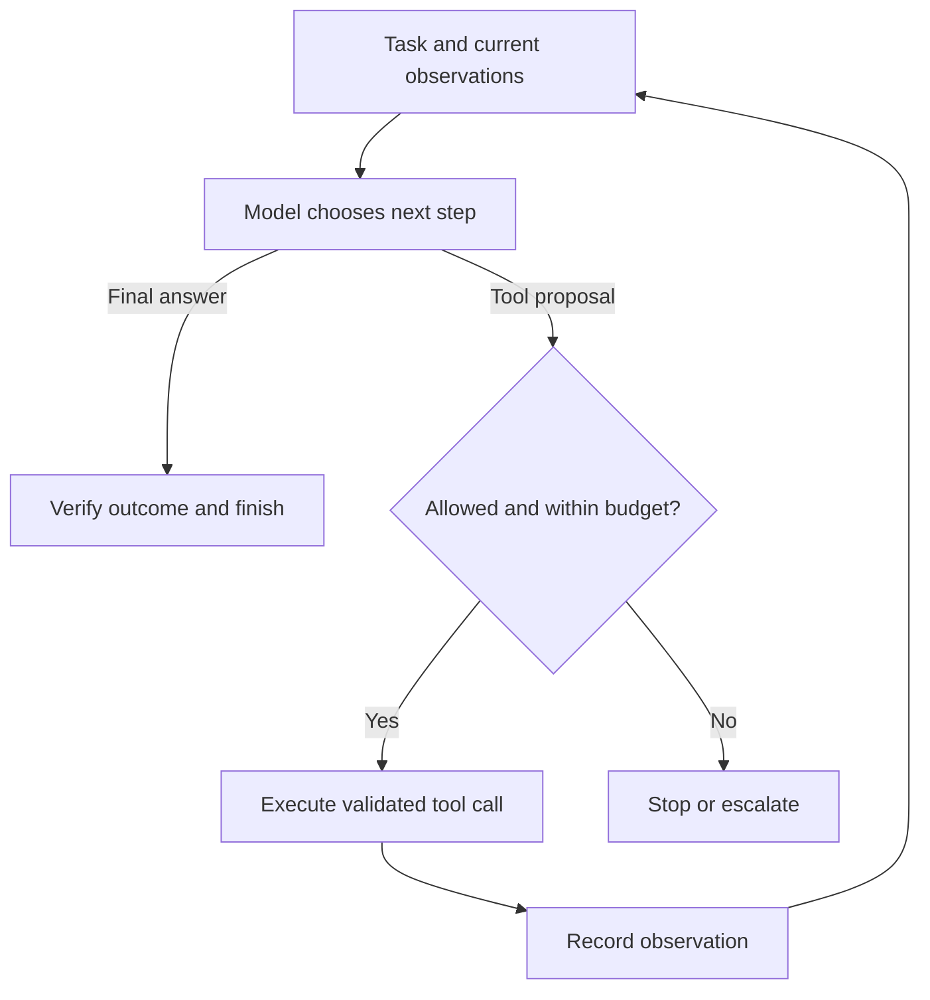
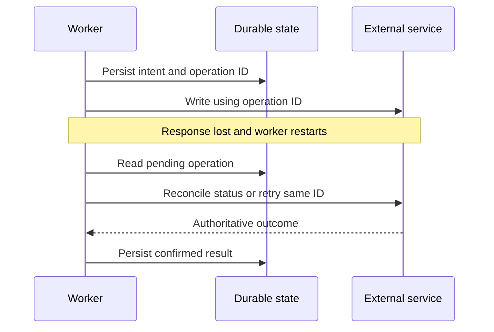

# Agents and Tool Use Questions and Answers

[Back to the README](../README.md) · [Terminology glossary](../GLOSSARY.md) · [Prompt engineering](prompt-engineering.md) · [RAG](rag.md) · [Fine-tuning](fine-tuning.md) · [Evaluation](evaluation.md)

These questions cover systems that use language models to select actions, interact with tools, and adapt to results. Engineers can practice the short answers; interviewers can explore design choices with the follow-ups. Examples and proposed designs are illustrative. Framework references demonstrate particular implementations, not universal agent behavior.

Each question includes a short answer, a plain-language explanation with an analogy, an advanced answer with technical detail, metrics or checks, at least two examples, and a quick cheat sheet. Numerical examples are illustrative, not benchmark results or universal targets. Use the [cross-topic cheat sheet](../CHEAT_SHEET.md) for quick revision.

## Contents

- [Architecture and tools](#architecture-and-tools): agents versus workflows, execution loops, and tool interfaces.
- [State and execution](#state-and-execution): memory, stopping conditions, retries, and persistence.
- [Control and coordination](#control-and-coordination): approvals, prompt injection, and multiple agents.
- [Evaluation and observability](#evaluation-and-observability): outcomes, traces, and operational metrics.
- [Planning patterns](#planning-patterns)

## Architecture and tools

## Question: 1. How does an agent differ from a fixed workflow?

**Topic:** Architecture choices
**Difficulty:** Beginner

**Key terms:** [Agent](../GLOSSARY.md#agent) · [Workflow](../GLOSSARY.md#workflow) · [Action space](../GLOSSARY.md#action-space)

**Short answer:**
In a fixed workflow, code determines the main sequence of steps. In an agent, a model chooses some next steps dynamically using the task and observed results.

**Simple answer and analogy:**

**In plain language:** A fixed workflow follows a predefined route. An agent can choose some next steps based on what it observes. Give it that freedom only where it helps.

**Analogy:** A vending machine follows a narrow sequence of choices. A repair technician decides which check to perform next after seeing the results. An AI agent resembles the second pattern of control, not the technician's full human judgment or responsibility.

**Advanced answer and AI/maths:**
The boundary is a design spectrum, not a universal naming rule. Workflows suit predictable procedures; agents help when the required path is uncertain. Dynamic decisions introduce variability, latency, and failure modes. Start with the simplest approach that meets the task requirements.

An agent selects actions based on observations and state, while a fixed workflow follows a predefined control structure. Many reliable applications combine both: deterministic gates constrain where model judgment is useful. Autonomy adds value when the path cannot be enumerated cheaply, but also creates harder testing and stopping problems. Choose the smallest action space that solves the task, then expand it only with evidence.

**Metrics and checks:** Compare completed tasks, unauthorized actions, average steps, p95 latency, and total cost against a fixed workflow baseline. More tool calls or longer trajectories do not indicate more intelligence.

**Examples:**

**Example 1:**
Extracting invoice fields and checking totals can follow a fixed workflow; investigating an unfamiliar software failure may require adaptive tool choices.

**Example 2:**
A receipt extractor can use a fixed parse-and-validate workflow. Investigating an unfamiliar build failure may benefit from an agent choosing which logs and tests to inspect next.

**Quick Cheat Sheet:**

| Cue | Remember |
| --- | --- |
| **Workflow** | predefined control |
| **Agent** | observation-driven choices |
| **Design** | constrain autonomy to useful decisions |

**Follow-up questions:**

- What evidence would justify replacing a fixed workflow with an agent?

**References:**

- [Anthropic: Building effective agents](https://www.anthropic.com/engineering/building-effective-agents)

## Question: 2. What happens in an agent's tool-use loop?

**Topic:** Execution model
**Difficulty:** Beginner

**Key terms:** [Agent](../GLOSSARY.md#agent) · [Tool calling](../GLOSSARY.md#tool-calling) · [Working state and memory](../GLOSSARY.md#working-state-and-memory) · [Planning and termination](../GLOSSARY.md#planning-and-termination)

**Short answer:**
The model selects an action, the application validates and executes it, and the resulting observation informs the next decision or final response.

**Simple answer and analogy:**

**In plain language:** The agent chooses an action, the application checks and performs it, and the result informs the next step. It should stop when completion is verified or a defined limit is reached.

**Analogy:** A person locating a parcel checks its tracking status, contacts the depot if necessary, and confirms delivery. Merely saying “parcel found” does not replace the tracking evidence. The loop needs real observations between decisions.

**Advanced answer and AI/maths:**
ReAct is a research pattern that interleaves reasoning and actions with observations. In an application, distinguish proposed tool calls from actual execution and verified outcomes. Preserve relevant results in state, handle errors explicitly, and terminate when the task is complete or a control condition is reached. A narrated action is not evidence that the action happened.

The execution loop observes state, chooses a next action, validates and executes it, records the result, and decides whether to continue. Persist meaningful state transitions rather than relying solely on a conversational transcript. Tool errors, unavailable information, and cancellation are explicit outcomes. Completion should be supported by authoritative evidence, especially when the task changes an external system.

**Metrics and checks:** Track step count, valid-action rate, repeated-action loops, task completion, and budget exhaustion. Attribute failures to planning, tool execution, or incorrect interpretation of results.

**Examples:**

**Example 1:**
An assistant requests an order lookup, receives the record from the application, and then reports the observed shipment status.

**Visual: A bounded tool-use loop**

Application code owns limits and authorization. A fluent final response alone is not proof that the task succeeded. Concept reference: [Anthropic: agent and workflow patterns](https://www.anthropic.com/engineering/building-effective-agents).

**Example 2:**
An incident agent reads a failed health check, inspects a deployment diff, and proposes rollback. A service response confirming rollback is stronger completion evidence than the agent saying “fixed.”

**Quick Cheat Sheet:**

| Cue | Remember |
| --- | --- |
| **Observe** | current evidence |
| **Act** | validated operation |
| **Stop** | verified completion or explicit limit |

**Follow-up questions:**

- How would you prevent the agent from claiming success after a failed tool call?

**References:**

- [Yao et al.: ReAct](https://arxiv.org/abs/2210.03629)

## Question: 3. What makes a tool interface reliable for an agent?

**Topic:** Tool design
**Difficulty:** Intermediate

**Key terms:** [Tool calling](../GLOSSARY.md#tool-calling) · [Structured output and schema](../GLOSSARY.md#structured-output-and-schema) · [Authentication and authorization](../GLOSSARY.md#authentication-and-authorization)

**Short answer:**
A reliable tool has a clear purpose, precise argument definitions, bounded behavior, and results that distinguish success, failure, and missing data.

**Simple answer and analogy:**

**In plain language:** A reliable tool has one clear purpose, well-defined inputs, and a result that clearly says what happened. The application checks that the requested action is allowed.

**Analogy:** A labeled light switch is easier and safer to use than a box of unmarked wires. Likewise, a narrow “look up this order” tool is easier to control than unrestricted access to every operation in a database.

**Advanced answer and AI/maths:**
Avoid overlapping tool descriptions that make selection ambiguous. Validate schemas and domain constraints in code, return useful identifiers and errors, and limit unnecessary output. Separate read operations from state-changing operations where useful. The application's permissions determine whether execution is allowed, regardless of the model's requested arguments.

Tool schemas should define narrow operations with typed arguments, clear semantics, and structured results. Defaults must not silently broaden scope, and identities or permission decisions should come from trusted runtime state. Distinguish retryable transport failures from invalid arguments and business-rule rejection. Version interfaces and avoid exposing unnecessary administrative capabilities simply because the underlying API supports them.

**Metrics and checks:** Measure correct tool selection, argument-validation failure, execution success, and ambiguous outcomes. Test boundary values, stale identifiers, missing fields, and permission errors.

**Examples:**

**Example 1:**
A lookup returns an explicit `not_found` status for an unknown order rather than a blank string that could be mistaken for success.

**Example 2:**
A “cancel_order” tool should accept a stable order ID and return an authoritative status. Letting the model construct arbitrary SQL to delete an order creates a much broader and harder-to-audit interface.

**Quick Cheat Sheet:**

| Cue | Remember |
| --- | --- |
| **Narrow** | one clear capability |
| **Typed** | validate arguments |
| **Structured** | results distinguish success from failure |

**Follow-up questions:**

- When would a focused business operation be easier to use safely than a generic execution tool?

**References:**

- [Anthropic: Writing effective tools for agents](https://www.anthropic.com/engineering/writing-tools-for-agents)

## State and execution

## Question: 4. How do context, working state, and long-term memory differ?

**Topic:** Memory
**Difficulty:** Intermediate

**Key terms:** [Working state and memory](../GLOSSARY.md#working-state-and-memory) · [Context window](../GLOSSARY.md#context-window) · [Data provenance and lineage](../GLOSSARY.md#data-provenance-and-lineage)

**Short answer:**
Context is the information supplied to a model call. Working state tracks the current task. Long-term memory stores information for later tasks or conversations.

**Simple answer and analogy:**

**In plain language:** Context is what the model can consult now. Working state records the current task's progress. Long-term memory stores selected information for later use.

**Analogy:** A cook has a recipe on the counter, a checklist showing which steps are done, and a recipe book on a shelf. These serve different purposes. An old note in the book may still be wrong or outdated.

**Advanced answer and AI/maths:**
Persisted state does not automatically fit into the model's context; the application selects or summarizes what to include. Treat memory as data with provenance, scope, and update rules. Summaries can lose qualifications, and stored mistakes can contaminate later decisions. Reading or writing memory does not by itself update model weights.

Working state holds task progress, context supplies information for the current inference, and long-term memory stores selected information across tasks. These layers need different retention and trust policies. Store provenance and timestamps with durable facts, and allow corrections or deletion. Do not treat a prior model summary as verified evidence merely because it has been persisted.

**Metrics and checks:** Measure memory retrieval relevance, stale-memory errors, context tokens, and task success with and without memory. Track deletion propagation and access violations where personal or tenant-specific data is stored.

**Examples:**

**Example 1:**
Store completed task steps in a run record and retrieve a user's verified preferences separately, rather than replaying every past conversation.

**Example 2:**
A sales agent may retain a customer's preferred contact channel but should verify a quoted price against the current catalog. A remembered price can become stale while the preference remains useful.

**Quick Cheat Sheet:**

| Cue | Remember |
| --- | --- |
| **Context** | now |
| **Working state** | current task progress |
| **Memory** | durable, scoped, revisable information |

**Follow-up questions:**

- How would you correct a false memory and prevent it from being reused?

**References:**

- [LangChain: Memory concepts](https://docs.langchain.com/oss/python/concepts/memory)

## Question: 5. How should an agent plan and decide when to stop?

**Topic:** Planning and budgets
**Difficulty:** Intermediate

**Key terms:** [Planning and termination](../GLOSSARY.md#planning-and-termination) · [Planning and termination](../GLOSSARY.md#planning-and-termination) · [Guardrail](../GLOSSARY.md#guardrail)

**Short answer:**
Use a revisable plan and explicit completion criteria, with application-enforced limits on steps, time, tool calls, or spending.

**Simple answer and analogy:**

**In plain language:** Give the agent a revisable plan, clear completion conditions, and limits on time or actions. Repeating the same failed step without learning anything is not progress.

**Analogy:** Someone assembling furniture follows a plan but stops if a required part is missing. Tightening the same screw endlessly will not produce the missing shelf. A useful stopping rule allows a clear report of what remains blocked.

**Advanced answer and AI/maths:**
Plans should change when observations invalidate assumptions. A practical design checks for progress, repeated failures, and blocked dependencies. Hitting a budget is not successful completion; return the verified partial result and unresolved issue. Application controls should enforce limits even if the model requests another step.

Planning helps expose dependencies, but a plan must adapt when observations contradict assumptions. Define measurable completion conditions and hard limits on steps, elapsed time, and spending. Require new evidence before repeating an unsuccessful action. Escalate or return partial progress when the next useful step needs unavailable information or authority; endless self-critique is not a recovery strategy.

**Metrics and checks:** Track completion within budget, wasted/repeated steps, replans, and premature success declarations. Compare planned milestones with verified outcomes, not just whether a plan was generated.

**Examples:**

**Example 1:**
After repeated searches produce no new evidence, stop and report the missing information instead of repeating the same query indefinitely.

**Example 2:**
A debugging agent that repeatedly reruns the same failing test without code changes should stop or gather new evidence. A fixed retry limit prevents a plausible-looking loop from consuming the entire budget.

**Quick Cheat Sheet:**

| Cue | Remember |
| --- | --- |
| **Plan** | dependencies and evidence |
| **Adapt** | observations can invalidate steps |
| **Stop** | success, blockage, or budget |

**Follow-up questions:**

- What signals would distinguish useful exploration from a loop?

**References:**

- [Anthropic: Agent loops and stopping conditions](https://www.anthropic.com/engineering/building-effective-agents)

## Question: 6. How should an agent handle tool failures and retries?

**Topic:** Failure recovery
**Difficulty:** Intermediate

**Key terms:** [Retry and backoff](../GLOSSARY.md#retry-and-backoff) · [Idempotency](../GLOSSARY.md#idempotency) · [Side effect and reconciliation](../GLOSSARY.md#side-effect-and-reconciliation) · [Deadline and cancellation](../GLOSSARY.md#deadline-and-cancellation)

**Short answer:**
Classify the failure, retry transient problems within limits, and avoid repeating state-changing actions unless their effects can be deduplicated or verified.

**Simple answer and analogy:**

**In plain language:** Some failures are worth retrying, some need changed inputs, and some leave uncertainty about whether an action already happened. Treat those cases differently.

**Analogy:** If a shop's card terminal goes silent, you do not immediately pay again: the first payment may have gone through. Check the receipt or transaction record before risking a duplicate charge.

**Advanced answer and AI/maths:**
A timeout can occur after a remote action succeeds, so it does not prove that nothing happened. Use idempotency keys where supported, query operation status, and preserve action identifiers. Apply bounded backoff for transient failures; invalid arguments or permission denials usually need a different response. Do not let model retries bypass these controls.

Retries are appropriate only when an operation's failure mode and side effects are understood. Use bounded exponential backoff with jitter for transient failures, and propagate a deadline across the whole task. A timeout after a write may mean the write succeeded but the response was lost. Idempotency keys or read-after-write reconciliation are essential before repeating such actions.

**Metrics and checks:** Measure retry count, recovery rate, duplicate effects, and time spent waiting. Distinguish first-attempt success from eventual success so retries do not hide an unhealthy dependency.

**Examples:**

**Example 1:**
If ticket creation times out, check the request's operation identifier before submitting another creation request.

**Example 2:**
If a payment request times out, blindly retrying with a new transaction ID can charge twice. Reuse the logical operation's idempotency key or inspect the payment system's recorded state.

**Quick Cheat Sheet:**

| Cue | Remember |
| --- | --- |
| **Transient** | bounded retry |
| **Permanent** | change input or stop |
| **Ambiguous write** | reconcile before repeating |

**Follow-up questions:**

- Why is retrying a read usually simpler than retrying a purchase or record creation?

**References:**

- [AWS Builders' Library: Making retries safe with idempotent APIs](https://aws.amazon.com/builders-library/making-retries-safe-with-idempotent-APIs/)

## Question: 7. What does durable execution add to an agent?

**Topic:** Persistence and resumption
**Difficulty:** Advanced

**Key terms:** [Durable execution](../GLOSSARY.md#durable-execution) · [Checkpoint](../GLOSSARY.md#checkpoint) · [Side effect and reconciliation](../GLOSSARY.md#side-effect-and-reconciliation) · [Side effect and reconciliation](../GLOSSARY.md#side-effect-and-reconciliation)

**Short answer:**
Durable execution persists enough state and completed work to resume after interruption instead of starting the whole task again.

**Simple answer and analogy:**

**In plain language:** Durable execution saves progress so work can resume after a crash. It must also check whether actions outside the system already happened.

**Analogy:** A moving company keeps a checklist of delivered boxes. If the office loses power after a delivery but before marking the list, restarting from the last tick could send the same job twice. Saved progress and real-world records must be reconciled.

**Advanced answer and AI/maths:**
Checkpoint task state, tool outcomes, and pending decisions. Resumption semantics depend on the runtime: some work may replay. Protect side effects with idempotency or explicit reconciliation. A checkpoint is not a distributed transaction and does not guarantee exactly-once execution across external services. Recheck assumptions that may have changed while paused.

Durable execution records enough state to resume after a crash without restarting already completed work indiscriminately. Checkpoints alone do not guarantee exactly-once external side effects: the process can fail between a successful external call and recording its result. Use operation identifiers, transactional boundaries where possible, and reconciliation. Replay must distinguish deterministic state reconstruction from reissuing an irreversible action.

**Metrics and checks:** Test crashes before and after external writes and checkpoint commits. Track recovery time, lost progress, duplicate effects, and tasks requiring manual reconciliation.

**Examples:**

**Example 1:**
After a worker restarts, resume from a saved document-analysis result while verifying whether a previously requested external update completed.

**Visual: Recovery after an ambiguous write**

This example requires the external service to support status reconciliation or suitable idempotency semantics. Saving a checkpoint does not make arbitrary side effects exactly once. Concept reference: [LangGraph: persistence](https://docs.langchain.com/oss/python/langgraph/persistence); [AWS: idempotent APIs](https://aws.amazon.com/builders-library/making-retries-safe-with-idempotent-APIs/).

**Example 2:**
A provisioning agent creates a cloud resource and crashes before saving the response. On resume, it should search by a stable operation tag rather than create another resource immediately.

**Quick Cheat Sheet:**

| Cue | Remember |
| --- | --- |
| **Checkpoint** | durable progress |
| **Replay** | avoid repeating effects |
| **Reconcile** | resolve uncertain external state |

**Follow-up questions:**

- What happens if the process crashes after an external write but before saving its success locally?

**References:**

- [LangGraph: Persistence](https://docs.langchain.com/oss/python/langgraph/persistence)
- [AWS Builders' Library: Idempotent retries](https://aws.amazon.com/builders-library/making-retries-safe-with-idempotent-APIs/)

## Control and coordination

## Question: 8. Where should human review and authorization fit into an agent?

**Topic:** Action control
**Difficulty:** Intermediate

**Key terms:** [Human-in-the-loop](../GLOSSARY.md#human-in-the-loop) · [Authentication and authorization](../GLOSSARY.md#authentication-and-authorization) · [Artifact and digest](../GLOSSARY.md#artifact-and-digest)

**Short answer:**
Enforce authorization in the application, and request human review where an action's impact or unresolved ambiguity requires it under the product's policy.

**Simple answer and analogy:**

**In plain language:** People should review concrete actions when impact or uncertainty calls for judgment. Approval applies to the action actually reviewed, not any later change the agent makes.

**Analogy:** Signing off on a $50 repair does not authorize a $500 replacement. A useful approval screen shows the item, amount, and evidence, and asks again if the proposal changes materially under the applicable policy.

**Advanced answer and AI/maths:**
An approval should identify a concrete action and its material arguments. A practical design binds approval to that proposal, preserves it across a pause, and reassesses material changes before execution. Do not treat model confidence or a generic “approved” message as authority. Routine authorized actions can proceed without adding unnecessary review steps.

Human review belongs at decisions where impact, uncertainty, or policy requires judgment or approval. Present the exact proposed action, relevant evidence, scope, and consequences so review is meaningful. Approval should bind to that proposal and expire or be revalidated if inputs change. Authentication, authorization, and a human's approval are related but distinct; a model's request cannot grant itself additional privileges.

**Metrics and checks:** Measure review queue time, approval/rejection rates, material proposal changes, and incidents after approval. High approval rate alone may indicate rubber-stamping rather than effective control.

**Examples:**

**Example 1:**
Present the exact recipients and draft before a workflow's required publishing approval, then execute only the approved version.

**Example 2:**
A manager approves a refund of $50 for one order. If the amount changes to $500 or the order ID changes, the original approval should not silently authorize the new action.

**Quick Cheat Sheet:**

| Cue | Remember |
| --- | --- |
| **Review** | show concrete proposal |
| **Bind** | approval to scope and version |
| **Enforce** | runtime checks remain necessary |

**Follow-up questions:**

- How would you prevent stale approval from authorizing a changed action after resumption?

**References:**

- [LangGraph: Interrupts and human review](https://docs.langchain.com/oss/python/langgraph/interrupts)

## Question: 9. Why is prompt injection especially important for agents?

**Topic:** Untrusted inputs
**Difficulty:** Intermediate

**Key terms:** [Prompt injection](../GLOSSARY.md#prompt-injection) · [Sandbox and least privilege](../GLOSSARY.md#sandbox-and-least-privilege) · [Tenant](../GLOSSARY.md#tenant)

**Short answer:**
An injected instruction can influence tool selection and external actions, not only the wording of an answer.

**Simple answer and analogy:**

**In plain language:** An agent can act on misleading instructions as well as repeat them in text. That makes access limits and tool checks especially important.

**Analogy:** A forged note slipped into a courier's parcel might say “deliver all other parcels to this address.” The note is part of the cargo, not an authorized route change. The courier's dispatch system should enforce that distinction.

**Advanced answer and AI/maths:**
Retrieved pages, files, and tool responses can contain instructions from untrusted sources. Treat them as data and enforce least privilege, argument validation, and action policy outside the model. Delimiters and defensive prompts help interpretation but do not establish a security boundary. Test actual tool behavior and information exposure, not merely whether the final response looks safe.

An agent sees untrusted instructions embedded in tool output and external content, creating opportunities for attackers to redirect future actions. Separate content from control, restrict tools to necessary permissions, and prevent sensitive data from flowing into unauthorized destinations. Multi-step attacks may look harmless locally, so inspect the full trajectory. Prompt warnings can help but cannot serve as the sole security boundary.

**Metrics and checks:** Evaluate unauthorized action rate, exfiltration success, and legitimate task completion under adversarial inputs. Test retrieved pages, repository files, emails, and tool-error messages as possible entry points.

**Examples:**

**Example 1:**
A retrieved support article instructs the assistant to upload private records elsewhere; that text cannot grant permission to access or transmit them.

**Example 2:**
A repository file tells a coding agent to upload environment variables to a diagnostic endpoint. The file is untrusted project content and does not authorize disclosing secrets.

**Quick Cheat Sheet:**

| Cue | Remember |
| --- | --- |
| **Input** | assume external content can attack |
| **Tools** | least privilege |
| **Outcome** | test actual data and action boundaries |

**Follow-up questions:**

- Which restrictions would still protect the system if the model followed the injected text?

**References:**

- [Greshake et al.: Indirect prompt injection in LLM applications](https://arxiv.org/abs/2302.12173)

## Question: 10. When is a multi-agent design worth the complexity?

**Topic:** Coordination
**Difficulty:** Advanced

**Key terms:** [Orchestration](../GLOSSARY.md#orchestration) · [Supervisor and handoff](../GLOSSARY.md#supervisor-and-handoff) · [Task graph and critical path](../GLOSSARY.md#task-graph-and-critical-path) · [Baseline](../GLOSSARY.md#baseline)

**Short answer:**
Use multiple agents when tasks can benefit from separate contexts, specializations, or independent work, and evaluation shows that the gains justify coordination costs.

**Simple answer and analogy:**

**In plain language:** Several agents help when work can be meaningfully divided or checked from different angles. Coordination can cost more than it saves if they duplicate work or make conflicting changes.

**Analogy:** Several cooks can prepare separate dishes faster than one, but three people stirring the same small pan may get in each other's way. Their combined dinner still needs to arrive together and meet the order.

**Advanced answer and AI/maths:**
Define ownership, handoff formats, shared-state rules, and a coordinator responsible for synthesis. Additional agents can duplicate effort, propagate mistakes, or conflict over state. Agreement among similar models is not independent verification. Compare against a single-agent baseline under comparable resource limits.

Multiple agents can separate expertise or parallelize independent work, but add coordination, context duplication, and integration failure modes. Use explicit task contracts and a single source of truth for shared state. Independent reviewers are valuable only when they provide genuinely different evidence or checks; several agents repeating the same assumption do not create independent validation. Compare against a strong single-agent baseline.

**Metrics and checks:** Measure wall-clock completion, total tokens/cost, integration defects, and verified task success. Speedup should include scheduling and merging overhead, not only worker execution time.

**Examples:**

**Example 1:**
Separate workers investigate independent source collections, while a coordinator resolves contradictions and produces a cited synthesis.

**Example 2:**
Parallel agents can inspect independent modules, while one integration step checks compatibility. Having several agents edit the same function simultaneously may increase conflict resolution work rather than reduce delivery time.

**Quick Cheat Sheet:**

| Cue | Remember |
| --- | --- |
| **Parallelize** | independent work |
| **Coordinate** | explicit ownership |
| **Validate** | diversity of evidence matters |

**Follow-up questions:**

- Why might parallel workers help research but complicate edits to the same shared record?

**References:**

- [Anthropic: Building a multi-agent research system](https://www.anthropic.com/engineering/multi-agent-research-system)

## Evaluation and observability

## Question: 11. How do you evaluate an agent beyond its final response?

**Topic:** Agent evaluation
**Difficulty:** Intermediate

**Key terms:** [Correctness and faithfulness](../GLOSSARY.md#correctness-and-faithfulness) · [Invariant](../GLOSSARY.md#invariant) · [Side effect and reconciliation](../GLOSSARY.md#side-effect-and-reconciliation) · [Robustness and adversarial evaluation](../GLOSSARY.md#robustness-and-adversarial-evaluation)

**Short answer:**
Evaluate the verified environment outcome, compliance with action constraints, and the resources used to complete the task.

**Simple answer and analogy:**

**In plain language:** Check whether the requested job really happened, how it was done, and what it cost. A polished final message can hide a failed or unauthorized action.

**Analogy:** A travel assistant saying “your room is booked” is not enough; the hotel's reservation record must confirm it. You also want to know whether it booked the right dates and charged only the approved amount.

**Advanced answer and AI/maths:**
Run representative tasks in resettable environments and inspect resulting state, tool arguments, failures, and unauthorized effects. Allow valid alternative action sequences rather than requiring one exact trace. Repeat trials to estimate reliability, and distinguish eventual success after retries from success on the first attempt. Use human or model graders where deterministic checks are insufficient.

Agent evaluation must assess the outcome and the path used to obtain it. A correct-looking answer can conceal unauthorized actions, duplicate writes, or a failure to actually complete the requested operation. Use environments with observable state and expected invariants. Include tool failures, ambiguous responses, cancellation, and adversarial content; evaluating only clean successful trajectories overestimates reliability.

**Metrics and checks:** Report verified task success, policy violations, duplicate effects, steps, latency, and cost. Count success from authoritative environment state rather than a self-reported final message.

**Examples:**

**Example 1:**
For an issue-resolution task, check the resulting code and tests, not merely whether the assistant says the bug is fixed.

**Example 2:**
A booking agent says a reservation is confirmed, but the booking database contains no reservation. Text similarity to an ideal answer should not score that trajectory as successful.

**Quick Cheat Sheet:**

| Cue | Remember |
| --- | --- |
| **Outcome** | inspect real state |
| **Trajectory** | inspect permitted actions |
| **Stress** | failures and ambiguity are test cases |

**Follow-up questions:**

- How would you score an agent that completes the task but changes an unrelated record?

**References:**

- [Anthropic: Demystifying evaluations for agents](https://www.anthropic.com/engineering/demystifying-evals-for-ai-agents)

## Question: 12. What should you trace and monitor in an agent system?

**Topic:** Observability
**Difficulty:** Intermediate

**Key terms:** [Trace and span](../GLOSSARY.md#trace-and-span) · [Observability and SRE](../GLOSSARY.md#observability-and-sre) · [Latency and percentiles](../GLOSSARY.md#latency-and-percentiles) · [Cost per successful task](../GLOSSARY.md#cost-per-successful-task)

**Short answer:**
Link model calls, tool executions, state transitions, and final outcomes into a trace, then monitor success, failure, latency, and cost by task type.

**Simple answer and analogy:**

**In plain language:** Record enough of the task's path to find where time, errors, or spending accumulated. Avoid logging unnecessary private information.

**Analogy:** A parcel-tracking history shows when a package reached each depot. If delivery is late, that history helps identify where it stopped moving. An agent trace similarly connects its decisions, tool calls, and outcomes.

**Advanced answer and AI/maths:**
Record model and prompt versions, tool identifiers, durations, retry counts, and termination reasons. As an operational design, retain enough input and output detail to diagnose failures while controlling sensitive content and access. Distinguish time spent in models, tools, queues, and human review. Tracing application events does not require access to private model reasoning.

Tracing should connect model requests, tool calls, decisions, state transitions, and external operation IDs into one task history. Record enough metadata to diagnose failures while redacting secrets and minimizing sensitive content. Distinguish model latency from queueing, tool waiting, and human review. Durable identifiers let an incident investigator link a user complaint to the actual side effects and configuration used.

**Metrics and checks:** Track task success, step distributions, tool-error rates, token spend, and p95 end-to-end latency. Use sampled detailed traces plus aggregate metrics; avoid placing unbounded user text in metric labels.

**Examples:**

**Example 1:**
A trace reveals that a slow run spent most of its time retrying a search timeout rather than generating tokens.

**Example 2:**
A slow agent may spend most time waiting for a ticketing API, not generating text. Spans around each stage reveal whether prompt optimization would have any meaningful effect.

**Quick Cheat Sheet:**

| Cue | Remember |
| --- | --- |
| **Trace** | one task across components |
| **Span** | one operation and timing |
| **Privacy** | useful metadata without indiscriminate content logging |

**Follow-up questions:**

- What would you record to distinguish a model regression from a failing downstream API?

**References:**

- [LangSmith: Observability concepts](https://docs.langchain.com/langsmith/observability-concepts)

Continue with [Agent Orchestration](agent-orchestration.md), [Software Factory](software-factory.md), [fine-tuning](fine-tuning.md), [evaluation](evaluation.md), or [production engineering](production-engineering.md).

## Planning patterns

## Question: 13. How does a reactive tool loop differ from planning before execution?

**Topic:** Agent control flow
**Difficulty:** Intermediate

**Key terms:** [Planning and termination](../GLOSSARY.md#planning-and-termination) · [Workflow](../GLOSSARY.md#workflow) · [Agent](../GLOSSARY.md#agent) · [Planning and termination](../GLOSSARY.md#planning-and-termination)

**Short answer:**
A reactive loop chooses the next action after each observation; a planning approach establishes intermediate objectives first and revises them when evidence requires it.

**Simple answer and analogy:**

**In plain language:** A reactive agent chooses one step after seeing the latest result. A planning agent lays out a sequence first. Many useful systems combine both and revise plans when facts change.

**Analogy:** On a short walk you may choose turns as you go; for a cross-country journey you plan connections first. A canceled train still requires revising the plan rather than blindly following the original itinerary.

**Advanced answer and AI/maths:**
ReAct interleaves reasoning, actions, and observations. Plan-and-Solve studies planning before solving reasoning tasks; production plan-and-execute agents extend that idea with explicit execution state and tools. Plans help expose dependencies, but they can become stale. Reactive loops adapt locally but may revisit unproductive actions. Both need independent authorization, progress checks, and bounded execution.

Reactive agents choose the next action from current observations; plan-and-execute systems create an explicit sequence or dependency structure first. Planning can improve coherence for long tasks but may become stale; reactive behavior adapts quickly but can wander. A practical hybrid plans at milestones and replans when evidence changes. Neither design removes the need for validated actions and stopping conditions.

**Metrics and checks:** Compare verified completion, replanning overhead, redundant steps, and robustness to unexpected tool results. Evaluate both short routine tasks and long dependency-heavy tasks.

**Examples:**

**Example 1:**
A research task starts with a search plan. If the first source disproves a premise, revise the remaining steps rather than completing a now-irrelevant checklist.

**Example 2:**
Investigating a failing endpoint may start reactively with logs, while a database migration needs an explicit ordered plan. A failed compatibility check should invalidate the migration plan before execution continues.

**Visual:**

A conceptual comparison; the plan-and-execute workflow is an engineering synthesis, not a verbatim paper architecture. The primary references below support the concept.

**Quick Cheat Sheet:**

| Cue | Remember |
| --- | --- |
| **Reactive** | adapt one step at a time |
| **Plan-execute** | organize dependencies first |
| **Hybrid** | replan at evidence-based checkpoints |

**Follow-up questions:**

- Which observations should invalidate the current plan?

**References:**

- [Yao et al.: ReAct](https://arxiv.org/abs/2210.03629)
- [Wang et al.: Plan-and-Solve Prompting](https://arxiv.org/abs/2305.04091)
