# Foundational AI and Machine Learning Questions and Answers

[Back to the README](../README.md) · [Terminology glossary](../GLOSSARY.md) · [Next: GenAI and LLM foundations](genai-foundations.md)

This section covers traditional machine learning before moving into GenAI. Engineers can practice the short answers aloud; interviewers can use the explanations and follow-ups to explore reasoning and practical judgment. Examples are illustrative. These answers are reference points, not a rigid scoring rubric.

Each question includes a long answer, metrics or checks, at least two examples, and a quick cheat sheet. Numerical examples are illustrative, not benchmark results or universal targets. Use the [cross-topic cheat sheet](../CHEAT_SHEET.md) for quick revision.

## Contents

- [Core concepts](#core-concepts): AI, machine learning, learning paradigms, and prediction tasks.
- [Data and validation](#data-and-validation): dataset splits, cross-validation, leakage, and preprocessing.
- [Training and generalization](#training-and-generalization): overfitting, regularization, optimization, and neural networks.
- [Traditional models](#traditional-models): linear models, trees, ensembles, nearest neighbors, SVMs, clustering, and PCA.
- [Evaluation and production](#evaluation-and-production): metrics, class imbalance, thresholds, and monitoring.
- [Additional ML interview topics](#additional-ml-interview-topics)

## Core concepts

## Question: 1. How do AI, machine learning, and deep learning relate?

**Topic:** AI basics
**Difficulty:** Beginner

**Key terms:** [Artificial intelligence (AI)](../GLOSSARY.md#artificial-intelligence-ai) · [Machine learning (ML)](../GLOSSARY.md#machine-learning-ml) · [Deep learning (DL)](../GLOSSARY.md#deep-learning-dl) · [Generative AI (GenAI)](../GLOSSARY.md#generative-ai-genai)

**Short answer:**
Artificial intelligence (AI) is the field of building systems that perform tasks associated with intelligence. Machine learning (ML) learns patterns from data. Deep learning (DL) is ML using neural networks with multiple processing layers.

**Long answer:**
AI also includes approaches such as rule-based reasoning and search. Traditional ML includes linear models, decision trees, and other methods that do not require deep networks. Deep learning can support classification, regression, and generation; it is not synonymous with GenAI.

Start with the business decision, available observations, and acceptable errors. A rules engine can be easier to audit when requirements are explicit; learned models help when rules are difficult to specify but representative examples exist. Deep models can learn useful representations from images or language, but require enough data, compute, or transferable pretrained features. Compare every approach with a simple baseline under the same split and operating constraints.

**Metrics and checks:** Measure task utility and cost together: classification precision/recall, regression error, inference latency, and maintenance effort. Parameter count alone is not a measure of intelligence.

**Examples:**

**Example 1:**
A hand-written routing rule, a learned decision tree, and a deep image classifier illustrate different approaches to automation.

**Example 2:**
For invoice processing, use a deterministic rule to check totals, an ML classifier to route document types, and a deep vision model to read scanned pages. One application can combine all three.

**Quick Cheat Sheet:**

| Cue | Remember |
| --- | --- |
| **Scope** | AI includes learned and rule-based systems |
| **ML** | learns from observations |
| **DL** | learns with multilayer neural networks |

**Follow-up questions:**

- When would a rule-based solution be preferable to training a model?

**References:**

- [Google: Machine learning glossary](https://developers.google.com/machine-learning/glossary)

## Question: 2. How do supervised, unsupervised, and reinforcement learning differ?

**Topic:** Learning paradigms
**Difficulty:** Beginner

**Key terms:** [Supervised learning](../GLOSSARY.md#supervised-learning) · [Unsupervised learning](../GLOSSARY.md#unsupervised-learning) · [Reinforcement learning (RL)](../GLOSSARY.md#reinforcement-learning-rl) · [Self-supervised learning](../GLOSSARY.md#self-supervised-learning)

**Short answer:**
Supervised learning uses input-target examples. Unsupervised learning discovers structure without target labels. Reinforcement learning trains an agent to choose actions using rewards from interaction with an environment.

**Long answer:**
The distinction is the learning signal. Labels guide supervised predictions; similarity or other structural objectives guide unsupervised methods. Reinforcement learning involves sequential decisions, potentially delayed rewards, and an exploration-exploitation tradeoff.

Define the learning signal before choosing an algorithm. Supervised labels must match the decision available at inference; unsupervised clusters need external interpretation because compact groups are not automatically useful business segments. In reinforcement learning, actions affect future observations, so optimizing immediate reward can damage long-term outcomes. Evaluate policies against a baseline and account for exploration risk, reward misspecification, and whether the simulator resembles deployment.

**Metrics and checks:** Supervised tasks use held-out predictive error; clustering may use silhouette plus downstream usefulness; RL uses expected discounted return, sum of gamma^t times reward at step t, and constraint violations.

**Examples:**

**Example 1:**
Predicting labeled support categories is supervised; grouping unlabeled tickets is unsupervised; learning a game-playing policy from rewards is reinforcement learning.

**Example 2:**
A thermostat can predict tomorrow's demand with supervised learning, cluster household consumption patterns without labels, or learn a control policy balancing comfort and energy consumption.

**Quick Cheat Sheet:**

| Cue | Remember |
| --- | --- |
| **Supervised** | target labels |
| **Unsupervised** | structure without task labels |
| **RL** | sequential actions and rewards |

**Follow-up questions:**

- Why is a reward signal different from a correct label for every action?

**References:**

- [Google: What is machine learning?](https://developers.google.com/machine-learning/intro-to-ml/what-is-ml)

## Question: 3. How do classification and regression differ?

**Topic:** Supervised learning
**Difficulty:** Beginner

**Key terms:** [Classification](../GLOSSARY.md#classification) · [Regression](../GLOSSARY.md#regression) · [Label and target](../GLOSSARY.md#label-and-target)

**Short answer:**
Classification predicts a category; regression predicts a numerical quantity.

**Long answer:**
The target's meaning determines the task. Integer category IDs remain labels, not numerical measurements. A classifier may estimate class probabilities before applying a decision rule. Regression predictions may need constraints appropriate to the target, such as nonnegative demand.

Classification probability estimation and the final decision threshold are separate problems. Regression estimates a quantity, and its loss should reflect the consequences of errors: squared loss emphasizes large deviations, while absolute loss is less sensitive to extremes. Ordinal categories have an order but not necessarily equal spacing. A numeric encoding such as 1, 2, and 3 does not justify treating the distances as meaningful.

**Metrics and checks:** Report classification metrics at a stated threshold and prevalence. Report regression errors with units, such as MAE in minutes, rather than comparing raw error values across incompatible targets.

**Examples:**

**Example 1:**
Predicting whether a shipment will be late is classification. Predicting its delay in minutes is regression.

**Example 2:**
A hospital occupancy forecast predicts bed counts, while an alert predicts whether occupancy will exceed capacity. The same continuous forecast can drive several thresholds, each with a different operational cost.

**Quick Cheat Sheet:**

| Cue | Remember |
| --- | --- |
| **Classification** | category or class probability |
| **Regression** | numerical quantity |
| **Decision** | choose a loss and threshold for the consequence |

**Follow-up questions:**

- What information is lost when a continuous target is converted into categories?

**References:**

- [Google: Supervised learning tasks](https://developers.google.com/machine-learning/intro-to-ml/what-is-ml)

## Data and validation

## Question: 4. Why separate training, validation, and test data?

**Topic:** Dataset splits
**Difficulty:** Beginner

**Key terms:** [Training set](../GLOSSARY.md#training-set) · [Validation set](../GLOSSARY.md#validation-set) · [Test set](../GLOSSARY.md#test-set) · [Group split](../GLOSSARY.md#group-split)

**Short answer:**
Training data fits the model, validation data guides model selection, and test data estimates performance after those choices are finalized.

**Long answer:**
Repeatedly selecting models using test results makes the test set part of development. Split according to deployment conditions: random splits may suit independent samples, group splits keep related entities together, and temporal splits preserve time order. Stratification preserves class proportions but does not resolve time or group leakage.

The split is a simulation of future use, not a bookkeeping exercise. Choose the independent unit first: patient, customer, document, or date. Any transformation that learns statistics must be fitted using training data only. Use validation results for model and threshold selection; access the test set after the procedure is fixed. Repeated test-driven changes require fresh evaluation data or an explicit acknowledgment that the estimate is now optimistic.

**Metrics and checks:** Report sample counts and class prevalence in each partition, plus performance by important slice. A nominal 80/10/10 split is an illustrative allocation, not a universal rule.

**Examples:**

**Example 1:**
For predicting future sales, train on earlier dates and evaluate on later dates rather than randomly mixing them.

**Example 2:**
For medical images, hold out patients rather than individual scans. Otherwise another scan from the same patient can make apparent generalization much easier than treating a new patient.

**Quick Cheat Sheet:**

| Cue | Remember |
| --- | --- |
| **Train** | fit parameters |
| **Validate** | choose the procedure |
| **Test** | estimate its unseen-data performance |

**Follow-up questions:**

- How would you split data containing multiple records for each customer?

**References:**

- [scikit-learn: Cross-validation and splitting strategies](https://scikit-learn.org/stable/modules/cross_validation.html)

## Question: 5. What is cross-validation, and how does it support hyperparameter tuning?

**Topic:** Model selection
**Difficulty:** Intermediate

**Key terms:** [Cross-validation (CV)](../GLOSSARY.md#cross-validation-cv) · [Nested cross-validation](../GLOSSARY.md#nested-cross-validation) · [Hyperparameter](../GLOSSARY.md#hyperparameter) · [Preprocessing pipeline](../GLOSSARY.md#preprocessing-pipeline)

**Short answer:**
Cross-validation repeatedly fits and evaluates a model on different training-validation partitions. It helps compare hyperparameter settings without relying on one split.

**Long answer:**
In k-fold cross-validation, each fold becomes the validation set once. Fit preprocessing within each training fold. Grid search checks specified combinations; randomized search samples them. Choose folds that respect time or groups. Retain an untouched test set, or use nested cross-validation, to assess the selected procedure.

Cross-validation evaluates a training procedure across multiple partitions, not one model trained once. Each fold must refit imputation, scaling, feature selection, and any resampling. More candidate settings increase compute and the opportunity to select a lucky result. Nested cross-validation separates inner tuning from outer assessment; it is especially useful when a single held-out test set would be small, provided the folds still reflect deployment dependencies.

**Metrics and checks:** With k folds and m candidate settings, tuning needs roughly k times m fits, plus refitting. Report fold scores and their spread; fold standard deviation is not automatically a confidence interval.

**Examples:**

**Example 1:**
Compare several tree depths across five folds, refit the chosen configuration on development data, then evaluate on the held-out test set.

**Example 2:**
When comparing two fraud models, use the same time-aware folds for both. This makes score differences easier to interpret than comparing one model on easy periods and another on difficult periods.

**Quick Cheat Sheet:**

| Cue | Remember |
| --- | --- |
| **Inner loop** | tune |
| **Outer loop** | assess selection |
| **Pipeline** | refit every learned transform inside each fold |

**Follow-up questions:**

- Why can reporting the best tuning score overestimate future performance?

**References:**

- [scikit-learn: Hyperparameter tuning](https://scikit-learn.org/stable/modules/grid_search.html)

## Question: 6. What is data leakage, and how do you prevent it?

**Topic:** Evaluation integrity
**Difficulty:** Intermediate

**Key terms:** [Data leakage](../GLOSSARY.md#data-leakage) · [Temporal split](../GLOSSARY.md#temporal-split) · [Group split](../GLOSSARY.md#group-split)

**Short answer:**
Leakage occurs when model development uses information that would not legitimately be available for the prediction being evaluated, producing misleading performance estimates.

**Long answer:**
Examples include future-derived features, overlapping entities across inappropriate splits, and preprocessing fitted on evaluation data. Split first, fit learned transformations only on training data, and apply the fitted transformations to validation or test data. Pipelines help enforce this during cross-validation, but cannot identify every invalid feature.

Leakage can enter through features, preprocessing, duplicate entities, or the time at which information becomes available. For each feature ask whether its value would actually exist when the prediction is made, including ingestion delays and retrospective corrections. A suspiciously strong score should trigger a lineage and split audit. Pipelines prevent some preprocessing mistakes, but cannot repair a feature whose definition contains the answer or a split that mixes dependent records.

**Metrics and checks:** Compare an availability-correct baseline with the suspect model, inspect duplicate overlap, and measure the score drop after removing future information. A large drop is evidence to investigate, not proof by itself.

**Examples:**

**Example 1:**
Using a cancellation date to predict whether an active customer will cancel leaks information from the outcome.

**Visual: Fit only on training data**

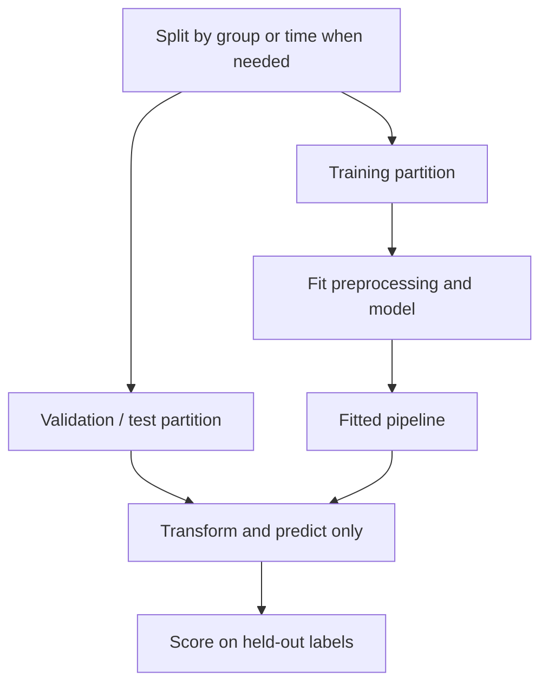

Within cross-validation, repeat fitting inside each training fold. Use validation results for selection; reserve the test set for the final assessment. Concept reference: [scikit-learn: preventing data leakage](https://scikit-learn.org/stable/common_pitfalls.html#data-leakage).

**Example 2:**
A churn model uses account-closure reason, a field populated after cancellation. Even a perfectly isolated preprocessing pipeline cannot make this a valid feature for predicting churn beforehand.

**Quick Cheat Sheet:**

| Cue | Remember |
| --- | --- |
| **Time** | was the feature available? |
| **Entity** | is the same subject on both sides? |
| **Transform** | fit on training only |

**Follow-up questions:**

- Can a transformation leak information even if it never uses target labels?

**References:**

- [scikit-learn: Common pitfalls and data leakage](https://scikit-learn.org/stable/common_pitfalls.html)

## Question: 7. How should you preprocess numerical and categorical features?

**Topic:** Feature preparation
**Difficulty:** Beginner

**Key terms:** [Preprocessing pipeline](../GLOSSARY.md#preprocessing-pipeline) · [Feature scaling](../GLOSSARY.md#feature-scaling) · [Categorical encoding](../GLOSSARY.md#categorical-encoding) · [Imputation](../GLOSSARY.md#imputation)

**Short answer:**
Preprocessing converts raw inputs into model-ready features: imputation handles missing values, encoding represents categories, and scaling adjusts numeric magnitudes. Fit learned transformations on training data only.

**Long answer:**
Standardization subtracts a training-set mean and divides by its standard deviation; it does not make a distribution Gaussian. One-hot encoding avoids inventing an order among nominal categories. Scaling matters for methods such as k-nearest neighbors and SVMs, while conventional decision trees generally do not require it. Plan for unseen categories and missing inputs at inference.

Preprocessing is model-dependent: distance-based methods and regularized linear models often need scaling, whereas tree splits are generally insensitive to monotonic rescaling. Define behavior for missing values, unseen categories, and extreme values before deployment. Target encoding needs cross-fitting within training data to avoid exposing a row's target to its features. Persist the fitted transformer with the model so serving applies the same mappings and column order.

**Metrics and checks:** Track missing-value rates, unknown-category rates, and train/serve feature agreement. Compare preprocessing choices using downstream validation performance, not whether transformed columns merely look well distributed.

**Examples:**

**Example 1:**
Scale annual spending and visit counts before computing customer distances so spending units do not dominate the comparison.

**Example 2:**
A kNN model using income and age may mostly measure income distance unless features are scaled. A categorical encoder also needs a defined outcome when a new employer appears at inference.

**Quick Cheat Sheet:**

| Cue | Remember |
| --- | --- |
| **Numeric** | scale when the model needs it |
| **Categorical** | encode and handle unseen values |
| **Serving** | reuse fitted transformations |

**Follow-up questions:**

- When is ordinal encoding appropriate, and when can it mislead a model?

**References:**

- [scikit-learn: Preprocessing data](https://scikit-learn.org/stable/modules/preprocessing.html)

## Training and generalization

## Question: 8. What are underfitting, overfitting, and the bias-variance tradeoff?

**Topic:** Generalization
**Difficulty:** Beginner

**Key terms:** [Statistical bias](../GLOSSARY.md#statistical-bias) · [Variance and overfitting](../GLOSSARY.md#variance-and-overfitting) · [Irreducible noise](../GLOSSARY.md#irreducible-noise) · [Generalization](../GLOSSARY.md#generalization)

**Short answer:**
Underfitting misses useful patterns; overfitting captures training-specific patterns that generalize poorly. Bias describes systematic modeling error, while variance describes sensitivity to the sampled training data.

**Long answer:**
Poor training and validation performance can indicate underfitting. Strong training performance with weaker validation performance can indicate overfitting, though distribution mismatch can also cause a gap. Learning curves help diagnose these patterns. Increasing complexity often reduces bias but can increase variance; this is a useful heuristic, not a universal law for every model.

For squared-error regression at a fixed input, expected prediction error can be decomposed into squared bias, variance across fitted models, and irreducible noise, under the usual data-generating assumptions. Bias measures systematic error in the average prediction; variance measures sensitivity to the sampled training set. This is a property of the learning procedure and data, not just parameter count. Learning curves and repeated fits provide practical evidence, but train/test gaps can also reflect distribution shift or leakage. More representative data often reduces variance; better features or a more suitable model can reduce bias.

**Metrics and checks:** Compare training and validation error as data size and regularization change. High errors on both suggest underfitting; low training error with much higher validation error suggests overfitting. Classification losses do not inherit this exact squared-error decomposition.

**Examples:**

**Example 1:**
An unrestricted tree memorizes training records but misclassifies many new records; limiting its depth may improve validation results.

**Example 2:**
Fitting a straight line to a curved demand trend leaves systematic errors even with more data. Conversely, a very flexible model trained on a small noisy sample can change dramatically when a few observations change.

**Example 3:**
In a synthetic learning-curve comparison, a shallow model has training/validation RMSE of 12/13 units, while an unrestricted model has 1/10 units. The first pattern suggests underfitting; the second suggests overfitting. A regularized model at 5/6 units is preferable on validation in this example, but the final test set must remain untouched until selection is complete. These numbers are diagnostic illustrations, not thresholds.

**Visual:**

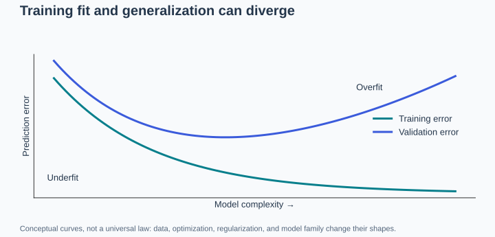

These are conceptual curves, not measured performance or a universal law. Concept reference: [scikit-learn: validation curves](https://scikit-learn.org/stable/modules/learning_curve.html).

**Quick Cheat Sheet:**

**Mnemonic: “V” for o“V”erfitting — high variance means sensitivity to the training sample.**

| Concept | What it is | Too much of it causes… | Example |
| --- | --- | --- | --- |
| **Bias** | Systematic error; often a model that is too simple or makes rigid assumptions | **Underfitting**: poor train and test performance | A straight line for a curved trend |
| **Variance** | Predictions change too much with the sampled training data; often excessive flexibility | **Overfitting**: great train performance, poor test performance | A zigzag curve chasing noisy observations |
| **Irreducible noise** | Variation not predictable from the available inputs | An error floor even with a suitable model | Different outcomes for otherwise indistinguishable examples |

For squared-error regression: **expected error = bias² + variance + irreducible noise**, averaging over training samples and outcome noise at a fixed input. Complexity is a useful diagnostic clue, not the definition of bias or variance; also check for distribution shift.

**Follow-up questions:**

- When might more training data help, and when might better features matter more?

**References:**

- [scikit-learn: Bias–variance decomposition](https://scikit-learn.org/stable/auto_examples/ensemble/plot_bias_variance.html)
- [scikit-learn: Validation and learning curves](https://scikit-learn.org/stable/modules/learning_curve.html)

## Question: 9. What is regularization, and how do L1 and L2 differ?

**Topic:** Complexity control
**Difficulty:** Intermediate

**Key terms:** [Regularization](../GLOSSARY.md#regularization) · [L1 and L2 penalties](../GLOSSARY.md#l1-and-l2-penalties) · [Feature scaling](../GLOSSARY.md#feature-scaling)

**Short answer:**
Regularization constrains model fitting to improve generalization. L1 penalizes absolute coefficient values; L2 penalizes squared coefficient values.

**Long answer:**
L1 can produce zero coefficients, yielding sparse models. L2 shrinks coefficients and can stabilize fits with correlated features. Penalty strength controls the tradeoff with data fit. Excessive regularization can underfit, and feature scaling affects coefficient penalties.

Regularization adds a preference for simpler or smaller parameter configurations to the training objective. L1 penalizes absolute coefficients and can set some to zero; L2 penalizes squared coefficients and tends to distribute weight across correlated features. Feature scale matters because the same coefficient magnitude has different meanings in different units. Select penalty strength on validation data. Penalty terms are one form of regularization; early stopping and data augmentation can also help generalization through different mechanisms, while additional representative data can reduce sampling uncertainty.

**Metrics and checks:** A common objective is mean data loss plus lambda times the penalty. Larger lambda increases regularization in this convention; some libraries expose its inverse, so inspect the definition before comparing settings.

**Examples:**

**Example 1:**
For a linear model with many potentially irrelevant inputs, tune an L1 penalty and inspect validation performance and selected features.

**Example 2:**
With hundreds of correlated sensor readings, ridge regression can stabilize coefficients. For a sparse text classifier, L1 can yield a smaller feature set, although selected features may change across similar training samples.

**Quick Cheat Sheet:**

| Cue | Remember |
| --- | --- |
| **L1** | absolute values and possible sparsity |
| **L2** | squared values and shrinkage |
| **Lambda** | strength depends on objective convention |

**Follow-up questions:**

- Why is a nonzero coefficient not proof that a feature causes the outcome?

**References:**

- [scikit-learn: Ridge and Lasso](https://scikit-learn.org/stable/modules/linear_model.html)

## Question: 10. How does gradient descent work?

**Topic:** Optimization
**Difficulty:** Beginner

**Key terms:** [Gradient descent](../GLOSSARY.md#gradient-descent) · [Gradient](../GLOSSARY.md#gradient) · [Learning rate (LR)](../GLOSSARY.md#learning-rate-lr) · [Optimizer and momentum](../GLOSSARY.md#optimizer-and-momentum)

**Short answer:**
Gradient descent updates parameters in the direction opposite the loss gradient: `parameters ← parameters − learning_rate × gradient`.

**Long answer:**
The gradient describes local sensitivity of the loss to each parameter. Batch gradient descent uses the full training set; stochastic and mini-batch methods use individual samples or subsets. A learning rate that is too large can cause divergence; one that is too small can slow progress. Nonconvex objectives do not generally guarantee convergence to a global minimum.

Gradient descent uses local derivatives to update parameters in a direction that decreases the objective for a sufficiently suitable step size. Mini-batches estimate the gradient cheaply but add noise; adaptive optimizers rescale updates and momentum smooths directions. Too large a learning rate can cause divergence, while too small a rate wastes compute or stalls progress. A decreasing training loss is necessary evidence of optimization progress, but does not establish generalization.

**Metrics and checks:** The basic update is theta_new = theta_old − learning_rate × gradient. Track training/validation loss, gradient norms, learning rate, and steps per second; compare runs at similar data exposure as well as elapsed time.

**Examples:**

**Example 1:**
For squared-error regression, updates adjust weights to reduce prediction errors on training examples.

**Example 2:**
A model whose loss becomes nonfinite may need input checks, a lower learning rate, or numerical stabilization. A flat validation curve while training loss keeps falling instead suggests that more optimization may not help.

**Quick Cheat Sheet:**

| Cue | Remember |
| --- | --- |
| **Gradient** | local slope |
| **Learning rate** | step size |
| **Validation** | optimization success is not generalization |

**Follow-up questions:**

- Why might mini-batch training be preferable to full-batch training on a large dataset?

**References:**

- [Google: Gradient descent](https://developers.google.com/machine-learning/crash-course/linear-regression/gradient-descent)

## Question: 11. Why do neural networks need nonlinear activation functions?

**Topic:** Neural network basics
**Difficulty:** Beginner

**Key terms:** [Activation function](../GLOSSARY.md#activation-function) · [Neural network](../GLOSSARY.md#neural-network) · [Backpropagation](../GLOSSARY.md#backpropagation)

**Short answer:**
Nonlinear activations allow networks to represent nonlinear relationships. Stacking only affine layers is equivalent to a single affine transformation.

**Long answer:**
A neuron combines weighted inputs and a bias, then applies an activation. Hidden layers can compose these transformations into richer representations. Common activations include ReLU, which outputs `max(0, x)`, and sigmoid. Adding layers without appropriate nonlinearities does not provide the same expressive power.

Without nonlinear activations, composing affine layers still produces an affine function, so depth alone does not create expressive nonlinear decision boundaries. ReLU is simple but units can become inactive; sigmoid and tanh can saturate, shrinking gradients. Activation choice interacts with initialization, normalization, architecture, and numerical precision. Output activations also have semantic roles: a multiclass softmax converts logits to normalized probabilities, while regression often uses an unconstrained linear output.

**Metrics and checks:** Inspect activation distributions, fractions of inactive units, and gradient magnitudes when debugging. Compare validation loss and convergence under controlled initialization rather than declaring one activation universally best.

**Examples:**

**Example 1:**
The XOR classification pattern cannot be separated by a single straight boundary, but a small network with nonlinear hidden units can represent it.

**Example 2:**
An XOR classifier cannot be represented by a single linear separator. A hidden layer with nonlinear activations can represent it, while stacking only linear layers cannot solve that representational limitation.

**Quick Cheat Sheet:**

| Cue | Remember |
| --- | --- |
| **Hidden activation** | adds nonlinearity |
| **Saturation** | can shrink gradients |
| **Output activation** | match the target and loss |

**Follow-up questions:**

- How would you choose different output activations for regression and binary classification?

**References:**

- [Google: Neural network nodes and hidden layers](https://developers.google.com/machine-learning/crash-course/neural-networks/nodes-hidden-layers)

## Traditional models

## Question: 12. How do linear regression and logistic regression differ?

**Topic:** Linear models
**Difficulty:** Beginner

**Key terms:** [Linear regression](../GLOSSARY.md#linear-regression) · [Logistic regression](../GLOSSARY.md#logistic-regression) · [Decision threshold](../GLOSSARY.md#decision-threshold)

**Short answer:**
Linear regression predicts a numerical value. Binary logistic regression applies a sigmoid to a linear score to estimate a class probability.

**Long answer:**
Ordinary least squares minimizes squared error. Logistic regression commonly minimizes log loss; a threshold converts probabilities into labels. Despite its name, logistic regression is a classifier. Its log-odds are linear in the supplied features; nonlinear feature transformations can extend the decision boundary.

Linear regression estimates a continuous outcome, often by minimizing squared residuals. Logistic regression models log-odds as a linear function of features and maps that value through a sigmoid for binary probabilities. Its decision boundary is linear in the supplied feature space, but feature transformations can make the boundary nonlinear in the original inputs. Probability estimation, calibration, and choosing a decision threshold should be assessed separately.

**Metrics and checks:** For binary logistic regression, p = 1/(1 + exp(−z)), where z is the linear score. Evaluate log loss or calibration for probabilities and precision/recall at the deployment threshold.

**Examples:**

**Example 1:**
Use linear regression to estimate delivery duration and logistic regression to estimate the probability of a late delivery.

**Example 2:**
Predicting a home's sale price is a regression task. Predicting whether it will sell within 30 days is classification; a 0.5 threshold is optional and should reflect business costs and capacity.

**Quick Cheat Sheet:**

| Cue | Remember |
| --- | --- |
| **Linear regression** | continuous target |
| **Logistic regression** | class probability |
| **Threshold** | converts probability into an action |

**Follow-up questions:**

- Why is a threshold of 0.5 not always the best classification decision rule?

**References:**

- [scikit-learn: Linear and logistic regression](https://scikit-learn.org/stable/modules/linear_model.html)

## Question: 13. How does a decision tree learn, and what are its limitations?

**Topic:** Decision trees
**Difficulty:** Beginner

**Key terms:** [Decision tree](../GLOSSARY.md#decision-tree) · [Impurity and Gini](../GLOSSARY.md#impurity-and-gini) · [Variance and overfitting](../GLOSSARY.md#variance-and-overfitting)

**Short answer:**
A decision tree recursively splits data using feature tests that improve a criterion such as class purity or regression error.

**Long answer:**
Leaves contain predictions for the resulting regions. Trees capture nonlinear relationships and interactions without requiring feature scaling. Deep trees can overfit and change substantially with small data changes. Depth limits, minimum leaf sizes, and pruning control complexity. Greedy split selection does not guarantee a globally optimal tree.

A decision tree recursively chooses feature splits that reduce an impurity or loss criterion on training data. Greedy local improvements do not guarantee a globally optimal tree. Deep trees can isolate tiny groups and memorize noise; shallow trees may miss important interactions. Limit depth or leaf size and consider pruning. Individual trees are interpretable when small, but their splits and explanations can be unstable under modest changes to the dataset.

**Metrics and checks:** For classification, Gini impurity is 1 − sum of squared class proportions. For regression, splits often reduce squared error. Compare validation performance and minimum leaf support alongside tree depth.

**Examples:**

**Example 1:**
A tree predicts delivery risk using successive tests on distance, carrier, and package weight.

**Example 2:**
A loan tree may first split by debt ratio and then income, capturing an interaction without manually constructing it. If a leaf contains two borrowers, its estimated default rate is highly uncertain.

**Quick Cheat Sheet:**

| Cue | Remember |
| --- | --- |
| **Split** | reduce impurity or loss |
| **Leaf** | prediction from local training data |
| **Complexity** | control depth and leaf support |

**Follow-up questions:**

- Why can a very small leaf produce an unreliable prediction?

**References:**

- [scikit-learn: Decision trees](https://scikit-learn.org/stable/modules/tree.html)

## Question: 14. How do random forests and gradient boosting differ?

**Topic:** Ensemble learning
**Difficulty:** Intermediate

**Key terms:** [Random forest](../GLOSSARY.md#random-forest) · [Gradient boosting](../GLOSSARY.md#gradient-boosting) · [Ensemble and bagging](../GLOSSARY.md#ensemble-and-bagging) · [Ensemble and bagging](../GLOSSARY.md#ensemble-and-bagging)

**Short answer:**
Random forests combine randomized trees trained largely independently. Gradient boosting builds an additive model sequentially, with each new learner addressing the current loss.

**Long answer:**
Standard random forests use bootstrap samples and random feature subsets to reduce correlation between trees; averaging helps reduce variance. Gradient boosting fits new learners to negative loss gradients, which are residuals for squared-error loss. Learning rate, tree complexity, and iteration count affect boosting performance and overfitting. Compare both on the task rather than assuming one always wins.

Random forests fit many randomized trees and average their predictions; useful diversity reduces the variance of unstable individual trees. Gradient boosting builds an additive model sequentially, fitting new learners to improve the current objective. Boosting can achieve strong tabular performance but needs careful control of learning rate, tree complexity, and iteration count. Forest trees are easier to train in parallel; boosting steps usually depend on previous predictions.

**Metrics and checks:** Compare out-of-sample error, fit time, prediction latency, and model size. Out-of-bag estimates can help evaluate bootstrap forests, but do not replace time-aware validation when records are temporally dependent.

**Examples:**

**Example 1:**
For tabular demand prediction, compare a forest baseline with boosted trees using the same temporal validation split.

**Example 2:**
A random forest may provide a robust baseline with limited tuning for equipment failure. A boosted model might improve rare-failure recall, but only after checking time-based validation and threshold-specific false alarms.

**Visual:**


The sketch shows the training dependency; random forests also randomize feature selection. Concept reference: [scikit-learn: ensemble methods](https://scikit-learn.org/stable/modules/ensemble.html).

**Quick Cheat Sheet:**

| Cue | Remember |
| --- | --- |
| **Forest** | randomized parallel trees |
| **Boosting** | sequential corrections |
| **Comparison** | validate quality and operating cost |

**Follow-up questions:**

- Why does averaging highly correlated trees provide less benefit?

**References:**

- [scikit-learn: Ensemble methods](https://scikit-learn.org/stable/modules/ensemble.html)

## Question: 15. How does k-nearest neighbors work?

**Topic:** Instance-based learning
**Difficulty:** Beginner

**Key terms:** [k-nearest neighbors (kNN)](../GLOSSARY.md#k-nearest-neighbors-knn) · [Feature scaling](../GLOSSARY.md#feature-scaling) · [Vector norm](../GLOSSARY.md#vector-norm)

**Short answer:**
k-nearest neighbors predicts from the labels or values of the k closest training examples, using voting for classification or averaging for regression.

**Long answer:**
The distance metric, feature scaling, and k determine what counts as similar. Small k can be sensitive to noise; larger k smooths predictions and may miss local structure. Prediction requires neighbor search and can become expensive with large datasets. High-dimensional distances may become less informative.

kNN stores training examples and predicts using nearby points under a chosen distance function. Scaling and irrelevant dimensions directly affect which points count as neighbors. Small k can follow noise; large k can oversmooth local structure. Exact search can become expensive as the dataset grows, and distances often become less informative in high-dimensional spaces. Approximate search changes the retrieval tradeoff and needs evaluation against the actual downstream prediction task.

**Metrics and checks:** Measure validation error across k, query latency, memory usage, and neighbor-label consistency. For approximate search, measure recall of exact neighbors separately from classification or regression quality.

**Examples:**

**Example 1:**
Estimate an item's demand from similar items using standardized numerical features and a validation-selected k.

**Example 2:**
A property-price estimator can average prices of nearby comparable homes. Geographic distance alone is insufficient if the nearest homes differ greatly in size, condition, or sale date.

**Quick Cheat Sheet:**

| Cue | Remember |
| --- | --- |
| **k small** | local and noisy |
| **k large** | smoother and less local |
| **Distance** | feature scaling defines similarity |

**Follow-up questions:**

- How can irrelevant features damage a distance-based model?

**References:**

- [scikit-learn: Nearest neighbors](https://scikit-learn.org/stable/modules/neighbors.html)

## Question: 16. What is a support vector machine, and what does a kernel do?

**Topic:** Margin-based learning
**Difficulty:** Intermediate

**Key terms:** [Support vector machine (SVM)](../GLOSSARY.md#support-vector-machine-svm) · [Kernel and RBF](../GLOSSARY.md#kernel-and-rbf) · [Kernel and RBF](../GLOSSARY.md#kernel-and-rbf) · [Feature scaling](../GLOSSARY.md#feature-scaling)

**Short answer:**
A support vector classifier seeks a decision boundary with a large margin while allowing penalized violations. A kernel computes similarities corresponding to an implicit feature space.

**Long answer:**
Support vectors determine the boundary. The parameter C trades margin regularization against training violations; larger C penalizes violations more strongly. Kernels such as the radial basis function allow nonlinear boundaries. Scaling and hyperparameter tuning matter. Kernel SVMs can be costly on large datasets, and their raw decision scores are not calibrated probabilities.

An SVM seeks a separating boundary with a large margin while allowing penalized violations in the soft-margin formulation. The regularization parameter balances margin width against training violations; kernels let the algorithm compare examples through an implicit feature space. An RBF kernel's scale controls how local similarity is. Scaling inputs and jointly tuning regularization and kernel parameters are essential, especially because a highly local kernel can fit noise.

**Metrics and checks:** Compare validation error, support-vector count, training time, and prediction latency. More support vectors generally increase inference work; raw SVM decision scores are not automatically calibrated probabilities.

**Examples:**

**Example 1:**
An RBF classifier can separate curved class regions that a linear boundary cannot capture.

**Example 2:**
For a modest dataset of engineered medical measurements, an RBF SVM may capture nonlinear separation. For millions of sparse text rows, a linear classifier can be a more practical starting point.

**Quick Cheat Sheet:**

| Cue | Remember |
| --- | --- |
| **Margin** | separation from boundary |
| **C** | penalty for violations in common formulations |
| **Kernel** | defines implicit feature similarity |

**Follow-up questions:**

- When would you prefer a linear SVM over a kernel SVM?

**References:**

- [scikit-learn: Support vector machines](https://scikit-learn.org/stable/modules/svm.html)

## Question: 17. What does k-means clustering optimize, and when can it fail?

**Topic:** Unsupervised learning
**Difficulty:** Beginner

**Key terms:** [k-means](../GLOSSARY.md#k-means) · [Clustering](../GLOSSARY.md#clustering) · [Silhouette score](../GLOSSARY.md#silhouette-score)

**Short answer:**
k-means partitions data into k groups by minimizing the sum of squared distances from points to their assigned centroids.

**Long answer:**
It alternates assigning points to nearby centroids and updating centroids. Initialization affects the local solution. Scaling, outliers, non-spherical groups, and unequal densities can cause problems. k must be chosen, and a cluster is not automatically a meaningful business category or known class.

k-means alternates assigning points to the nearest centroid and updating centroids to means, reducing within-cluster squared Euclidean distance until convergence to a local solution. Initialization matters, so compare multiple starts. It prefers roughly compact clusters and can distort groups with different scales, densities, or nonconvex shapes. Standardize meaningful numeric features and remember that choosing k imposes a number of groups whether or not the business problem contains natural segments.

**Metrics and checks:** Inertia is the sum of squared distances to assigned centroids; it always weakly improves as k grows. Use silhouette and stability as supporting evidence, then validate usefulness against an external task.

**Examples:**

**Example 1:**
Cluster customers by standardized purchase features, then inspect whether the groups represent useful behavioral differences.

**Example 2:**
Two concentric rings are poorly represented by centroid partitions. A customer-segmentation result may also group people mostly by spending scale unless the chosen features and normalization reflect the intended behavior.

**Quick Cheat Sheet:**

| Cue | Remember |
| --- | --- |
| **Objective** | within-cluster squared distance |
| **Assumption** | Euclidean compactness |
| **k** | more clusters trivially reduce inertia |

**Follow-up questions:**

- Why does decreasing training inertia alone not identify the best number of clusters?

**References:**

- [scikit-learn: Clustering](https://scikit-learn.org/stable/modules/clustering.html)

## Question: 18. What is principal component analysis?

**Topic:** Dimensionality reduction
**Difficulty:** Intermediate

**Key terms:** [Principal component analysis (PCA)](../GLOSSARY.md#principal-component-analysis-pca) · [Dimensionality reduction](../GLOSSARY.md#dimensionality-reduction) · [Covariance and correlation](../GLOSSARY.md#covariance-and-correlation) · [Eigenvalue and singular value](../GLOSSARY.md#eigenvalue-and-singular-value)

**Short answer:**
Principal component analysis (PCA) projects centered data onto orthogonal directions that capture the greatest variance, allowing a lower-dimensional representation.

**Long answer:**
PCA creates combinations of features rather than selecting original columns. Feature scale affects the result, so standardization may be appropriate. Fit PCA only on training data. High explained variance does not guarantee predictive usefulness because PCA does not use target labels; low-variance directions may still matter for the task.

PCA finds orthogonal directions of maximum variance after centering, typically using an eigendecomposition or singular-value decomposition. Scaling can radically change the result, so decide whether raw units or standardized features are meaningful. PCA is unsupervised: high variance need not imply predictive usefulness. It can reduce collinearity and storage, but transformed components may be difficult to explain and low-variance directions may contain the signal needed for a target.

**Metrics and checks:** Explained-variance ratio for component j is its eigenvalue divided by the sum of eigenvalues. Choose component count using reconstruction and downstream validation, rather than treating a fixed variance percentage as universally sufficient.

**Examples:**

**Example 1:**
Compress correlated sensor measurements into a few components, then verify that downstream predictive performance remains acceptable.

**Example 2:**
Compressing correlated sensor readings can remove redundancy. But a small change in a low-variance safety sensor could predict failures, so discarding that direction solely because its variance is small can harm recall.

**Visual:**

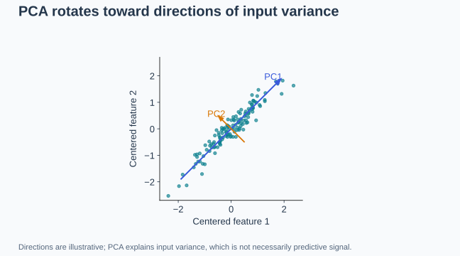

Input variance is not necessarily useful signal for predicting a target. Concept reference: [scikit-learn: PCA](https://scikit-learn.org/stable/modules/decomposition.html#pca).

**Quick Cheat Sheet:**

| Cue | Remember |
| --- | --- |
| **PCA** | variance-preserving projection |
| **Components** | orthogonal linear combinations |
| **Caution** | variance is not target relevance |

**Follow-up questions:**

- Why might PCA reduce interpretability even when it reduces dimensionality?

**References:**

- [scikit-learn: PCA and decomposition](https://scikit-learn.org/stable/modules/decomposition.html)

## Evaluation and production

## Question: 19. How do accuracy, precision, recall, and F1 differ?

**Topic:** Classification metrics
**Difficulty:** Beginner

**Key terms:** [Confusion matrix](../GLOSSARY.md#confusion-matrix) · [Accuracy](../GLOSSARY.md#accuracy) · [Precision and recall](../GLOSSARY.md#precision-and-recall) · [F1 score](../GLOSSARY.md#f1-score) · [Macro and micro averaging](../GLOSSARY.md#macro-and-micro-averaging)

**Short answer:**
Accuracy measures overall correctness, precision measures correctness among positive predictions, recall measures coverage of actual positives, and F1 is the harmonic mean of precision and recall.

**Long answer:**
With TP, TN, FP, and FN denoting true positives, true negatives, false positives, and false negatives:

| Metric | Formula |
| --- | --- |
| Accuracy | `(TP + TN) / (TP + TN + FP + FN)` |
| Precision | `TP / (TP + FP)` |
| Recall | `TP / (TP + FN)` |
| F1 | `2TP / (2TP + FP + FN)` |

Choose metrics according to error costs. F1 ignores true negatives; zero denominators require an explicit reporting convention.

Define the positive class and the unit being counted before computing a confusion matrix. Precision answers how reliable positive predictions are; recall answers how many actual positives were detected. F1 balances them through a harmonic mean but ignores true negatives and does not encode unequal business costs. Multiclass macro averages weight classes equally, while micro averages pool decisions; weighted averages can obscure poor minority-class performance.

**Metrics and checks:** Precision = TP/(TP+FP), recall = TP/(TP+FN), and F1 = 2TP/(2TP+FP+FN). Accuracy = (TP+TN)/N. State how undefined denominators and abstentions are handled.

**Examples:**

**Example 1:**
For 8 true alerts, 2 false alerts, and 4 missed positives, precision is 80%, recall is about 67%, and F1 is about 73%.

**Visual: Read the confusion matrix**

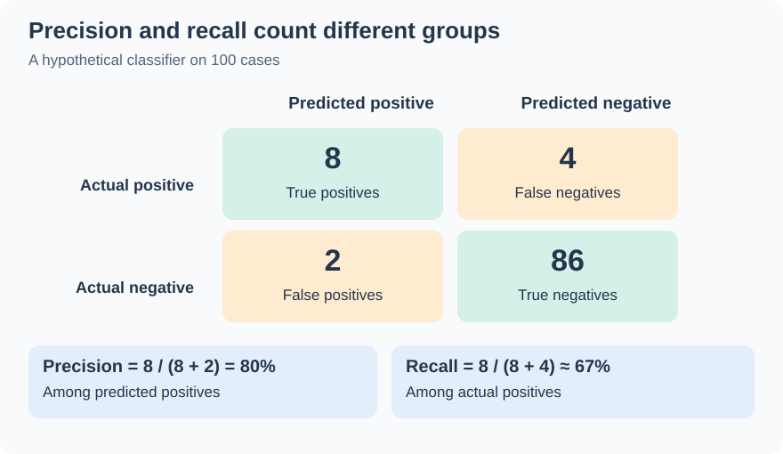

This extends the example with 86 true negatives: 100 cases total, 10 predicted positives, and 12 actual positives. Precision is `8/10`, recall is `8/12`, F1 is `16/22`, and accuracy is `94/100`. Concept reference: [Google: classification metrics](https://developers.google.com/machine-learning/crash-course/classification/accuracy-precision-recall).

**Example 2:**
In a synthetic screen with TP=80, FP=20, FN=40, and TN=860, accuracy is 94%, precision 80%, recall 66.7%, and F1 72.7%. These describe different aspects of the same decisions.

**Quick Cheat Sheet:**

| Cue | Remember |
| --- | --- |
| **Precision** | trust positive predictions |
| **Recall** | find actual positives |
| **F1** | harmonic balance, not overall utility |

**Follow-up questions:**

- When would you prioritize precision over recall?

**References:**

- [Google: Classification metrics](https://developers.google.com/machine-learning/crash-course/classification/accuracy-precision-recall)

## Question: 20. How do you handle class imbalance and choose a decision threshold?

**Topic:** Classification decisions
**Difficulty:** Intermediate

**Key terms:** [Class imbalance](../GLOSSARY.md#class-imbalance) · [Class weighting](../GLOSSARY.md#class-weighting) · [Resampling and SMOTE](../GLOSSARY.md#resampling-and-smote) · [Decision threshold](../GLOSSARY.md#decision-threshold) · [Prevalence](../GLOSSARY.md#prevalence)

**Short answer:**
Evaluate minority-class performance explicitly, consider class weighting or training-data resampling, and select a threshold using validation data and the costs of errors.

**Long answer:**
High accuracy can hide failure on rare positives. Precision-recall curves show tradeoffs across thresholds; ROC-AUC measures ranking across thresholds but can obscure the operational impact of false alerts under severe imbalance. Resample only within training folds and evaluate at realistic class prevalence. Threshold tuning changes decisions, not the underlying score ranking.

Imbalance is not fixed by a metric alone. Start with realistic prevalence, asymmetric error costs, and any limit on how many alerts people can review. Class weighting and training-only resampling can improve learning, but thresholds still require validation under deployment-like prevalence. Changing prevalence may change precision and calibration even when ranking remains similar. Choose thresholds using validation data and retain the final test set for an honest estimate.

**Metrics and checks:** If calibrated p is the probability of a positive case and only false-positive/false-negative costs matter, act when p > C_FP/(C_FP+C_FN). Capacity constraints or additional outcomes require a richer decision rule.

**Examples:**

**Example 1:**
If only 1% of records are positive, always predicting negative achieves 99% accuracy but zero positive recall.

**Example 2:**
A fraud team able to investigate 100 transactions per day may optimize precision among its top 100 alerts, while a safety detector may prioritize recall subject to an acceptable false-alarm burden.

**Quick Cheat Sheet:**

| Cue | Remember |
| --- | --- |
| **Training** | weighting or resampling |
| **Decision** | threshold reflects costs |
| **Reporting** | include prevalence and alert volume |

**Follow-up questions:**

- How would you choose a threshold if reviewers can investigate only 100 alerts per day?

**References:**

- [scikit-learn: Tuning classification thresholds](https://scikit-learn.org/stable/modules/classification_threshold.html)
- [scikit-learn: Classification evaluation](https://scikit-learn.org/stable/modules/model_evaluation.html)

## Question: 21. How do MAE, RMSE, and R-squared differ?

**Topic:** Regression metrics
**Difficulty:** Beginner

**Key terms:** [Mean absolute error (MAE)](../GLOSSARY.md#mean-absolute-error-mae) · [Mean squared error and RMSE](../GLOSSARY.md#mean-squared-error-and-rmse) · [R-squared (R²)](../GLOSSARY.md#r-squared-r²) · [Residual](../GLOSSARY.md#residual)

**Short answer:**
Mean absolute error (MAE) averages absolute residuals. Root mean squared error (RMSE) is the square root of mean squared residuals and emphasizes large misses. R-squared (R²) compares squared prediction error with the evaluation-set mean baseline.

**Long answer:**
MAE and RMSE use the target's units. R-squared is dimensionless and can be negative; it is not a percentage of predictions that are correct. Its usual formula needs special handling for constant targets. Choose a metric that reflects the cost of prediction errors.

MAE averages absolute residuals and stays in target units. RMSE also has target units but disproportionately penalizes large residuals. R² compares squared error against predicting the test-set target mean; it can be negative when the model is worse than that reference and is not a percentage of predictions that are correct. Metric choice should reflect whether occasional large errors are especially costly and whether performance differs by target scale or subgroup.

**Metrics and checks:** MAE = mean(abs(y−prediction)); RMSE = sqrt(mean((y−prediction)^2)); R² = 1 − SSE/SST, with SST measured around the evaluation-set mean. Constant targets require special handling.

**Examples:**

**Example 1:**
For errors of 0 and 4 units, MAE is 2 and RMSE is approximately 2.83.

**Example 2:**
For errors of 1, 1, and 10 minutes, MAE is 4 minutes while RMSE is about 5.83 minutes. The larger gap signals the influence of the single large error.

**Quick Cheat Sheet:**

| Cue | Remember |
| --- | --- |
| **MAE** | average absolute miss |
| **RMSE** | emphasizes large misses |
| **R²** | improvement over a mean reference |

**Follow-up questions:**

- Why can two datasets yield different R-squared values for the same MAE?

**References:**

- [scikit-learn: Regression evaluation](https://scikit-learn.org/stable/modules/model_evaluation.html)

## Question: 22. What should you monitor after deploying an ML model?

**Topic:** Production ML
**Difficulty:** Intermediate

**Key terms:** [Data drift](../GLOSSARY.md#data-drift) · [Concept drift](../GLOSSARY.md#concept-drift) · [Distribution shift](../GLOSSARY.md#distribution-shift) · [Observability and SRE](../GLOSSARY.md#observability-and-sre)

**Short answer:**
Monitor input quality, feature and prediction distributions, serving reliability, and predictive performance when outcome labels become available.

**Long answer:**
Data drift changes the input distribution; concept drift changes the relationship between inputs and targets. Training-serving skew means the model sees different feature processing or availability in production. A drift signal alone does not prove accuracy has fallen. Investigate data pipelines and evaluate on recent labeled data before deciding whether to retrain or roll back.

Production monitoring needs separate views of input health, predictions, eventual outcomes, and the serving system. Data drift means input distributions changed; concept drift means the input-to-target relationship changed. Neither a stable input histogram nor a changed one establishes whether quality has degraded. Delayed labels require leading indicators and later backfilled outcome analysis. Define who investigates alerts and when retraining or rollback is appropriate.

**Metrics and checks:** Track missingness, drift statistics, prediction rates, delayed-label precision/recall or error, latency, and failures. Slice by tenant or cohort; a stable global average can hide a severe local regression.

**Examples:**

**Example 1:**
A unit change from dollars to cents shifts a feature dramatically; fixing the pipeline may be more appropriate than retraining.

**Example 2:**
A retailer's demand model sees a holiday shift in inputs without losing accuracy. A pricing-policy change can instead break the relationship between price and demand even when individual feature distributions look similar.

**Quick Cheat Sheet:**

| Cue | Remember |
| --- | --- |
| **Data drift** | inputs change |
| **Concept drift** | target relationship changes |
| **Action** | connect alerts to outcome checks |

**Follow-up questions:**

- What could you monitor when reliable outcome labels arrive weeks later?

**References:**

- [Google: Monitoring production ML pipelines](https://developers.google.com/machine-learning/crash-course/production-ml-systems/monitoring)

Continue with [foundational GenAI and LLM questions](genai-foundations.md).

## Additional ML interview topics

## Question: 23. How do you validate a model that predicts future events?

**Topic:** Temporal validation
**Difficulty:** Intermediate

**Key terms:** [Temporal split](../GLOSSARY.md#temporal-split) · [Data leakage](../GLOSSARY.md#data-leakage) · [Baseline](../GLOSSARY.md#baseline)

**Short answer:**
Use evaluation windows that follow their training windows in time, with features constructed only from information available at prediction time.

**Long answer:**
An expanding window adds older observations to training; a sliding window keeps a fixed history. Match the evaluation horizon to deployment. Add a gap when feature windows or delayed labels overlap the evaluation period. A chronological split still leaks if features incorporate future events. TimeSeriesSplit assumes equally spaced samples when comparing equal-duration folds; irregular data may need calendar-based splits.

Time-based validation must reproduce the information and forecasting horizon available at each prediction timestamp. Use expanding or rolling training windows, and prevent labels or features that arrive later from crossing the boundary. A gap can help when labels span intervals or observations overlap, but its length should follow the actual availability and dependency structure. Evaluate across several periods so one seasonal interval does not dominate the conclusion.

**Metrics and checks:** Report error by horizon, time period, and season; compare with a naive or seasonal baseline. Multi-step forecasts should not use actual intermediate future outcomes unless deployment would genuinely observe them.

**Examples:**

**Example 1:**
To predict next-week demand, train through June, leave any required gap, and evaluate July. Repeat at later cutoffs; keep the final period untouched during model selection.

**Example 2:**
For a seven-day demand forecast made every Monday, build features only from data available on that Monday. A centered rolling average leaks future sales even if the train/test split itself is chronological.

**Visual:**

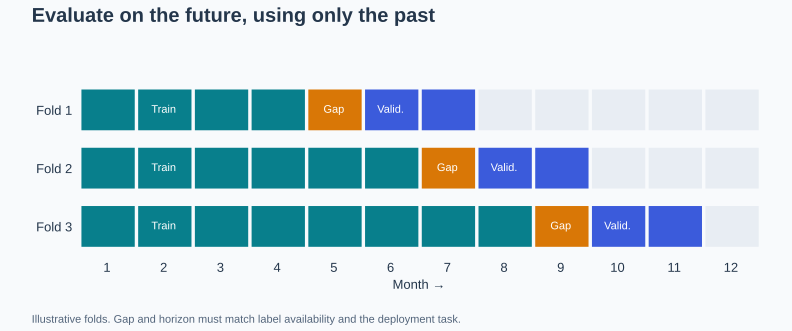

Illustrative monthly folds: validation always follows training; the gap must match the application. The primary references below support the concept.

**Quick Cheat Sheet:**

| Cue | Remember |
| --- | --- |
| **Split** | past before future |
| **Gap** | match availability and overlap |
| **Baseline** | last value or seasonal reference |

**Follow-up questions:**

- How would delayed labels change the training cutoff?

**References:**

- [scikit-learn: TimeSeriesSplit](https://scikit-learn.org/stable/modules/generated/sklearn.model_selection.TimeSeriesSplit.html)

## Question: 24. How does feature selection differ from PCA?

**Topic:** Feature reduction
**Difficulty:** Intermediate

**Key terms:** [Feature selection](../GLOSSARY.md#feature-selection) · [Principal component analysis (PCA)](../GLOSSARY.md#principal-component-analysis-pca) · [Cross-validation (CV)](../GLOSSARY.md#cross-validation-cv)

**Short answer:**
Feature selection retains a subset of original variables; PCA creates new axes that combine variables to explain input variance.

**Long answer:**
Filters, wrappers, and embedded selection methods use different criteria and computational budgets. Supervised selection can use labels, so fit it inside each training fold. PCA does not need labels, but high-variance directions need not be predictive. Compare predictive quality, stability, interpretability, and inference cost rather than reducing dimensions automatically.

Feature selection retains original columns, whereas PCA constructs new combinations of numeric features. Selection can preserve interpretability and reduce data collection requirements; PCA can compress correlated signals without selecting a subset. Supervised selection must be fitted within training folds because it uses labels. Neither method guarantees improvement: removing features can discard useful interactions, and components with high variance can be irrelevant to the task.

**Metrics and checks:** Compare validation quality, number of required source features, inference cost, and selection stability across folds. For PCA, report retained variance separately from predictive performance.

**Examples:**

**Example 1:**
Keeping tenure and purchase count preserves their meanings. Replacing them with principal components creates mixtures that may be harder to explain.

**Example 2:**
A clinical model might select five inexpensive lab tests to reduce collection cost. PCA using all 100 tests to form five components still requires collecting all 100 unless the pipeline is redesigned.

**Visual:**


A schematic comparison; the illustrated feature names and component count are hypothetical. The primary references below support the concept.

**Quick Cheat Sheet:**

| Cue | Remember |
| --- | --- |
| **Selection** | keep columns |
| **PCA** | combine columns |
| **Cost** | fewer components need not mean fewer measurements |

**Follow-up questions:**

- When could removing a low-variance feature destroy useful signal?

**References:**

- [scikit-learn: feature selection](https://scikit-learn.org/stable/modules/feature_selection.html)

## Question: 25. What does permutation importance tell you, and when can it mislead?

**Topic:** Interpretability
**Difficulty:** Intermediate

**Key terms:** [Permutation importance](../GLOSSARY.md#permutation-importance) · [Covariance and correlation](../GLOSSARY.md#covariance-and-correlation) · [Paired comparison](../GLOSSARY.md#paired-comparison)

**Short answer:**
It measures the drop in a fitted model’s score when a feature is shuffled, breaking its relationship with the target and other features.

**Long answer:**
Compute a baseline on appropriate held-out data, shuffle one column repeatedly, and compare scores. The result depends on the model, metric, and evaluation distribution; it is not a causal effect. Correlated substitutes can hide each other’s usefulness. Shuffling may also create unrealistic inputs. Inspect correlated groups and repeat measurements instead of treating a single ordering as universal.

Permutation importance measures how much a fitted model's score changes when one feature is shuffled on an evaluation dataset. It is model- and metric-dependent, not a causal effect or intrinsic value of the feature. Correlated predictors can substitute for one another, making each appear less important. Shuffling can also create unrealistic combinations. Inspect grouped permutations or conditional approaches where appropriate and compare results across samples.

**Metrics and checks:** Report mean score decrease and variation over repeated shuffles on held-out data. Negative importance can reflect noise, sampling variation, or a model using a feature poorly; it is not proof that the feature is universally harmful.

**Examples:**

**Example 1:**
If validation accuracy falls from 0.88 to 0.80 when tenure is shuffled, its importance under this metric is 0.08, not “8% of the prediction.”

**Example 2:**
House size and bedroom count can each look weak when the other remains available. Shuffling both together may reveal substantial joint reliance that one-column importance concealed.

**Visual:**

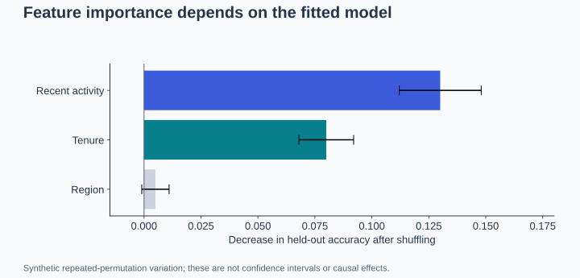

Synthetic repeated-permutation results, not a benchmark or a causal ranking. The primary references below support the concept.

**Quick Cheat Sheet:**

| Cue | Remember |
| --- | --- |
| **Importance** | score sensitivity for this model |
| **Correlation** | substitutes hide reliance |
| **Causality** | not established by shuffling |

**Follow-up questions:**

- How would you investigate two highly correlated features with low individual importance?

**References:**

- [scikit-learn: permutation importance](https://scikit-learn.org/stable/modules/permutation_importance.html)

## Question: 26. When should you inspect a precision–recall curve instead of only ROC-AUC?

**Topic:** Ranking metrics
**Difficulty:** Intermediate

**Key terms:** [Precision-recall curve and AP](../GLOSSARY.md#precision-recall-curve-and-ap) · [ROC-AUC](../GLOSSARY.md#roc-auc) · [Precision and recall](../GLOSSARY.md#precision-and-recall) · [Prevalence](../GLOSSARY.md#prevalence)

**Short answer:**
Use precision–recall analysis when positive predictions and missed positives matter, especially when the positive class is rare.

**Long answer:**
ROC plots true-positive rate against false-positive rate; PR plots precision against recall. With many negatives, a small false-positive rate can still produce many false alerts. ROC-AUC evaluates ranking across thresholds; it does not pick an operating threshold. PR results depend on prevalence. Average precision and trapezoidal PR area are different summaries, so name the metric explicitly.

ROC plots true-positive rate against false-positive rate; PR plots precision against recall. With rare positives, a small false-positive rate can still generate many false alarms because negatives are numerous. PR therefore makes alert reliability more visible, while ROC remains useful for ranking comparisons across thresholds. Average precision and trapezoidal PR area are different summaries and should be named precisely. Deployment still requires a selected operating point.

**Metrics and checks:** With 100 positives and 9,900 negatives, TPR=80% and FPR=1% gives TP=80 and FP=99, so precision is only 44.7%. A random-ranking PR baseline is tied to prevalence.

**Examples:**

**Example 1:**
At 1% prevalence, 80% recall and 5% false-positive rate yield 80 true alerts and 495 false alerts per 10,000 cases: precision is about 14%.

**Example 2:**
Two screening systems can have similar ROC-AUC but very different precision at the recall required by reviewers. Compare that operating region and expected daily false alarms rather than only whole-curve area.

**Visual:**

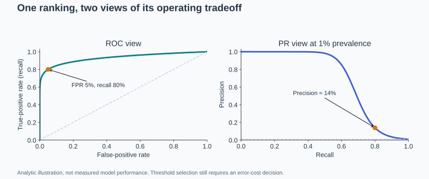

The marked operating point has 80% recall, 5% false-positive rate, and about 14% precision. The primary references below support the concept.

**Quick Cheat Sheet:**

| Cue | Remember |
| --- | --- |
| **ROC** | TPR versus FPR |
| **PR** | precision versus recall |
| **Rare positives** | small FPR can still mean many alerts |

**Follow-up questions:**

- Why can precision change after deployment even if class-conditional score distributions stay fixed?

**References:**

- [scikit-learn: classification metrics](https://scikit-learn.org/stable/modules/model_evaluation.html#classification-metrics)

## Question: 27. How is probability calibration different from discrimination?

**Topic:** Probability quality
**Difficulty:** Intermediate

**Key terms:** [Calibration and Brier score](../GLOSSARY.md#calibration-and-brier-score) · [Discrimination](../GLOSSARY.md#discrimination) · [Calibration and Brier score](../GLOSSARY.md#calibration-and-brier-score) · [Cross-entropy and log loss](../GLOSSARY.md#cross-entropy-and-log-loss)

**Short answer:**
Discrimination is the ability to rank positive cases above negative cases. Calibration means predicted probabilities agree with observed outcome frequencies in comparable cases. A model can rank well while being overconfident.

**Long answer:**
A model can rank examples well yet be overconfident. A reliability diagram compares mean predicted probability with the observed positive fraction in each bin; report bin sizes and uncertainty. Fit calibration on data separate from model fitting and final testing. Calibration can change under distribution shift and does not guarantee good ranking or subgroup performance.

Discrimination measures whether higher-risk cases tend to receive higher scores; calibration asks whether predicted probabilities correspond to observed frequencies. A strictly increasing transformation preserves ranking but can distort probability meaning. Calibrate using data separate from fitting the predictor, then evaluate on another held-out set. Calibration is distribution-dependent and may degrade when prevalence or populations change. Small reliability bins have noisy empirical rates.

**Metrics and checks:** Use reliability diagrams, log loss, and Brier score, mean((p−y)^2), alongside ranking metrics. These proper scores combine aspects of probability quality; a single bin-based calibration statistic depends on binning choices.

**Examples:**

**Example 1:**
Among many comparable predictions near 0.8, about 80% should be positive if that group is calibrated. An observed rate of 0.5 suggests overconfidence.

**Example 2:**
If 1,000 comparable cases receive probability 0.8 but only 500 are positive, that group is overconfident. The model may still rank positives above negatives well enough to have a strong ROC-AUC.

**Visual:**

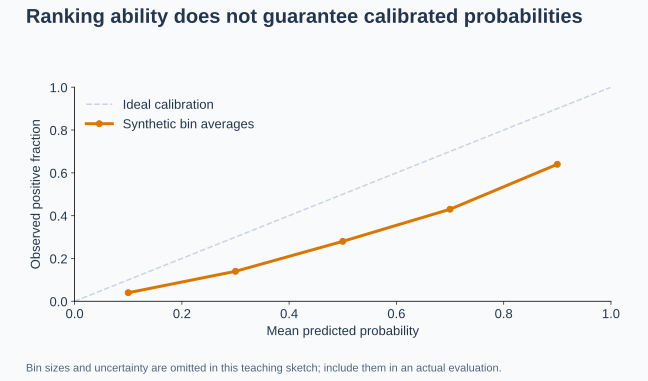

Synthetic bin averages. Being below the diagonal means predicted probabilities exceed observed frequencies. The primary references below support the concept.

**Quick Cheat Sheet:**

| Cue | Remember |
| --- | --- |
| **Discrimination** | who ranks higher? |
| **Calibration** | do probabilities mean what they say? |
| **Validation** | recalibration needs held-out data |

**Follow-up questions:**

- Why is predicting the base rate for every case calibrated but often unhelpful?

**References:**

- [scikit-learn: probability calibration](https://scikit-learn.org/stable/modules/calibration.html)

## Question: 28. What assumption makes naive Bayes naive?

**Topic:** Probabilistic classifiers
**Difficulty:** Beginner

**Key terms:** [Naive Bayes](../GLOSSARY.md#naive-bayes) · [Conditional probability](../GLOSSARY.md#conditional-probability) · [Conditional probability](../GLOSSARY.md#conditional-probability)

**Short answer:**
It treats features as conditionally independent given the class, then combines class priors and feature likelihoods using Bayes’ rule.

**Long answer:**
For features x_i and class y, the score is proportional to P(y) × product P(x_i | y). The assumption is conditional independence, not independence in the full dataset. Choose a likelihood appropriate to the feature type; smoothing avoids zero-count failures in discrete models. Correlated evidence can be counted more than once, so classification may be useful while probabilities are poorly calibrated.

Naive Bayes uses Bayes' rule with a class-conditional independence assumption to factor the feature likelihood. Features can be correlated in reality and the classifier may still rank classes usefully, but repeated evidence can make probabilities too extreme. Match the likelihood model to the feature type and use smoothing to avoid zero counts eliminating a class. Computation in log space avoids multiplying many tiny probabilities directly.

**Metrics and checks:** Evaluate classification quality and probability calibration separately. Inspect class priors, smoothing strength, and out-of-vocabulary behavior; high accuracy alone does not validate the independence assumption.

**Examples:**

**Example 1:**
A bag-of-words spam classifier combines the spam prior with word likelihoods. Two near-duplicate indicators may exaggerate its confidence.

**Example 2:**
In spam detection, the words “limited” and “offer” often co-occur. Treating them as independent can count closely related evidence twice, while still producing a useful fast baseline for filtering.

**Visual:**


The arrows express the model’s factorization, not a claim that the class causally generates real-world features. The primary references below support the concept.

**Quick Cheat Sheet:**

| Cue | Remember |
| --- | --- |
| **Bayes** | posterior from prior and likelihood |
| **Naive** | independent features given class |
| **Smoothing** | avoid zero-frequency collapse |

**Follow-up questions:**

- Why can the classifier still work when the independence assumption is imperfect?

**References:**

- [scikit-learn: naive Bayes](https://scikit-learn.org/stable/modules/naive_bayes.html)

## Question: 29. How should you handle missing values and extreme observations?

**Topic:** Data quality
**Difficulty:** Intermediate

**Key terms:** [Imputation](../GLOSSARY.md#imputation) · [Outlier](../GLOSSARY.md#outlier) · [Preprocessing pipeline](../GLOSSARY.md#preprocessing-pipeline)

**Short answer:**
Investigate why values are missing or extreme before choosing imputation, transformation, exclusion, or a model that supports them.

**Long answer:**
Fit imputation statistics using training data only and apply the same transformation at inference. Missingness indicators can preserve useful information but may encode a collection process that later changes. An extreme observation may be a data error or the event the model must detect. Evaluate handling rules on realistic slices; avoid blanket deletion or using future values to fill past records.

Missingness may itself carry information, but its interpretation can change when collection processes change. Fit imputers on training data, consider missingness indicators, and distinguish genuinely absent values from parsing errors. Extreme values may be errors or the rare cases the model most needs to handle. Investigate units and provenance before clipping; robust scaling and losses can reduce sensitivity without erasing important tail behavior.

**Metrics and checks:** Report missingness and extreme-value frequency by split and subgroup. Compare downstream performance with and without indicators or clipping, including tail errors; never select clipping bounds using the test set.

**Examples:**

**Example 1:**
A missing sensor reading receives a training-set median plus a missingness flag. A verified high reading is retained because it may indicate the failure being predicted.

**Example 2:**
A missing lab result can mean a clinician judged a test unnecessary, while a missing sensor reading may indicate hardware failure. Replacing both with a global mean discards very different operational signals.

**Visual:**


A possible preprocessing design. Missingness and outlier rules must be justified for the task. The primary references below support the concept.

**Quick Cheat Sheet:**

| Cue | Remember |
| --- | --- |
| **Missing** | ask why absent |
| **Extreme** | distinguish error from signal |
| **Fit** | imputation and bounds on training only |

**Follow-up questions:**

- What monitoring would reveal that the missing-data mechanism changed?

**References:**

- [scikit-learn: missing-value imputation](https://scikit-learn.org/stable/modules/impute.html)

## Question: 30. When would DBSCAN be preferable to k-means?

**Topic:** Clustering
**Difficulty:** Intermediate

**Key terms:** [DBSCAN](../GLOSSARY.md#dbscan) · [k-means](../GLOSSARY.md#k-means) · [Clustering](../GLOSSARY.md#clustering) · [Silhouette score](../GLOSSARY.md#silhouette-score)

**Short answer:**
Density-Based Spatial Clustering of Applications with Noise (DBSCAN) groups density-connected points and marks sparse points as noise. Unlike k-means, it does not require a cluster count and can capture nonconvex shapes, but varying densities can be difficult.

**Long answer:**
K-means favors compact clusters under its distance objective. DBSCAN uses a neighborhood radius and minimum density, so it can handle some non-convex shapes without specifying the number of clusters. Scaling and distance choice matter. One global density threshold can struggle when densities vary; high-dimensional distances can also be uninformative. Neither method discovers the uniquely correct grouping without a useful representation and objective.

DBSCAN groups points connected through sufficiently dense neighborhoods and can mark sparse points as noise. Unlike k-means, it does not require a cluster count and can discover nonconvex shapes. However, one neighborhood radius can struggle with strongly varying densities; scaling, distance choice, and high dimensionality affect the meaning of density. Points labeled noise are not automatically fraudulent or erroneous, and cluster IDs carry no intrinsic semantic meaning.

**Metrics and checks:** Tune epsilon and minimum samples using domain-aware stability checks. Report the fraction labeled noise and cluster-size distribution; a silhouette score excluding noise can hide how much data was discarded.

**Examples:**

**Example 1:**
Two interlocking crescent-shaped groups may suit density connectivity better than nearest-centroid partitions. Isolated points can remain unassigned.

**Example 2:**
GPS points along winding roads may form density-connected shapes that centroids represent poorly. Two cities with very different sampling densities can make a single DBSCAN radius inappropriate.

**Visual:**

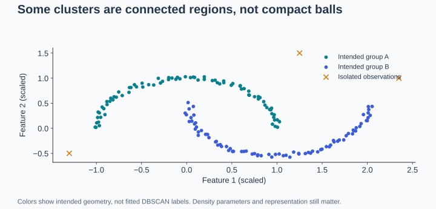

Synthetic geometry showing a possible use case; colors indicate intended groups, not fitted algorithm output. The primary references below support the concept.

**Quick Cheat Sheet:**

| Cue | Remember |
| --- | --- |
| **k-means** | centroid distance and chosen k |
| **DBSCAN** | density connectivity and noise |
| **Caution** | one density scale may not fit all groups |

**Follow-up questions:**

- What happens when one meaningful cluster is much sparser than another?

**References:**

- [scikit-learn: clustering](https://scikit-learn.org/stable/modules/clustering.html#dbscan)

## Question: 31. What should you check before trusting linear-regression results?

**Topic:** Regression diagnostics
**Difficulty:** Intermediate

**Key terms:** [Linear regression](../GLOSSARY.md#linear-regression) · [Residual](../GLOSSARY.md#residual) · [Heteroscedasticity](../GLOSSARY.md#heteroscedasticity) · [Confidence interval](../GLOSSARY.md#confidence-interval)

**Short answer:**
Check residual structure, dependence, changing error variance, influential observations, and whether the model is appropriate for the prediction or inference task.

**Long answer:**
Linearity concerns the conditional mean represented by the model. Curved residual patterns suggest omitted structure; a widening spread suggests heteroscedasticity. Predictive validation and classical confidence-interval assumptions are different checks. Normal errors are not required merely to fit least squares; they matter for some exact small-sample inference procedures. Correlated errors and multicollinearity can undermine uncertainty estimates or coefficient stability.

Separate assumptions needed for useful prediction from those needed for familiar coefficient tests and intervals. A linear conditional mean is a modeling assumption; correlated predictors can inflate coefficient uncertainty even when predictions remain acceptable. Residual patterns can reveal missing nonlinear terms, dependence, or nonconstant variance. Normal residuals are not required to compute ordinary least-squares estimates, but matter for certain exact small-sample inferential results.

**Metrics and checks:** Inspect residual-versus-fitted plots, held-out error, influential observations, and interval coverage. Use methods appropriate to heteroscedasticity or dependence when making uncertainty claims; robust standard errors do not repair a misspecified mean function.

**Examples:**

**Example 1:**
A demand model has near-zero mean residuals overall but consistently underpredicts at both low and high temperatures. Add plausible nonlinear terms and validate again.

**Example 2:**
A residual funnel in house-price predictions suggests error variance grows with price. A curved residual pattern instead suggests missing nonlinear structure; these require different responses.

**Visual:**

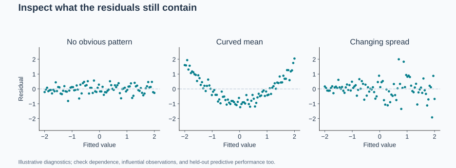

Synthetic diagnostic patterns; the axes represent fitted values and residuals. The primary references below support the concept.

**Quick Cheat Sheet:**

| Cue | Remember |
| --- | --- |
| **Mean structure** | linear in chosen features |
| **Variance** | check heteroscedasticity |
| **Inference** | assumptions depend on the claimed interval or test |

**Follow-up questions:**

- Why does a high R-squared not establish that residual assumptions hold?

**References:**

- [NIST: model validation and residual analysis](https://www.itl.nist.gov/div898/handbook/pmd/section4/pmd44.htm)

## Question: 32. How would you use a pretrained vision model with a small labeled dataset?

**Topic:** Transfer learning
**Difficulty:** Intermediate

**Key terms:** [Transfer learning](../GLOSSARY.md#transfer-learning) · [Data augmentation](../GLOSSARY.md#data-augmentation) · [Fine-tuning](../GLOSSARY.md#fine-tuning)

**Short answer:**
Start with a pretrained feature extractor and a task-specific head, then evaluate whether cautiously fine-tuning more layers improves held-out performance.

**Long answer:**
Keep preprocessing compatible with the backbone. Training only the head lowers the number of trainable parameters; unfreezing layers increases adaptation capacity and overfitting risk. Tune learning rates and augmentation on validation data. Preserve a meaningful split across related subjects or sources. Pretraining does not remove domain mismatch or data-license constraints.

Transfer learning reuses representations learned on another dataset, reducing the amount of task-specific data needed. Begin with a frozen backbone and train a small head, then consider selectively unfreezing layers with a smaller learning rate. Domain similarity matters: natural-image features may transfer unevenly to specialized imagery. Prevent duplicate subjects or near-identical images across splits and check whether augmentation preserves the label and deployment conditions.

**Metrics and checks:** Compare a frozen baseline with partial and full fine-tuning using held-out task metrics, compute, and subgroup performance. Use repeated seeds when the labeled sample is small enough for results to vary substantially.

**Examples:**

**Example 1:**
For product-defect images, compare a frozen backbone plus classifier with fine-tuning the last block. Split by production batch so nearly identical images do not cross partitions.

**Example 2:**
For plant-disease photos, brightness augmentation may be reasonable while aggressive color changes can erase disease cues. A pretrained classifier should also be checked on photographs from farms absent from training.

**Visual:**


Stage one freezes the backbone; a later experiment may unfreeze selected layers. The primary references below support the concept.

**Quick Cheat Sheet:**

| Cue | Remember |
| --- | --- |
| **Freeze** | cheap starting point |
| **Unfreeze** | adapt with overfitting risk |
| **Augment** | preserve the target signal |

**Follow-up questions:**

- What evidence would justify unfreezing the entire backbone?

**References:**

- [PyTorch: transfer learning tutorial](https://docs.pytorch.org/tutorials/beginner/transfer_learning_tutorial.html)

## Question: 33. Where does SMOTE belong in a validation pipeline?

**Topic:** Imbalanced learning
**Difficulty:** Intermediate

**Key terms:** [Resampling and SMOTE](../GLOSSARY.md#resampling-and-smote) · [Class imbalance](../GLOSSARY.md#class-imbalance) · [Cross-validation (CV)](../GLOSSARY.md#cross-validation-cv) · [Calibration and Brier score](../GLOSSARY.md#calibration-and-brier-score)

**Short answer:**
Synthetic Minority Over-sampling Technique (SMOTE) creates synthetic minority-class training examples by interpolating between neighbors. Apply it only inside each training fold, after suitable preprocessing; keep validation and test data unchanged.

**Long answer:**
SMOTE interpolates between a minority example and selected minority neighbors. Creating samples before splitting can leak related synthetic examples into validation. Preserve natural class prevalence in evaluation. Interpolation may be implausible near class overlap, outliers, or categorical boundaries; use suitable variants for mixed features and compare against class weighting and threshold tuning.

SMOTE creates synthetic minority examples by interpolating between minority neighbors. It must occur inside each training fold after the split, never before validation, or related synthetic points can leak information across partitions. Distance quality depends on scaling and feature representation; ordinary interpolation is inappropriate for arbitrary categorical IDs. Resampling changes the training distribution and can affect probabilities, so evaluate thresholds and calibration under realistic class prevalence.

**Metrics and checks:** Compare against class weighting and a no-resampling baseline using PR metrics and threshold-specific precision/recall. Leave validation/test prevalence unchanged; do not advertise balanced-set accuracy as deployment performance.

**Examples:**

**Example 1:**
For numeric features, a new point is x_new = x_i + λ(x_neighbor − x_i), with λ between zero and one. It lies on the segment rather than being a new independent observation.

**Example 2:**
Interpolating customer ages may be meaningful, but interpolating postcode IDs can create nonexistent categories. A mixed-type method or different imbalance strategy is needed, with all fitting contained within training folds.

**Visual:**

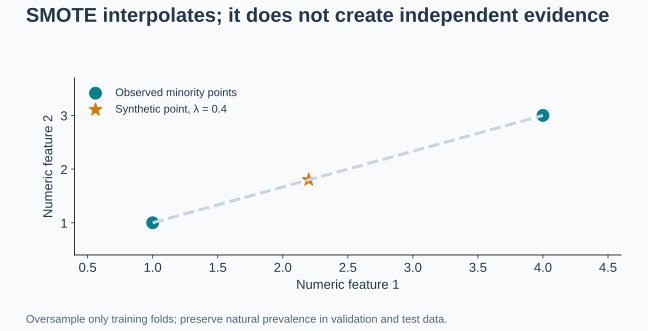

An illustration of interpolation, not evidence that the generated point is realistic for a particular dataset. The primary references below support the concept.

**Quick Cheat Sheet:**

| Cue | Remember |
| --- | --- |
| **Split first** | preserve honest evaluation |
| **Resample train** | never validation or test |
| **Check probabilities** | altered priors can affect calibration |

**Follow-up questions:**

- Why should you still measure precision at deployment prevalence?

**References:**

- [imbalanced-learn: oversampling and SMOTE](https://imbalanced-learn.org/stable/over_sampling.html)
