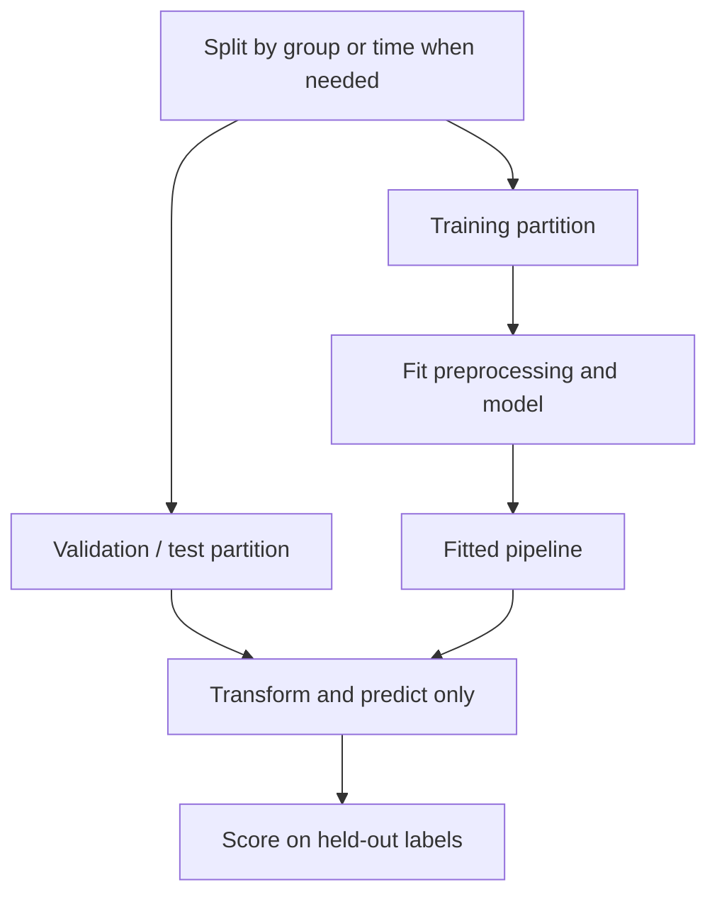

# Foundational AI and Machine Learning Questions and Answers

[Back to the README](../README.md) · [Next: GenAI and LLM foundations](genai-foundations.md)

This section covers traditional machine learning before moving into GenAI. Engineers can practice the short answers aloud; interviewers can use the explanations and follow-ups to explore reasoning and practical judgment. Examples are illustrative. These answers are reference points, not a rigid scoring rubric.

## Contents

- [Core concepts](#core-concepts): AI, machine learning, learning paradigms, and prediction tasks.
- [Data and validation](#data-and-validation): dataset splits, cross-validation, leakage, and preprocessing.
- [Training and generalization](#training-and-generalization): overfitting, regularization, optimization, and neural networks.
- [Traditional models](#traditional-models): linear models, trees, ensembles, nearest neighbors, SVMs, clustering, and PCA.
- [Evaluation and production](#evaluation-and-production): metrics, class imbalance, thresholds, and monitoring.
- [Additional ML interview topics](#additional-ml-interview-topics)

## Core concepts

### Question: 1. How do AI, machine learning, and deep learning relate?

**Topic:** AI basics
**Difficulty:** Beginner

**Short answer:**
Artificial intelligence is the broad field of building systems that perform tasks associated with intelligence. Machine learning is an approach within AI that learns from data. Deep learning uses neural networks with multiple layers.

**Explanation:**
AI also includes approaches such as rule-based reasoning and search. Traditional ML includes linear models, decision trees, and other methods that do not require deep networks. Deep learning can support classification, regression, and generation; it is not synonymous with GenAI.

**Example:**
A hand-written routing rule, a learned decision tree, and a deep image classifier illustrate different approaches to automation.

**Follow-up questions:**

- When would a rule-based solution be preferable to training a model?

**References:**

- [Google: Machine learning glossary](https://developers.google.com/machine-learning/glossary)

### Question: 2. How do supervised, unsupervised, and reinforcement learning differ?

**Topic:** Learning paradigms
**Difficulty:** Beginner

**Short answer:**
Supervised learning uses input-target examples. Unsupervised learning discovers structure without target labels. Reinforcement learning trains an agent to choose actions using rewards from interaction with an environment.

**Explanation:**
The distinction is the learning signal. Labels guide supervised predictions; similarity or other structural objectives guide unsupervised methods. Reinforcement learning involves sequential decisions, potentially delayed rewards, and an exploration-exploitation tradeoff.

**Example:**
Predicting labeled support categories is supervised; grouping unlabeled tickets is unsupervised; learning a game-playing policy from rewards is reinforcement learning.

**Follow-up questions:**

- Why is a reward signal different from a correct label for every action?

**References:**

- [Google: What is machine learning?](https://developers.google.com/machine-learning/intro-to-ml/what-is-ml)

### Question: 3. How do classification and regression differ?

**Topic:** Supervised learning
**Difficulty:** Beginner

**Short answer:**
Classification predicts a category; regression predicts a numerical quantity.

**Explanation:**
The target's meaning determines the task. Integer category IDs remain labels, not numerical measurements. A classifier may estimate class probabilities before applying a decision rule. Regression predictions may need constraints appropriate to the target, such as nonnegative demand.

**Example:**
Predicting whether a shipment will be late is classification. Predicting its delay in minutes is regression.

**Follow-up questions:**

- What information is lost when a continuous target is converted into categories?

**References:**

- [Google: Supervised learning tasks](https://developers.google.com/machine-learning/intro-to-ml/what-is-ml)

## Data and validation

### Question: 4. Why separate training, validation, and test data?

**Topic:** Dataset splits
**Difficulty:** Beginner

**Short answer:**
Training data fits the model, validation data guides model selection, and test data estimates performance after those choices are finalized.

**Explanation:**
Repeatedly selecting models using test results makes the test set part of development. Split according to deployment conditions: random splits may suit independent samples, group splits keep related entities together, and temporal splits preserve time order. Stratification preserves class proportions but does not resolve time or group leakage.

**Example:**
For predicting future sales, train on earlier dates and evaluate on later dates rather than randomly mixing them.

**Follow-up questions:**

- How would you split data containing multiple records for each customer?

**References:**

- [scikit-learn: Cross-validation and splitting strategies](https://scikit-learn.org/stable/modules/cross_validation.html)

### Question: 5. What is cross-validation, and how does it support hyperparameter tuning?

**Topic:** Model selection
**Difficulty:** Intermediate

**Short answer:**
Cross-validation repeatedly fits and evaluates a model on different training-validation partitions. It helps compare hyperparameter settings without relying on one split.

**Explanation:**
In k-fold cross-validation, each fold becomes the validation set once. Fit preprocessing within each training fold. Grid search checks specified combinations; randomized search samples them. Choose folds that respect time or groups. Retain an untouched test set, or use nested cross-validation, to assess the selected procedure.

**Example:**
Compare several tree depths across five folds, refit the chosen configuration on development data, then evaluate on the held-out test set.

**Follow-up questions:**

- Why can reporting the best tuning score overestimate future performance?

**References:**

- [scikit-learn: Hyperparameter tuning](https://scikit-learn.org/stable/modules/grid_search.html)

### Question: 6. What is data leakage, and how do you prevent it?

**Topic:** Evaluation integrity
**Difficulty:** Intermediate

**Short answer:**
Leakage occurs when model development uses information that would not legitimately be available for the prediction being evaluated, producing misleading performance estimates.

**Explanation:**
Examples include future-derived features, overlapping entities across inappropriate splits, and preprocessing fitted on evaluation data. Split first, fit learned transformations only on training data, and apply the fitted transformations to validation or test data. Pipelines help enforce this during cross-validation, but cannot identify every invalid feature.

**Example:**
Using a cancellation date to predict whether an active customer will cancel leaks information from the outcome.

**Visual: Fit only on training data**

Within cross-validation, repeat fitting inside each training fold. Use validation results for selection; reserve the test set for the final assessment. Concept reference: [scikit-learn: preventing data leakage](https://scikit-learn.org/stable/common_pitfalls.html#data-leakage).

**Follow-up questions:**

- Can a transformation leak information even if it never uses target labels?

**References:**

- [scikit-learn: Common pitfalls and data leakage](https://scikit-learn.org/stable/common_pitfalls.html)

### Question: 7. How should you preprocess numerical and categorical features?

**Topic:** Feature preparation
**Difficulty:** Beginner

**Short answer:**
Handle missing values, encode categories appropriately, and scale numerical features when the model is sensitive to magnitude or distance.

**Explanation:**
Standardization subtracts a training-set mean and divides by its standard deviation; it does not make a distribution Gaussian. One-hot encoding avoids inventing an order among nominal categories. Scaling matters for methods such as k-nearest neighbors and SVMs, while conventional decision trees generally do not require it. Plan for unseen categories and missing inputs at inference.

**Example:**
Scale annual spending and visit counts before computing customer distances so spending units do not dominate the comparison.

**Follow-up questions:**

- When is ordinal encoding appropriate, and when can it mislead a model?

**References:**

- [scikit-learn: Preprocessing data](https://scikit-learn.org/stable/modules/preprocessing.html)

## Training and generalization

### Question: 8. What are underfitting, overfitting, and the bias-variance tradeoff?

**Topic:** Generalization
**Difficulty:** Beginner

**Short answer:**
Underfitting misses useful patterns; overfitting captures training-specific patterns that generalize poorly. Bias describes systematic modeling error, while variance describes sensitivity to the sampled training data.

**Explanation:**
Poor training and validation performance can indicate underfitting. Strong training performance with weaker validation performance can indicate overfitting, though distribution mismatch can also cause a gap. Learning curves help diagnose these patterns. Increasing complexity often reduces bias but can increase variance; this is a useful heuristic, not a universal law for every model.

**Example:**
An unrestricted tree memorizes training records but misclassifies many new records; limiting its depth may improve validation results.

**Visual:**

These are conceptual curves, not measured performance or a universal law. Concept reference: [scikit-learn: validation curves](https://scikit-learn.org/stable/modules/learning_curve.html).

**Follow-up questions:**

- When might more training data help, and when might better features matter more?

**References:**

- [scikit-learn: Validation and learning curves](https://scikit-learn.org/stable/modules/learning_curve.html)

### Question: 9. What is regularization, and how do L1 and L2 differ?

**Topic:** Complexity control
**Difficulty:** Intermediate

**Short answer:**
Regularization constrains model fitting to improve generalization. L1 penalizes absolute coefficient values; L2 penalizes squared coefficient values.

**Explanation:**
L1 can produce zero coefficients, yielding sparse models. L2 shrinks coefficients and can stabilize fits with correlated features. Penalty strength controls the tradeoff with data fit. Excessive regularization can underfit, and feature scaling affects coefficient penalties.

**Example:**
For a linear model with many potentially irrelevant inputs, tune an L1 penalty and inspect validation performance and selected features.

**Follow-up questions:**

- Why is a nonzero coefficient not proof that a feature causes the outcome?

**References:**

- [scikit-learn: Ridge and Lasso](https://scikit-learn.org/stable/modules/linear_model.html)

### Question: 10. How does gradient descent work?

**Topic:** Optimization
**Difficulty:** Beginner

**Short answer:**
Gradient descent updates parameters in the direction opposite the loss gradient: `parameters ← parameters − learning_rate × gradient`.

**Explanation:**
The gradient describes local sensitivity of the loss to each parameter. Batch gradient descent uses the full training set; stochastic and mini-batch methods use individual samples or subsets. A learning rate that is too large can cause divergence; one that is too small can slow progress. Nonconvex objectives do not generally guarantee convergence to a global minimum.

**Example:**
For squared-error regression, updates adjust weights to reduce prediction errors on training examples.

**Follow-up questions:**

- Why might mini-batch training be preferable to full-batch training on a large dataset?

**References:**

- [Google: Gradient descent](https://developers.google.com/machine-learning/crash-course/linear-regression/gradient-descent)

### Question: 11. Why do neural networks need nonlinear activation functions?

**Topic:** Neural network basics
**Difficulty:** Beginner

**Short answer:**
Nonlinear activations allow networks to represent nonlinear relationships. Stacking only affine layers is equivalent to a single affine transformation.

**Explanation:**
A neuron combines weighted inputs and a bias, then applies an activation. Hidden layers can compose these transformations into richer representations. Common activations include ReLU, which outputs `max(0, x)`, and sigmoid. Adding layers without appropriate nonlinearities does not provide the same expressive power.

**Example:**
The XOR classification pattern cannot be separated by a single straight boundary, but a small network with nonlinear hidden units can represent it.

**Follow-up questions:**

- How would you choose different output activations for regression and binary classification?

**References:**

- [Google: Neural network nodes and hidden layers](https://developers.google.com/machine-learning/crash-course/neural-networks/nodes-hidden-layers)

## Traditional models

### Question: 12. How do linear regression and logistic regression differ?

**Topic:** Linear models
**Difficulty:** Beginner

**Short answer:**
Linear regression predicts a numerical value. Binary logistic regression applies a sigmoid to a linear score to estimate a class probability.

**Explanation:**
Ordinary least squares minimizes squared error. Logistic regression commonly minimizes log loss; a threshold converts probabilities into labels. Despite its name, logistic regression is a classifier. Its log-odds are linear in the supplied features; nonlinear feature transformations can extend the decision boundary.

**Example:**
Use linear regression to estimate delivery duration and logistic regression to estimate the probability of a late delivery.

**Follow-up questions:**

- Why is a threshold of 0.5 not always the best classification decision rule?

**References:**

- [scikit-learn: Linear and logistic regression](https://scikit-learn.org/stable/modules/linear_model.html)

### Question: 13. How does a decision tree learn, and what are its limitations?

**Topic:** Decision trees
**Difficulty:** Beginner

**Short answer:**
A decision tree recursively splits data using feature tests that improve a criterion such as class purity or regression error.

**Explanation:**
Leaves contain predictions for the resulting regions. Trees capture nonlinear relationships and interactions without requiring feature scaling. Deep trees can overfit and change substantially with small data changes. Depth limits, minimum leaf sizes, and pruning control complexity. Greedy split selection does not guarantee a globally optimal tree.

**Example:**
A tree predicts delivery risk using successive tests on distance, carrier, and package weight.

**Follow-up questions:**

- Why can a very small leaf produce an unreliable prediction?

**References:**

- [scikit-learn: Decision trees](https://scikit-learn.org/stable/modules/tree.html)

### Question: 14. How do random forests and gradient boosting differ?

**Topic:** Ensemble learning
**Difficulty:** Intermediate

**Short answer:**
Random forests combine randomized trees trained largely independently. Gradient boosting builds an additive model sequentially, with each new learner addressing the current loss.

**Explanation:**
Standard random forests use bootstrap samples and random feature subsets to reduce correlation between trees; averaging helps reduce variance. Gradient boosting fits new learners to negative loss gradients, which are residuals for squared-error loss. Learning rate, tree complexity, and iteration count affect boosting performance and overfitting. Compare both on the task rather than assuming one always wins.

**Example:**
For tabular demand prediction, compare a forest baseline with boosted trees using the same temporal validation split.

**Visual:**

The sketch shows the training dependency; random forests also randomize feature selection. Concept reference: [scikit-learn: ensemble methods](https://scikit-learn.org/stable/modules/ensemble.html).

**Follow-up questions:**

- Why does averaging highly correlated trees provide less benefit?

**References:**

- [scikit-learn: Ensemble methods](https://scikit-learn.org/stable/modules/ensemble.html)

### Question: 15. How does k-nearest neighbors work?

**Topic:** Instance-based learning
**Difficulty:** Beginner

**Short answer:**
k-nearest neighbors predicts from the labels or values of the k closest training examples, using voting for classification or averaging for regression.

**Explanation:**
The distance metric, feature scaling, and k determine what counts as similar. Small k can be sensitive to noise; larger k smooths predictions and may miss local structure. Prediction requires neighbor search and can become expensive with large datasets. High-dimensional distances may become less informative.

**Example:**
Estimate an item's demand from similar items using standardized numerical features and a validation-selected k.

**Follow-up questions:**

- How can irrelevant features damage a distance-based model?

**References:**

- [scikit-learn: Nearest neighbors](https://scikit-learn.org/stable/modules/neighbors.html)

### Question: 16. What is a support vector machine, and what does a kernel do?

**Topic:** Margin-based learning
**Difficulty:** Intermediate

**Short answer:**
A support vector classifier seeks a decision boundary with a large margin while allowing penalized violations. A kernel computes similarities corresponding to an implicit feature space.

**Explanation:**
Support vectors determine the boundary. The parameter C trades margin regularization against training violations; larger C penalizes violations more strongly. Kernels such as the radial basis function allow nonlinear boundaries. Scaling and hyperparameter tuning matter. Kernel SVMs can be costly on large datasets, and their raw decision scores are not calibrated probabilities.

**Example:**
An RBF classifier can separate curved class regions that a linear boundary cannot capture.

**Follow-up questions:**

- When would you prefer a linear SVM over a kernel SVM?

**References:**

- [scikit-learn: Support vector machines](https://scikit-learn.org/stable/modules/svm.html)

### Question: 17. What does k-means clustering optimize, and when can it fail?

**Topic:** Unsupervised learning
**Difficulty:** Beginner

**Short answer:**
k-means partitions data into k groups by minimizing the sum of squared distances from points to their assigned centroids.

**Explanation:**
It alternates assigning points to nearby centroids and updating centroids. Initialization affects the local solution. Scaling, outliers, non-spherical groups, and unequal densities can cause problems. k must be chosen, and a cluster is not automatically a meaningful business category or known class.

**Example:**
Cluster customers by standardized purchase features, then inspect whether the groups represent useful behavioral differences.

**Follow-up questions:**

- Why does decreasing training inertia alone not identify the best number of clusters?

**References:**

- [scikit-learn: Clustering](https://scikit-learn.org/stable/modules/clustering.html)

### Question: 18. What is principal component analysis?

**Topic:** Dimensionality reduction
**Difficulty:** Intermediate

**Short answer:**
Principal component analysis (PCA) projects centered data onto orthogonal directions that capture the greatest variance, allowing a lower-dimensional representation.

**Explanation:**
PCA creates combinations of features rather than selecting original columns. Feature scale affects the result, so standardization may be appropriate. Fit PCA only on training data. High explained variance does not guarantee predictive usefulness because PCA does not use target labels; low-variance directions may still matter for the task.

**Example:**
Compress correlated sensor measurements into a few components, then verify that downstream predictive performance remains acceptable.

**Visual:**

Input variance is not necessarily useful signal for predicting a target. Concept reference: [scikit-learn: PCA](https://scikit-learn.org/stable/modules/decomposition.html#pca).

**Follow-up questions:**

- Why might PCA reduce interpretability even when it reduces dimensionality?

**References:**

- [scikit-learn: PCA and decomposition](https://scikit-learn.org/stable/modules/decomposition.html)

## Evaluation and production

### Question: 19. How do accuracy, precision, recall, and F1 differ?

**Topic:** Classification metrics
**Difficulty:** Beginner

**Short answer:**
Accuracy measures overall correctness, precision measures correctness among positive predictions, recall measures coverage of actual positives, and F1 is the harmonic mean of precision and recall.

**Explanation:**
With TP, TN, FP, and FN denoting true positives, true negatives, false positives, and false negatives:

| Metric | Formula |
| --- | --- |
| Accuracy | `(TP + TN) / (TP + TN + FP + FN)` |
| Precision | `TP / (TP + FP)` |
| Recall | `TP / (TP + FN)` |
| F1 | `2TP / (2TP + FP + FN)` |

Choose metrics according to error costs. F1 ignores true negatives; zero denominators require an explicit reporting convention.

**Example:**
For 8 true alerts, 2 false alerts, and 4 missed positives, precision is 80%, recall is about 67%, and F1 is about 73%.

**Visual: Read the confusion matrix**

This extends the example with 86 true negatives: 100 cases total, 10 predicted positives, and 12 actual positives. Precision is `8/10`, recall is `8/12`, F1 is `16/22`, and accuracy is `94/100`. Concept reference: [Google: classification metrics](https://developers.google.com/machine-learning/crash-course/classification/accuracy-precision-recall).

**Follow-up questions:**

- When would you prioritize precision over recall?

**References:**

- [Google: Classification metrics](https://developers.google.com/machine-learning/crash-course/classification/accuracy-precision-recall)

### Question: 20. How do you handle class imbalance and choose a decision threshold?

**Topic:** Classification decisions
**Difficulty:** Intermediate

**Short answer:**
Evaluate minority-class performance explicitly, consider class weighting or training-data resampling, and select a threshold using validation data and the costs of errors.

**Explanation:**
High accuracy can hide failure on rare positives. Precision-recall curves show tradeoffs across thresholds; ROC-AUC measures ranking across thresholds but can obscure the operational impact of false alerts under severe imbalance. Resample only within training folds and evaluate at realistic class prevalence. Threshold tuning changes decisions, not the underlying score ranking.

**Example:**
If only 1% of records are positive, always predicting negative achieves 99% accuracy but zero positive recall.

**Follow-up questions:**

- How would you choose a threshold if reviewers can investigate only 100 alerts per day?

**References:**

- [scikit-learn: Tuning classification thresholds](https://scikit-learn.org/stable/modules/classification_threshold.html)
- [scikit-learn: Classification evaluation](https://scikit-learn.org/stable/modules/model_evaluation.html)

### Question: 21. How do MAE, RMSE, and R-squared differ?

**Topic:** Regression metrics
**Difficulty:** Beginner

**Short answer:**
MAE averages absolute errors. RMSE takes the square root of average squared errors, emphasizing large mistakes. R-squared compares squared error with a constant prediction of the evaluation target's mean.

**Explanation:**
MAE and RMSE use the target's units. R-squared is dimensionless and can be negative; it is not a percentage of predictions that are correct. Its usual formula needs special handling for constant targets. Choose a metric that reflects the cost of prediction errors.

**Example:**
For errors of 0 and 4 units, MAE is 2 and RMSE is approximately 2.83.

**Follow-up questions:**

- Why can two datasets yield different R-squared values for the same MAE?

**References:**

- [scikit-learn: Regression evaluation](https://scikit-learn.org/stable/modules/model_evaluation.html)

### Question: 22. What should you monitor after deploying an ML model?

**Topic:** Production ML
**Difficulty:** Intermediate

**Short answer:**
Monitor input quality, feature and prediction distributions, serving reliability, and predictive performance when outcome labels become available.

**Explanation:**
Data drift changes the input distribution; concept drift changes the relationship between inputs and targets. Training-serving skew means the model sees different feature processing or availability in production. A drift signal alone does not prove accuracy has fallen. Investigate data pipelines and evaluate on recent labeled data before deciding whether to retrain or roll back.

**Example:**
A unit change from dollars to cents shifts a feature dramatically; fixing the pipeline may be more appropriate than retraining.

**Follow-up questions:**

- What could you monitor when reliable outcome labels arrive weeks later?

**References:**

- [Google: Monitoring production ML pipelines](https://developers.google.com/machine-learning/crash-course/production-ml-systems/monitoring)

Continue with [foundational GenAI and LLM questions](genai-foundations.md).

## Additional ML interview topics

### Question: 23. How do you validate a model that predicts future events?

**Topic:** Temporal validation
**Difficulty:** Intermediate

**Short answer:**
Use evaluation windows that follow their training windows in time, with features constructed only from information available at prediction time.

**Explanation:**
An expanding window adds older observations to training; a sliding window keeps a fixed history. Match the evaluation horizon to deployment. Add a gap when feature windows or delayed labels overlap the evaluation period. A chronological split still leaks if features incorporate future events. TimeSeriesSplit assumes equally spaced samples when comparing equal-duration folds; irregular data may need calendar-based splits.

**Example:**
To predict next-week demand, train through June, leave any required gap, and evaluate July. Repeat at later cutoffs; keep the final period untouched during model selection.

**Visual:**

Illustrative monthly folds: validation always follows training; the gap must match the application. The primary references below support the concept.

**Follow-up questions:**

- How would delayed labels change the training cutoff?

**References:**

- [scikit-learn: TimeSeriesSplit](https://scikit-learn.org/stable/modules/generated/sklearn.model_selection.TimeSeriesSplit.html)

### Question: 24. How does feature selection differ from PCA?

**Topic:** Feature reduction
**Difficulty:** Intermediate

**Short answer:**
Feature selection retains a subset of original variables; PCA creates new axes that combine variables to explain input variance.

**Explanation:**
Filters, wrappers, and embedded selection methods use different criteria and computational budgets. Supervised selection can use labels, so fit it inside each training fold. PCA does not need labels, but high-variance directions need not be predictive. Compare predictive quality, stability, interpretability, and inference cost rather than reducing dimensions automatically.

**Example:**
Keeping tenure and purchase count preserves their meanings. Replacing them with principal components creates mixtures that may be harder to explain.

**Visual:**

A schematic comparison; the illustrated feature names and component count are hypothetical. The primary references below support the concept.

**Follow-up questions:**

- When could removing a low-variance feature destroy useful signal?

**References:**

- [scikit-learn: feature selection](https://scikit-learn.org/stable/modules/feature_selection.html)

### Question: 25. What does permutation importance tell you, and when can it mislead?

**Topic:** Interpretability
**Difficulty:** Intermediate

**Short answer:**
It measures the drop in a fitted model’s score when a feature is shuffled, breaking its relationship with the target and other features.

**Explanation:**
Compute a baseline on appropriate held-out data, shuffle one column repeatedly, and compare scores. The result depends on the model, metric, and evaluation distribution; it is not a causal effect. Correlated substitutes can hide each other’s usefulness. Shuffling may also create unrealistic inputs. Inspect correlated groups and repeat measurements instead of treating a single ordering as universal.

**Example:**
If validation accuracy falls from 0.88 to 0.80 when tenure is shuffled, its importance under this metric is 0.08, not “8% of the prediction.”

**Visual:**

Synthetic repeated-permutation results, not a benchmark or a causal ranking. The primary references below support the concept.

**Follow-up questions:**

- How would you investigate two highly correlated features with low individual importance?

**References:**

- [scikit-learn: permutation importance](https://scikit-learn.org/stable/modules/permutation_importance.html)

### Question: 26. When should you inspect a precision–recall curve instead of only ROC-AUC?

**Topic:** Ranking metrics
**Difficulty:** Intermediate

**Short answer:**
Use precision–recall analysis when positive predictions and missed positives matter, especially when the positive class is rare.

**Explanation:**
ROC plots true-positive rate against false-positive rate; PR plots precision against recall. With many negatives, a small false-positive rate can still produce many false alerts. ROC-AUC evaluates ranking across thresholds; it does not pick an operating threshold. PR results depend on prevalence. Average precision and trapezoidal PR area are different summaries, so name the metric explicitly.

**Example:**
At 1% prevalence, 80% recall and 5% false-positive rate yield 80 true alerts and 495 false alerts per 10,000 cases: precision is about 14%.

**Visual:**

The marked operating point has 80% recall, 5% false-positive rate, and about 14% precision. The primary references below support the concept.

**Follow-up questions:**

- Why can precision change after deployment even if class-conditional score distributions stay fixed?

**References:**

- [scikit-learn: classification metrics](https://scikit-learn.org/stable/modules/model_evaluation.html#classification-metrics)

### Question: 27. How is probability calibration different from discrimination?

**Topic:** Probability quality
**Difficulty:** Intermediate

**Short answer:**
Discrimination separates classes; calibration asks whether predicted probabilities match observed event frequencies.

**Explanation:**
A model can rank examples well yet be overconfident. A reliability diagram compares mean predicted probability with the observed positive fraction in each bin; report bin sizes and uncertainty. Fit calibration on data separate from model fitting and final testing. Calibration can change under distribution shift and does not guarantee good ranking or subgroup performance.

**Example:**
Among many comparable predictions near 0.8, about 80% should be positive if that group is calibrated. An observed rate of 0.5 suggests overconfidence.

**Visual:**

Synthetic bin averages. Being below the diagonal means predicted probabilities exceed observed frequencies. The primary references below support the concept.

**Follow-up questions:**

- Why is predicting the base rate for every case calibrated but often unhelpful?

**References:**

- [scikit-learn: probability calibration](https://scikit-learn.org/stable/modules/calibration.html)

### Question: 28. What assumption makes naive Bayes naive?

**Topic:** Probabilistic classifiers
**Difficulty:** Beginner

**Short answer:**
It treats features as conditionally independent given the class, then combines class priors and feature likelihoods using Bayes’ rule.

**Explanation:**
For features x_i and class y, the score is proportional to P(y) × product P(x_i | y). The assumption is conditional independence, not independence in the full dataset. Choose a likelihood appropriate to the feature type; smoothing avoids zero-count failures in discrete models. Correlated evidence can be counted more than once, so classification may be useful while probabilities are poorly calibrated.

**Example:**
A bag-of-words spam classifier combines the spam prior with word likelihoods. Two near-duplicate indicators may exaggerate its confidence.

**Visual:**

The arrows express the model’s factorization, not a claim that the class causally generates real-world features. The primary references below support the concept.

**Follow-up questions:**

- Why can the classifier still work when the independence assumption is imperfect?

**References:**

- [scikit-learn: naive Bayes](https://scikit-learn.org/stable/modules/naive_bayes.html)

### Question: 29. How should you handle missing values and extreme observations?

**Topic:** Data quality
**Difficulty:** Intermediate

**Short answer:**
Investigate why values are missing or extreme before choosing imputation, transformation, exclusion, or a model that supports them.

**Explanation:**
Fit imputation statistics using training data only and apply the same transformation at inference. Missingness indicators can preserve useful information but may encode a collection process that later changes. An extreme observation may be a data error or the event the model must detect. Evaluate handling rules on realistic slices; avoid blanket deletion or using future values to fill past records.

**Example:**
A missing sensor reading receives a training-set median plus a missingness flag. A verified high reading is retained because it may indicate the failure being predicted.

**Visual:**

A possible preprocessing design. Missingness and outlier rules must be justified for the task. The primary references below support the concept.

**Follow-up questions:**

- What monitoring would reveal that the missing-data mechanism changed?

**References:**

- [scikit-learn: missing-value imputation](https://scikit-learn.org/stable/modules/impute.html)

### Question: 30. When would DBSCAN be preferable to k-means?

**Topic:** Clustering
**Difficulty:** Intermediate

**Short answer:**
DBSCAN can recover dense connected regions and mark sparse points as noise; k-means partitions all points around a chosen number of centroids.

**Explanation:**
K-means favors compact clusters under its distance objective. DBSCAN uses a neighborhood radius and minimum density, so it can handle some non-convex shapes without specifying the number of clusters. Scaling and distance choice matter. One global density threshold can struggle when densities vary; high-dimensional distances can also be uninformative. Neither method discovers the uniquely correct grouping without a useful representation and objective.

**Example:**
Two interlocking crescent-shaped groups may suit density connectivity better than nearest-centroid partitions. Isolated points can remain unassigned.

**Visual:**

Synthetic geometry showing a possible use case; colors indicate intended groups, not fitted algorithm output. The primary references below support the concept.

**Follow-up questions:**

- What happens when one meaningful cluster is much sparser than another?

**References:**

- [scikit-learn: clustering](https://scikit-learn.org/stable/modules/clustering.html#dbscan)

### Question: 31. What should you check before trusting linear-regression results?

**Topic:** Regression diagnostics
**Difficulty:** Intermediate

**Short answer:**
Check residual structure, dependence, changing error variance, influential observations, and whether the model is appropriate for the prediction or inference task.

**Explanation:**
Linearity concerns the conditional mean represented by the model. Curved residual patterns suggest omitted structure; a widening spread suggests heteroscedasticity. Predictive validation and classical confidence-interval assumptions are different checks. Normal errors are not required merely to fit least squares; they matter for some exact small-sample inference procedures. Correlated errors and multicollinearity can undermine uncertainty estimates or coefficient stability.

**Example:**
A demand model has near-zero mean residuals overall but consistently underpredicts at both low and high temperatures. Add plausible nonlinear terms and validate again.

**Visual:**

Synthetic diagnostic patterns; the axes represent fitted values and residuals. The primary references below support the concept.

**Follow-up questions:**

- Why does a high R-squared not establish that residual assumptions hold?

**References:**

- [NIST: model validation and residual analysis](https://www.itl.nist.gov/div898/handbook/pmd/section4/pmd44.htm)

### Question: 32. How would you use a pretrained vision model with a small labeled dataset?

**Topic:** Transfer learning
**Difficulty:** Intermediate

**Short answer:**
Start with a pretrained feature extractor and a task-specific head, then evaluate whether cautiously fine-tuning more layers improves held-out performance.

**Explanation:**
Keep preprocessing compatible with the backbone. Training only the head lowers the number of trainable parameters; unfreezing layers increases adaptation capacity and overfitting risk. Tune learning rates and augmentation on validation data. Preserve a meaningful split across related subjects or sources. Pretraining does not remove domain mismatch or data-license constraints.

**Example:**
For product-defect images, compare a frozen backbone plus classifier with fine-tuning the last block. Split by production batch so nearly identical images do not cross partitions.

**Visual:**

Stage one freezes the backbone; a later experiment may unfreeze selected layers. The primary references below support the concept.

**Follow-up questions:**

- What evidence would justify unfreezing the entire backbone?

**References:**

- [PyTorch: transfer learning tutorial](https://docs.pytorch.org/tutorials/beginner/transfer_learning_tutorial.html)

### Question: 33. Where does SMOTE belong in a validation pipeline?

**Topic:** Imbalanced learning
**Difficulty:** Intermediate

**Short answer:**
Apply SMOTE only to the training portion of each fold, after suitable preprocessing and before fitting the classifier.

**Explanation:**
SMOTE interpolates between a minority example and selected minority neighbors. Creating samples before splitting can leak related synthetic examples into validation. Preserve natural class prevalence in evaluation. Interpolation may be implausible near class overlap, outliers, or categorical boundaries; use suitable variants for mixed features and compare against class weighting and threshold tuning.

**Example:**
For numeric features, a new point is x_new = x_i + λ(x_neighbor − x_i), with λ between zero and one. It lies on the segment rather than being a new independent observation.

**Visual:**

An illustration of interpolation, not evidence that the generated point is realistic for a particular dataset. The primary references below support the concept.

**Follow-up questions:**

- Why should you still measure precision at deployment prevalence?

**References:**

- [imbalanced-learn: oversampling and SMOTE](https://imbalanced-learn.org/stable/over_sampling.html)
