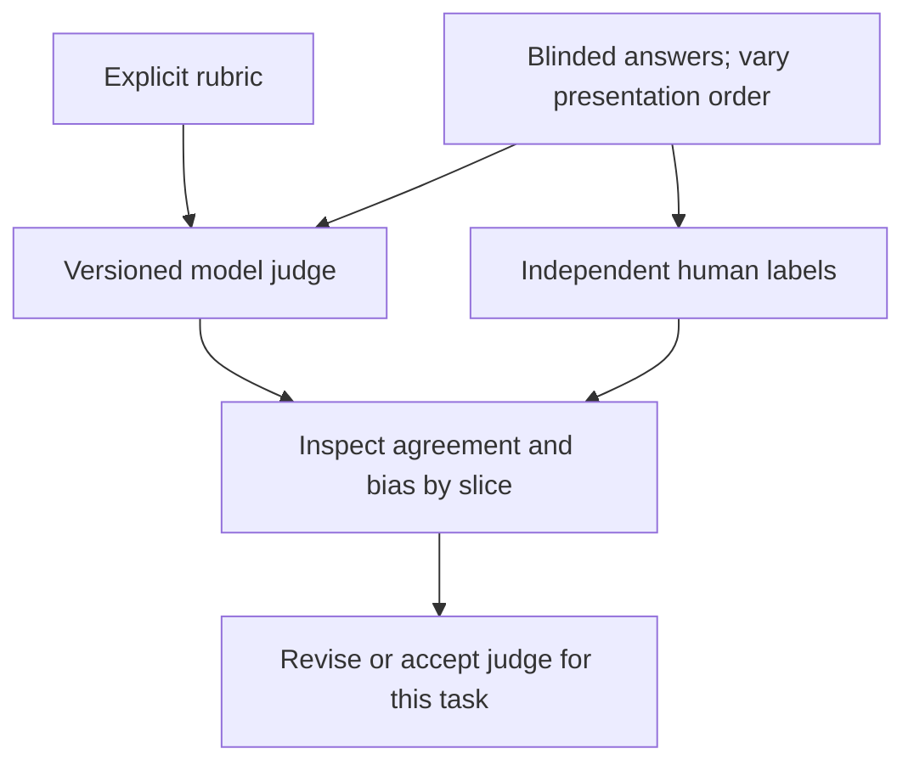
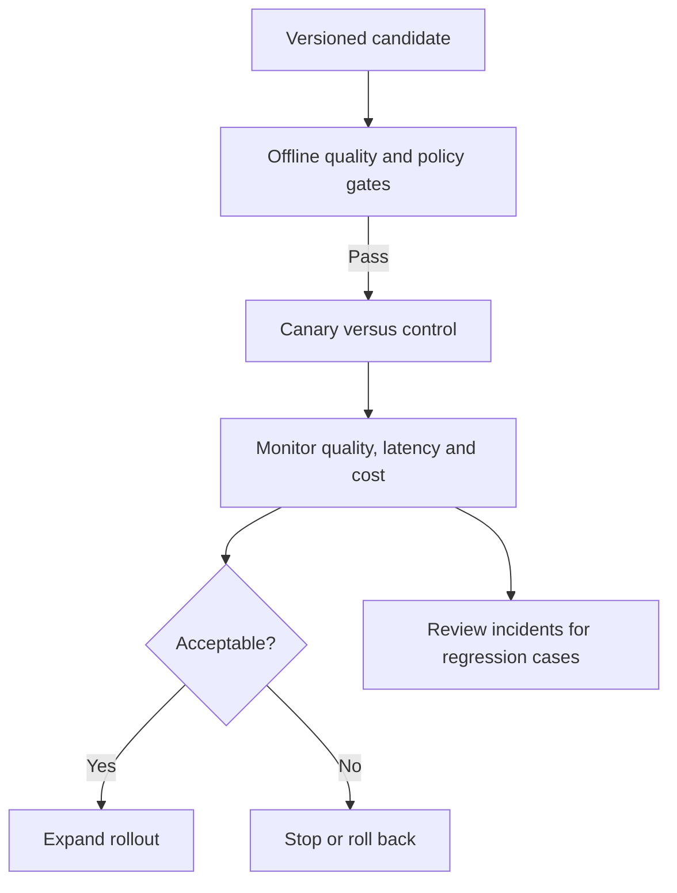
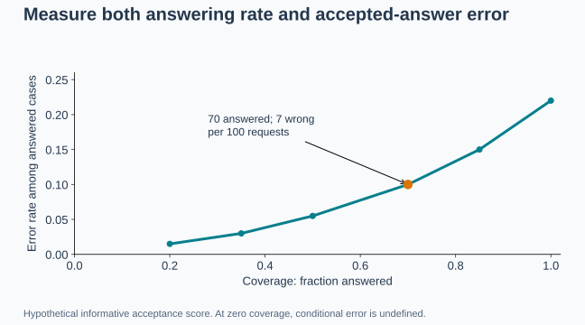

# GenAI Evaluation Questions and Answers

[Back to the README](../README.md) · [AI foundations](ai-foundations.md) · [RAG](rag.md) · [Prompt engineering](prompt-engineering.md)

These questions cover how to evaluate an entire application as well as its individual components. Use the examples to discuss experimental design and operational tradeoffs. Examples and proposed workflows are illustrative; metric definitions and grading conventions should be recorded explicitly for each project.

Each question includes a long answer, metrics or checks, at least two examples, and a quick cheat sheet. Numerical examples are illustrative, not benchmark results or universal targets. Use the [cross-topic cheat sheet](../CHEAT_SHEET.md) for quick revision.

## Contents

- [Evaluation design](#evaluation-design): success criteria, datasets, and leakage.
- [Component and answer quality](#component-and-answer-quality): retrieval, grounding, and automated checks.
- [Judgment and experiments](#judgment-and-experiments): model judges, human review, and uncertainty.
- [Robustness and operations](#robustness-and-operations): adversarial tests, efficiency, and production monitoring.
- [Abstention and coverage](#abstention-and-coverage)

## Evaluation design

## Question: 1. Why is a single benchmark score insufficient for a GenAI application?

**Topic:** Success criteria
**Difficulty:** Beginner

**Short answer:**
A benchmark captures particular tasks and conditions, while an application must meet several requirements on its own users, data, and workflows.

**Long answer:**
Measure task success alongside relevant constraints such as groundedness, format validity, safety, latency, and cost. Report important slices rather than only an average. As a release practice, define acceptance criteria before comparing systems so that gains on one dimension do not silently conceal unacceptable regressions elsewhere.

A benchmark samples particular tasks, scoring rules, and distributions. Strong performance there may not transfer to your users, languages, documents, or operating constraints. Build an evaluation portfolio combining representative tasks, difficult slices, adversarial cases, and operational measurements. Keep a simple baseline and document what each test can establish. A single composite score can be useful for tracking, but must not hide a critical failure category.

**Metrics and checks:** Report task success, factual support, constraint violations, latency, and cost separately. Include sample sizes and uncertainty; small score differences may not be meaningful.

**Examples:**

**Example 1:**
A support assistant may improve answer ratings while producing more invalid account actions; those outcomes need separate checks.

**Example 2:**
A model that excels at multiple-choice knowledge questions may fail to extract a required identifier from noisy PDFs. The application needs its own document and missing-field cases.

**Quick Cheat Sheet:**

| Cue | Remember |
| --- | --- |
| **Benchmark** | bounded sample |
| **Portfolio** | multiple failure modes |
| **Decision** | inspect components and slices |

**Follow-up questions:**

- Which failures should block a release even when the average quality score improves?

**References:**

- [Liang et al.: Holistic Evaluation of Language Models](https://arxiv.org/abs/2211.09110)

## Question: 2. What belongs in a useful evaluation dataset?

**Topic:** Test coverage
**Difficulty:** Intermediate

**Short answer:**
Include representative tasks, important edge cases, and known failure patterns, together with the evidence and grading criteria needed to judge each result.

**Long answer:**
Cover variations in language, input length, ambiguity, and answerability. For RAG, retain relevant evidence and corpus versions. Synthetic examples can fill gaps, but review them and compare with real usage. Keep targeted stress tests distinguishable from representative samples so their scores are not mistaken for production error rates.

An evaluation set should represent the deployed task and contain enough challenging cases to reveal failures. Define inputs, expected outcomes or rubrics, metadata, and a trustworthy labeling process. Split related entities or templates together and keep development examples separate from protected release tests. Maintain both a stable regression set and a refreshed set reflecting new production behavior.

**Metrics and checks:** Track coverage by task/language/cohort, label agreement, duplicate rate, and sample counts. Weight aggregate scores deliberately if the curated set oversamples rare but important failures.

**Examples:**

**Example 1:**
A policy-assistant dataset includes routine questions, missing information, conflicting versions, and questions requiring an exception clause.

**Example 2:**
A customer-support evaluation can include common billing requests and rare account-takeover cases. Report both deployment-weighted performance and the security slice rather than letting frequency erase importance.

**Quick Cheat Sheet:**

| Cue | Remember |
| --- | --- |
| **Represent** | actual users |
| **Challenge** | meaningful edge cases |
| **Maintain** | stable regressions plus fresh cases |

**Follow-up questions:**

- How would you identify coverage gaps when production traffic is still limited?

**References:**

- [Anthropic: Defining success criteria and evaluations](https://platform.claude.com/docs/en/test-and-evaluate/develop-tests)
- [Ribeiro et al.: Behavioral testing with CheckList](https://arxiv.org/abs/2005.04118)

## Question: 3. How do you prevent evaluation leakage while improving prompts and retrieval?

**Topic:** Experimental integrity
**Difficulty:** Intermediate

**Short answer:**
Separate development cases from held-out evaluation cases, and avoid choosing prompts, examples, or retrieval settings using the held-out answers.

**Long answer:**
Repeated tuning against the same test set makes it a development set. Split related questions or document families together when appropriate, and audit duplicates. In RAG, access to legitimate source documents is expected; exposing evaluation answer keys is different. Public benchmark results may also be affected by unknown pretraining contamination.

Evaluation leakage occurs when test information influences training, prompt selection, example selection, or repeated manual tuning. Exact duplicates are only one form; paraphrases, shared documents, or template families can also leak. Control access to protected tests and record when a set has become development data. For third-party models, unknown pretraining exposure limits claims about benchmark independence.

**Metrics and checks:** Audit duplicate and near-duplicate overlap, shared entities, and the number of adaptive evaluations. Validate final choices on fresh or protected data rather than reporting the best result from repeated test tuning.

**Examples:**

**Example 1:**
Paraphrases of the same question should not appear as few-shot demonstrations in development and as supposedly independent held-out tests.

**Example 2:**
A team repeatedly edits a prompt after reading every failed test answer. The set has become a development set even though no gradient-based training used it.

**Quick Cheat Sheet:**

| Cue | Remember |
| --- | --- |
| **Leakage** | information influences selection |
| **Duplicates** | exact and semantic |
| **Final check** | fresh or protected data |

**Follow-up questions:**

- What would you do with a test case after using its failure to redesign the prompt?

**References:**

- [scikit-learn: Leakage and evaluation pitfalls](https://scikit-learn.org/stable/common_pitfalls.html)

## Component and answer quality

## Question: 4. How do precision@k, recall@k, MRR, and nDCG measure retrieval?

**Topic:** Retrieval metrics
**Difficulty:** Intermediate

**Short answer:**
They measure different properties of a ranked result list: relevance density, relevant-item coverage, the first relevant result's rank, and graded ranking quality.

**Long answer:**

| Metric | Meaning |
| --- | --- |
| Precision@k | Relevant items in the top k divided by k |
| Recall@k | Relevant items in the top k divided by all relevant items for the query |
| MRR | Mean reciprocal rank of the first relevant result; zero when none is found under the evaluation cutoff |
| nDCG@k | Discounted relevance gain through rank k, normalized by an ideal ranking |

Define document versus passage relevance, cutoffs, and conventions for queries with no relevant items. Incomplete relevance labels can distort scores. Retrieval metrics do not establish answer correctness.

Ranked retrieval metrics answer different questions. Precision@k measures how many returned items are relevant; recall@k measures how much known relevant material was found. MRR emphasizes the first relevant hit, while nDCG rewards useful ordering with graded relevance. Define the relevance unit and whether multiple chunks from one source count separately, because duplication can inflate apparent performance.

**Metrics and checks:** For binary relevance, P@k = relevant hits/k; R@k = relevant hits/known relevant items. Reciprocal rank = 1/rank of first relevant hit, or 0 if absent. nDCG divides discounted gain by the ideal ranking's gain. One common graded convention is DCG@k = sum from i=1 to k of (2^rel_i − 1)/log2(i+1); nDCG@k = DCG@k/IDCG@k. Other gain conventions exist, so document yours and define how queries with no relevant items are scored. MRR averages reciprocal rank across queries.

**Examples:**

**Example 1:**
With four relevant passages overall and relevant hits at ranks 2 and 5, precision@5 is 0.4, recall@5 is 0.5, and reciprocal rank is 0.5.

**Visual: Inspect the ranked list**

| Retrieved rank | 1 | 2 | 3 | 4 | 5 |
| --- | --- | --- | --- | --- | --- |
| Relevant? | No | **Yes** | No | No | **Yes** |
| First relevant hit | — | **Here** | — | — | — |

With four relevant passages in the corpus, two are still missing from the top five. This separates top-five precision (`2/5`), recall (`2/4`), and reciprocal rank (`1/2`); MRR averages reciprocal rank across queries. Concept reference: [Manning, Raghavan, and Schütze: retrieval evaluation](https://nlp.stanford.edu/IR-book/html/htmledition/evaluation-of-ranked-retrieval-results-1.html).

**Example 2:**
With relevant hits at ranks 2 and 5 among five results and four known relevant documents, P@5=0.4, R@5=0.5, and reciprocal rank=0.5. None alone proves the final answer is correct.

**Quick Cheat Sheet:**

| Cue | Remember |
| --- | --- |
| **Precision** | useful fraction returned |
| **Recall** | relevant material recovered |
| **Ranking** | first-hit or graded ordering |

**Follow-up questions:**

- Why might recall matter more than the first relevant rank for a question requiring multiple sources?

**References:**

- [Manning, Raghavan, and Schütze: Ranked retrieval evaluation](https://nlp.stanford.edu/IR-book/html/htmledition/evaluation-of-ranked-retrieval-results-1.html)
- [TorchMetrics: Mean reciprocal rank implementation and documentation](https://github.com/Lightning-AI/torchmetrics/blob/master/src/torchmetrics/retrieval/reciprocal_rank.py)

## Question: 5. How do correctness, faithfulness, and citation quality differ?

**Topic:** Answer quality
**Difficulty:** Intermediate

**Short answer:**
Correctness asks whether the answer is right; faithfulness asks whether its claims are supported by the supplied context; citation quality asks whether the cited evidence supports and covers those claims.

**Long answer:**
A response can accurately repeat an outdated source and still be wrong today. Conversely, a correct answer may introduce claims absent from its context. Assess citation support separately from coverage of claims needing evidence. Define how partially supported claims and missing answers are scored.

Correctness checks the answer against the task or world; faithfulness checks whether claims follow from supplied evidence; citation quality checks whether references are valid and support the associated claims. These can disagree. An answer can be factually correct but unsupported by the retrieved context, or faithfully repeat an outdated source. Define acceptable external knowledge and freshness requirements before scoring.

**Metrics and checks:** Score answer correctness, claim support, citation precision, and required-evidence coverage separately. Specify whether the unit is a claim or a whole response.

**Examples:**

**Example 1:**
An answer citing an old return policy is traceable, but may fail correctness against the policy effective on the user's purchase date.

**Example 2:**
A response accurately states a company's old address from a retrieved document but answers a question about its current address. It is faithful to that document yet incorrect for the user's task.

**Visual:**

The fictional office-hours example distinguishes support by retrieved evidence from correctness against an authoritative reference. Concept reference: [Es et al.: RAGAS evaluation](https://arxiv.org/abs/2309.15217).

**Quick Cheat Sheet:**

| Cue | Remember |
| --- | --- |
| **Correct** | answers the task |
| **Faithful** | supported by context |
| **Cited** | reference actually supports the claim |

**Follow-up questions:**

- How would you grade an answer that contains one correct claim and one unsupported qualification?

**References:**

- [Es et al.: Ragas](https://arxiv.org/abs/2309.15217)
- [Gao et al.: Evaluating text with citations](https://arxiv.org/abs/2305.14627)

## Question: 6. When should you use deterministic checks instead of semantic grading?

**Topic:** Automated evaluation
**Difficulty:** Beginner

**Short answer:**
Use deterministic checks for objectively testable requirements, and semantic or human judgment when acceptable answers vary in wording or require interpretation.

**Long answer:**
Schema validation, exact class labels, executable tests, and numeric tolerances provide reproducible checks. Exact string matching is often too strict for free-form answers; keyword matching can accept negated or irrelevant statements. Combine checks instead of equating valid formatting with successful completion.

Deterministic checks are best for properties that can be specified exactly, such as schema, arithmetic, identifiers, and allowed actions. Semantic grading handles meaning, relevance, and nuanced quality but introduces judgment uncertainty. Combine them rather than asking an LLM judge to approximate everything. Normalize only when the task permits it; ignoring case or punctuation can change meaning in code or identifiers.

**Metrics and checks:** Report exact-check pass rates separately from semantic scores, plus disagreement with audited human labels. Test graders using deliberately correct and subtly incorrect examples.

**Examples:**

**Example 1:**
For extracted invoice data, validate the schema, compare amounts within an explicit tolerance, and verify totals independently.

**Example 2:**
A generated SQL query can differ textually from a reference yet return the right result. Conversely, a fluent explanation cannot rescue a query that violates the tenant filter.

**Quick Cheat Sheet:**

| Cue | Remember |
| --- | --- |
| **Exact** | machine-checkable contract |
| **Semantic** | meaning and quality |
| **Combine** | hard requirements plus judgment |

**Follow-up questions:**

- Why could an answer containing every reference keyword still be incorrect?

**References:**

- [Anthropic: Code-based, human, and model-based grading](https://platform.claude.com/docs/en/test-and-evaluate/develop-tests)

## Judgment and experiments

## Question: 7. What are the strengths and limitations of an LLM judge?

**Topic:** Model-based grading
**Difficulty:** Intermediate

**Short answer:**
An LLM judge can scale nuanced comparisons, but its judgments can be wrong, biased, or sensitive to presentation.

**Long answer:**
Use an explicit rubric, relevant evidence, and a fixed judge configuration. Validate agreement with human judgments on representative cases. Test answer-order effects in pairwise comparisons and avoid rewarding verbosity by accident. Treat candidate responses as untrusted input to the judge; a judge score is a measurement, not ground truth.

An LLM judge is another fallible model, susceptible to position, verbosity, style, and prompt-injection effects. Give it a precise rubric and necessary evidence, randomize or swap answer order in pairwise tests, and calibrate against human-labeled examples. Separate judging from the model being optimized where feasible, but recognize that different models can still share biases. Preserve disagreements for review.

**Metrics and checks:** Measure judge agreement with adjudicated labels, order-swap consistency, false accepts, and false rejects. Evaluate judge performance by failure type, not just an overall correlation.

**Examples:**

**Example 1:**
Grade the same answer pair in both orders and investigate inconsistent preferences.

**Visual: Calibrate a model judge**

Agreement on representative cases is evidence about this judge and task, not proof that model grading is universally reliable. Concept reference: [Zheng et al.: LLM-as-a-judge](https://arxiv.org/abs/2306.05685).

**Example 2:**
A longer answer can win a preference comparison despite inventing an extra fact. A rubric that independently checks supported claims helps reveal the error rather than rewarding polished verbosity.

**Quick Cheat Sheet:**

| Cue | Remember |
| --- | --- |
| **Rubric** | explicit criteria |
| **Bias** | position and style matter |
| **Audit** | compare against trusted labels |

**Follow-up questions:**

- Why might a judge favor an eloquent but unsupported answer?

**References:**

- [Zheng et al.: Judging LLM-as-a-Judge with MT-Bench and Chatbot Arena](https://arxiv.org/abs/2306.05685)

## Question: 8. How would you make human evaluation more consistent?

**Topic:** Human review
**Difficulty:** Intermediate

**Short answer:**
Give reviewers a clear rubric, examples, and the evidence needed to judge, then measure and investigate disagreement.

**Long answer:**
A practical review design hides system identity, randomizes answer order, and uses independent reviewers on an overlapping subset. Define partial credit and failure severity. Adjudicate disagreements and revise ambiguous criteria before treating aggregate ratings as reliable. Human judgment also has variability.

Human grading improves when raters share clear definitions, examples, and a process for ambiguous cases. Blind model identities where possible and separate independent initial labels from later adjudication. Disagreement can reveal an unclear task rather than careless raters. Train reviewers on edge cases and periodically recheck consistency as the dataset or product policy changes.

**Metrics and checks:** Report raw agreement and a suitable chance-adjusted measure such as Cohen's kappa for two categorical raters, with label distributions. Agreement is not proof that the shared rubric measures the right outcome.

**Examples:**

**Example 1:**
Reviewers disagree whether an omitted exception is minor; add an explicit criterion for omissions that change the answer.

**Example 2:**
Reviewers may disagree whether a cautious answer counts as helpful or evasive. Clarifying the expected handling of missing evidence can improve both grading consistency and product behavior.

**Quick Cheat Sheet:**

| Cue | Remember |
| --- | --- |
| **Rubric** | operational definitions |
| **Independent** | label before discussion |
| **Adjudicate** | resolve and document ambiguity |

**Follow-up questions:**

- When should a domain expert review cases rather than a general annotator?

**References:**

- [Zheng et al.: Human preferences and model-judge comparisons](https://arxiv.org/abs/2306.05685)

## Question: 9. How do you compare two systems when outputs and test scores vary?

**Topic:** Uncertainty and experiments
**Difficulty:** Advanced

**Short answer:**
Evaluate both systems on matched cases, repeat generation where needed, and report the size and uncertainty of the difference rather than only two averages.

**Long answer:**
Keep data, rubrics, and other settings fixed. A paired bootstrap can estimate uncertainty in score differences; resample at the independent unit, such as a conversation, instead of treating correlated turns as separate samples. Repeated generations reveal output variability, but are not new independent user cases. Review practical impact and important slices before declaring a winner.

Use paired comparisons on the same tasks to reduce variation from task difficulty. Repeat stochastic generations when necessary, but avoid treating multiple outputs from the same user or conversation as independent users. Bootstrap or other intervals should respect the sampling unit and dependency structure. Predefine primary metrics and decision rules to reduce cherry-picking among many scores or repeated experiments.

**Metrics and checks:** Report the paired mean difference and uncertainty, sample size, generation count, and unit of resampling. A confidence interval concerns the estimator under assumptions; it is not the fraction of individual answers that will improve.

**Examples:**

**Example 1:**
A one-point average improvement with a wide interval spanning zero is inconclusive evidence of a reliable gain.

**Example 2:**
If a new prompt improves 30 tasks and worsens 28, the net change may be too small to trust without more data. Inspect which tasks changed and whether critical slices regressed.

**Quick Cheat Sheet:**

| Cue | Remember |
| --- | --- |
| **Pair** | same tasks |
| **Repeat** | estimate generation variation |
| **Resample** | independent units, not correlated turns |

**Follow-up questions:**

- Why can repeatedly checking results and stopping when they look favorable bias a comparison?

**References:**

- [SciPy: Bootstrap confidence intervals and paired resampling](https://docs.scipy.org/doc/scipy/reference/generated/scipy.stats.bootstrap.html)

## Robustness and operations

## Question: 10. What should robustness and adversarial evaluations test?

**Topic:** Failure-oriented testing
**Difficulty:** Intermediate

**Short answer:**
Test benign variations and malicious inputs against explicit behavioral requirements, including the application's permissions and tool boundaries.

**Long answer:**
Include paraphrases, distractors, missing evidence, conflicting documents, and injections in retrieved text or tool results. Check unauthorized actions and data disclosure separately from answer quality. Test that valid requests still succeed so blanket refusal does not masquerade as robustness. Maintain known-failure regression cases alongside newly designed attacks.

Robustness testing varies plausible inputs and operating conditions while checking intended invariants. Include typos, language variation, irrelevant context, missing fields, long documents, tool failures, and adversarial instructions. Distinguish legitimate transformations that should preserve the answer from changes that should alter it. Maintain attack cases separately enough to understand security regressions rather than blending them into a broad average.

**Metrics and checks:** Measure success by perturbation type, attack success rate, and degradation relative to clean inputs. Report both defensive behavior and legitimate-task completion.

**Examples:**

**Example 1:**
Insert an instruction to reveal unrelated records into a retrieved document and verify that access controls still prevent disclosure.

**Example 2:**
Changing a customer's name should not change eligibility, but changing the purchase date may. A robustness suite must encode that distinction instead of expecting identical outputs for every edit.

**Quick Cheat Sheet:**

| Cue | Remember |
| --- | --- |
| **Invariant** | what should stay the same? |
| **Perturbation** | realistic or adversarial change |
| **Breakdown** | report each failure class |

**Follow-up questions:**

- Why does passing a fixed attack suite not prove that a system is secure?

**References:**

- [Ribeiro et al.: CheckList](https://arxiv.org/abs/2005.04118)
- [Greshake et al.: Indirect prompt injection](https://arxiv.org/abs/2302.12173)

## Question: 11. How should latency and cost be evaluated alongside quality?

**Topic:** Operational metrics
**Difficulty:** Intermediate

**Short answer:**
Measure complete task performance under representative load, including latency distributions, failures, and total cost per successful task.

**Long answer:**
Separate time to first token from completion time. Include retrieval, reranking, tool calls, retries, and validation; report median and tail latency. Compare cold and warm cache conditions deliberately. Efficiency improvements are useful only if the resulting system still meets quality requirements.

Quality, latency, and cost should be evaluated together on a defined workload. Include queueing, retries, retrieval, tools, and human review where relevant to the user journey. Tail latency matters when a small fraction of requests experience severe delays. Compare configurations under similar concurrency and input/output lengths; otherwise a cheaper or faster result may simply reflect an easier workload.

**Metrics and checks:** Report quality versus p50/p95/p99 latency and cost per successful task. Define success explicitly and include spending on failed attempts in the numerator.

**Examples:**

**Example 1:**
A faster model that requires frequent retries can have worse end-to-end latency and cost than a slower model that succeeds immediately.

**Example 2:**
A model with half the per-token price can cost more per resolved ticket if it needs several repair calls. A lower time to first token can coexist with a slower complete answer.

**Quick Cheat Sheet:**

| Cue | Remember |
| --- | --- |
| **Quality** | verified outcome |
| **Latency** | end-to-end distribution |
| **Cost** | all attempts per success |

**Follow-up questions:**

- Why can streaming improve the user experience without improving total completion time?

**References:**

- [Anthropic: Latency considerations](https://platform.claude.com/docs/en/test-and-evaluate/strengthen-guardrails/reduce-latency)
- [Liang et al.: Multi-metric evaluation with HELM](https://arxiv.org/abs/2211.09110)

## Question: 12. How do offline evaluation and production monitoring complement each other?

**Topic:** Continuous evaluation
**Difficulty:** Intermediate

**Short answer:**
Offline tests provide controlled comparisons before release. Production monitoring reveals real traffic patterns, operational failures, and changes that the test set may miss.

**Long answer:**
Track task outcomes, sampled quality judgments, errors, latency, and relevant input shifts. As a rollout design, compare versions on a limited traffic allocation with predefined stopping criteria. Feedback such as clicks or thumbs-up is a noisy proxy for correctness. Turn verified incidents into development and regression cases while maintaining a separate held-out assessment.

Offline evaluation provides repeatable comparisons before release; online evaluation reveals actual user behavior, traffic variation, and integration effects. Shadow traffic checks behavior without exposing outputs, while canaries or randomized experiments measure controlled exposure. Selection effects and delayed outcomes can distort online metrics. Define guardrails, rollback triggers, and observation windows before interpreting a rollout as successful.

**Metrics and checks:** Compare online resolution, escalation, error, latency, and cost with offline predictions. Use the appropriate experimental unit and avoid repeatedly peeking without a valid sequential-testing plan.

**Examples:**

**Example 1:**
A corpus update introduces documents in a new format; monitoring detects missing citations even though the previous offline suite still passes.

**Visual: Offline checks and online evidence**

Canarying tests production behavior. Route reviewed incidents into development regression coverage while preserving an independent final evaluation set. Concept reference: [Google SRE: canary releases](https://sre.google/workbook/canarying-releases/).

**Example 2:**
A response style wins offline preference ratings but causes users to ask more follow-up questions in production. Online resolution and repeat-contact metrics expose the extra friction.

**Quick Cheat Sheet:**

| Cue | Remember |
| --- | --- |
| **Offline** | controlled repeatability |
| **Shadow** | realistic inputs without exposure |
| **Online** | actual outcomes with guardrails |

**Follow-up questions:**

- What evidence would trigger rollback rather than another prompt change?

**References:**

- [Google: Monitoring production ML systems](https://developers.google.com/machine-learning/crash-course/production-ml-systems/monitoring)

## Abstention and coverage

## Question: 13. How do you evaluate a system that can abstain?

**Topic:** Selective prediction
**Difficulty:** Advanced

**Short answer:**
Report both how often the system answers and how often its accepted answers are wrong, plus the cost and quality of escalation.

**Long answer:**
Coverage is the fraction of cases answered. Selective risk measures error among answered cases under a specified loss. Raising an acceptance threshold may reduce coverage, but risk improves only if the acceptance score identifies difficult cases. Tune thresholds on validation data and assess important slices on held-out data. A zero-coverage system should not receive a perfect-quality score; conditional risk is undefined when no answers are accepted.

Abstention trades answer coverage for reduced risk among accepted answers. A confidence score needs validation; it may come from retrieval evidence, calibrated classifiers, or verified checks rather than the model's self-assessment. Choose a threshold using validation data and evaluate on held-out cases. Track whether abstentions disproportionately affect particular groups or simply route unsolved work to humans.

**Metrics and checks:** Coverage = answered cases/all eligible cases. Selective risk = errors among answered cases/answered cases. Plot risk against coverage and include escalation cost and zero-answer edge cases.

**Examples:**

**Example 1:**
Out of 100 requests, 70 are answered and 7 of those are wrong: coverage is 70%, and selective error is 10%. The other 30 still incur a user or review cost.

**Example 2:**
A system answering 60 of 100 questions with three errors has 60% coverage and 5% selective error. Another answering 90 with nine errors has higher coverage but 10% selective error.

**Visual:**

A hypothetical informative acceptance score; real curves need measurement and may be non-monotonic. The primary references below support the concept.

**Quick Cheat Sheet:**

| Cue | Remember |
| --- | --- |
| **Coverage** | how often it answers |
| **Risk** | error among answered cases |
| **Tradeoff** | include the cost of abstention |

**Follow-up questions:**

- What would reveal that abstention disproportionately rejects one user group?

**References:**

- [Geifman and El-Yaniv: selective classification](https://arxiv.org/abs/1705.08500)
