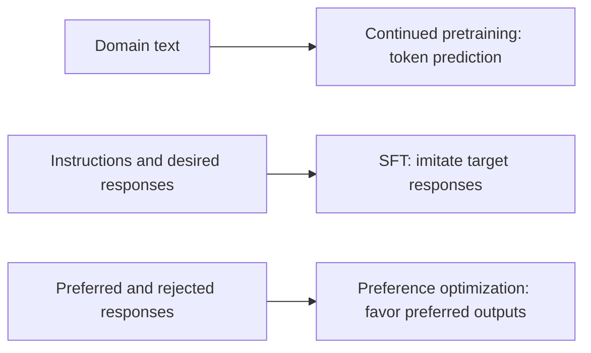
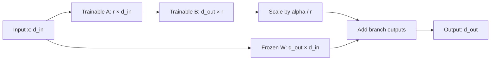

# Fine-Tuning Questions and Answers

[Back to the README](../README.md) · [Terminology glossary](../GLOSSARY.md) · [GenAI foundations](genai-foundations.md) · [RAG](rag.md) · [Agents](agents.md) · [Evaluation](evaluation.md)

These questions cover adapting pretrained language models, from choosing an objective to evaluating and deploying the result. Examples are illustrative. Training formats, supported methods, and deployment behavior depend on the model and framework; avoid treating example settings as universal defaults.

Each question includes a long answer, metrics or checks, at least two examples, and a quick cheat sheet. Numerical examples are illustrative, not benchmark results or universal targets. Use the [cross-topic cheat sheet](../CHEAT_SHEET.md) for quick revision.

## Contents

- [Goals and training data](#goals-and-training-data): when to fine-tune, objectives, curation, and loss masking.
- [Adaptation methods](#adaptation-methods): full fine-tuning, PEFT, LoRA, and QLoRA.
- [Training and preferences](#training-and-preferences): configuration, generalization, and preference optimization.
- [Evaluation and delivery](#evaluation-and-delivery): comparisons, checkpoints, and deployment.
- [Distillation and compression](#distillation-and-compression)

## Goals and training data

## Question: 1. When should you fine-tune instead of improving prompts or using RAG?

**Topic:** Adaptation choices
**Difficulty:** Beginner

**Key terms:** [Fine-tuning](../GLOSSARY.md#fine-tuning) · [Prompt and prompt engineering](../GLOSSARY.md#prompt-and-prompt-engineering) · [Retrieval-augmented generation (RAG)](../GLOSSARY.md#retrieval-augmented-generation-rag) · [Baseline](../GLOSSARY.md#baseline)

**Short answer:**
Consider fine-tuning when a pretrained model has a repeatable task or behavior gap and representative training examples are available. First establish prompt and retrieval baselines.

**Long answer:**
Fine-tuning updates learned parameters; prompting supplies instructions and examples at inference, while RAG supplies external evidence. As a design guideline, use retrieval for changing facts and fine-tuning for durable task patterns or response behavior. They can work together. Training introduces data, compute, evaluation, and maintenance costs, so require measurable benefits.

Fine-tuning is appropriate when repeated failures concern behavior, format, style, or domain adaptation that examples can teach reliably. First establish a prompting and retrieval baseline; training cannot compensate for unavailable current facts or incorrect permissions. Estimate data preparation and ongoing evaluation costs, not just training cost. A smaller tuned model may be useful, but only if held-out performance and operational constraints support the choice.

**Metrics and checks:** Compare task success, format validity, latency, and total lifecycle cost against prompt-only and RAG baselines. Evaluate on examples that differ from training templates and entities.

**Examples:**

**Example 1:**
Fine-tune consistent support-ticket extraction while retrieving the current product policy when answering factual questions.

**Example 2:**
A support model may need tuning to emit a stable taxonomy, while current product availability should remain a retrieved fact. Combining the two avoids retraining for every inventory change.

**Quick Cheat Sheet:**

| Cue | Remember |
| --- | --- |
| **Prompt** | specify behavior |
| **RAG** | supply facts |
| **Tune** | learn repeated behavior from data |

**Follow-up questions:**

- What failure analysis would show that a problem comes from missing evidence rather than model behavior?

**References:**

- [Hugging Face: Fine-tuning pretrained models](https://huggingface.co/docs/transformers/training)

## Question: 2. How do continued pretraining, SFT, and preference optimization differ?

**Topic:** Training objectives
**Difficulty:** Intermediate

**Key terms:** [Continued pretraining (CPT)](../GLOSSARY.md#continued-pretraining-cpt) · [Supervised fine-tuning (SFT)](../GLOSSARY.md#supervised-fine-tuning-sft) · [Direct preference optimization (DPO)](../GLOSSARY.md#direct-preference-optimization-dpo) · [RLHF and reward model](../GLOSSARY.md#rlhf-and-reward-model)

**Short answer:**
Continued pretraining learns from additional domain text, supervised fine-tuning (SFT) learns desired responses, and preference optimization learns from comparisons or reward signals.

**Long answer:**

| Approach | Typical signal | Intended adaptation |
| --- | --- | --- |
| Continued pretraining | Token prediction on domain text | Domain language and patterns |
| SFT | Demonstrations of desired outputs | Task execution and instruction following |
| Preference optimization | Preferred versus dispreferred responses, or rewards | Relative response quality |

These stages can be combined, but each requires evaluation. Domain exposure alone does not guarantee reliable instruction following or factual recall.

Continued pretraining adapts language-model representations using domain text; supervised fine-tuning learns desired input-output responses; preference optimization learns which responses are preferred. The objectives address different problems and require different data. A lower domain language-model loss does not guarantee instruction following, and a preferred response can still be factually wrong. Evaluate each stage against its intended benefit and possible regressions.

**Metrics and checks:** Track held-out token loss for continued pretraining, task metrics for SFT, and independently judged quality for preference training. Do not compare these objective values as if they shared a scale.

**Examples:**

**Example 1:**
Adapt to a technical corpus, train on support answers, then refine responses using quality comparisons.

**Visual: Different data for different objectives**

These are alternative or composable adaptation stages, not a mandatory sequence. The desired behavior determines the data and objective. The preference branch illustrates pair-based methods such as DPO. Concept references: [Gururangan et al.: domain-adaptive pretraining](https://arxiv.org/abs/2004.10964); [Hugging Face: supervised fine-tuning](https://huggingface.co/docs/trl/sft_trainer); [Rafailov et al.: DPO](https://arxiv.org/abs/2305.18290).

**Example 2:**
A legal model can first adapt to contract language, then learn extraction responses, then use preference pairs to improve clarity. Each stage needs separate evidence that it helps the deployed task.

**Quick Cheat Sheet:**

| Cue | Remember |
| --- | --- |
| **CPT** | domain distribution |
| **SFT** | desired demonstrations |
| **Preference** | relative response quality |

**Follow-up questions:**

- Why might training on raw manuals fail to teach the desired support-answer format?

**References:**

- [Gururangan et al.: Don't Stop Pretraining](https://arxiv.org/abs/2004.10964)
- [Hugging Face: SFT Trainer](https://huggingface.co/docs/trl/sft_trainer)
- [Rafailov et al.: Direct Preference Optimization](https://arxiv.org/abs/2305.18290)

## Question: 3. What makes a good fine-tuning dataset?

**Topic:** Data quality
**Difficulty:** Beginner

**Key terms:** [Dataset and corpus](../GLOSSARY.md#dataset-and-corpus) · [Label and target](../GLOSSARY.md#label-and-target) · [Synthetic data](../GLOSSARY.md#synthetic-data) · [Data leakage](../GLOSSARY.md#data-leakage)

**Short answer:**
It should contain correct, consistent examples of the intended behavior across representative tasks and important edge cases.

**Long answer:**
Inspect examples before scaling data volume. Deduplicate related records, resolve conflicting demonstrations, and include realistic missing-information cases. Split related examples together to reduce leakage, and keep held-out evaluation separate from training and selection. Review sensitive content and provenance before use. Synthetic examples need validation because generated mistakes can become training targets.

A useful dataset reflects deployment inputs, correct desired outputs, difficult boundaries, and explicit handling of unknowns. Remove duplicates and contradictory labels, preserve provenance, and split by the unit that could leak information, such as customer, document, or template family. Synthetic data needs independent validation because it can amplify the generator's errors. More examples do not compensate for a systematically wrong labeling policy.

**Metrics and checks:** Measure label agreement, duplicate overlap, class/slice coverage, and held-out learning curves as data grows. Inspect performance on rare high-impact cases rather than only aggregate loss.

**Examples:**

**Example 1:**
A routing dataset includes ambiguous tickets with an escalation label instead of forcing every ticket into a confident but incorrect category.

**Example 2:**
Ten thousand near-identical generated emails may teach a narrow template better than real customer diversity. A smaller reviewed set covering exceptions can provide more useful supervision.

**Quick Cheat Sheet:**

| Cue | Remember |
| --- | --- |
| **Representative** | deployment distribution |
| **Correct** | reviewed target policy |
| **Independent** | split related examples together |

**Follow-up questions:**

- Why might adding thousands of repetitive examples hurt coverage rather than improve it?

**References:**

- [Hugging Face: Supervised fine-tuning and data preparation](https://huggingface.co/learn/llm-course/en/chapter11/3)

## Question: 4. Why do chat formatting, loss masking, and truncation matter in SFT?

**Topic:** Training examples
**Difficulty:** Intermediate

**Key terms:** [Chat template and message role](../GLOSSARY.md#chat-template-and-message-role) · [Loss masking and padding](../GLOSSARY.md#loss-masking-and-padding) · [Token and tokenizer](../GLOSSARY.md#token-and-tokenizer)

**Short answer:**
Formatting defines the conversation structure, loss masking selects which tokens are training targets, and truncation determines which content survives preprocessing.

**Long answer:**
Use the model's expected chat template and inspect tokenized examples. Assistant-only loss can exclude user and system tokens as targets while retaining them as input context; it is different from attention masking. Check padding, end markers, and whether truncation removes answers. Packing can improve utilization, but inspect example boundaries and attention behavior in the chosen implementation.

Training must match the model's chat format, including role delimiters, special tokens, and end-of-turn behavior. Loss masking determines which tokens teach the objective; for response learning, user or padding tokens are often excluded. Truncation can remove the desired response or important instructions, silently changing the task. Inspect actual tokenized examples and masks rather than trusting formatted text previews.

**Metrics and checks:** Track effective supervised tokens, truncated-example rate, sequence lengths, and loss by relevant segment. Confirm that padding and ignored tokens do not contribute unintentionally.

**Examples:**

**Example 1:**
A long prompt consumes the entire sequence limit, leaving no assistant target tokens and therefore no useful supervised response signal.

**Example 2:**
A long conversation may be truncated just before the assistant answer, yielding little useful supervision. Another preprocessing bug may train the model to reproduce user messages instead of respond.

**Quick Cheat Sheet:**

| Cue | Remember |
| --- | --- |
| **Template** | match checkpoint |
| **Mask** | choose supervised tokens |
| **Truncate** | inspect what survives |

**Follow-up questions:**

- How would you verify that the loss is computed on the intended assistant tokens?

**References:**

- [Hugging Face: SFT formats, masking, and packing](https://huggingface.co/docs/trl/sft_trainer)

## Adaptation methods

## Question: 5. How does full fine-tuning compare with parameter-efficient fine-tuning?

**Topic:** PEFT
**Difficulty:** Beginner

**Key terms:** [Fine-tuning](../GLOSSARY.md#fine-tuning) · [Parameter-efficient fine-tuning (PEFT)](../GLOSSARY.md#parameter-efficient-fine-tuning-peft) · [Adapter](../GLOSSARY.md#adapter)

**Short answer:**
Full fine-tuning updates all model parameters. Parameter-efficient fine-tuning (PEFT) updates a smaller subset or added parameters while freezing most of the pretrained model.

**Long answer:**
PEFT can reduce trainable-parameter memory, optimizer state, and the size of task-specific artifacts. It does not eliminate the cost of loading and computing through the base model. Quality depends on the task and adaptation capacity; full fine-tuning is not automatically better, and PEFT is not automatically sufficient.

Full fine-tuning updates all model weights and offers broad adaptation at higher optimizer and gradient memory cost. Parameter-efficient methods update a smaller set of parameters or modules, reducing training state and artifact size. They still require the base model and activations, so memory savings are not proportional simply to trainable-parameter reduction. Choose by task quality, hardware, and deployment compatibility.

**Metrics and checks:** Compare trainable parameters, peak training memory, tokens per second, held-out quality, and serving overhead. Include adapter loading or merging behavior in deployment tests.

**Examples:**

**Example 1:**
Maintain separate small adapters for two extraction tasks while reusing one compatible base model.

**Example 2:**
A team can train several task adapters sharing one base checkpoint instead of storing several complete tuned models. Serving still needs a compatible base and a policy for selecting the correct adapter.

**Quick Cheat Sheet:**

| Cue | Remember |
| --- | --- |
| **Full** | update all weights |
| **PEFT** | update selected parameters |
| **Memory** | activations and base still matter |

**Follow-up questions:**

- Why can activation memory still be large even when very few parameters are trainable?

**References:**

- [Hugging Face: PEFT overview](https://huggingface.co/docs/peft/index)

## Question: 6. How does LoRA work, and what does its rank control?

**Topic:** Low-rank adaptation
**Difficulty:** Intermediate

**Key terms:** [Low-rank adaptation (LoRA)](../GLOSSARY.md#low-rank-adaptation-lora) · [Matrix rank](../GLOSSARY.md#matrix-rank) · [Parameter and weight](../GLOSSARY.md#parameter-and-weight)

**Short answer:**
Low-rank adaptation (LoRA) freezes a base weight matrix and learns an additive update factored into two smaller matrices. Its rank limits the update’s representational capacity and determines its trainable parameter count.

**Long answer:**
For a weight `W` of shape `d_out × d_in`, standard LoRA uses `W + (alpha / r)BA`, with `A` shaped `r × d_in` and `B` shaped `d_out × r`. The update has `r(d_in + d_out)` parameters. Rank, scaling, and target layers affect quality and cost; higher rank is not a guaranteed improvement.

LoRA adds a low-rank update to selected weight matrices, typically expressed as a scaled product BA while the base weight remains frozen. Rank limits the update's representational capacity and affects parameter count, but higher rank is not automatically better. Target modules and scaling also matter. Evaluate whether adapters are merged or applied separately at serving time, since numerical behavior and operational costs can differ.

**Metrics and checks:** For a d_out by d_in matrix, LoRA uses r(d_in+d_out) parameters instead of d_in*d_out. At 4096 by 4096 and rank 8, that is 65,536 versus 16,777,216, about 0.39% for that matrix.

**Examples:**

**Example 1:**
For a `4096 × 4096` weight and rank 8, the two adapter matrices contain 65,536 parameters rather than 16,777,216 in the original weight.

**Visual: LoRA adds a low-rank update**

For the original LoRA scaling, `y = Wx + (alpha / r)BAx`. This layer trains `r × (d_in + d_out)` adapter parameters; biases and other trainable modules are omitted. Concept reference: [Hu et al.: LoRA](https://arxiv.org/abs/2106.09685).

**Example 2:**
An adapter targeting only attention projections can behave differently from one also targeting feed-forward layers at the same rank. Compare target-module coverage as well as rank when interpreting results.

**Video comparison:**

[Simplilearn, near 26:00](https://www.youtube.com/watch?v=j5FU7kOGrsU&t=1560s): use the slide’s full-tuning/LoRA contrast as a starting point, then explain the matrix dimensions and trainable parameter count in the original diagram above. This is a 320 × 180 public preview frame; open the video for readable slide details. [Attribution and reuse notice](../assets/third-party/README.md).

**Quick Cheat Sheet:**

| Cue | Remember |
| --- | --- |
| **Update** | low-rank BA |
| **Rank** | capacity and parameter cost |
| **Targets** | which matrices are adapted |

**Follow-up questions:**

- Why might adapting more layers matter as much as increasing rank?

**References:**

- [Hu et al.: LoRA](https://arxiv.org/abs/2106.09685)

## Question: 7. How does QLoRA differ from LoRA and ordinary quantization?

**Topic:** Memory-efficient adaptation
**Difficulty:** Intermediate

**Key terms:** [QLoRA and NF4](../GLOSSARY.md#qlora-and-nf4) · [Low-rank adaptation (LoRA)](../GLOSSARY.md#low-rank-adaptation-lora) · [Numerical precision and quantization](../GLOSSARY.md#numerical-precision-and-quantization) · [QLoRA and NF4](../GLOSSARY.md#qlora-and-nf4)

**Short answer:**
QLoRA trains low-rank adapters through a frozen quantized base model. Quantization alone changes numerical representation; it does not teach new task behavior.

**Long answer:**
The original QLoRA method uses a 4-bit base representation, including NF4, with additional memory-saving techniques. Gradients flow through computations involving the frozen base into trainable adapters. This does not mean all arithmetic, activations, or trainable weights are 4-bit. Hardware and kernels affect speed, and reduced weight storage does not guarantee lower latency.

QLoRA combines a quantized frozen base with trainable low-rank adapters, reducing memory needed for base weights during adaptation. Computation and trainable states can use different precisions from stored weights. Quantization introduces approximation and implementation constraints, so verify supported hardware and serving paths. QLoRA is a training method configuration, not a guarantee that every deployed artifact remains four-bit or has identical latency.

**Metrics and checks:** Measure peak memory, throughput, held-out task quality, and parity between training-time evaluation and the final serving artifact. Include scales, metadata, activations, and optimizer state in memory estimates.

**Examples:**

**Example 1:**
Use a quantized base to make adapter training fit in memory, then evaluate the actual serving configuration before deployment.

**Example 2:**
A four-bit base may make adapter training fit on available hardware, yet merging and exporting to a different serving precision can change memory requirements and outputs. Test the actual exported configuration.

**Quick Cheat Sheet:**

| Cue | Remember |
| --- | --- |
| **LoRA** | low-rank update |
| **QLoRA** | quantized base plus adapters |
| **Deployment** | verify exported precision and behavior |

**Follow-up questions:**

- Why could a quantized training run still run out of memory on long examples?

**References:**

- [Dettmers et al.: QLoRA](https://arxiv.org/abs/2305.14314)

## Training and preferences

## Question: 8. Which training settings and memory tradeoffs should you understand?

**Topic:** Training configuration
**Difficulty:** Intermediate

**Key terms:** [Batch size and epoch](../GLOSSARY.md#batch-size-and-epoch) · [Gradient accumulation](../GLOSSARY.md#gradient-accumulation) · [Activation checkpointing](../GLOSSARY.md#activation-checkpointing) · [Optimizer and momentum](../GLOSSARY.md#optimizer-and-momentum)

**Short answer:**
Track learning rate, training duration, effective batch size, sequence length, and numerical precision. Activation checkpointing saves memory by recomputing intermediate activations; it differs from saving a model checkpoint for recovery.

**Long answer:**
In ordinary data-parallel training, effective batch size is per-device batch size times device count times gradient-accumulation steps. Accumulation enables more examples per optimizer update without a larger microbatch. Activation checkpointing reduces stored activations by recomputing them during backward passes. These techniques trade memory against runtime; they do not replace data quality or validation.

Training memory includes weights, gradients, optimizer states, activations, and temporary buffers. Batch size, sequence length, precision, optimizer choice, and checkpointing interact. Gradient accumulation increases the effective batch without storing all examples simultaneously, but does not remove sequence-length activation costs. Tune learning rate and schedule with controlled experiments and watch validation behavior rather than exhausting a predetermined epoch count.

**Metrics and checks:** Effective batch is microbatch size × accumulation steps × data-parallel workers, under ordinary equal batching. Track peak memory, tokens per second, training/validation loss, and gradient norms.

**Examples:**

**Example 1:**
A microbatch of 2 on 4 devices with 8 accumulation steps yields 64 examples per update, assuming full batches. Token counts can still vary.

**Example 2:**
Reducing microbatch size may resolve an out-of-memory error, while an exceptionally long sequence can still fail. Activation checkpointing trades additional computation for lower stored activation memory.

**Quick Cheat Sheet:**

| Cue | Remember |
| --- | --- |
| **Batch** | effective versus microbatch |
| **Memory** | more than weights |
| **Progress** | held-out quality per compute |

**Follow-up questions:**

- Why might reducing sequence length fit memory but damage the target task?

**References:**

- [Hugging Face: Trainer configuration](https://huggingface.co/docs/transformers/main_classes/trainer)

## Question: 9. How do overfitting and catastrophic forgetting differ?

**Topic:** Generalization and regression
**Difficulty:** Intermediate

**Key terms:** [Variance and overfitting](../GLOSSARY.md#variance-and-overfitting) · [Catastrophic forgetting](../GLOSSARY.md#catastrophic-forgetting) · [Early stopping](../GLOSSARY.md#early-stopping)

**Short answer:**
Overfitting means adapting too closely to training examples and generalizing poorly. Catastrophic forgetting means losing previously useful capabilities while learning new behavior.

**Long answer:**
A lower training loss can coexist with either problem. Track held-out task performance and regression tests for capabilities that must remain intact. As mitigation experiments, adjust training duration, learning rate, data diversity, or mixtures of old and new tasks. Neither freezing the base through adapters nor early stopping guarantees that the adapted system preserves every capability.

Overfitting means specializing to training data at the expense of unseen target examples; catastrophic forgetting means losing previously useful capabilities during adaptation. Both can occur together but require separate evaluation sets. Use early stopping, representative data, suitable regularization, or mixed training data as appropriate. A lower training loss is not evidence that either problem has been solved.

**Metrics and checks:** Track training-target loss, held-out target quality, and retained general-capability scores across checkpoints. Compare errors by task and slice, not just a blended aggregate.

**Examples:**

**Example 1:**
A model improves on a narrow extraction task but begins failing general instruction-following cases that the original model handled.

**Example 2:**
A medical-format adapter can improve structured notes while degrading general instruction following. A target-domain test alone would miss that regression; a retention suite exposes it.

**Quick Cheat Sheet:**

| Cue | Remember |
| --- | --- |
| **Overfit** | unseen target performance suffers |
| **Forget** | old capabilities regress |
| **Checkpoints** | evaluate both suites |

**Follow-up questions:**

- What evidence would distinguish dataset leakage from real improvement after fine-tuning?

**References:**

- [Luo et al.: Catastrophic forgetting during continual fine-tuning](https://arxiv.org/abs/2308.08747)

## Question: 10. How does DPO differ from a classic RLHF pipeline?

**Topic:** Preference optimization
**Difficulty:** Advanced

**Key terms:** [Direct preference optimization (DPO)](../GLOSSARY.md#direct-preference-optimization-dpo) · [RLHF and reward model](../GLOSSARY.md#rlhf-and-reward-model) · [RLHF and reward model](../GLOSSARY.md#rlhf-and-reward-model) · [Policy and return](../GLOSSARY.md#policy-and-return)

**Short answer:**
Direct preference optimization (DPO) trains on preferred/rejected response pairs using a reference policy. A classic reinforcement learning from human feedback (RLHF) pipeline instead fits a reward model and uses reinforcement learning to optimize a policy against it.

**Long answer:**
Standard DPO uses response likelihood ratios relative to a reference policy to learn from comparisons, without a separate reward model or an online rollout loop during that optimization. Preference labels can encode verbosity or other shortcuts instead of correctness. Check pair quality and evaluate whether the resulting behavior matches the intended criteria.

Preference optimization uses chosen/rejected responses to shape a policy. Classic RLHF commonly learns a reward model and then optimizes against it with a constraint relative to a reference; DPO directly uses a preference-based objective involving policy and reference likelihoods. Neither method makes preferences objectively correct. Data quality, comparison difficulty, and reward or preference biases remain central.

**Metrics and checks:** Evaluate held-out preference judgments alongside factuality, task success, length, and refusal behavior. Check whether an apparent win is mostly a response-length or stylistic bias.

**Examples:**

**Example 1:**
For the same support question, prefer a supported, concise answer over a confident answer that invents a policy exception.

**Example 2:**
Preference pairs favoring elaborate explanations can improve perceived helpfulness but harm concise extraction tasks. Independent task validation prevents stylistic preference from replacing the actual objective.

**Quick Cheat Sheet:**

| Cue | Remember |
| --- | --- |
| **RLHF** | reward model and policy optimization |
| **DPO** | direct preference objective |
| **Validation** | preference is one quality signal |

**Follow-up questions:**

- Why would consistently preferring longer answers risk teaching the wrong behavior?

**References:**

- [Rafailov et al.: Direct Preference Optimization](https://arxiv.org/abs/2305.18290)
- [Hugging Face: DPO Trainer and preference data](https://huggingface.co/docs/trl/dpo_trainer)

## Evaluation and delivery

## Question: 11. How do you know whether fine-tuning improved the application?

**Topic:** Model comparison
**Difficulty:** Intermediate

**Key terms:** [Paired comparison](../GLOSSARY.md#paired-comparison) · [Test set](../GLOSSARY.md#test-set) · [Baseline](../GLOSSARY.md#baseline) · [Catastrophic forgetting](../GLOSSARY.md#catastrophic-forgetting)

**Short answer:**
Compare the adapted model against meaningful baselines on held-out tasks, including target behavior, retained capabilities, reliability, and operational cost.

**Long answer:**
Keep prompts and evaluation conditions controlled when isolating the training effect. Separately compare complete application configurations when measuring product value. Evaluate important slices, output constraints, and unsupported claims; training loss alone is insufficient. Inspect uncertainty and regressions, and include a prompt-only or RAG baseline where relevant.

Evaluation should compare the tuned checkpoint with its base and the strongest practical non-training baseline. Hold prompts, retrieval, and serving conditions constant where possible, and use unseen entities or template families. Examine whether improvements survive repeated samples and difficult slices. Training metrics can select candidate checkpoints, but final release decisions need application-level outcomes and regression checks.

**Metrics and checks:** Report paired success differences, uncertainty, format validity, latency, and cost. Include retention tests and human review of changed failure patterns, especially for high-impact tasks.

**Examples:**

**Example 1:**
An extractor improves field accuracy but produces more invalid records; report both metrics before deciding whether the change is deployable.

**Example 2:**
A tuned model improves average extraction accuracy but begins inventing values for missing fields. That regression may outweigh the aggregate gain in a workflow that requires explicit nulls.

**Quick Cheat Sheet:**

| Cue | Remember |
| --- | --- |
| **Compare** | base and strong baseline |
| **Hold out** | entities and templates |
| **Release** | improvements plus regression limits |

**Follow-up questions:**

- How would you distinguish better memorization of common cases from improved handling of new cases?

**References:**

- [Liang et al.: Holistic Evaluation of Language Models](https://arxiv.org/abs/2211.09110)

## Question: 12. What must be saved and verified when deploying a fine-tuned model?

**Topic:** Artifacts and deployment
**Difficulty:** Advanced

**Key terms:** [Checkpoint](../GLOSSARY.md#checkpoint) · [Adapter](../GLOSSARY.md#adapter) · [Token and tokenizer](../GLOSSARY.md#token-and-tokenizer) · [Numerical precision and quantization](../GLOSSARY.md#numerical-precision-and-quantization)

**Short answer:**
Preserve the exact base-model revision, adapted weights, tokenizer, chat template, configuration, and evaluation results needed to reproduce the deployed behavior.

**Long answer:**
An adapter checkpoint generally does not contain the entire base model. Record target modules and adapter settings, and verify compatibility when loading. Merging supported adapters into base weights changes the deployment artifact; evaluate the final precision and quantization configuration. For resumable training, preserve optimizer, scheduler, and random-state information as well. Keep a known-good version for rollback.

A tuned artifact includes more than weights: base revision, tokenizer, chat template, adapter configuration, precision, generation settings, and dependency versions can all affect behavior. Validate loadability and task parity in the actual serving runtime. If adapters are merged, preserve the original components and record the transformation. Keep an explicit rollback bundle rather than assuming the previous environment can be reconstructed later.

**Metrics and checks:** Check startup success, output-schema validity, representative task scores, latency, and memory after export. Compare outputs within appropriate tolerances rather than demanding identical samples under stochastic decoding.

**Examples:**

**Example 1:**
An adapter loads successfully but uses a different chat template at serving time, causing a regression despite unchanged adapter weights.

**Example 2:**
An adapter trained against one base revision may load onto another without an obvious error yet behave differently. Pinning the base prevents a silent compatibility regression.

**Quick Cheat Sheet:**

| Cue | Remember |
| --- | --- |
| **Bundle** | weights plus interface and config |
| **Parity** | test actual serving runtime |
| **Rollback** | preserve a known-good bundle |

**Follow-up questions:**

- Why is saving only the adapter file insufficient to reproduce a training run or deployment?

**References:**

- [Hugging Face: PEFT checkpoint format](https://huggingface.co/docs/peft/developer_guides/checkpoint)
- [Hugging Face: Trainer checkpoints](https://huggingface.co/docs/transformers/main_classes/trainer)

Use the [evaluation question bank](evaluation.md) to design comparisons for these methods, then explore [production engineering](production-engineering.md) for serving and operating the resulting application.

## Distillation and compression

## Question: 13. How does knowledge distillation differ from quantization or ordinary fine-tuning?

**Topic:** Model compression
**Difficulty:** Intermediate

**Key terms:** [Knowledge distillation](../GLOSSARY.md#knowledge-distillation) · [Numerical precision and quantization](../GLOSSARY.md#numerical-precision-and-quantization) · [Fine-tuning](../GLOSSARY.md#fine-tuning)

**Short answer:**
Distillation trains a student using teacher-provided targets; quantization reduces numerical precision, while fine-tuning adapts parameters to a training objective.

**Long answer:**
Classic distillation uses softened teacher probabilities, often combined with labeled data. LLM pipelines may instead train on teacher-generated responses when logits are unavailable. This transfers behavior rather than guaranteeing equivalent knowledge or accuracy. Validate the student independently on rare cases and important slices; teacher errors and selection bias can propagate. Distillation and quantization can be combined.

Distillation trains a student using a teacher's outputs, distributions, or intermediate representations. It can reduce serving cost or specialize behavior, but transfers teacher errors and loses capabilities outside the distillation data. Hard-label imitation and soft distribution matching provide different signals. Choose examples covering deployment variation and verify the student independently instead of treating teacher agreement as the final goal.

**Metrics and checks:** Compare student task success, teacher agreement, latency, memory, and cost. Include cases where the teacher is wrong, because high agreement can otherwise conceal copied errors.

**Examples:**

**Example 1:**
A compact classifier learns from human labels and a larger teacher’s class probabilities. A generated-response dataset is a different supervision channel and needs quality checks.

**Example 2:**
A small model can learn a large model's ticket taxonomy from reviewed examples. It should still be tested on new issue types and ambiguous tickets rather than only held-out copies of the teacher's templates.

**Visual:**

Teacher targets supplement a training objective; held-out ground truth must remain independent. The primary references below support the concept.

**Quick Cheat Sheet:**

| Cue | Remember |
| --- | --- |
| **Teacher** | source of supervision |
| **Student** | cheaper or specialized model |
| **Goal** | real task quality, not agreement alone |

**Follow-up questions:**

- Why can a student score well on teacher agreement while failing the real task?

**References:**

- [Hinton et al.: knowledge distillation](https://arxiv.org/abs/1503.02531)
