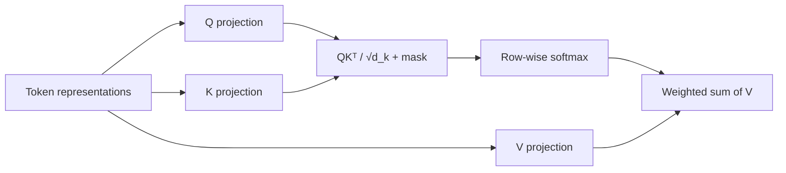
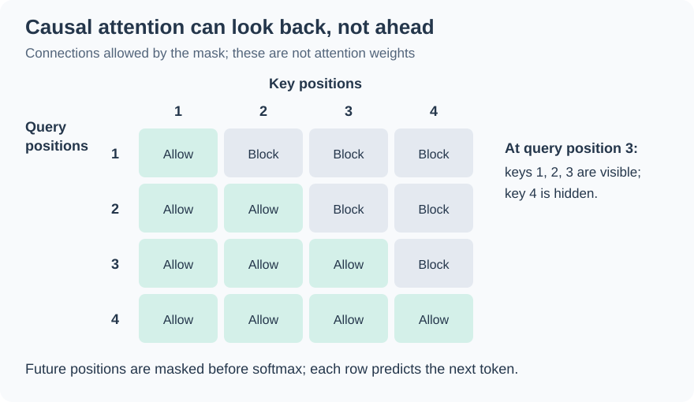
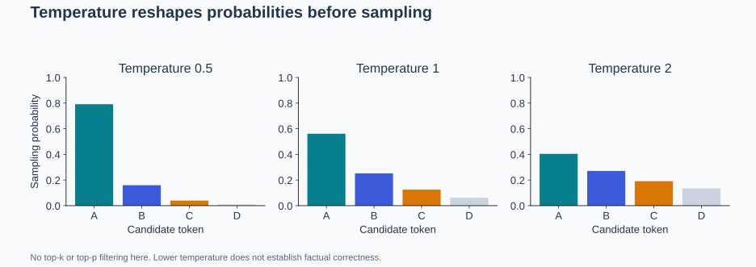
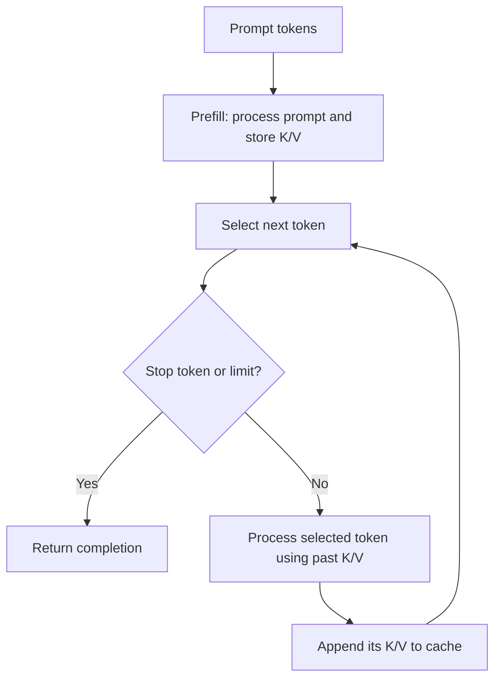

# Foundational GenAI and LLM Questions and Answers

[Back to the README](../README.md) · [Previous: AI and machine learning foundations](ai-foundations.md) · [Next: RAG](rag.md)

Start with the short answers, then use the explanations and follow-ups to practice deeper interview discussions. Examples are illustrative unless explicitly attributed to a source. Generation details below assume an autoregressive, decoder-only language model unless stated otherwise.

Each question includes a long answer, metrics or checks, at least two examples, and a quick cheat sheet. Numerical examples are illustrative, not benchmark results or universal targets. Use the [cross-topic cheat sheet](../CHEAT_SHEET.md) for quick revision.

## Contents

- [Core concepts](#core-concepts): GenAI, LLMs, tokens, and embeddings.
- [Transformer architecture](#transformer-architecture): transformer blocks, attention, position, and model families.
- [Training and adaptation](#training-and-adaptation): objectives, fine-tuning, human feedback, parameters, and in-context learning.
- [Inference and context](#inference-and-context): generation, context windows, sampling, and caching.
- [Evaluation and limitations](#evaluation-and-limitations): perplexity, hallucinations, and model scale.
- [Model families and checkpoint choices](#model-families-and-checkpoint-choices)

## Core concepts

## Question: 1. What is generative AI, and how does it differ from discriminative AI?

**Topic:** GenAI basics
**Difficulty:** Beginner

**Short answer:**
Generative AI learns patterns in data to produce content such as text, images, or audio. Discriminative models learn to predict a target, such as a class label, from an input.

**Long answer:**
The distinction concerns the modeling objective. Generative models can also perform classification by generating labels, so the categories do not define exclusive application types. GenAI extends beyond language models.

A discriminative model estimates a target or decision boundary from inputs; a generative model represents a data distribution and can sample from it. Conditional generators also take inputs, so receiving a prompt does not make a model discriminative. Choose the formulation based on the output and uncertainty needed, rather than assuming generation is always the more advanced solution.

**Metrics and checks:** Compare task accuracy and calibration for prediction; compare validity, diversity, usefulness, and cost for generation. Likelihood alone does not establish that generated content meets user needs.

**Examples:**

**Example 1:**
A spam classifier predicts whether an email is spam. A generative model can draft an email or output a spam label when prompted.

**Example 2:**
A classifier flags a product review as negative, while a conditional generator drafts a reply. The generator's fluency does not guarantee that its reply follows the refund policy.

**Quick Cheat Sheet:**

| Cue | Remember |
| --- | --- |
| **Discriminative** | predict a label or boundary |
| **Generative** | model and sample data |
| **Conditional** | generation can depend on inputs |

**Follow-up questions:**

- When would a dedicated classifier be preferable to a generative model?

**References:**

- [Google: What is machine learning?](https://developers.google.com/machine-learning/intro-to-ml/what-is-ml)

## Question: 2. What is a large language model?

**Topic:** LLM basics
**Difficulty:** Beginner

**Short answer:**
An LLM is a neural language model trained at substantial scale to learn patterns in token sequences. Generative LLMs use those patterns to produce text conditioned on context.

**Long answer:**
Many LLMs use transformers. Their training supports multiple language tasks, but fluent output does not establish correctness. A language model is one component of a chat application, which may additionally provide retrieval, tools, and conversation storage. There is no universal parameter threshold for “large.”

An LLM represents text as tokens and learns statistical structure through a large neural network. Its ability to continue text can support answering, extraction, and coding, but the underlying objective does not verify statements against the world. Capabilities depend on training data, architecture, post-training, and inference configuration. Treat the deployed system as the model plus prompts, retrieval, tools, and checks.

**Metrics and checks:** Evaluate task success, unsupported claims, latency, and cost on representative inputs. Model size and a public benchmark score do not substitute for application-specific measurements.

**Examples:**

**Example 1:**
The same generative LLM can summarize a paragraph or draft code when given different instructions.

**Example 2:**
The same model can summarize a document reliably when all facts are supplied yet fail to report today's inventory unless connected to a current data source.

**Quick Cheat Sheet:**

| Cue | Remember |
| --- | --- |
| **Model** | learned token distribution |
| **Application** | model plus surrounding controls |
| **Knowledge** | weights are not a live database |

**Follow-up questions:**

- How does a base language model differ from an instruction-tuned model?

**References:**

- [Hugging Face: How do transformers work?](https://huggingface.co/learn/llm-course/en/chapter1/4)

## Question: 3. What are tokens, and why does tokenization matter?

**Topic:** Tokenization
**Difficulty:** Beginner

**Short answer:**
Tokens are units that a tokenizer maps to integer IDs for a model. They may represent whole words, word fragments, punctuation, or bytes.

**Long answer:**
Subword methods such as byte-pair encoding balance vocabulary size against sequence length. Token counts depend on the tokenizer, language, and text; one word does not necessarily equal one token. Tokenization affects context usage and computational cost. Use the tokenizer associated with the model.

Tokenization maps text into a vocabulary-dependent sequence, often using subword units. Spaces, punctuation, code, and non-English text can tokenize differently, so character counts are only rough proxies. Token boundaries influence context budgets, truncation, cost, and exact-string tasks. Preserve the tokenizer version associated with a checkpoint; swapping vocabularies without compatible model training changes the meaning of token IDs.

**Metrics and checks:** Measure actual input/output token counts using the selected tokenizer. Report tokens per request by language and workload; a single words-to-tokens conversion can underestimate long-tail costs.

**Examples:**

**Example 1:**
A rare identifier may require several tokens even though a programmer sees it as one word.

**Example 2:**
A short serial number can consume many tokens despite containing no spaces. A multilingual support workflow should budget on real messages rather than extrapolating from English prose alone.

**Quick Cheat Sheet:**

| Cue | Remember |
| --- | --- |
| **Tokens** | model-specific units |
| **IDs** | meaningful only with the matching vocabulary |
| **Budget** | count actual inputs and outputs |

**Follow-up questions:**

- What tradeoff arises when increasing a tokenizer's vocabulary size?

**References:**

- [Hugging Face: Tokenization algorithms](https://huggingface.co/docs/transformers/tokenizer_summary)

## Question: 4. What is an embedding?

**Topic:** Representations
**Difficulty:** Beginner

**Short answer:**
An embedding is a learned vector representation of an item, such as a token, sentence, or document.

**Long answer:**
Embeddings encode relationships useful for their training objective. An LLM's input embedding maps a token ID to a vector; transformer layers then produce contextual representations. A sentence embedding used for retrieval is a different representation, designed or trained to support comparisons between texts. Similarity does not prove factual equivalence.

Embeddings place items in a learned vector space where the training objective encourages selected relationships. Similarity is therefore task-dependent: semantic resemblance is not factual equivalence, authorization, or entailment. Normalize consistently when using cosine similarity, and keep query/document encoders compatible. A vector index accelerates search but does not make an unsuitable embedding model appropriate for a domain.

**Metrics and checks:** Cosine similarity is the dot product divided by the product of vector norms. Evaluate recall@k and downstream task quality on domain queries, alongside index size and retrieval latency.

**Examples:**

**Example 1:**
A retrieval model may place “reset my password” near “recover account access,” helping match a query to relevant documentation.

**Example 2:**
“Treatment recommended” and “treatment not recommended” may be close in semantic space despite opposite implications. A medical retriever needs evidence-sensitive evaluation, not just visually plausible neighbor lists.

**Quick Cheat Sheet:**

| Cue | Remember |
| --- | --- |
| **Vector** | learned representation |
| **Similarity** | objective-dependent |
| **Retrieval** | verify relevance and meaning separately |

**Follow-up questions:**

- Why might averaging token embeddings perform worse than a trained sentence embedding model?

**References:**

- [Google: Embeddings](https://developers.google.com/machine-learning/crash-course/embeddings)

## Transformer architecture

## Question: 5. What is a transformer?

**Topic:** Architecture
**Difficulty:** Beginner

**Short answer:**
A transformer processes sequences using attention and feed-forward layers, with residual connections and normalization.

**Long answer:**
Attention mixes information across positions; feed-forward layers transform each position's representation. During training, many token positions can be processed in parallel. Ordinary autoregressive generation still depends on previously generated tokens.

A transformer alternates attention-based information mixing with position-wise feed-forward computation, using residual paths and normalization to support optimization. Attention can connect distant token positions directly, but does not eliminate context-length or compute constraints. Architectural variants change masking, positional encoding, normalization order, and attention layout. Explain which variant is relevant before making claims about generation or bidirectional understanding.

**Metrics and checks:** Standard full attention forms a sequence-length-squared interaction structure; practical memory and runtime depend on kernels and architecture. Compare measured prefill latency and peak memory at realistic input lengths.

**Examples:**

**Example 1:**
Training can evaluate predictions at many positions in a sentence in one forward pass, while basic decoding selects the next token before continuing.

**Example 2:**
A document encoder can use information on both sides of a word, while a causal text generator must prevent a token's training representation from seeing future target tokens.

**Quick Cheat Sheet:**

| Cue | Remember |
| --- | --- |
| **Attention** | mixes positions |
| **Feed-forward** | transforms representations |
| **Mask** | determines permitted information flow |

**Follow-up questions:**

- Why do residual connections help train deep networks?

**References:**

- [Vaswani et al.: Attention Is All You Need](https://arxiv.org/html/1706.03762v7)

## Question: 6. How does self-attention work?

**Topic:** Attention
**Difficulty:** Intermediate

**Short answer:**
Self-attention uses learned query, key, and value projections to combine information from positions in the same sequence.

**Long answer:**
Scaled dot-product attention is `softmax(QKᵀ / √d_k + M)V`, where `d_k` is the key dimension and `M` masks disallowed positions with negative infinity. Query-key similarity determines weights over values. Multiple heads learn different projections. Causal masking prevents access to future tokens.

Self-attention forms queries, keys, and values from the same sequence. Query-key scores determine weights used to combine value vectors, with masking controlling which positions are visible. Multiple heads can learn different useful interactions, but interpreting a head as a single human concept is unreliable. High attention weight is also not proof that a token caused the final output.

**Metrics and checks:** Scaled dot-product attention is softmax(QKᵀ/sqrt(d_k) + mask)V. For standard dense attention, the score matrix has one entry per allowed query/key pair per head.

**Examples:**

**Example 1:**
When predicting a continuation after “The cat slept because it,” attention can incorporate earlier words such as “cat.”

**Visual: One attention head**

This shows one head; a full attention layer combines multiple heads and applies an output projection. Concept reference: [Vaswani et al.: Attention Is All You Need](https://arxiv.org/abs/1706.03762).

The cells show **allowed connections, not learned attention weights**. Masked future positions receive zero attention probability after softmax. Concept reference: [Vaswani et al.: Attention Is All You Need](https://arxiv.org/abs/1706.03762).

**Example 2:**
In “The trophy did not fit in the suitcase because it was too large,” context helps relate “it” to a plausible referent. Attention contributes to contextual representation without guaranteeing correct reasoning.

**Quick Cheat Sheet:**

| Cue | Remember |
| --- | --- |
| **Q** | what seeks information |
| **K** | what can be matched |
| **V** | what gets combined |

**Follow-up questions:**

- Why divide attention scores by the square root of the key dimension?

**References:**

- [Vaswani et al.: Scaled dot-product and multi-head attention](https://arxiv.org/html/1706.03762v7)

## Question: 7. Why do transformers need positional information?

**Topic:** Position encoding
**Difficulty:** Intermediate

**Short answer:**
Attention needs a way to represent token positions and their relationships so that sequence order can influence processing.

**Long answer:**
Approaches include absolute position embeddings and rotary position embeddings (RoPE). RoPE rotates query and key vectors according to position, allowing their dot products to incorporate relative position. A position encoding scheme alone does not guarantee reliable performance at arbitrary sequence lengths.

Attention without positional information cannot distinguish arbitrary reorderings in the way language requires. Absolute embeddings, relative schemes, and rotary approaches encode position differently and interact with extrapolation beyond training lengths. A claimed maximum context length says little about whether important evidence is used reliably at every position. Test location, distance, and distractor effects rather than assuming a longer configuration preserves quality.

**Metrics and checks:** Measure retrieval or reasoning accuracy with evidence at the beginning, middle, and end, across multiple lengths. Separate accepted input length from effective task performance.

**Examples:**

**Example 1:**
“The dog chased the cat” and “The cat chased the dog” contain the same words but express different events.

**Example 2:**
“Dog bites person” and “person bites dog” share tokens but differ in order and meaning. A long-context assistant must also connect a definition near the start with an exception far later.

**Quick Cheat Sheet:**

| Cue | Remember |
| --- | --- |
| **Order** | changes meaning |
| **Position scheme** | architecture-dependent |
| **Long context** | validate use, not just acceptance |

**Follow-up questions:**

- What can go wrong when using a model beyond the sequence lengths seen during training?

**References:**

- [Su et al.: RoFormer](https://arxiv.org/abs/2104.09864)

## Question: 8. How do encoder-only, decoder-only, and encoder-decoder models differ?

**Topic:** Model families
**Difficulty:** Intermediate

**Short answer:**
Encoders build representations of input text, causal decoders generate continuations, and encoder-decoder models generate output conditioned on an encoded input.

**Long answer:**

| Architecture | Typical attention pattern | Example family | Common use |
| --- | --- | --- | --- |
| Encoder-only | Bidirectional across the input | BERT | Classification and representation learning |
| Decoder-only | Causal within the sequence | GPT | Text continuation and chat |
| Encoder-decoder | Bidirectional encoder; causal decoder with cross-attention to encoder outputs | T5 | Translation and summarization |

These are typical uses, not strict task boundaries.

Encoder-only models typically build bidirectional representations for classification, tagging, or retrieval. Decoder-only models use causal attention for continuation. Encoder-decoder models encode a source and generate a target through a decoder that can attend to the encoded source. These are architectural patterns, not strict capability boundaries; training objectives and task interfaces also determine suitability.

**Metrics and checks:** Compare task quality, serving latency, and required output structure. For retrieval, embedding throughput matters; for translation, output quality and generation cost may dominate.

**Examples:**

**Example 1:**
For translation, an encoder-decoder model reads the source sentence and generates a target sentence token by token.

**Example 2:**
A search system can use an encoder for document embeddings and a decoder for answer generation. A translation model can instead use an encoder-decoder to condition generated text on the entire source sentence.

**Quick Cheat Sheet:**

| Cue | Remember |
| --- | --- |
| **Encoder** | contextual representations |
| **Decoder** | causal continuation |
| **Encoder-decoder** | source-to-target generation |

**Follow-up questions:**

- How does cross-attention differ from self-attention?

**References:**

- [Hugging Face: Transformer architectures](https://huggingface.co/learn/llm-course/en/chapter1/6)

## Training and adaptation

## Question: 9. What is next-token prediction, and why is it self-supervised?

**Topic:** Pretraining objectives
**Difficulty:** Beginner

**Short answer:**
Next-token prediction trains a model to predict each token from the preceding tokens. The text supplies its own targets, so separate human labels are unnecessary.

**Long answer:**
Training commonly minimizes cross-entropy: the negative log probability assigned to the actual next token, averaged over target positions. Causal masking prevents future-token leakage. This objective rewards prediction of training text; it does not directly certify truth. Masked language modeling is a different objective that predicts hidden tokens from surrounding context.

Training constructs input/target pairs from the text itself by shifting token positions. A causal mask prevents each prediction from reading its future target. The loss usually sums or averages negative log probabilities over selected target positions. This objective teaches many patterns because predicting language requires useful representations, but it does not directly encode truthfulness, instruction compliance, or every downstream task.

**Metrics and checks:** Token cross-entropy is the mean of −log p(correct next token). State which tokens are masked and how losses are aggregated; changing the tokenizer or evaluated text can change the meaning of the score.

**Examples:**

**Example 1:**
For “Birds can fly,” the token sequence corresponding to “Birds can” provides context for predicting the next token.

**Example 2:**
From “water freezes at zero,” the model can learn to predict successive tokens without a human labeling each one. Training on an incorrect sentence still rewards reproducing its token pattern.

**Visual:**

Token strings are illustrative; actual tokenization varies. A causal mask prevents seeing the target’s future context. Concept reference: [Hugging Face: causal language modeling](https://huggingface.co/docs/transformers/tasks/language_modeling).

**Quick Cheat Sheet:**

| Cue | Remember |
| --- | --- |
| **Self-supervised** | labels come from data |
| **Shift** | predict the next position |
| **Causal mask** | prevent future-token leakage |

**Follow-up questions:**

- Why would access to future tokens invalidate causal language-model training?

**References:**

- [Hugging Face: Causal language modeling](https://huggingface.co/docs/transformers/tasks/language_modeling)

## Question: 10. How do pretraining, fine-tuning, and inference differ?

**Topic:** Model lifecycle
**Difficulty:** Beginner

**Short answer:**
Pretraining learns broad patterns from data. Fine-tuning further trains an existing model for a domain, task, or behavior. Inference uses a trained model to produce outputs.

**Long answer:**
Both pretraining and fine-tuning update learned parameters, although some methods update only a subset or added adapters. Ordinary inference keeps those parameters fixed. Instructions or examples in a prompt change the context, not the model weights.

Pretraining learns broad representations from a large corpus; fine-tuning updates weights for a more targeted objective; inference runs a trained model to produce outputs. Prompting and retrieval normally change inputs without changing weights. Each stage needs separate data governance and evaluation: a successful training run can still produce a poorly calibrated or operationally unsuitable application.

**Metrics and checks:** Track training loss and held-out loss during learning, then application quality, latency, and cost during inference. Training throughput and user-visible generation speed are different measurements.

**Examples:**

**Example 1:**
Training on a broad text corpus, adapting to support conversations, and answering a customer question illustrate the three stages.

**Example 2:**
A model can be pretrained on general text, fine-tuned on support conversations, and supplied with a customer's current contract at inference through retrieval. Each step solves a different problem.

**Quick Cheat Sheet:**

| Cue | Remember |
| --- | --- |
| **Pretrain** | broad learning |
| **Fine-tune** | update for a target objective |
| **Inference** | use the learned model |

**Follow-up questions:**

- What evidence would justify fine-tuning instead of improving the prompt?

**References:**

- [Hugging Face: Pretraining and fine-tuning](https://huggingface.co/learn/llm-course/en/chapter1/4)

## Question: 11. What are instruction tuning and RLHF?

**Topic:** Post-training
**Difficulty:** Intermediate

**Short answer:**
Instruction tuning trains on examples of requested behavior. Reinforcement learning from human feedback (RLHF) uses human feedback to guide optimization toward preferred outputs.

**Long answer:**
In a classic RLHF pipeline, supervised fine-tuning teaches responses, human comparisons train a reward model, and reinforcement learning optimizes the language model against that reward. This can improve helpfulness and instruction following, but preference rewards are imperfect proxies for correctness and safety. Post-training pipelines vary.

Instruction tuning uses demonstrations of desired responses, while preference-based alignment learns from comparisons or reward signals about response quality. Classic RLHF includes fitting a reward model and optimizing a policy; other preference methods use different optimization procedures. Human preference is not identical to factual correctness, and reward optimization can favor superficial style unless evaluation explicitly checks task completion and evidence.

**Metrics and checks:** Evaluate instruction adherence, factual support, refusal appropriateness, and regressions on held-out tasks. A rising reward-model score is not an independent measure of real-world improvement.

**Examples:**

**Example 1:**
Annotators prefer a clear, relevant answer over a rambling one; those comparisons provide a training signal.

**Example 2:**
Raters may prefer a polished long response even when a short answer is more accurate. A support assistant therefore needs policy and factual checks alongside preference judgments.

**Quick Cheat Sheet:**

| Cue | Remember |
| --- | --- |
| **Demonstrations** | teach desired outputs |
| **Preferences** | compare outputs |
| **Reward** | proxy that needs independent validation |

**Follow-up questions:**

- What happens if a model learns to exploit weaknesses in the reward model?

**References:**

- [Ouyang et al.: Training language models to follow instructions with human feedback](https://arxiv.org/abs/2203.02155)

## Question: 12. What is the difference between parameters and hyperparameters?

**Topic:** Machine learning basics
**Difficulty:** Beginner

**Short answer:**
Parameters are values learned during training, such as weight matrices. Hyperparameters are configuration choices that govern the model or training process, such as learning rate and layer count.

**Long answer:**
An optimizer updates parameters using gradients. Engineers choose or search over hyperparameters. Generation controls such as temperature are inference settings; changing them does not retrain the model. Parameter count describes model size, not a count of stored facts.

Parameters are learned values such as weights; hyperparameters configure training or inference, such as learning rate or sampling temperature. Some choices, such as model width, determine the parameter count before training. Other settings affect serving without updating any weights. Reproducibility requires recording both the checkpoint and the configurations that generated it and served its outputs.

**Metrics and checks:** Report parameter count separately from active parameters, optimizer memory, and serving memory. Compare hyperparameters using validation data and record random seeds and software versions where relevant.

**Examples:**

**Example 1:**
Changing the learning rate affects training updates; changing temperature affects how tokens are selected from the trained model's outputs.

**Example 2:**
Changing a classifier's learned coefficient requires training, while changing its decision threshold may only alter deployment configuration. Similarly, lowering generation temperature does not retrain the LLM.

**Quick Cheat Sheet:**

| Cue | Remember |
| --- | --- |
| **Parameters** | learned values |
| **Hyperparameters** | chosen settings |
| **Reproducibility** | checkpoint plus configuration |

**Follow-up questions:**

- Why can an excessively large learning rate prevent training from converging?

**References:**

- [Google: Machine learning glossary](https://developers.google.com/machine-learning/glossary#hyperparameter)

## Question: 13. What are zero-shot, few-shot, and in-context learning?

**Topic:** Adaptation through prompts
**Difficulty:** Beginner

**Short answer:**
Zero-shot prompting supplies a task without demonstrations. Few-shot prompting includes a small number of examples. In-context learning adapts behavior using the supplied context without updating model weights.

**Long answer:**
Demonstrations communicate patterns such as output format or label meanings. Their quality, relevance, and order can affect results. This adaptation is not persistent training: later requests need the relevant context supplied again unless the application retains it.

In-context learning conditions a fixed model on task instructions and examples; it does not normally update weights. Examples communicate formats, decision boundaries, and exceptions, but can introduce label bias or accidental patterns. Zero-shot avoids demonstration tokens, while few-shot can improve consistency at added context cost. Select examples that cover meaningful variation and keep evaluation examples out of the prompt.

**Metrics and checks:** Compare held-out task success, format validity, input tokens, and latency for zero-shot and several demonstration sets. Test sensitivity to example order and class balance.

**Examples:**

**Example 1:**
Provide “excellent → positive” and “awful → negative,” then ask the model to label “wonderful.”

**Example 2:**
A ticket classifier shown only urgent examples may overpredict urgency. Include routine cases and ambiguous boundary cases, then check on separate tickets rather than reusing the demonstrations.

**Quick Cheat Sheet:**

| Cue | Remember |
| --- | --- |
| **Zero-shot** | instruction without demonstrations |
| **Few-shot** | examples in context |
| **Learning** | no ordinary weight update |

**Follow-up questions:**

- How would you test whether few-shot examples actually improve performance?

**References:**

- [Brown et al.: Language Models are Few-Shot Learners](https://arxiv.org/abs/2005.14165)

## Inference and context

## Question: 14. How does an autoregressive LLM generate an answer?

**Topic:** Inference
**Difficulty:** Beginner

**Short answer:**
It processes the prompt, computes scores for possible next tokens, selects one using a decoding strategy, and repeats with the selected token added to the context.

**Long answer:**
The scores are called logits; softmax converts them into probabilities. Greedy decoding selects the highest-scoring token, while sampling draws from a distribution. Generation stops at an end token, a configured stop condition, or an output limit. Greedy local choices do not guarantee the most probable complete sequence.

Autoregressive generation repeatedly predicts the next token conditioned on the prompt and previously generated tokens. Errors can therefore influence later continuation, and a locally likely token sequence need not form a correct solution. Decoding ends through stop tokens, configured limits, or external control. Streaming exposes partial output sooner but does not change the sequential dependency of ordinary decoding.

**Metrics and checks:** Measure time to first token, inter-token latency, output length, and completion rate. End-to-end latency includes queueing and prompt processing as well as decoding.

**Examples:**

**Example 1:**
Different first-token selections can lead the same prompt toward different complete answers.

**Example 2:**
A code generator that chooses the wrong variable early can consistently reuse it throughout a function. Syntax validity at each local step does not guarantee that the completed function meets the specification.

**Quick Cheat Sheet:**

| Cue | Remember |
| --- | --- |
| **Loop** | predict then append |
| **Dependency** | prior output shapes the next step |
| **Stop** | completion conditions must be explicit |

**Follow-up questions:**

- Why does generating a longer answer usually increase latency?

**References:**

- [Hugging Face: Generation strategies](https://huggingface.co/docs/transformers/generation_strategies)

## Question: 15. What is a context window, and is it the same as memory?

**Topic:** Context limits
**Difficulty:** Beginner

**Short answer:**
A context window bounds the token sequence a model can process. It is different from information learned in weights or stored by an application.

**Long answer:**
For a typical decoder-only request, prompt tokens and generated tokens share a context budget; serving systems may impose additional limits. A larger window does not guarantee reliable use of every detail. The Lost in the Middle study found sensitivity to information position in the models it evaluated.

The context window bounds the tokens a model can process in a request; persistent memory requires an external mechanism that selects and supplies information across requests. Summaries and retrieved memories can lose details or preserve stale claims. Treat stored memory as data with provenance, retention, and access rules. A larger window reduces some truncation pressure but can add cost, latency, and distraction.

**Metrics and checks:** Track context tokens, truncation frequency, retrieval success, and task quality as conversations grow. Include system instructions, tool outputs, and reserved output capacity in the budget.

**Examples:**

**Example 1:**
With an illustrative 8,000-token total budget and a 6,000-token prompt, at most 2,000 tokens remain for generation before other constraints.

**Example 2:**
A travel assistant may remember a seating preference in a database while omitting last week's full conversation. Before booking, it should verify that the preference is current and applies to the present traveler.

**Quick Cheat Sheet:**

| Cue | Remember |
| --- | --- |
| **Context** | current request capacity |
| **Memory** | stored and retrieved state |
| **Summary** | lossy representation, not perfect recall |

**Follow-up questions:**

- How would you preserve useful conversation information when the history exceeds the context limit?

**References:**

- [Google: Context window](https://developers.google.com/machine-learning/glossary#context-window)
- [Liu et al.: Lost in the Middle](https://arxiv.org/abs/2307.03172)

## Question: 16. What do temperature, top-k, and top-p control?

**Topic:** Sampling
**Difficulty:** Intermediate

**Short answer:**
Temperature reshapes token probabilities. Top-k limits sampling to the k highest-scoring tokens. Top-p limits sampling to the smallest highest-probability set whose cumulative probability reaches a threshold.

**Long answer:**
For positive temperature `T`, probabilities are proportional to `exp(logit / T)`. Lower values sharpen the distribution; higher values flatten it. Top-k and top-p filter candidates before sampling. Greedy decoding is commonly exposed separately or through a zero-temperature convention; implementations vary. Lower randomness does not guarantee factual accuracy or reproducibility across execution environments.

Temperature rescales logits before sampling; top-k retains a fixed number of candidates and top-p retains a probability-mass-based set. These controls change diversity and repetition, but do not verify facts. Their interaction depends on implementation order and model behavior. Even low-temperature output can vary because of serving details, so use deterministic validators when exact structure or business rules matter.

**Metrics and checks:** Evaluate task success and output diversity across repeated generations, with the decoding configuration recorded. Compare factual errors separately; lower randomness does not imply lower systematic error.

**Examples:**

**Example 1:**
With probabilities `[0.60, 0.25, 0.10, 0.05]`, top-p at `0.80` retains the first two candidates and renormalizes their probabilities.

**Example 2:**
Creative headline generation may benefit from varied samples, while invoice extraction may prioritize consistent schema compliance. Both still need task-specific checks rather than relying on temperature alone.

**Visual:**

Synthetic probabilities without top-k or top-p filtering. Greedy decoding is a separate selection rule; lower temperature does not guarantee truth. Concept reference: [Hugging Face: generation strategies](https://huggingface.co/docs/transformers/generation_strategies).

**Quick Cheat Sheet:**

| Cue | Remember |
| --- | --- |
| **Temperature** | reshape probabilities |
| **Top-k** | fixed candidate count |
| **Top-p** | cumulative probability mass |

**Follow-up questions:**

- How can changing both temperature and top-p complicate an experiment?

**References:**

- [Hugging Face: Generation configuration](https://huggingface.co/docs/transformers/main_classes/text_generation)

## Question: 17. What are prefill, decoding, and the KV cache?

**Topic:** Inference efficiency
**Difficulty:** Intermediate

**Short answer:**
Prefill processes the prompt. Decoding generates subsequent tokens. A key-value (KV) cache stores earlier attention keys and values so decoding can reuse them.

**Long answer:**
For a causal transformer, later tokens do not change earlier tokens' representations, enabling reuse. Caching reduces repeated computation but consumes memory, typically increasing with retained sequence length and batch size. It stores intermediate tensors, not finished answers, and does not remove the need to attend to relevant prior positions.

Prefill processes prompt tokens and creates reusable key/value state; decoding adds new tokens while attending to prior cached state. KV caching avoids recomputing earlier keys and values, but consumes memory that grows with sequence length and concurrent requests. Grouped-query attention changes the number of KV heads and therefore cache size. Weight quantization does not automatically imply the cache uses the same precision.

**Metrics and checks:** Approximate KV bytes = 2 × layers × batch × sequence length × KV heads × head dimension × bytes per element, before overhead. Measure prefill and decoding separately at realistic concurrency.

**Examples:**

**Example 1:**
After processing a long prompt, the model reuses its cached keys and values when generating each answer token.

**Visual: Prefill and cached decoding**

The cache stores attention keys and values at each layer. It saves recomputation; it does not extend the model’s supported context window. Concept reference: [Hugging Face: KV caching](https://huggingface.co/docs/transformers/cache_explanation).

**Example 2:**
With all other dimensions fixed, doubling a request's cached sequence length approximately doubles its KV storage. A server that fits one long request may still run out of memory when many such requests overlap. For an illustrative configuration with 32 layers, batch size 1, 8,192 cached tokens, 8 KV heads, head dimension 128, and two bytes per element, the formula gives 1,073,741,824 bytes, or 1 GiB, before allocator overhead. This excludes model weights and other buffers.

**Quick Cheat Sheet:**

| Cue | Remember |
| --- | --- |
| **Prefill** | process prompt |
| **Decode** | generate incrementally |
| **KV cache** | saves compute while consuming memory |

**Follow-up questions:**

- Why can long concurrent requests exhaust memory even when the model weights fit on the device?

**References:**

- [Hugging Face: How caching works](https://huggingface.co/docs/transformers/cache_explanation)

## Evaluation and limitations

## Question: 18. What is perplexity, and what does it tell us?

**Topic:** Language-model evaluation
**Difficulty:** Intermediate

**Short answer:**
Perplexity is the exponential of average negative log-likelihood per token. Lower values indicate that a model assigns higher probability to the observed evaluation text.

**Long answer:**
Using natural logarithms, `perplexity = exp(cross-entropy)`. Compare results only under compatible tokenization, data, and context-evaluation protocols. Perplexity measures predictive fit, not directly factual accuracy, helpfulness, or application success. It is not directly defined in the same way for masked language models.

Perplexity is the exponential of mean negative log likelihood when natural logarithms are used. It summarizes how surprised a model is by reference tokens, not whether generated answers are helpful or correct. Comparisons require the same tokenization, evaluation text, and masking conventions. A model can achieve better language-model loss while becoming worse at following a particular instruction format or producing evidence-backed answers.

**Metrics and checks:** Perplexity = exp(cross-entropy in nats). Lower is better for predicting that reference distribution; scores across different tokenizers are generally not directly comparable.

**Examples:**

**Example 1:**
An average loss of approximately `0.693` nats per token corresponds to perplexity `2`.

**Example 2:**
A model that predicts common legal phrasing well may have low perplexity on contracts while still inventing a clause when asked a specific question about a missing section.

**Quick Cheat Sheet:**

| Cue | Remember |
| --- | --- |
| **Loss** | average token surprise |
| **Perplexity** | exponential of that loss |
| **Limit** | not an application-quality score |

**Follow-up questions:**

- Why should a chatbot evaluation include measures beyond perplexity?

**References:**

- [Hugging Face: Perplexity of fixed-length models](https://huggingface.co/docs/transformers/perplexity)

## Question: 19. What is an LLM hallucination, and why can it happen?

**Topic:** Reliability
**Difficulty:** Beginner

**Short answer:**
A hallucination is generated content that is false or unsupported by the relevant evidence or input, even when it sounds plausible.

**Long answer:**
Learning to predict text does not ensure truth: training data can contain misconceptions, and plausible continuations can fill gaps without evidence. Confident language is not a calibrated correctness score. As an engineering practice, verify important claims against trusted evidence and test whether a system can acknowledge missing information.

Hallucination covers unsupported or false generated content, but evaluation should distinguish incorrect world knowledge, unsupported claims about supplied evidence, fabricated citations, and invalid tool results. Causes include missing information, ambiguous instructions, poor retrieval, and generation that favors plausible continuation. Mitigations must target the cause: better evidence, explicit abstention, verification, or a deterministic computation may be more effective than a prompt warning.

**Metrics and checks:** Measure unsupported-claim rate, answer correctness, citation validity, and abstention coverage on labeled tasks. Define the unit: claims, responses, or conversations yield different denominators.

**Examples:**

**Example 1:**
A model supplies a convincing paper title and citation, but the paper does not exist.

**Example 2:**
A financial assistant can retrieve the correct report yet compute a percentage incorrectly. A calculator addresses that arithmetic failure, while adding more documents may only increase context noise.

**Quick Cheat Sheet:**

| Cue | Remember |
| --- | --- |
| **Diagnose** | missing facts or bad use? |
| **Ground** | connect claims to evidence |
| **Abstain** | when support is insufficient |

**Follow-up questions:**

- How would you detect an answer that contradicts a supplied document?

**References:**

- [Lin et al.: TruthfulQA](https://arxiv.org/abs/2109.07958)

## Question: 20. Does a larger model always perform better?

**Topic:** Scaling and model selection
**Difficulty:** Intermediate

**Short answer:**
No. Performance depends on training data, compute allocation, architecture, adaptation, and the task, as well as parameter count.

**Long answer:**
The Chinchilla study demonstrated that a smaller model trained on more tokens could outperform larger models under a comparable training-compute budget. That result is not a universal model-selection rule. In practice, compare candidate models on representative tasks and measure quality, latency, and resource requirements together.

Larger models can improve some capabilities but may increase latency, serving memory, and cost without improving the target workflow enough to justify them. Data quality, post-training, retrieval, tools, and task specialization also matter. Compare complete configurations under the same input distribution and service constraints. Routing between models can help, but the router's errors and fallback costs must be included.

**Metrics and checks:** Plot quality against p95 latency and cost per successful task. Include failure/retry costs and evaluate difficult slices rather than selecting on average accuracy alone.

**Examples:**

**Example 1:**
For a narrow support-labeling task, evaluate whether a smaller adapted model meets accuracy requirements before accepting the cost of a larger one.

**Example 2:**
A small classifier may reliably route a fixed set of ticket categories, while a larger model handles unusual multilingual cases. Routing is worthwhile only if missed difficult cases remain acceptable.

**Quick Cheat Sheet:**

| Cue | Remember |
| --- | --- |
| **Size** | one capability factor |
| **Baseline** | test a smaller suitable model |
| **Decision** | quality within latency and cost constraints |

**Follow-up questions:**

- How would you design a fair comparison between two models for your application?

**References:**

- [Hoffmann et al.: Training Compute-Optimal Large Language Models](https://arxiv.org/abs/2203.15556)

## Model families and checkpoint choices

## Question: 21. How do GANs, VAEs, and diffusion models generate data differently?

**Topic:** Generative model families
**Difficulty:** Intermediate

**Short answer:**
GANs learn through adversarial training, VAEs learn a probabilistic latent representation, and diffusion models learn to reverse a corruption process.

**Long answer:**
A GAN pairs a generator with a discriminator during training. A VAE optimizes reconstruction together with a regularizer on its approximate latent posterior; sampling uses a prior and decoder. A diffusion model learns denoising transitions, often conditioned on text or another signal. Training stability, sampling cost, fidelity, and diversity depend on the implementation; no family wins every task.

GANs learn through a generator/discriminator competition; VAEs optimize a probabilistic latent-variable objective with an approximate posterior; diffusion models learn to reverse a corruption process. These families have different training stability, sampling, and representation tradeoffs. Avoid reducing them to a single quality ranking: architecture, dataset, conditioning, and sampling procedure strongly affect results. Evaluate both sample quality and diversity, as well as task-specific constraints.

**Metrics and checks:** Compare validity, coverage/diversity, generation latency, and human task judgments. Distributional image metrics are useful proxies but depend on feature extraction and do not fully capture usefulness or memorization.

**Examples:**

**Example 1:**
Image generation may map noise through a GAN generator, decode a VAE latent sample, or iteratively denoise a diffusion sample. The discriminator and VAE encoder are not required for those basic sampling paths.

**Example 2:**
A VAE may be useful for exploring a smooth latent space, while a diffusion model may support detailed conditional image generation. A visually convincing output still needs checks for the requested attributes.

**Visual:**

Basic generation paths only; training objectives and architecture variants differ. The primary references below support the concept.

**Quick Cheat Sheet:**

| Cue | Remember |
| --- | --- |
| **GAN** | adversarial training |
| **VAE** | latent probabilistic reconstruction |
| **Diffusion** | learn to reverse noise |

**Follow-up questions:**

- Why should sampling steps be included in a diffusion model’s latency evaluation?

**References:**

- [Goodfellow et al.: Generative Adversarial Networks](https://arxiv.org/abs/1406.2661)
- [Kingma and Welling: Auto-Encoding Variational Bayes](https://arxiv.org/abs/1312.6114)
- [Ho et al.: Denoising Diffusion Probabilistic Models](https://arxiv.org/abs/2006.11239)

## Question: 22. Does a mixture-of-experts model run every expert for every token?

**Topic:** Sparse model architecture
**Difficulty:** Intermediate

**Short answer:**
In a sparse MoE layer, a router selects a subset of experts for each token, so active computation differs from total parameter count.

**Long answer:**
Experts commonly replace feed-forward sublayers while attention remains shared. Routing introduces load-balance, capacity, and communication concerns. Sparse activation can reduce arithmetic relative to activating every expert, but all required weights still need storage somewhere. Latency depends on hardware placement, batching, and communication as well as active parameters.

Sparse mixture-of-experts layers route each token to a subset of experts, separating total parameter count from the computation activated per token. The complete model may still need substantial memory to hold all experts. Routing balance, communication between devices, and expert capacity affect throughput. Sparse activation therefore does not mean the system costs the same as a dense model with only the active parameter count.

**Metrics and checks:** Report total and active parameters, tokens per second, expert-load distribution, communication overhead, and tail latency. Compare at equal quality and deployment configuration, not parameter count alone.

**Examples:**

**Example 1:**
An illustrative top-two router chooses two of eight experts for one token and combines their weighted outputs. This does not mean the whole model uses exactly one quarter of its parameters.

**Example 2:**
A token routed to two experts does not use every expert in that layer. If many tokens prefer the same experts, imbalance can still create bottlenecks despite apparently sparse computation.

**Visual:**

A schematic top-two layer; expert count and routing policy are model-specific. The primary references below support the concept.

**Quick Cheat Sheet:**

| Cue | Remember |
| --- | --- |
| **Total** | all stored experts |
| **Active** | selected computation per token |
| **Bottleneck** | routing and communication matter |

**Follow-up questions:**

- When can communication erase the compute savings of sparse routing?

**References:**

- [Fedus et al.: Switch Transformers](https://arxiv.org/abs/2101.03961)

## Question: 23. How should you choose between a base checkpoint and an instruction-tuned checkpoint?

**Topic:** Model selection
**Difficulty:** Intermediate

**Short answer:**
Choose the checkpoint whose training behavior fits the task and whose measured performance, format, license, and operational constraints meet your needs.

**Long answer:**
A base language model primarily learns continuation; instruction tuning encourages responses to requests. Chat formatting and role conventions are part of the checkpoint interface. An instruction-tuned model can still hallucinate or ignore constraints. A base checkpoint may suit specialized adaptation, but it requires task-specific validation rather than assuming that completion ability implies assistant behavior.

A base checkpoint is trained primarily for its foundational objective, while an instruction checkpoint has additional training for following requests and conversational behavior. The latter can still require its expected chat template, role tokens, and generation settings. Selecting a base model because it is less constrained may shift substantial work into data preparation and post-training. Evaluate the actual checkpoint and interface together.

**Metrics and checks:** Compare instruction adherence, task quality, formatting, and inappropriate refusals using identical task intent and each checkpoint's correct input format. Record the exact checkpoint revision.

**Examples:**

**Example 1:**
The same text, “Classify this ticket,” may elicit a continued document from a base model and a label from an instruction-tuned model. Test actual prompts and output contracts on representative cases.

**Example 2:**
A base model may continue a question with another question, while an instruction-tuned model answers it. Feeding malformed role delimiters to the instruction checkpoint can undermine that expected behavior.

**Visual:**

A conceptual training path. Some pipelines use different stages or omit preference optimization. The primary references below support the concept.

**Quick Cheat Sheet:**

| Cue | Remember |
| --- | --- |
| **Base** | foundational training objective |
| **Instruction** | additional response training |
| **Template** | part of the model interface |

**Follow-up questions:**

- How can an incorrect chat template make a capable checkpoint look poor?

**References:**

- [Ouyang et al.: instruction following with human feedback](https://arxiv.org/abs/2203.02155)
