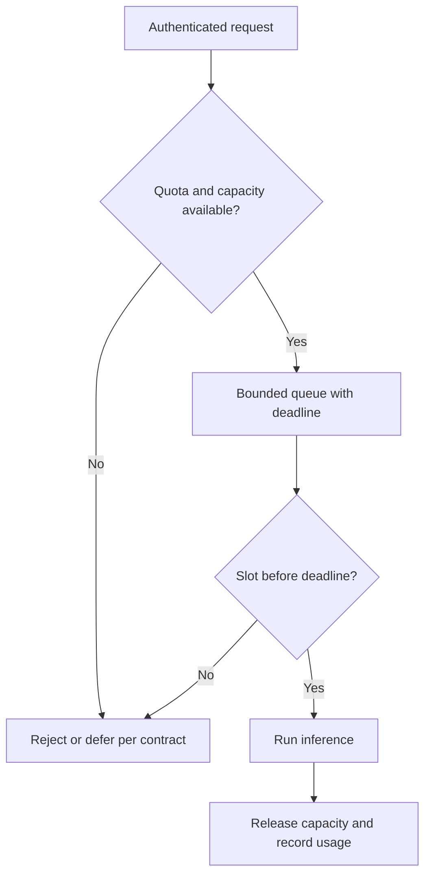
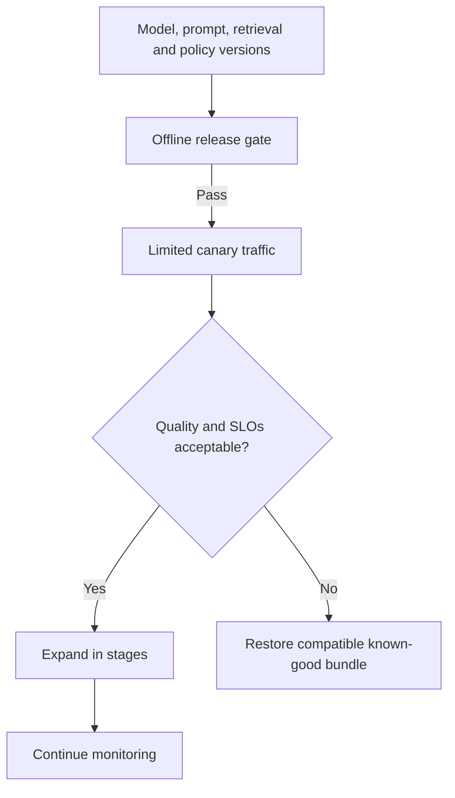
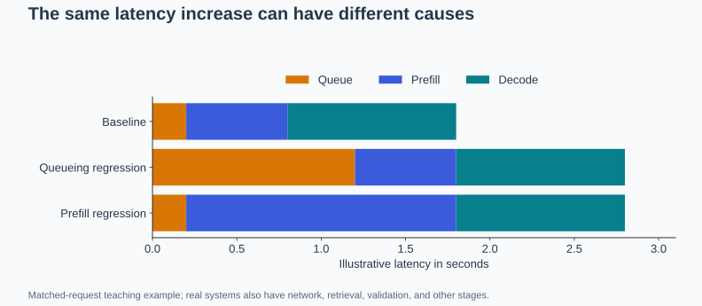

# Production Engineering Questions and Answers

[Back to the README](../README.md) · [Terminology glossary](../GLOSSARY.md) · [Agents](agents.md) · [Fine-tuning](fine-tuning.md) · [RAG](rag.md) · [Evaluation](evaluation.md)

These questions cover deploying and operating reliable GenAI applications. Engineers can practice the short answers; interviewers can use the examples and follow-ups to explore operational judgment. Designs, numerical examples, and targets are illustrative. Serving behavior and supported optimizations depend on the model, runtime, hardware, and provider.

Each question includes a short answer, a plain-language explanation with an analogy, an advanced answer with technical detail, metrics or checks, at least two examples, and a quick cheat sheet. Numerical examples are illustrative, not benchmark results or universal targets. Use the [cross-topic cheat sheet](../CHEAT_SHEET.md) for quick revision.

## Contents

- [Deployment and service goals](#deployment-and-service-goals): hosting choices, service objectives, and latency.
- [Serving performance](#serving-performance): batching, memory, quantization, and caching.
- [Reliability and releases](#reliability-and-releases): overload, retries, fallbacks, and rollout safety.
- [Operations and cost](#operations-and-cost): observability, security, and efficiency.
- [Inference optimization scenarios](#inference-optimization-scenarios)

## Deployment and service goals

## Question: 1. How do you choose between a hosted model API and self-managed inference?

**Topic:** Deployment architecture
**Difficulty:** Intermediate

**Key terms:** [API and SDK](../GLOSSARY.md#api-and-sdk) · [Inference](../GLOSSARY.md#inference) · [CPU, GPU, and accelerator](../GLOSSARY.md#cpu-gpu-and-accelerator) · [Cost per successful task](../GLOSSARY.md#cost-per-successful-task)

**Short answer:**
Compare task quality, data-handling requirements, control over the serving stack, operational capacity, and total cost under realistic traffic.

**Simple answer and analogy:**

**In plain language:** You can pay a provider to run the model or operate the serving system yourself. Compare the full cost, control, reliability, and staffing needs for your actual workload.

**Analogy:** Using a taxi avoids buying and maintaining a car; owning a car gives more control but brings fixed costs and responsibilities. Occasional journeys and constant daily use can lead to different sensible choices.

**Advanced answer and AI/maths:**
A hosted API reduces infrastructure work but introduces provider quotas, dependencies, and configuration constraints. Self-managed inference offers more control while requiring capacity planning, upgrades, security, and incident response. Managed dedicated endpoints offer another option between these extremes. Benchmark the complete application; self-hosting is not automatically cheaper, and a managed service does not remove application-level responsibilities.

Hosted APIs reduce infrastructure management but introduce provider limits, network dependencies, and less control over runtime changes. Self-managed serving offers deployment control and potential scale economics, but requires capacity planning, reliability work, security maintenance, and model operations. Compare the complete workload, including utilization and burstiness. Data residency, supported models, and integration constraints may be decisive beyond raw inference price.

**Metrics and checks:** Estimate total cost per successful request, p95 latency, availability, peak capacity, and operational effort. Self-hosting cost depends strongly on utilization, not just accelerator hourly price.

**Examples:**

**Example 1:**
A team compares a shared API with a dedicated endpoint using the same workload, including idle periods, peak traffic, and failure handling.

**Example 2:**
A sporadic internal assistant may leave dedicated GPUs idle most of the day. A steady high-volume specialized workload may justify self-managed serving after accounting for staffing and redundancy.

**Quick Cheat Sheet:**

| Cue | Remember |
| --- | --- |
| **Hosted** | operational simplicity with dependency |
| **Self-managed** | control with responsibility |
| **Compare** | full workload economics |

**Follow-up questions:**

- Which costs would you include beyond the model's token price or accelerator rental?

**References:**

- [Hugging Face: Managed inference endpoints](https://huggingface.co/docs/inference-endpoints/index)

## Question: 2. What are SLIs, SLOs, and error budgets for a GenAI service?

**Topic:** Service reliability
**Difficulty:** Intermediate

**Key terms:** [Service-level indicator (SLI)](../GLOSSARY.md#service-level-indicator-sli) · [Service-level objective (SLO)](../GLOSSARY.md#service-level-objective-slo) · [Error budget](../GLOSSARY.md#error-budget)

**Short answer:**
A service-level indicator (SLI) measures behavior, a service-level objective (SLO) sets a target over a window, and an error budget describes the allowed deviation.

**Simple answer and analogy:**

**In plain language:** An indicator measures service behavior, an objective sets the target, and the error budget says how much failure that target allows over a defined period.

**Analogy:** A delivery company measures on-time parcels, promises a target percentage, and tracks how many late parcels fit within that allowance. “Late parcels” and “minutes the depot was closed” are different measurements, so their budgets cannot be swapped casually.

**Advanced answer and AI/maths:**
Define the eligible request population, success criteria, and measurement point. Track availability and latency separately from answer quality: an HTTP success can contain an unusable answer. Quality may require delayed or sampled evaluation. Use budget consumption to guide release and reliability work rather than treating every service as requiring perfect availability.

SLIs measure user-visible behavior, SLOs set target performance over a window, and an error budget quantifies allowed failure against that target. Define eligible requests and what counts as success, including correctness where measurable. Separate availability and latency objectives rather than hiding slow successful requests. An SLO should guide release and reliability decisions, not merely decorate a dashboard.

**Metrics and checks:** For a request-based 99.9% success SLO over 1,000,000 eligible requests, the budget is 1,000 failed requests. This is not a downtime-minute budget unless the SLI is defined by time.

**Examples:**

**Example 1:**
For a request-based 99.9% success SLO over 100,000 eligible requests, the budget permits 100 unsuccessful requests in that window.

**Example 2:**
An endpoint returning HTTP 200 with invalid JSON may still fail the user-facing success SLI. Counting transport success alone would overstate reliability.

**Quick Cheat Sheet:**

| Cue | Remember |
| --- | --- |
| **SLI** | measurement |
| **SLO** | target and window |
| **Budget** | permitted bad events under that definition |

**Follow-up questions:**

- How should a response that starts streaming but fails before completion affect the success SLI?

**References:**

- [Google SRE: Service-level objectives](https://sre.google/sre-book/service-level-objectives/)

## Question: 3. How do you diagnose latency in a streaming LLM application?

**Topic:** Latency analysis
**Difficulty:** Intermediate

**Key terms:** [Time to first token (TTFT)](../GLOSSARY.md#time-to-first-token-ttft) · [Latency and percentiles](../GLOSSARY.md#latency-and-percentiles) · [Prefill and decoding](../GLOSSARY.md#prefill-and-decoding) · [Trace and span](../GLOSSARY.md#trace-and-span)

**Short answer:**
Separate queueing, retrieval, prompt processing, token generation, and downstream work; measure time to first token and total completion time.

**Simple answer and analogy:**

**In plain language:** Separate the wait before work starts, the time spent reading the prompt, and the time spent producing and delivering the response. A quick first word is not the same as a quick complete answer.

**Analogy:** At a restaurant, waiting for a table, cooking, and serving are different delays. A waiter bringing water immediately improves the first impression but does not prove the meal will arrive quickly.

**Advanced answer and AI/maths:**
Prefill processes the prompt, while decoding generates subsequent tokens. Record where timing begins, because client-observed latency includes work that model-server metrics may exclude. Inspect median and tail latency across realistic input and output lengths. Streaming can improve responsiveness without shortening completion time, and a fast first token can hide slow later generation.

Streaming separates the first visible response from completion. Diagnose queueing, retrieval, prefill, decoding, network transport, and client rendering independently. Long prompts often affect prefill, while long outputs increase decoding time. A good first-token experience can mask slow completion, and buffering anywhere in the stack can defeat streaming even when the model emits tokens incrementally.

**Metrics and checks:** Measure time to first token, inter-token latency, total completion time, and output tokens under stated load. Use traces to distinguish server emission from client receipt.

**Examples:**

**Example 1:**
With a 1-second time to first token and 99 further tokens arriving 20 milliseconds apart, the 100-token response completes in approximately 2.98 seconds, ignoring finalization overhead.

**Example 2:**
A proxy buffers chunks until a response is complete, so users see no benefit from server-side streaming. Fixing model decoding speed would not address that buffering problem.

**Quick Cheat Sheet:**

| Cue | Remember |
| --- | --- |
| **TTFT** | first visible progress |
| **Inter-token** | streaming pace |
| **Total** | full task latency |

**Follow-up questions:**

- What would you investigate if time to first token rises while token-generation speed remains stable?

**References:**

- [vLLM: Serving metrics](https://docs.vllm.ai/en/latest/design/metrics/)

## Serving performance

## Question: 4. How do batching and memory affect inference capacity?

**Topic:** Throughput and scaling
**Difficulty:** Intermediate

**Key terms:** [Continuous batching](../GLOSSARY.md#continuous-batching) · [Throughput and concurrency](../GLOSSARY.md#throughput-and-concurrency) · [KV cache](../GLOSSARY.md#kv-cache) · [Throughput and concurrency](../GLOSSARY.md#throughput-and-concurrency)

**Short answer:**
Batching shares computation across requests, while available memory limits the model, active sequences, and their key-value caches. Capacity depends on token workload, not just request count.

**Simple answer and analogy:**

**In plain language:** Handling requests together can use hardware more efficiently, but waiting to form groups and storing ongoing work can slow users down. Capacity depends on request length and available memory as well as request count.

**Analogy:** A bus carries many people efficiently, but passengers may wait for departure and long journeys occupy seats. A full bus is not automatically a fast service for every passenger; scheduling and trip lengths matter.

**Advanced answer and AI/maths:**
Continuous batching lets new requests join as others finish rather than waiting for an entire fixed batch. Higher concurrency can improve throughput but increase queueing and per-request latency. Account for prompt length, output length, KV-cache growth, and startup time when sizing or scaling replicas. Paged KV-cache management improves utilization but does not create unlimited capacity.

Batching amortizes computation across requests, but waiting to form batches can increase latency. Continuous batching admits and removes sequences as they progress, improving utilization for variable output lengths. Capacity is constrained by weights, KV cache, temporary buffers, and scheduling policy. Long requests can crowd out short ones, so admission and fairness need explicit treatment.

**Metrics and checks:** Measure tokens per second, request throughput, queue delay, p95 latency, and peak memory across length/concurrency distributions. Maximum throughput under saturation is not the same as capacity within an SLO.

**Examples:**

**Example 1:**
Ten requests with long histories and long outputs can consume more serving capacity than many short classification requests.

**Example 2:**
A batch dominated by long generations can delay short interactive requests. Length-aware scheduling or separate queues may improve user latency even if peak aggregate throughput changes little.

**Quick Cheat Sheet:**

| Cue | Remember |
| --- | --- |
| **Batch** | amortize compute |
| **Queue** | latency cost |
| **Capacity** | memory and SLO constraints |

**Follow-up questions:**

- Why might queue depth and active token counts be more useful scaling signals than CPU utilization alone?

**References:**

- [Hugging Face: Continuous batching](https://huggingface.co/docs/transformers/continuous_batching)
- [Kwon et al.: PagedAttention and LLM serving](https://arxiv.org/abs/2309.06180)

## Question: 5. What does inference quantization save, and what must you verify?

**Topic:** Model optimization
**Difficulty:** Intermediate

**Key terms:** [Numerical precision and quantization](../GLOSSARY.md#numerical-precision-and-quantization) · [Floating-point formats](../GLOSSARY.md#floating-point-formats) · [CPU, GPU, and accelerator](../GLOSSARY.md#cpu-gpu-and-accelerator)

**Short answer:**
Quantization stores selected tensors at lower precision, reducing their memory footprint. Validate both task quality and performance on the actual serving hardware.

**Simple answer and analogy:**

**In plain language:** Quantization stores some model numbers in a more compact form. This can save memory, but may lose detail and only improves speed when the hardware handles that format efficiently.

**Analogy:** Rounding measurements can make a record smaller and easier to handle, but a small rounding error may matter for a tight-fitting part. Test the actual job instead of assuming that a smaller file works just as well or always faster.

**Advanced answer and AI/maths:**
Weight-only quantization does not automatically reduce activations or the KV cache. Metadata, temporary buffers, and runtime overhead also consume memory. Speed depends on supported kernels and workload; a smaller model representation can still run slower. Test difficult task slices and the final deployed artifact rather than assuming compression preserves behavior.

Quantization represents values with fewer bits, potentially reducing memory traffic and storage. Weight-only, activation, and KV-cache quantization affect different resources and can have different quality impacts. Speedups depend on hardware kernels and workload; a smaller artifact is not automatically faster. Evaluate sensitive tasks and numerical edge cases after conversion, using the actual serving implementation.

**Metrics and checks:** Compare memory, tokens per second, p95 latency, task quality, and failure slices at each precision. Include scales and metadata in memory accounting rather than assuming an exact bit-ratio saving.

**Examples:**

**Example 1:**
Eight billion weights require approximately 16 GB at 16 bits each or 4 GB at 4 bits each, using decimal units and excluding all other memory costs.

**Example 2:**
A quantized model may preserve casual summarization quality but degrade exact numeric extraction. A deployment decision needs the extraction slice if that is a core workload.

**Quick Cheat Sheet:**

| Cue | Remember |
| --- | --- |
| **Lower bits** | less storage |
| **Kernels** | determine realized speed |
| **Quality** | validate task-specific losses |

**Follow-up questions:**

- Why can a model's weights fit on a device while production requests still exhaust memory?

**References:**

- [Hugging Face: Quantization overview](https://huggingface.co/docs/transformers/quantization/overview)

## Question: 6. How do response caching, semantic caching, and prefix caching differ?

**Topic:** Cache design
**Difficulty:** Intermediate

**Key terms:** [Response, semantic, and prefix caches](../GLOSSARY.md#response-semantic-and-prefix-caches) · [Response, semantic, and prefix caches](../GLOSSARY.md#response-semantic-and-prefix-caches) · [Response, semantic, and prefix caches](../GLOSSARY.md#response-semantic-and-prefix-caches) · [Time to live (TTL)](../GLOSSARY.md#time-to-live-ttl)

**Short answer:**
Response caching reuses a completed result, semantic caching reuses a result for a sufficiently similar request, and prefix caching reuses computation for an identical prompt prefix.

**Simple answer and analogy:**

**In plain language:** Different caches reuse different things: a finished answer, an answer to a similar request, or calculations for a shared input prefix. Each needs rules for when reuse remains valid.

**Analogy:** A restaurant may reuse a finished prepared dish, suggest a similar dish, or reuse chopped ingredients. These are not equivalent shortcuts. A meal prepared for someone without an allergy cannot simply be reused for a customer with one.

**Advanced answer and AI/maths:**
Prefix caching reduces repeated prefill work; it does not reuse a finished answer or eliminate decoding. As an application design, include relevant model, prompt, data-version, and authorization scope in response-cache decisions. Similar wording does not prove equivalent meaning. Define invalidation rules for source changes and permission revocations, and measure cold-cache as well as warm-cache behavior.

Response caches reuse complete outputs; semantic caches reuse outputs for sufficiently similar requests; prefix caches reuse model computation for matching prefixes. They require different correctness conditions. Cache keys must account for model/prompt versions, evidence freshness, decoding settings where relevant, and authorization scope. Semantic similarity is especially risky when small wording differences change dates, negation, or permissions.

**Metrics and checks:** Track hit rate, latency savings, stale/incorrect hits, invalidation lag, and memory use. A high hit rate is harmful if reuse violates freshness or access requirements.

**Examples:**

**Example 1:**
Reusing an answer about one customer's order for another customer is incorrect even if their questions are nearly identical.

**Example 2:**
“Can I cancel before shipment?” and “Can I cancel after shipment?” may be semantically close but require different policies. Prefix reuse can save compute without assuming their final answers are interchangeable.

**Quick Cheat Sheet:**

| Cue | Remember |
| --- | --- |
| **Response** | reuse answer |
| **Semantic** | similarity needs correctness checks |
| **Prefix** | reuse computation, not necessarily content |

**Follow-up questions:**

- When could a semantic cache return a plausible answer that violates freshness or access requirements?

**References:**

- [vLLM: Automatic prefix caching](https://docs.vllm.ai/en/latest/features/automatic_prefix_caching/)

## Reliability and releases

## Question: 7. How do you protect a GenAI service from overload?

**Topic:** Admission control
**Difficulty:** Intermediate

**Key terms:** [Admission control and backpressure](../GLOSSARY.md#admission-control-and-backpressure) · [Admission control and backpressure](../GLOSSARY.md#admission-control-and-backpressure) · [Rate limit and quota](../GLOSSARY.md#rate-limit-and-quota) · [Throughput and concurrency](../GLOSSARY.md#throughput-and-concurrency)

**Short answer:**
Limit admitted work, bound queues and concurrency, and reject or defer excess demand before it causes widespread timeouts or memory exhaustion.

**Simple answer and analogy:**

**In plain language:** Do not accept unlimited work when the service is already full. Bound waiting, share capacity fairly, and reject or defer requests clearly when necessary.

**Analogy:** A restaurant that keeps taking orders after the kitchen is overwhelmed makes everyone wait and may spoil food. An honest waiting list or temporary pause can preserve useful service for the orders already accepted.

**Advanced answer and AI/maths:**
Requests have different costs, so consider token limits and per-tenant budgets as well as request rate. Backpressure slows upstream producers; load shedding rejects work the service cannot safely handle. Autoscaling helps only after capacity becomes ready. Propagate cancellations where possible, and prevent a backlog of expired requests from consuming scarce inference capacity.

Overload occurs when demand exceeds sustainable capacity, and unbounded queueing turns a burst into long delays and resource exhaustion. Use admission control, bounded queues, tenant quotas, and explicit load shedding. Preserve capacity for critical work and communicate retry behavior. Autoscaling helps only if startup delay and downstream limits are included; adding workers can worsen pressure on a constrained dependency.

**Metrics and checks:** Track queue age, rejection rate, utilization, latency, and error-budget burn under load. Determine sustainable throughput at the target SLO, not just the highest observed request rate.

**Examples:**

**Example 1:**
During a traffic spike, enforce bounded queues and explicit overload responses rather than accepting every request into an indefinitely growing queue.

**Visual: Bound load before expensive work**

Queue length, deadline, and concurrency limits constrain different resources. Unbounded retries can turn rejected load into more overload. Concept reference: [Google SRE: handling overload](https://sre.google/sre-book/handling-overload/).

**Example 2:**
During a traffic spike, rejecting excess requests quickly can preserve useful latency for admitted work. Letting every request wait until timeout consumes resources while giving users a worse experience.

**Quick Cheat Sheet:**

| Cue | Remember |
| --- | --- |
| **Bound** | queues and concurrency |
| **Shed** | explicit excess-load policy |
| **Scale** | account for startup and dependencies |

**Follow-up questions:**

- How would you keep one tenant's long-running requests from starving everyone else?

**References:**

- [Google SRE: Handling overload](https://sre.google/sre-book/handling-overload/)

## Question: 8. How should retries, deadlines, and fallbacks work together?

**Topic:** Dependency failures
**Difficulty:** Advanced

**Key terms:** [Retry and backoff](../GLOSSARY.md#retry-and-backoff) · [Deadline and cancellation](../GLOSSARY.md#deadline-and-cancellation) · [Circuit breaker and fallback](../GLOSSARY.md#circuit-breaker-and-fallback) · [Circuit breaker and fallback](../GLOSSARY.md#circuit-breaker-and-fallback)

**Short answer:**
Set an overall request deadline, retry only appropriate failures within a bounded budget, and use fallbacks whose behavior has been evaluated in advance.

**Simple answer and analogy:**

**In plain language:** Set a total time limit, retry only recoverable problems, and use a fallback only if it can still do the job acceptably. Independent retries can make an outage worse.

**Analogy:** If a road is blocked, a driver may try one suitable alternative within the arrival deadline. Circling the same block endlessly or taking a route that cannot reach the destination is not a useful recovery plan.

**Advanced answer and AI/maths:**
Exponential backoff with jitter helps avoid synchronized retry bursts. Avoid multiplying retries across application and SDK layers. Do not blindly retry invalid requests, permission failures, or ambiguous side-effecting actions. A circuit breaker can temporarily stop calls to a failing dependency. Fallback models must still satisfy output, privacy, and task requirements; restarting after partial streaming also needs explicit client handling.

Retries should respect a shared deadline and distinguish transient transport errors from permanent validation or authorization failures. Backoff with jitter reduces synchronized retry storms, while circuit breakers can limit calls to a failing dependency. Fallbacks must preserve task requirements, privacy, and acceptable quality. A fallback response is not automatically a successful request simply because it arrives quickly.

**Metrics and checks:** Measure first-attempt versus eventual success, retry amplification, deadline misses, fallback frequency, and fallback quality. Record total downstream calls per logical request.

**Examples:**

**Example 1:**
If the primary model times out, use the remaining deadline for one validated fallback rather than starting another full timeout window.

**Example 2:**
Falling back to a smaller model may work for summarization but fail a strict tool-call schema. Validate fallback capabilities before activating it during an incident.

**Quick Cheat Sheet:**

| Cue | Remember |
| --- | --- |
| **Retry** | transient and bounded |
| **Deadline** | end-to-end budget |
| **Fallback** | validated behavior, not just availability |

**Follow-up questions:**

- How could a fallback improve availability while silently reducing application correctness?

**References:**

- [AWS: Retry behavior, backoff, and retry budgets](https://docs.aws.amazon.com/sdkref/latest/guide/feature-retry-behavior.html)
- [Google SRE: Handling overload and limiting dependency pressure](https://sre.google/sre-book/handling-overload/)

## Question: 9. How do you release and roll back a GenAI application safely?

**Topic:** Deployment lifecycle
**Difficulty:** Intermediate

**Key terms:** [Canary, shadow, and rollback](../GLOSSARY.md#canary-shadow-and-rollback) · [Canary, shadow, and rollback](../GLOSSARY.md#canary-shadow-and-rollback) · [Artifact and digest](../GLOSSARY.md#artifact-and-digest) · [Checkpoint](../GLOSSARY.md#checkpoint)

**Short answer:**
Version the complete application configuration, validate a candidate, expose limited traffic, and retain a tested path back to a compatible known-good release.

**Simple answer and analogy:**

**In plain language:** Release a checked version gradually, watch its real effects, and keep a compatible way back. The version includes prompts and supporting data settings, not just the model file.

**Analogy:** A café trials a new menu at a few tables before replacing it everywhere. It keeps the old recipes ready, but already-served meals cannot be unserved. Software releases also have effects that reverting code alone cannot undo.

**Advanced answer and AI/maths:**
The release includes model revision, tokenizer, prompt, tool schemas, retrieval configuration, and relevant data versions. A practical rollout uses readiness checks, warmup, and canary monitoring for quality and reliability. Shadow requests must not duplicate external side effects. Infrastructure rollback alone may not restore changed indexes, prompts, or database state, so plan compatibility explicitly.

Release the model, prompt, tokenizer, retrieval settings, schemas, and runtime configuration as a traceable bundle where they jointly determine behavior. Use offline gates and limited exposure, then monitor operational and quality signals. Define rollback criteria before rollout. Reverting one component may be insufficient when indexes or schemas changed, so preserve compatible prior artifacts and plan data/state recovery.

**Metrics and checks:** Track canary-versus-baseline quality, latency, cost, failures, and time to rollback. Watch important low-volume slices that aggregate traffic can conceal.

**Examples:**

**Example 1:**
A new embedding model uses a separately built index; switching back restores the previous compatible model-index pair.

**Visual: Release a versioned configuration**

Define stop conditions and verify rollback compatibility before rollout. A model-only rollback may leave an incompatible prompt or index in place. Concept reference: [Google SRE: canary releases](https://sre.google/workbook/canarying-releases/).

**Example 2:**
A new embedding model paired with an old document index can break retrieval even when the generation model is unchanged. A coordinated versioned bundle prevents partial rollout incompatibility.

**Quick Cheat Sheet:**

| Cue | Remember |
| --- | --- |
| **Bundle** | all behavior-changing components |
| **Canary** | limited measured exposure |
| **Rollback** | compatible prior state |

**Follow-up questions:**

- Why might rolling back only the application container fail to restore previous behavior?

**References:**

- [Kubernetes: Deployment updates and rollbacks](https://kubernetes.io/docs/concepts/workloads/controllers/deployment/)

## Operations and cost

## Question: 10. What observability helps diagnose and manage production incidents?

**Topic:** Monitoring and incident response
**Difficulty:** Intermediate

**Key terms:** [Observability and SRE](../GLOSSARY.md#observability-and-sre) · [Trace and span](../GLOSSARY.md#trace-and-span) · [Data provenance and lineage](../GLOSSARY.md#data-provenance-and-lineage)

**Short answer:**
Combine user-facing metrics with correlated traces and structured logs so you can identify the failing stage, mitigate impact, and verify recovery.

**Simple answer and analogy:**

**In plain language:** Use measurements, event records, and request histories to locate failures and verify recovery. Collect useful evidence without storing private content unnecessarily.

**Analogy:** A mechanic uses warning lights, a service history, and readings from different components to diagnose a fault. A single “engine failed” message is much less useful than knowing where and when the problem began.

**Advanced answer and AI/maths:**
Trace retrieval, model calls, tools, and retries using shared request identifiers. Record versions, durations, errors, token usage, and cache behavior without indiscriminately retaining sensitive content. Alert on meaningful user impact. During incidents, establish ownership, communicate status, and prioritize mitigation; preserve evidence for root-cause analysis and follow-up regression tests.

Observability should connect a request to its configuration, retrieved evidence identifiers, model usage, tools, and user-visible result. Metrics reveal trends, logs explain events, and traces show cross-service timing. Limit sensitive content collection and maintain appropriate access and retention. For incidents, preserve enough version and operation metadata to reproduce the failure without indiscriminately storing every prompt or document.

**Metrics and checks:** Monitor task failure, latency percentiles, token spend, dependency errors, queueing, and quality samples. Break down by bounded dimensions such as model version and task type.

**Examples:**

**Example 1:**
A latency alert leads to traces showing slow reranking. Reverting that component restores the service while the team investigates its resource contention.

**Example 2:**
A spike in unsupported answers may coincide with an ingestion parser release rather than a model change. Evidence IDs and stage-level traces make that connection diagnosable.

**Quick Cheat Sheet:**

| Cue | Remember |
| --- | --- |
| **Metrics** | trends |
| **Logs** | events |
| **Traces** | request path and timing |

**Follow-up questions:**

- Which measurements would distinguish a provider outage from a bad prompt release or a slow retrieval index?

**References:**

- [OpenTelemetry: Distributed traces](https://opentelemetry.io/docs/concepts/signals/traces/)
- [Google SRE: Managing incidents](https://sre.google/sre-book/managing-incidents/)

## Question: 11. Where should security boundaries sit in a production GenAI application?

**Topic:** Application security
**Difficulty:** Intermediate

**Key terms:** [Sandbox and least privilege](../GLOSSARY.md#sandbox-and-least-privilege) · [Authentication and authorization](../GLOSSARY.md#authentication-and-authorization) · [Prompt injection](../GLOSSARY.md#prompt-injection) · [Tenant](../GLOSSARY.md#tenant)

**Short answer:**
Enforce identity, authorization, secret handling, and action policy in trusted application components rather than relying on model instructions.

**Simple answer and analogy:**

**In plain language:** Trusted software must enforce who can see data and perform actions. A model's instructions are not a substitute for those controls.

**Analogy:** A receptionist may be told not to hand out master keys, but the building should also keep those keys in a controlled cabinet. Clear instructions help; real access restrictions limit the consequences when someone makes a mistake or is deceived.

**Advanced answer and AI/maths:**
Treat user inputs, retrieved documents, tool results, and generated output as potentially untrusted. Scope data access and caches to the correct tenant, constrain tool permissions and network access, and validate generated commands or parameters before execution. Prompt injection defenses do not replace these controls. Give logs and traces explicit access and retention rules because they can contain sensitive content.

Security boundaries belong in trusted application and infrastructure controls, not solely in model instructions. Authenticate callers, authorize evidence and actions, isolate tenants, manage secrets, and validate tool inputs and destinations. Consider prompt injection, data exfiltration, unsafe code execution, and supply-chain risks separately. Minimize what a compromised or misdirected model can access, and test end-to-end outcomes across these boundaries.

**Metrics and checks:** Track authorization violations, cross-tenant leakage tests, secret exposure, and unauthorized tool effects. Include adversarial tests while also checking that legitimate workflows still succeed.

**Examples:**

**Example 1:**
A generated query must execute under the authenticated user's permitted data scope, even when its syntax is valid.

**Example 2:**
A model instructed never to reveal secrets should not receive unrelated credentials in its context. Least-privilege access reduces the consequences of both prompt injection and ordinary model mistakes.

**Quick Cheat Sheet:**

| Cue | Remember |
| --- | --- |
| **Identity** | who is calling? |
| **Authorization** | what may they access or do? |
| **Isolation** | limit cross-boundary consequences |

**Follow-up questions:**

- How could a debugging trace or shared cache leak information even when normal retrieval is correctly authorized?

**References:**

- [OWASP: AI agent security guidance](https://cheatsheetseries.owasp.org/cheatsheets/AI_Agent_Security_Cheat_Sheet.html)

## Question: 12. How do you optimize cost without undermining task success?

**Topic:** Cost and utilization
**Difficulty:** Intermediate

**Key terms:** [Cost per successful task](../GLOSSARY.md#cost-per-successful-task) · [Token and tokenizer](../GLOSSARY.md#token-and-tokenizer) · [Baseline](../GLOSSARY.md#baseline)

**Short answer:**
Measure total cost per successfully completed task, then optimize the largest contributors while keeping quality and reliability requirements fixed.

**Simple answer and analogy:**

**In plain language:** Measure the total cost of successfully completing the user's task, then improve the most expensive parts without lowering the required quality.

**Analogy:** Buying the cheapest paint is not a saving if it needs three extra coats and repainting next month. Likewise, a cheaper model can cost more if it causes repeated calls or extra human repair.

**Advanced answer and AI/maths:**
Include model calls, failed attempts, retrieval, tools, storage, and provisioned capacity. Hosted token billing and dedicated hardware billing respond differently to idle time and utilization. Test shorter outputs, appropriate model routing, caching, batching, or asynchronous processing where the task permits. Compare equivalent workloads and cache conditions; a lower price per call can be offset by more failures and retries.

Cost optimization starts with attributing spend to complete tasks and identifying the dominant contributors. Consider shorter outputs, retrieval quality, caching, routing, batching, and smaller models, but evaluate each against success and latency. A cheaper component may increase retries or human escalation. Use quality constraints and representative traffic so optimization does not merely shift costs to another stage or to users.

**Metrics and checks:** Cost per successful task = total model, tool, infrastructure, and included review cost divided by successful tasks. Report what the numerator includes and compare at similar task mix and quality.

**Examples:**

**Example 1:**
Spending 12 cost units for 800 successful tasks costs 0.015 per success; spending 10 for only 500 successes costs 0.02. The cheaper total is less efficient in this example.

**Example 2:**
Better retrieval can reduce repeated model calls by supplying decisive evidence initially. That may save more than trimming a few instruction tokens from every request. In a synthetic comparison, $20 total spend for 80 successful tasks is $0.25 per success; $18 for 60 successes is $0.30. The lower total spend is less efficient on this measure, assuming comparable tasks and the same included cost categories.

**Quick Cheat Sheet:**

| Cue | Remember |
| --- | --- |
| **Attribute** | complete task cost |
| **Optimize** | dominant contributor |
| **Constrain** | quality and latency |

**Follow-up questions:**

- How would bursty demand change the comparison between shared API usage and continuously provisioned accelerators?

**References:**

- [Hugging Face: Dedicated endpoint billing model](https://huggingface.co/docs/inference-endpoints/pricing)
- [Hugging Face: Continuous batching and utilization](https://huggingface.co/docs/transformers/continuous_batching)

Use the [evaluation question bank](evaluation.md) to define release criteria and assess these operational tradeoffs.

## Inference optimization scenarios

## Question: 13. When does speculative decoding reduce latency?

**Topic:** Inference optimization
**Difficulty:** Advanced

**Key terms:** [Speculative decoding](../GLOSSARY.md#speculative-decoding) · [Autoregressive generation](../GLOSSARY.md#autoregressive-generation) · [Temperature and sampling](../GLOSSARY.md#temperature-and-sampling)

**Short answer:**
It can help when inexpensive draft tokens are often accepted by a larger target model and the saved target work exceeds drafting and verification overhead.

**Simple answer and analogy:**

**In plain language:** A cheaper process proposes several next tokens, and the main model checks them. It helps only when enough proposals are accepted to outweigh the extra work.

**Analogy:** A junior assistant drafts a familiar paragraph for an editor to approve in a batch. If most drafts are useful, work speeds up; if the editor must replace nearly everything, the extra handoff may make it slower. The actual decoding algorithm also controls how rejected proposals are corrected.

**Advanced answer and AI/maths:**
The draft proposes several tokens; the target verifies them together. An exact speculative-sampling algorithm uses acceptance and correction rules to preserve the target distribution, not simple agreement alone. Acceptance rate, draft cost, output length, batching, and hardware determine speedup. Gains are workload-dependent, and short requests or low acceptance can lose performance.

Speculative decoding uses a cheaper draft mechanism to propose tokens that a target model verifies in larger steps. For algorithms with the appropriate acceptance/correction procedure, sampling can preserve the target distribution, but not every implementation provides identical guarantees. Benefits depend on draft agreement, verification efficiency, and overhead. It can be ineffective when drafting is expensive or acceptance is low.

**Metrics and checks:** Measure accepted draft tokens per verification step, draft overhead, end-to-end speedup, memory, and output-distribution or task-quality checks appropriate to the implementation. Do not infer speedup from acceptance rate alone.

**Examples:**

**Example 1:**
A draft proposes four tokens. The verifier accepts a prefix and corrects the first rejection; later proposals from that block are discarded. Measure end-to-end latency against ordinary target decoding.

**Example 2:**
Predictable code boilerplate may yield high draft agreement, while specialized reasoning text may not. Benchmark both workloads because a single average can conceal a regression on difficult requests.

**Visual:**

A simplified block illustration; exact sampling requires the paper’s probability-based acceptance and correction rules. The primary references below support the concept.

**Quick Cheat Sheet:**

| Cue | Remember |
| --- | --- |
| **Draft** | cheap proposals |
| **Verify** | target checks |
| **Speedup** | acceptance minus overhead |

**Follow-up questions:**

- Why is a fixed “2× faster” promise not portable across workloads?

**References:**

- [Leviathan et al.: speculative decoding](https://arxiv.org/abs/2211.17192)

## Question: 14. How would you investigate a latency regression after increasing the context limit?

**Topic:** Performance diagnosis
**Difficulty:** Advanced

**Key terms:** [Context window](../GLOSSARY.md#context-window) · [Prefill and decoding](../GLOSSARY.md#prefill-and-decoding) · [KV cache](../GLOSSARY.md#kv-cache) · [Latency and percentiles](../GLOSSARY.md#latency-and-percentiles)

**Short answer:**
Compare actual workload and serving configuration separately, then attribute the regression to queueing, prefill, decoding, or other request stages.

**Simple answer and analogy:**

**In plain language:** Allowing longer requests can increase reading work and stored state, reducing how many requests fit at once. Find out which stage got slower rather than assuming the larger limit itself is the whole explanation.

**Analogy:** Letting diners reserve much larger tables can increase waiting for small parties even if their meals are unchanged. A few long requests can similarly occupy shared memory and make unrelated short requests wait.

**Advanced answer and AI/maths:**
A larger configured limit does not prove that prompts became longer. Replay matched requests and compare token lengths, concurrency, cache hits, memory allocation, and scheduler settings. Some implementations reserve more memory or change batching under a larger limit even with unchanged prompts. Diagnose time to first token separately from output-token throughput; optimize the stage supported by measurements.

A context-limit change can alter queueing, prefill work, KV memory, concurrency, and output behavior even if average prompt length changes modestly. Inspect the actual length distribution and server settings before blaming model computation alone. Longer requests may reduce batch capacity or trigger different kernels. Compare matched workloads and trace stages to distinguish input growth from scheduling or configuration regressions.

**Metrics and checks:** Measure p50/p95 prompt lengths, prefill time, decoding rate, KV memory, queue delay, and admitted concurrency before/after. Correlate latency with length and load rather than only the configured maximum.

**Examples:**

**Example 1:**
If prompt lengths stay fixed but queueing rises, investigate capacity and KV-cache allocation before trimming evidence. If prefill grows with prompt length, test smaller context while checking answer quality.

**Example 2:**
Raising the limit allows a few very long requests that occupy much of the KV cache. Short requests then become slower through queueing even though their own prompts are unchanged.

**Visual:**

Illustrative measurements, not benchmark results. Inspired by the accessible first Medium scenario; see the resource guide. The primary references below support the concept.

**Quick Cheat Sheet:**

| Cue | Remember |
| --- | --- |
| **Length** | inspect distribution |
| **Memory** | long requests reduce capacity |
| **Latency** | separate queue, prefill, and decode |

**Follow-up questions:**

- What controlled experiment would separate a workload change from a configuration change?

**References:**

- [vLLM: optimization and tuning](https://docs.vllm.ai/en/latest/configuration/optimization/)
