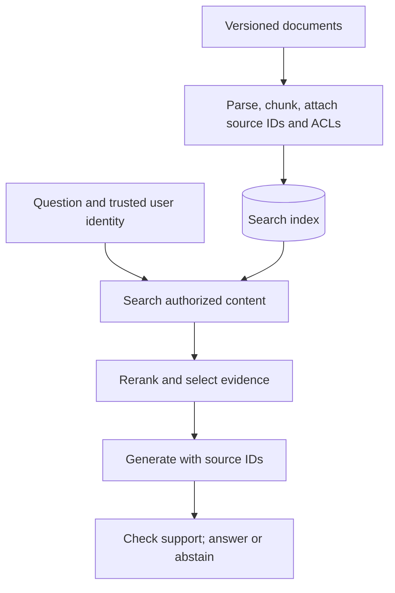
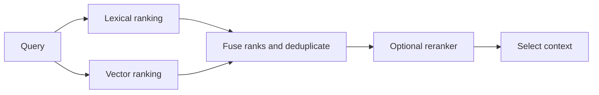

# Retrieval-Augmented Generation Questions and Answers

[Back to the README](../README.md) · [GenAI foundations](genai-foundations.md) · [Prompt engineering](prompt-engineering.md) · [Evaluation](evaluation.md)

These questions cover designing and diagnosing systems that answer using retrieved evidence. Engineers can practice the short answers; interviewers can use the examples and follow-ups to explore tradeoffs. Examples and proposed designs are illustrative. Vendor references demonstrate implementations, not universal API behavior.

## Contents

- [Architecture and data](#architecture-and-data): when to use RAG, ingestion, chunking, and embeddings.
- [Retrieval and context](#retrieval-and-context): hybrid search, reranking, query rewriting, and context selection.
- [Reliability and operations](#reliability-and-operations): grounding, access control, freshness, and diagnosis.
- [Advanced retrieval and structured data](#advanced-retrieval-and-structured-data)

## Architecture and data

### Question: 1. What is RAG, and when would you choose it over fine-tuning?

**Topic:** Architecture choices
**Difficulty:** Beginner

**Short answer:**
Retrieval-augmented generation supplies externally retrieved information to a model when answering. It is useful when answers require changing, private, or traceable knowledge.

**Explanation:**
Fine-tuning changes model behavior through training; RAG provides evidence through context. They can be combined. As a design guideline, start with retrieval for frequently updated facts and consider fine-tuning for recurring behavior or task-performance gaps. RAG adds retrieval dependencies and latency, and cannot guarantee a correct answer.

**Example:**
Retrieve the current employee travel policy rather than retraining a model whenever reimbursement limits change.

**Follow-up questions:**

- When would a direct database query or a small document in the prompt be simpler than a search pipeline?

**References:**

- [Lewis et al.: Retrieval-Augmented Generation for Knowledge-Intensive NLP Tasks](https://arxiv.org/abs/2005.11401)

### Question: 2. What are the main stages of a RAG pipeline?

**Topic:** System architecture
**Difficulty:** Beginner

**Short answer:**
Ingestion prepares searchable content. At request time, the system retrieves evidence, builds context, generates an answer, and checks the result.

**Explanation:**
A typical ingestion path parses documents, splits them into chunks, attaches metadata, and builds lexical or vector indexes. A request path retrieves authorized candidates, optionally reranks them, and passes selected passages with source identifiers to the generator. Preserve document versions and provenance so errors can be traced back to source content.

**Example:**
A support assistant indexes product manuals and returns answers with links to the sections used.

**Visual: Ingestion and answering paths**

The index is built ahead of queries. Enforce current access policy before evidence enters model context. Concept reference: [Microsoft: RAG architecture](https://learn.microsoft.com/en-us/azure/search/retrieval-augmented-generation-overview).

**Video comparison:**

[Simplilearn, near 20:00](https://www.youtube.com/watch?v=j5FU7kOGrsU&t=1200s): compare the slide’s ingestion and query paths with the diagram above. The interview answer must also address authorization, freshness, and evidence checking. This is a 320 × 180 public preview frame; open the video for readable slide details. [Attribution and reuse notice](../assets/third-party/README.md).

**Follow-up questions:**

- Which stages would you inspect if the answer cites the right document but the wrong product version?

**References:**

- [Microsoft: RAG architecture in Azure AI Search](https://learn.microsoft.com/en-us/azure/search/retrieval-augmented-generation-overview)

### Question: 3. How do you choose chunk size and overlap?

**Topic:** Document preparation
**Difficulty:** Intermediate

**Short answer:**
Choose chunks that preserve useful meaning while remaining specific enough to retrieve and small enough to fit the context budget. Tune overlap using representative questions.

**Explanation:**
Small chunks can lose definitions or qualifications; large chunks can dilute relevance. Overlap preserves boundary context but increases storage, duplicate results, and prompt tokens. Prefer meaningful boundaries where possible, retain section titles, and keep table headers with their values. There is no universally best token count.

**Example:**
Keep a policy rule and its exception together instead of splitting precisely between them at a fixed character boundary.

**Visual:**

Overlap preserves some boundary context while duplicating indexed text; it does not guarantee semantic completeness. Concept reference: [Microsoft: chunking documents](https://learn.microsoft.com/en-us/azure/search/vector-search-how-to-chunk-documents).

**Follow-up questions:**

- How would you compare chunking strategies without changing the embedding model at the same time?

**References:**

- [Microsoft: Chunking documents](https://learn.microsoft.com/en-us/azure/search/vector-search-how-to-chunk-documents)

### Question: 4. What makes an embedding model suitable for retrieval?

**Topic:** Semantic search
**Difficulty:** Intermediate

**Short answer:**
It should rank useful passages highly for the actual queries, language, and domain, within the system's latency and storage constraints.

**Explanation:**
Query and document encoders must produce compatible representations; some models use different query and document instructions. Match the model's expected similarity metric and normalization. Equal vector dimensions do not make two models' embedding spaces interchangeable. When changing models, rebuild affected embeddings and validate retrieval before switching traffic.

**Example:**
Evaluate whether short support questions retrieve the correct long manual sections, rather than testing only similarity between equally sized sentences.

**Follow-up questions:**

- Why might a high cosine similarity still retrieve a passage that cannot answer the question?

**References:**

- [Sentence Transformers: Semantic search](https://www.sbert.net/examples/sentence_transformer/applications/semantic-search/README.html)

## Retrieval and context

### Question: 5. How do lexical, dense, and hybrid retrieval differ?

**Topic:** Retrieval strategies
**Difficulty:** Intermediate

**Short answer:**
Lexical retrieval matches terms, dense retrieval compares learned vectors, and hybrid retrieval combines signals from both.

**Explanation:**
BM25 is useful for exact identifiers and terminology; dense search can find relevant paraphrases. Hybrid systems can merge ranked lists using reciprocal rank fusion, avoiding a naive addition of incompatible raw scores. Benefits depend on the corpus and queries, so compare against each individual retriever.

**Example:**
A query about “ERR-1042 connection failure” benefits from matching the exact code and related explanations such as “handshake timeout.”

**Visual: Hybrid retrieval**

Both branches search eligible content. Rank fusion can combine lists whose raw relevance scores are not directly comparable. Concept reference: [Microsoft: hybrid search](https://learn.microsoft.com/en-us/azure/search/hybrid-search-overview).

**Follow-up questions:**

- Why might dense retrieval struggle with a newly introduced product code?

**References:**

- [Microsoft: Hybrid search](https://learn.microsoft.com/en-us/azure/search/hybrid-search-overview)

### Question: 6. Why use a reranker after retrieval?

**Topic:** Ranking quality
**Difficulty:** Intermediate

**Short answer:**
A reranker applies a more expensive relevance model to a limited candidate set, improving the ordering before context is assembled.

**Explanation:**
A bi-encoder supports fast retrieval using separately encoded queries and documents. A cross-encoder scores each query-document pair jointly, often improving relevance at additional computational cost. Reranking cannot recover evidence that was never retrieved. Tune candidate count and final context size separately.

**Example:**
Retrieve 50 candidates, rerank them, then supply the five most useful nonduplicate passages. These counts are illustrative, not defaults.

**Follow-up questions:**

- How would you tell whether low answer quality comes from candidate recall or reranking?

**References:**

- [Sentence Transformers: Retrieve and rerank](https://www.sbert.net/examples/sentence_transformer/applications/retrieve_rerank/README.html)

### Question: 7. When should you rewrite or decompose a retrieval query?

**Topic:** Query preparation
**Difficulty:** Intermediate

**Short answer:**
Rewrite when conversational wording obscures the search intent; decompose when answering requires distinct pieces of evidence.

**Explanation:**
A rewrite can resolve references from conversation history or express the request in searchable terms. Multiple queries can improve coverage but add latency and noise. Preserve names, dates, negations, and constraints, and do not treat a generated expansion as established fact. Compare rewritten retrieval with the original-query baseline.

**Example:**
After discussing Product A, rewrite “Does it work offline?” to “Product A offline support,” without assuming the answer is yes.

**Follow-up questions:**

- How would you detect a rewrite that silently changes the user's question?

**References:**

- [Ma et al.: Query Rewriting for Retrieval-Augmented Large Language Models](https://arxiv.org/abs/2305.14283)

### Question: 8. Why not put every retrieved document into the prompt?

**Topic:** Context selection
**Difficulty:** Intermediate

**Short answer:**
Extra context costs tokens and can introduce duplication, distraction, or contradictions. Select enough evidence to answer while preserving the relevant qualifications.

**Explanation:**
Budget for instructions, history, evidence, and output. Deduplicate passages and retain source identifiers. Research has found sensitivity to where evidence appears in long contexts; test placement for the chosen model and workload. A larger context window does not guarantee reliable use of all supplied material.

**Example:**
Use the applicable policy section and its exception instead of filling the prompt with repeated navigation text and obsolete versions.

**Follow-up questions:**

- How can aggressive summarization remove evidence needed for a correct answer?

**References:**

- [Liu et al.: Lost in the Middle](https://arxiv.org/abs/2307.03172)

## Reliability and operations

### Question: 9. What do grounding, citations, and abstention contribute?

**Topic:** Evidence-based answers
**Difficulty:** Intermediate

**Short answer:**
Grounding ties claims to evidence, citations identify that evidence, and abstention avoids unsupported answers when the evidence is insufficient.

**Explanation:**
A citation's presence does not prove that it supports the nearby claim. Check both citation support and coverage of substantive claims. As a design practice, ask for missing-information or conflicting-source responses when appropriate, and validate cited identifiers against retrieved sources. A faithful answer can still be wrong if its source is outdated.

**Example:**
If a document gives a warranty period but no refund policy, answer the warranty question and acknowledge the refund information is missing.

**Follow-up questions:**

- How would you measure whether abstention reduces errors without rejecting too many answerable questions?

**References:**

- [Gao et al.: Enabling Large Language Models to Generate Text with Citations](https://arxiv.org/abs/2305.14627)

### Question: 10. How do you protect access-controlled content in RAG?

**Topic:** Authorization
**Difficulty:** Advanced

**Short answer:**
Enforce access in the application and retrieval layer using trusted identity and document permissions before content reaches an unauthorized user's model context.

**Explanation:**
Propagate access metadata to chunks and apply it to every retrieval path. A user-supplied identity string is not authentication. Scope caches and stored conversation context appropriately, and handle revoked access. Prompt instructions to keep secrets are not an authorization mechanism; output filtering is too late if restricted evidence has already been exposed.

**Example:**
An employee assistant retrieves only documents permitted for the authenticated employee's groups, including during query expansion.

**Follow-up questions:**

- How could a shared answer cache bypass otherwise correct retrieval permissions?

**References:**

- [Microsoft: Security filtering pattern](https://learn.microsoft.com/en-us/azure/search/search-security-trimming-for-azure-search)

### Question: 11. How do you keep a RAG index fresh and handle deletions?

**Topic:** Index lifecycle
**Difficulty:** Intermediate

**Short answer:**
Track source versions, update changed content, propagate deletions to all derived chunks, and measure how long those changes take to become searchable.

**Explanation:**
Deleting a source does not necessarily delete its indexed representation automatically. Use stable document-to-chunk mappings and explicit deletion handling. As an operational design, invalidate affected caches, retry failed updates safely, and check that superseded chunks disappear. Version embedding and chunking configurations so migrations can be tested and rolled back.

**Example:**
When a manual is withdrawn, remove its chunks from lexical and vector indexes and invalidate answers cached from that version.

**Follow-up questions:**

- How would you detect an ingestion job that succeeded for new content but left old chunks behind?

**References:**

- [Microsoft: Detecting changed and deleted source content](https://learn.microsoft.com/en-us/azure/search/search-how-to-index-azure-blob-changed-deleted)

### Question: 12. How would you diagnose an incorrect RAG answer?

**Topic:** Failure analysis
**Difficulty:** Advanced

**Short answer:**
Check whether the source contains the answer, whether retrieval found it, whether context retained it, and whether generation used it correctly.

**Explanation:**
Use stage-level evaluation instead of changing the prompt blindly. A useful diagnostic experiment supplies known relevant evidence: if the answer improves, inspect retrieval and context selection; if not, inspect instructions and generation. Keep the question and model configuration fixed. This experiment helps localize a failure but does not replace end-to-end evaluation.

**Example:**
If the correct exception appears in retrieved candidates but is absent from the final prompt, investigate context assembly before replacing the embedding model.

**Follow-up questions:**

- What traces would you capture to reproduce the failure without retaining unnecessary sensitive content?

**References:**

- [Es et al.: Ragas and component-level RAG evaluation](https://arxiv.org/abs/2309.15217)

Continue with [prompt engineering](prompt-engineering.md) and [evaluation](evaluation.md).

## Advanced retrieval and structured data

### Question: 13. Why retrieve a small chunk but give the generator a larger parent passage?

**Topic:** Hierarchical retrieval
**Difficulty:** Intermediate

**Short answer:**
Small chunks can match a specific question precisely, while an associated parent passage supplies definitions and surrounding context.

**Explanation:**
Index child chunks with stable parent IDs and keep parent text in a document store. Retrieve children, deduplicate parents, enforce current permissions on expanded content, and select context within a token budget. Expanding every hit can reintroduce irrelevant material or exceed the budget. Compare against fixed chunks on evidence coverage and answer quality.

**Example:**
A child chunk mentions a cancellation fee, while its parent section includes the exception and effective date. The answer needs both the match and its qualifying context.

**Visual:**

Parent expansion is subject to permissions and a context budget; it is not automatic access to the full document. The primary references below support the concept.

**Follow-up questions:**

- What if a parent contains sections the user is not authorized to read?

**References:**

- [MongoDB: parent document retrieval with LangChain](https://www.mongodb.com/docs/atlas/ai-integrations/langchain/parent-document-retrieval/)

### Question: 14. How does reciprocal rank fusion combine retrieval results?

**Topic:** Rank fusion
**Difficulty:** Intermediate

**Short answer:**
RRF sums reciprocal contributions from each result’s rank in multiple lists, so it can combine rankings without comparing raw scores directly.

**Explanation:**
A common form is score(d) = sum 1 / (c + rank_i(d)), with ranks starting at one and a positive smoothing constant c. A missing result contributes zero from that list. Deduplicate document identities and apply eligibility rules consistently. The constant controls rank sensitivity and is not the requested number of results. Fusion cannot recover relevant documents absent from every candidate list.

**Example:**
With c = 60, a document ranked first lexically and second semantically scores 1/61 + 1/62 ≈ 0.0325. A document appearing only at rank one scores about 0.0164.

**Visual:**

Hypothetical rankings with c = 60; the shared top candidate gains evidence from both lists. The primary references below support the concept.

**Follow-up questions:**

- Why can adding a low-quality retrieval branch hurt despite using rank fusion?

**References:**

- [Microsoft: reciprocal rank fusion](https://learn.microsoft.com/en-us/azure/search/hybrid-search-ranking)

### Question: 15. When is graph-based retrieval worth its additional complexity?

**Topic:** Graph retrieval
**Difficulty:** Advanced

**Short answer:**
Consider it when questions depend on relationships or corpus-wide structure that isolated passages do not capture well.

**Explanation:**
A knowledge graph represents entities and relationships; retrieval can traverse connections and return supporting evidence. Microsoft GraphRAG also uses extracted structure and community summaries for some broader questions. Extraction errors, entity resolution, update cost, and summary provenance become additional failure modes. A graph edge is not automatically a verified fact. Compare a graph approach with simpler hybrid retrieval on the actual question set.

**Example:**
To explain which projects depend on a retiring service, traverse documented dependency links and cite their source records. For a single policy lookup, ordinary retrieval may be sufficient.

**Visual:**

A hypothetical dependency graph. Edges require evidence and may be incomplete or incorrect. The primary references below support the concept.

**Follow-up questions:**

- How would you invalidate a summary after a supporting source is deleted?

**References:**

- [Microsoft: GraphRAG overview](https://microsoft.github.io/graphrag/)

### Question: 16. How would you make natural-language-to-SQL answers trustworthy?

**Topic:** Structured data retrieval
**Difficulty:** Advanced

**Short answer:**
Treat generated SQL as an untrusted proposal, restrict what the database identity can do, and validate both execution safety and business meaning.

**Explanation:**
Retrieve relevant schema and approved metric definitions, then generate a query against a least-privilege read-only role. Apply parsing and policy checks, parameterize literal values where feasible, enforce row-level access, and limit runtime and result size. Valid SQL can still use the wrong join, grain, date boundary, or metric. Ambiguous requests should trigger clarification; successful execution is not proof of correctness.

**Example:**
“Revenue last month” requires an agreed revenue definition, reporting timezone, and treatment of refunds. Review those semantics before interpreting a query result.

**Visual:**

Illustrative controls; enforcement must reside in trusted services and database permissions. The primary references below support the concept.

**Follow-up questions:**

- Why is checking that a statement starts with SELECT insufficient?

**References:**

- [LangChain: SQL agent and database permission guidance](https://docs.langchain.com/oss/python/langchain/sql-agent)

### Question: 17. What must change when you replace an embedding model?

**Topic:** Index migrations
**Difficulty:** Advanced

**Short answer:**
Re-embed the corpus and route queries to the matching embedding model and index version; matching vector dimensions alone is insufficient.

**Explanation:**
Different encoders can create incompatible coordinate spaces. Version the encoder, preprocessing, normalization, distance metric, and corpus snapshot. Build a parallel index, evaluate retrieval quality and latency, then switch query routing and index selection together with a rollback path. Similarity thresholds and caches may also need revalidation. A staged migration is an engineering pattern, not a guarantee from the embedding library.

**Example:**
A new 768-dimensional encoder cannot safely query old 768-dimensional document vectors merely because the shapes match.

**Visual:**

A hypothetical migration: keep model/index pairs compatible throughout rollout and rollback. The primary references below support the concept.

**Follow-up questions:**

- How would you migrate while documents continue to change?

**References:**

- [Sentence Transformers: semantic search](https://www.sbert.net/examples/sentence_transformer/applications/semantic-search/README.html)
