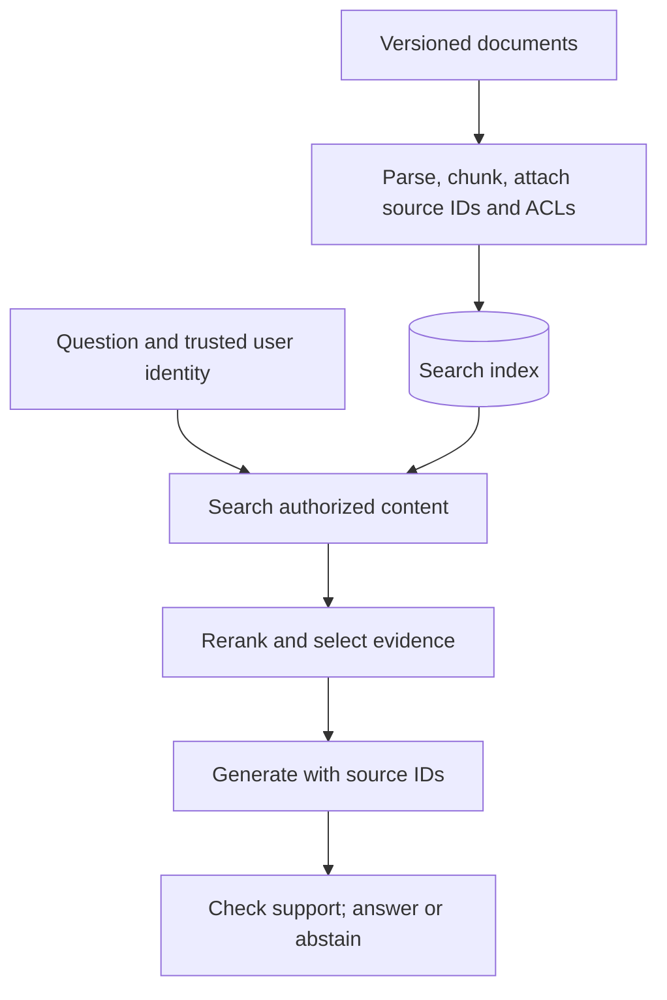
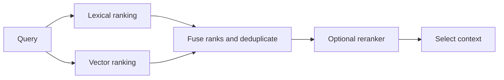
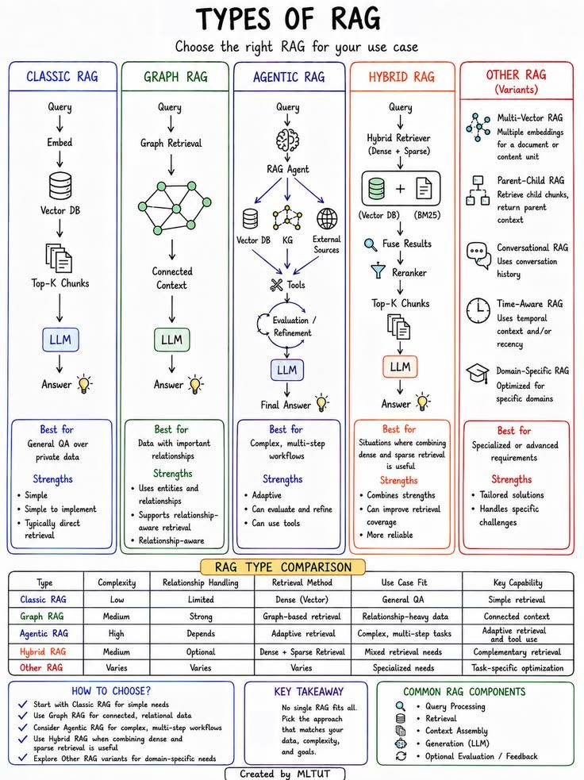

# Retrieval-Augmented Generation Questions and Answers

[Back to the README](../README.md) · [Terminology glossary](../GLOSSARY.md) · [GenAI foundations](genai-foundations.md) · [Prompt engineering](prompt-engineering.md) · [Evaluation](evaluation.md)

These questions cover designing and diagnosing systems that answer using retrieved evidence. Engineers can practice the short answers; interviewers can use the examples and follow-ups to explore tradeoffs. Examples and proposed designs are illustrative. Vendor references demonstrate implementations, not universal API behavior.

Each question includes a short answer, a plain-language explanation with an analogy, an advanced answer with technical detail, metrics or checks, at least two examples, and a quick cheat sheet. Numerical examples are illustrative, not benchmark results or universal targets. Use the [cross-topic cheat sheet](../CHEAT_SHEET.md) for quick revision.

## Contents

- [Architecture and data](#architecture-and-data): when to use RAG, ingestion, chunking, and embeddings.
- [Retrieval and context](#retrieval-and-context): hybrid search, reranking, query rewriting, and context selection.
- [Reliability and operations](#reliability-and-operations): grounding, access control, freshness, and diagnosis.
- [Advanced retrieval and structured data](#advanced-retrieval-and-structured-data)
- [RAG architecture types](#rag-architecture-types): eight overlapping approaches, selection criteria, and an illustrated comparison.

## Architecture and data

## Question: 1. What is RAG, and when would you choose it over fine-tuning?

**Topic:** Architecture choices
**Difficulty:** Beginner

**Key terms:** [Retrieval-augmented generation (RAG)](../GLOSSARY.md#retrieval-augmented-generation-rag) · [Fine-tuning](../GLOSSARY.md#fine-tuning) · [Gold-context evaluation](../GLOSSARY.md#gold-context-evaluation)

**Short answer:**
Retrieval-augmented generation supplies externally retrieved information to a model when answering. It is useful when answers require changing, private, or traceable knowledge.

**Simple answer and analogy:**

**In plain language:** RAG gives the model relevant documents to consult while answering. Fine-tuning changes the model's learned behavior. Use the right approach for the reason it is failing.

**Analogy:** An employee can read today's policy handbook or attend training on how to handle customers. The handbook supplies changing facts; training shapes behavior. Teaching a response style does not replace checking the current refund rule.

**Advanced answer and AI/maths:**
Fine-tuning changes model behavior through training; RAG provides evidence through context. They can be combined. As a design guideline, start with retrieval for frequently updated facts and consider fine-tuning for recurring behavior or task-performance gaps. RAG adds retrieval dependencies and latency, and cannot guarantee a correct answer.

RAG keeps reference information outside model weights and retrieves it at request time. This supports updates, provenance, and access filtering, but introduces ingestion and retrieval failures that fine-tuning does not solve. Fine-tuning is often better suited to repeatable behavior or format adaptation; the two approaches can be combined. First determine whether failures come from unavailable facts or from the model's inability to use information it already receives.

**Metrics and checks:** Compare answer correctness with and without gold evidence, retrieval recall, freshness lag, and cost per supported answer. Gold-context evaluation isolates generation from retrieval failure.

**Examples:**

**Example 1:**
Retrieve the current employee travel policy rather than retraining a model whenever reimbursement limits change.

**Example 2:**
An employee assistant should retrieve this month's benefits policy, while fine-tuning might teach a consistent response format. Retraining weights whenever a policy changes would create an unnecessary update bottleneck.

**Quick Cheat Sheet:**

| Cue | Remember |
| --- | --- |
| **RAG** | supply external evidence |
| **Fine-tuning** | adapt learned behavior |
| **Diagnosis** | missing knowledge versus poor use |

**Follow-up questions:**

- When would a direct database query or a small document in the prompt be simpler than a search pipeline?

**References:**

- [Lewis et al.: Retrieval-Augmented Generation for Knowledge-Intensive NLP Tasks](https://arxiv.org/abs/2005.11401)

## Question: 2. What are the main stages of a RAG pipeline?

**Topic:** System architecture
**Difficulty:** Beginner

**Key terms:** [Retrieval-augmented generation (RAG)](../GLOSSARY.md#retrieval-augmented-generation-rag) · [Ingestion and indexing](../GLOSSARY.md#ingestion-and-indexing) · [Chunk and overlap](../GLOSSARY.md#chunk-and-overlap) · [Embedding](../GLOSSARY.md#embedding)

**Short answer:**
Ingestion prepares searchable content. At request time, the system retrieves evidence, builds context, generates an answer, and checks the result.

**Simple answer and analogy:**

**In plain language:** A RAG system prepares documents for search, finds useful evidence for a question, gives it to the model, and checks the resulting answer. A failure at any stage can affect the result.

**Analogy:** A librarian catalogs books, selects relevant pages for your question, and helps you write a sourced answer. If a page was scanned incorrectly or the wrong edition was chosen, elegant writing cannot repair that missing foundation.

**Advanced answer and AI/maths:**
A typical ingestion path parses documents, splits them into chunks, attaches metadata, and builds lexical or vector indexes. A request path retrieves authorized candidates, optionally reranks them, and passes selected passages with source identifiers to the generator. Preserve document versions and provenance so errors can be traced back to source content.

An ingestion path extracts, normalizes, chunks, enriches, embeds, and indexes source material. A query path authenticates the user, retrieves authorized candidates, optionally reranks, builds context, and generates a supported answer. Version documents and transformations so an answer can be traced to the source actually used. Treat parsing failures and stale indexes as observable production conditions rather than invisible preprocessing details.

**Metrics and checks:** Measure ingestion success, source-to-index lag, retrieval recall, reranking lift, answer support, and latency per stage. End-to-end success can fail even when each individual stage looks reasonable in isolation.

**Examples:**

**Example 1:**
A support assistant indexes product manuals and returns answers with links to the sections used.

**Visual: Ingestion and answering paths**

The index is built ahead of queries. Enforce current access policy before evidence enters model context. Concept reference: [Microsoft: RAG architecture](https://learn.microsoft.com/en-us/azure/search/retrieval-augmented-generation-overview).

**Example 2:**
A scanned table may be parsed in the wrong reading order, causing a correct search result to supply incorrect evidence. Fixing the parser is more useful than increasing the model size.

**Video comparison:**

[Simplilearn, near 20:00](https://www.youtube.com/watch?v=j5FU7kOGrsU&t=1200s): compare the slide’s ingestion and query paths with the diagram above. The interview answer must also address authorization, freshness, and evidence checking. This is a 320 × 180 public preview frame; open the video for readable slide details. [Attribution and reuse notice](../assets/third-party/README.md).

**Quick Cheat Sheet:**

| Cue | Remember |
| --- | --- |
| **Ingest** | make searchable evidence |
| **Retrieve** | find authorized relevance |
| **Generate** | answer with verifiable support |

**Follow-up questions:**

- Which stages would you inspect if the answer cites the right document but the wrong product version?

**References:**

- [Microsoft: RAG architecture in Azure AI Search](https://learn.microsoft.com/en-us/azure/search/retrieval-augmented-generation-overview)

## Question: 3. How do you choose chunk size and overlap?

**Topic:** Document preparation
**Difficulty:** Intermediate

**Key terms:** [Chunk and overlap](../GLOSSARY.md#chunk-and-overlap) · [Token and tokenizer](../GLOSSARY.md#token-and-tokenizer) · [Precision@k and recall@k](../GLOSSARY.md#precisionk-and-recallk)

**Short answer:**
Choose chunks that preserve useful meaning while remaining specific enough to retrieve and small enough to fit the context budget. Tune overlap using representative questions.

**Simple answer and analogy:**

**In plain language:** Break documents into pieces that are easy to find without separating a statement from the context needed to interpret it. Some overlap can protect sentences near boundaries.

**Analogy:** Cutting a cookbook into individual lines makes each line easy to store but may separate “bake for 20 minutes” from the oven temperature. Keeping entire books together has the opposite problem: too much unrelated material to search and read.

**Advanced answer and AI/maths:**
Small chunks can lose definitions or qualifications; large chunks can dilute relevance. Overlap preserves boundary context but increases storage, duplicate results, and prompt tokens. Prefer meaningful boundaries where possible, retain section titles, and keep table headers with their values. There is no universally best token count.

Chunking determines what can be retrieved and how much surrounding context accompanies it. Small chunks can improve specificity but lose definitions and exceptions; large chunks preserve context but dilute similarity and consume more tokens. Overlap reduces boundary loss while duplicating storage and repeated evidence. Respect document structure where useful, and keep identifiers connecting chunks to parent sections and source versions.

**Metrics and checks:** Sweep chunk size and overlap against evidence recall, answer quality, index size, and context tokens. Compare at a controlled context budget rather than letting one setting supply much more text.

**Examples:**

**Example 1:**
Keep a policy rule and its exception together instead of splitting precisely between them at a fixed character boundary.

**Example 2:**
A warranty rule and its exclusion may fall on opposite sides of a fixed boundary. Section-aware chunks or parent expansion can preserve the relationship better than simply retrieving more overlapping fragments.

**Visual:**

Overlap preserves some boundary context while duplicating indexed text; it does not guarantee semantic completeness. Concept reference: [Microsoft: chunking documents](https://learn.microsoft.com/en-us/azure/search/vector-search-how-to-chunk-documents).

**Quick Cheat Sheet:**

| Cue | Remember |
| --- | --- |
| **Small** | precise but context-poor |
| **Large** | contextual but expensive |
| **Overlap** | boundary protection with duplication |

**Follow-up questions:**

- How would you compare chunking strategies without changing the embedding model at the same time?

**References:**

- [Microsoft: Chunking documents](https://learn.microsoft.com/en-us/azure/search/vector-search-how-to-chunk-documents)

## Question: 4. What makes an embedding model suitable for retrieval?

**Topic:** Semantic search
**Difficulty:** Intermediate

**Key terms:** [Embedding](../GLOSSARY.md#embedding) · [Dot product and cosine similarity](../GLOSSARY.md#dot-product-and-cosine-similarity) · [Vector index and approximate nearest neighbors](../GLOSSARY.md#vector-index-and-approximate-nearest-neighbors)

**Short answer:**
An embedding model maps queries and documents into comparable learned vectors. It is suitable when that representation retrieves relevant evidence for the actual language, domain, and query types within latency and storage limits.

**Simple answer and analogy:**

**In plain language:** A good embedding model brings genuinely relevant documents close to the query in its numerical representation. Suitability depends on the actual language and subject matter.

**Analogy:** A filing system arranged by everyday topics may work for general questions but confuse two medical terms or nearly identical product codes. The best filing system is the one that helps find the evidence your users actually need.

**Advanced answer and AI/maths:**
Query and document encoders must produce compatible representations; some models use different query and document instructions. Match the model's expected similarity metric and normalization. Equal vector dimensions do not make two models' embedding spaces interchangeable. When changing models, rebuild affected embeddings and validate retrieval before switching traffic.

An embedding model must represent the distinctions that matter for the corpus and queries. Check language, terminology, maximum input length, query/document formatting, and licensing or deployment constraints. Benchmark on labeled queries with relevant evidence, including difficult negatives that share vocabulary. Changing the embedding model changes the coordinate system, so mixing incompatible query and document vectors generally invalidates similarity comparisons.

**Metrics and checks:** Track recall@k, ranking metrics, embedding throughput, dimension-dependent storage, and downstream answer quality. Evaluate exact search first where feasible to separate representation quality from approximate-index loss.

**Examples:**

**Example 1:**
Evaluate whether short support questions retrieve the correct long manual sections, rather than testing only similarity between equally sized sentences.

**Example 2:**
A general model may confuse similar product codes while a domain-adapted representation distinguishes them. Exact identifier lookup can still outperform semantic search for serial numbers and SKUs.

**Quick Cheat Sheet:**

| Cue | Remember |
| --- | --- |
| **Domain** | test actual terminology |
| **Compatibility** | query and document spaces must match |
| **Benchmark** | relevance before infrastructure optimization |

**Follow-up questions:**

- Why might a high cosine similarity still retrieve a passage that cannot answer the question?

**References:**

- [Sentence Transformers: Semantic search](https://www.sbert.net/examples/sentence_transformer/applications/semantic-search/README.html)

## Retrieval and context

## Question: 5. How do lexical, dense, and hybrid retrieval differ?

**Topic:** Retrieval strategies
**Difficulty:** Intermediate

**Key terms:** [Lexical retrieval and BM25](../GLOSSARY.md#lexical-retrieval-and-bm25) · [Dense and sparse retrieval](../GLOSSARY.md#dense-and-sparse-retrieval) · [Hybrid retrieval](../GLOSSARY.md#hybrid-retrieval) · [Reciprocal rank fusion (RRF)](../GLOSSARY.md#reciprocal-rank-fusion-rrf)

**Short answer:**
Lexical retrieval matches terms, dense retrieval compares learned vectors, and hybrid retrieval combines signals from both.

**Simple answer and analogy:**

**In plain language:** Keyword search finds matching words or codes. Dense search can find related meaning even with different wording. Hybrid search combines the two.

**Analogy:** Searching a library catalog for an exact book title is like keyword search. Asking a librarian for “stories about difficult journeys” is closer to meaning-based search. Using both can help, but the combined shortlist still needs checking.

**Advanced answer and AI/maths:**
BM25 is useful for exact identifiers and terminology; dense search can find relevant paraphrases. Hybrid systems can merge ranked lists using reciprocal rank fusion, avoiding a naive addition of incompatible raw scores. Benefits depend on the corpus and queries, so compare against each individual retriever.

Lexical retrieval rewards term matches and is strong for exact names, identifiers, and rare terms. Dense retrieval can recover semantic matches with different wording, but may blur distinctions such as negation or codes. Hybrid retrieval combines complementary signals, usually after normalization or rank fusion. Improvement is empirical: combining two redundant or poorly tuned systems can add cost without improving evidence coverage.

**Metrics and checks:** Compare lexical, dense, and hybrid recall@k on exact-match and paraphrase slices. Include latency and candidate overlap; aggregate scores can hide a regression on identifier-heavy queries.

**Examples:**

**Example 1:**
A query about “ERR-1042 connection failure” benefits from matching the exact code and related explanations such as “handshake timeout.”

**Visual: Hybrid retrieval**

Both branches search eligible content. Rank fusion can combine lists whose raw relevance scores are not directly comparable. Concept reference: [Microsoft: hybrid search](https://learn.microsoft.com/en-us/azure/search/hybrid-search-overview).

**Example 2:**
“Cannot sign in” may need semantic matching to “authentication failure,” while error code E1042 benefits from literal matching. A support corpus often contains both query types.

**Quick Cheat Sheet:**

| Cue | Remember |
| --- | --- |
| **Lexical** | exact terms |
| **Dense** | semantic similarity |
| **Hybrid** | combine complementary evidence |

**Follow-up questions:**

- Why might dense retrieval struggle with a newly introduced product code?

**References:**

- [Microsoft: Hybrid search](https://learn.microsoft.com/en-us/azure/search/hybrid-search-overview)

## Question: 6. Why use a reranker after retrieval?

**Topic:** Ranking quality
**Difficulty:** Intermediate

**Key terms:** [Reranker](../GLOSSARY.md#reranker) · [Precision@k and recall@k](../GLOSSARY.md#precisionk-and-recallk) · [DCG and nDCG](../GLOSSARY.md#dcg-and-ndcg)

**Short answer:**
A reranker reorders a retrieved candidate set using a relevance score, often from a more expensive model. It can improve context selection, but cannot recover relevant documents absent from the candidates.

**Simple answer and analogy:**

**In plain language:** A reranker takes an initial shortlist and puts the most relevant items nearer the top. It can improve the order, but cannot recover something absent from the shortlist.

**Analogy:** A hiring assistant selects 20 applications from a large pile, then a specialist reviews those 20 more carefully. The specialist cannot choose a great applicant whose application never reached their desk.

**Advanced answer and AI/maths:**
A bi-encoder supports fast retrieval using separately encoded queries and documents. A cross-encoder scores each query-document pair jointly, often improving relevance at additional computational cost. Reranking cannot recover evidence that was never retrieved. Tune candidate count and final context size separately.

A reranker scores query-candidate pairs more carefully after inexpensive retrieval narrows the search space. It can improve ordering but cannot recover relevant documents absent from the candidate pool. Larger candidate sets trade recall against reranking cost. Keep authorization filtering ahead of any model that must not see restricted content, and validate whether the reranker's training domain matches the evidence users need.

**Metrics and checks:** Measure candidate recall before reranking, nDCG or MRR after reranking, and added p95 latency. Compare final answer quality at the same number of context tokens.

**Examples:**

**Example 1:**
Retrieve 50 candidates, rerank them, then supply the five most useful nonduplicate passages. These counts are illustrative, not defaults.

**Example 2:**
A retriever finds ten policies mentioning refunds; a reranker prioritizes the policy for damaged goods because the query specifically describes damage. It cannot help if that policy was never retrieved.

**Quick Cheat Sheet:**

| Cue | Remember |
| --- | --- |
| **Retrieve** | maximize useful candidates |
| **Rerank** | improve their order |
| **Limit** | cannot rescue absent evidence |

**Follow-up questions:**

- How would you tell whether low answer quality comes from candidate recall or reranking?

**References:**

- [Sentence Transformers: Retrieve and rerank](https://www.sbert.net/examples/sentence_transformer/applications/retrieve_rerank/README.html)

## Question: 7. When should you rewrite or decompose a retrieval query?

**Topic:** Query preparation
**Difficulty:** Intermediate

**Key terms:** [Query rewriting and decomposition](../GLOSSARY.md#query-rewriting-and-decomposition) · [Context window](../GLOSSARY.md#context-window) · [Token and tokenizer](../GLOSSARY.md#token-and-tokenizer)

**Short answer:**
Rewrite when conversational wording obscures the search intent; decompose when answering requires distinct pieces of evidence.

**Simple answer and analogy:**

**In plain language:** Sometimes the search question needs clearer wording or needs splitting into smaller questions. Preserve what the user meant while making the evidence easier to find.

**Analogy:** If someone asks “Does that apply abroad?”, a librarian first needs to know what “that” refers to. If they ask to compare two countries' rules, two focused searches may work better than one vague search.

**Advanced answer and AI/maths:**
A rewrite can resolve references from conversation history or express the request in searchable terms. Multiple queries can improve coverage but add latency and noise. Preserve names, dates, negations, and constraints, and do not treat a generated expansion as established fact. Compare rewritten retrieval with the original-query baseline.

Query rewriting resolves conversational references or changes wording to improve search; decomposition breaks a multi-part request into evidence needs. Preserve constraints such as dates, entities, and negations. Generated rewrites can drift from user intent, so retain the original query and compare retrieval behavior. Multi-query approaches also need deduplication and a budget to prevent query expansion from becoming uncontrolled fan-out.

**Metrics and checks:** Measure evidence recall and answer correctness before/after rewriting, plus query count and retrieval latency. Track entity/date preservation and whether expanded queries introduce unsupported assumptions.

**Examples:**

**Example 1:**
After discussing Product A, rewrite “Does it work offline?” to “Product A offline support,” without assuming the answer is yes.

**Example 2:**
“Does that apply in France?” needs the earlier topic restored before retrieval. “Compare the 2024 and 2025 policies” may require separate version-specific searches rather than one broad similarity query.

**Quick Cheat Sheet:**

| Cue | Remember |
| --- | --- |
| **Rewrite** | preserve intent |
| **Decompose** | separate evidence needs |
| **Budget** | cap expansion and deduplicate |

**Follow-up questions:**

- How would you detect a rewrite that silently changes the user's question?

**References:**

- [Ma et al.: Query Rewriting for Retrieval-Augmented Large Language Models](https://arxiv.org/abs/2305.14283)

## Question: 8. Why not put every retrieved document into the prompt?

**Topic:** Context selection
**Difficulty:** Intermediate

**Key terms:** [Chunk and overlap](../GLOSSARY.md#chunk-and-overlap) · [Context window](../GLOSSARY.md#context-window) · [Correctness and faithfulness](../GLOSSARY.md#correctness-and-faithfulness)

**Short answer:**
Extra context costs tokens and can introduce duplication, distraction, or contradictions. Select enough evidence to answer while preserving the relevant qualifications.

**Simple answer and analogy:**

**In plain language:** More documents are not always better. Duplicate, irrelevant, or conflicting material can bury the evidence needed for the answer and increase processing cost.

**Analogy:** To check a warranty, a folder containing the warranty and its exceptions is more useful than a wheelbarrow of brochures. The goal is enough good evidence, not the largest possible pile of paper.

**Advanced answer and AI/maths:**
Budget for instructions, history, evidence, and output. Deduplicate passages and retain source identifiers. Research has found sensitivity to where evidence appears in long contexts; test placement for the chosen model and workload. A larger context window does not guarantee reliable use of all supplied material.

Context assembly is a selection problem under token, attention, and security constraints. Duplicate or weakly related passages can crowd out decisive evidence and confuse attribution. Prefer diverse, directly relevant evidence with source identifiers and enough surrounding qualifications. Evidence compression should preserve exceptions and provenance; summarizing a passage can accidentally remove the condition that makes its statement true.

**Metrics and checks:** Track unique evidence coverage, context-token utilization, unsupported claims, and answer quality as more passages are added. More retrieved text is not automatically a better experimental condition.

**Examples:**

**Example 1:**
Use the applicable policy section and its exception instead of filling the prompt with repeated navigation text and obsolete versions.

**Example 2:**
Five near-duplicate marketing pages can displace one technical limitation document. Deduplication and source diversity may improve the answer while reducing both input tokens and latency.

**Quick Cheat Sheet:**

| Cue | Remember |
| --- | --- |
| **Select** | relevance and coverage |
| **Deduplicate** | repeated text wastes budget |
| **Preserve** | conditions and provenance |

**Follow-up questions:**

- How can aggressive summarization remove evidence needed for a correct answer?

**References:**

- [Liu et al.: Lost in the Middle](https://arxiv.org/abs/2307.03172)

## Reliability and operations

## Question: 9. What do grounding, citations, and abstention contribute?

**Topic:** Evidence-based answers
**Difficulty:** Intermediate

**Key terms:** [Correctness and faithfulness](../GLOSSARY.md#correctness-and-faithfulness) · [Citation validity and support](../GLOSSARY.md#citation-validity-and-support) · [Abstention and coverage](../GLOSSARY.md#abstention-and-coverage) · [Entailment](../GLOSSARY.md#entailment)

**Short answer:**
Grounding ties claims to evidence, citations identify that evidence, and abstention avoids unsupported answers when the evidence is insufficient.

**Simple answer and analogy:**

**In plain language:** Grounding means the answer's claims are backed by evidence. Citations show where that evidence is. Abstention means saying there is not enough support to answer reliably.

**Analogy:** A careful student points to the passage supporting a claim and says when the book does not answer the question. Merely adding a book title beside an invented statement does not make it well supported.

**Advanced answer and AI/maths:**
A citation's presence does not prove that it supports the nearby claim. Check both citation support and coverage of substantive claims. As a design practice, ask for missing-information or conflicting-source responses when appropriate, and validate cited identifiers against retrieved sources. A faithful answer can still be wrong if its source is outdated.

Grounding requires the answer's claims to be supported by the supplied evidence, not merely accompanied by plausible-looking citations. Citation validation should check that a cited source exists and supports the adjacent claim. Conflicting, incomplete, or stale evidence may justify a qualified response or abstention. Define whether the assistant may use outside knowledge, because that changes the meaning of faithfulness.

**Metrics and checks:** Measure claim-level support, citation precision, evidence coverage, and risk at different answer-coverage levels. Report abstentions separately rather than silently treating unanswered questions as correct.

**Examples:**

**Example 1:**
If a document gives a warranty period but no refund policy, answer the warranty question and acknowledge the refund information is missing.

**Example 2:**
A source may confirm that a product supports encryption but say nothing about a particular certification. Citing that source beside a certification claim is still unsupported.

**Quick Cheat Sheet:**

| Cue | Remember |
| --- | --- |
| **Grounding** | support each claim |
| **Citation** | location plus entailment |
| **Abstention** | insufficient evidence is a valid outcome |

**Follow-up questions:**

- How would you measure whether abstention reduces errors without rejecting too many answerable questions?

**References:**

- [Gao et al.: Enabling Large Language Models to Generate Text with Citations](https://arxiv.org/abs/2305.14627)

## Question: 10. How do you protect access-controlled content in RAG?

**Topic:** Authorization
**Difficulty:** Advanced

**Key terms:** [Authentication and authorization](../GLOSSARY.md#authentication-and-authorization) · [Tenant](../GLOSSARY.md#tenant) · [Authentication and authorization](../GLOSSARY.md#authentication-and-authorization) · [Response, semantic, and prefix caches](../GLOSSARY.md#response-semantic-and-prefix-caches)

**Short answer:**
Enforce access in the application and retrieval layer using trusted identity and document permissions before content reaches an unauthorized user's model context.

**Simple answer and analogy:**

**In plain language:** The system must retrieve only information the current user is allowed to see. That rule must hold for search results, expanded passages, and reused answers.

**Analogy:** A library assistant should not read a restricted personnel file aloud just because it answers a visitor's question. Checking access after the answer is spoken is too late. The same applies before private text reaches the model.

**Advanced answer and AI/maths:**
Propagate access metadata to chunks and apply it to every retrieval path. A user-supplied identity string is not authentication. Scope caches and stored conversation context appropriately, and handle revoked access. Prompt instructions to keep secrets are not an authorization mechanism; output filtering is too late if restricted evidence has already been exposed.

Authorization must constrain which evidence enters the retrieval and generation path. Apply tenant and document permissions consistently across indexes, caches, parent expansion, reranking, and citations. Post-generation redaction is insufficient if the model already received restricted text. Permission changes and deletions require propagation with observable lag, and cached answers need identities or entitlement scopes that prevent reuse across incompatible users.

**Metrics and checks:** Test cross-tenant and revoked-access cases, measure authorization-filter coverage and revocation lag, and audit retrieved document IDs. Evaluate leakage attempts as explicit security tests, not only average answer accuracy.

**Examples:**

**Example 1:**
An employee assistant retrieves only documents permitted for the authenticated employee's groups, including during query expansion.

**Example 2:**
Two employees ask the same salary question, but only one can access compensation records. A shared semantic-answer cache must not return the privileged employee's answer to the other.

**Quick Cheat Sheet:**

| Cue | Remember |
| --- | --- |
| **Filter** | before restricted evidence is exposed |
| **Propagate** | permissions through every stage |
| **Cache** | scope by effective access |

**Follow-up questions:**

- How could a shared answer cache bypass otherwise correct retrieval permissions?

**References:**

- [Microsoft: Security filtering pattern](https://learn.microsoft.com/en-us/azure/search/search-security-trimming-for-azure-search)

## Question: 11. How do you keep a RAG index fresh and handle deletions?

**Topic:** Index lifecycle
**Difficulty:** Intermediate

**Key terms:** [Freshness and deletion propagation](../GLOSSARY.md#freshness-and-deletion-propagation) · [Data provenance and lineage](../GLOSSARY.md#data-provenance-and-lineage) · [Ingestion and indexing](../GLOSSARY.md#ingestion-and-indexing) · [Time to live (TTL)](../GLOSSARY.md#time-to-live-ttl)

**Short answer:**
Track source versions, update changed content, propagate deletions to all derived chunks, and measure how long those changes take to become searchable.

**Simple answer and analogy:**

**In plain language:** When a source changes or disappears, update every searchable or cached copy that depends on it. Track how long this takes.

**Analogy:** If a restaurant changes its prices, replacing the kitchen's price list is not enough while old menus remain on tables and online. An updated search index can still produce stale answers if an answer cache holds yesterday's version.

**Advanced answer and AI/maths:**
Deleting a source does not necessarily delete its indexed representation automatically. Use stable document-to-chunk mappings and explicit deletion handling. As an operational design, invalidate affected caches, retry failed updates safely, and check that superseded chunks disappear. Version embedding and chunking configurations so migrations can be tested and rolled back.

Freshness is an end-to-end property of source detection, ingestion, indexing, caches, and answer generation. Use stable source identifiers and versions to replace stale chunks and remove deleted material, including derived summaries or embeddings. Incremental updates need retry-safe processing and reconciliation because events can be missed or duplicated. Define how the system behaves while different replicas or indexes temporarily disagree.

**Metrics and checks:** Measure source-to-searchable update lag, deletion propagation lag, stale-answer rate, and reconciliation discrepancies. State the reference timestamp when reporting freshness.

**Examples:**

**Example 1:**
When a manual is withdrawn, remove its chunks from lexical and vector indexes and invalidate answers cached from that version.

**Example 2:**
A refund policy changes at noon, but an answer cache retains yesterday's wording. Updating the vector index alone does not make responses fresh until dependent cached content is invalidated or versioned.

**Quick Cheat Sheet:**

| Cue | Remember |
| --- | --- |
| **Update** | replace all derived versions |
| **Delete** | remove derived access too |
| **Freshness** | weakest stale stage still matters |

**Follow-up questions:**

- How would you detect an ingestion job that succeeded for new content but left old chunks behind?

**References:**

- [Microsoft: Detecting changed and deleted source content](https://learn.microsoft.com/en-us/azure/search/search-how-to-index-azure-blob-changed-deleted)

## Question: 12. How would you diagnose an incorrect RAG answer?

**Topic:** Failure analysis
**Difficulty:** Advanced

**Key terms:** [Gold-context evaluation](../GLOSSARY.md#gold-context-evaluation) · [Precision@k and recall@k](../GLOSSARY.md#precisionk-and-recallk) · [Correctness and faithfulness](../GLOSSARY.md#correctness-and-faithfulness)

**Short answer:**
Check whether the source contains the answer, whether retrieval found it, whether context retained it, and whether generation used it correctly.

**Simple answer and analogy:**

**In plain language:** Follow the evidence through the system: was the right information available, found, included, and used correctly? Fix the stage that failed.

**Analogy:** If a meal is wrong, check the order, ingredients, preparation, and delivery instead of always blaming the chef. Giving the model the correct evidence directly is like handing the kitchen the right ingredients to isolate one part of the problem.

**Advanced answer and AI/maths:**
Use stage-level evaluation instead of changing the prompt blindly. A useful diagnostic experiment supplies known relevant evidence: if the answer improves, inspect retrieval and context selection; if not, inspect instructions and generation. Keep the question and model configuration fixed. This experiment helps localize a failure but does not replace end-to-end evaluation.

Debug from the source outward: verify the correct evidence exists, was parsed accurately, survived authorization filters, entered the candidate set, reached the prompt, and was used correctly. A gold-context experiment tests whether generation succeeds when retrieval is perfect. Separate wrong facts from unsupported claims and wrong calculations. This decomposition directs changes toward the failing stage instead of repeatedly modifying prompts without evidence.

**Metrics and checks:** Compare candidate recall, context evidence coverage, gold-context answer accuracy, and end-to-end accuracy. Use per-query traces so aggregate improvements do not conceal different failure mechanisms.

**Examples:**

**Example 1:**
If the correct exception appears in retrieved candidates but is absent from the final prompt, investigate context assembly before replacing the embedding model.

**Example 2:**
An answer can be wrong because the policy is missing from the index or because the model ignored a retrieved exception. The first needs ingestion work; the second needs context/use evaluation.

**Quick Cheat Sheet:**

| Cue | Remember |
| --- | --- |
| **Source** | does evidence exist? |
| **Retrieval** | did it arrive? |
| **Generation** | was it used correctly? |

**Follow-up questions:**

- What traces would you capture to reproduce the failure without retaining unnecessary sensitive content?

**References:**

- [Es et al.: Ragas and component-level RAG evaluation](https://arxiv.org/abs/2309.15217)

Continue with [prompt engineering](prompt-engineering.md) and [evaluation](evaluation.md).

## Advanced retrieval and structured data

## Question: 13. Why retrieve a small chunk but give the generator a larger parent passage?

**Topic:** Hierarchical retrieval
**Difficulty:** Intermediate

**Key terms:** [Parent-child and multi-vector retrieval](../GLOSSARY.md#parent-child-and-multi-vector-retrieval) · [Chunk and overlap](../GLOSSARY.md#chunk-and-overlap) · [Authentication and authorization](../GLOSSARY.md#authentication-and-authorization)

**Short answer:**
Small chunks can match a specific question precisely, while an associated parent passage supplies definitions and surrounding context.

**Simple answer and analogy:**

**In plain language:** Search with a small focused passage, then supply its surrounding section so the model sees the full meaning. Keep the added material relevant and authorized.

**Analogy:** A search may find the sentence “Cancellation is free,” but the next paragraph says “within 24 hours.” Retrieve the matching sentence to locate the rule, then read the surrounding section before answering.

**Advanced answer and AI/maths:**
Index child chunks with stable parent IDs and keep parent text in a document store. Retrieve children, deduplicate parents, enforce current permissions on expanded content, and select context within a token budget. Expanding every hit can reintroduce irrelevant material or exceed the budget. Compare against fixed chunks on evidence coverage and answer quality.

Parent-child retrieval indexes focused child passages but expands selected hits into larger parent sections for generation. This can combine precise matching with enough context to interpret definitions and exceptions. Keep stable child-parent mappings and recheck permissions on expanded content. Deduplicate parents when several children match, and bound expansion so a small hit does not bring an entire irrelevant document into context.

**Metrics and checks:** Compare child retrieval recall, parent expansion tokens, duplicate-context rate, and answer support. Measure whether expansion recovers necessary qualifications rather than merely increasing context length.

**Examples:**

**Example 1:**
A child chunk mentions a cancellation fee, while its parent section includes the exception and effective date. The answer needs both the match and its qualifying context.

**Example 2:**
A child paragraph matches “termination notice,” while its parent section contains different rules for annual and monthly contracts. Parent context prevents applying the wrong notice period.

**Visual:**

Parent expansion is subject to permissions and a context budget; it is not automatic access to the full document. The primary references below support the concept.

**Quick Cheat Sheet:**

| Cue | Remember |
| --- | --- |
| **Child** | precise search unit |
| **Parent** | interpretation context |
| **Expansion** | deduplicate and authorize |

**Follow-up questions:**

- What if a parent contains sections the user is not authorized to read?

**References:**

- [MongoDB: parent document retrieval with LangChain](https://www.mongodb.com/docs/atlas/ai-integrations/langchain/parent-document-retrieval/)

## Question: 14. How does reciprocal rank fusion combine retrieval results?

**Topic:** Rank fusion
**Difficulty:** Intermediate

**Key terms:** [Reciprocal rank fusion (RRF)](../GLOSSARY.md#reciprocal-rank-fusion-rrf) · [Hybrid retrieval](../GLOSSARY.md#hybrid-retrieval) · [Discrimination](../GLOSSARY.md#discrimination)

**Short answer:**
Reciprocal rank fusion (RRF) combines ranked lists by summing decreasing contributions from each item’s rank. It avoids comparing incompatible raw retrieval scores directly.

**Simple answer and analogy:**

**In plain language:** RRF combines several search-result lists using positions rather than comparing their raw scores. A document that ranks usefully in several lists can receive a stronger combined position.

**Analogy:** Two judges may score on different scales, such as out of 10 and out of 100. Combining their finishing orders avoids pretending those scores are directly comparable. Agreement still does not prove the chosen item is relevant.

**Advanced answer and AI/maths:**
A common form is score(d) = sum 1 / (c + rank_i(d)), with ranks starting at one and a positive smoothing constant c. A missing result contributes zero from that list. Deduplicate document identities and apply eligibility rules consistently. The constant controls rank sensitivity and is not the requested number of results. Fusion cannot recover relevant documents absent from every candidate list.

Reciprocal rank fusion combines rankings by summing a decreasing contribution from each list position. It avoids requiring raw scores from different retrievers to share a scale, but its rank constant and candidate depth still affect behavior. Deduplicate by stable document identity and decide how to treat multiple chunks from one source. Fusion cannot fix a systematic lack of relevant candidates across all retrievers.

**Metrics and checks:** A common score is sum over lists of 1/(c + rank), with ranks starting at 1 and absent items contributing zero. Tune c and retrieval depth on held-out relevance labels.

**Examples:**

**Example 1:**
With c = 60, a document ranked first lexically and second semantically scores 1/61 + 1/62 ≈ 0.0325. A document appearing only at rank one scores about 0.0164.

**Example 2:**
A passage ranked moderately by both lexical and dense retrieval can outrank a passage ranked highly by only one. Whether that consensus helps depends on the corpus and query mix.

**Visual:**

Hypothetical rankings with c = 60; the shared top candidate gains evidence from both lists. The primary references below support the concept.

**Quick Cheat Sheet:**

| Cue | Remember |
| --- | --- |
| **Input** | ranked lists |
| **Contribution** | reciprocal rank with smoothing |
| **Caution** | consensus is not proof of relevance |

**Follow-up questions:**

- Why can adding a low-quality retrieval branch hurt despite using rank fusion?

**References:**

- [Microsoft: reciprocal rank fusion](https://learn.microsoft.com/en-us/azure/search/hybrid-search-ranking)

## Question: 15. When is graph-based retrieval worth its additional complexity?

**Topic:** Graph retrieval
**Difficulty:** Advanced

**Key terms:** [Knowledge graph and Graph RAG](../GLOSSARY.md#knowledge-graph-and-graph-rag) · [Entity resolution](../GLOSSARY.md#entity-resolution) · [Knowledge graph and Graph RAG](../GLOSSARY.md#knowledge-graph-and-graph-rag)

**Short answer:**
Consider it when questions depend on relationships or corpus-wide structure that isolated passages do not capture well.

**Simple answer and analogy:**

**In plain language:** Graph retrieval is useful when answering depends on connections between things, not just passages mentioning similar words. Those connections must themselves be accurate and current.

**Analogy:** A family tree helps answer “Who is this person's aunt?” by following relationships. A pile of paragraphs mentioning the same names may be harder to use. A mistaken link in the tree can still produce the wrong answer.

**Advanced answer and AI/maths:**
A knowledge graph represents entities and relationships; retrieval can traverse connections and return supporting evidence. Microsoft GraphRAG also uses extracted structure and community summaries for some broader questions. Extraction errors, entity resolution, update cost, and summary provenance become additional failure modes. A graph edge is not automatically a verified fact. Compare a graph approach with simpler hybrid retrieval on the actual question set.

Graph retrieval represents entities and relationships explicitly, making some multi-hop questions easier to traverse than with isolated similarity hits. Extraction errors, missing edges, and ambiguous entity resolution create new failure modes. A graph path provides a structural hypothesis, not automatic truth; answers still need source evidence for the relationships. Combine graph and text retrieval when narrative details or qualifications remain in documents.

**Metrics and checks:** Evaluate entity resolution, edge precision/recall, multi-hop evidence completeness, query latency, and final answer support. Count the cost of building and refreshing the graph.

**Examples:**

**Example 1:**
To explain which projects depend on a retiring service, traverse documented dependency links and cite their source records. For a single policy lookup, ordinary retrieval may be sufficient.

**Example 2:**
“Which suppliers serve factories in the flood region?” requires joining locations, factories, and suppliers. A stale ownership edge can produce a convincing but incorrect chain even when the traversal is technically valid.

**Visual:**

A hypothetical dependency graph. Edges require evidence and may be incomplete or incorrect. The primary references below support the concept.

**Quick Cheat Sheet:**

| Cue | Remember |
| --- | --- |
| **Nodes** | entities |
| **Edges** | sourced relationships |
| **Paths** | verify every necessary link |

**Follow-up questions:**

- How would you invalidate a summary after a supporting source is deleted?

**References:**

- [Microsoft: GraphRAG overview](https://microsoft.github.io/graphrag/)

## Question: 16. How would you make natural-language-to-SQL answers trustworthy?

**Topic:** Structured data retrieval
**Difficulty:** Advanced

**Key terms:** [Text-to-SQL](../GLOSSARY.md#text-to-sql) · [Structured output and schema](../GLOSSARY.md#structured-output-and-schema) · [Authentication and authorization](../GLOSSARY.md#authentication-and-authorization) · [Deterministic check](../GLOSSARY.md#deterministic-check)

**Short answer:**
Natural-language-to-SQL translates a request into Structured Query Language (SQL) for a database. Treat the generated query as an untrusted proposal: restrict permissions and resource use, then check that its results answer the intended business question.

**Simple answer and analogy:**

**In plain language:** The model turns a question into a database query. Check both whether the query is safe to run and whether its result answers the intended question.

**Analogy:** Asking an assistant to total restaurant sales is straightforward until they count each bill once for every item on it. The arithmetic can run successfully while doubling the revenue. A working query is not automatically a correct interpretation.

**Advanced answer and AI/maths:**
Retrieve relevant schema and approved metric definitions, then generate a query against a least-privilege read-only role. Apply parsing and policy checks, parameterize literal values where feasible, enforce row-level access, and limit runtime and result size. Valid SQL can still use the wrong join, grain, date boundary, or metric. Ambiguous requests should trigger clarification; successful execution is not proof of correctness.

Natural-language-to-SQL systems must translate intent, schema, joins, filters, and aggregation semantics into a query that the database can execute safely. Read-only permissions and resource limits reduce execution risk but do not guarantee semantic correctness. Validate dates, units, tenant constraints, and row multiplicity. Supply schema context and examples carefully, and distinguish an executable query from one that answers the business question.

**Metrics and checks:** Measure execution accuracy against expected results, semantic correctness on curated cases, timeout rate, and scanned data or query cost. Exact SQL-string match can penalize equivalent valid queries.

**Examples:**

**Example 1:**
“Revenue last month” requires an agreed revenue definition, reporting timezone, and treatment of refunds. Review those semantics before interpreting a query result.

**Example 2:**
Joining orders to line items can duplicate order totals and inflate revenue. The SQL may run successfully while answering the wrong aggregation question, so result-level checks are essential.

**Visual:**

Illustrative controls; enforcement must reside in trusted services and database permissions. The primary references below support the concept.

**Quick Cheat Sheet:**

| Cue | Remember |
| --- | --- |
| **Syntax** | does it execute? |
| **Semantics** | does it answer the question? |
| **Safety** | constrain permissions and resources |

**Follow-up questions:**

- Why is checking that a statement starts with SELECT insufficient?

**References:**

- [LangChain: SQL agent and database permission guidance](https://docs.langchain.com/oss/python/langchain/sql-agent)

## Question: 17. What must change when you replace an embedding model?

**Topic:** Index migrations
**Difficulty:** Advanced

**Key terms:** [Embedding](../GLOSSARY.md#embedding) · [Vector index and approximate nearest neighbors](../GLOSSARY.md#vector-index-and-approximate-nearest-neighbors) · [Canary, shadow, and rollback](../GLOSSARY.md#canary-shadow-and-rollback) · [Canary, shadow, and rollback](../GLOSSARY.md#canary-shadow-and-rollback)

**Short answer:**
Re-embed the corpus and route queries to the matching embedding model and index version; matching vector dimensions alone is insufficient.

**Simple answer and analogy:**

**In plain language:** A new embedding model can arrange meaning differently, so existing document vectors may need rebuilding. The query and document representations must match.

**Analogy:** If one city map uses a different coordinate system, old coordinates cannot simply be plotted on the new map—even if both use two numbers. Build and test the matching map before switching navigation over.

**Advanced answer and AI/maths:**
Different encoders can create incompatible coordinate spaces. Version the encoder, preprocessing, normalization, distance metric, and corpus snapshot. Build a parallel index, evaluate retrieval quality and latency, then switch query routing and index selection together with a rollback path. Similarity thresholds and caches may also need revalidation. A staged migration is an engineering pattern, not a guarantee from the embedding library.

An embedding migration changes representations and often index configuration, query formatting, or chunking. Build a separate compatible index, backfill with versioned source data, and compare old and new pipelines using identical queries. Shadow or canary traffic can reveal domain regressions before cutover. Keep a rollback path and account for updates arriving during backfill so the new index does not launch already stale.

**Metrics and checks:** Compare retrieval recall, answer quality, latency, storage, and ingestion lag by query slice. Track migration completeness and verify that each query encoder targets its matching index version.

**Examples:**

**Example 1:**
A new 768-dimensional encoder cannot safely query old 768-dimensional document vectors merely because the shapes match.

**Example 2:**
A multilingual upgrade improves Spanish queries but weakens exact product-code retrieval. Slice-level evaluation can justify hybrid search or a delayed rollout even if aggregate recall improves.

**Visual:**

A hypothetical migration: keep model/index pairs compatible throughout rollout and rollback. The primary references below support the concept.

**Quick Cheat Sheet:**

| Cue | Remember |
| --- | --- |
| **Version** | encoder and index together |
| **Validate** | paired queries and slices |
| **Cutover** | include updates and rollback |

**Follow-up questions:**

- How would you migrate while documents continue to change?

**References:**

- [Sentence Transformers: semantic search](https://www.sbert.net/examples/sentence_transformer/applications/semantic-search/README.html)

## RAG architecture types

## Question: 18. What are the different types of RAG?

**Topic:** RAG architecture selection
**Difficulty:** Intermediate

**Key terms:** [Naive, Advanced, and Modular RAG](../GLOSSARY.md#naive-advanced-and-modular-rag) · [Hybrid retrieval](../GLOSSARY.md#hybrid-retrieval) · [Knowledge graph and Graph RAG](../GLOSSARY.md#knowledge-graph-and-graph-rag) · [Agentic RAG](../GLOSSARY.md#agentic-rag) · [Corrective RAG (CRAG)](../GLOSSARY.md#corrective-rag-crag) · [Self-RAG](../GLOSSARY.md#self-rag)

**Short answer:**
Eight useful categories are **Naive, Advanced, Modular, Hybrid, Graph, Agentic, Corrective RAG (CRAG), and Self-RAG**. They describe different aspects of a system and can overlap. Start with a simple retrieval-and-generation baseline, measure its weaknesses, and add techniques that improve the outcomes you need.

**Simple answer and analogy:**

**In plain language:** RAG types are different ways to find and use evidence, not a ladder where the most complicated option is always best. Several approaches can work together.

**Analogy:** A library can offer simple lookup, keyword-and-topic search, a relationship map, or a librarian who investigates in several steps. Choose the service the question needs. A straightforward opening-hours question does not require a full research team.

**Advanced answer and AI/maths:**
These names are not eight mutually exclusive standards. Naive, Advanced, and Modular describe broad design approaches; Hybrid and Graph emphasize retrieval; Agentic emphasizes control flow; CRAG and Self-RAG name specific research approaches as well as inspiring broader design patterns.

1. **Naive RAG:** Retrieve relevant document chunks and pass them to an LLM to generate an answer. A typical pipeline embeds a query, retrieves top-k chunks from a vector index, and includes them in the prompt. It is a useful baseline, but weak retrieval or missing context can produce unsupported answers.

2. **Advanced RAG:** Improve the basic pipeline with techniques such as query rewriting, hybrid search, metadata filtering, and reranking. Diagnose the failing stage before adding components: a reranker cannot recover a document that never entered the candidate set.

3. **Modular RAG:** Organize retrieval, routing, filtering, reranking, context assembly, and generation as interchangeable components. Different tasks can use different combinations. Explicit input/output contracts make components easier to evaluate and replace, but introduce integration and configuration work.

4. **Hybrid RAG:** Combine lexical search, commonly BM25, with dense vector similarity search. Lexical retrieval helps with exact identifiers; dense retrieval helps with paraphrases. Fuse their results, for example using reciprocal rank fusion, and optionally rerank. Hybrid retrieval can be one module within Advanced or Agentic RAG.

5. **Graph RAG:** Retrieve entities and relationships from a knowledge graph to support connected or multi-hop questions. Graph construction and entity resolution introduce cost and possible errors, so relationship evidence needs provenance. The specific Microsoft GraphRAG research approach also uses community summaries for corpus-wide questions; graph-based RAG is a broader category.

6. **Agentic RAG:** Let an agent plan retrieval steps, choose sources or tools, assess results, and retrieve again when needed. This suits investigations whose evidence needs emerge over several steps. Bound the loop by time, calls, and cost, and enforce permissions in the runtime rather than relying on the agent's judgment.

7. **Corrective RAG (CRAG):** Evaluate retrieved evidence and trigger corrective actions when it is unreliable. The CRAG paper uses a retrieval evaluator, selective evidence refinement, and web retrieval to supplement inadequate results. In an application, any fallback source must also meet access, privacy, and trust requirements; adding web search is not automatically appropriate for private questions.

8. **Self-RAG:** Learn when to retrieve and how to critique retrieved passages and generated content. The original method trains a model to emit special reflection tokens that guide retrieval and assess relevance, support, and usefulness. A generic prompt asking a model to “check your answer” is not equivalent to the trained Self-RAG method, and self-assessment still needs independent evaluation.

**How does a RAG pipeline evolve?**

A possible learning path is **Naive RAG → Advanced RAG → Hybrid RAG → Graph RAG → Agentic RAG**. Treat this as an illustrative exploration path, **not a required upgrade sequence or a ranking of quality**. Hybrid retrieval is often already part of Advanced RAG; Graph RAG is useful when relationships matter; an agent can use hybrid or graph retrieval without passing through every preceding label. Modular design, corrective retrieval, and self-reflection address additional dimensions.

**Key takeaway:** Choose the simplest architecture that meets measured requirements. Data structure, query complexity, evidence quality, permissions, latency, and cost should drive the choice, rather than how fashionable an architecture sounds.

**Metrics and checks:**

- **Retrieval:** Measure recall@k (relevant items retrieved divided by known relevant items) and ranking quality such as nDCG on labeled queries. Separate identifier, paraphrase, and multi-hop query slices.
- **Answer quality:** Measure task correctness, claim support, citation validity, and answer coverage. More retrieved content or more agent steps is not evidence of improvement.
- **Corrective and reflective behavior:** Check whether evidence-quality judgments match independent labels. Track unnecessary extra retrieval, recovery on initially failed cases, and errors that remain after correction.
- **Operations:** Compare p95 end-to-end latency, retrieval/tool calls, index maintenance cost, and cost per successful task, including failed attempts. Apply the same permissions and quality requirements to every candidate.
- **Experiment:** Change one component at a time where feasible, use paired held-out questions, and include uncertainty. Numerical gains in the examples below are illustrative, not published benchmarks or universal targets.

**Examples:**

**Example 1:**
A support assistant must find both exact error codes and paraphrased symptoms. Compare Naive dense retrieval with Hybrid retrieval before adding an agent. In a synthetic evaluation of 100 queries with one labeled relevant document each, retrieving that document in the top five for 72 versus 86 queries gives mean recall@5 of 72% versus 86%. Verify whether the gain also improves supported answers enough to justify added latency.

**Example 2:**
A supply-chain question asks which products depend on suppliers located in a flood-affected region. Graph RAG can traverse region → supplier → component → product, provided the edges are current and sourced. An Agentic layer may help if it must query inventory and logistics tools to investigate missing links. A graph alone does not establish that a shipment is currently delayed.

**Example 3:**
A policy assistant retrieves an outdated leave policy. A corrective workflow can detect the version mismatch, search the approved policy repository again, and abstain if no current evidence exists. Modular design lets the team replace the freshness checker separately. A Self-RAG-style trained model offers a different approach to retrieval decisions and critique; neither approach removes the need to check its judgments against trusted labels.

**Visual:**

User-supplied infographic; visible creator credit: **MLTUT**. See [source and rights notes](../assets/third-party/README.md#types-of-rag-infographic). Its “Classic RAG” corresponds to the simple baseline described here. The infographic groups types differently from the eight-category explanation and does not separately depict Advanced, Modular, CRAG, or Self-RAG. Its complexity and reliability labels are qualitative teaching aids, not guarantees: for example, hybrid retrieval must be evaluated before claiming it is more reliable.

**Quick Cheat Sheet:**

| Type | Remember | Use when… | Watch for… |
| --- | --- | --- | --- |
| **Naive** | Retrieve → generate | Establishing a simple baseline | Missing or irrelevant evidence |
| **Advanced** | Improve pipeline stages | A measured retrieval/context weakness needs fixing | Added components without measured gains |
| **Modular** | Swap and compose components | Tasks need different retrieval or processing paths | Interface and configuration complexity |
| **Hybrid** | Keywords + vectors | Exact terms and paraphrases both matter | Fusion settings and extra retrieval cost |
| **Graph** | Entities + relationships | Answers require connected evidence | Incorrect edges and stale relationships |
| **Agentic** | Plan → retrieve → assess → repeat | Evidence needs emerge during investigation | Unbounded loops, cost, and tool permissions |
| **Corrective / CRAG** | Check evidence → repair retrieval | Initial evidence is unreliable | Wrong evaluator judgments or untrusted fallback sources |
| **Self-RAG** | Learn when to retrieve and critique | Training and serving can support reflection-token behavior | Confusing self-critique with independent verification |

**Memory aid:** Hybrid changes **how you search**; Graph changes **what relationships you retrieve**; Agentic changes **who chooses the next step**. These choices can coexist.

**Follow-up questions:**

- How could a single system be Modular, Hybrid, and Agentic at the same time?
- What experiment would justify adding graph retrieval instead of improving chunking or reranking?
- How does the original Self-RAG method differ from a prompt-only self-review loop?
- When should corrective retrieval abstain instead of searching additional sources?

**References:**

- [Gao et al.: Retrieval-Augmented Generation for Large Language Models: A Survey](https://arxiv.org/abs/2312.10997) — Naive, Advanced, and Modular paradigms.
- [Yan et al.: Corrective Retrieval Augmented Generation](https://arxiv.org/abs/2401.15884) — retrieval evaluation and corrective actions.
- [Asai et al.: Self-RAG: Learning to Retrieve, Generate, and Critique through Self-Reflection](https://arxiv.org/abs/2310.11511) — adaptive retrieval and learned reflection tokens.
- [Edge et al.: From Local to Global: A Graph RAG Approach to Query-Focused Summarization](https://arxiv.org/abs/2404.16130) — a specific graph-based approach.
- [Hybrid retrieval and its tradeoffs](#question-5-how-do-lexical-dense-and-hybrid-retrieval-differ) and [reciprocal rank fusion](#question-14-how-does-reciprocal-rank-fusion-combine-retrieval-results) — related questions and implementation references.
- [Agent execution loops](agents.md#question-2-what-happens-in-an-agents-tool-use-loop) — control flow and tool-use references.
