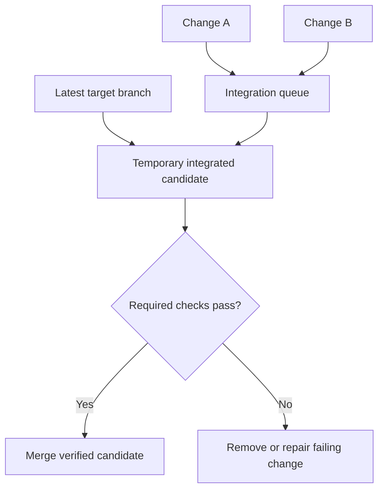
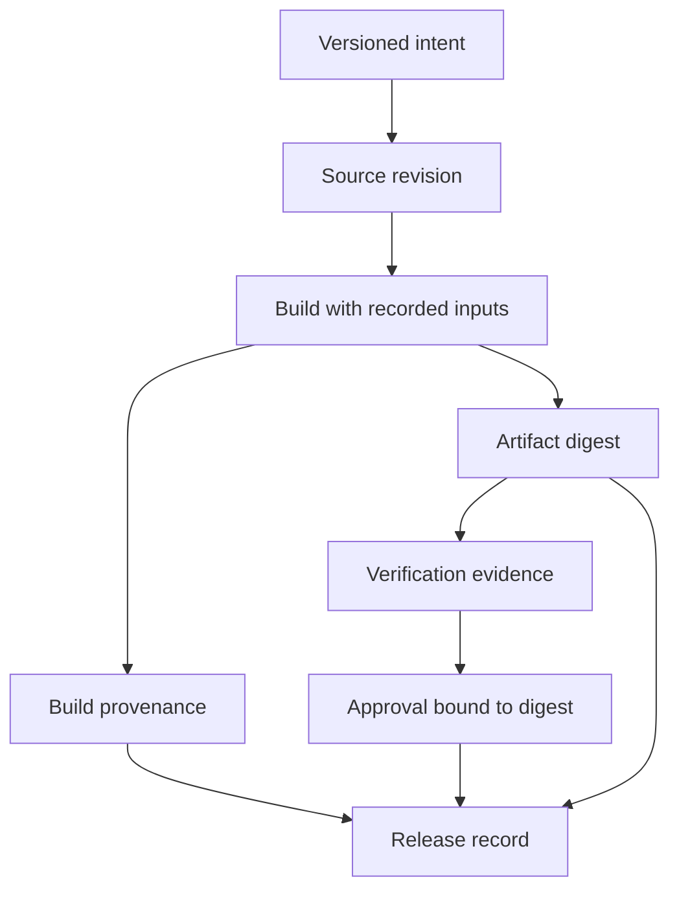

# Software Factory Questions and Answers

[Back to the README](../README.md) · [Terminology glossary](../GLOSSARY.md) · [Agent Orchestration](agent-orchestration.md) · [Agents and tool use](agents.md) · [Production engineering](production-engineering.md) · [System design scenario](../system-design/README.md#6-autonomous-software-factory)

Here, a software factory means an end-to-end software development system in which fleets of autonomous AI agents handle planning, coding, testing, and monitoring, while human engineers define business intent and review results. Autonomy operates within explicit permissions and delivery policies. These questions describe illustrative architectures, not a claim that a particular product can reliably automate every development task. References support individual engineering techniques; the proposed factory combines them into a design for discussion.

Each question includes a long answer, metrics or checks, at least two examples, and a quick cheat sheet. Numerical examples are illustrative, not benchmark results or universal targets. Use the [cross-topic cheat sheet](../CHEAT_SHEET.md) for quick revision.

## Contents

- [Intent and planning](#intent-and-planning): the factory model, acceptance criteria, and task decomposition.
- [Implementation and verification](#implementation-and-verification): execution environments, independent tests, and integration.
- [Review and release](#review-and-release): human judgment, provenance, deployment, and rollback.
- [Monitoring and improvement](#monitoring-and-improvement): production feedback, outcome metrics, and factory changes.

## Intent and planning

## Question: 1. What makes an autonomous software factory different from a coding assistant or a CI/CD pipeline?

**Topic:** End-to-end development lifecycle
**Difficulty:** Beginner

**Key terms:** [Software factory](../GLOSSARY.md#software-factory) · [CI/CD](../GLOSSARY.md#cicd) · [Agent](../GLOSSARY.md#agent)

**Short answer:**
A software factory coordinates agents across the development lifecycle, turning business intent into verified changes and monitored releases. Coding assistance and CI/CD are components of that larger system.

**Long answer:**
The factory needs persistent work ownership and evidence connecting requirements to deployed behavior. Agents can investigate, propose plans, implement changes, and interpret failures; deterministic services execute builds and enforce policy. Humans remain responsible for business priorities and judging whether results satisfy intent. The architecture should also handle rejected, blocked, and partially completed requests.

A software factory coordinates the full delivery process from intent through implementation, validation, release, and operational feedback. Coding assistants and CI are components within that process, not substitutes for product decisions or independent verification. Define ownership and gates for each transition. Autonomy should be bounded by available evidence and permissions, with humans retaining responsibility for ambiguous requirements and consequential decisions.

**Metrics and checks:** Measure accepted changes, lead time, escaped defects, review effort, and cost per accepted change. Generated lines of code or autonomous run duration can increase while delivery value decreases.

**Examples:**

**Example 1:**
An engineer requests invoice export. Agents identify affected services, propose a contract, implement it, assemble test evidence, and monitor the reviewed release against the agreed objectives.

**Example 2:**
A system that generates a patch but cannot validate compatibility or safely release it is automating one stage. A broader factory also tracks acceptance evidence and post-release behavior.

**Quick Cheat Sheet:**

| Cue | Remember |
| --- | --- |
| **Scope** | entire delivery lifecycle |
| **Gates** | evidence before transitions |
| **Value** | accepted useful changes |

**Follow-up questions:**

- Which lifecycle steps would you automate first, and what evidence would justify expanding autonomy?

**References:**

- [Anthropic: Agent workflows and coding applications](https://www.anthropic.com/engineering/building-effective-agents)

## Question: 2. How should business intent become an executable development specification?

**Topic:** Requirements and acceptance criteria
**Difficulty:** Intermediate

**Key terms:** [Acceptance criteria](../GLOSSARY.md#acceptance-criteria) · [Invariant](../GLOSSARY.md#invariant) · [Latency and percentiles](../GLOSSARY.md#latency-and-percentiles)

**Short answer:**
Turn the requested outcome into versioned user scenarios, measurable acceptance criteria, constraints, and explicit non-goals, while recording ambiguities for human resolution.

**Long answer:**
Distinguish desired business impact from software behavior and operational targets. A specification should identify users, permissions, compatibility needs, and observable failure behavior. Agents may propose missing details, but material product decisions need an accountable owner. Tests cover parts of a specification; passing them does not prove business value.

Translate intent into observable behavior, inputs, exclusions, constraints, and acceptance criteria before delegating implementation. Separate business outcomes from technical proxies and state the operating conditions for each requirement. Ambiguity should be resolved explicitly instead of allowing a coding agent to invent policy. A specification should also identify nonfunctional requirements such as access control, latency, accessibility, and failure behavior.

**Metrics and checks:** Each criterion needs a measurement window, denominator, and test method. For latency targets, state workload and percentile; an average alone can hide poor tail behavior.

**Examples:**

**Example 1:**
“Make exports reliable” becomes “authorized users can export their own invoices; failures are recoverable without duplicate jobs; 99% of eligible jobs finish within five minutes over a defined window.” The team separately measures whether support requests fall.

**Example 2:**
“Make checkout faster” can become “reduce p95 checkout latency under a stated load while preserving payment correctness.” Revenue impact remains a separate hypothesis to measure after release.

**Quick Cheat Sheet:**

| Cue | Remember |
| --- | --- |
| **Intent** | desired user outcome |
| **Contract** | measurable behavior |
| **Constraints** | conditions and exclusions |

**Follow-up questions:**

- How would you handle a request whose success depends on user behavior rather than a deterministic test?

**References:**

- [Google SRE: Defining measurable service objectives](https://sre.google/sre-book/service-level-objectives/)

## Question: 3. How should planning agents divide a feature across a fleet?

**Topic:** Planning and dependency management
**Difficulty:** Advanced

**Key terms:** [Task graph and critical path](../GLOSSARY.md#task-graph-and-critical-path) · [Supervisor and handoff](../GLOSSARY.md#supervisor-and-handoff) · [Merge queue and semantic conflict](../GLOSSARY.md#merge-queue-and-semantic-conflict)

**Short answer:**
Inspect the repository and architecture, define interfaces and bounded tasks, then schedule independent work around explicit dependencies and integration milestones.

**Long answer:**
Each task should reference the intent version, repository revision, allowed scope, expected artifact, and acceptance criteria. Assign ownership for shared contracts and migrations. Replan when discoveries change the assumptions; mark affected downstream results stale. A larger fleet helps only when useful independent work exists and integration capacity can keep up.

Decompose a feature around interfaces and independently verifiable outcomes, not arbitrary file counts. Identify schema migrations, shared abstractions, and compatibility decisions before parallel implementation. Assign artifact ownership and integration order so workers do not make incompatible assumptions. Plans should be revised when tests or repository evidence contradict initial estimates, while preserving the accepted product intent.

**Metrics and checks:** Track blocked time, integration conflicts, acceptance-criterion coverage, and rework. Compare end-to-end delivery time rather than the number of tasks marked complete.

**Examples:**

**Example 1:**
An export feature has separate API, worker, and UI tasks after its job-state contract is agreed. A retention-policy discovery changes that contract and triggers targeted revalidation of dependent work.

**Example 2:**
Frontend and backend work can proceed in parallel after agreeing on an API contract. If each agent invents the response schema independently, parallelism creates avoidable integration work.

**Quick Cheat Sheet:**

| Cue | Remember |
| --- | --- |
| **Decompose** | stable interfaces |
| **Assign** | clear ownership |
| **Integrate** | explicit dependency order |

**Follow-up questions:**

- When is one agent completing a vertical slice preferable to separate specialist agents?

**References:**

- [Anthropic: Task decomposition and delegation lessons](https://www.anthropic.com/engineering/multi-agent-research-system)

## Implementation and verification

## Question: 4. What execution environment should a coding agent receive?

**Topic:** Sandboxes and permissions
**Difficulty:** Intermediate

**Key terms:** [Sandbox and least privilege](../GLOSSARY.md#sandbox-and-least-privilege) · [VM and container](../GLOSSARY.md#vm-and-container) · [Artifact and digest](../GLOSSARY.md#artifact-and-digest) · [Sandbox and least privilege](../GLOSSARY.md#sandbox-and-least-privilege)

**Short answer:**
Provide an isolated, disposable environment with pinned inputs, scoped credentials, bounded compute, and only the network and tools needed for the task.

**Long answer:**
Treat repository scripts, dependencies, and generated code as untrusted execution inputs. A branch or worktree separates edits but does not isolate processes, secrets, or network access. Use an appropriate container or VM boundary for the threat model, and keep production credentials out of coding environments. Trusted services should mediate privileged actions and collect artifacts before cleanup.

Coding agents need reproducible environments with the required repository version, dependencies, build tools, and test commands. Isolate workspaces and scope credentials to the operations actually needed. Repository content and build scripts can be untrusted, so execution boundaries matter independently of prompt instructions. Capture dependency and environment versions so failures can be reproduced outside the agent session.

**Metrics and checks:** Track environment setup failures, reproducible build rate, test duration, and unauthorized-access attempts. Separate environment failures from code defects in delivery metrics.

**Examples:**

**Example 1:**
A worker can fetch approved dependencies and test against disposable data, but a command embedded in a source comment cannot grant it access to release credentials.

**Example 2:**
A patch passes locally because an undeclared package is already installed. A clean isolated build exposes the missing dependency before reviewers mistake the local result for reproducible validation.

**Quick Cheat Sheet:**

| Cue | Remember |
| --- | --- |
| **Reproduce** | pinned environment |
| **Isolate** | separate workspace and credentials |
| **Validate** | clean build and test evidence |

**Follow-up questions:**

- How would you prevent one compromised build from affecting the next task on a reused runner?

**References:**

- [GitHub: Secure use of automation and runners](https://docs.github.com/en/actions/reference/security/secure-use)

## Question: 5. How can the factory verify code when agents also generate the tests?

**Topic:** Independent verification
**Difficulty:** Advanced

**Key terms:** [Regression test and mutation testing](../GLOSSARY.md#regression-test-and-mutation-testing) · [Regression test and mutation testing](../GLOSSARY.md#regression-test-and-mutation-testing) · [Acceptance criteria](../GLOSSARY.md#acceptance-criteria)

**Short answer:**
Combine agent-generated tests with protected acceptance checks, existing regression coverage, and independent review tied to the approved specification.

**Long answer:**
An implementation and its tests can share the same misunderstanding. Preserve trusted checks outside the coding worker's write scope, and scrutinize deleted or weakened assertions. Use contract, integration, property, security, or performance checks according to the change. Run them against the actual candidate artifact. Coverage and model approval are supporting signals, not proof of correctness.

Tests written by the implementing agent can repeat its misunderstanding of the requirement. Use independent acceptance checks derived from the specification, existing regression suites, static analysis, and human review where judgment is needed. Mutation testing or targeted negative cases can reveal weak assertions. Passing tests provides bounded evidence for tested behavior, not proof that all security or correctness properties hold.

**Metrics and checks:** Report acceptance coverage, failing/added regressions, mutation results where useful, and escaped defects. Line coverage alone says which code ran, not whether the assertions detect incorrect behavior.

**Examples:**

**Example 1:**
An export patch passes its new unit tests but fails a protected cross-tenant access test. The factory rejects the patch even if a reviewing agent calls it correct.

**Example 2:**
An agent implements and tests a discount using the same wrong rounding rule. An independently specified currency-boundary test catches the shared mistake.

**Quick Cheat Sheet:**

| Cue | Remember |
| --- | --- |
| **Independent** | requirements drive checks |
| **Regression** | preserve existing behavior |
| **Coverage** | execution is not assertion strength |

**Follow-up questions:**

- What would you do when the existing test suite is weak or flaky?

**References:**

- [SWE-bench: Executable evaluation of generated software changes](https://www.swebench.com/SWE-bench/)

## Question: 6. How should the factory integrate concurrent changes from multiple agents?

**Topic:** Integration and merge coordination
**Difficulty:** Advanced

**Key terms:** [Merge queue and semantic conflict](../GLOSSARY.md#merge-queue-and-semantic-conflict) · [Merge queue and semantic conflict](../GLOSSARY.md#merge-queue-and-semantic-conflict) · [CI/CD](../GLOSSARY.md#cicd)

**Short answer:**
Keep changes isolated, coordinate shared interfaces, and validate the combined candidate against the current target branch before merging.

**Long answer:**
A clean text merge does not establish behavioral compatibility. Use a merge queue or equivalent serialization point that tests the proposed integration result. If the target branch or candidate changes, invalidate affected checks and approvals according to policy. Bound conflict-repair attempts and return unresolved architectural conflicts to an owner.

Concurrent changes need isolated branches or workspaces, explicit ownership, and integration checks on the combined result. A patch that passes against an old base may fail after another change lands. Use a merge queue or equivalent serialization where appropriate, and rerun relevant checks after conflict resolution. Semantic conflicts can occur without textual conflicts, such as two changes making incompatible assumptions about an API.

**Metrics and checks:** Measure merge conflicts, integration failures, queue time, and defects caused by interactions. Count validation on the actual integrated revision rather than only individual branches.

**Examples:**

**Example 1:**
Two individually passing patches change a job-state enum and a UI switch statement. Their combined integration test fails, so the queue blocks the release until the contract is reconciled.

**Visual: Verify the integrated candidate**

Isolated branch checks can miss interactions. Rebuild the candidate when relevant queued changes or the target branch change. Concept reference: [GitHub: merge queues](https://docs.github.com/en/repositories/configuring-branches-and-merges-in-your-repository/configuring-pull-request-merges/managing-a-merge-queue).

**Example 2:**
One patch changes a field from nullable to required while another introduces a caller that omits it. Both can pass isolated tests yet fail when combined.

**Quick Cheat Sheet:**

| Cue | Remember |
| --- | --- |
| **Isolate** | independent edits |
| **Integrate** | test combined revision |
| **Conflict** | semantic as well as textual |

**Follow-up questions:**

- How would you coordinate a feature spanning multiple repositories that cannot merge atomically?

**References:**

- [GitHub: Managing a merge queue](https://docs.github.com/en/repositories/configuring-branches-and-merges-in-your-repository/configuring-pull-request-merges/managing-a-merge-queue)

## Review and release

## Question: 7. Where should human engineers participate in an autonomous software factory?

**Topic:** Human intent and review
**Difficulty:** Intermediate

**Key terms:** [Human-in-the-loop](../GLOSSARY.md#human-in-the-loop) · [Human-in-the-loop](../GLOSSARY.md#human-in-the-loop) · [Artifact and digest](../GLOSSARY.md#artifact-and-digest)

**Short answer:**
Engineers define outcomes and constraints, resolve material ambiguities, and review concrete results at checkpoints determined by impact and organizational policy.

**Long answer:**
Prepare a review packet containing requirement coverage, the diff, a demonstration where useful, test evidence, limitations, and rollout options. Avoid requiring engineers to approve every internal tool call. Bind any required authorization to the candidate, environment, and permitted action; changed behavior may require renewed review. Agents cannot grant themselves authority by declaring a task low risk.

Human engineers contribute problem framing, architecture judgment, review of ambiguous evidence, and responsibility for production outcomes. Review should focus on concrete artifacts and unresolved risks rather than rereading every generated token. Define escalation triggers and provide sufficient context to make decisions efficiently. Keep approval tied to the reviewed revision; later changes can invalidate earlier evidence.

**Metrics and checks:** Track human review time, rejected proposals, rework, and post-release defects. Reduced human involvement is beneficial only when quality and accountability remain acceptable.

**Examples:**

**Example 1:**
An engineer reviews a working export flow and its access-control evidence. A later change to export visibility invalidates the relevant review before release.

**Example 2:**
An engineer may approve a schema migration after reviewing compatibility and rollback evidence, while routine formatting changes follow automated checks. The review depth follows impact and uncertainty.

**Quick Cheat Sheet:**

| Cue | Remember |
| --- | --- |
| **Humans** | intent and judgment |
| **Agents** | bounded implementation work |
| **Approval** | tied to exact evidence |

**Follow-up questions:**

- How would you prevent a large agent fleet from overwhelming the human review queue?

**References:**

- [LangGraph: Persisted workflow state and human-in-the-loop support](https://docs.langchain.com/oss/python/langgraph/persistence)

## Question: 8. What provenance should connect business intent to a production release?

**Topic:** Artifact identity and audit trails
**Difficulty:** Advanced

**Key terms:** [Data provenance and lineage](../GLOSSARY.md#data-provenance-and-lineage) · [Artifact and digest](../GLOSSARY.md#artifact-and-digest) · [Artifact and digest](../GLOSSARY.md#artifact-and-digest)

**Short answer:**
Maintain a versioned chain from intent and task records through source commits, build inputs, test reports, approvals, and the deployed artifact digest.

**Long answer:**
Record model and tool configurations for diagnosis, but do not promise identical model outputs on replay. Protect evidence from the workers whose work it verifies. Build provenance describes artifact origin and build execution; it does not prove functional correctness. The factory's requirements and review records extend beyond build provenance and need their own integrity and access controls.

Provenance connects business intent, requirements, task assignments, code changes, dependencies, test results, approvals, and deployed artifacts. Stable identifiers and immutable records make it possible to reconstruct why a behavior shipped. Record the actual model/prompt configuration when it materially affects generated artifacts, but avoid storing secrets or unnecessary private data in logs. Provenance supports investigation; it does not itself guarantee correctness.

**Metrics and checks:** Measure traceability coverage from releases to requirements and checks, missing artifact links, and time to reconstruct an incident. Verify that recorded test results belong to the deployed revision.

**Examples:**

**Example 1:**
An incident responder starts with a container digest and finds the exact source revision, checks, reviewer decision, and business request that produced it.

**Visual: Trace a release to its evidence**

This repository’s example extends build provenance with intent, verification, and approval records. SLSA provenance describes the build; it does not establish that the product meets business requirements. Concept reference: [SLSA: build provenance](https://slsa.dev/spec/v1.2/build-provenance).

**Example 2:**
A release report showing green tests is misleading if those tests ran before the final conflict resolution. Linking results to exact commit and artifact digests exposes the mismatch.

**Quick Cheat Sheet:**

| Cue | Remember |
| --- | --- |
| **Chain** | intent to deployed artifact |
| **Identity** | exact versions and digests |
| **Evidence** | checks must match the release |

**Follow-up questions:**

- How would you detect a release artifact that differs from the one that passed verification?

**References:**

- [SLSA: Build provenance](https://slsa.dev/spec/v1.2/provenance)

## Question: 9. How should agents participate in deployment and rollback?

**Topic:** Controlled release execution
**Difficulty:** Advanced

**Key terms:** [Canary, shadow, and rollback](../GLOSSARY.md#canary-shadow-and-rollback) · [Canary, shadow, and rollback](../GLOSSARY.md#canary-shadow-and-rollback) · [Feature flag](../GLOSSARY.md#feature-flag) · [Atomic operation and transaction](../GLOSSARY.md#atomic-operation-and-transaction)

**Short answer:**
Agents can propose rollout plans and analyze results, while a trusted release service enforces permissions, artifact identity, staged exposure, and stop conditions.

**Long answer:**
Deploy a verified immutable artifact and compare canary behavior with a suitable baseline. Persist release operation IDs and reconcile ambiguous outcomes before retrying. Rollback requires compatible data and dependencies; reversing an application image does not undo a destructive migration. Use staged schema evolution, feature flags, or a tested forward-recovery plan when needed.

Deployment should promote a verified artifact through controlled environments with health checks, rollout limits, and a clear rollback decision. Feature flags can separate deployment from exposure, while canaries limit initial impact. Rollback may require more than restoring application code: schema changes, data writes, caches, and external side effects can make reversal incomplete. Design compatibility and recovery before executing the release.

**Metrics and checks:** Track deployment failure rate, detection time, recovery time, and user-impact metrics during rollout. Compare canary and baseline under comparable traffic and watch low-volume critical slices.

**Examples:**

**Example 1:**
A new export worker is enabled for limited traffic. A sustained error-rate increase stops rollout and restores the previous compatible worker while preserving queued jobs.

**Example 2:**
Reverting code after a destructive database migration does not restore deleted data. A backward-compatible migration and tested recovery plan are needed before the rollout starts.

**Quick Cheat Sheet:**

| Cue | Remember |
| --- | --- |
| **Promote** | verified artifact |
| **Observe** | real user outcomes |
| **Rollback** | account for state, not just binaries |

**Follow-up questions:**

- How would you evaluate a low-traffic canary that has insufficient observations?

**References:**

- [Google SRE: Canarying releases](https://sre.google/workbook/canarying-releases/)
- [AWS Builders' Library: Idempotent operations](https://aws.amazon.com/builders-library/making-retries-safe-with-idempotent-APIs/)

## Monitoring and improvement

## Question: 10. How should monitoring agents close the loop after deployment?

**Topic:** Production feedback and incident response
**Difficulty:** Advanced

**Key terms:** [Observability and SRE](../GLOSSARY.md#observability-and-sre) · [Regression test and mutation testing](../GLOSSARY.md#regression-test-and-mutation-testing) · [Ground truth](../GLOSSARY.md#ground-truth)

**Short answer:**
Connect telemetry and user outcomes to release versions, detect meaningful regressions, and turn verified incidents into bounded remediation work.

**Long answer:**
Separate detection from authority to act. Preauthorized mitigation can follow a tested runbook; a novel code fix should pass the development and verification process. Deduplicate incidents, limit repair attempts, and provide an emergency stop to prevent repeated fix-and-redeploy loops. Monitoring agents should report uncertainty and preserve evidence for an accountable incident owner.

Operational feedback should become structured evidence for new work, with clear severity, reproducibility, and expected behavior. Monitoring can reveal regressions or unmet needs, but automatically turning every alert into a code change creates noise and risk. Deduplicate incidents, distinguish symptoms from causes, and validate proposed fixes against both the incident and broader regressions. Close the loop only after checking the deployed outcome.

**Metrics and checks:** Measure detection-to-triage time, recurrence, fix effectiveness, and regressions introduced by repairs. Alert count alone is not a measure of reliability or improvement.

**Examples:**

**Example 1:**
An agent links a rise in failed exports to a release, triggers an allowed rollback, and proposes a regression test and patch through the normal review path.

**Example 2:**
A timeout alert may be caused by a downstream outage rather than inefficient application code. An automated patch that increases all timeouts can hide symptoms while worsening resource exhaustion.

**Quick Cheat Sheet:**

| Cue | Remember |
| --- | --- |
| **Observe** | evidence of impact |
| **Diagnose** | cause before patch |
| **Verify** | outcome after deployment |

**Follow-up questions:**

- How would the factory behave if the monitoring pipeline itself became unavailable?

**References:**

- [OpenTelemetry: Correlating distributed execution with traces](https://opentelemetry.io/docs/concepts/signals/traces/)
- [Google SRE: Service objectives and indicators](https://sre.google/sre-book/service-level-objectives/)

## Question: 11. Which metrics show whether the software factory is delivering value?

**Topic:** Delivery outcomes and economics
**Difficulty:** Intermediate

**Key terms:** [Cost per successful task](../GLOSSARY.md#cost-per-successful-task) · [Latency and percentiles](../GLOSSARY.md#latency-and-percentiles) · [Service-level objective (SLO)](../GLOSSARY.md#service-level-objective-slo)

**Short answer:**
Measure accepted business outcomes, delivery time, escaped defects, operational reliability, human effort, and total cost per accepted change.

**Long answer:**
Lines of code, agent activity, and PR counts can increase without improving results. Compare similar task classes and include failed attempts, review, rework, infrastructure, and model costs. Define acceptance independently of the generating agents and track results after release. Report completion and abandonment rates alongside cost so difficult tasks cannot disappear from the denominator.

Factory productivity should be measured through accepted useful changes and their lifecycle costs. Include model usage, infrastructure, human review, rework, and incident response. Compare similar task mixes over meaningful periods because easy generated changes can inflate throughput. Quality and reliability constraints belong beside speed metrics; otherwise the system can optimize for rapid delivery of work that creates downstream burden.

**Metrics and checks:** Cost per accepted change = total relevant delivery cost divided by accepted changes. Pair lead time and throughput with escaped defects, recovery time, and reviewer effort.

**Examples:**

**Example 1:**
Factory A spends 600 illustrative cost units for 30 accepted changes: 20 per change. Factory B spends 500 for 20: 25 per change. Compare review effort and escaped defects before deciding which is better.

**Example 2:**
A factory produces twice as many patches but half require extensive repair. Counting patches reports success; measuring accepted changes per engineer-hour may show no improvement.

**Quick Cheat Sheet:**

| Cue | Remember |
| --- | --- |
| **Throughput** | accepted changes |
| **Cost** | include review and rework |
| **Quality** | measure escaped impact |

**Follow-up questions:**

- How would you avoid attributing an improvement to agents when the task mix became easier?

**References:**

- [SWE-bench: Task-level software evaluation](https://www.swebench.com/SWE-bench/)

## Question: 12. How should the factory improve its own prompts, tools, and orchestration?

**Topic:** Factory evaluation and controlled evolution
**Difficulty:** Advanced

**Key terms:** [Prompt and prompt engineering](../GLOSSARY.md#prompt-and-prompt-engineering) · [Ablation](../GLOSSARY.md#ablation) · [Benchmark and evaluation slice](../GLOSSARY.md#benchmark-and-evaluation-slice) · [Canary, shadow, and rollback](../GLOSSARY.md#canary-shadow-and-rollback)

**Short answer:**
Version factory configurations, evaluate candidates on held-out representative tasks, and expand deployment only after quality and operational evidence support the change.

**Long answer:**
Separate changes to customer software from changes to the machinery that builds it. An agent may propose a better planner or test policy, but cannot silently weaken its own release criteria. Evaluate task outcomes, permission violations, cost, and review effort. Shadow experiments need isolated environments to avoid duplicate external effects. Preserve a compatible way to finish or migrate runs started under an older configuration.

Changes to the factory's own prompts, tools, or coordination policies should pass a separate evaluation and release process. Use versioned configurations, protected test tasks, and independent checks so the system cannot weaken its own acceptance criteria to appear better. Shadow or limited rollout can expose regressions. Preserve rollback and compare against a fixed baseline before allowing a self-proposed improvement into general use.

**Metrics and checks:** Measure paired task success, total cost, human rework, and guardrail violations across configuration versions. Watch for benchmark overfitting after repeated optimization on the same tasks.

**Examples:**

**Example 1:**
A revised planner reduces completion time in offline trials but increases integration failures. The team retains the existing planner while testing a narrower change to task decomposition.

**Example 2:**
A proposed prompt change reduces test execution to save time. It is not an improvement if accepted patches later fail more often, even when immediate run cost drops.

**Quick Cheat Sheet:**

| Cue | Remember |
| --- | --- |
| **Propose** | versioned change |
| **Evaluate** | independent protected criteria |
| **Release** | staged and reversible |

**Follow-up questions:**

- How would you evaluate a factory change that only affects rare, long-running failures?

**References:**

- [Google SRE: Controlled comparison and staged releases](https://sre.google/workbook/canarying-releases/)

Apply these ideas in the [autonomous software factory system design scenario](../system-design/README.md#6-autonomous-software-factory).
