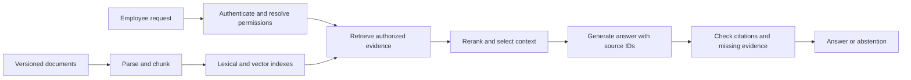

# System Design Scenarios

[Back to the main README](../README.md) · [Hands-on Python exercises](../hands-on/README.md)

Use these five scenarios for a 45–60 minute interview or a self-guided design session. All workloads, budgets, and targets below are hypothetical interview constraints, not product guarantees. Clarify requirements, estimate capacity, sketch the data flow, and discuss failures before selecting specific products.

Reference designs are expandable so candidates can attempt each problem first. They illustrate defensible approaches rather than a single correct architecture. Interviewers should assess assumptions, tradeoffs, and verification, and adjust depth to the role.

## Scenarios

1. [Permission-aware knowledge assistant](#1-permission-aware-knowledge-assistant)
2. [Support agent with controlled actions](#2-support-agent-with-controlled-actions)
3. [Document extraction and review pipeline](#3-document-extraction-and-review-pipeline)
4. [Multi-tenant inference gateway](#4-multi-tenant-inference-gateway)
5. [Evaluation and release platform](#5-evaluation-and-release-platform)

## Interview structure

| Stage | Suggested time | Expected discussion |
| --- | --- | --- |
| Requirements | 5–10 minutes | Users, authorization, correctness, exclusions, and success criteria |
| Capacity and data | 5–10 minutes | Peak demand, storage, token volume, freshness, and retention |
| Architecture | 15–20 minutes | Components, state, interfaces, and a complete request flow |
| Failures and tradeoffs | 10–15 minutes | Recovery, scaling, security boundaries, cost, and alternatives |
| Evaluation | 5 minutes | Evidence that the proposed system meets its requirements |

For each scenario, produce a component diagram, a data model or API sketch, one capacity estimate with units, and a rollout and failure-recovery plan. Strong answers connect choices to the stated workload and acknowledge what still needs measurement.

## 1. Permission-aware knowledge assistant

**Difficulty:** Intermediate to Advanced

**Prompt:** Design an internal assistant that answers employee questions using company documents and provides citations.

**Starting constraints:**

- 10,000 employees, 200,000 source documents, and an assumed average of 10 chunks per document.
- Peak demand of 20 questions per second; target p95 time to first answer token below 3 seconds.
- Searchable updates within 15 minutes. Revoked access must be enforced at request time even if indexing is delayed.
- Documents have group-based permissions, multiple versions, and occasional conflicting policies.

**Clarify first:** What counts as an authoritative source? Can the system answer partially? Which requests require current policy dates? Does the latency target include identity lookup and retrieval?

**Design tasks:** Describe ingestion and deletion handling, permission enforcement, retrieval and reranking, context assembly, citation checking, and abstention. Explain how you would investigate a correct document that produces an incorrect answer.

Reference design and interviewer notes

Use two paths: ingestion produces versioned chunks with source identifiers and access metadata; online requests authenticate the user, retrieve eligible evidence, and generate a supported answer. Apply current authorization before restricted content reaches generation; stale indexed permissions alone cannot satisfy immediate revocation. Keep document-to-chunk mappings for updates and deletions.

An illustrative vector-storage lower bound is `200,000 × 10 × 768 × 4 = 6.144 GB` for 768-dimensional float32 vectors in decimal units. Text, index structures, replicas, and metadata add overhead. Estimate query-side token load separately; measure whether retrieval, reranking, and prefill can meet the latency budget.

Compare lexical, dense, and hybrid retrieval on labeled questions. Track evidence recall, answer correctness, citation support, access-control failures, and freshness. A vector similarity threshold alone is not a reliable answerability test. Scope caches to identity and permission state, and invalidate them when relevant data or permissions change.

**Strong signals:** Separates retrieval errors from generation errors, preserves version provenance, and addresses permission revocation and cache isolation explicitly.

**Failure injection:** A deleted document remains in the index; an access grant is revoked during a conversation; two sources disagree.

**Follow-up:** How would the design change for scanned PDFs or a tenfold increase in document count?

**Related study:** [RAG](../questions/rag.md), [production engineering](../questions/production-engineering.md). [Microsoft's security-filter pattern](https://learn.microsoft.com/en-us/azure/search/search-security-trimming-for-azure-search) illustrates query-time filtering; the immediate-revocation requirement here is an additional design constraint.

## 2. Support agent with controlled actions

**Difficulty:** Advanced

**Prompt:** Design a customer-support agent that retrieves order information, proposes resolutions, and can create replacement requests after the required approval.

**Starting constraints:**

- 50,000 conversations per day, averaging 6 model decisions per conversation, with a peak 8 times the daily average decision rate.
- Order lookups are read-only. Replacement creation changes external state and requires approval of the specific order and replacement details.
- The order service occasionally times out after accepting a write. Sessions must survive worker restarts.
- A task may run for at most 2 minutes before returning a verified result, escalation, or an explicit pending status.

**Clarify first:** Who can approve a replacement? Which policy checks are deterministic? What is the authoritative completion record? How should cancellation affect a pending action?

**Design tasks:** Specify tools, task state, approval records, retry semantics, stopping conditions, and an audit trail. Walk through a crash between an external write and a local checkpoint.

Reference design and interviewer notes

Use a model for interpretation and action selection within an application-controlled state machine. Enforce user authorization and replacement policy outside the model. Read tools return typed outcomes; write tools accept stable operation identifiers and concrete approved arguments.

Store task ID, actor, observed order version, proposed action, approval binding, operation ID, and status. One possible progression is `proposed → awaiting_approval → approved → executing → confirmed`, with explicit failed, cancelled, and unresolved states. Revalidate stale order state and material action changes before execution. Do not turn a model's claim of completion into a confirmed state.

The mean decision rate is `50,000 × 6 / 86,400 ≈ 3.47 per second`; the assumed peak is about `27.8 per second`. This is not concurrent-request capacity: estimate that from decision duration and tool wait time. Count retries and independent tool traffic as additional load.

Persist the operation ID before attempting a write. After an ambiguous timeout or crash, reconcile with the external service or retry using its supported idempotency contract. A checkpoint alone cannot guarantee exactly-once effects. Apply bounded retries, a global deadline, and a pending/escalation path when the outcome is unknown.

Evaluate final external state, unauthorized actions, duplicate replacements, successful escalations, and latency. Test retrieved instructions that attempt to bypass policy. Traces should support diagnosis while limiting unnecessary customer-data retention.

**Strong signals:** Binds approval to exact arguments, handles ambiguous write outcomes, and distinguishes persistent execution from transactionality.

**Failure injection:** The service accepts a replacement but its response is lost; approval arrives after cancellation; a support article contains an injected instruction.

**Follow-up:** Which steps should remain fixed code even if the language model becomes more capable?

**Related study:** [Agents](../questions/agents.md), [prompt engineering](../questions/prompt-engineering.md). [AWS's discussion of idempotent APIs](https://aws.amazon.com/builders-library/making-retries-safe-with-idempotent-APIs/) explains why retries need explicit side-effect semantics.

## 3. Document extraction and review pipeline

**Difficulty:** Intermediate to Advanced

**Prompt:** Design a service that extracts invoice fields from uploaded PDFs and produces validated records, routing uncertain or inconsistent cases to reviewers.

**Starting constraints:**

- 100,000 documents per day, averaging 5 pages; a burst can be 10 times average arrival rate.
- Documents must finish within 30 minutes or be reported as pending/failed. The workflow is asynchronous.
- Required fields include vendor ID, currency, line items, and total. Duplicate uploads must not create duplicate exported records.
- Some PDFs are scanned, unreadable, or contain instructions unrelated to extraction. Human review capacity is limited.

**Clarify first:** What is the ground truth? Which fields are critical? How do invoice corrections and duplicates differ? What happens when human review cannot meet the deadline?

**Design tasks:** Design upload, storage, queueing, parsing/OCR, extraction, validation, review, and export. Specify task states and the provenance retained for each field.

Reference design and interviewer notes

Accept uploads into tenant-scoped object storage and assign a durable job ID. Validate file limits, record a content hash, and queue work. Workers parse or OCR pages, extract a typed record, and run deterministic checks before any export. Preserve page references or evidence spans so reviewers can inspect the source.

Average throughput is `100,000 × 5 / 86,400 ≈ 5.79 pages per second`, or roughly `57.9 pages per second` at the assumed peak. If a worker processes 2 pages per second in a benchmark, 29 workers is only a peak-throughput lower bound; headroom, retries, queue drain, and other stages require additional capacity. Measure the slowest stage and oldest-job age.

Use schema checks plus domain checks: allowed currencies, line-item arithmetic, vendor matching, and missing fields. Schema validity does not establish correctness, and self-reported confidence should not be treated as calibrated. Set review thresholds from labeled data and reviewer capacity. Define terminal failure and review-pending states instead of retrying unreadable files forever.

Deduplicate per tenant using appropriate business keys and content identity; a revised invoice may legitimately have a new version. Make exports idempotent and retain an audit history. Evaluate field precision/recall, critical-field accuracy, review rate, reviewer agreement, duplicate exports, and end-to-end completion latency. Compare a simpler extraction baseline before introducing fine-tuning.

**Strong signals:** Separates extraction from validation, models backpressure and review queues, and distinguishes duplicates from corrections.

**Failure injection:** OCR returns empty text; a total contradicts its line items; the export succeeds but acknowledgment is lost.

**Follow-up:** How would reviewer corrections become training examples without leaking into held-out evaluation?

**Related study:** [Fine-tuning](../questions/fine-tuning.md), [evaluation](../questions/evaluation.md), and exercises 6–7 in the [hands-on notebooks](../hands-on/README.md).

## 4. Multi-tenant inference gateway

**Difficulty:** Advanced

**Prompt:** Design a gateway that serves interactive chat and asynchronous summarization across multiple model backends while enforcing tenant budgets and reliability targets.

**Starting constraints:**

- Peak chat load is 40 requests per second, averaging 2,000 input tokens and 300 output tokens per request.
- Batch summarization can wait up to 1 hour; interactive chat targets p95 time to first token below 2 seconds.
- Each tenant has an independent spend budget and permissions. One backend may be unavailable or rate-limited.
- Backends differ in context limits, tool support, latency, and response quality.

**Clarify first:** Which tasks can use a smaller model? Are fallbacks equivalent for required features and data policy? How are tokens reserved versus actually billed? What constitutes a completed streaming request?

**Design tasks:** Cover routing, admission control, queues, caching, deadlines, fallbacks, metering, cancellation, and capacity measurement.

Reference design and interviewer notes

Authenticate tenants, validate request size, reserve an estimated budget, and route according to evaluated task policies. Use separate interactive and batch queues so long jobs do not dominate latency. Limit concurrency and queue length; scale capacity using observed token workload and queue age rather than request count alone.

The assumed peak represents `80,000 input tokens/second` and `12,000 output tokens/second`. These are distinct serving demands, not interchangeable accelerator-capacity units. Benchmark the actual prompt/output distribution, cache behavior, concurrency, and batching policy to estimate replicas. Include startup and warmup time in scaling plans.

Set an overall deadline and coordinated retry budget. Route to a fallback only if it satisfies the task's feature and data requirements. Define client-visible behavior for interrupted streams; silently appending a second model's output to the first is unsafe. Cancel abandoned work where supported and reconcile reserved against actual cost.

Distinguish prefix caching from answer caching. Scope reused answers to trusted authorization context, model/prompt versions, and data freshness. Semantic similarity is insufficient for cache correctness. Track availability, first-token and completion latency, rejection rate, quality by route, and cost per successful task. Roll out routing changes with controlled traffic and rollback criteria.

**Strong signals:** Converts requests into token load, protects tenant isolation, and treats fallback quality and partial streaming as product contracts.

**Failure injection:** One tenant submits huge prompts; a primary backend fails mid-stream; a shared cache contains a response generated under different permissions.

**Follow-up:** How would the gateway behave during a sudden traffic spike while new accelerator replicas are still loading?

**Related study:** [Production engineering](../questions/production-engineering.md), [evaluation](../questions/evaluation.md), and exercise 8 in the [hands-on notebooks](../hands-on/README.md).

## 5. Evaluation and release platform

**Difficulty:** Intermediate to Advanced

**Prompt:** Design a platform that compares prompt, model, and retrieval changes before release and detects regressions after rollout.

**Starting constraints:**

- 20 candidate configurations per week, a 2,000-case evaluation suite, and 3 generation trials per case.
- Tasks include extraction, cited answers, and tool-using agents. Some graders call another model; others run deterministic checks.
- Runs must be reproducible enough to investigate regressions, with explicit data and configuration versions.
- A failing authorization test blocks release even when average answer quality improves.

**Clarify first:** Who owns the rubric? Which cases are tuning versus held-out? How are costly or state-changing tools simulated? What minimum difference is meaningful enough to justify release?

**Design tasks:** Describe dataset versioning, run orchestration, artifact storage, graders, comparisons, release gates, and post-release monitoring. Explain how to assess a small improvement with high output variability.

Reference design and interviewer notes

Register immutable dataset versions, candidate configurations, grader versions, and corpus snapshots. Schedule tasks through a bounded queue; persist case-level inputs, outputs, trace references, scores, errors, and resource usage. Keep sensitive content access-controlled. Isolate agent test environments and reset them between trials so one run cannot change another's starting state.

The workload is `20 × 2,000 × 3 = 120,000 candidate trials per week`, before baselines, retries, grader calls, or multi-step agent execution. If two model graders run once per trial, that adds 240,000 grader calls. Estimate token volume and rate limits separately, and use cheap deterministic checks where they answer the grading question.

Compare candidates on matched cases and inspect important slices. Track uncertainty at the independent case or conversation level; three generations are not three independent user tasks. Calibrate model judges against human review, test order bias, and keep formatting, correctness, citations, and action policy as distinct dimensions. Do not optimize prompts on the final held-out set.

A release gate combines hard constraints with quality and operational targets. After passing offline checks, use a canary rollout with specified stop conditions and a compatible rollback path. Online feedback can reveal distribution changes but is not automatically ground truth. Add verified incidents to regression coverage without silently converting every assessment case into tuning data.

**Strong signals:** Versions graders as well as models, accounts for evaluation cost, and separates outcome checks from persuasive final responses.

**Failure injection:** A judge upgrade inflates all scores; an agent test reuses mutated state; a candidate improves averages but fails one tenant's permission checks.

**Follow-up:** How would you prioritize the evaluation suite when cost or release time is cut in half?

**Related study:** [Evaluation](../questions/evaluation.md), [agents](../questions/agents.md). [Google SRE's canary-release guidance](https://sre.google/workbook/canarying-releases/) describes staged comparison and release risk.
